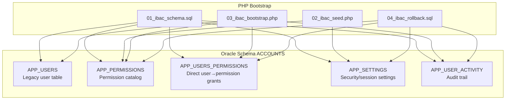
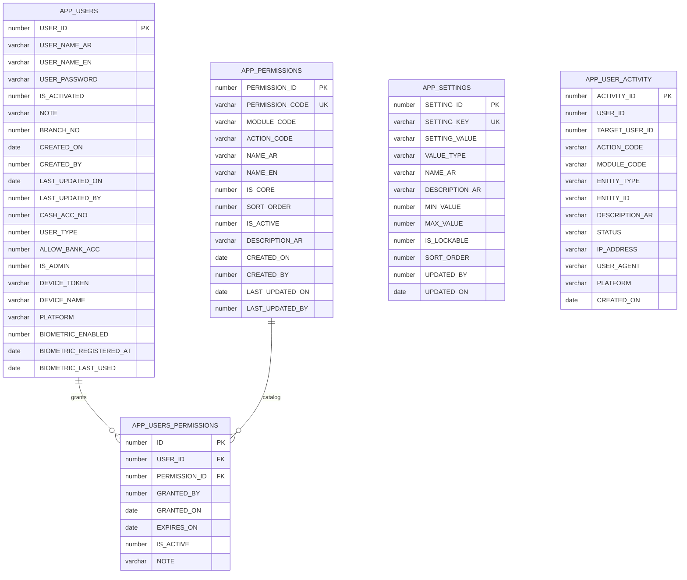
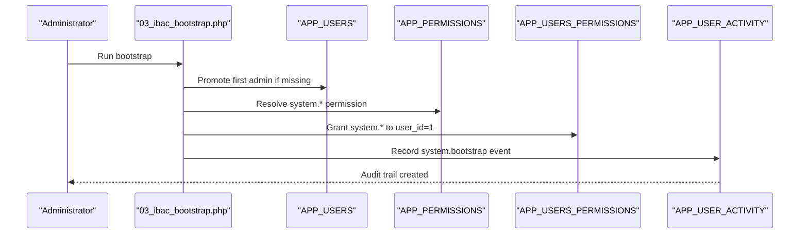
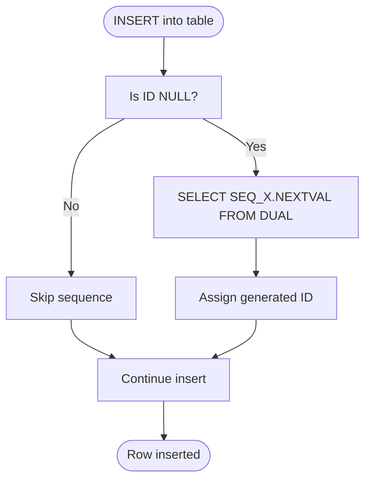
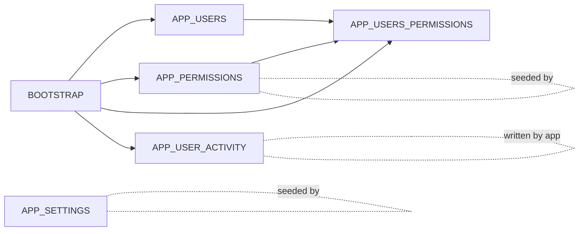

# Database Design

<cite>
**Referenced Files in This Document**
- [01_ibac_schema.sql](file://kyApp_API/database/oracle/01_ibac_schema.sql)
- [02_ibac_seed.php](file://kyApp_API/database/oracle/02_ibac_seed.php)
- [03_ibac_bootstrap.php](file://kyApp_API/database/oracle/03_ibac_bootstrap.php)
- [04_ibac_rollback.sql](file://kyApp_API/database/oracle/04_ibac_rollback.sql)
- [User.php](file://kyApp_API/app/Models/User.php)
- [AGENTS.md](file://kyApp_API/AGENTS.md)
- [DBdevloping_history.md](file://DBdevloping_history.md)
</cite>

## Table of Contents
1. [Introduction](#introduction)
2. [Project Structure](#project-structure)
3. [Core Components](#core-components)
4. [Architecture Overview](#architecture-overview)
5. [Detailed Component Analysis](#detailed-component-analysis)
6. [Dependency Analysis](#dependency-analysis)
7. [Performance Considerations](#performance-considerations)
8. [Troubleshooting Guide](#troubleshooting-guide)
9. [Conclusion](#conclusion)

## Introduction
This document describes the Oracle database design used by the application, focusing on:
- The IBAC (Identity-Based Access Control) schema under the `ACCOUNTS` schema.
- Core security tables: `APP_USERS`, `APP_PERMISSIONS`, `APP_USERS_PERMISSIONS`, `APP_SETTINGS`, and `APP_USER_ACTIVITY`.
- Business entity tables for customers, workers, accounts, journal entries, and invoices as referenced by the API and Flutter client.
- Foreign key constraints, indexes, triggers, sequences, data validation rules, and referential integrity policies.
- Performance considerations including indexing strategy, query optimization, and partitioning approaches.

The repository does not migrate business tables from code; the real Oracle schema is legacy and maintained outside this repository. The IBAC layer is explicitly defined in SQL and PHP bootstrap scripts.

## Project Structure
The database-related artifacts relevant to this documentation are located under `kyApp_API/database/oracle`:
- `01_ibac_schema.sql` defines the IBAC tables, constraints, indexes, sequences, and row-level triggers.
- `02_ibac_seed.php` seeds permission catalog rows and default security settings.
- `03_ibac_bootstrap.php` applies bilingual comments, promotes the first administrator, grants system-wide permissions, and records a bootstrap audit event.
- `04_ibac_rollback.sql` drops only the new IBAC objects without touching business data.

**Diagram sources**
- [01_ibac_schema.sql:21-192](file://kyApp_API/database/oracle/01_ibac_schema.sql#L21-L192)
- [02_ibac_seed.php:38-442](file://kyApp_API/database/oracle/02_ibac_seed.php#L38-L442)
- [03_ibac_bootstrap.php:109-217](file://kyApp_API/database/oracle/03_ibac_bootstrap.php#L109-L217)
- [04_ibac_rollback.sql:13-31](file://kyApp_API/database/oracle/04_ibac_rollback.sql#L13-L31)

**Section sources**
- [01_ibac_schema.sql:1-207](file://kyApp_API/database/oracle/01_ibac_schema.sql#L1-L207)
- [02_ibac_seed.php:1-461](file://kyApp_API/database/oracle/02_ibac_seed.php#L1-L461)
- [03_ibac_bootstrap.php:1-227](file://kyApp_API/database/oracle/03_ibac_bootstrap.php#L1-L227)
- [04_ibac_rollback.sql:1-42](file://kyApp_API/database/oracle/04_ibac_rollback.sql#L1-L42)

## Core Components
The IBAC core consists of five primary tables plus supporting sequences and triggers.

### APP_USERS
- Purpose: Legacy user table extended with IBAC support.
- Key changes:
  - `USER_PASSWORD` widened to accommodate future hashing while preserving legacy behavior.
  - `IS_ADMIN` added as a numeric flag where `1` means full system administrator privileges.
- Primary key: `USER_ID`.
- Important attributes include user identity fields, activation status, branch association, timestamps, cash account reference, user type, bank account allowance, admin flag, and biometric enrollment fields.
- The Laravel model maps to this table using the `oracle` connection and treats `user_id` as the primary key.

**Section sources**
- [01_ibac_schema.sql:21-33](file://kyApp_API/database/oracle/01_ibac_schema.sql#L21-L33)
- [User.php:14-75](file://kyApp_API/app/Models/User.php#L14-L75)
- [User.php:91-117](file://kyApp_API/app/Models/User.php#L91-L117)
- [AGENTS.md:454-462](file://kyApp_API/AGENTS.md#L454-L462)

### APP_PERMISSIONS
- Purpose: Permission catalog defining modules, actions, display names, core flags, sort order, active state, and descriptions.
- Constraints:
  - Primary key on `PERMISSION_ID`.
  - Unique constraint on `PERMISSION_CODE`.
  - Check constraints on `IS_CORE` and `IS_ACTIVE`.
- Indexes:
  - Composite index on `MODULE_CODE` and `SORT_ORDER` for efficient module-based listing.
- Sequences and triggers:
  - `SEQ_APP_PERMISSIONS` provides auto-increment IDs.
  - `TRG_APP_PERMISSIONS` assigns the next sequence value when `PERMISSION_ID` is null during insert.

**Section sources**
- [01_ibac_schema.sql:35-75](file://kyApp_API/database/oracle/01_ibac_schema.sql#L35-L75)

### APP_USERS_PERMISSIONS
- Purpose: Direct user-to-permission grants forming the IBAC core without roles.
- Constraints:
  - Primary key on `ID`.
  - Unique constraint on `(USER_ID, PERMISSION_ID)` to prevent duplicate grants.
  - Foreign keys referencing `APP_USERS.USER_ID` with cascade delete and `APP_PERMISSIONS.PERMISSION_ID`.
  - Check constraint on `IS_ACTIVE`.
- Indexes:
  - Composite index on `(USER_ID, IS_ACTIVE)` for fast user grant queries.
  - Index on `PERMISSION_ID` for reverse lookups.
- Sequences and triggers:
  - `SEQ_APP_USERS_PERM` provides auto-increment IDs.
  - `TRG_APP_USERS_PERM` assigns the next sequence value when `ID` is null during insert.

**Section sources**
- [01_ibac_schema.sql:77-112](file://kyApp_API/database/oracle/01_ibac_schema.sql#L77-L112)

### APP_SETTINGS
- Purpose: Security and session settings editable from the UI, with typed values and optional bounds.
- Constraints:
  - Primary key on `SETTING_ID`.
  - Unique constraint on `SETTING_KEY`.
  - Check constraint on `VALUE_TYPE` allowing `int`, `bool`, `string`, or `json`.
- Sequences and triggers:
  - `SEQ_APP_SETTINGS` provides auto-increment IDs.
  - `TRG_APP_SETTINGS` assigns the next sequence value when `SETTING_ID` is null during insert.
- Seed behavior:
  - Default settings include session idle timeout, absolute session lifetime, touch threshold, single-session policy, password length, failed login lockout, biometric login, activity retention, maintenance message, company identity, theming colors, font family, and a locked API settings password.

**Section sources**
- [01_ibac_schema.sql:114-146](file://kyApp_API/database/oracle/01_ibac_schema.sql#L114-L146)
- [02_ibac_seed.php:93-361](file://kyApp_API/database/oracle/02_ibac_seed.php#L93-L361)

### APP_USER_ACTIVITY
- Purpose: Lightweight audit trail for user actions such as login, user management, sessions, and settings changes. Logging failures must never break requests.
- Constraints:
  - Primary key on `ACTIVITY_ID`.
  - Check constraint on `STATUS` allowing `success` or `failed`.
  - No foreign key on `USER_ID` so unknown users can be logged and deleting a user does not erase their history.
- Indexes:
  - Composite index on `(USER_ID, CREATED_ON)`.
  - Composite index on `(TARGET_USER_ID, CREATED_ON)`.
  - Composite index on `(MODULE_CODE, CREATED_ON)`.
- Sequences and triggers:
  - `SEQ_APP_ACTIVITY` provides auto-increment IDs.
  - `TRG_APP_ACTIVITY` assigns the next sequence value when `ACTIVITY_ID` is null during insert.

**Section sources**
- [01_ibac_schema.sql:148-192](file://kyApp_API/database/oracle/01_ibac_schema.sql#L148-L192)

## Architecture Overview
The IBAC architecture separates concerns between identity, permissions, grants, configuration, and auditing:

**Diagram sources**
- [01_ibac_schema.sql:21-192](file://kyApp_API/database/oracle/01_ibac_schema.sql#L21-L192)

## Detailed Component Analysis

### IBAC Tables: Field Definitions, Data Types, and Relationships
| Table | Field | Data Type | Notes |
|---|---|---|---|
| `APP_USERS` | `USER_ID` | `NUMBER(5)` | Primary key; legacy ERP identifier replaced by `USER_ID`. |
| `APP_USERS` | `USER_PASSWORD` | `VARCHAR2(100)` | Widened to support future hashing while preserving legacy behavior. |
| `APP_USERS` | `IS_ADMIN` | `NUMBER(1)` | System administrator flag; bypasses grant checks. |
| `APP_PERMISSIONS` | `PERMISSION_ID` | `NUMBER(6)` | Auto-generated via sequence and trigger. |
| `APP_PERMISSIONS` | `PERMISSION_CODE` | `VARCHAR2(60)` | Unique code such as `module.action`; also supports wildcard patterns. |
| `APP_PERMISSIONS` | `MODULE_CODE` | `VARCHAR2(30)` | Module grouping; indexed with `SORT_ORDER`. |
| `APP_PERMISSIONS` | `ACTION_CODE` | `VARCHAR2(30)` | Action within a module; `*` indicates module-wide access. |
| `APP_PERMISSIONS` | `NAME_AR` | `VARCHAR2(150)` | Arabic display name. |
| `APP_PERMISSIONS` | `NAME_EN` | `VARCHAR2(150)` | English description. |
| `APP_PERMISSIONS` | `IS_CORE` | `NUMBER(1)` | Core permission flag; checked against `0` or `1`. |
| `APP_PERMISSIONS` | `SORT_ORDER` | `NUMBER(4)` | Display ordering within a module. |
| `APP_PERMISSIONS` | `IS_ACTIVE` | `NUMBER(1)` | Active flag; checked against `0` or `1`. |
| `APP_PERMISSIONS` | `DESCRIPTION_AR` | `VARCHAR2(500)` | Arabic detailed description. |
| `APP_USERS_PERMISSIONS` | `ID` | `NUMBER(9)` | Auto-generated via sequence and trigger. |
| `APP_USERS_PERMISSIONS` | `USER_ID` | `NUMBER(5)` | Foreign key to `APP_USERS.USER_ID`; cascade delete. |
| `APP_USERS_PERMISSIONS` | `PERMISSION_ID` | `NUMBER(6)` | Foreign key to `APP_PERMISSIONS.PERMISSION_ID`. |
| `APP_USERS_PERMISSIONS` | `GRANTED_BY` | `NUMBER(5)` | Auditor who granted the permission. |
| `APP_USERS_PERMISSIONS` | `GRANTED_ON` | `DATE` | Grant timestamp. |
| `APP_USERS_PERMISSIONS` | `EXPIRES_ON` | `DATE` | Optional expiration; null means permanent. |
| `APP_USERS_PERMISSIONS` | `IS_ACTIVE` | `NUMBER(1)` | Active grant flag; checked against `0` or `1`. |
| `APP_USERS_PERMISSIONS` | `NOTE` | `VARCHAR2(200)` | Short note about the grant. |
| `APP_SETTINGS` | `SETTING_ID` | `NUMBER(6)` | Auto-generated via sequence and trigger. |
| `APP_SETTINGS` | `SETTING_KEY` | `VARCHAR2(60)` | Unique setting key used by application code. |
| `APP_SETTINGS` | `SETTING_VALUE` | `VARCHAR2(500)` | Stored value interpreted according to `VALUE_TYPE`. |
| `APP_SETTINGS` | `VALUE_TYPE` | `VARCHAR2(20)` | Allowed types: `int`, `bool`, `string`, `json`. |
| `APP_SETTINGS` | `NAME_AR` | `VARCHAR2(150)` | Arabic label for UI. |
| `APP_SETTINGS` | `DESCRIPTION_AR` | `VARCHAR2(500)` | Arabic description and range explanation. |
| `APP_SETTINGS` | `MIN_VALUE` | `NUMBER(10)` | Numeric minimum bound. |
| `APP_SETTINGS` | `MAX_VALUE` | `NUMBER(10)` | Numeric maximum bound. |
| `APP_SETTINGS` | `IS_LOCKABLE` | `NUMBER(1)` | Sensitive settings cannot be edited from UI. |
| `APP_SETTINGS` | `SORT_ORDER` | `NUMBER(4)` | UI ordering. |
| `APP_SETTINGS` | `UPDATED_BY` | `NUMBER(5)` | Auditor who last updated the setting. |
| `APP_SETTINGS` | `UPDATED_ON` | `DATE` | Last update timestamp. |
| `APP_USER_ACTIVITY` | `ACTIVITY_ID` | `NUMBER(11)` | Auto-generated via sequence and trigger. |
| `APP_USER_ACTIVITY` | `USER_ID` | `NUMBER(5)` | Nullable; unknown users log with null. |
| `APP_USER_ACTIVITY` | `TARGET_USER_ID` | `NUMBER(5)` | Target user affected by the action. |
| `APP_USER_ACTIVITY` | `ACTION_CODE` | `VARCHAR2(60)` | Action identifier such as `login`, `users.create`, `sessions.terminate`. |
| `APP_USER_ACTIVITY` | `MODULE_CODE` | `VARCHAR2(30)` | Related module. |
| `APP_USER_ACTIVITY` | `ENTITY_TYPE` | `VARCHAR2(40)` | Affected entity type such as `app_user`, `session`, `setting`. |
| `APP_USER_ACTIVITY` | `ENTITY_ID` | `VARCHAR2(60)` | Affected entity identifier. |
| `APP_USER_ACTIVITY` | `DESCRIPTION_AR` | `VARCHAR2(1000)` | Arabic human-readable description. |
| `APP_USER_ACTIVITY` | `STATUS` | `VARCHAR2(10)` | `success` or `failed`. |
| `APP_USER_ACTIVITY` | `IP_ADDRESS` | `VARCHAR2(45)` | IPv4 or IPv6 address. |
| `APP_USER_ACTIVITY` | `USER_AGENT` | `VARCHAR2(200)` | Browser/device agent string. |
| `APP_USER_ACTIVITY` | `PLATFORM` | `VARCHAR2(20)` | Client platform such as `android`, `ios`, `web`, `windows`. |
| `APP_USER_ACTIVITY` | `CREATED_ON` | `DATE` | Event timestamp. |

**Section sources**
- [01_ibac_schema.sql:21-192](file://kyApp_API/database/oracle/01_ibac_schema.sql#L21-L192)
- [03_ibac_bootstrap.php:49-104](file://kyApp_API/database/oracle/03_ibac_bootstrap.php#L49-L104)

### Business Entity Tables: Customers, Workers, Accounts, Invoices
The business schema is legacy and not migrated from this repository. The following entities are referenced by the API and Flutter client:

| Entity | Oracle Table | Purpose | Key Fields |
|---|---|---|---|
| Customer | `CUST` | Customer master data | `CUST_NO`, `CUST_NAME`, `ADDR`, `TEL1`, `TEL2`, `POSTBOX`, `EMAIL`, `FAX`, `ACC_NO`, `LIMITED_BALANCE`, `PRE_CUST_NAME`, `STOPPING_CUST` |
| Employee | `TAILOR_EMPLOYEES` | Employee registry | `EMP_NO`, `EMP_NAME`, `EMP_PHONE1`, `EMP_PHONE2`, `EMP_EMAIL`, `EMP_STATUS`, `ACC_NO`, `JOP_TYPE`, `EMP_CLASS`, `WAGES_TYPE`, `SALARY`, `PIECE_PRICE` |
| Cutter | `CUTTER` | Cutter registry | `CUTTER_NO`, `CUTTER_NAME`, `CUTTER_PHONE1`, `CUTTER_STATUS`, `ACC_NO` |
| Tailor | `TAILOR` | Tailor registry | `TAILOR_NO`, `TAILOR_NAME`, `TAILOR_PHONE1`, `TAILOR_STATUS`, `ACC_NO` |
| Chart of Accounts | `ACCOUNT`, `ACC_MAIN`, `ACC_SUB`, `ACC_SUB_GROUP`, `CHART_ACC` | Five-level account hierarchy | Account levels and groupings |
| Journal Entries | `ENTRY_MAIN`, `ENTRY_SUB`, `ENTRY_TYPE` | General ledger transactions | Entry numbers, dates, details, debit/credit, balances, entry types |
| Currency | `CURRENCY`, `CUR_CODE`, `CUR_PRICE` | Currency definitions and daily FX rates | Currency codes and prices |
| Invoice | `SALES_BILL` | Sales invoice read-only view | Invoice data consumed by reporting/UI |

Referential integrity and relationships are enforced at the Oracle level. For example, customer statements join `ENTRY_SUB.ACC_NO` with `CUST.ACC_NO`, and `ENTRY_SUB.ENTRY_NO` with `ENTRY_MAIN.ENTRY_NO`, while `ENTRY_TYPE` provides descriptive labels.

**Section sources**
- [AGENTS.md:454-469](file://kyApp_API/AGENTS.md#L454-L469)
- [DBdevloping_history.md:6-36](file://DBdevloping_history.md#L6-L36)
- [DBdevloping_history.md:57-62](file://DBdevloping_history.md#L57-L62)

### IBAC Integration with User Management
IBAC integrates with user management through:
- `IS_ADMIN` on `APP_USERS`: A hard-coded administrator bypass that cannot be revoked by grant edits, providing an anti-lockout guarantee.
- `APP_PERMISSIONS`: Centralized permission catalog seeded by `02_ibac_seed.php`.
- `APP_USERS_PERMISSIONS`: Direct grants from users to permissions, with optional expiration and active/inactive states.
- `APP_SETTINGS`: Runtime security and session configuration controlling idle timeouts, absolute lifetimes, touch thresholds, single-session policy, password length, failed login lockout, biometric login, activity retention, and maintenance mode.
- `APP_USER_ACTIVITY`: Audit trail capturing actions, modules, entities, statuses, IPs, user agents, platforms, and timestamps.

Bootstrap logic ensures:
- Bilingual table and column comments are applied.
- The first administrator is promoted safely if none exists.
- A system-wide wildcard permission is granted to the first administrator.
- A bootstrap audit event is recorded even if logging fails.

**Diagram sources**
- [03_ibac_bootstrap.php:131-217](file://kyApp_API/database/oracle/03_ibac_bootstrap.php#L131-L217)

**Section sources**
- [03_ibac_bootstrap.php:1-227](file://kyApp_API/database/oracle/03_ibac_bootstrap.php#L1-L227)
- [02_ibac_seed.php:38-442](file://kyApp_API/database/oracle/02_ibac_seed.php#L38-L442)
- [User.php:108-117](file://kyApp_API/app/Models/User.php#L108-L117)

### Triggers and Sequences
Each auto-ID table uses a sequence and a `BEFORE INSERT` trigger:
- `SEQ_APP_PERMISSIONS` + `TRG_APP_PERMISSIONS`
- `SEQ_APP_USERS_PERM` + `TRG_APP_USERS_PERM`
- `SEQ_APP_SETTINGS` + `TRG_APP_SETTINGS`
- `SEQ_APP_ACTIVITY` + `TRG_APP_ACTIVITY`
- `SEQ_APP_USERS_ID` for the legacy `APP_USERS` extension

These ensure consistent ID generation without relying on application-side logic.

**Diagram sources**
- [01_ibac_schema.sql:68-75](file://kyApp_API/database/oracle/01_ibac_schema.sql#L68-L75)
- [01_ibac_schema.sql:105-112](file://kyApp_API/database/oracle/01_ibac_schema.sql#L105-L112)
- [01_ibac_schema.sql:139-146](file://kyApp_API/database/oracle/01_ibac_schema.sql#L139-L146)
- [01_ibac_schema.sql:177-184](file://kyApp_API/database/oracle/01_ibac_schema.sql#L177-L184)

**Section sources**
- [01_ibac_schema.sql:32-33](file://kyApp_API/database/oracle/01_ibac_schema.sql#L32-L33)
- [01_ibac_schema.sql:61-75](file://kyApp_API/database/oracle/01_ibac_schema.sql#L61-L75)
- [01_ibac_schema.sql:102-112](file://kyApp_API/database/oracle/01_ibac_schema.sql#L102-L112)
- [01_ibac_schema.sql:136-146](file://kyApp_API/database/oracle/01_ibac_schema.sql#L136-L146)
- [01_ibac_schema.sql:174-184](file://kyApp_API/database/oracle/01_ibac_schema.sql#L174-L184)

### Data Validation Rules, Business Constraints, and Referential Integrity
- Boolean-like flags use check constraints: `IS_CORE`, `IS_ACTIVE`, `IS_LOCKABLE`, and `STATUS`.
- `VALUE_TYPE` in `APP_SETTINGS` is restricted to `int`, `bool`, `string`, or `json`.
- `PERMISSION_CODE` is unique across the permission catalog.
- `SETTING_KEY` is unique across settings.
- Duplicate user-permission grants are prevented by a unique constraint on `(USER_ID, PERMISSION_ID)`.
- Referential integrity:
  - `APP_USERS_PERMISSIONS.USER_ID` references `APP_USERS.USER_ID` with cascade delete.
  - `APP_USERS_PERMISSIONS.PERMISSION_ID` references `APP_PERMISSIONS.PERMISSION_ID`.
  - `APP_USER_ACTIVITY.USER_ID` is intentionally nullable to allow anonymous failure logging and preserve audit history after user deletion.

**Section sources**
- [01_ibac_schema.sql:38-57](file://kyApp_API/database/oracle/01_ibac_schema.sql#L38-L57)
- [01_ibac_schema.sql:81-97](file://kyApp_API/database/oracle/01_ibac_schema.sql#L81-L97)
- [01_ibac_schema.sql:118-134](file://kyApp_API/database/oracle/01_ibac_schema.sql#L118-L134)
- [01_ibac_schema.sql:152-168](file://kyApp_API/database/oracle/01_ibac_schema.sql#L152-L168)
- [01_ibac_schema.sql:186-189](file://kyApp_API/database/oracle/01_ibac_schema.sql#L186-L189)

## Dependency Analysis
The IBAC layer has clear dependency directions:
- `APP_USERS_PERMISSIONS` depends on both `APP_USERS` and `APP_PERMISSIONS`.
- `APP_PERMISSIONS` is independent and seeded by PHP.
- `APP_SETTINGS` is independent and seeded by PHP.
- `APP_USER_ACTIVITY` is independent and written by application logic.
- Bootstrap logic depends on all four tables to apply comments, promote administrators, grant system permissions, and record audit events.

**Diagram sources**
- [01_ibac_schema.sql:81-97](file://kyApp_API/database/oracle/01_ibac_schema.sql#L81-L97)
- [02_ibac_seed.php:38-442](file://kyApp_API/database/oracle/02_ibac_seed.php#L38-L442)
- [03_ibac_bootstrap.php:109-217](file://kyApp_API/database/oracle/03_ibac_bootstrap.php#L109-L217)

**Section sources**
- [01_ibac_schema.sql:77-192](file://kyApp_API/database/oracle/01_ibac_schema.sql#L77-L192)
- [02_ibac_seed.php:38-442](file://kyApp_API/database/oracle/02_ibac_seed.php#L38-L442)
- [03_ibac_bootstrap.php:109-217](file://kyApp_API/database/oracle/03_ibac_bootstrap.php#L109-L217)

## Performance Considerations
### Indexing Strategy
- `APP_PERMISSIONS`: Composite index on `(MODULE_CODE, SORT_ORDER)` optimizes module-based permission listing.
- `APP_USERS_PERMISSIONS`: Composite index on `(USER_ID, IS_ACTIVE)` optimizes active grant lookup per user; index on `PERMISSION_ID` optimizes reverse permission-to-user queries.
- `APP_USER_ACTIVITY`: Composite indexes on `(USER_ID, CREATED_ON)`, `(TARGET_USER_ID, CREATED_ON)`, and `(MODULE_CODE, CREATED_ON)` optimize time-bounded audit queries by actor, target, and module.

### Query Optimization
- Use bind variables for all dynamic values, especially Arabic text, to avoid mojibake and improve plan reuse.
- Prefer querying by `SETTING_KEY` rather than scanning all settings.
- Filter `APP_USERS_PERMISSIONS` by `USER_ID` and `IS_ACTIVE` to reduce grant set size.
- Partition large audit tables by `CREATED_ON` if historical volume grows significantly.

### Data Partitioning Approaches
- `APP_USER_ACTIVITY` is a high-growth audit table; consider range partitioning by month or quarter on `CREATED_ON`.
- Retention policies should align with `activity_log_retention_days` from `APP_SETTINGS`.
- Archive old partitions before dropping them to maintain compliance and reporting capabilities.

### Sequences and Triggers
- Using sequences avoids contention compared to `MAX(id)+1` logic.
- Row-level triggers centralize ID generation and reduce application-side complexity.
- Avoid caching sequence values excessively; the current sequences use `NOCACHE NOCYCLE`, which reduces memory usage at the cost of slightly more sequence calls.

**Section sources**
- [01_ibac_schema.sql:59-60](file://kyApp_API/database/oracle/01_ibac_schema.sql#L59-L60)
- [01_ibac_schema.sql:99-100](file://kyApp_API/database/oracle/01_ibac_schema.sql#L99-L100)
- [01_ibac_schema.sql:170-172](file://kyApp_API/database/oracle/01_ibac_schema.sql#L170-L172)
- [02_ibac_seed.php:10-23](file://kyApp_API/database/oracle/02_ibac_seed.php#L10-L23)
- [02_ibac_seed.php:191-200](file://kyApp_API/database/oracle/02_ibac_seed.php#L191-L200)

## Troubleshooting Guide
### Arabic Text and Character Encoding
- The Oracle client connects as `AL32UTF8`, but the database uses `WE8MSWIN1252`. Raw CP1256 bytes are converted to replacement characters unless processed through `ArabicEncoding::toOracleSearchChars()`.
- Always seed Arabic text through the provided encoding helper rather than embedding raw Arabic in SQL files.

**Section sources**
- [01_ibac_schema.sql:11-15](file://kyApp_API/database/oracle/01_ibac_schema.sql#L11-L15)
- [02_ibac_seed.php:10-23](file://kyApp_API/database/oracle/02_ibac_seed.php#L10-L23)
- [03_ibac_bootstrap.php:22-30](file://kyApp_API/database/oracle/03_ibac_bootstrap.php#L22-L30)

### Administrator Lockout Prevention
- `IS_ADMIN` is stored directly on `APP_USERS` so grant editing errors cannot revoke system administrator access.
- Bootstrap promotes only one administrator and skips promotion if one already exists.
- System-wide wildcard permission is granted only once.

**Section sources**
- [User.php:108-117](file://kyApp_API/app/Models/User.php#L108-L117)
- [03_ibac_bootstrap.php:131-149](file://kyApp_API/database/oracle/03_ibac_bootstrap.php#L131-L149)
- [03_ibac_bootstrap.php:151-185](file://kyApp_API/database/oracle/03_ibac_bootstrap.php#L151-L185)

### Rollback Safety
- The rollback script drops only IBAC objects and leaves business data untouched.
- It includes optional steps to restore `APP_USERS` columns if needed, with warnings about narrowing `USER_PASSWORD`.
- A backup snapshot table `APP_USERS_BAK_IBAC` is referenced for safe restoration.

**Section sources**
- [04_ibac_rollback.sql:1-42](file://kyApp_API/database/oracle/04_ibac_rollback.sql#L1-L42)

### Session and Security Settings
- If session behavior seems incorrect, verify `session_idle_minutes`, `session_absolute_days`, `session_touch_threshold_minutes`, and `single_active_session_per_device`.
- If password policy appears inconsistent, verify `password_min_length` and related lockout settings.
- If the API settings screen is locked, check `api_settings_password` and its lockable flag.

**Section sources**
- [02_ibac_seed.php:101-200](file://kyApp_API/database/oracle/02_ibac_seed.php#L101-L200)
- [02_ibac_seed.php:229-360](file://kyApp_API/database/oracle/02_ibac_seed.php#L229-L360)

## Conclusion
The Oracle database design combines a legacy business schema with a modern IBAC security layer. The IBAC tables provide explicit, auditable, and configurable access control without introducing role indirection. Business entities such as customers, workers, accounts, journal entries, currencies, and invoices remain in legacy tables accessed through the Laravel Oracle connection. The design emphasizes:
- Clear separation between identity, permissions, grants, configuration, and auditing.
- Strong constraints and indexes for correctness and performance.
- Safe bootstrap and rollback procedures.
- Careful handling of Arabic text and character encoding.
- Extensible settings and auditability for operational visibility.