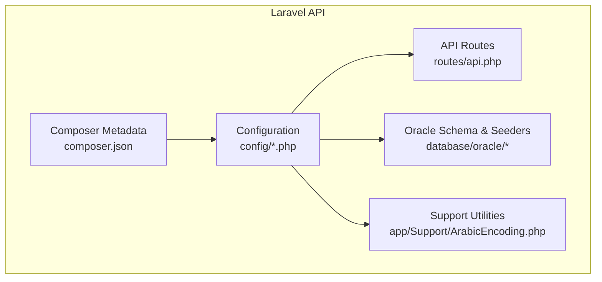
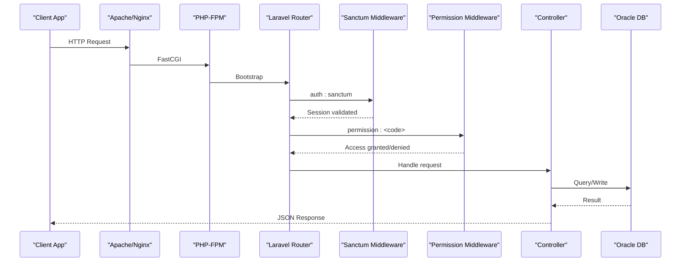
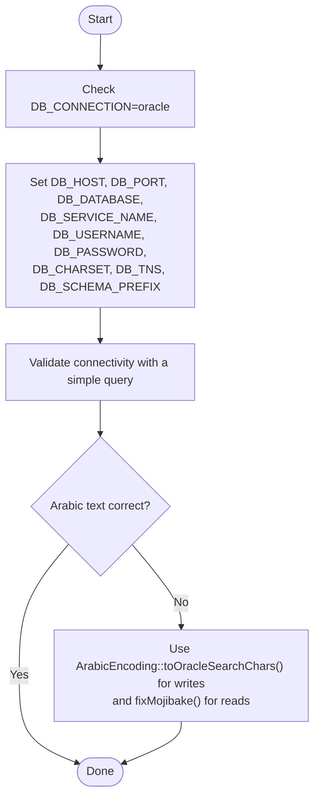
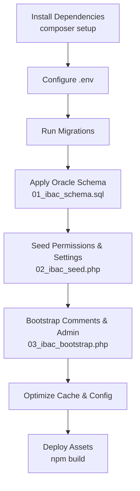
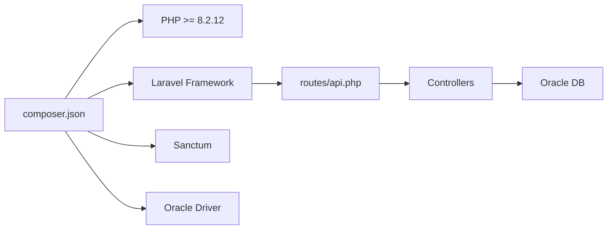

# Backend Deployment

<cite>
**Referenced Files in This Document**
- [composer.json](file://kyApp_API/composer.json)
- [config/app.php](file://kyApp_API/config/app.php)
- [config/database.php](file://kyApp_API/config/database.php)
- [config/oracle.php](file://kyApp_API/config/oracle.php)
- [config/cache.php](file://kyApp_API/config/cache.php)
- [config/logging.php](file://kyApp_API/config/logging.php)
- [config/session.php](file://kyApp_API/config/session.php)
- [config/sanctum.php](file://kyApp_API/config/sanctum.php)
- [config/queue.php](file://kyApp_API/config/queue.php)
- [config/mail.php](file://kyApp_API/config/mail.php)
- [routes/api.php](file://kyApp_API/routes/api.php)
- [database/oracle/01_ibac_schema.sql](file://kyApp_API/database/oracle/01_ibac_schema.sql)
- [database/oracle/02_ibac_seed.php](file://kyApp_API/database/oracle/02_ibac_seed.php)
- [database/oracle/03_ibac_bootstrap.php](file://kyApp_API/database/oracle/03_ibac_bootstrap.php)
- [app/Support/ArabicEncoding.php](file://kyApp_API/app/Support/ArabicEncoding.php)
</cite>

## Table of Contents
1. [Introduction](#introduction)
2. [Project Structure](#project-structure)
3. [Core Components](#core-components)
4. [Architecture Overview](#architecture-overview)
5. [Detailed Component Analysis](#detailed-component-analysis)
6. [Dependency Analysis](#dependency-analysis)
7. [Performance Considerations](#performance-considerations)
8. [Troubleshooting Guide](#troubleshooting-guide)
9. [Conclusion](#conclusion)
10. [Appendices](#appendices)

## Introduction
This document provides comprehensive backend deployment guidance for the Laravel API service. It covers server environment requirements, Oracle database setup and configuration (including Arabic text encoding), application deployment steps, production web server and PHP-FPM hardening, backup strategies, logging, and monitoring. The guidance is grounded in the repository’s configuration files, routes, and Oracle schema scripts.

## Project Structure
The backend lives under `kyApp_API`. Key areas:
- Configuration: `config/*.php`
- Routes: `routes/api.php`
- Database schema and seeding: `database/oracle/*`
- Application support utilities: `app/Support/ArabicEncoding.php`
- Composer metadata and scripts: `composer.json`

**Diagram sources**
- [composer.json:1-96](file://kyApp_API/composer.json#L1-L96)
- [config/app.php:1-127](file://kyApp_API/config/app.php#L1-L127)
- [routes/api.php:1-327](file://kyApp_API/routes/api.php#L1-L327)
- [database/oracle/01_ibac_schema.sql:1-207](file://kyApp_API/database/oracle/01_ibac_schema.sql#L1-L207)
- [app/Support/ArabicEncoding.php:1-194](file://kyApp_API/app/Support/ArabicEncoding.php#L1-L194)

**Section sources**
- [composer.json:1-96](file://kyApp_API/composer.json#L1-L96)
- [config/app.php:1-127](file://kyApp_API/config/app.php#L1-L127)
- [routes/api.php:1-327](file://kyApp_API/routes/api.php#L1-L327)

## Core Components
- PHP runtime and framework: PHP 8.2.12+ with Laravel 12 and Sanctum.
- Oracle integration via `yajra/laravel-oci8`.
- Database connections: SQLite default, MySQL/MariaDB/PostgreSQL/SQL Server templates, plus an explicit Oracle connection.
- Cache, session, queue, mail, logging, and Sanctum configurations are all environment-driven.

Key environment variables to set in `.env`:
- Application: `APP_NAME`, `APP_ENV`, `APP_DEBUG`, `APP_URL`, `APP_KEY`, `APP_LOCALE`, `APP_FALLBACK_LOCALE`, `APP_FAKER_LOCALE`, `APP_MAINTENANCE_DRIVER`, `APP_MAINTENANCE_STORE`.
- Database: `DB_CONNECTION`, `DB_HOST`, `DB_PORT`, `DB_DATABASE`, `DB_USERNAME`, `DB_PASSWORD`, `DB_CHARSET`, `DB_SERVICE_NAME`, `DB_TNS`, `DB_SCHEMA_PREFIX`, `DB_EDITION`, `DB_SERVER_VERSION`, `DB_LOAD_BALANCE`, `ORA_MAX_NAME_LEN`.
- Cache: `CACHE_STORE`, `DB_CACHE_CONNECTION`, `DB_CACHE_TABLE`, `DB_CACHE_LOCK_CONNECTION`, `DB_CACHE_LOCK_TABLE`, `REDIS_*`, `MEMCACHED_*`, `DYNAMODB_*`.
- Session: `SESSION_DRIVER`, `SESSION_LIFETIME`, `SESSION_EXPIRE_ON_CLOSE`, `SESSION_ENCRYPT`, `SESSION_CONNECTION`, `SESSION_TABLE`, `SESSION_STORE`, `SESSION_COOKIE`, `SESSION_PATH`, `SESSION_DOMAIN`, `SESSION_SECURE_COOKIE`, `SESSION_HTTP_ONLY`, `SESSION_SAME_SITE`, `SESSION_PARTITIONED_COOKIE`.
- Queue: `QUEUE_CONNECTION`, `DB_QUEUE_CONNECTION`, `DB_QUEUE_TABLE`, `DB_QUEUE`, `DB_QUEUE_RETRY_AFTER`, `BEANSTALKD_*`, `SQS_*`, `REDIS_QUEUE_*`, `QUEUE_FAILED_DRIVER`.
- Mail: `MAIL_MAILER`, `MAIL_SCHEME`, `MAIL_URL`, `MAIL_HOST`, `MAIL_PORT`, `MAIL_USERNAME`, `MAIL_PASSWORD`, `MAIL_EHLO_DOMAIN`, `MAIL_FROM_ADDRESS`, `MAIL_FROM_NAME`.
- Logging: `LOG_CHANNEL`, `LOG_STACK`, `LOG_LEVEL`, `LOG_DAILY_DAYS`, `LOG_SLACK_WEBHOOK_URL`, `LOG_SLACK_USERNAME`, `LOG_SLACK_EMOJI`, `LOG_PAPERTRAIL_HANDLER`, `PAPERTRAIL_URL`, `PAPERTRAIL_PORT`, `LOG_STDERR_FORMATTER`, `LOG_SYSLOG_FACILITY`.
- Sanctum: `SANCTUM_STATEFUL_DOMAINS`, `SANCTUM_TOKEN_PREFIX`.

**Section sources**
- [composer.json:11-18](file://kyApp_API/composer.json#L11-L18)
- [config/app.php:16-100](file://kyApp_API/config/app.php#L16-L100)
- [config/database.php:20-127](file://kyApp_API/config/database.php#L20-L127)
- [config/cache.php:18-115](file://kyApp_API/config/cache.php#L18-L115)
- [config/session.php:21-215](file://kyApp_API/config/session.php#L21-L215)
- [config/queue.php:16-127](file://kyApp_API/config/queue.php#L16-L127)
- [config/mail.php:17-116](file://kyApp_API/config/mail.php#L17-L116)
- [config/logging.php:21-128](file://kyApp_API/config/logging.php#L21-L128)
- [config/sanctum.php:21-92](file://kyApp_API/config/sanctum.php#L21-L92)

## Architecture Overview
The API exposes REST endpoints protected by Sanctum sessions and fine-grained permissions. Requests flow through the web server into PHP-FPM, then Laravel routing and middleware enforce authentication and authorization before reaching controllers.

**Diagram sources**
- [routes/api.php:17-116](file://kyApp_API/routes/api.php#L17-L116)
- [config/sanctum.php:21-109](file://kyApp_API/config/sanctum.php#L21-L109)

## Detailed Component Analysis

### Server Environment Requirements
- PHP version: 8.2.12 or higher.
- Required extensions: PDO, OCI8 (for Oracle), OpenSSL, Mbstring, Tokenizer, XML, Ctype, JSON.
- System dependencies:
  - Oracle Instant Client libraries matching your Oracle server version.
  - For Redis-backed cache/queues: Redis server and phpredis extension.
  - For Memcached: memcached daemon and extension.
  - For file-based storage/logs: writable directories (`storage`, `bootstrap/cache`).

Validation checklist:
- `php -v` shows 8.2.12+.
- `php -m` includes `pdo`, `pdo_oci`, `openssl`, `mbstring`, `tokenizer`, `xml`, `ctype`, `json`.
- Oracle client libraries are discoverable by PHP.

**Section sources**
- [composer.json:11-18](file://kyApp_API/composer.json#L11-L18)

### Oracle Database Setup and Configuration
- Connection driver: `oracle` via `yajra/laravel-oci8`.
- Default connection parameters include host, port, database/service name, username/password, charset, prefix, and schema prefix.
- Dedicated Oracle config defines TNS, edition, server version, load balancing, max name length, and session NLS variables.

Recommended settings for Arabic text:
- Database character set: WE8MSWIN1252 (as documented in the schema script).
- Client connection charset: AL32UTF8.
- Use the provided encoding helper to safely write/search Arabic data without mojibake.

Connection string guidance:
- Prefer using `DB_SERVICE_NAME` and `DB_HOST`/`DB_PORT` together with `DB_TNS` when required by your Oracle network configuration.
- Ensure `DB_CHARSET` aligns with the application’s AL32UTF8 client behavior.

Performance tuning tips:
- Enable connection pooling/load balancing if supported by your Oracle deployment.
- Tune session NLS formats to avoid conversion overhead.
- Keep `prefix_schema` aligned with the schema used by migrations and seeders.

**Diagram sources**
- [config/database.php:116-127](file://kyApp_API/config/database.php#L116-L127)
- [config/oracle.php:3-29](file://kyApp_API/config/oracle.php#L3-L29)
- [database/oracle/01_ibac_schema.sql:1-19](file://kyApp_API/database/oracle/01_ibac_schema.sql#L1-L19)
- [app/Support/ArabicEncoding.php:122-162](file://kyApp_API/app/Support/ArabicEncoding.php#L122-L162)

**Section sources**
- [config/database.php:116-127](file://kyApp_API/config/database.php#L116-L127)
- [config/oracle.php:3-29](file://kyApp_API/config/oracle.php#L3-L29)
- [database/oracle/01_ibac_schema.sql:1-19](file://kyApp_API/database/oracle/01_ibac_schema.sql#L1-L19)
- [app/Support/ArabicEncoding.php:33-120](file://kyApp_API/app/Support/ArabicEncoding.php#L33-L120)

### Laravel Application Deployment
Deployment steps:
1. Install dependencies:
   - Run the Composer setup script which installs packages, copies `.env.example` to `.env`, generates the application key, runs migrations, installs Node assets, and builds them.
2. Configure environment variables:
   - Set all required variables listed in Core Components.
3. Database migrations:
   - Run migrations to create framework tables and any Laravel-managed schema.
4. Oracle schema initialization:
   - Execute the Oracle schema SQL to create IBAC tables, sequences, triggers, and indexes.
   - Run the seed script to populate permission catalog and security settings.
   - Run the bootstrap script to apply comments and ensure initial admin access.
5. Cache optimization:
   - Clear and warm caches after deployment.
   - Choose a production cache store (Redis recommended).

Important notes:
- The Oracle schema script documents that Arabic text must not be seeded directly from the SQL file; use the provided PHP seeders with proper encoding helpers.
- The seed and bootstrap scripts are idempotent and safe to re-run.

**Diagram sources**
- [composer.json:42-50](file://kyApp_API/composer.json#L42-L50)
- [database/oracle/01_ibac_schema.sql:1-207](file://kyApp_API/database/oracle/01_ibac_schema.sql#L1-L207)
- [database/oracle/02_ibac_seed.php:1-310](file://kyApp_API/database/oracle/02_ibac_seed.php#L1-L310)
- [database/oracle/03_ibac_bootstrap.php:1-227](file://kyApp_API/database/oracle/03_ibac_bootstrap.php#L1-L227)

**Section sources**
- [composer.json:42-50](file://kyApp_API/composer.json#L42-L50)
- [database/oracle/01_ibac_schema.sql:1-207](file://kyApp_API/database/oracle/01_ibac_schema.sql#L1-L207)
- [database/oracle/02_ibac_seed.php:1-310](file://kyApp_API/database/oracle/02_ibac_seed.php#L1-L310)
- [database/oracle/03_ibac_bootstrap.php:1-227](file://kyApp_API/database/oracle/03_ibac_bootstrap.php#L1-L227)

### Production Server Setup (Apache/Nginx + PHP-FPM)
- Web server:
  - Point the document root to the Laravel `public` directory.
  - Enable URL rewriting to route requests to `index.php`.
- PHP-FPM:
  - Run under a dedicated user with minimal privileges.
  - Restrict open_basedir to the application directory.
  - Disable dangerous functions and enable OPcache.
- Security hardening:
  - Enforce HTTPS and HSTS at the reverse proxy.
  - Set secure cookie flags for sessions and Sanctum stateful domains.
  - Limit request size and timeouts.
  - Restrict access to sensitive paths (`.env`, `storage`, `vendor`).

Environment-specific recommendations:
- Set `APP_ENV=production` and `APP_DEBUG=false`.
- Configure `SESSION_SECURE_COOKIE=true` and appropriate `SESSION_SAME_SITE`.
- Define `SANCTUM_STATEFUL_DOMAINS` only for trusted frontend hosts.

**Section sources**
- [config/app.php:29-42](file://kyApp_API/config/app.php#L29-L42)
- [config/session.php:172-202](file://kyApp_API/config/session.php#L172-L202)
- [config/sanctum.php:21-26](file://kyApp_API/config/sanctum.php#L21-L26)

### Backup Strategies
- Database backups:
  - Schedule regular logical backups of the Oracle schema (especially ACCOUNTS).
  - Include sequences, triggers, and table/column comments.
- Application backups:
  - Back up `.env`, `storage`, and `bootstrap/cache`.
  - Exclude large vendor/node artifacts from frequent backups.
- Recovery testing:
  - Periodically test restore procedures and verify Arabic text integrity using the encoding helper.

[No sources needed since this section provides general guidance]

### Logging Configuration
- Default channel: stack, composed of configured channels.
- Common channels: single, daily, slack, papertrail, syslog, stderr, errorlog, null.
- Production recommendations:
  - Use `daily` with rotation days.
  - Stream to `stderr` for containerized environments.
  - Integrate with centralized logging (Papertrail/Syslog/Slack).
- Sensitive data:
  - Avoid logging secrets; sanitize logs where necessary.

**Section sources**
- [config/logging.php:21-128](file://kyApp_API/config/logging.php#L21-L128)

### Monitoring Setup
- Health checks:
  - Expose a lightweight endpoint (e.g., `/hello`) for uptime monitors.
- Metrics:
  - Track queue worker health, failed jobs, and slow queries.
- Alerts:
  - Route critical errors to Slack or PagerDuty via logging channels.
- Observability:
  - Monitor PHP-FPM process pools, memory usage, and Oracle connection metrics.

**Section sources**
- [routes/api.php:118-122](file://kyApp_API/routes/api.php#L118-L122)
- [config/logging.php:76-95](file://kyApp_API/config/logging.php#L76-L95)

## Dependency Analysis
High-level dependency relationships:
- Composer requires PHP 8.2.12+, Laravel 12, Sanctum, and Oracle driver.
- Runtime depends on Oracle client libraries and optional Redis/Memcached.
- Routing enforces Sanctum authentication and custom permission checks.

**Diagram sources**
- [composer.json:11-18](file://kyApp_API/composer.json#L11-L18)
- [routes/api.php:17-116](file://kyApp_API/routes/api.php#L17-L116)

**Section sources**
- [composer.json:11-18](file://kyApp_API/composer.json#L11-L18)
- [routes/api.php:17-116](file://kyApp_API/routes/api.php#L17-L116)

## Performance Considerations
- Cache:
  - Use Redis for high-throughput caching and distributed sessions.
  - Prefix cache keys per application to avoid collisions.
- Sessions:
  - Prefer database or Redis drivers in multi-node deployments.
  - Tune lifetime and idle thresholds according to business needs.
- Queues:
  - Use Redis or SQS for scalable background processing.
  - Configure retry policies and failure handling.
- Database:
  - Ensure proper indexing on frequently queried columns.
  - Use connection pooling and tune Oracle session NLS formats.

**Section sources**
- [config/cache.php:18-115](file://kyApp_API/config/cache.php#L18-L115)
- [config/session.php:21-215](file://kyApp_API/config/session.php#L21-L215)
- [config/queue.php:16-127](file://kyApp_API/config/queue.php#L16-L127)
- [config/oracle.php:3-29](file://kyApp_API/config/oracle.php#L3-L29)

## Troubleshooting Guide
Common issues and resolutions:
- Arabic text corruption:
  - Symptom: Mojibake or replacement characters in Oracle.
  - Resolution: Write via `ArabicEncoding::toOracleSearchChars()` and read via `fixMojibake()`.
- Authentication failures:
  - Verify `SANCTUM_STATEFUL_DOMAINS` includes your frontend host.
  - Ensure `SESSION_SECURE_COOKIE` matches HTTPS usage.
- Cache/session inconsistencies:
  - Confirm `CACHE_STORE` and `SESSION_DRIVER` point to available backends.
  - Clear config and cache after changes.
- Queue workers not processing:
  - Check `QUEUE_CONNECTION` and backend connectivity.
  - Inspect failed jobs table and logs.

**Section sources**
- [app/Support/ArabicEncoding.php:33-120](file://kyApp_API/app/Support/ArabicEncoding.php#L33-L120)
- [config/sanctum.php:21-26](file://kyApp_API/config/sanctum.php#L21-L26)
- [config/session.php:172-202](file://kyApp_API/config/session.php#L172-L202)
- [config/cache.php:18-115](file://kyApp_API/config/cache.php#L18-L115)
- [config/queue.php:16-127](file://kyApp_API/config/queue.php#L16-L127)

## Conclusion
This guide consolidates environment requirements, Oracle setup with robust Arabic text handling, deployment steps, production hardening, and operational practices. Following these instructions ensures a secure, performant, and maintainable Laravel API backed by Oracle.

[No sources needed since this section summarizes without analyzing specific files]

## Appendices

### Oracle Schema Initialization Checklist
- Run schema SQL to create tables, sequences, triggers, and indexes.
- Run seed script to populate permission catalog and security settings.
- Run bootstrap script to apply comments and ensure initial admin access.

**Section sources**
- [database/oracle/01_ibac_schema.sql:1-207](file://kyApp_API/database/oracle/01_ibac_schema.sql#L1-L207)
- [database/oracle/02_ibac_seed.php:1-310](file://kyApp_API/database/oracle/02_ibac_seed.php#L1-L310)
- [database/oracle/03_ibac_bootstrap.php:1-227](file://kyApp_API/database/oracle/03_ibac_bootstrap.php#L1-L227)