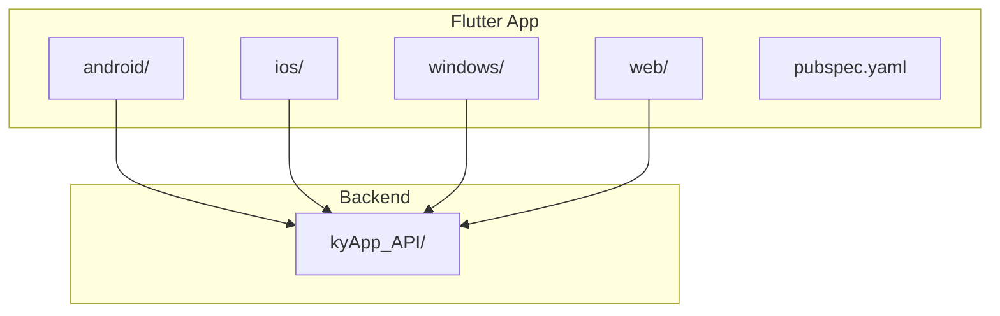
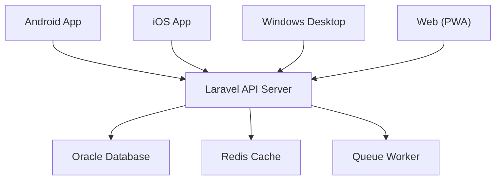
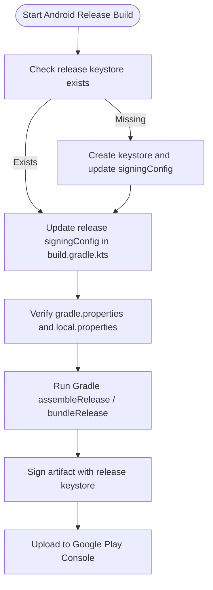
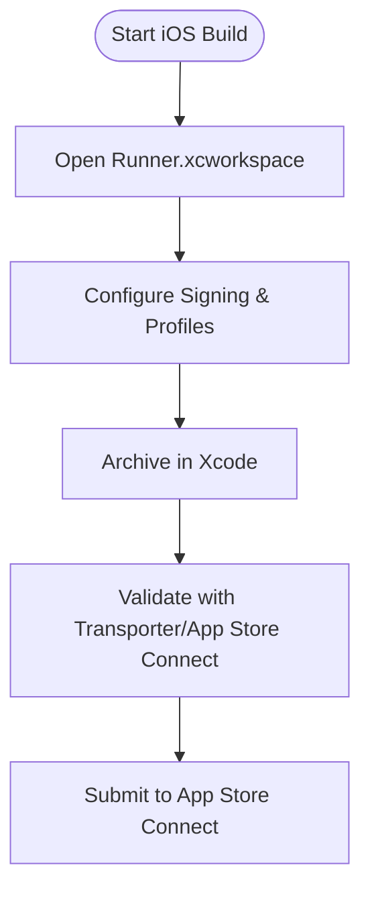
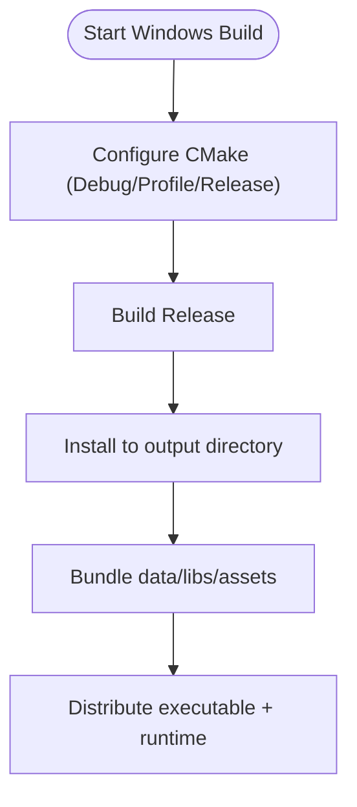
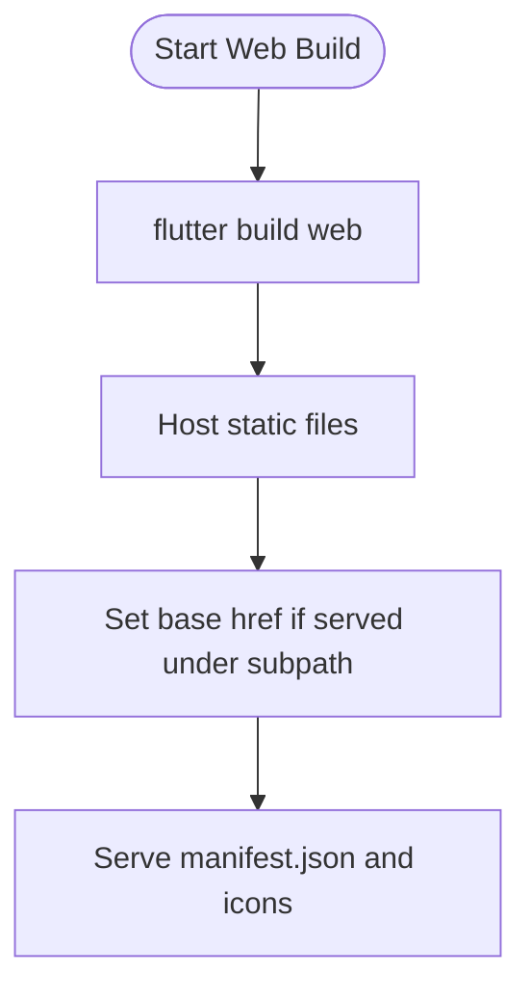
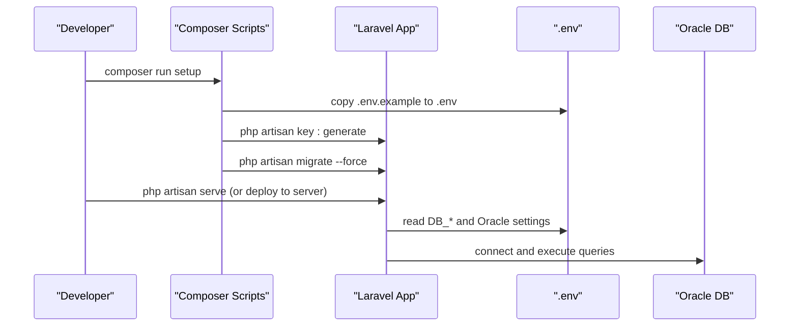
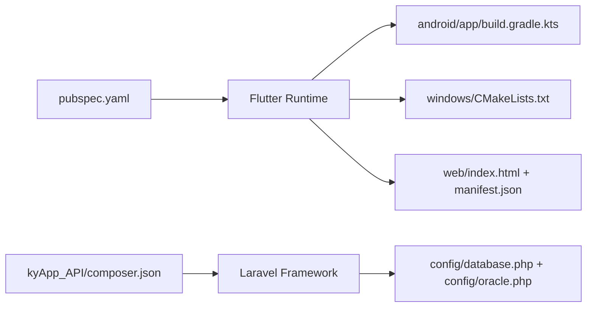

# Deployment Guide

<cite>
**Referenced Files in This Document**
- [pubspec.yaml](file://pubspec.yaml)
- [android/app/build.gradle.kts](file://android/app/build.gradle.kts)
- [android/build.gradle.kts](file://android/build.gradle.kts)
- [android/gradle.properties](file://android/gradle.properties)
- [android/local.properties](file://android/local.properties)
- [ios/Runner.xcworkspace/contents.xcworkspacedata](file://ios/Runner.xcworkspace/contents.xcworkspacedata)
- [windows/CMakeLists.txt](file://windows/CMakeLists.txt)
- [web/index.html](file://web/index.html)
- [web/manifest.json](file://web/manifest.json)
- [kyApp_API/composer.json](file://kyApp_API/composer.json)
- [kyApp_API/.env.example](file://kyApp_API/.env.example)
- [kyApp_API/config/database.php](file://kyApp_API/config/database.php)
- [kyApp_API/config/oracle.php](file://kyApp_API/config/oracle.php)
</cite>

## Table of Contents
1. [Introduction](#introduction)
2. [Project Structure](#project-structure)
3. [Core Components](#core-components)
4. [Architecture Overview](#architecture-overview)
5. [Detailed Component Analysis](#detailed-component-analysis)
6. [Dependency Analysis](#dependency-analysis)
7. [Performance Considerations](#performance-considerations)
8. [Troubleshooting Guide](#troubleshooting-guide)
9. [Conclusion](#conclusion)
10. [Appendices](#appendices)

## Introduction
This deployment guide covers all target platforms for the project: Android, iOS, Windows desktop, web, and the Laravel backend with Oracle database support. It explains build tooling, configuration files, signing/provisioning requirements, environment management, and production considerations. The goal is to enable reliable builds and deployments across platforms using the existing repository structure.

## Project Structure
The repository is a multi-platform Flutter application with a Laravel API backend:
- Flutter app (Android, iOS, Windows, Web) under root directories android/, ios/, windows/, web/
- Backend API under kyApp_API/ (Laravel 12, PHP 8.2+, Oracle via OCI8)
- Shared assets and configuration files at the root level

**Diagram sources**
- [pubspec.yaml:1-19](file://pubspec.yaml#L1-L19)
- [android/app/build.gradle.kts:1-45](file://android/app/build.gradle.kts#L1-L45)
- [ios/Runner.xcworkspace/contents.xcworkspacedata:1-8](file://ios/Runner.xcworkspace/contents.xcworkspacedata#L1-L8)
- [windows/CMakeLists.txt:1-109](file://windows/CMakeLists.txt#L1-L109)
- [web/index.html:1-39](file://web/index.html#L1-L39)
- [kyApp_API/composer.json:1-96](file://kyApp_API/composer.json#L1-L96)

**Section sources**
- [pubspec.yaml:1-19](file://pubspec.yaml#L1-L19)
- [android/app/build.gradle.kts:1-45](file://android/app/build.gradle.kts#L1-L45)
- [ios/Runner.xcworkspace/contents.xcworkspacedata:1-8](file://ios/Runner.xcworkspace/contents.xcworkspacedata#L1-L8)
- [windows/CMakeLists.txt:1-109](file://windows/CMakeLists.txt#L1-L109)
- [web/index.html:1-39](file://web/index.html#L1-L39)
- [kyApp_API/composer.json:1-96](file://kyApp_API/composer.json#L1-L96)

## Core Components
- Flutter app versioning and SDK constraints are defined in pubspec.yaml.
- Android build uses Gradle Kotlin DSL with Flutter plugin integration.
- iOS workspace references the Xcode project.
- Windows build uses CMake with Flutter-managed subdirectories.
- Web uses index.html and manifest.json for PWA configuration.
- Backend uses Laravel with Composer scripts and Oracle configuration.

Key responsibilities:
- Versioning and dependencies: pubspec.yaml
- Android packaging and signing: android/app/build.gradle.kts, android/gradle.properties, android/local.properties
- iOS workspace linkage: ios/Runner.xcworkspace/contents.xcworkspacedata
- Windows native bundling: windows/CMakeLists.txt
- Web PWA metadata: web/index.html, web/manifest.json
- Backend runtime and DB config: kyApp_API/composer.json, kyApp_API/.env.example, kyApp_API/config/database.php, kyApp_API/config/oracle.php

**Section sources**
- [pubspec.yaml:1-19](file://pubspec.yaml#L1-L19)
- [android/app/build.gradle.kts:1-45](file://android/app/build.gradle.kts#L1-L45)
- [android/gradle.properties:1-27](file://android/gradle.properties#L1-L27)
- [android/local.properties:1-5](file://android/local.properties#L1-L5)
- [ios/Runner.xcworkspace/contents.xcworkspacedata:1-8](file://ios/Runner.xcworkspace/contents.xcworkspacedata#L1-L8)
- [windows/CMakeLists.txt:1-109](file://windows/CMakeLists.txt#L1-L109)
- [web/index.html:1-39](file://web/index.html#L1-L39)
- [web/manifest.json:1-36](file://web/manifest.json#L1-L36)
- [kyApp_API/composer.json:1-96](file://kyApp_API/composer.json#L1-L96)
- [kyApp_API/.env.example:1-66](file://kyApp_API/.env.example#L1-L66)
- [kyApp_API/config/database.php:1-197](file://kyApp_API/config/database.php#L1-L197)
- [kyApp_API/config/oracle.php:1-30](file://kyApp_API/config/oracle.php#L1-L30)

## Architecture Overview
High-level deployment architecture:
- Clients (Android, iOS, Windows, Web) call the Laravel API over HTTP.
- Laravel connects to Oracle (and optionally other databases), caches via Redis, queues jobs, and serves static assets.

[No sources needed since this diagram shows conceptual workflow, not actual code structure]

## Detailed Component Analysis

### Android Build and Play Store Deployment
- Gradle configuration:
  - Uses com.android.application, kotlin-android, and dev.flutter.flutter-gradle-plugin.
  - compileSdk=36, ndkVersion set, Java/Kotlin JVM targets configured.
  - defaultConfig sets applicationId, minSdk, targetSdk, versionCode/versionName from Flutter.
  - release buildType currently uses debug signing; must be replaced with a proper release keystore.
- Gradle properties:
  - JVM args include locale settings to avoid Arabic numeral issues during Maven resolution.
  - JDK path configured; AndroidX enabled; performance flags enabled.
- Local properties:
  - sdk.dir and flutter.sdk paths point to local installations.
  - flutter.versionName and flutter.versionCode can be overridden by CI or build scripts.

Steps:
1. Configure a release keystore and update android/app/build.gradle.kts release signingConfig to reference it.
2. Ensure android/gradle.properties points to a compatible JDK and has required JVM args.
3. Verify android/local.properties has correct sdk.dir and flutter.sdk.
4. Build signed APK/AAB and publish to Google Play Console.

**Diagram sources**
- [android/app/build.gradle.kts:33-39](file://android/app/build.gradle.kts#L33-L39)
- [android/gradle.properties:1-27](file://android/gradle.properties#L1-L27)
- [android/local.properties:1-5](file://android/local.properties#L1-L5)

**Section sources**
- [android/app/build.gradle.kts:1-45](file://android/app/build.gradle.kts#L1-L45)
- [android/gradle.properties:1-27](file://android/gradle.properties#L1-L27)
- [android/local.properties:1-5](file://android/local.properties#L1-L5)

### iOS Build and App Store Submission
- Workspace configuration:
  - Runner.xcworkspace references Runner.xcodeproj.
- Provisioning profiles and signing:
  - Must configure Signing & Capabilities in Xcode for development and distribution.
  - Use appropriate provisioning profiles for device testing and App Store distribution.
- Build and submit:
  - Archive in Xcode or use xcrun/altool/fastlane for automation.
  - Submit via App Store Connect.

**Diagram sources**
- [ios/Runner.xcworkspace/contents.xcworkspacedata:1-8](file://ios/Runner.xcworkspace/contents.xcworkspacedata#L1-L8)

**Section sources**
- [ios/Runner.xcworkspace/contents.xcworkspacedata:1-8](file://ios/Runner.xcworkspace/contents.xcworkspacedata#L1-L8)

### Windows Desktop Build and Distribution
- CMake configuration:
  - Defines binary name, build types (Debug/Profile/Release).
  - Includes Flutter-managed subdirectory and generated plugins.
  - Installation rules copy runtime files, libraries, and assets next to the executable.
- Build steps:
  - Configure with CMake (Visual Studio generator recommended).
  - Build Release profile.
  - Distribute the installed bundle directory as a portable package or create an installer.

**Diagram sources**
- [windows/CMakeLists.txt:1-109](file://windows/CMakeLists.txt#L1-L109)

**Section sources**
- [windows/CMakeLists.txt:1-109](file://windows/CMakeLists.txt#L1-L109)

### Web Deployment and Progressive Web App Configuration
- index.html:
  - Sets base href placeholder for Flutter’s --base-href argument.
  - Includes meta tags for mobile/web-app capabilities and links to manifest.
- manifest.json:
  - Defines PWA metadata: name, short_name, start_url, display mode, theme colors, icons.

Deployment options:
- Static hosting: Serve the built web folder on any static host (e.g., CDN, S3, Netlify, Vercel).
- Base path: If serving under a subpath, pass --base-href when building Flutter web.

**Diagram sources**
- [web/index.html:1-39](file://web/index.html#L1-L39)
- [web/manifest.json:1-36](file://web/manifest.json#L1-L36)

**Section sources**
- [web/index.html:1-39](file://web/index.html#L1-L39)
- [web/manifest.json:1-36](file://web/manifest.json#L1-L36)

### Backend Deployment (Laravel + Oracle)
- Runtime requirements:
  - PHP >= 8.2.12, Laravel 12, Oracle OCI8 extension via yajra/laravel-oci8.
  - Composer scripts define setup, dev, test workflows.
- Environment variables:
  - .env.example provides defaults for APP_* settings, logging, sessions, cache, queue, mail, Redis, AWS, and VITE_APP_NAME.
- Database configuration:
  - config/database.php defines multiple connections including sqlite, mysql, mariadb, pgsql, sqlsrv, oracle.
  - Oracle connection uses env variables for host, port, database/service_name, username, password, charset, prefix, and schema prefix.
  - config/oracle.php provides additional OCI8-specific settings like sessionVars and server_version.

Production checklist:
- Copy .env.example to .env and fill in production values (APP_URL, DB_* for Oracle, REDIS_*, MAIL_*, etc.).
- Set DB_CONNECTION=oracle and provide DB_HOST, DB_PORT, DB_DATABASE/DB_SERVICE_NAME, DB_USERNAME, DB_PASSWORD.
- Run migrations and seeders as needed.
- Optimize autoload and cache configs for production.

**Diagram sources**
- [kyApp_API/composer.json:42-74](file://kyApp_API/composer.json#L42-L74)
- [kyApp_API/.env.example:1-66](file://kyApp_API/.env.example#L1-L66)
- [kyApp_API/config/database.php:116-127](file://kyApp_API/config/database.php#L116-L127)
- [kyApp_API/config/oracle.php:1-30](file://kyApp_API/config/oracle.php#L1-L30)

**Section sources**
- [kyApp_API/composer.json:1-96](file://kyApp_API/composer.json#L1-L96)
- [kyApp_API/.env.example:1-66](file://kyApp_API/.env.example#L1-L66)
- [kyApp_API/config/database.php:1-197](file://kyApp_API/config/database.php#L1-L197)
- [kyApp_API/config/oracle.php:1-30](file://kyApp_API/config/oracle.php#L1-L30)

## Dependency Analysis
- Flutter app depends on packages declared in pubspec.yaml (dio, go_router, flutter_secure_storage, etc.).
- Android Gradle depends on Google and Maven Central repositories; local Aliyun mirrors are configured.
- Windows CMake includes Flutter-managed plugins and bundles native assets.
- Backend depends on Laravel framework, Sanctum, and Oracle OCI8 driver.

**Diagram sources**
- [pubspec.yaml:1-19](file://pubspec.yaml#L1-L19)
- [android/app/build.gradle.kts:1-45](file://android/app/build.gradle.kts#L1-L45)
- [windows/CMakeLists.txt:1-109](file://windows/CMakeLists.txt#L1-L109)
- [web/index.html:1-39](file://web/index.html#L1-L39)
- [web/manifest.json:1-36](file://web/manifest.json#L1-L36)
- [kyApp_API/composer.json:1-96](file://kyApp_API/composer.json#L1-L96)
- [kyApp_API/config/database.php:1-197](file://kyApp_API/config/database.php#L1-L197)
- [kyApp_API/config/oracle.php:1-30](file://kyApp_API/config/oracle.php#L1-L30)

**Section sources**
- [pubspec.yaml:1-19](file://pubspec.yaml#L1-L19)
- [android/app/build.gradle.kts:1-45](file://android/app/build.gradle.kts#L1-L45)
- [windows/CMakeLists.txt:1-109](file://windows/CMakeLists.txt#L1-L109)
- [web/index.html:1-39](file://web/index.html#L1-L39)
- [web/manifest.json:1-36](file://web/manifest.json#L1-L36)
- [kyApp_API/composer.json:1-96](file://kyApp_API/composer.json#L1-L96)
- [kyApp_API/config/database.php:1-197](file://kyApp_API/config/database.php#L1-L197)
- [kyApp_API/config/oracle.php:1-30](file://kyApp_API/config/oracle.php#L1-L30)

## Performance Considerations
- Android:
  - Keep gradle.properties JVM args and parallel/caching enabled.
  - Use a dedicated release keystore and avoid debug signing in production.
- iOS:
  - Ensure optimized asset sizes and minimal entitlements for faster archive times.
- Windows:
  - Prefer Profile/Release builds; ensure native assets are bundled correctly.
- Web:
  - Minimize payload size; leverage CDN caching; ensure correct base href for subpath hosting.
- Backend:
  - Enable OPcache, optimize autoloader, and configure Redis for cache/session where applicable.
  - Tune Oracle connection pool and query performance; monitor slow queries.

[No sources needed since this section provides general guidance]

## Troubleshooting Guide
Common issues and resolutions:
- Android build fails due to locale-related version parsing:
  - Ensure gradle.properties includes -Duser.language=en -Duser.country.US in org.gradle.jvmargs.
- Android cannot resolve SDK/Flutter paths:
  - Verify android/local.properties has correct sdk.dir and flutter.sdk.
- Android release signing errors:
  - Replace debug signingConfig with a proper release keystore in android/app/build.gradle.kts.
- iOS workspace not found:
  - Confirm Runner.xcworkspace contains the correct Runner.xcodeproj reference.
- Windows build missing runtime files:
  - Ensure CMake install step runs to copy data/libs/assets alongside the executable.
- Web base path incorrect:
  - Pass --base-href when building Flutter web if serving under a subpath; verify index.html base href placeholder is replaced.
- Backend environment misconfiguration:
  - Copy .env.example to .env and set APP_URL, DB_* for Oracle, REDIS_*, MAIL_* appropriately.
- Oracle connection failures:
  - Verify DB_CONNECTION=oracle and that DB_HOST, DB_PORT, DB_DATABASE/DB_SERVICE_NAME, DB_USERNAME, DB_PASSWORD are correct in .env.
  - Check config/oracle.php sessionVars and server_version match your Oracle instance.

**Section sources**
- [android/gradle.properties:1-27](file://android/gradle.properties#L1-L27)
- [android/local.properties:1-5](file://android/local.properties#L1-L5)
- [android/app/build.gradle.kts:33-39](file://android/app/build.gradle.kts#L33-L39)
- [ios/Runner.xcworkspace/contents.xcworkspacedata:1-8](file://ios/Runner.xcworkspace/contents.xcworkspacedata#L1-L8)
- [windows/CMakeLists.txt:61-109](file://windows/CMakeLists.txt#L61-L109)
- [web/index.html:1-39](file://web/index.html#L1-L39)
- [kyApp_API/.env.example:1-66](file://kyApp_API/.env.example#L1-L66)
- [kyApp_API/config/database.php:116-127](file://kyApp_API/config/database.php#L116-L127)
- [kyApp_API/config/oracle.php:1-30](file://kyApp_API/config/oracle.php#L1-L30)

## Conclusion
This guide consolidates the deployment procedures for all platforms supported by the repository. By following the platform-specific configurations and checklists—especially Android signing, iOS provisioning, Windows CMake installation, web base href handling, and Laravel environment and Oracle configuration—you can reliably build, test, and ship the application across Android, iOS, Windows, and web, while deploying the Laravel backend to production environments.

[No sources needed since this section summarizes without analyzing specific files]

## Appendices
- Recommended CI/CD pipeline stages:
  - Setup: Install Flutter, Android SDK, Xcode tools, CMake, PHP, Composer, Node.js.
  - Test: Run Flutter tests and Laravel tests (composer test).
  - Build: Generate artifacts for each platform (APK/AAB, IPA, Windows bundle, web build).
  - Sign: Apply release signatures for Android and iOS.
  - Deploy: Upload to Play Store, App Store Connect, static hosting, and backend server.

[No sources needed since this section provides general guidance]