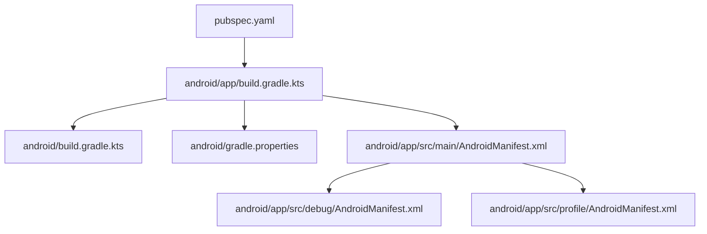
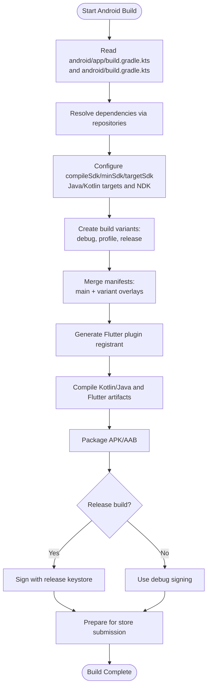
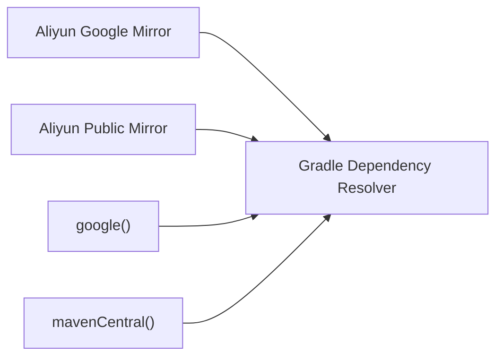

# Android App Deployment

<cite>
**Referenced Files in This Document**
- [android/app/build.gradle.kts](file://android/app/build.gradle.kts)
- [android/build.gradle.kts](file://android/build.gradle.kts)
- [android/gradle.properties](file://android/gradle.properties)
- [android/app/src/main/AndroidManifest.xml](file://android/app/src/main/AndroidManifest.xml)
- [android/app/src/debug/AndroidManifest.xml](file://android/app/src/debug/AndroidManifest.xml)
- [android/app/src/profile/AndroidManifest.xml](file://android/app/src/profile/AndroidManifest.xml)
- [pubspec.yaml](file://pubspec.yaml)
- [android/.gitignore](file://android/.gitignore)
- [AGENTS.md](file://AGENTS.md)
</cite>

## Table of Contents
1. [Introduction](#introduction)
2. [Project Structure](#project-structure)
3. [Core Components](#core-components)
4. [Architecture Overview](#architecture-overview)
5. [Detailed Component Analysis](#detailed-component-analysis)
6. [Dependency Analysis](#dependency-analysis)
7. [Performance Considerations](#performance-considerations)
8. [Troubleshooting Guide](#troubleshooting-guide)
9. [Conclusion](#conclusion)

## Introduction
This document provides a comprehensive guide to building, signing, and releasing the Android app in this Flutter project. It covers Gradle configuration, build variants, keystore management for debug and release builds, Google Play Store deployment steps, platform-specific Android configuration, permissions, native integration notes, troubleshooting common build issues, performance optimization techniques, and production debugging strategies.

The project is currently not production-ready on Android: the release build uses the debug signing key, the main manifest lacks the INTERNET permission required by network calls, and the applicationId remains a placeholder. These items are addressed in the detailed sections below.

## Project Structure
The Android side of the Flutter project lives under `android/`. The most important files for deployment are:
- `android/app/build.gradle.kts`: Application-level Gradle configuration (SDK versions, compile options, default config, build types).
- `android/build.gradle.kts`: Project-level Gradle configuration (repositories, build directories, clean task).
- `android/gradle.properties`: JVM and Gradle settings, AndroidX flags, Kotlin execution strategy, timeouts.
- `android/app/src/main/AndroidManifest.xml`: Main app manifest with permissions, activity, and metadata.
- `android/app/src/debug/AndroidManifest.xml` and `android/app/src/profile/AndroidManifest.xml`: Variant-specific manifest overlays.
- `pubspec.yaml`: Flutter package versioning that maps to Android versionCode/versionName.

**Diagram sources**
- [android/app/build.gradle.kts:1-45](file://android/app/build.gradle.kts#L1-L45)
- [android/build.gradle.kts:1-35](file://android/build.gradle.kts#L1-L35)
- [android/gradle.properties:1-27](file://android/gradle.properties#L1-L27)
- [android/app/src/main/AndroidManifest.xml:1-49](file://android/app/src/main/AndroidManifest.xml#L1-L49)
- [android/app/src/debug/AndroidManifest.xml:1-8](file://android/app/src/debug/AndroidManifest.xml#L1-L8)
- [android/app/src/profile/AndroidManifest.xml:1-7](file://android/app/src/profile/AndroidManifest.xml#L1-L7)
- [pubspec.yaml:1-100](file://pubspec.yaml#L1-L100)

**Section sources**
- [android/app/build.gradle.kts:1-45](file://android/app/build.gradle.kts#L1-L45)
- [android/build.gradle.kts:1-35](file://android/build.gradle.kts#L1-L35)
- [android/gradle.properties:1-27](file://android/gradle.properties#L1-L27)
- [android/app/src/main/AndroidManifest.xml:1-49](file://android/app/src/main/AndroidManifest.xml#L1-L49)
- [pubspec.yaml:1-100](file://pubspec.yaml#L1-L100)

## Core Components
- Build targets and SDKs:
  - Compile SDK: 36
  - Min SDK: 23
  - NDK: 27.0.12077973
  - Java/Kotlin target: 11
- Versioning:
  - Flutter version string in `pubspec.yaml` maps to Android `versionName` and `versionCode`.
- Build types:
  - Debug and Release; Release currently uses the debug signing configuration.
- Repositories:
  - Aliyun Maven mirrors configured before google() and mavenCentral() to mitigate download timeouts.

Key implications:
- Network access requires the INTERNET permission in the main manifest for release builds.
- Release builds must be signed with a proper keystore, not the debug key.
- The applicationId should be updated from the example value to your organization’s domain.

**Section sources**
- [android/app/build.gradle.kts:8-39](file://android/app/build.gradle.kts#L8-L39)
- [android/build.gradle.kts:1-18](file://android/build.gradle.kts#L1-L18)
- [pubspec.yaml:7-19](file://pubspec.yaml#L7-L19)
- [AGENTS.md:638-659](file://AGENTS.md#L638-L659)

## Architecture Overview
The Android build pipeline integrates Flutter, Kotlin, and the Android Gradle Plugin. The flow is:

**Diagram sources**
- [android/app/build.gradle.kts:1-45](file://android/app/build.gradle.kts#L1-L45)
- [android/build.gradle.kts:1-35](file://android/build.gradle.kts#L1-L35)
- [android/app/src/main/AndroidManifest.xml:1-49](file://android/app/src/main/AndroidManifest.xml#L1-L49)
- [android/app/src/debug/AndroidManifest.xml:1-8](file://android/app/src/debug/AndroidManifest.xml#L1-L8)
- [android/app/src/profile/AndroidManifest.xml:1-7](file://android/app/src/profile/AndroidManifest.xml#L1-L7)

## Detailed Component Analysis

### Gradle Configuration and Build Variants
- Application-level Gradle (`android/app/build.gradle.kts`):
  - Plugins: Android application, Kotlin Android, Flutter Gradle plugin.
  - SDKs: compileSdk 36, minSdk 23, NDK 27.0.12077973.
  - Java/Kotlin: sourceCompatibility and jvmTarget set to 11.
  - DefaultConfig: applicationId placeholder, targetSdk from Flutter tooling, versionCode/versionName from Flutter.
  - BuildTypes: release currently signs with debug keys.
- Project-level Gradle (`android/build.gradle.kts`):
  - Repositories: Aliyun mirrors first, then google(), mavenCentral().
  - Build directory overrides to isolate outputs.
  - Clean task deletes root build directory.
- Gradle properties (`android/gradle.properties`):
  - JVM args include memory tuning and locale fixes to avoid Arabic numeral issues in artifact resolution.
  - JDK path set explicitly.
  - AndroidX enabled, Jetifier disabled.
  - Gradle daemon, parallel, and caching enabled.
  - Kotlin compiler execution strategy set to in-process to avoid socket timeouts on Windows/JDK 21.
  - HTTP timeouts configured to prevent indefinite hangs.

Recommendations:
- Replace the placeholder applicationId with a unique identifier.
- Define a dedicated release signing configuration using a secure keystore.
- Keep Aliyun mirrors if they improve reliability in your environment; otherwise prefer official repositories.

**Section sources**
- [android/app/build.gradle.kts:1-45](file://android/app/build.gradle.kts#L1-L45)
- [android/build.gradle.kts:1-35](file://android/build.gradle.kts#L1-L35)
- [android/gradle.properties:1-27](file://android/gradle.properties#L1-L27)

### Keystore Generation and Management
Current state:
- Release builds use the debug signing configuration, which is not suitable for production.
- `.gitignore` excludes keystore files and `key.properties`, indicating the intended pattern for storing secrets outside version control.

Steps to prepare for production:
- Generate a keystore file (`.jks`) using a secure tool such as keytool or Android Studio.
- Store the keystore securely and never commit it to version control.
- Create a `key.properties` file at the module level to hold keystore paths and passwords, and ensure it is ignored by Git.
- Update the app-level Gradle file to reference the release keystore and configure the release signing configuration.
- Remove the temporary assignment of the debug signing config for release builds.

Security best practices:
- Restrict access to the keystore and credentials.
- Use CI/CD secret managers to inject keystore details during automated builds.
- Rotate keys only when necessary and maintain backups.

**Section sources**
- [android/app/build.gradle.kts:33-39](file://android/app/build.gradle.kts#L33-L39)
- [android/.gitignore:10-14](file://android/.gitignore#L10-L14)

### Google Play Store Deployment
Prerequisites:
- Unique applicationId matching your Play Store listing.
- Properly signed release bundle (AAB) using a production keystore.
- Correct versioning aligned with `pubspec.yaml`.

Play Store setup checklist:
- Create or update the app listing in Google Play Console.
- Upload the signed AAB.
- Provide required assets (screenshots, feature graphic, description).
- Set content rating, privacy policy, and data safety forms.
- Manage internal testing tracks for pre-release validation.

Version management:
- Flutter’s `pubspec.yaml` version field maps to Android `versionName` and `versionCode`.
- Ensure each upload increments the build number to satisfy Play Store requirements.

Store submission requirements:
- Target SDK must meet current Play Store policies.
- App must request only necessary permissions.
- Network-dependent apps must declare INTERNET permission in the main manifest.

**Section sources**
- [pubspec.yaml:7-19](file://pubspec.yaml#L7-L19)
- [android/app/build.gradle.kts:22-31](file://android/app/build.gradle.kts#L22-L31)
- [AGENTS.md:638-659](file://AGENTS.md#L638-L659)

### Platform-Specific Configurations and Permissions
Main manifest (`android/app/src/main/AndroidManifest.xml`):
- Declares biometric-related permissions.
- Defines the launcher activity with Flutter embedding metadata.
- Includes queries for text processing intents used by Flutter plugins.

Variant overlays:
- Debug and profile manifests add the INTERNET permission for development workflows.
- The main manifest does not include INTERNET, so release builds will lack network access unless added.

Action items:
- Add INTERNET permission to the main manifest if the app makes network requests in production.
- Review and minimize permissions to only those required by features.
- Validate that the launcher activity and Flutter embedding metadata are correct.

**Section sources**
- [android/app/src/main/AndroidManifest.xml:1-49](file://android/app/src/main/AndroidManifest.xml#L1-L49)
- [android/app/src/debug/AndroidManifest.xml:1-8](file://android/app/src/debug/AndroidManifest.xml#L1-L8)
- [android/app/src/profile/AndroidManifest.xml:1-7](file://android/app/src/profile/AndroidManifest.xml#L1-L7)

### Native Code Integration Notes
- NDK version is pinned to 27.0.12077973.
- Java/Kotlin targets are set to 11, ensuring compatibility with the AGP and Kotlin versions.
- GeneratedPluginRegistrant is created by Flutter tooling and referenced via manifest metadata.

Considerations:
- If integrating native modules, ensure they support the configured NDK and API levels.
- Validate any JNI libraries against the target architectures and keep them up to date.

**Section sources**
- [android/app/build.gradle.kts:8-20](file://android/app/build.gradle.kts#L8-L20)
- [android/app/src/main/AndroidManifest.xml:31-35](file://android/app/src/main/AndroidManifest.xml#L31-L35)

## Dependency Analysis
Repositories and resolution order:
- Aliyun mirrors are prioritized to reduce timeout issues.
- Official Google and Maven Central repositories follow.

**Diagram sources**
- [android/build.gradle.kts:1-18](file://android/build.gradle.kts#L1-L18)

**Section sources**
- [android/build.gradle.kts:1-18](file://android/build.gradle.kts#L1-L18)

## Performance Considerations
- Gradle performance:
  - Daemon enabled, parallel builds enabled, build cache enabled.
  - JVM heap and metaspace tuned for stability.
  - Kotlin incremental compilation disabled due to known socket timeout issues on Windows/JDK 21; in-process execution is used instead.
- Network timeouts:
  - HTTP connection and socket timeouts configured to prevent indefinite hangs.
- Build output isolation:
  - Custom build directories help avoid conflicts and speed up multi-module operations.

Optimization tips:
- Keep Gradle caches enabled and leverage CI caching where possible.
- Monitor dependency resolution times and consider repository ordering based on your network conditions.
- Avoid unnecessary large assets in the app bundle.

**Section sources**
- [android/gradle.properties:1-27](file://android/gradle.properties#L1-L27)
- [android/build.gradle.kts:21-34](file://android/build.gradle.kts#L21-L34)

## Troubleshooting Guide

Common Android build issues and resolutions:
- Missing INTERNET permission in release builds:
  - Symptom: Network calls fail in production despite working in debug/profile.
  - Resolution: Add INTERNET permission to the main manifest.
- Release builds signed with debug key:
  - Symptom: Play Store rejects uploads or updates fail due to signature mismatch.
  - Resolution: Configure a proper release keystore and remove the debug signing fallback.
- Placeholder applicationId:
  - Symptom: Conflicts with other apps or Play Store listing mismatches.
  - Resolution: Update applicationId to a unique identifier.
- Gradle download timeouts:
  - Symptom: Builds hang while fetching dependencies.
  - Resolution: Keep Aliyun mirrors if they work in your environment; adjust timeouts in `gradle.properties`.
- Kotlin daemon socket timeouts on Windows/JDK 21:
  - Symptom: Compilation fails intermittently.
  - Resolution: Use in-process Kotlin compiler execution and disable incremental compilation as configured.

Debugging strategies for production apps:
- Enable logging selectively in release builds and avoid sensitive data.
- Use crash reporting tools integrated into the app.
- Test network behavior with realistic endpoints and handle errors gracefully.
- Validate permissions and runtime flows on real devices.

**Section sources**
- [AGENTS.md:638-659](file://AGENTS.md#L638-L659)
- [android/app/build.gradle.kts:33-39](file://android/app/build.gradle.kts#L33-L39)
- [android/app/src/main/AndroidManifest.xml:1-49](file://android/app/src/main/AndroidManifest.xml#L1-L49)
- [android/gradle.properties:1-27](file://android/gradle.properties#L1-L27)

## Conclusion
To make this Android app production-ready:
- Update the applicationId to a unique value.
- Add INTERNET permission to the main manifest if the app requires network access.
- Configure a secure release keystore and remove the debug signing fallback.
- Align versioning with Play Store requirements and maintain consistent version codes.
- Keep Gradle and repository configurations optimized for your environment.
- Follow security best practices for keystore management and CI/CD integration.

Once these steps are completed, you can confidently build signed release bundles and submit them to the Google Play Store.