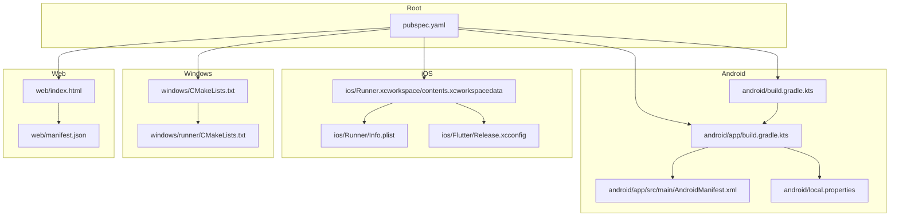
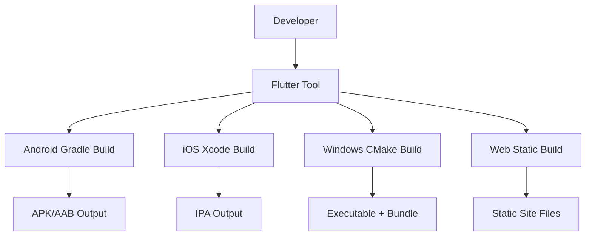
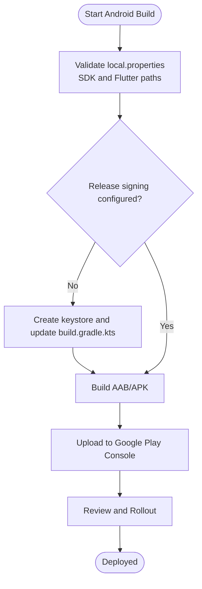
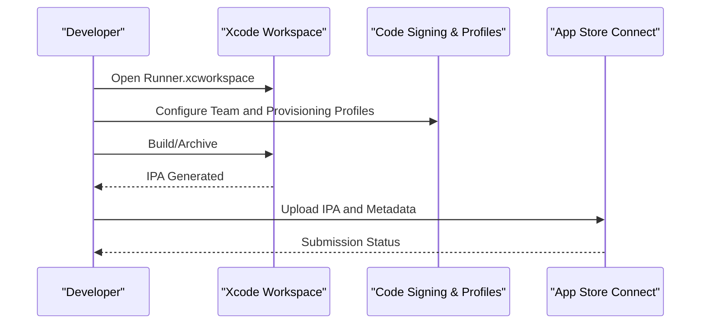
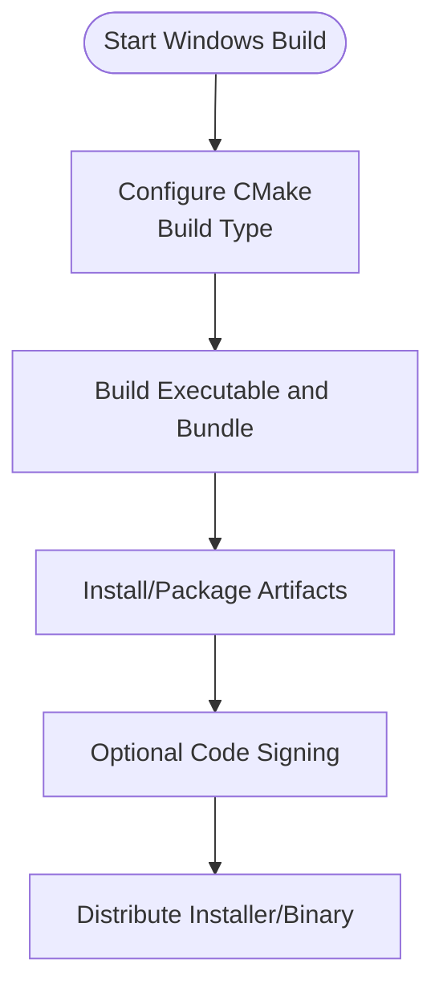
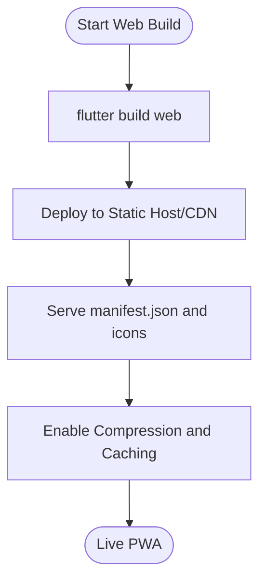
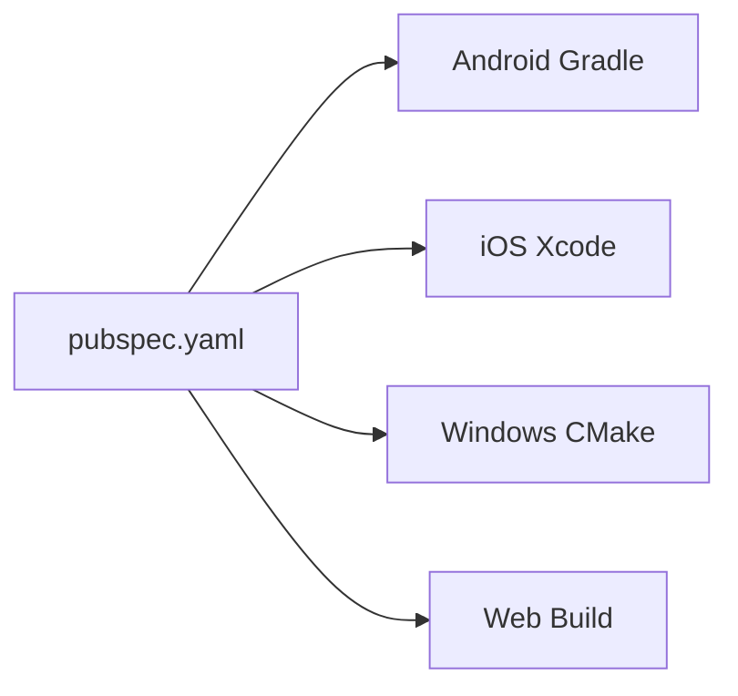

# Frontend Deployment

<cite>
**Referenced Files in This Document**
- [pubspec.yaml](file://pubspec.yaml)
- [android/build.gradle.kts](file://android/build.gradle.kts)
- [android/app/build.gradle.kts](file://android/app/build.gradle.kts)
- [android/local.properties](file://android/local.properties)
- [android/app/src/main/AndroidManifest.xml](file://android/app/src/main/AndroidManifest.xml)
- [ios/Runner/Info.plist](file://ios/Runner/Info.plist)
- [ios/Flutter/Release.xcconfig](file://ios/Flutter/Release.xcconfig)
- [ios/Runner.xcworkspace/contents.xcworkspacedata](file://ios/Runner.xcworkspace/contents.xcworkspacedata)
- [windows/CMakeLists.txt](file://windows/CMakeLists.txt)
- [windows/runner/CMakeLists.txt](file://windows/runner/CMakeLists.txt)
- [web/index.html](file://web/index.html)
- [web/manifest.json](file://web/manifest.json)
</cite>

## Table of Contents
1. [Introduction](#introduction)
2. [Project Structure](#project-structure)
3. [Core Components](#core-components)
4. [Architecture Overview](#architecture-overview)
5. [Detailed Component Analysis](#detailed-component-analysis)
6. [Dependency Analysis](#dependency-analysis)
7. [Performance Considerations](#performance-considerations)
8. [Troubleshooting Guide](#troubleshooting-guide)
9. [Conclusion](#conclusion)
10. [Appendices](#appendices)

## Introduction
This document provides comprehensive frontend deployment guidance for a Flutter-based application targeting Android, iOS, Windows desktop, and Web. It covers build systems (Gradle, Xcode workspace, CMake), signing and provisioning, asset bundling, platform-specific configurations, and distribution procedures including Google Play Store and App Store submission. It also includes web hosting setup, PWA configuration, and CDN optimization strategies.

## Project Structure
The project is a standard Flutter app with platform-specific directories:
- android: Gradle-based Android build with Kotlin and Flutter plugin integration
- ios: Xcode workspace and Runner target with Info.plist and xcconfig files
- windows: CMake-based desktop build with runner target
- web: Static site assets including index.html and manifest.json
- Root pubspec.yaml defines dependencies, assets, and versioning

**Diagram sources**
- [pubspec.yaml:1-100](file://pubspec.yaml#L1-L100)
- [android/build.gradle.kts:1-35](file://android/build.gradle.kts#L1-L35)
- [android/app/build.gradle.kts:1-45](file://android/app/build.gradle.kts#L1-L45)
- [android/app/src/main/AndroidManifest.xml:1-49](file://android/app/src/main/AndroidManifest.xml#L1-L49)
- [android/local.properties:1-5](file://android/local.properties#L1-L5)
- [ios/Runner.xcworkspace/contents.xcworkspacedata:1-8](file://ios/Runner.xcworkspace/contents.xcworkspacedata#L1-L8)
- [ios/Runner/Info.plist:1-52](file://ios/Runner/Info.plist#L1-L52)
- [ios/Flutter/Release.xcconfig:1-2](file://ios/Flutter/Release.xcconfig#L1-L2)
- [windows/CMakeLists.txt:1-109](file://windows/CMakeLists.txt#L1-L109)
- [windows/runner/CMakeLists.txt:1-41](file://windows/runner/CMakeLists.txt#L1-L41)
- [web/index.html:1-39](file://web/index.html#L1-L39)
- [web/manifest.json:1-36](file://web/manifest.json#L1-L36)

**Section sources**
- [pubspec.yaml:1-100](file://pubspec.yaml#L1-L100)
- [android/build.gradle.kts:1-35](file://android/build.gradle.kts#L1-L35)
- [android/app/build.gradle.kts:1-45](file://android/app/build.gradle.kts#L1-L45)
- [android/app/src/main/AndroidManifest.xml:1-49](file://android/app/src/main/AndroidManifest.xml#L1-L49)
- [android/local.properties:1-5](file://android/local.properties#L1-L5)
- [ios/Runner/Info.plist:1-52](file://ios/Runner/Info.plist#L1-L52)
- [ios/Flutter/Release.xcconfig:1-2](file://ios/Flutter/Release.xcconfig#L1-L2)
- [ios/Runner.xcworkspace/contents.xcworkspacedata:1-8](file://ios/Runner.xcworkspace/contents.xcworkspacedata#L1-L8)
- [windows/CMakeLists.txt:1-109](file://windows/CMakeLists.txt#L1-L109)
- [windows/runner/CMakeLists.txt:1-41](file://windows/runner/CMakeLists.txt#L1-L41)
- [web/index.html:1-39](file://web/index.html#L1-L39)
- [web/manifest.json:1-36](file://web/manifest.json#L1-L36)

## Core Components
- Android: Gradle build scripts define SDK versions, compile options, default config, and build types; AndroidManifest declares permissions and activity metadata; local.properties points to SDK and Flutter paths.
- iOS: Info.plist defines app metadata and capabilities; Release.xcconfig includes generated configuration; workspace references the Xcode project.
- Windows: Top-level CMakeLists sets up build modes, install targets, and asset copying; runner CMakeLists builds the executable and links Flutter libraries.
- Web: index.html sets base href and loads Flutter bootstrap; manifest.json defines PWA metadata and icons.
- Flutter root: pubspec.yaml defines dependencies, assets, and versioning that propagate to all platforms.

Key responsibilities:
- Versioning and build numbers are sourced from Flutter tooling and applied across platforms.
- Assets declared in pubspec.yaml are bundled into each platform’s output.
- Platform manifests configure runtime behavior and required permissions.

**Section sources**
- [pubspec.yaml:1-100](file://pubspec.yaml#L1-L100)
- [android/app/build.gradle.kts:1-45](file://android/app/build.gradle.kts#L1-L45)
- [android/app/src/main/AndroidManifest.xml:1-49](file://android/app/src/main/AndroidManifest.xml#L1-L49)
- [android/local.properties:1-5](file://android/local.properties#L1-L5)
- [ios/Runner/Info.plist:1-52](file://ios/Runner/Info.plist#L1-L52)
- [ios/Flutter/Release.xcconfig:1-2](file://ios/Flutter/Release.xcconfig#L1-L2)
- [windows/CMakeLists.txt:1-109](file://windows/CMakeLists.txt#L1-L109)
- [windows/runner/CMakeLists.txt:1-41](file://windows/runner/CMakeLists.txt#L1-L41)
- [web/index.html:1-39](file://web/index.html#L1-L39)
- [web/manifest.json:1-36](file://web/manifest.json#L1-L36)

## Architecture Overview
The Flutter tool orchestrates platform-specific builds using native build systems:
- Android: flutter invokes Gradle to assemble APK/AAB with signing and resource processing.
- iOS: flutter uses xcodebuild via the Xcode workspace to produce an IPA with code signing and provisioning.
- Windows: flutter delegates to CMake to build the executable and bundle assets.
- Web: flutter compiles Dart to JavaScript and outputs static assets served by a web server or CDN.

[No sources needed since this diagram shows conceptual workflow, not actual code structure]

## Detailed Component Analysis

### Android Build and Deployment
- Gradle configuration:
  - SDK and NDK versions, Java/Kotlin compatibility, min/target SDK levels, and version mapping from Flutter.
  - Build types include release; currently configured to use debug signing for convenience.
- Manifest:
  - Declares biometric permissions and main activity metadata required by Flutter embedding.
- Local properties:
  - Points to Android SDK and Flutter SDK locations; contains Flutter version name/code used during builds.

Build steps:
1. Ensure android/local.properties has correct sdk.dir and flutter.sdk.
2. Configure release signing:
   - Create a keystore file and store its path and credentials securely.
   - Update android/app/build.gradle.kts to reference the keystore in a release signingConfig.
3. Build signed artifacts:
   - Use flutter build commands to generate APK or AAB.
   - For Google Play, prefer AAB and upload via Play Console.
4. Google Play Store deployment:
   - Set applicationId and versioning consistently.
   - Upload AAB to Play Console, complete internal testing or rollout as needed.

**Diagram sources**
- [android/app/build.gradle.kts:1-45](file://android/app/build.gradle.kts#L1-L45)
- [android/local.properties:1-5](file://android/local.properties#L1-L5)

**Section sources**
- [android/app/build.gradle.kts:1-45](file://android/app/build.gradle.kts#L1-L45)
- [android/app/src/main/AndroidManifest.xml:1-49](file://android/app/src/main/AndroidManifest.xml#L1-L49)
- [android/local.properties:1-5](file://android/local.properties#L1-L5)

### iOS Build and Deployment
- Workspace and configuration:
  - The Xcode workspace references the Runner project.
  - Info.plist defines display name, supported orientations, and capability descriptions.
  - Release.xcconfig includes generated configuration for release builds.

Build steps:
1. Open ios/Runner.xcworkspace in Xcode.
2. Configure code signing:
   - Select appropriate Team and Bundle Identifier.
   - Ensure provisioning profiles are available and valid.
3. Build and archive:
   - Use Product > Archive to create an IPA.
   - Validate and distribute via Xcode Organizer or App Store Connect.
4. App Store submission:
   - Prepare screenshots and metadata in App Store Connect.
   - Submit for review and manage rollout.

**Diagram sources**
- [ios/Runner.xcworkspace/contents.xcworkspacedata:1-8](file://ios/Runner.xcworkspace/contents.xcworkspacedata#L1-L8)
- [ios/Runner/Info.plist:1-52](file://ios/Runner/Info.plist#L1-L52)
- [ios/Flutter/Release.xcconfig:1-2](file://ios/Flutter/Release.xcconfig#L1-L2)

**Section sources**
- [ios/Runner/Info.plist:1-52](file://ios/Runner/Info.plist#L1-L52)
- [ios/Flutter/Release.xcconfig:1-2](file://ios/Flutter/Release.xcconfig#L1-L2)
- [ios/Runner.xcworkspace/contents.xcworkspacedata:1-8](file://ios/Runner.xcworkspace/contents.xcworkspacedata#L1-L8)

### Windows Desktop Build and Distribution
- CMake configuration:
  - Top-level CMakeLists sets build modes (Debug/Profile/Release), Unicode definitions, and install rules for assets and libraries.
  - Runner CMakeLists defines the executable target, links Flutter libraries, and depends on Flutter assembly.

Build steps:
1. Ensure CMake and Visual Studio toolchains are installed.
2. Configure and build:
   - Use flutter build windows to invoke CMake and produce the executable and bundle.
3. Packaging:
   - Install or copy the built bundle (executable, data, libraries).
   - Optionally sign the executable and create an installer package.

**Diagram sources**
- [windows/CMakeLists.txt:1-109](file://windows/CMakeLists.txt#L1-L109)
- [windows/runner/CMakeLists.txt:1-41](file://windows/runner/CMakeLists.txt#L1-L41)

**Section sources**
- [windows/CMakeLists.txt:1-109](file://windows/CMakeLists.txt#L1-L109)
- [windows/runner/CMakeLists.txt:1-41](file://windows/runner/CMakeLists.txt#L1-L41)

### Web Deployment and PWA Configuration
- Static assets:
  - index.html sets base href placeholder and loads flutter_bootstrap.js.
  - manifest.json defines PWA metadata, icons, and orientation.

Deployment steps:
1. Build web artifacts:
   - Use flutter build web to generate static files.
2. Host statically:
   - Deploy to any static hosting service (e.g., CDN, object storage).
3. PWA setup:
   - Ensure manifest.json is served at the expected path.
   - Configure service worker if caching strategy is desired.
4. CDN optimization:
   - Enable gzip/brotli compression.
   - Set long-lived cache headers for immutable assets.
   - Use HTTP/2 and proper content delivery routing.

**Diagram sources**
- [web/index.html:1-39](file://web/index.html#L1-L39)
- [web/manifest.json:1-36](file://web/manifest.json#L1-L36)

**Section sources**
- [web/index.html:1-39](file://web/index.html#L1-L39)
- [web/manifest.json:1-36](file://web/manifest.json#L1-L36)

### Flutter-Specific Deployment Considerations
- Asset bundling:
  - Declare assets in pubspec.yaml under the flutter section; they will be included in all platform builds.
- Platform-specific configurations:
  - Android: manifest permissions and activity settings.
  - iOS: Info.plist keys and capabilities.
  - Windows: CMake install rules for assets and native libraries.
  - Web: base href and manifest for PWA.
- Performance optimization per platform:
  - Android: enable ProGuard/R8 rules in release builds; minimize resources; consider split APKs for large apps.
  - iOS: optimize images and fonts; ensure minimal payload; validate entitlements.
  - Windows: link against optimized libraries; avoid unnecessary native assets; consider installer compression.
  - Web: compress assets; leverage CDN caching; lazy-load heavy features; keep bundle size small.

**Section sources**
- [pubspec.yaml:63-100](file://pubspec.yaml#L63-L100)
- [android/app/src/main/AndroidManifest.xml:1-49](file://android/app/src/main/AndroidManifest.xml#L1-L49)
- [ios/Runner/Info.plist:1-52](file://ios/Runner/Info.plist#L1-L52)
- [windows/CMakeLists.txt:61-109](file://windows/CMakeLists.txt#L61-L109)
- [web/index.html:1-39](file://web/index.html#L1-L39)
- [web/manifest.json:1-36](file://web/manifest.json#L1-L36)

## Dependency Analysis
Flutter dependencies and plugins are managed via pubspec.yaml. At build time, the Flutter tool resolves these and integrates them into each platform’s artifact:
- Android: Gradle pulls native components and generates plugin registrants.
- iOS: CocoaPods or Swift Package Manager may be invoked by Flutter depending on plugins.
- Windows: CMake includes generated plugin rules and links necessary libraries.
- Web: Dart packages are compiled into JS bundles.

**Diagram sources**
- [pubspec.yaml:1-100](file://pubspec.yaml#L1-L100)

**Section sources**
- [pubspec.yaml:1-100](file://pubspec.yaml#L1-L100)

## Performance Considerations
- Android:
  - Use release builds with signing enabled.
  - Minify and obfuscate code where possible.
  - Optimize images and fonts; avoid excessive resources.
- iOS:
  - Keep entitlements minimal; remove unused frameworks.
  - Compress assets; use appropriate image formats.
- Windows:
  - Prefer Profile/Release builds for performance.
  - Avoid bundling unnecessary native libraries.
- Web:
  - Enable compression and caching.
  - Use CDN and HTTP/2.
  - Lazy-load heavy modules and defer non-critical scripts.

[No sources needed since this section provides general guidance]

## Troubleshooting Guide
- Android:
  - If build fails due to SDK paths, verify android/local.properties.
  - If release signing errors occur, ensure keystore configuration is correct in android/app/build.gradle.kts.
  - If permissions are missing at runtime, check android/app/src/main/AndroidManifest.xml.
- iOS:
  - If code signing fails, confirm Team and provisioning profiles in Xcode workspace.
  - If Info.plist keys are invalid, validate entries such as CFBundleDisplayName and orientation settings.
- Windows:
  - If CMake configuration fails, ensure toolchain and CMake version match requirements.
  - If assets are missing at runtime, verify install rules in windows/CMakeLists.txt.
- Web:
  - If base href is incorrect, adjust --base-href when building or update web/index.html accordingly.
  - If PWA icons do not load, ensure manifest.json paths are correct and served.

**Section sources**
- [android/local.properties:1-5](file://android/local.properties#L1-L5)
- [android/app/build.gradle.kts:33-39](file://android/app/build.gradle.kts#L33-L39)
- [android/app/src/main/AndroidManifest.xml:1-49](file://android/app/src/main/AndroidManifest.xml#L1-L49)
- [ios/Runner/Info.plist:1-52](file://ios/Runner/Info.plist#L1-L52)
- [windows/CMakeLists.txt:61-109](file://windows/CMakeLists.txt#L61-L109)
- [web/index.html:1-39](file://web/index.html#L1-L39)

## Conclusion
This guide consolidates the build and deployment processes for Android, iOS, Windows, and Web within a Flutter project. By configuring Gradle, Xcode workspace, and CMake appropriately, and by managing signing, provisioning, and assets correctly, you can reliably produce production-ready artifacts and distribute them through official channels. Optimizing assets and leveraging CDNs further improves performance and user experience across platforms.

[No sources needed since this section summarizes without analyzing specific files]

## Appendices
- Recommended environment setup:
  - Android: Android SDK, JDK 11+, Gradle wrapper.
  - iOS: Xcode, command-line tools, Apple Developer account.
  - Windows: Visual Studio with C++ workload, CMake.
  - Web: Any static host or CDN provider.
- Versioning best practices:
  - Keep version and build number synchronized across platforms via Flutter tooling.
- Security:
  - Store keystores and secrets securely; never commit sensitive files.

[No sources needed since this section provides general guidance]