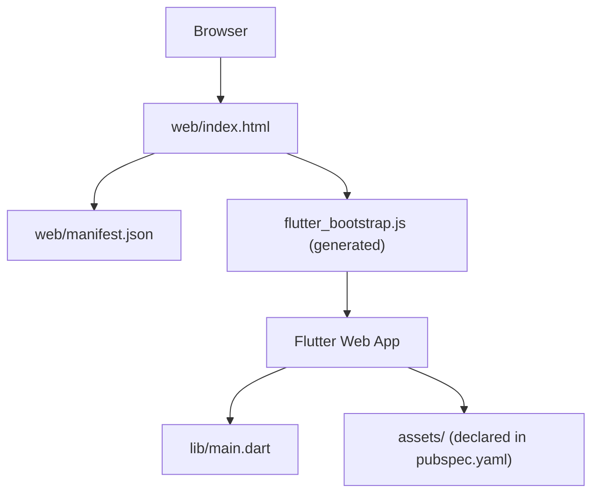
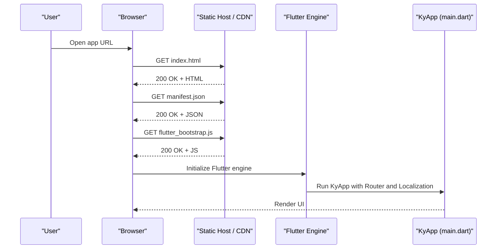
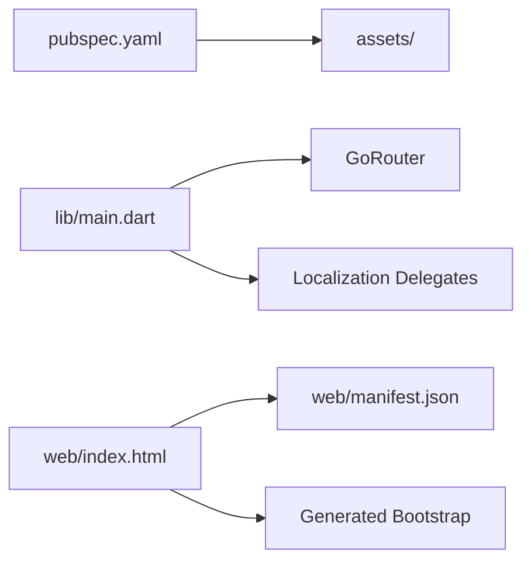

# Web Application Deployment

<cite>
**Referenced Files in This Document**
- [pubspec.yaml](file://pubspec.yaml)
- [lib/main.dart](file://lib/main.dart)
- [web/index.html](file://web/index.html)
- [web/manifest.json](file://web/manifest.json)
- [AGENTS.md](file://AGENTS.md)
</cite>

## Table of Contents
1. [Introduction](#introduction)
2. [Project Structure](#project-structure)
3. [Core Components](#core-components)
4. [Architecture Overview](#architecture-overview)
5. [Detailed Component Analysis](#detailed-component-analysis)
6. [Dependency Analysis](#dependency-analysis)
7. [Performance Considerations](#performance-considerations)
8. [Troubleshooting Guide](#troubleshooting-guide)
9. [Conclusion](#conclusion)

## Introduction
This document explains how to deploy the Flutter web build of this project as a static site, configure it as a Progressive Web App, and optimize it for performance and security. It covers:

- Static hosting setup and asset optimization
- CDN configuration for caching and delivery
- PWA configuration using the existing manifest and recommended service worker registration
- Hosting options including Firebase Hosting, Netlify, Vercel, and traditional web servers
- Security considerations such as HTTPS, CORS, and Content Security Policy
- Performance techniques such as code splitting, lazy loading, and caching strategies

The project is a Flutter application with a standard `web/` entry point and a PWA manifest. The main Dart entry point initializes the app and configures localization and routing.

## Project Structure
The web deployment surface is small and centered around the Flutter web template:

- `web/index.html`: HTML shell, base href placeholder, meta tags, favicon, title, and manifest link.
- `web/manifest.json`: PWA manifest with name, short name, start URL, display mode, colors, orientation, and icons.
- `pubspec.yaml`: Declares the Flutter SDK, dependencies, assets, and environment constraints.
- `lib/main.dart`: Flutter entry point that initializes widgets, sets up Riverpod, and configures the Material app with localization and router.

**Diagram sources**
- [web/index.html:1-39](file://web/index.html#L1-L39)
- [web/manifest.json:1-36](file://web/manifest.json#L1-L36)
- [pubspec.yaml:63-73](file://pubspec.yaml#L63-L73)
- [lib/main.dart:7-47](file://lib/main.dart#L7-L47)

**Section sources**
- [web/index.html:1-39](file://web/index.html#L1-L39)
- [web/manifest.json:1-36](file://web/manifest.json#L1-L36)
- [pubspec.yaml:1-100](file://pubspec.yaml#L1-L100)
- [lib/main.dart:1-47](file://lib/main.dart#L1-L47)

## Core Components
- Web shell (`web/index.html`)
  - Sets `<base href>` via a Flutter-provided placeholder.
  - Includes meta tags for mobile capabilities and Apple-specific settings.
  - Links the PWA manifest and favicon.
  - Loads the generated Flutter bootstrap script asynchronously.
- PWA manifest (`web/manifest.json`)
  - Defines app identity, start URL, display mode, theme color, background color, orientation, and icon variants.
- Flutter entry point (`lib/main.dart`)
  - Initializes Flutter binding and runs the app inside a provider scope.
  - Configures MaterialApp with localization delegates, supported locales, and a text scaler clamp.
  - Uses GoRouter for navigation.

**Section sources**
- [web/index.html:1-39](file://web/index.html#L1-L39)
- [web/manifest.json:1-36](file://web/manifest.json#L1-L36)
- [lib/main.dart:1-47](file://lib/main.dart#L1-L47)

## Architecture Overview
At runtime, the browser loads `index.html`, which references the PWA manifest and the generated Flutter bootstrap script. The Flutter engine then renders the app defined in `main.dart`. For deployment, the entire `build/web` output is served as static files by a web server or CDN.

**Diagram sources**
- [web/index.html:17-36](file://web/index.html#L17-L36)
- [web/manifest.json:1-36](file://web/manifest.json#L1-L36)
- [lib/main.dart:7-47](file://lib/main.dart#L7-L47)

## Detailed Component Analysis

### Web Build Process and Asset Optimization
- Build command
  - Use the Flutter toolchain to produce a production-ready static build.
  - The repository’s documentation notes Android release commands; for web, use the equivalent Flutter web build command to generate optimized artifacts under `build/web`.
- Output structure
  - The Flutter web build generates an HTML shell, JavaScript bundles, asset folders, and a generated bootstrap file referenced by `index.html`.
- Asset declaration
  - The project declares an `assets/` directory in `pubspec.yaml`. Ensure any images, fonts, or data files used by the app are included there so they are bundled into the web build.
- Base path handling
  - If serving from a subpath, set the base href appropriately during build. The HTML template includes a placeholder replaced by the Flutter build process based on the provided base href argument.

Recommendations:
- Always build in release mode for production.
- Verify that all required assets are declared in `pubspec.yaml` under the assets section.
- Confirm that the base href matches your deployment path when not serving at the root.

**Section sources**
- [pubspec.yaml:63-73](file://pubspec.yaml#L63-L73)
- [web/index.html:14-17](file://web/index.html#L14-L17)
- [AGENTS.md:633-649](file://AGENTS.md#L633-L649)

### Progressive Web App Configuration
- Manifest
  - The manifest defines the app name, short name, start URL, display mode, theme color, background color, orientation, and icons.
  - Icons include both standard and maskable variants at 192x192 and 512x512.
- Service worker
  - The current web template does not include a custom service worker file. To enable offline capabilities and advanced caching, register a service worker from the Flutter app or inject one through the web shell.
  - A typical approach is to register the service worker early in the bootstrap flow and implement cache-first strategies for static assets and network-first for API calls.
- Offline behavior
  - With a service worker, you can precache critical resources and handle fetch events to serve cached content when offline.
  - Ensure that sensitive data is not cached unless explicitly intended.

Implementation guidance:
- Add a service worker file and register it before the Flutter engine starts.
- Configure cache versions and update strategies to avoid stale assets.
- Test offline behavior across browsers and devices.

**Section sources**
- [web/manifest.json:1-36](file://web/manifest.json#L1-L36)
- [web/index.html:32-36](file://web/index.html#L32-L36)

### Hosting Platform Options

#### Firebase Hosting
- Deploy the contents of `build/web` to Firebase Hosting.
- Configure rewrites if needed to support client-side routing.
- Enable HTTPS automatically and leverage Google’s CDN.

#### Netlify
- Point the build directory to `build/web`.
- Configure redirects for SPA routing if necessary.
- Enable HTTPS and global CDN.

#### Vercel
- Set the framework to “Other” and specify the build output directory as `build/web`.
- Configure rewrites for client-side routes.
- Use Vercel Edge Network for fast global delivery.

#### Traditional Web Servers
- Serve the `build/web` directory from Nginx, Apache, IIS, or any static file server.
- Configure MIME types, compression, and long-term caching for immutable assets.
- Ensure proper base href handling if not served at the root.

[No sources needed since this section provides general guidance]

### Security Considerations

#### HTTPS
- Always serve over HTTPS in production.
- Use platform-managed certificates where available (Firebase, Netlify, Vercel).
- For self-hosted setups, configure TLS termination at the reverse proxy or load balancer.

#### CORS
- The backend is a Laravel API. If the Flutter web app calls the API from a different origin, ensure the API responds with appropriate CORS headers.
- The repository documentation mentions preflight warnings in the web build; configure the API to allow the frontend origin, methods, and headers.

#### Content Security Policy (CSP)
- Define a strict CSP to mitigate XSS and injection risks.
- Restrict allowed sources for scripts, styles, images, and connections.
- Avoid inline scripts where possible; use nonces or hashes if required.

**Section sources**
- [AGENTS.md:555-556](file://AGENTS.md#L555-L556)

### Performance Optimization Techniques

#### Code Splitting and Lazy Loading
- Flutter web builds bundle code efficiently; avoid large synchronous imports.
- Defer heavy computations and defer initialization of non-critical features until needed.
- Use conditional imports and feature flags to reduce initial payload.

#### Caching Strategies
- Use immutable asset filenames and long cache times for static assets.
- Implement cache busting via versioned filenames.
- For dynamic content, use HTTP cache headers and ETags appropriately.

#### Network Optimization
- Minimize request count by bundling assets and avoiding unnecessary network calls.
- Compress responses (gzip/brotli) on the server or CDN.
- Prefer efficient data formats and paginate large datasets.

[No sources needed since this section provides general guidance]

## Dependency Analysis
The web deployment depends on:
- Flutter SDK and toolchain to produce the static build.
- The `web/` template files (`index.html`, `manifest.json`).
- Declared assets in `pubspec.yaml`.
- The Flutter app entry point in `lib/main.dart`.

**Diagram sources**
- [pubspec.yaml:63-73](file://pubspec.yaml#L63-L73)
- [lib/main.dart:17-31](file://lib/main.dart#L17-L31)
- [web/index.html:17-36](file://web/index.html#L17-L36)
- [web/manifest.json:1-36](file://web/manifest.json#L1-L36)

**Section sources**
- [pubspec.yaml:1-100](file://pubspec.yaml#L1-L100)
- [lib/main.dart:1-47](file://lib/main.dart#L1-L47)
- [web/index.html:1-39](file://web/index.html#L1-L39)
- [web/manifest.json:1-36](file://web/manifest.json#L1-L36)

## Performance Considerations
- Build in release mode and verify bundle size.
- Serve only necessary assets; remove unused images and fonts.
- Enable compression and HTTP/2 or HTTP/3 where supported.
- Use a CDN to cache assets close to users.
- Monitor Core Web Vitals and optimize Largest Contentful Paint, Cumulative Layout Shift, and First Input Delay.

[No sources needed since this section provides general guidance]

## Troubleshooting Guide
- Web build branding and metadata
  - The repository notes that the web build is only partially rebranded: the HTML title exists but the description meta still reads a default value, and the manifest uses stock colors. Update these before a web release.
- Base href issues
  - If the app is served from a subpath, ensure the base href is correctly set during build and matches the deployment path.
- CORS preflight warnings
  - When running the web build against a cross-origin API, expect preflight warnings if the API does not permit the frontend origin. Configure the API’s CORS settings accordingly.

**Section sources**
- [AGENTS.md:647-649](file://AGENTS.md#L647-L649)
- [web/index.html:14-17](file://web/index.html#L14-L17)
- [AGENTS.md:555-556](file://AGENTS.md#L555-L556)

## Conclusion
This Flutter project deploys as a static web application using the standard `web/` template and a PWA manifest. Production deployments should:
- Build with Flutter in release mode.
- Serve `build/web` via a CDN-enabled host.
- Configure HTTPS, CORS, and CSP according to best practices.
- Optionally add a service worker to enable offline capabilities and advanced caching.
- Keep the manifest and HTML metadata updated for branding and user experience.

[No sources needed since this section summarizes without analyzing specific files]