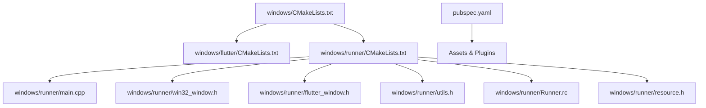
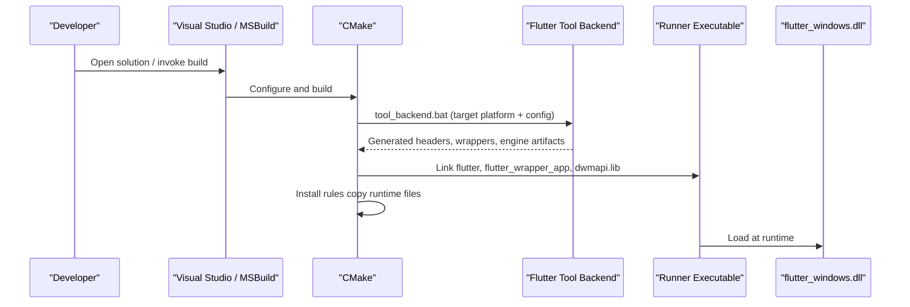
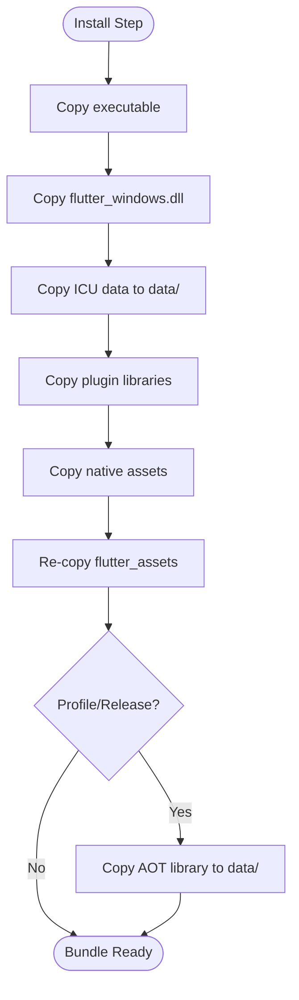
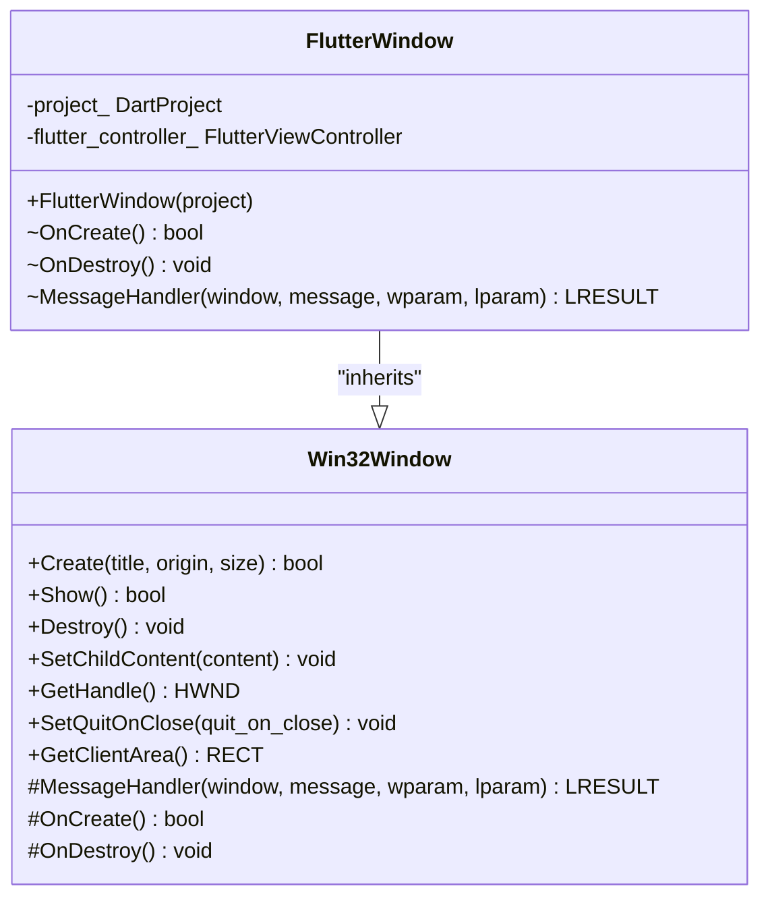
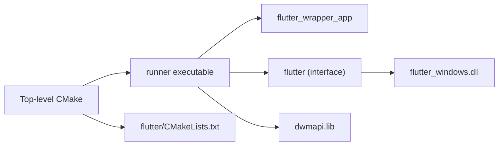

# Windows Desktop Deployment

<cite>
**Referenced Files in This Document**
- [CMakeLists.txt](file://windows/CMakeLists.txt)
- [CMakeLists.txt](file://windows/flutter/CMakeLists.txt)
- [CMakeLists.txt](file://windows/runner/CMakeLists.txt)
- [main.cpp](file://windows/runner/main.cpp)
- [win32_window.h](file://windows/runner/win32_window.h)
- [flutter_window.h](file://windows/runner/flutter_window.h)
- [utils.h](file://windows/runner/utils.h)
- [resource.h](file://windows/runner/resource.h)
- [Runner.rc](file://windows/runner/Runner.rc)
- [pubspec.yaml](file://pubspec.yaml)
</cite>

## Table of Contents
1. [Introduction](#introduction)
2. [Project Structure](#project-structure)
3. [Core Components](#core-components)
4. [Architecture Overview](#architecture-overview)
5. [Detailed Component Analysis](#detailed-component-analysis)
6. [Dependency Analysis](#dependency-analysis)
7. [Performance Considerations](#performance-considerations)
8. [Troubleshooting Guide](#troubleshooting-guide)
9. [Conclusion](#conclusion)
10. [Appendices](#appendices)

## Introduction
This document provides end-to-end guidance for building, bundling, and distributing the Flutter Windows desktop application in this repository. It focuses on CMake configuration, Visual Studio toolchain usage, MSBuild integration, installer packaging (Inno Setup or NSIS), code signing, platform-specific considerations (Windows API, file system access, native libraries), troubleshooting common Windows build issues, performance optimization for desktop environments, and enterprise distribution strategies.

## Project Structure
The Windows target is implemented with a standard Flutter Windows runner layout:
- Top-level CMake project configures build modes, Unicode, and install rules.
- flutter subdirectory integrates the Flutter engine and wrapper.
- runner subdirectory defines the executable, links dependencies, and embeds resources.
- pubspec.yaml declares Dart-side assets and dependencies that influence what gets bundled.

**Diagram sources**
- [CMakeLists.txt:1-109](file://windows/CMakeLists.txt#L1-L109)
- [CMakeLists.txt:1-110](file://windows/flutter/CMakeLists.txt#L1-L110)
- [CMakeLists.txt:1-41](file://windows/runner/CMakeLists.txt#L1-L41)
- [main.cpp:1-44](file://windows/runner/main.cpp#L1-L44)
- [win32_window.h:1-103](file://windows/runner/win32_window.h#L1-L103)
- [flutter_window.h:1-34](file://windows/runner/flutter_window.h#L1-L34)
- [utils.h:1-20](file://windows/runner/utils.h#L1-L20)
- [Runner.rc:56-121](file://windows/runner/Runner.rc#L56-L121)
- [resource.h:1-17](file://windows/runner/resource.h#L1-L17)
- [pubspec.yaml:1-100](file://pubspec.yaml#L1-L100)

**Section sources**
- [CMakeLists.txt:1-109](file://windows/CMakeLists.txt#L1-L109)
- [CMakeLists.txt:1-110](file://windows/flutter/CMakeLists.txt#L1-L110)
- [CMakeLists.txt:1-41](file://windows/runner/CMakeLists.txt#L1-L41)
- [pubspec.yaml:1-100](file://pubspec.yaml#L1-L100)

## Core Components
- Build configuration and install rules:
  - Defines binary name, build types (Debug, Profile, Release), Unicode macros, and standard compile options.
  - Installs runtime files next to the executable so it can run from any location.
- Flutter engine integration:
  - Generates and links flutter_windows.dll and headers via generated_config.cmake.
  - Builds wrapper libraries for app and plugins.
- Runner executable:
  - Creates a Win32 window, initializes COM, sets up Flutter view controller, and runs the message loop.
  - Links dwmapi.lib and includes version metadata via resource script.

Key responsibilities by file:
- windows/CMakeLists.txt: top-level project setup, install targets, asset copying, AOT library installation for non-Debug builds.
- windows/flutter/CMakeLists.txt: Flutter tool backend invocation, library and wrapper targets, header exposure.
- windows/runner/CMakeLists.txt: executable target, compile definitions, dependency linking, flutter_assemble dependency.
- windows/runner/main.cpp: process entry point, console attachment, COM initialization, Flutter project setup, window creation, message loop.
- windows/runner/win32_window.h: high-DPI-aware window abstraction used by FlutterWindow.
- windows/runner/flutter_window.h: Flutter view hosting inside a Win32 window.
- windows/runner/utils.h: utilities for console, UTF conversion, command-line parsing.
- windows/runner/Runner.rc and resource.h: embedded version info and icon resources.
- pubspec.yaml: Dart SDK constraints, dependencies, and assets that affect bundle contents.

**Section sources**
- [CMakeLists.txt:1-109](file://windows/CMakeLists.txt#L1-L109)
- [CMakeLists.txt:1-110](file://windows/flutter/CMakeLists.txt#L1-L110)
- [CMakeLists.txt:1-41](file://windows/runner/CMakeLists.txt#L1-L41)
- [main.cpp:1-44](file://windows/runner/main.cpp#L1-L44)
- [win32_window.h:1-103](file://windows/runner/win32_window.h#L1-L103)
- [flutter_window.h:1-34](file://windows/runner/flutter_window.h#L1-L34)
- [utils.h:1-20](file://windows/runner/utils.h#L1-L20)
- [Runner.rc:56-121](file://windows/runner/Runner.rc#L56-L121)
- [resource.h:1-17](file://windows/runner/resource.h#L1-L17)
- [pubspec.yaml:1-100](file://pubspec.yaml#L1-L100)

## Architecture Overview
The Windows build pipeline uses CMake as the orchestrator, invoking the Flutter tool backend to generate artifacts and link them into the runner executable. The resulting bundle contains the executable, Flutter engine DLL, ICU data, plugin libraries, native assets, and Flutter assets.

**Diagram sources**
- [CMakeLists.txt:86-109](file://windows/flutter/CMakeLists.txt#L86-L109)
- [CMakeLists.txt:35-40](file://windows/runner/CMakeLists.txt#L35-L40)
- [CMakeLists.txt:61-109](file://windows/CMakeLists.txt#L61-L109)

## Detailed Component Analysis

### Windows Build Environment Setup
- Visual Studio requirements:
  - Use a recent Visual Studio with C++ workload and CMake support.
  - Ensure the Windows SDK and MSVC toolchains are installed.
- Flutter Windows dependencies:
  - The Flutter tool generates the engine DLL and headers under the ephemeral directory.
  - The runner links against flutter_windows.dll and required Windows libraries.
- MSBuild configuration:
  - CMake drives MSBuild through Visual Studio; ensure generator selection matches your VS version.
  - Build configurations include Debug, Profile, and Release.

Practical steps:
- Install Visual Studio with C++ desktop development.
- Run Flutter doctor to validate Windows toolchain.
- Build using CMake or Visual Studio; the default install step places all runtime files beside the executable.

**Section sources**
- [CMakeLists.txt:13-33](file://windows/CMakeLists.txt#L13-L33)
- [CMakeLists.txt:86-109](file://windows/flutter/CMakeLists.txt#L86-L109)
- [CMakeLists.txt:35-40](file://windows/runner/CMakeLists.txt#L35-L40)

### Application Bundling
Bundling is handled by CMake install rules:
- Binary and Flutter engine DLL are installed to the same directory.
- ICU data file is copied to data/.
- Plugin-bundled libraries and native assets are included.
- Flutter assets (flutter_assets) are re-copied on each install to avoid stale files.
- AOT library (Profile/Release) is installed to data/.

**Diagram sources**
- [CMakeLists.txt:61-109](file://windows/CMakeLists.txt#L61-L109)

**Section sources**
- [CMakeLists.txt:61-109](file://windows/CMakeLists.txt#L61-L109)

### Installer Creation (Inno Setup or NSIS)
While not present in the repository, you can package the installed bundle using Inno Setup or NSIS:
- Inno Setup:
  - Create an .iss script that copies the entire install directory (executable, DLLs, data/, flutter_assets).
  - Add registry entries for file associations or shell extensions if needed.
  - Sign the installer and executables during build.
- NSIS:
  - Create a .nsi script that installs the bundle and optionally creates shortcuts.
  - Integrate code signing and versioning metadata.

Recommendations:
- Package the output of CMake install to a staging folder, then sign and archive.
- Include uninstaller logic and update mechanisms for enterprise scenarios.

[No sources needed since this section provides general guidance]

### Digital Signature Implementation
- Sign the executable and installer using a trusted certificate.
- Use signtool.exe to timestamp and verify signatures.
- Embed code signing information in CI/CD pipelines for automated builds.

[No sources needed since this section provides general guidance]

### Platform-Specific Considerations
- Windows API integrations:
  - The runner initializes COM and attaches to a console when debugging.
  - High-DPI window handling is provided by the Win32Window abstraction.
- File system access:
  - Utilities provide UTF-16 to UTF-8 conversion and command-line argument parsing.
- Native library dependencies:
  - The runner links dwmapi.lib for desktop window manager features.
  - Plugin-bundled libraries are automatically included by generated plugin rules.

**Diagram sources**
- [win32_window.h:10-100](file://windows/runner/win32_window.h#L10-L100)
- [flutter_window.h:11-31](file://windows/runner/flutter_window.h#L11-L31)

**Section sources**
- [main.cpp:8-42](file://windows/runner/main.cpp#L8-L42)
- [win32_window.h:10-100](file://windows/runner/win32_window.h#L10-L100)
- [flutter_window.h:11-31](file://windows/runner/flutter_window.h#L11-L31)
- [utils.h:7-17](file://windows/runner/utils.h#L7-L17)
- [CMakeLists.txt:35-37](file://windows/runner/CMakeLists.txt#L35-L37)

## Dependency Analysis
The runner depends on Flutter’s C++ client wrapper and the engine DLL. The top-level CMake project wires together the Flutter tool backend and install rules.

**Diagram sources**
- [CMakeLists.txt:35-40](file://windows/runner/CMakeLists.txt#L35-L40)
- [CMakeLists.txt:18-40](file://windows/flutter/CMakeLists.txt#L18-L40)
- [CMakeLists.txt:48-58](file://windows/CMakeLists.txt#L48-L58)

**Section sources**
- [CMakeLists.txt:35-40](file://windows/runner/CMakeLists.txt#L35-L40)
- [CMakeLists.txt:18-40](file://windows/flutter/CMakeLists.txt#L18-L40)
- [CMakeLists.txt:48-58](file://windows/CMakeLists.txt#L48-L58)

## Performance Considerations
- Build configuration:
  - Use Profile or Release builds for optimized performance.
  - AOT library is installed for non-Debug builds to improve startup time.
- Asset management:
  - Keep assets minimal and use appropriate image formats/sizes.
  - Avoid large fonts or unnecessary packages.
- Window and rendering:
  - Leverage high-DPI support to reduce scaling overhead.
  - Minimize heavy per-frame work in Dart; offload to background isolates.
- Plugin evaluation:
  - Audit native plugins for performance impact and bundle size.

[No sources needed since this section provides general guidance]

## Troubleshooting Guide
Common Windows-specific issues and resolutions:
- Missing Visual Studio components:
  - Ensure C++ workload and Windows SDK are installed.
- CMake generator mismatch:
  - Select the correct generator matching your VS version.
- Runtime DLL not found:
  - Verify flutter_windows.dll is installed next to the executable.
- Stale assets:
  - Re-run install to refresh flutter_assets directory.
- Version metadata:
  - Confirm Runner.rc and resource.h define expected version strings and icons.

Checklist:
- Validate Flutter doctor Windows toolchain.
- Clean and rebuild to regenerate ephemeral artifacts.
- Inspect install directory for all required files.

**Section sources**
- [CMakeLists.txt:61-109](file://windows/CMakeLists.txt#L61-L109)
- [Runner.rc:56-121](file://windows/runner/Runner.rc#L56-L121)
- [resource.h:1-17](file://windows/runner/resource.h#L1-L17)

## Conclusion
This repository implements a standard Flutter Windows desktop application with clear CMake-based build and install rules. By following the environment setup, bundling guidelines, and platform-specific notes here, you can reliably build, package, and distribute the application for Windows users, including enterprise scenarios with signed installers and automated CI/CD pipelines.

[No sources needed since this section summarizes without analyzing specific files]

## Appendices

### Build Commands and Targets
- Configure and build with CMake:
  - Generate project files for Visual Studio.
  - Build Debug, Profile, or Release configurations.
- Install to local bundle:
  - Use the install target to assemble the runnable bundle.

[No sources needed since this section provides general guidance]

### Enterprise Distribution Strategies
- Centralized artifact storage and versioning.
- Automated code signing and notarization workflows.
- Update mechanisms (silent updates, rollback).
- Policy-driven deployment via group policy or software distribution tools.

[No sources needed since this section provides general guidance]