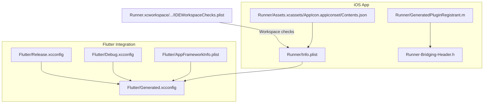
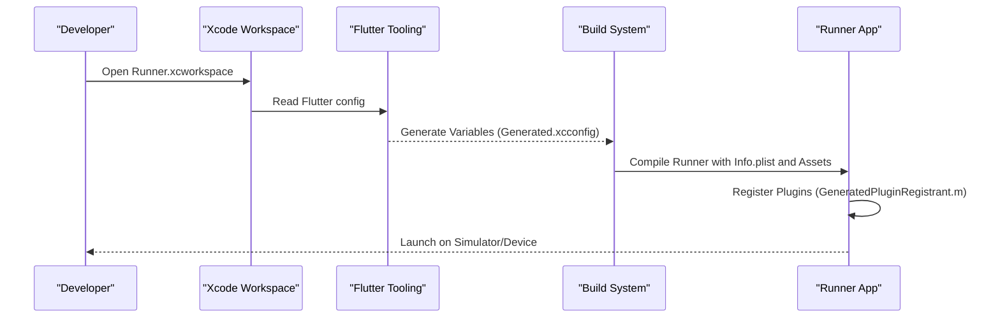
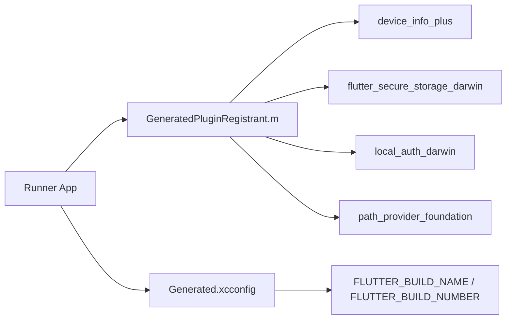

# iOS App Deployment

<cite>
**Referenced Files in This Document**
- [pubspec.yaml](file://pubspec.yaml)
- [Info.plist](file://ios/Runner/Info.plist)
- [AppFrameworkInfo.plist](file://ios/Flutter/AppFrameworkInfo.plist)
- [Generated.xcconfig](file://ios/Flutter/Generated.xcconfig)
- [Debug.xcconfig](file://ios/Flutter/Debug.xcconfig)
- [Release.xcconfig](file://ios/Flutter/Release.xcconfig)
- [IDEWorkspaceChecks.plist](file://ios/Runner.xcworkspace/xcshareddata/IDEWorkspaceChecks.plist)
- [Contents.json (AppIcon)](file://ios/Runner/Assets.xcassets/AppIcon.appiconset/Contents.json)
- [GeneratedPluginRegistrant.m](file://ios/Runner/GeneratedPluginRegistrant.m)
- [Runner-Bridging-Header.h](file://ios/Runner/Runner-Bridging-Header.h)
</cite>

## Table of Contents
1. [Introduction](#introduction)
2. [Project Structure](#project-structure)
3. [Core Components](#core-components)
4. [Architecture Overview](#architecture-overview)
5. [Detailed Component Analysis](#detailed-component-analysis)
6. [Dependency Analysis](#dependency-analysis)
7. [Performance Considerations](#performance-considerations)
8. [Troubleshooting Guide](#troubleshooting-guide)
9. [Conclusion](#conclusion)

## Introduction
This document provides a comprehensive guide to deploying the Flutter-based iOS application, focusing on Xcode workspace configuration, code signing and provisioning, entitlements, Info.plist settings, bundle identifier management, asset catalog organization, and the complete App Store Connect submission workflow. It also includes simulator vs device testing strategies and performance profiling techniques tailored for iOS applications.

## Project Structure
The iOS portion of this Flutter project is organized under ios/, with the main app target in Runner/ and Flutter framework metadata in Flutter/. The Xcode workspace is located at ios/Runner.xcworkspace. Key configuration files include:
- Runner/Info.plist: app metadata, supported orientations, and runtime keys
- Flutter/AppFrameworkInfo.plist: minimum OS version and framework identity
- Flutter/Generated.xcconfig: build-time variables injected by Flutter tooling
- Runner/Assets.xcassets/AppIcon.appiconset/Contents.json: app icon assets mapping
- Runner/GeneratedPluginRegistrant.m: plugin registration for native integrations

**Diagram sources**
- [Info.plist:1-52](file://ios/Runner/Info.plist#L1-L52)
- [AppFrameworkInfo.plist:1-27](file://ios/Flutter/AppFrameworkInfo.plist#L1-L27)
- [Generated.xcconfig:1-15](file://ios/Flutter/Generated.xcconfig#L1-L15)
- [Debug.xcconfig:1-2](file://ios/Flutter/Debug.xcconfig#L1-L2)
- [Release.xcconfig:1-2](file://ios/Flutter/Release.xcconfig#L1-L2)
- [Contents.json (AppIcon):1-123](file://ios/Runner/Assets.xcassets/AppIcon.appiconset/Contents.json#L1-L123)
- [GeneratedPluginRegistrant.m:1-42](file://ios/Runner/GeneratedPluginRegistrant.m#L1-L42)
- [Runner-Bridging-Header.h:1-1](file://ios/Runner/Runner-Bridging-Header.h#L1-L1)
- [IDEWorkspaceChecks.plist:1-9](file://ios/Runner.xcworkspace/xcshareddata/IDEWorkspaceChecks.plist#L1-L9)

**Section sources**
- [Info.plist:1-52](file://ios/Runner/Info.plist#L1-L52)
- [AppFrameworkInfo.plist:1-27](file://ios/Flutter/AppFrameworkInfo.plist#L1-L27)
- [Generated.xcconfig:1-15](file://ios/Flutter/Generated.xcconfig#L1-L15)
- [Debug.xcconfig:1-2](file://ios/Flutter/Debug.xcconfig#L1-L2)
- [Release.xcconfig:1-2](file://ios/Flutter/Release.xcconfig#L1-L2)
- [Contents.json (AppIcon):1-123](file://ios/Runner/Assets.xcassets/AppIcon.appiconset/Contents.json#L1-L123)
- [GeneratedPluginRegistrant.m:1-42](file://ios/Runner/GeneratedPluginRegistrant.m#L1-L42)
- [Runner-Bridging-Header.h:1-1](file://ios/Runner/Runner-Bridging-Header.h#L1-L1)
- [IDEWorkspaceChecks.plist:1-9](file://ios/Runner.xcworkspace/xcshareddata/IDEWorkspaceChecks.plist#L1-L9)

## Core Components
- Bundle Identifier and Versioning
  - The app’s bundle identifier is resolved via a build setting rather than hardcoded, enabling environment-specific values.
  - Short version string and build number are driven by Flutter’s generated build variables.
- Minimum OS Version
  - The Flutter framework sets a minimum deployment target that must be respected during distribution.
- Assets Catalog
  - App icons are defined with size and scale mappings for iPhone, iPad, and marketing use.
- Plugin Registration
  - Native plugins are registered automatically by the generated registrant, which may require entitlements or permissions.

Key implementation references:
- Bundle ID resolution and version mapping: [Info.plist:13-26](file://ios/Runner/Info.plist#L13-L26), [Generated.xcconfig:7-8](file://ios/Flutter/Generated.xcconfig#L7-L8)
- Minimum OS version: [AppFrameworkInfo.plist:23-24](file://ios/Flutter/AppFrameworkInfo.plist#L23-L24)
- App icon assets: [Contents.json (AppIcon):1-123](file://ios/Runner/Assets.xcassets/AppIcon.appiconset/Contents.json#L1-L123)
- Plugin registration: [GeneratedPluginRegistrant.m:33-40](file://ios/Runner/GeneratedPluginRegistrant.m#L33-L40)

**Section sources**
- [Info.plist:13-26](file://ios/Runner/Info.plist#L13-L26)
- [Generated.xcconfig:7-8](file://ios/Flutter/Generated.xcconfig#L7-L8)
- [AppFrameworkInfo.plist:23-24](file://ios/Flutter/AppFrameworkInfo.plist#L23-L24)
- [Contents.json (AppIcon):1-123](file://ios/Runner/Assets.xcassets/AppIcon.appiconset/Contents.json#L1-L123)
- [GeneratedPluginRegistrant.m:33-40](file://ios/Runner/GeneratedPluginRegistrant.m#L33-L40)

## Architecture Overview
The iOS build pipeline integrates Flutter-generated configuration with Xcode workspace settings. At build time, Flutter injects variables into Generated.xcconfig, which are consumed by Debug.xcconfig and Release.xcconfig. The Runner target reads Info.plist for runtime behavior and uses the asset catalog for app icons. Plugins are registered through the generated Objective-C registrant.

**Diagram sources**
- [IDEWorkspaceChecks.plist:1-9](file://ios/Runner.xcworkspace/xcshareddata/IDEWorkspaceChecks.plist#L1-L9)
- [Generated.xcconfig:1-15](file://ios/Flutter/Generated.xcconfig#L1-L15)
- [Debug.xcconfig:1-2](file://ios/Flutter/Debug.xcconfig#L1-L2)
- [Release.xcconfig:1-2](file://ios/Flutter/Release.xcconfig#L1-L2)
- [Info.plist:1-52](file://ios/Runner/Info.plist#L1-L52)
- [GeneratedPluginRegistrant.m:33-40](file://ios/Runner/GeneratedPluginRegistrant.m#L33-L40)

## Detailed Component Analysis

### Xcode Workspace Configuration
- Open the workspace file ios/Runner.xcworkspace in Xcode.
- Ensure the workspace integrity check is present; it indicates Xcode has computed relevant workspace settings.
- Verify that the Runner target is selected and that schemes are configured for Debug and Release builds.

Operational notes:
- Use the workspace rather than the .xcodeproj to ensure CocoaPods and Flutter integration are correctly loaded.
- Confirm that the correct signing team and bundle identifier are set per environment.

**Section sources**
- [IDEWorkspaceChecks.plist:1-9](file://ios/Runner.xcworkspace/xcshareddata/IDEWorkspaceChecks.plist#L1-L9)

### Provisioning Profiles and Code Signing
- Create an App ID in Apple Developer Portal matching the bundle identifier used by the app.
- Generate a Distribution Certificate and associate it with your Apple ID team.
- Create a Distribution Provisioning Profile linked to the App ID and certificate.
- In Xcode:
  - Set Automatic Signing or manually assign the provisioning profile for Release builds.
  - Ensure the Team is selected so profiles can be managed automatically if enabled.
- Validate code signing by building a Release archive and attempting to validate/upload via Xcode Organizer.

Best practices:
- Keep profiles scoped to specific environments (Development vs Distribution).
- Rotate certificates and profiles periodically and remove unused ones.

[No sources needed since this section provides general guidance]

### Entitlements Configuration
- Biometric authentication usage requires a Face ID usage description key in Info.plist.
- If using local authentication features, ensure the corresponding capability is enabled in Xcode and that the usage description is present.

Implementation reference:
- Face ID usage description key presence: [Info.plist:7-8](file://ios/Runner/Info.plist#L7-L8)

**Section sources**
- [Info.plist:7-8](file://ios/Runner/Info.plist#L7-L8)

### Platform-Specific Configurations in Info.plist
- Supported interface orientations are explicitly declared for iPhone and iPad.
- Runtime behaviors such as indirect input events support are enabled.
- Minimum OS version is enforced by the Flutter framework metadata.

Configuration references:
- Orientation arrays and runtime keys: [Info.plist:27-49](file://ios/Runner/Info.plist#L27-L49)
- Minimum OS version: [AppFrameworkInfo.plist:23-24](file://ios/Flutter/AppFrameworkInfo.plist#L23-L24)

**Section sources**
- [Info.plist:27-49](file://ios/Runner/Info.plist#L27-L49)
- [AppFrameworkInfo.plist:23-24](file://ios/Flutter/AppFrameworkInfo.plist#L23-L24)

### Bundle Identifier Management
- The bundle identifier is not hardcoded; it resolves from a build setting.
- Ensure the bundle identifier matches the App ID created in Apple Developer Portal.
- For multi-environment setups, manage distinct identifiers and provisioning profiles per environment.

Reference:
- Bundle ID resolution: [Info.plist:13-14](file://ios/Runner/Info.plist#L13-L14)

**Section sources**
- [Info.plist:13-14](file://ios/Runner/Info.plist#L13-L14)

### Asset Catalog Organization
- App icons are defined with size and scale mappings for multiple devices and contexts.
- Ensure all required sizes are included to pass App Store validation and display correctly across devices.

Reference:
- Icon asset definitions: [Contents.json (AppIcon):1-123](file://ios/Runner/Assets.xcassets/AppIcon.appiconset/Contents.json#L1-L123)

**Section sources**
- [Contents.json (AppIcon):1-123](file://ios/Runner/Assets.xcassets/AppIcon.appiconset/Contents.json#L1-L123)

### Complete App Store Connect Workflow
- Prepare Metadata:
  - App name, subtitle, description, keywords, and category.
  - Privacy policy URL and contact information.
- Prepare Screenshots:
  - Capture screenshots for all supported device sizes and orientations.
  - Ensure screenshots match the app’s UI and comply with guidelines.
- Submit for Review:
  - Upload the signed archive via Xcode Organizer or Transporter.
  - Fill out compliance questions (e.g., encryption, third-party tracking).
  - Select the appropriate build and submit for review.
- Post-Submission:
  - Monitor review status and respond to feedback.
  - Manage versions and releases in App Store Connect.

[No sources needed since this section provides general guidance]

### Review Guidelines Compliance
- Provide clear privacy and security descriptions where applicable (e.g., biometric usage).
- Avoid prohibited content and ensure data handling complies with Apple’s policies.
- Test thoroughly on real devices to catch platform-specific issues.

[No sources needed since this section provides general guidance]

### Simulator vs Device Testing Strategies
- Simulator:
  - Fast iteration for UI and logic validation.
  - Limited hardware capabilities; avoid relying on device-only features during early tests.
- Real Device:
  - Essential for testing biometrics, network behavior, and performance characteristics.
  - Validate provisioning and code signing on-device before submission.

[No sources needed since this section provides general guidance]

### Performance Profiling Techniques for iOS Applications
- Instruments:
  - Time Profiler for CPU hotspots.
  - Allocations and Leaks for memory issues.
  - Energy Log to identify battery-intensive operations.
- Xcode Diagnostics:
  - Memory graph debugger and zombie objects.
  - Network link conditioner for throttling scenarios.
- Flutter Tools:
  - Use devtools and performance overlays to analyze frame times and widget rebuilds.

[No sources needed since this section provides general guidance]

## Dependency Analysis
The iOS app depends on Flutter-generated configuration and several native plugins. The generated plugin registrant wires up plugins like device info, secure storage, local auth, and path provider.

**Diagram sources**
- [GeneratedPluginRegistrant.m:9-39](file://ios/Runner/GeneratedPluginRegistrant.m#L9-L39)
- [Generated.xcconfig:7-8](file://ios/Flutter/Generated.xcconfig#L7-L8)

**Section sources**
- [GeneratedPluginRegistrant.m:9-39](file://ios/Runner/GeneratedPluginRegistrant.m#L9-L39)
- [Generated.xcconfig:7-8](file://ios/Flutter/Generated.xcconfig#L7-L8)

## Performance Considerations
- Minimize heavy initialization at launch; defer non-critical work.
- Optimize image assets and avoid oversized images in the app bundle.
- Use background tasks judiciously and respect system constraints.
- Profile memory and CPU regularly to detect regressions early.

[No sources needed since this section provides general guidance]

## Troubleshooting Guide
Common iOS build and submission issues:
- Code signing errors:
  - Verify certificate validity, provisioning profile association, and bundle identifier alignment.
  - Clean derived data and rebuild after updating profiles.
- Missing entitlements:
  - Ensure required keys (e.g., Face ID usage description) are present in Info.plist.
- Plugin-related failures:
  - Confirm that plugins requiring native capabilities have proper entitlements and that the generated registrant is intact.
- Minimum OS version mismatches:
  - Align deployment target with AppFrameworkInfo.plist and Xcode settings.

References:
- Face ID usage description key: [Info.plist:7-8](file://ios/Runner/Info.plist#L7-L8)
- Minimum OS version: [AppFrameworkInfo.plist:23-24](file://ios/Flutter/AppFrameworkInfo.plist#L23-L24)
- Plugin registration: [GeneratedPluginRegistrant.m:33-40](file://ios/Runner/GeneratedPluginRegistrant.m#L33-L40)

**Section sources**
- [Info.plist:7-8](file://ios/Runner/Info.plist#L7-L8)
- [AppFrameworkInfo.plist:23-24](file://ios/Flutter/AppFrameworkInfo.plist#L23-L24)
- [GeneratedPluginRegistrant.m:33-40](file://ios/Runner/GeneratedPluginRegistrant.m#L33-L40)

## Conclusion
This guide outlined the essential steps to configure the iOS workspace, manage provisioning and code signing, configure entitlements, and prepare the app for App Store submission. By aligning Info.plist settings, bundle identifiers, and asset catalogs with Apple’s requirements—and by following best practices for testing and performance—you can streamline the deployment process and reduce friction during review.

[No sources needed since this section summarizes without analyzing specific files]