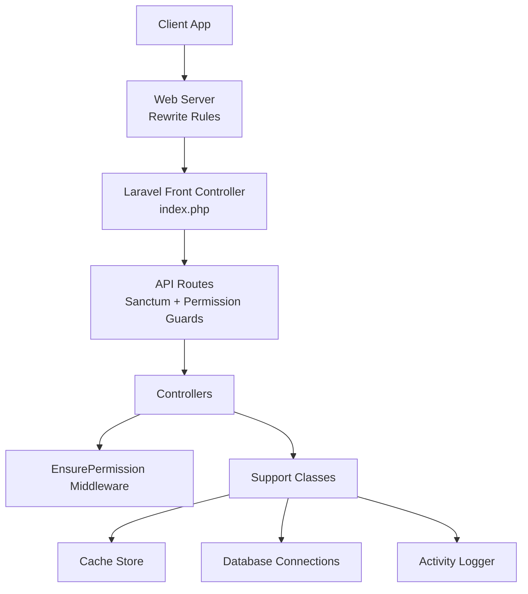
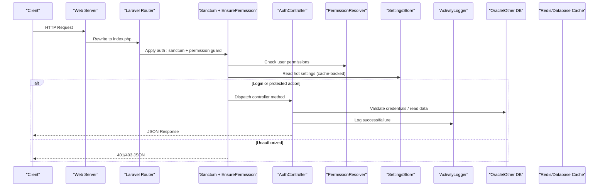
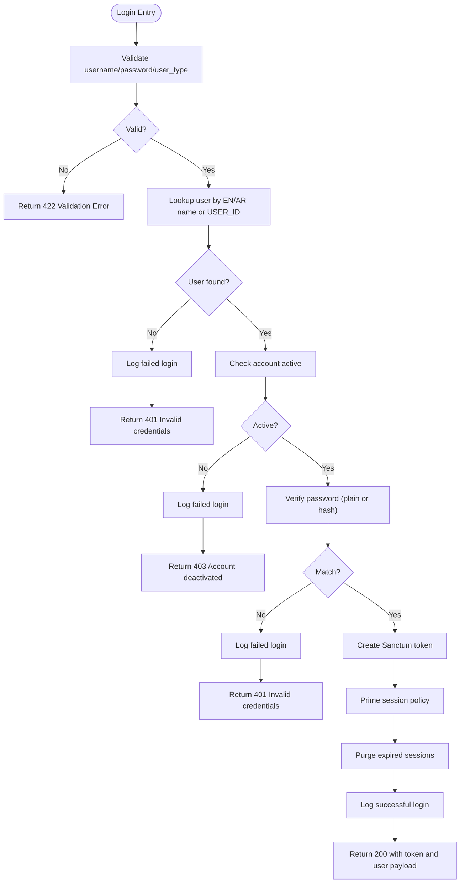
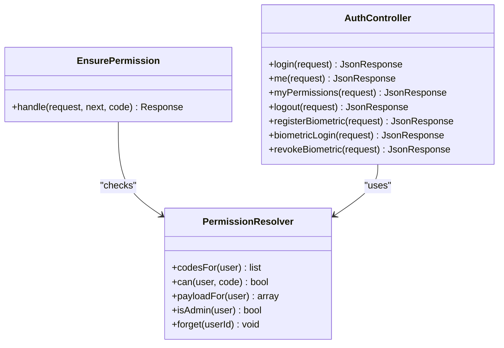
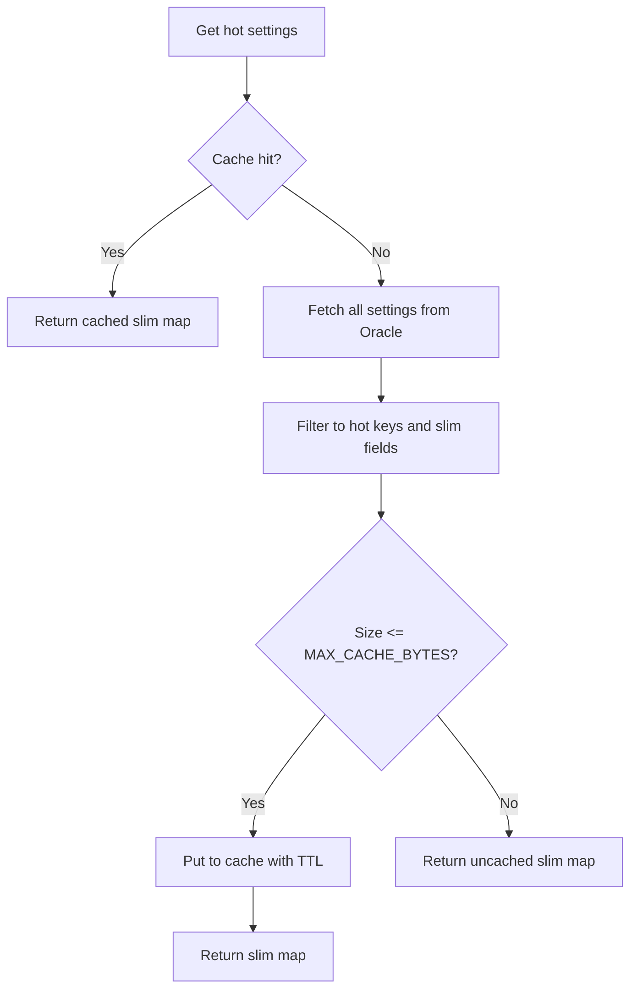
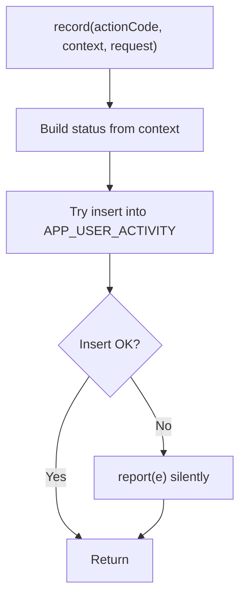
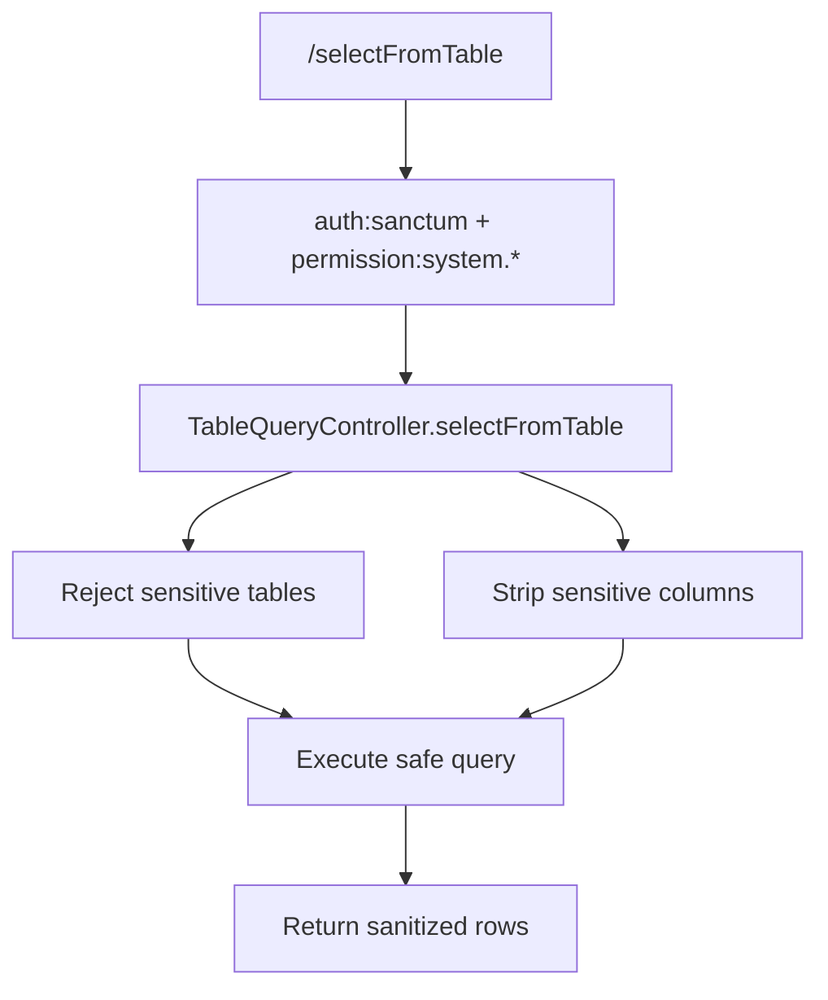
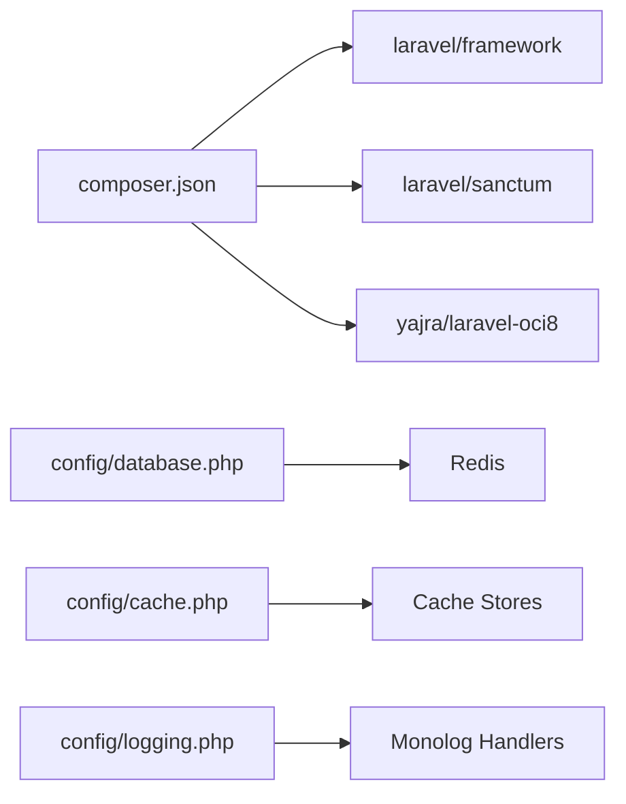

# Production Considerations

<cite>
**Referenced Files in This Document**
- [composer.json](file://kyApp_API/composer.json)
- [config/app.php](file://kyApp_API/config/app.php)
- [config/database.php](file://kyApp_API/config/database.php)
- [config/cache.php](file://kyApp_API/config/cache.php)
- [config/logging.php](file://kyApp_API/config/logging.php)
- [config/session.php](file://kyApp_API/config/session.php)
- [config/auth.php](file://kyApp_API/config/auth.php)
- [config/oracle.php](file://kyApp_API/config/oracle.php)
- [routes/api.php](file://kyApp_API/routes/api.php)
- [public/.htaccess](file://kyApp_API/public/.htaccess)
- [app/Http/Middleware/EnsurePermission.php](file://kyApp_API/app/Http/Middleware/EnsurePermission.php)
- [app/Support/ActivityLogger.php](file://kyApp_API/app/Support/ActivityLogger.php)
- [app/Support/SettingsStore.php](file://kyApp_API/app/Support/SettingsStore.php)
- [app/Support/PermissionResolver.php](file://kyApp_API/app/Support/PermissionResolver.php)
- [app/Http/Controllers/AuthController.php](file://kyApp_API/app/Http/Controllers/AuthController.php)
- [app/Http/Controllers/TableQueryController.php](file://kyApp_API/app/Http/Controllers/TableQueryController.php)
</cite>

## Table of Contents
1. [Introduction](#introduction)
2. [Project Structure](#project-structure)
3. [Core Components](#core-components)
4. [Architecture Overview](#architecture-overview)
5. [Detailed Component Analysis](#detailed-component-analysis)
6. [Dependency Analysis](#dependency-analysis)
7. [Performance Considerations](#performance-considerations)
8. [Security Hardening](#security-hardening)
9. [Monitoring and Logging](#monitoring-and-logging)
10. [Scaling Considerations](#scaling-considerations)
11. [Disaster Recovery, Backup, and Rollback](#disaster-recovery-backup-and-rollback)
12. [CI/CD Pipeline Setup](#cicd-pipeline-setup)
13. [Troubleshooting Guide](#troubleshooting-guide)
14. [Conclusion](#conclusion)

## Introduction
This document provides production deployment considerations for the Laravel API backend that powers the Flutter application. It focuses on performance optimization, security hardening, monitoring and logging, scaling strategies, disaster recovery, and CI/CD automation. The guidance is grounded in the actual configuration, routes, middleware, support classes, and controllers present in the repository.

## Project Structure
The production surface area relevant to this guide is primarily the Laravel API under `kyApp_API`. Key areas include:
- Framework configuration files for application behavior, database connections, caching, logging, sessions, authentication, and Oracle-specific settings.
- API route definitions with Sanctum authentication and fine-grained permission checks.
- Middleware enforcing deny-by-default authorization.
- Support classes handling permissions, session policy, settings storage, activity auditing, and Arabic encoding.
- Controllers implementing authentication flows and business endpoints.
- Web server rewrite rules for request routing and header forwarding.

**Diagram sources**
- [public/.htaccess:6-24](file://kyApp_API/public/.htaccess#L6-L24)
- [routes/api.php:17-327](file://kyApp_API/routes/api.php#L17-L327)
- [app/Http/Middleware/EnsurePermission.php:25-52](file://kyApp_API/app/Http/Middleware/EnsurePermission.php#L25-L52)
- [app/Support/ActivityLogger.php:37-73](file://kyApp_API/app/Support/ActivityLogger.php#L37-L73)

**Section sources**
- [public/.htaccess:1-26](file://kyApp_API/public/.htaccess#L1-L26)
- [routes/api.php:1-327](file://kyApp_API/routes/api.php#L1-L327)

## Core Components
- Application configuration controls environment, debug mode, URL, timezone, locale, encryption key, maintenance mode driver, and store.
- Database configuration defines default connection, multiple drivers (SQLite, MySQL, MariaDB, PostgreSQL, SQL Server, Oracle), Redis connections for default and cache stores, and retry/backoff options.
- Cache configuration supports array, database, file, Memcached, Redis, DynamoDB, Octane, and failover stores, plus a global prefix.
- Logging configuration defines channels including stack, single, daily, Slack, Papertrail, stderr, syslog, errorlog, null, and emergency.
- Session configuration sets driver, lifetime, encryption, file path, database connection/table, cache store, cookie attributes, SameSite, and partitioned cookies.
- Authentication configuration defines guards and providers, password reset broker, expiry, throttle, and timeout.
- Oracle configuration sets TNS/host/port/service_name/schema/edition/server_version/load_balance/name length, dynamic options, and NLS session variables.

**Section sources**
- [config/app.php:15-124](file://kyApp_API/config/app.php#L15-L124)
- [config/database.php:20-194](file://kyApp_API/config/database.php#L20-L194)
- [config/cache.php:18-115](file://kyApp_API/config/cache.php#L18-L115)
- [config/logging.php:21-128](file://kyApp_API/config/logging.php#L21-L128)
- [config/session.php:21-215](file://kyApp_API/config/session.php#L21-L215)
- [config/auth.php:18-115](file://kyApp_API/config/auth.php#L18-L115)
- [config/oracle.php:4-27](file://kyApp_API/config/oracle.php#L4-L27)

## Architecture Overview
The API uses Laravel Sanctum for token-based authentication and a custom IBAC (Identity-Based Access Control) layer enforced by middleware. Requests flow through web server rewrite rules into Laravel, where routes apply authentication and permission checks before reaching controllers. Controllers use support classes for permissions resolution, session policy, settings retrieval, and activity logging.

**Diagram sources**
- [routes/api.php:17-327](file://kyApp_API/routes/api.php#L17-L327)
- [app/Http/Middleware/EnsurePermission.php:25-52](file://kyApp_API/app/Http/Middleware/EnsurePermission.php#L25-L52)
- [app/Support/PermissionResolver.php:95-132](file://kyApp_API/app/Support/PermissionResolver.php#L95-L132)
- [app/Support/SettingsStore.php:130-153](file://kyApp_API/app/Support/SettingsStore.php#L130-L153)
- [app/Http/Controllers/AuthController.php:47-163](file://kyApp_API/app/Http/Controllers/AuthController.php#L47-L163)
- [app/Support/ActivityLogger.php:37-73](file://kyApp_API/app/Support/ActivityLogger.php#L37-L73)

## Detailed Component Analysis

### Authentication Flow and Token Lifecycle
- Input validation enforces required fields and allowed values for login and biometric registration/login.
- Username lookup supports English, Arabic, and numeric USER_ID inputs.
- Account activation check prevents disabled accounts from authenticating.
- Password verification supports legacy plain text and hashed passwords.
- Sanctum personal access tokens are issued; session policy primes and purges expired sessions.
- Activity logging records successful and failed authentication events.

**Diagram sources**
- [app/Http/Controllers/AuthController.php:47-163](file://kyApp_API/app/Http/Controllers/AuthController.php#L47-L163)
- [app/Support/ActivityLogger.php:37-73](file://kyApp_API/app/Support/ActivityLogger.php#L37-L73)

**Section sources**
- [app/Http/Controllers/AuthController.php:47-163](file://kyApp_API/app/Http/Controllers/AuthController.php#L47-L163)
- [app/Support/ActivityLogger.php:37-73](file://kyApp_API/app/Support/ActivityLogger.php#L37-L73)

### Authorization Model and Middleware
- Deny-by-default authorization via `EnsurePermission` middleware.
- Permission evaluation order: system admin bypass, system wildcard, explicit code, module wildcard, otherwise deny.
- Permissions are cached per user with a safe payload size limit due to Oracle cache constraints.
- Sensitive routes require specific permission codes; some paths are restricted to system-wide wildcard.

**Diagram sources**
- [app/Http/Middleware/EnsurePermission.php:25-52](file://kyApp_API/app/Http/Middleware/EnsurePermission.php#L25-L52)
- [app/Support/PermissionResolver.php:95-132](file://kyApp_API/app/Support/PermissionResolver.php#L95-L132)
- [app/Http/Controllers/AuthController.php:170-215](file://kyApp_API/app/Http/Controllers/AuthController.php#L170-L215)

**Section sources**
- [app/Http/Middleware/EnsurePermission.php:1-54](file://kyApp_API/app/Http/Middleware/EnsurePermission.php#L1-L54)
- [app/Support/PermissionResolver.php:1-275](file://kyApp_API/app/Support/PermissionResolver.php#L1-L275)
- [routes/api.php:45-88](file://kyApp_API/routes/api.php#L45-L88)

### Settings Storage and Caching Strategy
- Hot settings are cached with a short TTL to reduce database reads on the request path.
- Cached payload is bounded to avoid Oracle cache column overflow.
- Definitions requiring Arabic labels are read directly from the database.
- Writes validate type, bounds, lockability, and drop cache immediately.

**Diagram sources**
- [app/Support/SettingsStore.php:130-153](file://kyApp_API/app/Support/SettingsStore.php#L130-L153)
- [app/Support/SettingsStore.php:267-297](file://kyApp_API/app/Support/SettingsStore.php#L267-L297)

**Section sources**
- [app/Support/SettingsStore.php:1-477](file://kyApp_API/app/Support/SettingsStore.php#L1-L477)

### Activity Auditing
- All authentication events are recorded with context such as user ID, module code, description, status, IP, user agent, and platform.
- Audit writes are wrapped in try/catch to ensure they never break successful requests.
- Uses bound statements and truncation to fit column sizes.

**Diagram sources**
- [app/Support/ActivityLogger.php:37-73](file://kyApp_API/app/Support/ActivityLogger.php#L37-L73)

**Section sources**
- [app/Support/ActivityLogger.php:1-170](file://kyApp_API/app/Support/ActivityLogger.php#L1-L170)

### API Route Security and Data Exposure Controls
- Business routes are grouped behind Sanctum and permission middleware.
- Diagnostic query endpoint requires system-wide wildcard and enforces a denied table list and denied columns inside the controller.
- Parameter constraints restrict numeric IDs to prevent injection-like patterns.

**Diagram sources**
- [routes/api.php:154-155](file://kyApp_API/routes/api.php#L154-L155)
- [app/Http/Controllers/TableQueryController.php:28-59](file://kyApp_API/app/Http/Controllers/TableQueryController.php#L28-L59)

**Section sources**
- [routes/api.php:118-156](file://kyApp_API/routes/api.php#L118-L156)
- [app/Http/Controllers/TableQueryController.php:28-59](file://kyApp_API/app/Http/Controllers/TableQueryController.php#L28-L59)

## Dependency Analysis
Key runtime dependencies:
- Laravel framework and Sanctum for authentication.
- Oracle driver via yajra/laravel-oci8.
- Redis for caching and sessions when configured.
- Monolog handlers for structured logging.

**Diagram sources**
- [composer.json:11-18](file://kyApp_API/composer.json#L11-L18)
- [config/database.php:158-194](file://kyApp_API/config/database.php#L158-L194)
- [config/cache.php:35-100](file://kyApp_API/config/cache.php#L35-L100)
- [config/logging.php:53-128](file://kyApp_API/config/logging.php#L53-L128)

**Section sources**
- [composer.json:1-96](file://kyApp_API/composer.json#L1-L96)
- [config/database.php:20-194](file://kyApp_API/config/database.php#L20-L194)
- [config/cache.php:18-115](file://kyApp_API/config/cache.php#L18-L115)
- [config/logging.php:21-128](file://kyApp_API/config/logging.php#L21-L128)

## Performance Considerations
- Caching mechanisms:
  - Use Redis or Memcached for high-throughput caching; configure `CACHE_STORE` accordingly.
  - Leverage per-user permission caches and hot settings caches with bounded payloads to avoid Oracle cache column limits.
  - Prefer failover cache stores for resilience during cache outages.
- Database query optimization:
  - Use bound parameters consistently; avoid string interpolation.
  - Tune Oracle session variables and connection pooling; consider service names and load balancing.
  - Index frequently queried audit trails and permission grants; review slow queries using Oracle tools.
- API response optimization:
  - Return minimal payloads; avoid returning sensitive or large fields.
  - Use pagination and selective field projection for list endpoints.
  - Enable compression at the web server level and set appropriate cache headers for static assets.

[No sources needed since this section provides general guidance]

## Security Hardening
- HTTPS configuration:
  - Enforce HTTPS at the reverse proxy or web server; set `SESSION_SECURE_COOKIE` to true.
  - Configure HSTS, TLS versions, and cipher suites appropriately.
- Input validation:
  - Validate all incoming data using Laravel validators; enforce types, lengths, and allowlists.
  - Sanitize outputs based on context; prefer Blade escaping for HTML.
- SQL injection prevention:
  - Always use bound parameters; never interpolate user input into SQL strings.
  - Restrict dynamic queries; apply deny lists for sensitive tables/columns.
- XSS protection:
  - Escape output in templates; avoid raw rendering of untrusted content.
  - Set secure cookie flags (`http_only`, `secure`, `same_site`) and consider partitioned cookies if applicable.
- Authentication and authorization:
  - Use Sanctum tokens with proper expiration and revocation.
  - Enforce deny-by-default permissions; require explicit grants per route.
  - Protect administrative and diagnostic endpoints with system-wide permissions and internal deny lists.

**Section sources**
- [config/session.php:162-202](file://kyApp_API/config/session.php#L162-L202)
- [routes/api.php:154-155](file://kyApp_API/routes/api.php#L154-L155)
- [app/Http/Controllers/TableQueryController.php:28-59](file://kyApp_API/app/Http/Controllers/TableQueryController.php#L28-L59)
- [app/Http/Middleware/EnsurePermission.php:25-52](file://kyApp_API/app/Http/Middleware/EnsurePermission.php#L25-L52)

## Monitoring and Logging
- Application metrics:
  - Instrument request duration and throughput; expose health and readiness endpoints.
  - Track cache hit rates, database query latency, and queue processing times.
- Error tracking:
  - Centralize errors via Stackdriver, Sentry, or similar; forward critical logs to Slack or PagerDuty.
  - Capture structured logs with correlation IDs and user context where appropriate.
- Performance monitoring:
  - Monitor slow queries and resource contention; alert on threshold breaches.
  - Track audit trail volume and retention policies.

**Section sources**
- [config/logging.php:53-128](file://kyApp_API/config/logging.php#L53-L128)
- [app/Support/ActivityLogger.php:37-73](file://kyApp_API/app/Support/ActivityLogger.php#L37-L73)

## Scaling Considerations
- Horizontal scaling strategies:
  - Run multiple application instances behind a load balancer; ensure stateless request handling.
  - Externalize sessions and caches to Redis or database-backed stores.
- Load balancing:
  - Use health checks and sticky sessions only if necessary; prefer stateless design.
  - Configure graceful shutdown and rolling deployments.
- Database scaling approaches:
  - Use Oracle RAC or read replicas where supported; tune connection pools.
  - Partition large tables and archive old audit records.
  - Optimize queries and indexes; monitor execution plans.

**Section sources**
- [config/database.php:158-194](file://kyApp_API/config/database.php#L158-L194)
- [config/cache.php:35-100](file://kyApp_API/config/cache.php#L35-L100)
- [config/oracle.php:4-27](file://kyApp_API/config/oracle.php#L4-L27)

## Disaster Recovery, Backup, and Rollback
- Backup strategies:
  - Schedule regular backups of Oracle schemas, especially ACCOUNTS and application tables.
  - Back up Redis snapshots and persistence files; back up application storage and configuration.
- Restore procedures:
  - Test restore drills regularly; verify data integrity and application connectivity.
  - Maintain runbooks for partial and full restores.
- Rollback procedures:
  - Keep migration scripts idempotent; maintain rollback DDL scripts for schema changes.
  - Use feature flags and blue/green deployments to minimize risk.
  - Preserve previous artifact versions and environment configurations.

[No sources needed since this section provides general guidance]

## CI/CD Pipeline Setup
- Automated testing:
  - Run unit and feature tests; clear config cache before test runs.
  - Use isolated test databases and seeders; mock external services where appropriate.
- Deployment automation:
  - Build and publish artifacts; deploy to environments with environment-specific configurations.
  - Rotate secrets securely; avoid committing `.env` files.
- Environment-specific configurations:
  - Separate configs for dev, staging, and production; enable debug only in development.
  - Configure logging channels per environment; route critical logs to alerting systems.
- Best practices:
  - Enforce code quality checks and dependency audits.
  - Implement canary releases and automated rollbacks on failure.

**Section sources**
- [composer.json:42-77](file://kyApp_API/composer.json#L42-L77)
- [config/app.php:29-42](file://kyApp_API/config/app.php#L29-L42)
- [config/logging.php:53-128](file://kyApp_API/config/logging.php#L53-L128)

## Troubleshooting Guide
- Common issues:
  - Oracle cache column overflow due to large payloads; reduce cached data or fall back to direct DB reads.
  - Empty Oracle DATE values causing type errors; normalize date fields before use.
  - Permission cache staleness after grant changes; invalidate per-user caches explicitly.
- Debugging steps:
  - Inspect logs for authentication failures and permission denials.
  - Validate environment variables and secret rotation.
  - Review route middleware chains and permission assignments.
- Recovery actions:
  - Clear caches and recompile configuration.
  - Re-run migrations or seeders cautiously; verify schema state.
  - Reset sessions and revoke tokens if compromised.

**Section sources**
- [app/Support/PermissionResolver.php:35-43](file://kyApp_API/app/Support/PermissionResolver.php#L35-L43)
- [app/Support/SettingsStore.php:23-27](file://kyApp_API/app/Support/SettingsStore.php#L23-L27)
- [config/logging.php:53-128](file://kyApp_API/config/logging.php#L53-L128)

## Conclusion
Productionizing this Laravel API requires careful attention to caching, database tuning, secure authentication and authorization, comprehensive logging, scalable architecture, robust disaster recovery, and automated CI/CD pipelines. The existing configuration and code provide strong foundations; align operational practices with these guidelines to achieve reliable, secure, and performant production deployments.

[No sources needed since this section summarizes without analyzing specific files]