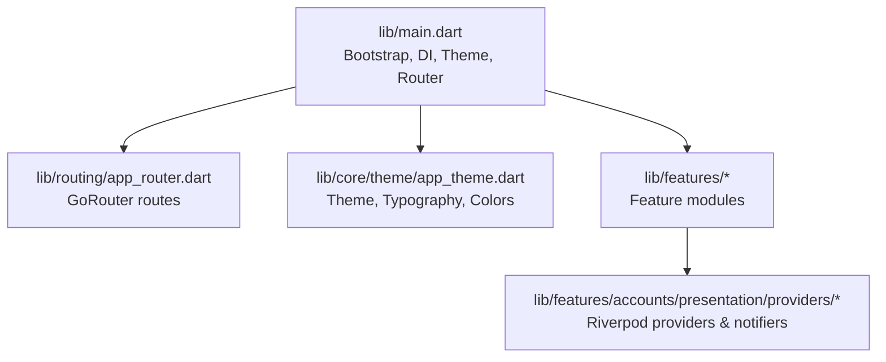
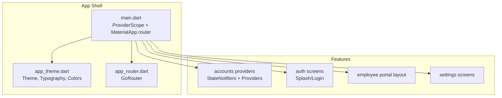
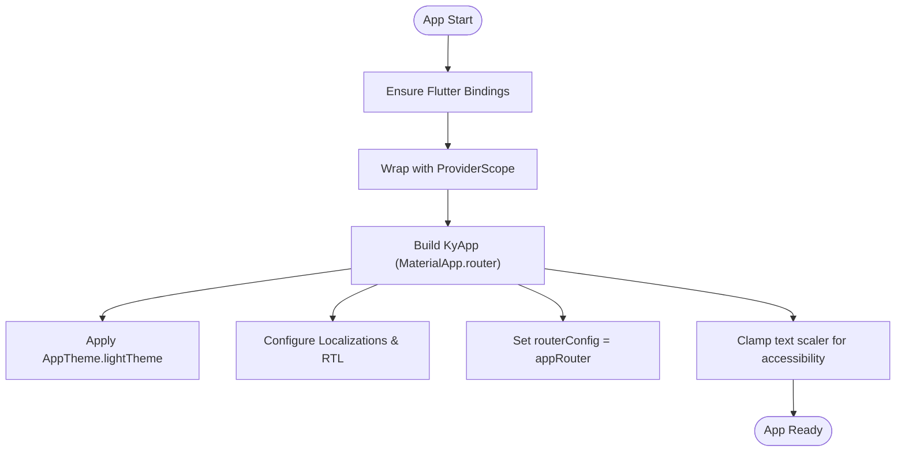
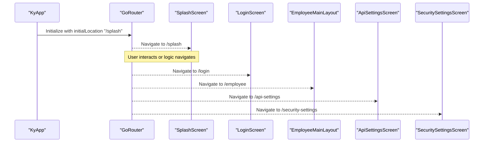
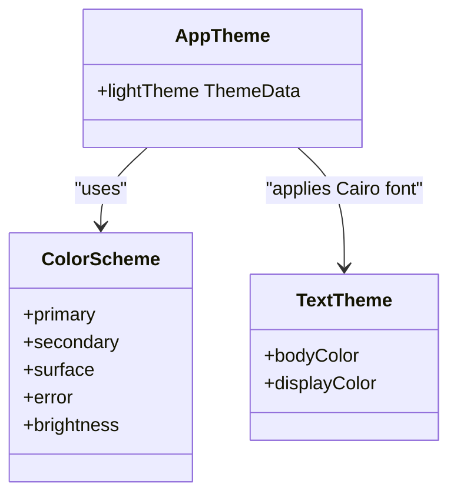
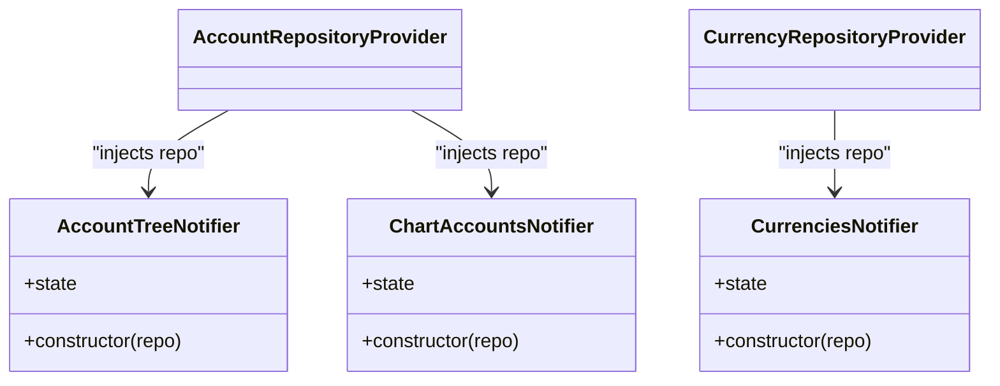
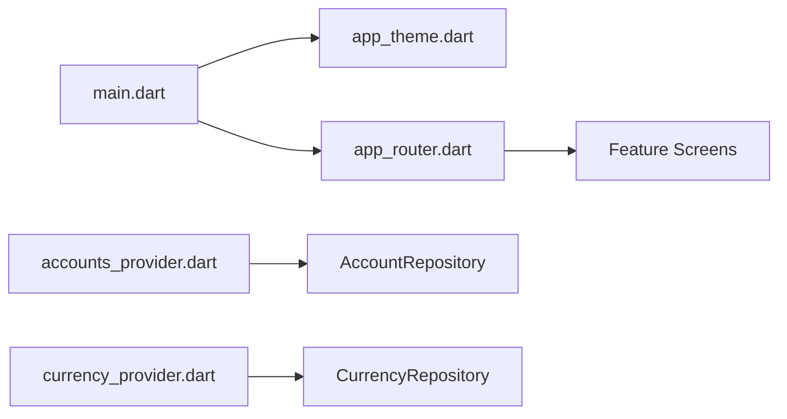

# Core Architecture

<cite>
**Referenced Files in This Document**
- [main.dart](file://lib/main.dart)
- [app_router.dart](file://lib/routing/app_router.dart)
- [app_theme.dart](file://lib/core/theme/app_theme.dart)
- [accounts_provider.dart](file://lib/features/accounts/presentation/providers/accounts_provider.dart)
- [currency_provider.dart](file://lib/features/accounts/presentation/providers/currency_provider.dart)
</cite>

## Table of Contents
1. [Introduction](#introduction)
2. [Project Structure](#project-structure)
3. [Core Components](#core-components)
4. [Architecture Overview](#architecture-overview)
5. [Detailed Component Analysis](#detailed-component-analysis)
6. [Dependency Analysis](#dependency-analysis)
7. [Performance Considerations](#performance-considerations)
8. [Troubleshooting Guide](#troubleshooting-guide)
9. [Conclusion](#conclusion)

## Introduction
This document explains the Flutter application’s core architecture with a focus on:
- Application bootstrap and dependency injection setup using Riverpod
- State management patterns with providers and notifiers
- Navigation via GoRouter, including route definitions and navigation flow
- Theme system covering color schemes, typography, and responsive text scaling
- Practical guidance for extending themes, adding routes, and implementing stateful features

The goal is to provide both high-level understanding and code-level insights so that developers can extend the app confidently while maintaining clean architecture principles.

## Project Structure
At a high level, the Flutter application is organized into:
- lib/main.dart: Entry point, dependency injection scope, theme, localization, and router integration
- lib/routing/app_router.dart: Centralized routing configuration using GoRouter
- lib/core/theme/app_theme.dart: Centralized theme definition with Material 3, typography, and input/button/card styling
- lib/features: Feature-based modules (e.g., accounts, admin, auth, settings), each containing presentation layer providers and screens

**Diagram sources**
- [main.dart:7-46](file://lib/main.dart#L7-L46)
- [app_router.dart:10-36](file://lib/routing/app_router.dart#L10-L36)
- [app_theme.dart:7-86](file://lib/core/theme/app_theme.dart#L7-L86)

**Section sources**
- [main.dart:7-46](file://lib/main.dart#L7-L46)
- [app_router.dart:10-36](file://lib/routing/app_router.dart#L10-L36)
- [app_theme.dart:7-86](file://lib/core/theme/app_theme.dart#L7-L86)

## Core Components
- Bootstrap and Dependency Injection
  - The app initializes Flutter bindings, wraps the root widget with ProviderScope from Riverpod, and configures MaterialApp.router with theme, localization, and router.
- Routing
  - GoRouter is configured centrally with initial location and route definitions for splash, login, employee portal, API settings, and security settings.
- Theme System
  - AppTheme defines a light theme using Material 3, Cairo Arabic font, consistent color tokens, and styled components (AppBar, inputs, buttons, cards).
- State Management
  - Riverpod is used across features; examples include repository providers, StateNotifier classes, and provider wiring for UI state.

**Section sources**
- [main.dart:7-46](file://lib/main.dart#L7-L46)
- [app_router.dart:10-36](file://lib/routing/app_router.dart#L10-L36)
- [app_theme.dart:7-86](file://lib/core/theme/app_theme.dart#L7-L86)
- [accounts_provider.dart:9-128](file://lib/features/accounts/presentation/providers/accounts_provider.dart#L9-L128)
- [currency_provider.dart:8-92](file://lib/features/accounts/presentation/providers/currency_provider.dart#L8-L92)

## Architecture Overview
The application follows a layered approach:
- Presentation Layer: Widgets and screens consume Riverpod providers to render reactive UIs.
- State Layer: Notifiers encapsulate business logic and expose state to the UI.
- Data Layer: Repositories abstract network calls (via Dio client providers) and data models.
- Infrastructure: Theme, routing, and localization are centralized at the app level.

**Diagram sources**
- [main.dart:7-46](file://lib/main.dart#L7-L46)
- [app_theme.dart:7-86](file://lib/core/theme/app_theme.dart#L7-L86)
- [app_router.dart:10-36](file://lib/routing/app_router.dart#L10-L36)
- [accounts_provider.dart:9-128](file://lib/features/accounts/presentation/providers/accounts_provider.dart#L9-L128)

## Detailed Component Analysis

### Bootstrap and Dependency Injection (main.dart)
- Initializes Flutter bindings and provides a global ProviderScope for Riverpod.
- Configures MaterialApp.router with:
  - Theme from AppTheme
  - Localization delegates and supported locales (Arabic and English)
  - Text scaler clamping to prevent overflow on small screens
  - Router configuration via GoRouter

**Diagram sources**
- [main.dart:7-46](file://lib/main.dart#L7-L46)

**Section sources**
- [main.dart:7-46](file://lib/main.dart#L7-L46)

### Navigation with GoRouter (app_router.dart)
- Centralized GoRouter instance with:
  - Initial location set to splash
  - Route definitions for splash, login, employee main layout, API settings, and security settings
- Each route maps directly to a screen widget.

**Diagram sources**
- [app_router.dart:10-36](file://lib/routing/app_router.dart#L10-L36)

**Section sources**
- [app_router.dart:10-36](file://lib/routing/app_router.dart#L10-L36)

### Theme System (app_theme.dart)
- Centralizes visual design:
  - Uses Material 3 and Cairo Arabic font family
  - Defines color scheme based on token colors
  - Styles AppBar, InputDecoration, ElevatedButton, and Card consistently
- Provides a single entry point for theming across the app.

**Diagram sources**
- [app_theme.dart:7-86](file://lib/core/theme/app_theme.dart#L7-L86)

**Section sources**
- [app_theme.dart:7-86](file://lib/core/theme/app_theme.dart#L7-L86)

### State Management with Riverpod (accounts and currency providers)
- Repository Providers
  - Provide repositories (e.g., AccountRepository, CurrencyRepository) constructed with dependencies like Dio client.
- StateNotifiers
  - Encapsulate feature-specific state and behavior (e.g., AccountTreeNotifier, ChartAccountsNotifier, CurrenciesNotifier).
- Provider Wiring
  - StateNotifierProvider instances wire notifiers to repositories and expose state to widgets.

**Diagram sources**
- [accounts_provider.dart:9-128](file://lib/features/accounts/presentation/providers/accounts_provider.dart#L9-L128)
- [currency_provider.dart:8-92](file://lib/features/accounts/presentation/providers/currency_provider.dart#L8-L92)

**Section sources**
- [accounts_provider.dart:9-128](file://lib/features/accounts/presentation/providers/accounts_provider.dart#L9-L128)
- [currency_provider.dart:8-92](file://lib/features/accounts/presentation/providers/currency_provider.dart#L8-L92)

### Practical Examples

#### Extending the Theme
- Add new color tokens and update ColorScheme accordingly.
- Extend input, button, and card styles to maintain consistency.
- Ensure Cairo font remains applied across text themes.

[No sources needed since this section provides general guidance]

#### Adding New Routes
- Define a new GoRoute in app_router.dart with a path and builder returning the target screen.
- Navigate programmatically using GoRouter methods from any context.

[No sources needed since this section provides general guidance]

#### Implementing State Management Patterns
- Create a StateNotifier subclass to manage feature state.
- Expose a StateNotifierProvider that wires the notifier with its dependencies.
- Consume state in widgets using ref.watch or provider selectors.

[No sources needed since this section provides general guidance]

## Dependency Analysis
High-level dependencies among core components:
- main.dart depends on app_theme.dart and app_router.dart
- app_router.dart imports feature screens
- Feature providers depend on repositories and network clients

**Diagram sources**
- [main.dart:7-46](file://lib/main.dart#L7-L46)
- [app_router.dart:10-36](file://lib/routing/app_router.dart#L10-L36)
- [accounts_provider.dart:9-128](file://lib/features/accounts/presentation/providers/accounts_provider.dart#L9-L128)
- [currency_provider.dart:8-92](file://lib/features/accounts/presentation/providers/currency_provider.dart#L8-L92)

**Section sources**
- [main.dart:7-46](file://lib/main.dart#L7-L46)
- [app_router.dart:10-36](file://lib/routing/app_router.dart#L10-L36)
- [accounts_provider.dart:9-128](file://lib/features/accounts/presentation/providers/accounts_provider.dart#L9-L128)
- [currency_provider.dart:8-92](file://lib/features/accounts/presentation/providers/currency_provider.dart#L8-L92)

## Performance Considerations
- Use ProviderScope once at the app root to avoid unnecessary rebuilds.
- Prefer selective reads with ref.watch and provider selectors to minimize widget rebuilds.
- Clamp text scaler to prevent layout thrash on small screens.
- Keep route builders lightweight; defer heavy computations until after navigation.
- Cache expensive data in notifiers or use FutureProvider.family for parameterized requests.

[No sources needed since this section provides general guidance]

## Troubleshooting Guide
- If the app fails to start:
  - Verify ProviderScope is wrapping the root widget.
  - Ensure MaterialApp.router has a valid routerConfig.
- If routes do not navigate:
  - Confirm route paths match those defined in app_router.dart.
  - Check initialLocation and ensure no guards block navigation.
- If theme looks incorrect:
  - Validate that AppTheme.lightTheme is applied and color tokens are correctly referenced.
- If state does not update:
  - Ensure StateNotifierProvider is properly wired and notifiers emit updated states.

**Section sources**
- [main.dart:7-46](file://lib/main.dart#L7-L46)
- [app_router.dart:10-36](file://lib/routing/app_router.dart#L10-L36)
- [app_theme.dart:7-86](file://lib/core/theme/app_theme.dart#L7-L86)
- [accounts_provider.dart:9-128](file://lib/features/accounts/presentation/providers/accounts_provider.dart#L9-L128)
- [currency_provider.dart:8-92](file://lib/features/accounts/presentation/providers/currency_provider.dart#L8-L92)

## Conclusion
The application’s core architecture centers around a clean separation of concerns:
- Bootstrap and DI via Riverpod’s ProviderScope
- Centralized routing with GoRouter
- Unified theming through AppTheme
- Reactive state management using Riverpod providers and notifiers

Following these patterns ensures scalability, testability, and maintainability as the app grows.

[No sources needed since this section summarizes without analyzing specific files]