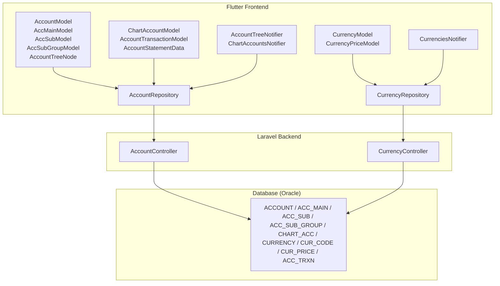
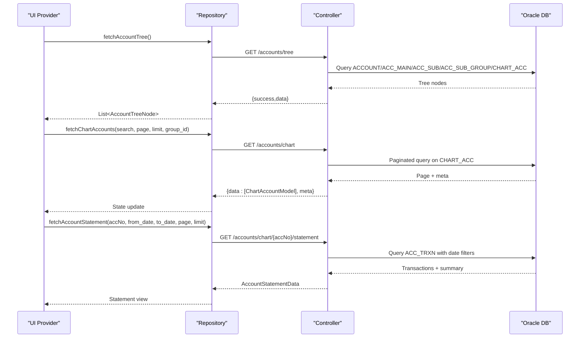
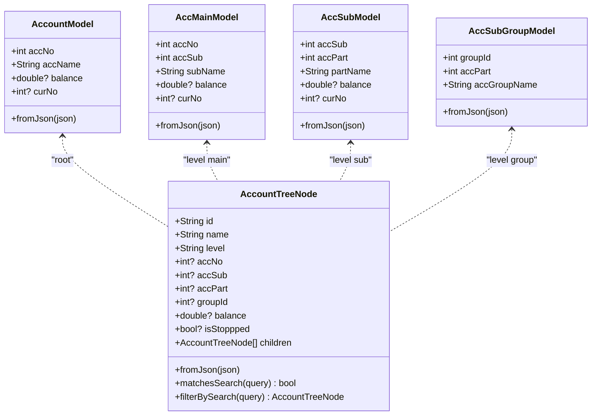
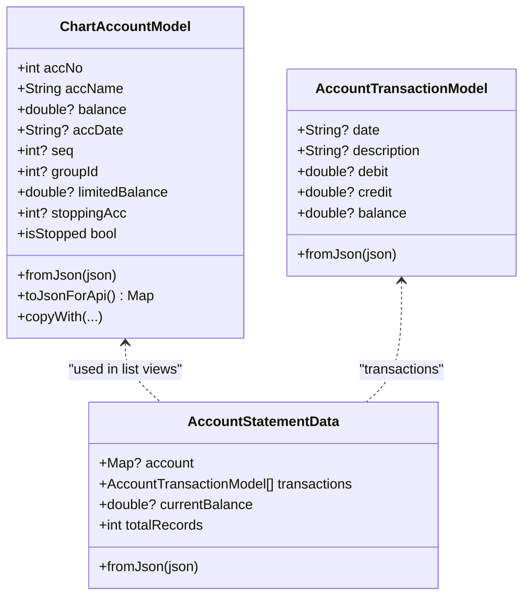
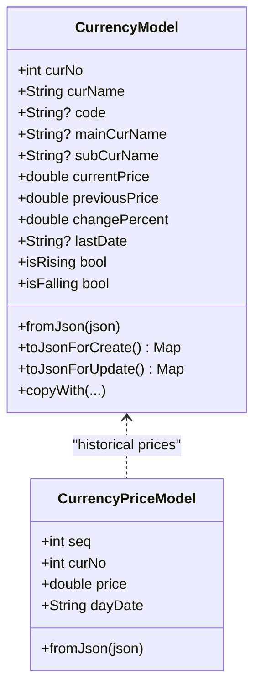
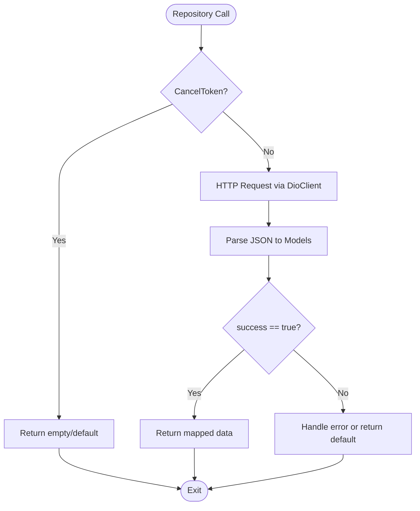
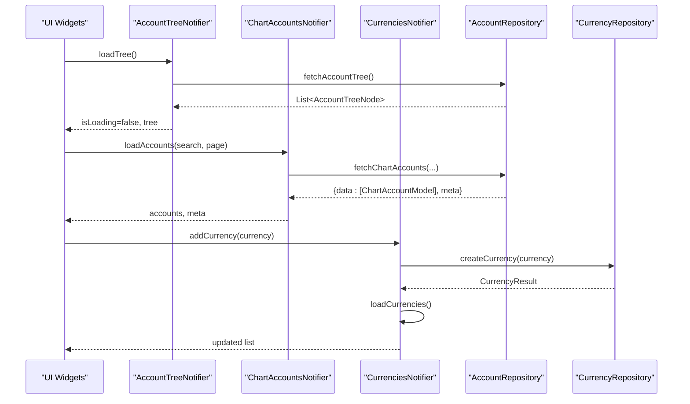
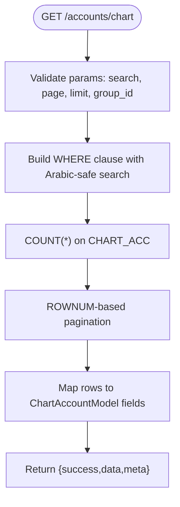
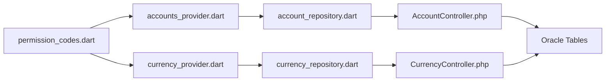

# Accounting Module

<cite>
**Referenced Files in This Document**
- [account_model.dart](file://lib/features/accounts/data/models/account_model.dart)
- [chart_account_model.dart](file://lib/features/accounts/data/models/chart_account_model.dart)
- [currency_model.dart](file://lib/features/accounts/data/models/currency_model.dart)
- [account_repository.dart](file://lib/features/accounts/data/repositories/account_repository.dart)
- [currency_repository.dart](file://lib/features/accounts/data/repositories/currency_repository.dart)
- [accounts_provider.dart](file://lib/features/accounts/presentation/providers/accounts_provider.dart)
- [currency_provider.dart](file://lib/features/accounts/presentation/providers/currency_provider.dart)
- [AccountController.php](file://kyApp_API/app/Http/Controllers/AccountController.php)
- [CurrencyController.php](file://kyApp_API/app/Http/Controllers/CurrencyController.php)
- [permission_codes.dart](file://lib/core/constants/permission_codes.dart)
</cite>

## Table of Contents
1. [Introduction](#introduction)
2. [Project Structure](#project-structure)
3. [Core Components](#core-components)
4. [Architecture Overview](#architecture-overview)
5. [Detailed Component Analysis](#detailed-component-analysis)
6. [Dependency Analysis](#dependency-analysis)
7. [Performance Considerations](#performance-considerations)
8. [Troubleshooting Guide](#troubleshooting-guide)
9. [Conclusion](#conclusion)
10. [Appendices](#appendices)

## Introduction
This document describes the accounting module that provides:
- Chart of accounts management with a hierarchical tree structure
- Financial statements and detailed statement generation
- Multi-currency support with exchange rate history
- UI state providers for account and currency operations
- Backend controllers for Oracle 11g data access

The module is implemented as a Flutter frontend (models, repositories, Riverpod providers) and a Laravel backend (controllers). It integrates with an Oracle database through a dedicated connection and supports Arabic text encoding.

## Project Structure
The accounting module spans two layers:
- Flutter layer: models, repositories, and Riverpod providers under lib/features/accounts
- Backend layer: AccountController and CurrencyController under kyApp_API/app/Http/Controllers

**Diagram sources**
- [account_model.dart:1-191](file://lib/features/accounts/data/models/account_model.dart#L1-L191)
- [chart_account_model.dart:1-147](file://lib/features/accounts/data/models/chart_account_model.dart#L1-L147)
- [currency_model.dart:1-123](file://lib/features/accounts/data/models/currency_model.dart#L1-L123)
- [account_repository.dart:1-313](file://lib/features/accounts/data/repositories/account_repository.dart#L1-L313)
- [currency_repository.dart:1-162](file://lib/features/accounts/data/repositories/currency_repository.dart#L1-L162)
- [accounts_provider.dart:1-158](file://lib/features/accounts/presentation/providers/accounts_provider.dart#L1-L158)
- [currency_provider.dart:1-96](file://lib/features/accounts/presentation/providers/currency_provider.dart#L1-L96)
- [AccountController.php:1-810](file://kyApp_API/app/Http/Controllers/AccountController.php#L1-L810)
- [CurrencyController.php:1-402](file://kyApp_API/app/Http/Controllers/CurrencyController.php#L1-L402)

**Section sources**
- [account_model.dart:1-191](file://lib/features/accounts/data/models/account_model.dart#L1-L191)
- [chart_account_model.dart:1-147](file://lib/features/accounts/data/models/chart_account_model.dart#L1-L147)
- [currency_model.dart:1-123](file://lib/features/accounts/data/models/currency_model.dart#L1-L123)
- [account_repository.dart:1-313](file://lib/features/accounts/data/repositories/account_repository.dart#L1-L313)
- [currency_repository.dart:1-162](file://lib/features/accounts/data/repositories/currency_repository.dart#L1-L162)
- [accounts_provider.dart:1-158](file://lib/features/accounts/presentation/providers/accounts_provider.dart#L1-L158)
- [currency_provider.dart:1-96](file://lib/features/accounts/presentation/providers/currency_provider.dart#L1-L96)
- [AccountController.php:1-810](file://kyApp_API/app/Http/Controllers/AccountController.php#L1-L810)
- [CurrencyController.php:1-402](file://kyApp_API/app/Http/Controllers/CurrencyController.php#L1-L402)

## Core Components
- Models define the domain entities:
  - Hierarchical chart of accounts nodes and leaf financial accounts
  - Currency definitions and price history
- Repositories encapsulate HTTP calls to backend endpoints and map responses to models
- Providers manage UI state using Riverpod and orchestrate repository calls
- Controllers implement business logic and database queries against Oracle tables

Key responsibilities:
- Account model hierarchy: ACCOUNT → ACC_MAIN → ACC_SUB → ACC_SUB_GROUP → CHART_ACC
- Financial statements: per-account transaction lists and aggregated summaries
- Multi-currency: currency metadata, current/previous prices, change percent, and historical prices
- Permissions: feature-level permission codes for accounts and currencies

**Section sources**
- [account_model.dart:1-191](file://lib/features/accounts/data/models/account_model.dart#L1-L191)
- [chart_account_model.dart:1-147](file://lib/features/accounts/data/models/chart_account_model.dart#L1-L147)
- [currency_model.dart:1-123](file://lib/features/accounts/data/models/currency_model.dart#L1-L123)
- [account_repository.dart:1-313](file://lib/features/accounts/data/repositories/account_repository.dart#L1-L313)
- [currency_repository.dart:1-162](file://lib/features/accounts/data/repositories/currency_repository.dart#L1-L162)
- [accounts_provider.dart:1-158](file://lib/features/accounts/presentation/providers/accounts_provider.dart#L1-L158)
- [currency_provider.dart:1-96](file://lib/features/accounts/presentation/providers/currency_provider.dart#L1-L96)
- [AccountController.php:1-810](file://kyApp_API/app/Http/Controllers/AccountController.php#L1-L810)
- [CurrencyController.php:1-402](file://kyApp_API/app/Http/Controllers/CurrencyController.php#L1-L402)
- [permission_codes.dart:75-93](file://lib/core/constants/permission_codes.dart#L75-L93)

## Architecture Overview
The accounting module follows a layered architecture:
- Presentation layer (Riverpod providers) manages UI state and triggers repository methods
- Data layer (repositories) performs network requests via DioClient and maps JSON to models
- API layer (controllers) validates input, executes Oracle queries, and returns standardized JSON
- Database layer (Oracle) stores chart of accounts, transactions, currencies, and exchange rates

**Diagram sources**
- [accounts_provider.dart:46-61](file://lib/features/accounts/presentation/providers/accounts_provider.dart#L46-L61)
- [accounts_provider.dart:96-129](file://lib/features/accounts/presentation/providers/accounts_provider.dart#L96-L129)
- [account_repository.dart:121-138](file://lib/features/accounts/data/repositories/account_repository.dart#L121-L138)
- [account_repository.dart:145-183](file://lib/features/accounts/data/repositories/account_repository.dart#L145-L183)
- [account_repository.dart:252-282](file://lib/features/accounts/data/repositories/account_repository.dart#L252-L282)
- [AccountController.php:650-805](file://kyApp_API/app/Http/Controllers/AccountController.php#L650-L805)
- [AccountController.php:161-243](file://kyApp_API/app/Http/Controllers/AccountController.php#L161-L243)
- [AccountController.php:439-540](file://kyApp_API/app/Http/Controllers/AccountController.php#L439-L540)

## Detailed Component Analysis

### Chart of Accounts Model Hierarchy
The chart of accounts is represented by a nested tree:
- AccountModel: top-level section
- AccMainModel: secondary level
- AccSubModel: tertiary level
- AccSubGroupModel: grouping for sub-levels
- AccountTreeNode: UI-friendly node with children and search/filter utilities

**Diagram sources**
- [account_model.dart:8-28](file://lib/features/accounts/data/models/account_model.dart#L8-L28)
- [account_model.dart:30-53](file://lib/features/accounts/data/models/account_model.dart#L30-L53)
- [account_model.dart:55-78](file://lib/features/accounts/data/models/account_model.dart#L55-L78)
- [account_model.dart:80-97](file://lib/features/accounts/data/models/account_model.dart#L80-L97)
- [account_model.dart:99-174](file://lib/features/accounts/data/models/account_model.dart#L99-L174)

**Section sources**
- [account_model.dart:1-191](file://lib/features/accounts/data/models/account_model.dart#L1-L191)

### Financial Account Model and Statements
Financial accounts are modeled by ChartAccountModel, while statements use AccountTransactionModel and AccountStatementData. The backend paginates results and returns summary totals.

**Diagram sources**
- [chart_account_model.dart:7-70](file://lib/features/accounts/data/models/chart_account_model.dart#L7-L70)
- [chart_account_model.dart:76-130](file://lib/features/accounts/data/models/chart_account_model.dart#L76-L130)

**Section sources**
- [chart_account_model.dart:1-147](file://lib/features/accounts/data/models/chart_account_model.dart#L1-L147)
- [AccountController.php:161-243](file://kyApp_API/app/Http/Controllers/AccountController.php#L161-L243)
- [AccountController.php:439-540](file://kyApp_API/app/Http/Controllers/AccountController.php#L439-L540)

### Multi-Currency System
Currency data includes currency metadata, code mappings, and exchange rate history. The controller computes current and previous prices and percentage change.

**Diagram sources**
- [currency_model.dart:8-83](file://lib/features/accounts/data/models/currency_model.dart#L8-L83)
- [currency_model.dart:85-106](file://lib/features/accounts/data/models/currency_model.dart#L85-L106)

**Section sources**
- [currency_model.dart:1-123](file://lib/features/accounts/data/models/currency_model.dart#L1-L123)
- [CurrencyController.php:25-94](file://kyApp_API/app/Http/Controllers/CurrencyController.php#L25-L94)
- [CurrencyController.php:223-293](file://kyApp_API/app/Http/Controllers/CurrencyController.php#L223-L293)

### Repository Implementation for Financial Data Operations
Repositories provide typed methods for fetching and mutating accounting data:
- Fetching hierarchical structures and flat lists
- Creating/updating chart accounts and sub-groups
- Generating statements and detailed reports
- Managing currencies and exchange rates

**Diagram sources**
- [account_repository.dart:37-55](file://lib/features/accounts/data/repositories/account_repository.dart#L37-L55)
- [account_repository.dart:145-183](file://lib/features/accounts/data/repositories/account_repository.dart#L145-L183)
- [account_repository.dart:252-282](file://lib/features/accounts/data/repositories/account_repository.dart#L252-L282)
- [currency_repository.dart:27-42](file://lib/features/accounts/data/repositories/currency_repository.dart#L27-L42)

**Section sources**
- [account_repository.dart:1-313](file://lib/features/accounts/data/repositories/account_repository.dart#L1-L313)
- [currency_repository.dart:1-162](file://lib/features/accounts/data/repositories/currency_repository.dart#L1-L162)

### UI Components and State Management
Providers wrap repository calls and expose state to the UI:
- AccountTreeNotifier loads the full tree
- ChartAccountsNotifier handles search, pagination, and filtering
- CurrenciesNotifier manages currency CRUD and refreshes after mutations
- Family providers load dependent data based on IDs

**Diagram sources**
- [accounts_provider.dart:39-61](file://lib/features/accounts/presentation/providers/accounts_provider.dart#L39-L61)
- [accounts_provider.dart:96-129](file://lib/features/accounts/presentation/providers/accounts_provider.dart#L96-L129)
- [currency_provider.dart:38-87](file://lib/features/accounts/presentation/providers/currency_provider.dart#L38-L87)

**Section sources**
- [accounts_provider.dart:1-158](file://lib/features/accounts/presentation/providers/accounts_provider.dart#L1-L158)
- [currency_provider.dart:1-96](file://lib/features/accounts/presentation/providers/currency_provider.dart#L1-L96)

### Backend Controllers and Database Integration
Controllers implement REST endpoints for accounting and currency operations:
- AccountController: tree, chart accounts CRUD, statements, detailed statements
- CurrencyController: currency CRUD, price history CRUD, current/previous price computation

**Diagram sources**
- [AccountController.php:161-243](file://kyApp_API/app/Http/Controllers/AccountController.php#L161-L243)

**Section sources**
- [AccountController.php:1-810](file://kyApp_API/app/Http/Controllers/AccountController.php#L1-L810)
- [CurrencyController.php:1-402](file://kyApp_API/app/Http/Controllers/CurrencyController.php#L1-L402)

## Dependency Analysis
The module exhibits clear separation between presentation, data, and API layers:
- Providers depend on repositories
- Repositories depend on DioClient and map to models
- Controllers depend on Laravel DB facade and Oracle connection
- Permission codes gate features at the UI and middleware levels

**Diagram sources**
- [accounts_provider.dart:1-158](file://lib/features/accounts/presentation/providers/accounts_provider.dart#L1-L158)
- [currency_provider.dart:1-96](file://lib/features/accounts/presentation/providers/currency_provider.dart#L1-L96)
- [account_repository.dart:1-313](file://lib/features/accounts/data/repositories/account_repository.dart#L1-L313)
- [currency_repository.dart:1-162](file://lib/features/accounts/data/repositories/currency_repository.dart#L1-L162)
- [AccountController.php:1-810](file://kyApp_API/app/Http/Controllers/AccountController.php#L1-L810)
- [CurrencyController.php:1-402](file://kyApp_API/app/Http/Controllers/CurrencyController.php#L1-L402)
- [permission_codes.dart:75-93](file://lib/core/constants/permission_codes.dart#L75-L93)

**Section sources**
- [accounts_provider.dart:1-158](file://lib/features/accounts/presentation/providers/accounts_provider.dart#L1-L158)
- [currency_provider.dart:1-96](file://lib/features/accounts/presentation/providers/currency_provider.dart#L1-L96)
- [account_repository.dart:1-313](file://lib/features/accounts/data/repositories/account_repository.dart#L1-L313)
- [currency_repository.dart:1-162](file://lib/features/accounts/data/repositories/currency_repository.dart#L1-L162)
- [AccountController.php:1-810](file://kyApp_API/app/Http/Controllers/AccountController.php#L1-L810)
- [CurrencyController.php:1-402](file://kyApp_API/app/Http/Controllers/CurrencyController.php#L1-L402)
- [permission_codes.dart:75-93](file://lib/core/constants/permission_codes.dart#L75-L93)

## Performance Considerations
- Pagination uses Oracle ROWNUM-based windowing to avoid large result sets
- Search queries include multiple encodings for Arabic text to improve match accuracy
- Date filters bind parameters explicitly to prevent SQL injection and ensure correct formatting
- Repository methods handle cancellation tokens to abort long-running requests
- Providers debounce search updates internally to reduce redundant network calls

[No sources needed since this section provides general guidance]

## Troubleshooting Guide
Common issues and resolutions:
- Empty or malformed dates: Ensure date formats match controller expectations (DD/MM/YYYY for statements; YYYY-MM-DD for currency prices)
- Arabic text display problems: Verify encoding utilities are applied consistently across models and controllers
- Missing tables: If ACC_TRXN is absent, statement endpoints gracefully return empty transaction lists
- Validation errors: Controller validation returns structured errors; check request payloads for required fields
- Permission denials: Confirm user permissions align with permission codes for accounts and currencies

**Section sources**
- [AccountController.php:439-540](file://kyApp_API/app/Http/Controllers/AccountController.php#L439-L540)
- [CurrencyController.php:299-338](file://kyApp_API/app/Http/Controllers/CurrencyController.php#L299-L338)
- [permission_codes.dart:75-93](file://lib/core/constants/permission_codes.dart#L75-L93)

## Conclusion
The accounting module delivers a robust, multi-layered system for managing chart of accounts, generating financial statements, and handling multi-currency operations. Its design emphasizes clear separation of concerns, safe database interactions, and responsive UI state management. With well-defined models, repositories, providers, and controllers, it supports extensibility for new account types, currency configurations, and custom reporting.

[No sources needed since this section summarizes without analyzing specific files]

## Appendices

### Practical Examples

#### Adding a New Account Type
Steps:
- Define or extend groups in ACC_SUB_GROUP if necessary
- Create a new chart account via POST /accounts/chart with group_id and optional balance/limited_balance
- Use AccountRepository.createChartAccount and render in the chart accounts list

Relevant paths:
- [AccountController.php:249-304](file://kyApp_API/app/Http/Controllers/AccountController.php#L249-L304)
- [account_repository.dart:206-232](file://lib/features/accounts/data/repositories/account_repository.dart#L206-L232)

#### Configuring Currency Settings
Steps:
- Add a new currency via POST /currencies with cur_name, code, main_cur_name, sub_cur_name
- Set exchange rates via POST /currencies/{curNo}/prices with price and day_date
- Use CurrencyRepository methods to manage currencies and prices

Relevant paths:
- [CurrencyController.php:99-145](file://kyApp_API/app/Http/Controllers/CurrencyController.php#L99-L145)
- [CurrencyController.php:299-338](file://kyApp_API/app/Http/Controllers/CurrencyController.php#L299-L338)
- [currency_repository.dart:44-57](file://lib/features/accounts/data/repositories/currency_repository.dart#L44-L57)
- [currency_repository.dart:113-129](file://lib/features/accounts/data/repositories/currency_repository.dart#L113-L129)

#### Generating Custom Financial Reports
Options:
- Per-account statement: GET /accounts/chart/{accNo}/statement with date range and pagination
- Detailed statement: GET /accounts/statement-detail with type (account|main|sub|group), id, date range, currency filter

Relevant paths:
- [AccountController.php:439-540](file://kyApp_API/app/Http/Controllers/AccountController.php#L439-L540)
- [AccountController.php:547-640](file://kyApp_API/app/Http/Controllers/AccountController.php#L547-L640)
- [account_repository.dart:252-311](file://lib/features/accounts/data/repositories/account_repository.dart#L252-L311)