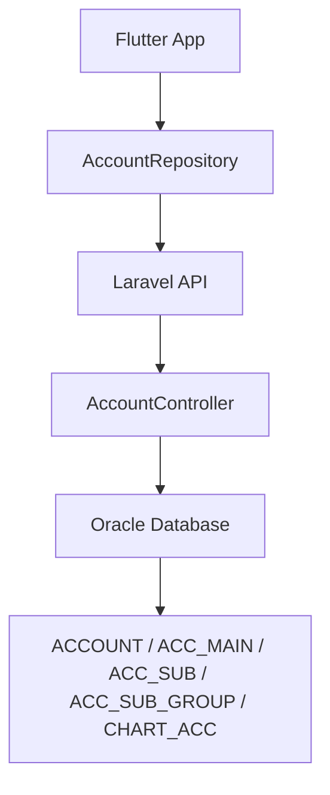
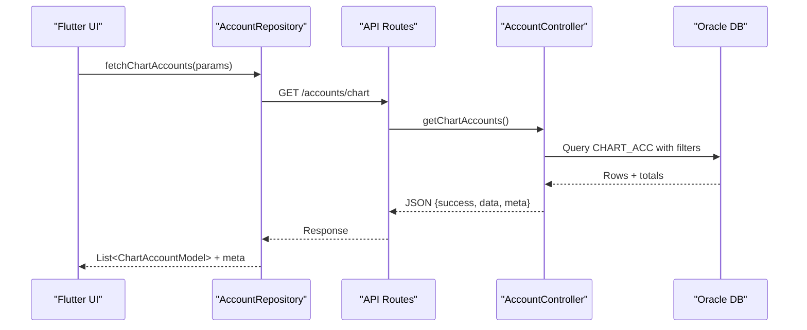
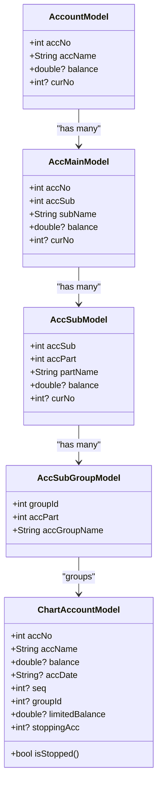
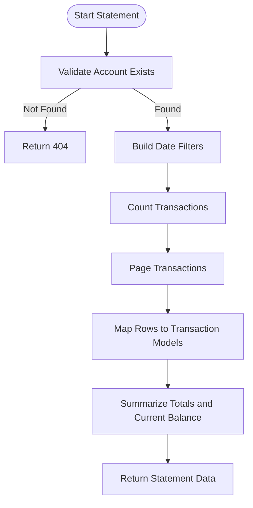
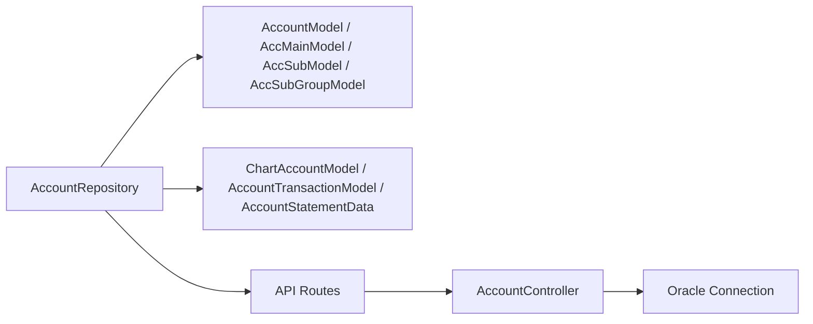

# Chart of Accounts Management

<cite>
**Referenced Files in This Document**
- [AccountController.php](file://kyApp_API/app/Http/Controllers/AccountController.php)
- [api.php](file://kyApp_API/routes/api.php)
- [account_model.dart](file://lib/features/accounts/data/models/account_model.dart)
- [chart_account_model.dart](file://lib/features/accounts/data/models/chart_account_model.dart)
- [account_repository.dart](file://lib/features/accounts/data/repositories/account_repository.dart)
</cite>

## Table of Contents
1. [Introduction](#introduction)
2. [Project Structure](#project-structure)
3. [Core Components](#core-components)
4. [Architecture Overview](#architecture-overview)
5. [Detailed Component Analysis](#detailed-component-analysis)
6. [Dependency Analysis](#dependency-analysis)
7. [Performance Considerations](#performance-considerations)
8. [Troubleshooting Guide](#troubleshooting-guide)
9. [Conclusion](#conclusion)

## Introduction
This document explains the chart of accounts management system implemented in this repository. It covers the hierarchical account structure, financial account model and code organization, backend controller logic, frontend data models, repository methods for CRUD operations, tree navigation, balance calculations, validation rules, naming conventions, and integration points with financial reporting through statements and detailed summaries.

The system is built around a five-level accounting hierarchy:
- Main section (ACCOUNT)
- Sub-account (ACC_MAIN)
- Part-account (ACC_SUB)
- Sub-group (ACC_SUB_GROUP)
- Financial account (CHART_ACC)

Financial accounts are grouped by `GROUP_ID`, which links to sub-groups under part-accounts. The backend uses an Oracle database connection and exposes REST endpoints protected by permissions. The Flutter side provides typed models and a repository that calls these endpoints.

## Project Structure
The chart of accounts feature spans both backend and frontend layers:

- Backend
  - Controller: `app/Http/Controllers/AccountController.php`
  - Routes: `routes/api.php`
- Frontend
  - Models: `lib/features/accounts/data/models/account_model.dart`, `lib/features/accounts/data/models/chart_account_model.dart`
  - Repository: `lib/features/accounts/data/repositories/account_repository.dart`

**Diagram sources**
- [account_repository.dart:24-312](file://lib/features/accounts/data/repositories/account_repository.dart#L24-L312)
- [AccountController.php:10-20](file://kyApp_API/app/Http/Controllers/AccountController.php#L10-L20)
- [api.php:285-321](file://kyApp_API/routes/api.php#L285-L321)

**Section sources**
- [AccountController.php:10-20](file://kyApp_API/app/Http/Controllers/AccountController.php#L10-L20)
- [api.php:285-321](file://kyApp_API/routes/api.php#L285-L321)

## Core Components
This section summarizes the core components and their responsibilities.

- Backend controller
  - Reads and writes to Oracle tables for the accounting hierarchy and financial accounts.
  - Provides endpoints for listing, creating, updating, and querying accounts and statements.
- Frontend models
  - Represent the hierarchy nodes and financial account records.
  - Provide JSON serialization helpers and search/filter utilities for tree nodes.
- Repository
  - Encapsulates HTTP calls to the API.
  - Normalizes responses into domain models.
  - Supports cancellation and error handling.

Key responsibilities:
- Hierarchical navigation: main sections → sub-accounts → parts → sub-groups → financial accounts.
- Financial account CRUD: create, update, list with pagination and search.
- Statements: single-account statement and detailed multi-account summary.

**Section sources**
- [AccountController.php:21-810](file://kyApp_API/app/Http/Controllers/AccountController.php#L21-L810)
- [account_model.dart:8-174](file://lib/features/accounts/data/models/account_model.dart#L8-L174)
- [chart_account_model.dart:8-147](file://lib/features/accounts/data/models/chart_account_model.dart#L8-L147)
- [account_repository.dart:24-312](file://lib/features/accounts/data/repositories/account_repository.dart#L24-L312)

## Architecture Overview
The architecture follows a layered approach:
- Presentation layer (Flutter UI) consumes the repository.
- Repository handles network requests and maps responses to models.
- Laravel routes enforce authentication and permissions.
- Controller implements business logic and interacts with Oracle.

**Diagram sources**
- [account_repository.dart:144-183](file://lib/features/accounts/data/repositories/account_repository.dart#L144-L183)
- [api.php:299-305](file://kyApp_API/routes/api.php#L299-L305)
- [AccountController.php:161-243](file://kyApp_API/app/Http/Controllers/AccountController.php#L161-L243)

## Detailed Component Analysis

### Hierarchical Account Structure
The hierarchy consists of five levels:
- ACCOUNT: top-level sections with balances and currency codes.
- ACC_MAIN: sub-accounts under a main section.
- ACC_SUB: parts under a sub-account.
- ACC_SUB_GROUP: groups under a part; used to organize financial accounts.
- CHART_ACC: actual financial accounts with balances, grouping, sequence, and optional stop flags.

**Diagram sources**
- [account_model.dart:8-97](file://lib/features/accounts/data/models/account_model.dart#L8-L97)
- [chart_account_model.dart:8-70](file://lib/features/accounts/data/models/chart_account_model.dart#L8-L70)

**Section sources**
- [account_model.dart:8-97](file://lib/features/accounts/data/models/account_model.dart#L8-L97)
- [chart_account_model.dart:8-70](file://lib/features/accounts/data/models/chart_account_model.dart#L8-L70)

### Account Model Implementation
The primary financial account model includes:
- `acc_no`: unique identifier derived from part prefix and sequence.
- `acc_name`: display name, normalized for Arabic encoding.
- `balance`: current account balance.
- `group_id`: link to sub-group for categorization.
- `seq`: ordering within the group.
- `limited_balance`: optional limit field.
- `stopping_acc`: flag indicating if the account is stopped.

Validation and transformation:
- JSON parsing normalizes numeric fields and fixes Arabic text.
- `isStopped` helper indicates whether the account is stopped.
- `toJsonForApi` serializes only non-null fields for updates.

**Section sources**
- [chart_account_model.dart:8-70](file://lib/features/accounts/data/models/chart_account_model.dart#L8-L70)

### Repository Methods for CRUD Operations
The repository provides:
- Read operations:
  - Fetch main sections, sub-accounts, parts, sub-groups.
  - Fetch full tree.
  - Fetch financial accounts with search, pagination, and group filter.
  - Fetch single-account statement and detailed statement.
- Write operations:
  - Create sub-group.
  - Create financial account.
  - Update financial account.

Error handling:
- Cancellation support via Dio cancel tokens.
- Graceful fallbacks returning empty lists or default models on errors.

**Section sources**
- [account_repository.dart:37-138](file://lib/features/accounts/data/repositories/account_repository.dart#L37-L138)
- [account_repository.dart:144-183](file://lib/features/accounts/data/repositories/account_repository.dart#L144-L183)
- [account_repository.dart:185-249](file://lib/features/accounts/data/repositories/account_repository.dart#L185-L249)
- [account_repository.dart:251-311](file://lib/features/accounts/data/repositories/account_repository.dart#L251-L311)

### Tree Navigation and Balance Calculations
Tree navigation:
- The backend builds a nested tree from ACCOUNT down to CHART_ACC.
- Special handling exists for specific part/group combinations (e.g., customer-related special case).
- Each node carries identifiers (`acc_no`, `acc_sub`, `acc_part`, `group_id`) and balances where applicable.

Balance calculations:
- Single-account statement aggregates debit, credit, and running balance per transaction row.
- Detailed statement sums balances across selected accounts based on type and id filters.

**Diagram sources**
- [AccountController.php:439-540](file://kyApp_API/app/Http/Controllers/AccountController.php#L439-L540)

**Section sources**
- [AccountController.php:650-810](file://kyApp_API/app/Http/Controllers/AccountController.php#L650-L810)
- [AccountController.php:439-540](file://kyApp_API/app/Http/Controllers/AccountController.php#L439-L540)
- [AccountController.php:547-640](file://kyApp_API/app/Http/Controllers/AccountController.php#L547-L640)

### Practical Examples

#### Adding New Account Categories
To add a new sub-group category:
- Use the repository method to create a sub-group with a name and part number.
- The backend validates inputs, computes the next group ID, and inserts into `ACC_SUB_GROUP`.

Steps:
1. Call `createSubGroup(name, accPart)` from the repository.
2. Backend validates `acc_group_name` and `acc_part`.
3. Backend queries max `GROUP_ID` and inserts new record.
4. Repository returns success result with new `group_id`.

**Section sources**
- [account_repository.dart:185-204](file://lib/features/accounts/data/repositories/account_repository.dart#L185-L204)
- [AccountController.php:354-392](file://kyApp_API/app/Http/Controllers/AccountController.php#L354-L392)

#### Creating Sub-Accounts (Financial Accounts)
To create a new financial account:
- Use the repository method to create a chart account with name, group, optional balance and limit.
- Backend resolves the part from the group, calculates the next account number based on part prefix, and inserts into `CHART_ACC`.

Steps:
1. Call `createChartAccount(name, groupId, balance?, limitedBalance?)`.
2. Backend validates `acc_name` and `group_id`.
3. Backend finds `ACC_PART` from `ACC_SUB_GROUP`.
4. Backend computes next `ACC_NO` using part-based prefix.
5. Backend inserts new financial account and returns `acc_no`.

**Section sources**
- [account_repository.dart:206-232](file://lib/features/accounts/data/repositories/account_repository.dart#L206-L232)
- [AccountController.php:245-304](file://kyApp_API/app/Http/Controllers/AccountController.php#L245-L304)

#### Managing Account Hierarchies
Hierarchy management involves:
- Listing and filtering main sections, sub-accounts, parts, and sub-groups.
- Building the complete tree for UI display.
- Handling special cases like excluding certain groups or injecting specific accounts.

Operations:
- Fetch tree: `fetchAccountTree()` returns nested nodes with balances and stop flags.
- Filter by search: client-side filtering supports matching names and account numbers.

**Section sources**
- [account_repository.dart:120-138](file://lib/features/accounts/data/repositories/account_repository.dart#L120-L138)
- [account_model.dart:99-174](file://lib/features/accounts/data/models/account_model.dart#L99-L174)
- [AccountController.php:650-810](file://kyApp_API/app/Http/Controllers/AccountController.php#L650-L810)

### Validation Rules and Naming Conventions
Backend validation:
- Financial account creation requires `acc_name` (string, max length) and `group_id` (integer).
- Sub-group creation requires `acc_group_name` (string, max length) and `acc_part` (integer).
- Update endpoints check existence before modifying fields.

Naming conventions:
- Names are normalized for Arabic encoding when stored or returned.
- Search queries handle both uppercase and encoded variants.

Constraints:
- Account numbers are derived from part prefixes and sequences.
- Group IDs are auto-incremented.

**Section sources**
- [AccountController.php:245-304](file://kyApp_API/app/Http/Controllers/AccountController.php#L245-L304)
- [AccountController.php:354-392](file://kyApp_API/app/Http/Controllers/AccountController.php#L354-L392)
- [AccountController.php:310-352](file://kyApp_API/app/Http/Controllers/AccountController.php#L310-L352)

### Integration with Financial Reporting Systems
Reporting integration points:
- Single-account statement endpoint returns transactions with debits, credits, and running balances.
- Detailed statement endpoint aggregates balances across multiple accounts filtered by type and id.
- Pagination and date filters allow efficient reporting over large datasets.

Usage patterns:
- UI can request statements with date ranges and page sizes.
- Reports can sum balances from detailed statements for portfolio views.

**Section sources**
- [AccountController.php:439-540](file://kyApp_API/app/Http/Controllers/AccountController.php#L439-L540)
- [AccountController.php:547-640](file://kyApp_API/app/Http/Controllers/AccountController.php#L547-L640)
- [account_repository.dart:251-311](file://lib/features/accounts/data/repositories/account_repository.dart#L251-L311)

## Dependency Analysis
The following diagram shows key dependencies between repository, models, routes, and controller.

**Diagram sources**
- [account_repository.dart:1-312](file://lib/features/accounts/data/repositories/account_repository.dart#L1-L312)
- [account_model.dart:8-174](file://lib/features/accounts/data/models/account_model.dart#L8-L174)
- [chart_account_model.dart:8-147](file://lib/features/accounts/data/models/chart_account_model.dart#L8-L147)
- [api.php:285-321](file://kyApp_API/routes/api.php#L285-L321)
- [AccountController.php:10-20](file://kyApp_API/app/Http/Controllers/AccountController.php#L10-L20)

**Section sources**
- [account_repository.dart:1-312](file://lib/features/accounts/data/repositories/account_repository.dart#L1-L312)
- [api.php:285-321](file://kyApp_API/routes/api.php#L285-L321)

## Performance Considerations
- Pagination: Both chart accounts and statements use Oracle-compatible pagination to limit dataset size.
- Search optimization: Backend searches across name and account number, supporting encoded Arabic characters.
- Tree building: Backend constructs the full tree in one call; clients should cache results and filter locally when possible.
- Statement aggregation: Balances are computed server-side; clients should avoid redundant calculations.

Recommendations:
- Use appropriate page sizes for large datasets.
- Cache tree data and refresh on structural changes.
- Leverage group filters to reduce query scope.

[No sources needed since this section provides general guidance]

## Troubleshooting Guide
Common issues and resolutions:
- Missing account or group:
  - Endpoints return 404 when referenced entities do not exist.
  - Verify IDs and ensure they exist before updates.
- Validation failures:
  - Creation endpoints return 422 with validation errors when required fields are missing or invalid.
  - Ensure `acc_name` and `group_id` are provided for financial accounts; `acc_group_name` and `acc_part` for sub-groups.
- Encoding problems:
  - Names are normalized for Arabic encoding; ensure client sends consistent text.
- Network errors:
  - Repository handles Dio exceptions and cancellations; inspect error messages and retry strategies.

**Section sources**
- [AccountController.php:245-304](file://kyApp_API/app/Http/Controllers/AccountController.php#L245-L304)
- [AccountController.php:310-352](file://kyApp_API/app/Http/Controllers/AccountController.php#L310-L352)
- [account_repository.dart:144-183](file://lib/features/accounts/data/repositories/account_repository.dart#L144-L183)

## Conclusion
The chart of accounts management system provides a robust hierarchical structure backed by Oracle, with clear separation between backend logic and frontend models. The repository abstracts API interactions, while the controller enforces validation, security, and performance considerations. By leveraging the provided endpoints and models, developers can implement comprehensive account management features, including tree navigation, financial account CRUD, and financial reporting integrations.

[No sources needed since this section summarizes without analyzing specific files]