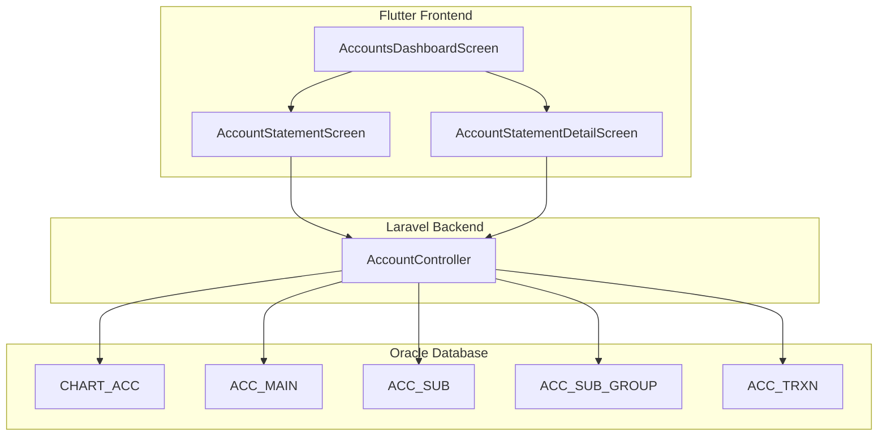
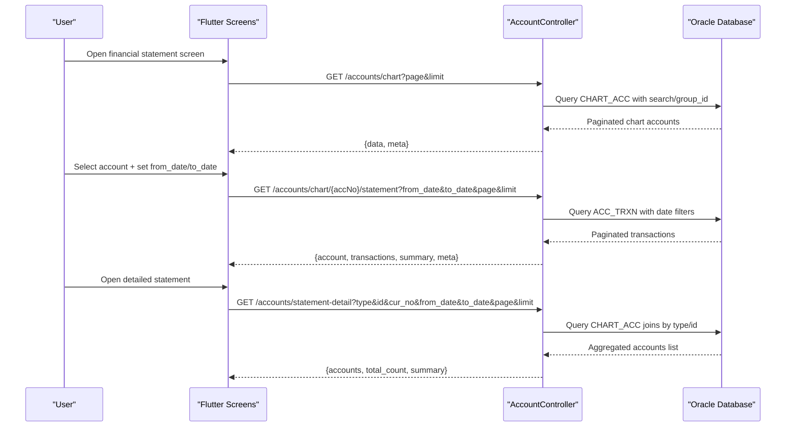
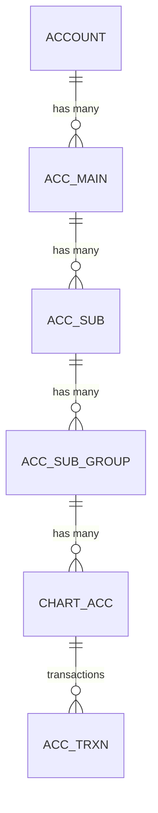
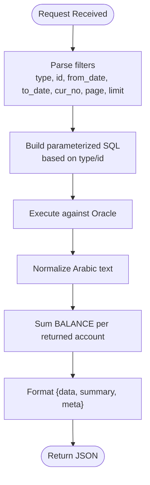
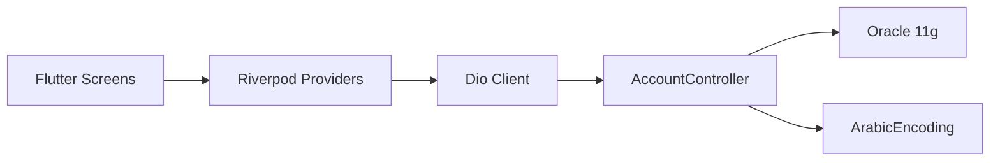

# Financial Statements & Reports

<cite>
**Referenced Files in This Document**   
- [accounts_dashboard_screen.dart](file://lib/features/accounts/presentation/screens/accounts_dashboard_screen.dart)
- [account_statement_screen.dart](file://lib/features/accounts/presentation/screens/account_statement_screen.dart)
- [account_statement_detail_screen.dart](file://lib/features/accounts/presentation/screens/account_statement_detail_screen.dart)
- [AccountController.php](file://kyApp_API/app/Http/Controllers/AccountController.php)
- [AGENTS.md](file://AGENTS.md)
- [devloping_history.md](file://devloping_history.md)
</cite>

## Table of Contents
1. [Introduction](#introduction)
2. [Project Structure](#project-structure)
3. [Core Components](#core-components)
4. [Architecture Overview](#architecture-overview)
5. [Detailed Component Analysis](#detailed-component-analysis)
6. [Dependency Analysis](#dependency-analysis)
7. [Performance Considerations](#performance-considerations)
8. [Troubleshooting Guide](#troubleshooting-guide)
9. [Conclusion](#conclusion)
10. [Appendices](#appendices)

## Introduction
This document explains the financial statement generation and reporting capabilities for balance sheets, income statements, and cash flow statements. It focuses on:
- The Flutter statement screens that let users select accounts, filter by date range and currency, and view summarized balances.
- The backend repository methods that fetch chart-of-accounts data, account-level transactions, and detailed multi-account summaries.
- Data aggregation logic for calculating totals, period-based filtering, and report formatting.
- Practical guidance for customizing layouts, exporting reports, and integrating with external accounting systems.
- Performance optimization strategies for large datasets and near real-time updates.

The system is built on a Flutter frontend and a Laravel backend connected to an Oracle 11g database. Statement queries bind parameters safely and use Oracle-compatible pagination. Arabic text is normalized through a dedicated encoding layer.

## Project Structure
Financial statements are exposed through the Accounts section dashboard and two statement screens:
- A general financial statement screen for a single account.
- A detailed analytical statement screen for multiple accounts filtered by hierarchy level, group, or currency.

**Diagram sources**
- [accounts_dashboard_screen.dart:307-357](file://lib/features/accounts/presentation/screens/accounts_dashboard_screen.dart#L307-L357)
- [AccountController.php:156-243](file://kyApp_API/app/Http/Controllers/AccountController.php#L156-L243)
- [AccountController.php:434-640](file://kyApp_API/app/Http/Controllers/AccountController.php#L434-L640)

**Section sources**
- [accounts_dashboard_screen.dart:307-357](file://lib/features/accounts/presentation/screens/accounts_dashboard_screen.dart#L307-L357)
- [devloping_history.md:178-181](file://devloping_history.md#L178-L181)

## Core Components
- Accounts dashboard: Entry point to financial reports and account management. It exposes tiles for “General financial statement” and “Detailed analytical statement.”
- General statement screen: Selects one account and displays debit, credit, and running balance over a date range.
- Detailed statement screen: Filters by hierarchy levels (main, sub, group), optional currency, and date range; aggregates balances across selected accounts.
- Account controller: Provides endpoints for chart-of-accounts listing, single-account statements, and detailed multi-account summaries.

Key responsibilities:
- UI: Collect filters (account, dates, currency), display summary cards, render transaction lists, and support navigation to detail views.
- Backend: Validate inputs, build parameterized queries, paginate results, normalize Arabic text, and return structured JSON envelopes.

**Section sources**
- [accounts_dashboard_screen.dart:307-357](file://lib/features/accounts/presentation/screens/accounts_dashboard_screen.dart#L307-L357)
- [AccountController.php:156-243](file://kyApp_API/app/Http/Controllers/AccountController.php#L156-L243)
- [AccountController.php:434-640](file://kyApp_API/app/Http/Controllers/AccountController.php#L434-L640)

## Architecture Overview
The statement workflow connects Flutter screens to Laravel controllers and Oracle tables.

**Diagram sources**
- [AccountController.php:156-243](file://kyApp_API/app/Http/Controllers/AccountController.php#L156-L243)
- [AccountController.php:434-640](file://kyApp_API/app/Http/Controllers/AccountController.php#L434-L640)

## Detailed Component Analysis

### Flutter Statement Screens
- Accounts dashboard:
  - Exposes two report entry points: general statement and detailed analytical statement.
  - Uses providers to load chart accounts, tree, and currencies.
- General statement screen:
  - Presents account selector, date pickers, and summary cards for current balance, total debits, and total credits.
  - Navigates to detail view when needed.
- Detailed statement screen:
  - Supports filters for hierarchy levels (all, main, sub, partial, group, financial account), currency, and date range.
  - Displays aggregated balances and supports export/print actions.

Customization tips:
- Layout: Adjust grid cross-axis counts and tile aspect ratios to fit different screen sizes.
- Export: Add PDF/Excel export buttons in the statement screens; reuse existing print/export patterns from the account tree screen.
- Real-time updates: Debounce search and refresh actions; cancel in-flight requests using provided cancellation tokens where available.

**Section sources**
- [accounts_dashboard_screen.dart:307-357](file://lib/features/accounts/presentation/screens/accounts_dashboard_screen.dart#L307-L357)
- [devloping_history.md:178-181](file://devloping_history.md#L178-L181)

### Backend Repository Methods (AccountController)
- Chart accounts listing:
  - Endpoint: GET /accounts/chart
  - Parameters: search, page, limit, group_id
  - Behavior: Builds WHERE clauses for Arabic-safe search and group filter; returns paginated results with metadata.
- Single account statement:
  - Endpoint: GET /accounts/chart/{accNo}/statement
  - Parameters: from_date, to_date, page, limit
  - Behavior: Reads account header from CHART_ACC; attempts to read transactions from ACC_TRXN with date filters; returns transactions, summary, and pagination.
- Detailed statement:
  - Endpoint: GET /accounts/statement-detail
  - Parameters: type (account|main|sub|group), id, cur_no, from_date, to_date, page, limit
  - Behavior: Joins CHART_ACC with ACC_SUB/ACC_MAIN based on type/id; aggregates balances across returned accounts; returns accounts list and summary.

Data aggregation logic:
- Balances: Sum BALANCE from CHART_ACC rows returned by each query branch.
- Totals: For detailed statement, total_debit and total_credit are placeholders; only total_balance is computed from row balances.
- Period filtering: Date filters are applied to ACC_TRXN via TO_DATE with DD/MM/YYYY format; ensure consistent date formats across the codebase.

Report formatting:
- Responses include success flag, data envelope, and meta pagination.
- Arabic names are normalized before returning to clients.

Known limitations:
- getDetailedStatement does not compute total_debit/total_credit; they remain zero.
- getAccountStatement reads ACC_TRXN; if the table is missing, transactions are empty while account header remains valid.

**Section sources**
- [AccountController.php:156-243](file://kyApp_API/app/Http/Controllers/AccountController.php#L156-L243)
- [AccountController.php:434-640](file://kyApp_API/app/Http/Controllers/AccountController.php#L434-L640)
- [AGENTS.md:718-720](file://AGENTS.md#L718-L720)

### Data Models and Relationships

**Diagram sources**
- [AccountController.php:646-800](file://kyApp_API/app/Http/Controllers/AccountController.php#L646-L800)

### Statement Processing Flow

**Diagram sources**
- [AccountController.php:547-640](file://kyApp_API/app/Http/Controllers/AccountController.php#L547-L640)

## Dependency Analysis
- Flutter screens depend on providers for state and network calls.
- Controllers depend on Oracle connection and Arabic encoding utilities.
- Statement queries depend on correct schema and indexes on date columns and account identifiers.

**Diagram sources**
- [accounts_dashboard_screen.dart:1-12](file://lib/features/accounts/presentation/screens/accounts_dashboard_screen.dart#L1-L12)
- [AccountController.php:1-20](file://kyApp_API/app/Http/Controllers/AccountController.php#L1-L20)

**Section sources**
- [accounts_dashboard_screen.dart:1-12](file://lib/features/accounts/presentation/screens/accounts_dashboard_screen.dart#L1-L12)
- [AccountController.php:1-20](file://kyApp_API/app/Http/Controllers/AccountController.php#L1-L20)

## Performance Considerations
- Pagination: Use page/limit consistently; avoid fetching full datasets into memory.
- Parameter binding: Always bind dates and IDs; never interpolate user input.
- Indexing: Ensure indexes exist on TRXN_DATE, ACC_NO, and GROUP_ID to speed up statement queries.
- N+1 queries: The account tree builder performs nested queries; consider batched loading or materialized views for large trees.
- Caching: Cache static chart-of-accounts and currency data at the provider level; invalidate on refresh.
- Real-time updates: Debounce user inputs; cancel previous requests; show optimistic UI while refreshing.

[No sources needed since this section provides general guidance]

## Troubleshooting Guide
Common issues and resolutions:
- Missing transaction table:
  - Symptom: Statement returns no transactions but shows account header.
  - Cause: ACC_TRXN table absent or inaccessible; error is swallowed internally.
  - Resolution: Verify ACC_TRXN exists and contains data; align statement logic with ENTRY_MAIN/ENTRY_SUB if required.
- Zero debit/credit totals:
  - Symptom: Detailed statement summary shows total_debit and total_credit as zero.
  - Cause: Logic initializes totals but never updates them.
  - Resolution: Implement debit/credit aggregation from transaction rows or source tables.
- Date format mismatches:
  - Symptom: Queries return unexpected results or errors.
  - Cause: Inconsistent TO_DATE formats across controllers.
  - Resolution: Standardize to DD/MM/YYYY for statement queries; match neighboring query conventions.
- Arabic text corruption:
  - Symptom: Names appear garbled.
  - Cause: Not using ArabicEncoding normalization on read/write paths.
  - Resolution: Apply fixMojibake on read and toOracleSearchChars on write/search.

**Section sources**
- [AccountController.php:434-540](file://kyApp_API/app/Http/Controllers/AccountController.php#L434-L540)
- [AccountController.php:547-640](file://kyApp_API/app/Http/Controllers/AccountController.php#L547-L640)
- [AGENTS.md:718-720](file://AGENTS.md#L718-L720)

## Conclusion
The financial statement feature set provides a solid foundation for generating account-level and multi-account reports. The Flutter screens collect filters and present summaries, while the backend builds safe, parameterized queries and returns structured responses. To extend the system:
- Implement debit/credit aggregation in detailed statements.
- Add robust export functionality (PDF/Excel) in the statement screens.
- Optimize queries with proper indexing and caching strategies.
- Align date handling and Arabic encoding across all components.

[No sources needed since this section summarizes without analyzing specific files]

## Appendices

### Customizing Report Layouts
- Adjust grid layout and tile aspect ratios in the dashboard to accommodate more controls or larger summaries.
- Add export buttons to statement screens; reuse existing print/export patterns from the account tree screen.
- Introduce theme-aware styling for printed outputs.

[No sources needed since this section provides general guidance]

### Integrating with External Accounting Software
- Map CHART_ACC groups to external GL segments.
- Sync currency codes and daily FX rates via the currencies endpoints.
- Push generated statements to external systems via scheduled jobs or webhooks.

[No sources needed since this section provides general guidance]