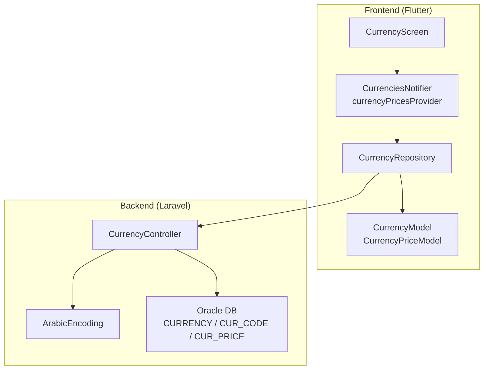
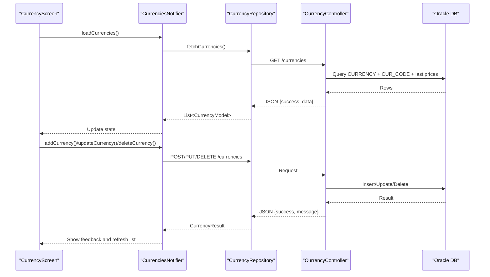
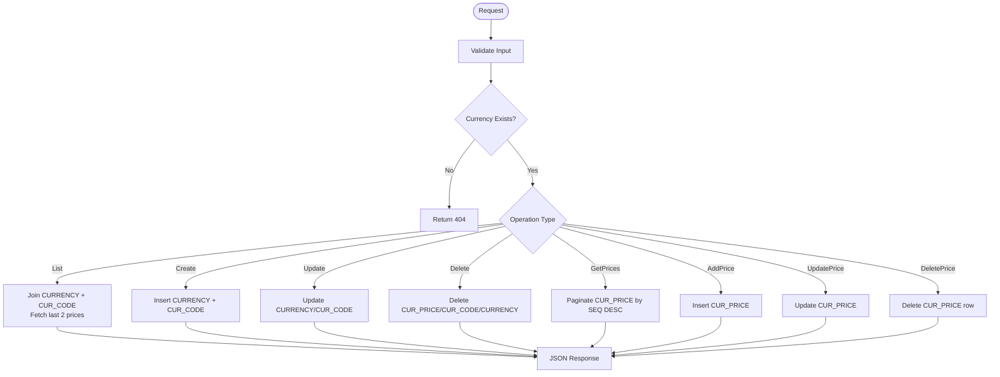
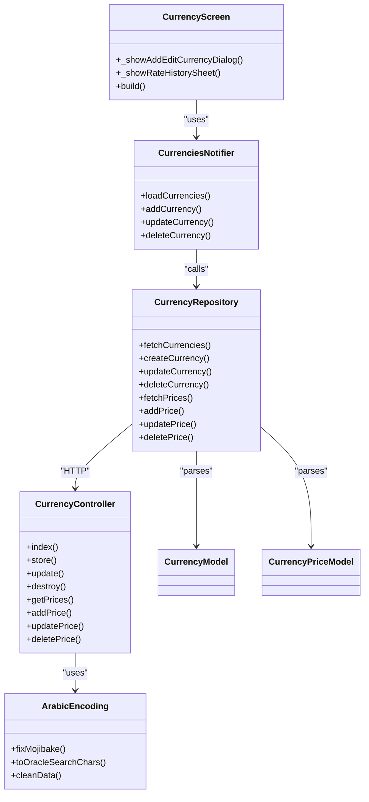

# Multi-Currency System

<cite>
**Referenced Files in This Document**
- [CurrencyController.php](file://kyApp_API/app/Http/Controllers/CurrencyController.php)
- [ArabicEncoding.php](file://kyApp_API/app/Support/ArabicEncoding.php)
- [currency_model.dart](file://lib/features/accounts/data/models/currency_model.dart)
- [currency_repository.dart](file://lib/features/accounts/data/repositories/currency_repository.dart)
- [currency_provider.dart](file://lib/features/accounts/presentation/providers/currency_provider.dart)
- [currency_screen.dart](file://lib/features/accounts/presentation/screens/currency_screen.dart)
</cite>

## Table of Contents
1. [Introduction](#introduction)
2. [Project Structure](#project-structure)
3. [Core Components](#core-components)
4. [Architecture Overview](#architecture-overview)
5. [Detailed Component Analysis](#detailed-component-analysis)
6. [Dependency Analysis](#dependency-analysis)
7. [Performance Considerations](#performance-considerations)
8. [Troubleshooting Guide](#troubleshooting-guide)
9. [Conclusion](#conclusion)
10. [Appendices](#appendices)

## Introduction
This document explains the multi-currency support system that enables international financial operations across currencies and exchange rates. It covers:
- Currency configuration, including currency definitions, codes, and unit names
- Exchange rate management with historical tracking and change calculations
- The backend controller for managing currencies and prices
- The Flutter frontend integration for displaying amounts, selecting currencies, and viewing conversion history
- Practical examples for adding currencies, configuring exchange rates, and handling fluctuations
- Precision handling, timezone considerations, and audit trail recommendations

The system is built on a Laravel API backed by an Oracle database and a Flutter client using Riverpod state management and Dio for networking.

## Project Structure
The multi-currency feature spans both backend and frontend layers:
- Backend (Laravel):
  - Controller handles REST endpoints for currencies and exchange rates
  - Database tables store currency metadata and price history
  - Encoding helper ensures correct Arabic text handling with Oracle
- Frontend (Flutter):
  - Models represent currency and price data
  - Repository abstracts network calls to the API
  - Provider manages UI state and triggers refreshes
  - Screen provides user interfaces for CRUD operations and history views

**Diagram sources**
- [currency_screen.dart:1-797](file://lib/features/accounts/presentation/screens/currency_screen.dart#L1-L797)
- [currency_provider.dart:1-96](file://lib/features/accounts/presentation/providers/currency_provider.dart#L1-L96)
- [currency_repository.dart:1-162](file://lib/features/accounts/data/repositories/currency_repository.dart#L1-L162)
- [currency_model.dart:1-122](file://lib/features/accounts/data/models/currency_model.dart#L1-L122)
- [CurrencyController.php:1-402](file://kyApp_API/app/Http/Controllers/CurrencyController.php#L1-L402)
- [ArabicEncoding.php:1-194](file://kyApp_API/app/Support/ArabicEncoding.php#L1-L194)

**Section sources**
- [CurrencyController.php:1-402](file://kyApp_API/app/Http/Controllers/CurrencyController.php#L1-L402)
- [currency_screen.dart:1-797](file://lib/features/accounts/presentation/screens/currency_screen.dart#L1-L797)

## Core Components
- CurrencyController: Manages currency definitions and exchange rate records via REST endpoints. Computes current and previous prices and percentage changes.
- ArabicEncoding: Ensures safe Arabic text encoding between UTF-8 clients and Oracle’s Windows-1256 environment.
- CurrencyModel and CurrencyPriceModel: Strongly typed models for currency metadata and price history.
- CurrencyRepository: Network layer encapsulating API calls for currencies and prices.
- CurrenciesNotifier and Providers: State management for loading, creating, updating, deleting currencies, and fetching price histories.
- CurrencyScreen: User interface for adding/editing currencies, viewing current rates, and managing historical prices.

Key responsibilities:
- Backend:
  - List currencies with latest two prices and computed change percent
  - Create/update/delete currencies
  - Paginate and manage price history
  - Validate inputs and return consistent JSON responses
- Frontend:
  - Display currency cards with code, name, main/sub units, current price, and trend indicator
  - Add/edit currency details
  - Record new exchange rates with date selection
  - View and delete historical prices

**Section sources**
- [CurrencyController.php:25-94](file://kyApp_API/app/Http/Controllers/CurrencyController.php#L25-L94)
- [currency_model.dart:1-122](file://lib/features/accounts/data/models/currency_model.dart#L1-L122)
- [currency_repository.dart:27-162](file://lib/features/accounts/data/repositories/currency_repository.dart#L27-L162)
- [currency_provider.dart:38-96](file://lib/features/accounts/presentation/providers/currency_provider.dart#L38-L96)
- [currency_screen.dart:20-158](file://lib/features/accounts/presentation/screens/currency_screen.dart#L20-L158)

## Architecture Overview
The system follows a layered architecture:
- Presentation Layer (Flutter):
  - CurrencyScreen renders UI and collects user input
  - CurrenciesNotifier updates state and triggers repository calls
- Data Layer (Flutter):
  - CurrencyRepository performs HTTP requests via DioClient
  - Models parse and validate payloads
- API Layer (Laravel):
  - CurrencyController validates requests, interacts with Oracle DB, and returns JSON
- Storage Layer (Oracle):
  - CURRENCY, CUR_CODE, CUR_PRICE tables store master data and historical rates

**Diagram sources**
- [currency_screen.dart:105-158](file://lib/features/accounts/presentation/screens/currency_screen.dart#L105-L158)
- [currency_provider.dart:45-80](file://lib/features/accounts/presentation/providers/currency_provider.dart#L45-L80)
- [currency_repository.dart:27-85](file://lib/features/accounts/data/repositories/currency_repository.dart#L27-L85)
- [CurrencyController.php:25-145](file://kyApp_API/app/Http/Controllers/CurrencyController.php#L25-L145)

## Detailed Component Analysis

### CurrencyController (Backend)
Responsibilities:
- Index endpoint lists all currencies with their codes and unit names, plus the latest two prices and computed change percent
- Store endpoint creates a new currency and its code/unit metadata
- Update endpoint modifies currency name and/or code/unit fields
- Destroy endpoint deletes currency and related code and price records
- GetPrices endpoint paginates historical prices for a specific currency
- AddPrice/UpdatePrice/DeletePrice endpoints manage individual price records

Data flow highlights:
- Uses Oracle connection and raw SQL queries compatible with Oracle 11g
- Applies ArabicEncoding for safe text handling
- Validates numeric and date inputs before persistence
- Returns consistent JSON structure with success flag and messages

**Diagram sources**
- [CurrencyController.php:25-94](file://kyApp_API/app/Http/Controllers/CurrencyController.php#L25-L94)
- [CurrencyController.php:100-145](file://kyApp_API/app/Http/Controllers/CurrencyController.php#L100-L145)
- [CurrencyController.php:151-193](file://kyApp_API/app/Http/Controllers/CurrencyController.php#L151-L193)
- [CurrencyController.php:199-216](file://kyApp_API/app/Http/Controllers/CurrencyController.php#L199-L216)
- [CurrencyController.php:223-293](file://kyApp_API/app/Http/Controllers/CurrencyController.php#L223-L293)
- [CurrencyController.php:299-338](file://kyApp_API/app/Http/Controllers/CurrencyController.php#L299-L338)
- [CurrencyController.php:344-377](file://kyApp_API/app/Http/Controllers/CurrencyController.php#L344-L377)
- [CurrencyController.php:383-400](file://kyApp_API/app/Http/Controllers/CurrencyController.php#L383-L400)

**Section sources**
- [CurrencyController.php:25-94](file://kyApp_API/app/Http/Controllers/CurrencyController.php#L25-L94)
- [CurrencyController.php:100-145](file://kyApp_API/app/Http/Controllers/CurrencyController.php#L100-L145)
- [CurrencyController.php:151-193](file://kyApp_API/app/Http/Controllers/CurrencyController.php#L151-L193)
- [CurrencyController.php:199-216](file://kyApp_API/app/Http/Controllers/CurrencyController.php#L199-L216)
- [CurrencyController.php:223-293](file://kyApp_API/app/Http/Controllers/CurrencyController.php#L223-L293)
- [CurrencyController.php:299-338](file://kyApp_API/app/Http/Controllers/CurrencyController.php#L299-L338)
- [CurrencyController.php:344-377](file://kyApp_API/app/Http/Controllers/CurrencyController.php#L344-L377)
- [CurrencyController.php:383-400](file://kyApp_API/app/Http/Controllers/CurrencyController.php#L383-L400)

### ArabicEncoding (Backend Utility)
Purpose:
- Fix mojibake from Oracle when reading Arabic text
- Convert UTF-8 Arabic to Oracle-compatible characters for writes/searches
- Provide recursive cleaning for arrays/objects

Relevance:
- Ensures currency names and unit names display correctly in the UI
- Prevents data corruption during insert/update operations

**Section sources**
- [ArabicEncoding.php:33-120](file://kyApp_API/app/Support/ArabicEncoding.php#L33-L120)
- [ArabicEncoding.php:122-162](file://kyApp_API/app/Support/ArabicEncoding.php#L122-L162)
- [ArabicEncoding.php:164-194](file://kyApp_API/app/Support/ArabicEncoding.php#L164-L194)

### CurrencyModel and CurrencyPriceModel (Frontend Models)
Models:
- CurrencyModel: Represents a full currency record including current/previous prices and change percent; includes helpers for rising/falling trends and JSON serialization
- CurrencyPriceModel: Represents a single historical price entry with sequence number, currency ID, price, and date

Precision handling:
- Numeric fields are parsed safely with helper functions to avoid null or invalid values
- Change percent and prices are treated as doubles for UI formatting

**Section sources**
- [currency_model.dart:8-83](file://lib/features/accounts/data/models/currency_model.dart#L8-L83)
- [currency_model.dart:85-106](file://lib/features/accounts/data/models/currency_model.dart#L85-L106)
- [currency_model.dart:108-122](file://lib/features/accounts/data/models/currency_model.dart#L108-L122)

### CurrencyRepository (Frontend Data Layer)
Responsibilities:
- Fetch all currencies
- Create, update, delete currencies
- Fetch paginated price history for a currency
- Add, update, delete price records

Error handling:
- Wraps network errors into CurrencyResult with success flags and messages
- Supports cancellation tokens for long-running requests

**Section sources**
- [currency_repository.dart:27-42](file://lib/features/accounts/data/repositories/currency_repository.dart#L27-L42)
- [currency_repository.dart:44-85](file://lib/features/accounts/data/repositories/currency_repository.dart#L44-L85)
- [currency_repository.dart:87-111](file://lib/features/accounts/data/repositories/currency_repository.dart#L87-L111)
- [currency_repository.dart:113-162](file://lib/features/accounts/data/repositories/currency_repository.dart#L113-L162)

### CurrenciesNotifier and Providers (Frontend State Management)
Responsibilities:
- Load currencies on initialization
- Trigger refresh after mutations (add/update/delete)
- Provide per-currency price history via FutureProvider.family

State:
- Loading indicators and error messages
- Currency list and derived metrics

**Section sources**
- [currency_provider.dart:13-36](file://lib/features/accounts/presentation/providers/currency_provider.dart#L13-L36)
- [currency_provider.dart:38-81](file://lib/features/accounts/presentation/providers/currency_provider.dart#L38-L81)
- [currency_provider.dart:83-96](file://lib/features/accounts/presentation/providers/currency_provider.dart#L83-L96)

### CurrencyScreen (Frontend UI)
Features:
- Add/Edit currency dialog with validation
- Currency card showing code, name, main/sub units, current price, and trend indicator
- Rate history modal with date picker and price entry form
- Delete historical price entries and refresh lists

User flows:
- Adding a new currency: open dialog, fill fields, submit, show success/error, refresh list
- Viewing rate history: open bottom sheet, add price with date, view list, delete entries

**Section sources**
- [currency_screen.dart:20-158](file://lib/features/accounts/presentation/screens/currency_screen.dart#L20-L158)
- [currency_screen.dart:160-219](file://lib/features/accounts/presentation/screens/currency_screen.dart#L160-L219)
- [currency_screen.dart:221-415](file://lib/features/accounts/presentation/screens/currency_screen.dart#L221-L415)
- [currency_screen.dart:480-797](file://lib/features/accounts/presentation/screens/currency_screen.dart#L480-L797)

## Dependency Analysis
Component relationships:
- CurrencyScreen depends on CurrenciesNotifier for state and actions
- CurrenciesNotifier depends on CurrencyRepository for network operations
- CurrencyRepository depends on DioClient and maps responses to CurrencyModel/CurrencyPriceModel
- CurrencyController depends on Oracle DB and ArabicEncoding for data integrity
- ArabicEncoding is used by CurrencyController to handle Arabic text safely

**Diagram sources**
- [currency_screen.dart:1-797](file://lib/features/accounts/presentation/screens/currency_screen.dart#L1-L797)
- [currency_provider.dart:1-96](file://lib/features/accounts/presentation/providers/currency_provider.dart#L1-L96)
- [currency_repository.dart:1-162](file://lib/features/accounts/data/repositories/currency_repository.dart#L1-L162)
- [currency_model.dart:1-122](file://lib/features/accounts/data/models/currency_model.dart#L1-L122)
- [CurrencyController.php:1-402](file://kyApp_API/app/Http/Controllers/CurrencyController.php#L1-L402)
- [ArabicEncoding.php:1-194](file://kyApp_API/app/Support/ArabicEncoding.php#L1-L194)

**Section sources**
- [currency_screen.dart:1-797](file://lib/features/accounts/presentation/screens/currency_screen.dart#L1-L797)
- [currency_provider.dart:1-96](file://lib/features/accounts/presentation/providers/currency_provider.dart#L1-L96)
- [currency_repository.dart:1-162](file://lib/features/accounts/data/repositories/currency_repository.dart#L1-L162)
- [currency_model.dart:1-122](file://lib/features/accounts/data/models/currency_model.dart#L1-L122)
- [CurrencyController.php:1-402](file://kyApp_API/app/Http/Controllers/CurrencyController.php#L1-L402)
- [ArabicEncoding.php:1-194](file://kyApp_API/app/Support/ArabicEncoding.php#L1-L194)

## Performance Considerations
- Pagination: Price history uses server-side pagination with ROWNUM-based queries for Oracle compatibility. Ensure reasonable page sizes to balance responsiveness and memory usage.
- Latest prices optimization: The index endpoint retrieves only the most recent two prices per currency to compute change percent efficiently.
- Network efficiency: Use cancellation tokens for long-running requests to avoid unnecessary work when navigating away.
- UI rendering: Avoid heavy computations in build methods; rely on providers to hold computed states like loading and error.

[No sources needed since this section provides general guidance]

## Troubleshooting Guide
Common issues and resolutions:
- Arabic text appears garbled:
  - Ensure ArabicEncoding::fixMojibake is applied when reading from Oracle
  - Use ArabicEncoding::toOracleSearchChars when writing or searching
- Validation errors when adding/updating currencies:
  - Verify required fields: cur_name, code, main_cur_name, sub_cur_name
  - Check string length limits enforced by the controller
- Price entry fails:
  - Confirm day_date format matches YYYY-MM-DD
  - Ensure price is numeric and non-negative
- Missing currency or price records:
  - Verify existence checks in controller methods return appropriate 404 responses
- Network errors:
  - Repository wraps exceptions into CurrencyResult; inspect message field for details
  - Use cancellation tokens to prevent stale requests

**Section sources**
- [ArabicEncoding.php:33-120](file://kyApp_API/app/Support/ArabicEncoding.php#L33-L120)
- [CurrencyController.php:100-145](file://kyApp_API/app/Http/Controllers/CurrencyController.php#L100-L145)
- [CurrencyController.php:299-338](file://kyApp_API/app/Http/Controllers/CurrencyController.php#L299-L338)
- [currency_repository.dart:44-85](file://lib/features/accounts/data/repositories/currency_repository.dart#L44-L85)
- [currency_repository.dart:113-162](file://lib/features/accounts/data/repositories/currency_repository.dart#L113-L162)

## Conclusion
The multi-currency system provides a robust foundation for international financial operations:
- Backend controller manages currency definitions and historical exchange rates with proper validation and encoding
- Frontend offers intuitive UI for managing currencies and viewing rate history
- State management ensures responsive and consistent user experiences
- Precision handling and Oracle compatibility ensure reliable data storage and retrieval

To extend the system:
- Integrate real-time rate updates via scheduled jobs or external APIs
- Implement currency conversion algorithms at business logic layers using stored rates
- Add audit trails for currency and price changes to track modifications over time

[No sources needed since this section summarizes without analyzing specific files]

## Appendices

### Practical Examples

#### Setting Up a New Currency
Steps:
- Open the Add Currency dialog in CurrencyScreen
- Fill in currency name, code, main unit name, and sub unit name
- Submit the form; the provider calls the repository which posts to /currencies
- On success, the list refreshes automatically

**Section sources**
- [currency_screen.dart:20-158](file://lib/features/accounts/presentation/screens/currency_screen.dart#L20-L158)
- [currency_repository.dart:44-57](file://lib/features/accounts/data/repositories/currency_repository.dart#L44-L57)
- [CurrencyController.php:100-145](file://kyApp_API/app/Http/Controllers/CurrencyController.php#L100-L145)

#### Configuring Exchange Rate Sources
Current implementation stores manual price entries:
- Use the Rate History modal to add a price with a specific date
- The controller inserts into CUR_PRICE with validated inputs
- For automated sources, consider integrating external APIs and scheduling periodic updates to CUR_PRICE

**Section sources**
- [currency_screen.dart:480-797](file://lib/features/accounts/presentation/screens/currency_screen.dart#L480-L797)
- [CurrencyController.php:299-338](file://kyApp_API/app/Http/Controllers/CurrencyController.php#L299-L338)

#### Handling Currency Fluctuations
- The index endpoint computes change percent based on the latest two prices
- Frontend displays trend indicators (rising/falling) and percentages
- Users can monitor historical trends via the rate history modal

**Section sources**
- [CurrencyController.php:25-94](file://kyApp_API/app/Http/Controllers/CurrencyController.php#L25-L94)
- [currency_screen.dart:221-415](file://lib/features/accounts/presentation/screens/currency_screen.dart#L221-L415)

### Precision Handling and Timezone Considerations
- Prices are stored as numeric values; model parsing ensures safe double conversions
- Dates are stored as strings in YYYY-MM-DD format; UI formats dates consistently
- For timezone-sensitive operations, consider storing timestamps in UTC and converting to local time in the UI

[No sources needed since this section provides general guidance]

### Audit Trails for Currency Changes
Recommendations:
- Log create/update/delete operations for currencies and prices
- Include user identity, timestamp, and changed fields in audit logs
- Expose audit endpoints for reporting and compliance

[No sources needed since this section provides general guidance]