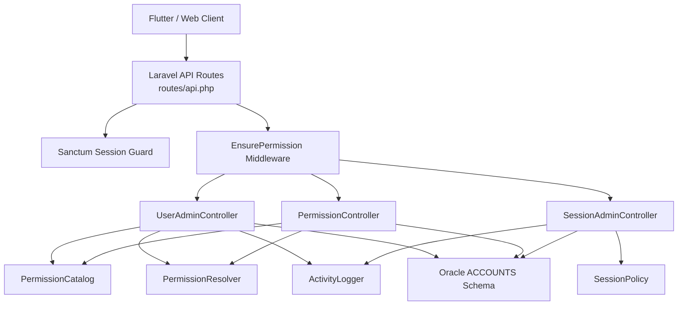
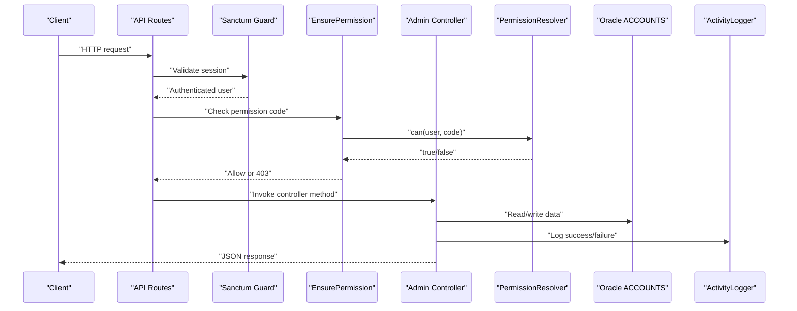
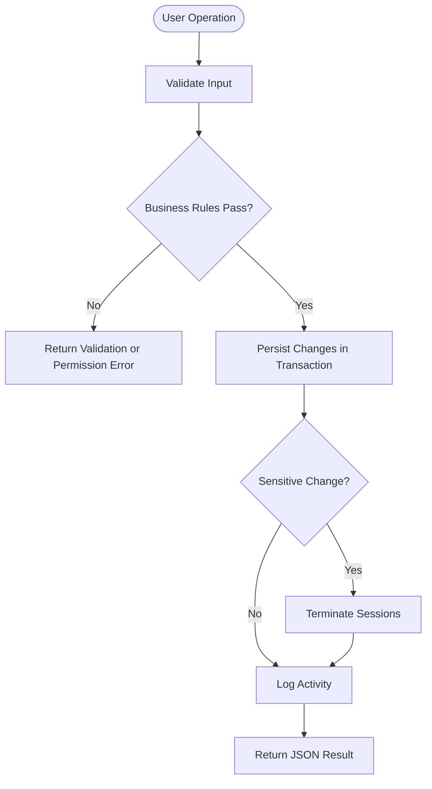
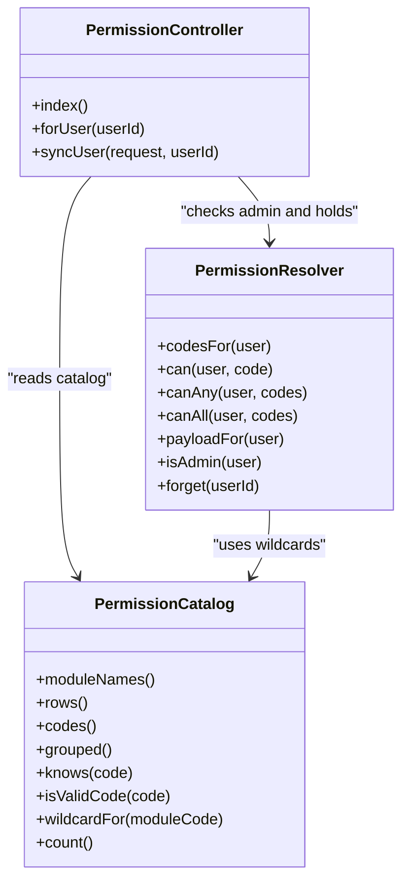
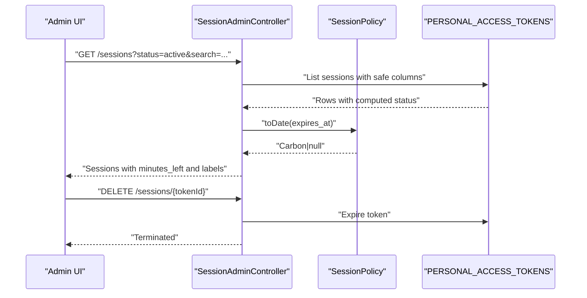
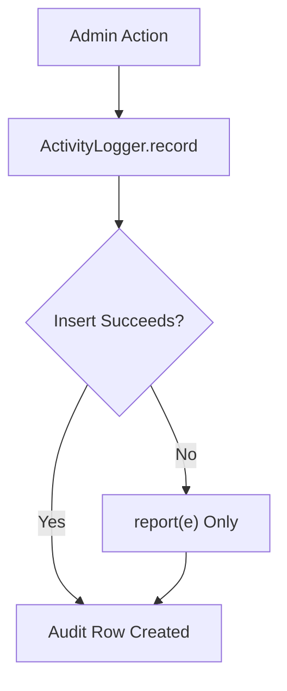
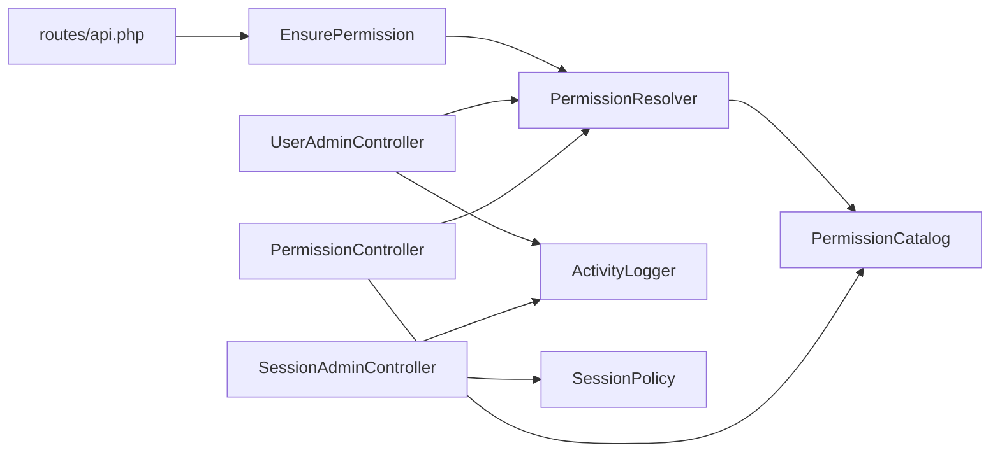

# Admin Module

<cite>
**Referenced Files in This Document**
- [UserAdminController.php](file://kyApp_API/app/Http/Controllers/UserAdminController.php)
- [PermissionController.php](file://kyApp_API/app/Http/Controllers/PermissionController.php)
- [SessionAdminController.php](file://kyApp_API/app/Http/Controllers/SessionAdminController.php)
- [EnsurePermission.php](file://kyApp_API/app/Http/Middleware/EnsurePermission.php)
- [PermissionCatalog.php](file://kyApp_API/app/Support/PermissionCatalog.php)
- [PermissionResolver.php](file://kyApp_API/app/Support/PermissionResolver.php)
- [ActivityLogger.php](file://kyApp_API/app/Support/ActivityLogger.php)
- [SessionPolicy.php](file://kyApp_API/app/Support/SessionPolicy.php)
- [api.php](file://kyApp_API/routes/api.php)
- [01_ibac_schema.sql](file://kyApp_API/database/oracle/01_ibac_schema.sql)
- [02_ibac_seed.php](file://kyApp_API/database/oracle/02_ibac_seed.php)
</cite>

## Table of Contents
1. [Introduction](#introduction)
2. [Project Structure](#project-structure)
3. [Core Components](#core-components)
4. [Architecture Overview](#architecture-overview)
5. [Detailed Component Analysis](#detailed-component-analysis)
6. [Dependency Analysis](#dependency-analysis)
7. [Performance Considerations](#performance-considerations)
8. [Troubleshooting Guide](#troubleshooting-guide)
9. [Conclusion](#conclusion)
10. [Appendices](#appendices)

## Introduction
The admin module provides system administration capabilities for user management, permission administration, and active session monitoring. It is built around a direct user-to-permission model (IBAC), where permissions are granted to users rather than roles. The module exposes REST endpoints protected by Sanctum sessions and fine-grained permission checks, while persisting administrative actions in an audit trail.

Key responsibilities:
- User lifecycle management: create, read, update, toggle activation, delete, and view activity.
- Permission catalog maintenance and per-user grant synchronization.
- Active session listing, filtering, and termination.
- Security settings and application configuration boundaries that influence session behavior and access control.

## Project Structure
The admin module lives under the Laravel API layer and consists of:
- Controllers for users, permissions, and sessions.
- Middleware enforcing route-level permissions.
- Support classes for permission catalog, permission resolution, activity logging, and session policy.
- Routes defining public and protected endpoints.
- Oracle schema and seed scripts for permissions, grants, settings, and activity tables.

**Diagram sources**
- [api.php:59-146](file://kyApp_API/routes/api.php#L59-L146)
- [EnsurePermission.php:25-52](file://kyApp_API/app/Http/Middleware/EnsurePermission.php#L25-L52)
- [UserAdminController.php:34-102](file://kyApp_API/app/Http/Controllers/UserAdminController.php#L34-L102)
- [PermissionController.php:30-42](file://kyApp_API/app/Http/Controllers/PermissionController.php#L30-L42)
- [SessionAdminController.php:32-82](file://kyApp_API/app/Http/Controllers/SessionAdminController.php#L32-L82)
- [PermissionCatalog.php:22-237](file://kyApp_API/app/Support/PermissionCatalog.php#L22-L237)
- [PermissionResolver.php:27-43](file://kyApp_API/app/Support/PermissionResolver.php#L27-L43)
- [ActivityLogger.php:18-17](file://kyApp_API/app/Support/ActivityLogger.php#L18-L17)
- [SessionPolicy.php:42-44](file://kyApp_API/app/Support/SessionPolicy.php#L42-L44)

**Section sources**
- [api.php:59-146](file://kyApp_API/routes/api.php#L59-L146)
- [01_ibac_schema.sql:38-184](file://kyApp_API/database/oracle/01_ibac_schema.sql#L38-L184)

## Core Components
- User administration controller: manages user records, grants, toggles, deletions, and activity queries.
- Permission controller: serves the permission catalog grouped by modules, reads a user’s effective grants, and atomically replaces them.
- Session administration controller: lists active sessions with filters and terminates individual or all sessions for a user.
- Permission middleware: enforces deny-by-default access using permission codes.
- Permission catalog: canonical definition of modules, actions, labels, wildcards, and ordering.
- Permission resolver: evaluates whether a user can perform an action based on admin status, explicit grants, and module wildcards.
- Activity logger: writes audit events without failing successful requests.
- Session policy: implements sliding idle expiry, absolute age limits, token purging, and safe date handling.

**Section sources**
- [UserAdminController.php:18-33](file://kyApp_API/app/Http/Controllers/UserAdminController.php#L18-L33)
- [PermissionController.php:17-29](file://kyApp_API/app/Http/Controllers/PermissionController.php#L17-L29)
- [SessionAdminController.php:15-31](file://kyApp_API/app/Http/Controllers/SessionAdminController.php#L15-L31)
- [EnsurePermission.php:11-24](file://kyApp_API/app/Http/Middleware/EnsurePermission.php#L11-L24)
- [PermissionCatalog.php:5-21](file://kyApp_API/app/Support/PermissionCatalog.php#L5-L21)
- [PermissionResolver.php:9-26](file://kyApp_API/app/Support/PermissionResolver.php#L9-L26)
- [ActivityLogger.php:9-17](file://kyApp_API/app/Support/ActivityLogger.php#L9-L17)
- [SessionPolicy.php:9-41](file://kyApp_API/app/Support/SessionPolicy.php#L9-L41)

## Architecture Overview
The admin module follows a layered request flow:
1. A client calls a protected endpoint under `auth:sanctum`.
2. The `permission:<code>` middleware checks the current user’s effective permissions via `PermissionResolver`.
3. The controller validates input, applies business rules, persists changes through the Oracle connection, and logs the action.
4. For sensitive operations like granting permissions or deactivating users, existing sessions may be terminated so new decisions apply immediately.

**Diagram sources**
- [api.php:59-146](file://kyApp_API/routes/api.php#L59-L146)
- [EnsurePermission.php:32-52](file://kyApp_API/app/Http/Middleware/EnsurePermission.php#L32-L52)
- [PermissionResolver.php:95-132](file://kyApp_API/app/Support/PermissionResolver.php#L95-L132)
- [UserAdminController.php:108-148](file://kyApp_API/app/Http/Controllers/UserAdminController.php#L108-L148)
- [PermissionController.php:51-93](file://kyApp_API/app/Http/Controllers/PermissionController.php#L51-L93)
- [SessionAdminController.php:93-141](file://kyApp_API/app/Http/Controllers/SessionAdminController.php#L93-L141)
- [ActivityLogger.php:37-73](file://kyApp_API/app/Support/ActivityLogger.php#L37-L73)

## Detailed Component Analysis

### User Management Interface
The user management interface supports:
- Listing users with search, filter, sort, and pagination.
- Viewing a single user with their granted permissions and latest activity.
- Creating users with optional initial permissions.
- Updating user attributes and replacing permissions when explicitly provided.
- Toggling activation state with anti-lockout guards.
- Deleting users along with grants and tokens.
- Querying a user’s activity trail.

Security and integrity rules include:
- No password or device token leakage in responses.
- Arabic text encoded safely for Oracle.
- Anti-self-deletion, anti-self-deactivation, and protection against removing the last administrator.
- Anti-escalation: non-admins cannot set the admin flag or grant permissions they do not hold.

**Diagram sources**
- [UserAdminController.php:188-312](file://kyApp_API/app/Http/Controllers/UserAdminController.php#L188-L312)
- [UserAdminController.php:318-496](file://kyApp_API/app/Http/Controllers/UserAdminController.php#L318-L496)
- [UserAdminController.php:502-560](file://kyApp_API/app/Http/Controllers/UserAdminController.php#L502-L560)
- [UserAdminController.php:566-626](file://kyApp_API/app/Http/Controllers/UserAdminController.php#L566-L626)

Practical examples:
- Adding a new user: send required English username, password, and optional permissions; the controller creates the account and inserts grants atomically.
- Editing a user: send only changed fields; if `permissions` is included, the entire grant set is replaced.
- Deactivating a user: prevents self-deactivation and protects the last admin; also ends live sessions.
- Deleting a user: removes grants, personal access tokens, and the user row; clears cached permissions.

**Section sources**
- [UserAdminController.php:108-148](file://kyApp_API/app/Http/Controllers/UserAdminController.php#L108-L148)
- [UserAdminController.php:154-182](file://kyApp_API/app/Http/Controllers/UserAdminController.php#L154-L182)
- [UserAdminController.php:188-312](file://kyApp_API/app/Http/Controllers/UserAdminController.php#L188-L312)
- [UserAdminController.php:318-496](file://kyApp_API/app/Http/Controllers/UserAdminController.php#L318-L496)
- [UserAdminController.php:502-560](file://kyApp_API/app/Http/Controllers/UserAdminController.php#L502-L560)
- [UserAdminController.php:566-626](file://kyApp_API/app/Http/Controllers/UserAdminController.php#L566-L626)
- [UserAdminController.php:632-679](file://kyApp_API/app/Http/Controllers/UserAdminController.php#L632-L679)

### Permission Management System
The permission system is centered on:
- A canonical catalog of modules and actions.
- Direct grants from users to permissions.
- Route-level authorization via middleware.
- Atomic replacement of a user’s grants.

Key behaviors:
- The catalog defines module names, core actions (`view`, `create`, `update`, `delete`), extra actions, wildcard support, and sorting.
- The resolver evaluates admin bypass, system-wide wildcard, explicit grant, and module wildcard.
- The permission controller returns the grouped catalog with database IDs and resolves a user’s current grants.
- Grant synchronization validates unknown/inactive codes, prevents self-editing by non-admins, and enforces “grant only what you hold.”

**Diagram sources**
- [PermissionCatalog.php:22-479](file://kyApp_API/app/Support/PermissionCatalog.php#L22-L479)
- [PermissionResolver.php:27-275](file://kyApp_API/app/Support/PermissionResolver.php#L27-L275)
- [PermissionController.php:30-243](file://kyApp_API/app/Http/Controllers/PermissionController.php#L30-L243)

Practical examples:
- Maintaining the permission catalog: add a new module or action in `PermissionCatalog`; the seed script upserts rows into `APP_PERMISSIONS`.
- Assigning permissions to a user: call the sync endpoint with an array of permission codes; inactive or unknown codes are rejected; non-admins can only grant what they hold.
- Viewing effective permissions: the resolver returns codes derived from grants and wildcards; admins bypass grant checks.

**Section sources**
- [PermissionCatalog.php:52-237](file://kyApp_API/app/Support/PermissionCatalog.php#L52-L237)
- [PermissionCatalog.php:271-316](file://kyApp_API/app/Support/PermissionCatalog.php#L271-L316)
- [PermissionCatalog.php:400-415](file://kyApp_API/app/Support/PermissionCatalog.php#L400-L415)
- [PermissionResolver.php:66-89](file://kyApp_API/app/Support/PermissionResolver.php#L66-L89)
- [PermissionResolver.php:95-132](file://kyApp_API/app/Support/PermissionResolver.php#L95-L132)
- [PermissionController.php:51-93](file://kyApp_API/app/Http/Controllers/PermissionController.php#L51-L93)
- [PermissionController.php:99-128](file://kyApp_API/app/Http/Controllers/PermissionController.php#L99-L128)
- [PermissionController.php:137-243](file://kyApp_API/app/Http/Controllers/PermissionController.php#L137-L243)
- [02_ibac_seed.php:38-91](file://kyApp_API/database/oracle/02_ibac_seed.php#L38-L91)

### System Monitoring Features
System monitoring includes:
- Active session tracking: list sessions with filters by user, status, and search terms.
- Performance indicators: session status, minutes left, creation time, last activity, and platform/device metadata.
- Health indicators: account activation state, token expiry, absolute age, and sliding renewal behavior.

Capabilities:
- List sessions with safe column selection and Oracle-compatible formatting.
- Terminate a specific session by token ID.
- Terminate all sessions for a user.
- Integrate with session policy to determine status and remaining lifetime consistently.

**Diagram sources**
- [SessionAdminController.php:93-141](file://kyApp_API/app/Http/Controllers/SessionAdminController.php#L93-L141)
- [SessionAdminController.php:147-182](file://kyApp_API/app/Http/Controllers/SessionAdminController.php#L147-L182)
- [SessionAdminController.php:193-233](file://kyApp_API/app/Http/Controllers/SessionAdminController.php#L193-L233)
- [SessionPolicy.php:50-61](file://kyApp_API/app/Support/SessionPolicy.php#L50-L61)

Practical examples:
- Filtering active sessions: use `status=active` to show currently valid tokens for activated accounts.
- Terminating a lost device: call the terminate endpoint with the token ID; the next request will fail authentication and the client will log out.
- Auditing session changes: each termination is logged with actor, target user, and affected count.

**Section sources**
- [SessionAdminController.php:38-80](file://kyApp_API/app/Http/Controllers/SessionAdminController.php#L38-L80)
- [SessionAdminController.php:93-141](file://kyApp_API/app/Http/Controllers/SessionAdminController.php#L93-L141)
- [SessionAdminController.php:147-182](file://kyApp_API/app/Http/Controllers/SessionAdminController.php#L147-L182)
- [SessionAdminController.php:193-233](file://kyApp_API/app/Http/Controllers/SessionAdminController.php#L193-L233)
- [SessionPolicy.php:70-108](file://kyApp_API/app/Support/SessionPolicy.php#L70-L108)
- [SessionPolicy.php:130-141](file://kyApp_API/app/Support/SessionPolicy.php#L130-L141)

### Audit Trail and Activity Logging
Administrative actions are recorded in `APP_USER_ACTIVITY`:
- Action codes such as user creation, updates, toggles, deletions, permission synchronization, and session termination.
- Context including actor, target user, module, entity type, entity ID, Arabic description, IP, user agent, and platform.
- Failures are never allowed to break successful requests; logging errors are reported silently.

**Diagram sources**
- [ActivityLogger.php:37-73](file://kyApp_API/app/Support/ActivityLogger.php#L37-L73)
- [UserAdminController.php:293-300](file://kyApp_API/app/Http/Controllers/UserAdminController.php#L293-L300)
- [UserAdminController.php:477-484](file://kyApp_API/app/Http/Controllers/UserAdminController.php#L477-L484)
- [UserAdminController.php:543-550](file://kyApp_API/app/Http/Controllers/UserAdminController.php#L543-L550)
- [UserAdminController.php:609-616](file://kyApp_API/app/Http/Controllers/UserAdminController.php#L609-L616)
- [PermissionController.php:219-226](file://kyApp_API/app/Http/Controllers/PermissionController.php#L219-L226)
- [SessionAdminController.php:165-172](file://kyApp_API/app/Http/Controllers/SessionAdminController.php#L165-L172)

**Section sources**
- [ActivityLogger.php:9-17](file://kyApp_API/app/Support/ActivityLogger.php#L9-L17)
- [ActivityLogger.php:37-73](file://kyApp_API/app/Support/ActivityLogger.php#L37-L73)
- [01_ibac_schema.sql:149-184](file://kyApp_API/database/oracle/01_ibac_schema.sql#L149-L184)

## Dependency Analysis
The admin module components have clear dependencies:
- Controllers depend on support services for permissions, grants, activity, and session policy.
- Routes enforce authentication and permission checks before reaching controllers.
- The permission catalog is the single source of truth for permission definitions and is used by seeding, controllers, and resolvers.
- The resolver depends on the catalog for wildcard logic and on the database for grant evaluation.
- The session controller relies on the session policy for consistent date handling and expiration semantics.

**Diagram sources**
- [api.php:59-146](file://kyApp_API/routes/api.php#L59-L146)
- [EnsurePermission.php:25-52](file://kyApp_API/app/Http/Middleware/EnsurePermission.php#L25-L52)
- [PermissionResolver.php:27-43](file://kyApp_API/app/Support/PermissionResolver.php#L27-L43)
- [PermissionCatalog.php:22-237](file://kyApp_API/app/Support/PermissionCatalog.php#L22-L237)
- [UserAdminController.php:97-102](file://kyApp_API/app/Http/Controllers/UserAdminController.php#L97-L102)
- [PermissionController.php:38-42](file://kyApp_API/app/Http/Controllers/PermissionController.php#L38-L42)
- [SessionAdminController.php:82-82](file://kyApp_API/app/Http/Controllers/SessionAdminController.php#L82-L82)

**Section sources**
- [api.php:59-146](file://kyApp_API/routes/api.php#L59-L146)
- [PermissionResolver.php:95-132](file://kyApp_API/app/Support/PermissionResolver.php#L95-L132)
- [PermissionCatalog.php:400-415](file://kyApp_API/app/Support/PermissionCatalog.php#L400-L415)

## Performance Considerations
- Pagination uses Oracle 11g-compatible window functions instead of OFFSET/FETCH.
- Sorting is restricted to a whitelist to prevent SQL injection and ensure deterministic results.
- Permission caching avoids repeated database reads for grant evaluation, with a size cap to avoid Oracle bind length limits.
- Session renewal is write-throttled to reduce database writes during frequent requests.
- Arabic text encoding is handled carefully to avoid mojibake and unnecessary conversions.

[No sources needed since this section provides general guidance]

## Troubleshooting Guide
Common issues and resolutions:
- Permission denied (403): verify the user has the required permission code or is an admin; check the catalog and grants.
- Unknown permission codes: ensure the code exists in the catalog and is active; re-run the seed script if the catalog drifted.
- Username already exists: normalize usernames case-insensitively and ensure uniqueness before creating or updating.
- Cannot deactivate last admin: protect system lockout by preventing deactivation or demotion of the final administrator.
- Sessions not ending after permission change: confirm that the operation triggers session termination or that the client refreshes its cached permissions.
- Arabic text corruption: ensure values go through the correct encoding path and are repaired on read.

**Section sources**
- [EnsurePermission.php:32-52](file://kyApp_API/app/Http/Middleware/EnsurePermission.php#L32-L52)
- [PermissionController.php:171-210](file://kyApp_API/app/Http/Controllers/PermissionController.php#L171-L210)
- [UserAdminController.php:222-241](file://kyApp_API/app/Http/Controllers/UserAdminController.php#L222-L241)
- [UserAdminController.php:330-347](file://kyApp_API/app/Http/Controllers/UserAdminController.php#L330-L347)
- [UserAdminController.php:518-525](file://kyApp_API/app/Http/Controllers/UserAdminController.php#L518-L525)
- [SessionAdminController.php:384-417](file://kyApp_API/app/Http/Controllers/SessionAdminController.php#L384-L417)

## Conclusion
The admin module delivers a secure, auditable, and extensible administration surface:
- Users can be managed with strong safeguards against self-harm and system lockout.
- Permissions are defined centrally and enforced at every route, supporting granular access control and immediate effect through session termination.
- Active sessions are visible and controllable, with consistent expiration logic driven by configuration.
- Extending the system involves adding catalog entries, wiring routes and middleware, and following the established patterns for validation, transactions, and auditing.

[No sources needed since this section summarizes without analyzing specific files]

## Appendices

### Practical Extension Examples

#### Adding a New Admin Feature
Steps:
1. Define the feature’s permission code in `PermissionCatalog` under the appropriate module.
2. Add the route in `routes/api.php` under the relevant group.
3. Attach `middleware('permission:<code>')` to the route.
4. Implement the controller method with validation, business rules, persistence, and activity logging.
5. Seed the catalog and settings if needed.

**Section sources**
- [PermissionCatalog.php:52-237](file://kyApp_API/app/Support/PermissionCatalog.php#L52-L237)
- [api.php:59-146](file://kyApp_API/routes/api.php#L59-L146)
- [02_ibac_seed.php:434-442](file://kyApp_API/database/oracle/02_ibac_seed.php#L434-L442)

#### Implementing Custom Monitoring Dashboards
Approach:
- Use the session listing endpoint to gather active sessions, statuses, and metadata.
- Compute dashboard metrics such as total active sessions, expired sessions, disabled accounts, and average minutes left.
- Expose a custom endpoint behind `sessions.view` or a dedicated permission if needed.
- Reuse `SessionPolicy::toDate()` for consistent date handling.

**Section sources**
- [SessionAdminController.php:93-141](file://kyApp_API/app/Http/Controllers/SessionAdminController.php#L93-L141)
- [SessionPolicy.php:50-61](file://kyApp_API/app/Support/SessionPolicy.php#L50-L61)

#### Extending the Permission System with New Access Controls
Approach:
- Add a new action to `PermissionCatalog` under the desired module.
- Run the seed script to upsert the new permission row.
- Protect the new route with `middleware('permission:<new_code>')`.
- Validate that callers hold the permission or are admins; leverage resolver methods for checks.

**Section sources**
- [PermissionCatalog.php:271-316](file://kyApp_API/app/Support/PermissionCatalog.php#L271-L316)
- [PermissionResolver.php:95-132](file://kyApp_API/app/Support/PermissionResolver.php#L95-L132)
- [api.php:59-146](file://kyApp_API/routes/api.php#L59-L146)
- [02_ibac_seed.php:38-91](file://kyApp_API/database/oracle/02_ibac_seed.php#L38-L91)