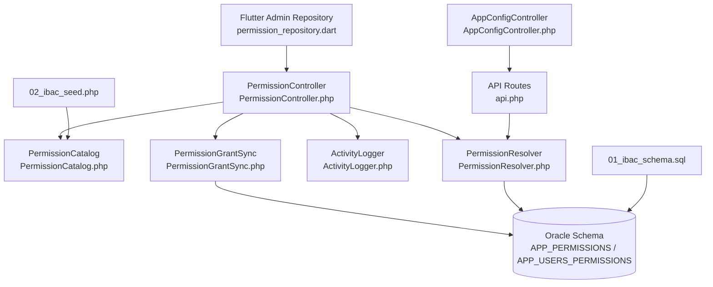
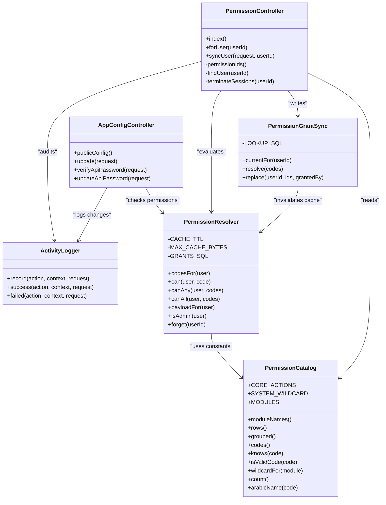
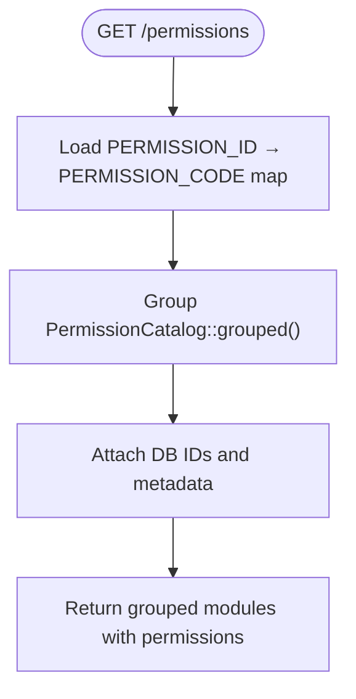
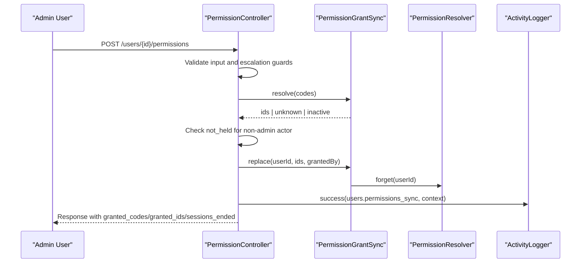
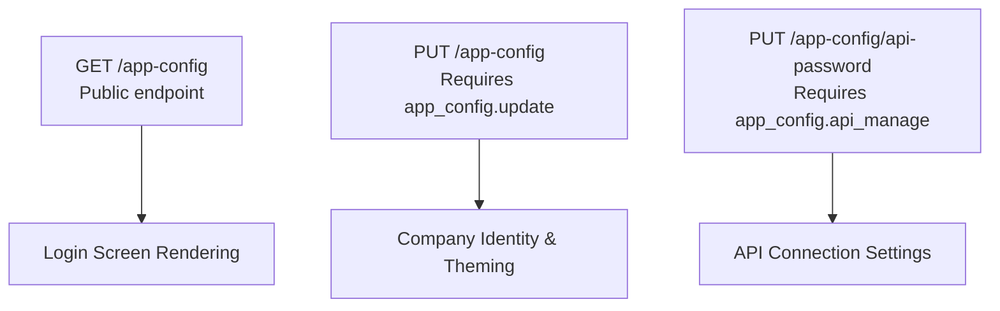
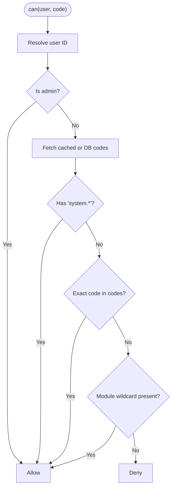
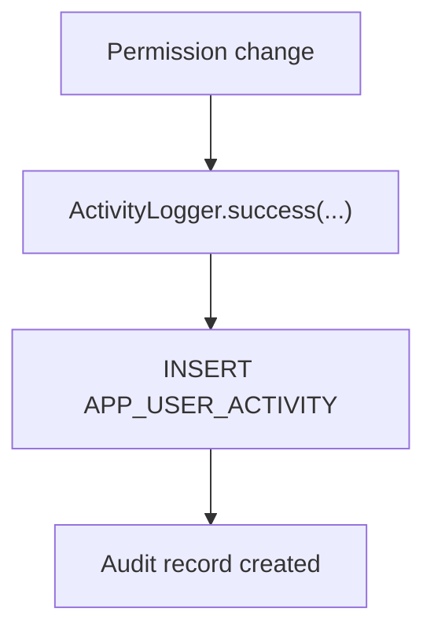
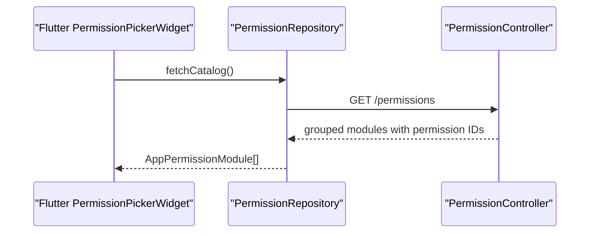
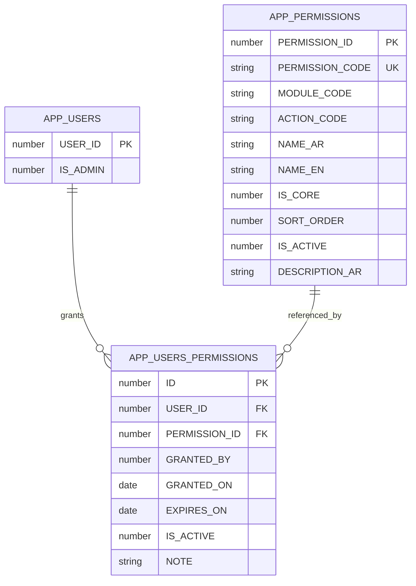
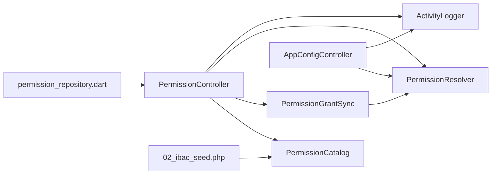

# Permission Management

<cite>
**Referenced Files in This Document**
- [PermissionCatalog.php](file://kyApp_API/app/Support/PermissionCatalog.php)
- [PermissionResolver.php](file://kyApp_API/app/Support/PermissionResolver.php)
- [PermissionGrantSync.php](file://kyApp_API/app/Support/PermissionGrantSync.php)
- [PermissionController.php](file://kyApp_API/app/Http/Controllers/PermissionController.php)
- [ActivityLogger.php](file://kyApp_API/app/Support/ActivityLogger.php)
- [AppConfigController.php](file://kyApp_API/app/Http/Controllers/AppConfigController.php)
- [api.php](file://kyApp_API/routes/api.php)
- [01_ibac_schema.sql](file://kyApp_API/database/oracle/01_ibac_schema.sql)
- [02_ibac_seed.php](file://kyApp_API/database/oracle/02_ibac_seed.php)
- [permission_repository.dart](file://lib/features/admin/data/repositories/permission_repository.dart)
- [permission_codes.dart](file://lib/core/constants/permission_codes.dart)
- [ibac_test.dart](file://test/ibac_test.dart)
- [IbacCoreTest.php](file://kyApp_API/tests/Feature/IbacCoreTest.php)
- [PermissionSyncTest.php](file://kyApp_API/tests/Feature/PermissionSyncTest.php)
- [AppConfigTest.php](file://kyApp_API/tests/Feature/AppConfigTest.php)
</cite>

## Update Summary
**Changes Made**
- Added documentation for the new `app_config` module with four permission codes: `app_config.view`, `app_config.update`, and `app_config.api_manage`
- Updated the permission catalog section to include the new app configuration management capabilities
- Enhanced examples to demonstrate the new dynamic configuration access permissions
- Updated architecture diagrams to reflect the integration of AppConfigController with the permission system

## Table of Contents
1. [Introduction](#introduction)
2. [Project Structure](#project-structure)
3. [Core Components](#core-components)
4. [Architecture Overview](#architecture-overview)
5. [Detailed Component Analysis](#detailed-component-analysis)
6. [Dependency Analysis](#dependency-analysis)
7. [Performance Considerations](#performance-considerations)
8. [Troubleshooting Guide](#troubleshooting-guide)
9. [Conclusion](#conclusion)
10. [Appendices](#appendices)

## Introduction
This document explains the permission management system that provides granular, Identity-Based Access Control (IBAC). Permissions are defined centrally, granted directly to users, evaluated at runtime, and audited. The system exposes a catalog maintenance interface for defining permissions, organizing them into modules, and managing grants through an API consumed by the Flutter admin UI.

Key goals:
- Maintain a single source of truth for permission codes, labels, and module structure.
- Provide a secure grant engine that validates escalation, rejects unknown or inactive permissions, and atomically replaces user grants.
- Evaluate access using a deny-by-default resolver with administrator bypass and wildcard support.
- Record permission changes and security-sensitive actions in an audit trail.
- Keep the database schema, seed data, server services, and client repository aligned.

## Project Structure
The permission system spans backend services, database schema, seeding scripts, controller endpoints, and a Flutter repository:

**Diagram sources**
- [PermissionController.php:17-42](file://kyApp_API/app/Http/Controllers/PermissionController.php#L17-L42)
- [PermissionCatalog.php:5-21](file://kyApp_API/app/Support/PermissionCatalog.php#L5-L21)
- [PermissionGrantSync.php:7-19](file://kyApp_API/app/Support/PermissionGrantSync.php#L7-L19)
- [ActivityLogger.php:9-17](file://kyApp_API/app/Support/ActivityLogger.php#L9-L17)
- [PermissionResolver.php:9-26](file://kyApp_API/app/Support/PermissionResolver.php#L9-L26)
- [AppConfigController.php:38-44](file://kyApp_API/app/Http/Controllers/AppConfigController.php#L38-L44)
- [api.php:141-146](file://kyApp_API/routes/api.php#L141-L146)
- [01_ibac_schema.sql:36-100](file://kyApp_API/database/oracle/01_ibac_schema.sql#L36-L100)
- [02_ibac_seed.php:3-24](file://kyApp_API/database/oracle/02_ibac_seed.php#L3-L24)
- [permission_repository.dart:70-95](file://lib/features/admin/data/repositories/permission_repository.dart#L70-L95)

**Section sources**
- [PermissionController.php:17-42](file://kyApp_API/app/Http/Controllers/PermissionController.php#L17-L42)
- [PermissionCatalog.php:5-21](file://kyApp_API/app/Support/PermissionCatalog.php#L5-L21)
- [PermissionGrantSync.php:7-19](file://kyApp_API/app/Support/PermissionGrantSync.php#L7-L19)
- [ActivityLogger.php:9-17](file://kyApp_API/app/Support/ActivityLogger.php#L9-L17)
- [PermissionResolver.php:9-26](file://kyApp_API/app/Support/PermissionResolver.php#L9-L26)
- [AppConfigController.php:38-44](file://kyApp_API/app/Http/Controllers/AppConfigController.php#L38-L44)
- [api.php:141-146](file://kyApp_API/routes/api.php#L141-L146)
- [01_ibac_schema.sql:36-100](file://kyApp_API/database/oracle/01_ibac_schema.sql#L36-L100)
- [02_ibac_seed.php:3-24](file://kyApp_API/database/oracle/02_ibac_seed.php#L3-L24)
- [permission_repository.dart:70-95](file://lib/features/admin/data/repositories/permission_repository.dart#L70-L95)

## Core Components
- PermissionCatalog: Canonical definition of modules, actions, permission codes, labels, ordering, validation helpers, and grouped structures for the UI.
- PermissionResolver: Runtime evaluation engine implementing IBAC rules, caching, and payload generation for clients.
- PermissionGrantSync: Write path for user grants, including code resolution, atomic replacement, and cache invalidation.
- PermissionController: HTTP endpoints serving the catalog, reading current grants, replacing grants safely, terminating sessions, and auditing changes.
- ActivityLogger: Audit trail writer that never breaks successful requests.
- AppConfigController: Manages application configuration including company identity, theming, and API connection settings with granular permissions.
- Oracle Schema and Seed: Database tables for permissions, user grants, settings, and activity; idempotent seeding driven by PermissionCatalog.
- Flutter PermissionRepository: Client-side repository fetching the grouped catalog from `/permissions`.

**Section sources**
- [PermissionCatalog.php:22-479](file://kyApp_API/app/Support/PermissionCatalog.php#L22-L479)
- [PermissionResolver.php:27-274](file://kyApp_API/app/Support/PermissionResolver.php#L27-L274)
- [PermissionGrantSync.php:20-190](file://kyApp_API/app/Support/PermissionGrantSync.php#L20-L190)
- [PermissionController.php:30-378](file://kyApp_API/app/Http/Controllers/PermissionController.php#L30-L378)
- [ActivityLogger.php:18-170](file://kyApp_API/app/Support/ActivityLogger.php#L18-L170)
- [AppConfigController.php:38-423](file://kyApp_API/app/Http/Controllers/AppConfigController.php#L38-L423)
- [01_ibac_schema.sql:36-100](file://kyApp_API/database/oracle/01_ibac_schema.sql#L36-L100)
- [02_ibac_seed.php:332-461](file://kyApp_API/database/oracle/02_ibac_seed.php#L332-L461)
- [permission_repository.dart:70-95](file://lib/features/admin/data/repositories/permission_repository.dart#L70-L95)

## Architecture Overview
The permission system follows a clear separation between catalog definition, runtime evaluation, grant writing, and audit logging:

**Diagram sources**
- [PermissionCatalog.php:22-479](file://kyApp_API/app/Support/PermissionCatalog.php#L22-L479)
- [PermissionResolver.php:27-274](file://kyApp_API/app/Support/PermissionResolver.php#L27-L274)
- [PermissionGrantSync.php:20-190](file://kyApp_API/app/Support/PermissionGrantSync.php#L20-L190)
- [PermissionController.php:30-378](file://kyApp_API/app/Http/Controllers/PermissionController.php#L30-L378)
- [AppConfigController.php:38-423](file://kyApp_API/app/Http/Controllers/AppConfigController.php#L38-L423)
- [ActivityLogger.php:18-170](file://kyApp_API/app/Support/ActivityLogger.php#L18-L170)

## Detailed Component Analysis

### Permission Catalog Maintenance Interface
The catalog is the authoritative source for all permission metadata. It defines:
- Modules ordered exactly as they appear in the portal UI.
- Core actions (`view`, `create`, `update`, `delete`) per module.
- Extra actions beyond core.
- Wildcards for module-level grants and system-wide grants.
- Methods to generate rows for seeding, group permissions for UI, validate codes, and compute counts.

**Updated** The catalog now includes the `app_config` module with four permission codes: `app_config.*` (wildcard), `app_config.view` (view application configuration), `app_config.update` (update company identity and theming), and `app_config.api_manage` (manage API connection settings).

The controller's index endpoint returns the grouped catalog with database IDs so the Flutter UI can submit IDs rather than raw codes.

**Diagram sources**
- [PermissionController.php:51-93](file://kyApp_API/app/Http/Controllers/PermissionController.php#L51-L93)
- [PermissionCatalog.php:400-415](file://kyApp_API/app/Support/PermissionCatalog.php#L400-L415)

Practical example: adding a new permission category
- Add a new module entry under `MODULES` in PermissionCatalog with its Arabic name, core actions, and extra actions.
- Run the seed script to upsert rows into `APP_PERMISSIONS`; the seed uses `PermissionCatalog::rows()` and is idempotent.
- Verify via the catalog endpoint that the module appears grouped correctly and that the total count matches expectations.

Validation and wildcards
- Explicit permission codes must match lowercase module/action patterns.
- Wildcards are allowed only as `<module>.*` or `system.*`.
- Unknown codes are rejected during grant sync.

**Section sources**
- [PermissionCatalog.php:22-479](file://kyApp_API/app/Support/PermissionCatalog.php#L22-L479)
- [PermissionController.php:51-93](file://kyApp_API/app/Http/Controllers/PermissionController.php#L51-L93)
- [02_ibac_seed.php:432-461](file://kyApp_API/database/oracle/02_ibac_seed.php#L432-L461)
- [IbacCoreTest.php:62-74](file://kyApp_API/tests/Feature/IbacCoreTest.php#L62-L74)

### Grant Management and Escalation Guards
The grant engine ensures safe administration:
- Non-admins cannot edit their own grants.
- Non-admins can only grant permissions they hold.
- Unknown or inactive permission codes are rejected.
- Replacing grants is atomic: delete existing grants, insert new ones, then invalidate the user's cached codes.
- Changing grants optionally terminates the target user's sessions to avoid stale access.

**Diagram sources**
- [PermissionController.php:137-243](file://kyApp_API/app/Http/Controllers/PermissionController.php#L137-L243)
- [PermissionGrantSync.php:77-163](file://kyApp_API/app/Support/PermissionGrantSync.php#L77-L163)
- [ActivityLogger.php:75-95](file://kyApp_API/app/Support/ActivityLogger.php#L75-L95)

**Section sources**
- [PermissionController.php:137-243](file://kyApp_API/app/Http/Controllers/PermissionController.php#L137-L243)
- [PermissionGrantSync.php:77-163](file://kyApp_API/app/Support/PermissionGrantSync.php#L77-L163)

### Application Configuration Management
**New Section** The `app_config` module provides granular control over application configuration management through three distinct permission levels:

- `app_config.view`: Allows viewing application configuration without modification
- `app_config.update`: Allows updating company identity, theming, and visual appearance settings
- `app_config.api_manage`: Highest privilege level for managing API connection settings and passwords

The AppConfigController implements a tiered security model where:
- Public endpoints provide configuration data without authentication for login screen rendering
- Branding updates require `app_config.update` permission
- API password changes require the elevated `app_config.api_manage` permission
- All configuration changes are audited with detailed change tracking

**Diagram sources**
- [AppConfigController.php:55-67](file://kyApp_API/app/Http/Controllers/AppConfigController.php#L55-L67)
- [AppConfigController.php:80-175](file://kyApp_API/app/Http/Controllers/AppConfigController.php#L80-L175)
- [AppConfigController.php:240-292](file://kyApp_API/app/Http/Controllers/AppConfigController.php#L240-L292)
- [api.php:141-146](file://kyApp_API/routes/api.php#L141-L146)

**Section sources**
- [AppConfigController.php:38-423](file://kyApp_API/app/Http/Controllers/AppConfigController.php#L38-L423)
- [api.php:141-146](file://kyApp_API/routes/api.php#L141-L146)
- [AppConfigTest.php:52-64](file://kyApp_API/tests/Feature/AppConfigTest.php#L52-L64)

### Runtime Permission Evaluation (PermissionResolver)
The resolver implements IBAC decision rules in order:
1. System administrator bypass (`IS_ADMIN = 1`).
2. Granted `system.*` wildcard implies everything.
3. Exact permission code match.
4. Module wildcard match (`<module>.*`).
5. Deny by default.

It caches effective codes per user with a TTL and a safe byte-size bound to avoid Oracle cache limits. It also generates a payload for the Flutter client containing user ID, admin flag, permissions list, and derived modules.

**Diagram sources**
- [PermissionResolver.php:95-132](file://kyApp_API/app/Support/PermissionResolver.php#L95-L132)
- [PermissionResolver.php:66-89](file://kyApp_API/app/Support/PermissionResolver.php#L66-L89)
- [PermissionResolver.php:178-200](file://kyApp_API/app/Support/PermissionResolver.php#L178-L200)

**Section sources**
- [PermissionResolver.php:27-274](file://kyApp_API/app/Support/PermissionResolver.php#L27-L274)
- [ibac_test.dart:86-94](file://test/ibac_test.dart#L86-L94)
- [IbacCoreTest.php:76-84](file://kyApp_API/tests/Feature/IbacCoreTest.php#L76-L84)

### Audit Trail Functionality
Permission changes are recorded through ActivityLogger:
- Successful permission synchronization logs include actor, target user, module, entity type, description, and status.
- Logging failures are silently reported without breaking the request.
- The audit table supports querying by user, target user, module, and time.

**Updated** The audit trail now includes comprehensive logging for application configuration changes, including company information updates, theming modifications, and API password changes.

**Diagram sources**
- [PermissionController.php:219-226](file://kyApp_API/app/Http/Controllers/PermissionController.php#L219-L226)
- [ActivityLogger.php:37-73](file://kyApp_API/app/Support/ActivityLogger.php#L37-L73)
- [01_ibac_schema.sql:149-184](file://kyApp_API/database/oracle/01_ibac_schema.sql#L149-L184)

**Section sources**
- [PermissionController.php:219-226](file://kyApp_API/app/Http/Controllers/PermissionController.php#L219-L226)
- [ActivityLogger.php:37-73](file://kyApp_API/app/Support/ActivityLogger.php#L37-L73)
- [01_ibac_schema.sql:149-184](file://kyApp_API/database/oracle/01_ibac_schema.sql#L149-L184)

### Integration with Flutter Permission Picker
The Flutter admin repository fetches the grouped catalog from `/permissions` and consumes it to build the permission picker UI. The server builds groups from `PermissionCatalog::grouped()`, ensuring consistent ordering and avoiding drift between server and client.

**Diagram sources**
- [permission_repository.dart:70-95](file://lib/features/admin/data/repositories/permission_repository.dart#L70-L95)
- [PermissionController.php:51-93](file://kyApp_API/app/Http/Controllers/PermissionController.php#L51-L93)

**Section sources**
- [permission_repository.dart:70-95](file://lib/features/admin/data/repositories/permission_repository.dart#L70-L95)
- [PermissionController.php:51-93](file://kyApp_API/app/Http/Controllers/PermissionController.php#L51-L93)

### Relationship Between Permissions and IBAC Components
IBAC grants permissions directly to users without roles:
- `APP_PERMISSIONS` stores the canonical catalog.
- `APP_USERS_PERMISSIONS` stores direct user grants with active/expired state.
- `PermissionResolver` evaluates access against these grants plus admin bypass and wildcards.
- `PermissionGrantSync` writes grants atomically and invalidates caches.
- `PermissionController` orchestrates catalog retrieval, grant reads/writes, session termination, and audit logging.

**Updated** The system now includes the `app_config` module with specialized permissions for application configuration management, providing fine-grained control over different aspects of application setup.

**Diagram sources**
- [01_ibac_schema.sql:36-100](file://kyApp_API/database/oracle/01_ibac_schema.sql#L36-L100)
- [PermissionResolver.php:49-58](file://kyApp_API/app/Support/PermissionResolver.php#L49-L58)
- [PermissionGrantSync.php:40-63](file://kyApp_API/app/Support/PermissionGrantSync.php#L40-L63)

**Section sources**
- [01_ibac_schema.sql:36-100](file://kyApp_API/database/oracle/01_ibac_schema.sql#L36-L100)
- [PermissionResolver.php:49-58](file://kyApp_API/app/Support/PermissionResolver.php#L49-L58)
- [PermissionGrantSync.php:40-63](file://kyApp_API/app/Support/PermissionGrantSync.php#L40-L63)

## Dependency Analysis
The components have clear dependencies:
- PermissionController depends on PermissionCatalog, PermissionGrantSync, PermissionResolver, and ActivityLogger.
- PermissionGrantSync depends on PermissionResolver for cache invalidation.
- PermissionResolver depends on PermissionCatalog for constants and on Oracle for grants.
- Seed script depends on PermissionCatalog to generate rows.
- Flutter repository depends on the controller's `/permissions` endpoint.
- AppConfigController depends on PermissionResolver for permission checks and ActivityLogger for audit trails.

**Diagram sources**
- [PermissionController.php:30-42](file://kyApp_API/app/Http/Controllers/PermissionController.php#L30-L42)
- [PermissionGrantSync.php:32-32](file://kyApp_API/app/Support/PermissionGrantSync.php#L32-L32)
- [02_ibac_seed.php:432-461](file://kyApp_API/database/oracle/02_ibac_seed.php#L432-L461)
- [permission_repository.dart:70-95](file://lib/features/admin/data/repositories/permission_repository.dart#L70-L95)
- [AppConfigController.php:40-44](file://kyApp_API/app/Http/Controllers/AppConfigController.php#L40-L44)

**Section sources**
- [PermissionController.php:30-42](file://kyApp_API/app/Http/Controllers/PermissionController.php#L30-L42)
- [PermissionGrantSync.php:32-32](file://kyApp_API/app/Support/PermissionGrantSync.php#L32-L32)
- [02_ibac_seed.php:432-461](file://kyApp_API/database/oracle/02_ibac_seed.php#L432-L461)
- [permission_repository.dart:70-95](file://lib/features/admin/data/repositories/permission_repository.dart#L70-L95)
- [AppConfigController.php:40-44](file://kyApp_API/app/Http/Controllers/AppConfigController.php#L40-L44)

## Performance Considerations
- Caching: PermissionResolver caches effective codes per user with a TTL and a maximum serialized size to avoid Oracle cache limits. Oversized sets skip caching to prevent ORA-01461.
- Cache invalidation: After any grant replacement, the resolver forgets the affected user's cache to ensure immediate effect.
- Query efficiency: Grants SQL joins active permission rows and filters by expiration and activation flags.
- Atomic writes: Grant replacement deletes old grants and inserts new ones within a transaction, minimizing inconsistent states.
- Session termination: Optional termination of target user sessions prevents stale client-side cached permission lists.

**Section sources**
- [PermissionResolver.php:29-43](file://kyApp_API/app/Support/PermissionResolver.php#L29-L43)
- [PermissionResolver.php:66-89](file://kyApp_API/app/Support/PermissionResolver.php#L66-L89)
- [PermissionGrantSync.php:134-163](file://kyApp_API/app/Support/PermissionGrantSync.php#L134-L163)
- [PermissionController.php:212-218](file://kyApp_API/app/Http/Controllers/PermissionController.php#L212-L218)

## Troubleshooting Guide
Common issues and resolutions:
- Unknown permission codes: Ensure codes exist in `APP_PERMISSIONS` and are active. Use `PermissionCatalog::isValidCode()` and `PermissionCatalog::knows()` to validate before granting.
- Inactive permissions: Only active permissions can be granted. Reactivate or update the catalog row.
- Escalation denied: Non-admins cannot grant permissions they do not hold and cannot edit their own grants.
- Stale permissions after grant changes: Ensure cache invalidation occurs; verify `PermissionResolver::forget()` is called after `PermissionGrantSync::replace()`.
- Flutter UI mismatch: Confirm the server returns grouped modules from `PermissionCatalog::grouped()` and that the client does not re-sort locally.

**Updated** For app_config related issues:
- API password changes require `app_config.api_manage` permission, not just `app_config.update`
- Public configuration endpoint should not expose sensitive API password data
- Configuration changes are audited with detailed change descriptions

Diagnostic checks:
- Catalog endpoint returns correct totals and module counts (now 97 permissions including app_config).
- Resolver denies by default for unknown users and empty permission lists.
- Seed script reports inserted/updated counts matching expected catalog size.
- AppConfig endpoints properly enforce permission requirements.

**Section sources**
- [PermissionController.php:171-210](file://kyApp_API/app/Http/Controllers/PermissionController.php#L171-L210)
- [PermissionGrantSync.php:77-120](file://kyApp_API/app/Support/PermissionGrantSync.php#L77-L120)
- [PermissionResolver.php:95-132](file://kyApp_API/app/Support/PermissionResolver.php#L95-L132)
- [PermissionSyncTest.php:71-92](file://kyApp_API/tests/Feature/PermissionSyncTest.php#L71-L92)
- [IbacCoreTest.php:76-84](file://kyApp_API/tests/Feature/IbacCoreTest.php#L76-L84)
- [AppConfigTest.php:83-157](file://kyApp_API/tests/Feature/AppConfigTest.php#L83-L157)

## Conclusion
The permission management system provides a robust, auditable, and scalable IBAC implementation. Permission definitions are centralized in PermissionCatalog, grants are managed securely through PermissionController and PermissionGrantSync, and access decisions are enforced by PermissionResolver with caching and wildcard logic. The Oracle schema and seed scripts keep the catalog synchronized, while ActivityLogger records critical changes. The Flutter repository integrates cleanly with the server's grouped catalog to deliver a consistent admin experience.

**Updated** The recent addition of the `app_config` module enhances the system with granular control over application configuration management, providing three distinct permission levels for viewing, updating branding, and managing API connection settings. This enables fine-grained security policies for application setup and configuration management.

## Appendices

### Practical Examples

Adding a new permission category
- Define a new module in `PermissionCatalog::MODULES` with Arabic name, core actions, and extra actions.
- Run the seed script to upsert rows into `APP_PERMISSIONS`.
- Verify via `/permissions` that the module appears grouped and the total count matches.

Implementing custom permission logic
- Extend PermissionResolver if additional decision rules are required, preserving the deny-by-default principle.
- Ensure any new rule respects admin bypass and wildcard semantics unless explicitly scoped.
- Update tests to mirror resolver behavior.

**Updated** Managing application configuration permissions
- Grant `app_config.view` for read-only access to application configuration
- Grant `app_config.update` for modifying company identity and theming settings
- Grant `app_config.api_manage` for managing API connection settings and passwords
- Use the public `/app-config` endpoint for login screen rendering without authentication

Troubleshooting permission conflicts
- Validate codes with `PermissionCatalog::isValidCode()` and `PermissionCatalog::knows()`.
- Check for inactive permissions and unknown codes returned by `PermissionGrantSync::resolve()`.
- Confirm escalation guards prevent self-editing and unauthorized granting.
- Invalidate caches after grant changes and terminate sessions when necessary.
- For app_config issues, verify proper permission hierarchy: `app_config.api_manage` > `app_config.update` > `app_config.view`

**Section sources**
- [PermissionCatalog.php:22-479](file://kyApp_API/app/Support/PermissionCatalog.php#L22-L479)
- [PermissionResolver.php:27-274](file://kyApp_API/app/Support/PermissionResolver.php#L27-L274)
- [PermissionGrantSync.php:77-163](file://kyApp_API/app/Support/PermissionGrantSync.php#L77-L163)
- [PermissionController.php:137-243](file://kyApp_API/app/Http/Controllers/PermissionController.php#L137-L243)
- [AppConfigController.php:38-423](file://kyApp_API/app/Http/Controllers/AppConfigController.php#L38-L423)
- [02_ibac_seed.php:432-461](file://kyApp_API/database/oracle/02_ibac_seed.php#L432-L461)
- [IbacCoreTest.php:45-48](file://kyApp_API/tests/Feature/IbacCoreTest.php#L45-L48)