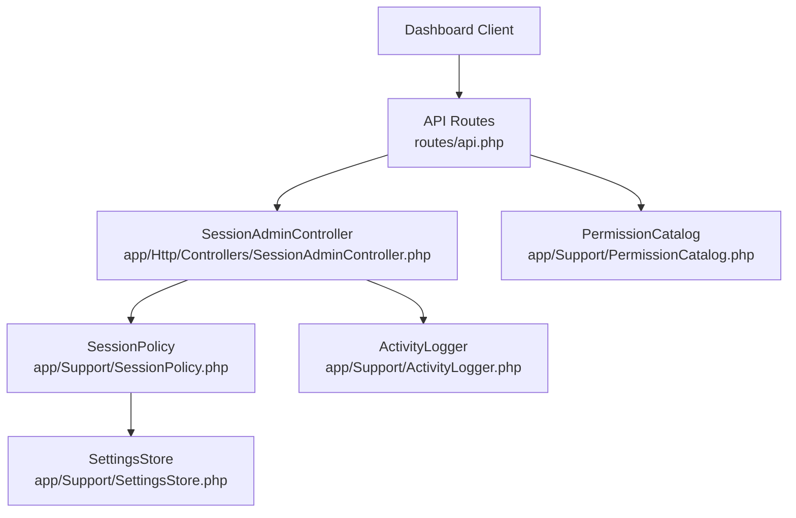
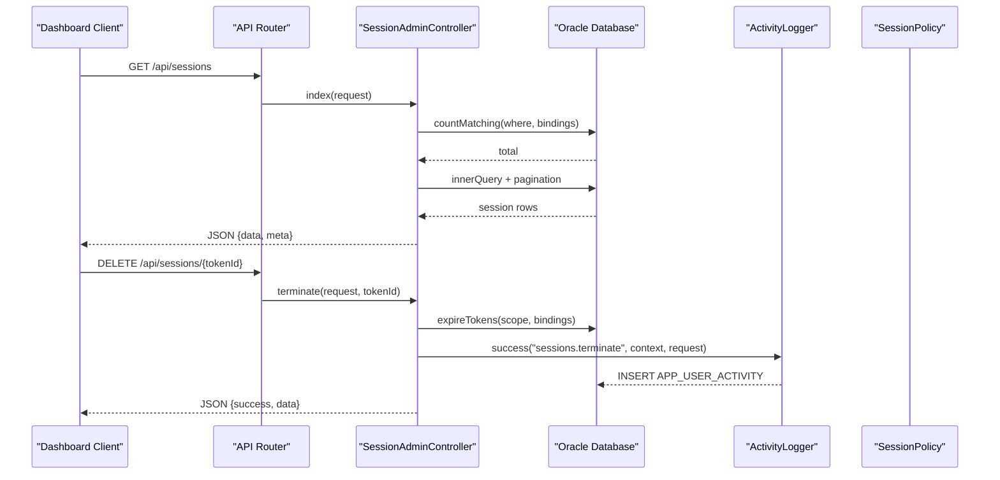
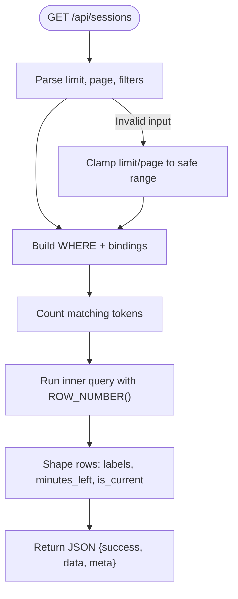
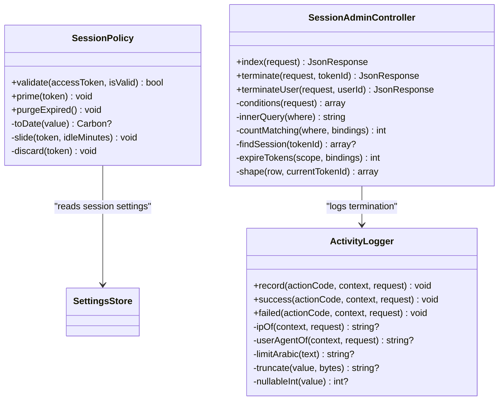
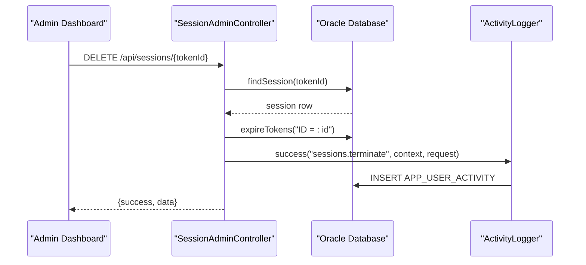
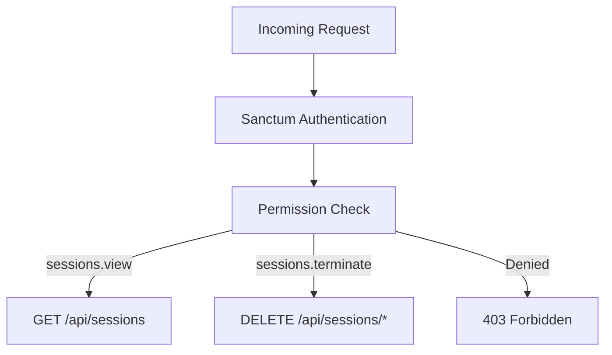
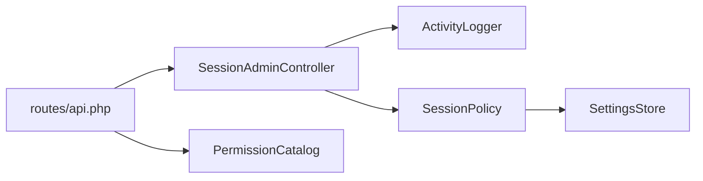

# System Monitoring

<cite>
**Referenced Files in This Document**
- [SessionAdminController.php](file://kyApp_API/app/Http/Controllers/SessionAdminController.php)
- [ActivityLogger.php](file://kyApp_API/app/Support/ActivityLogger.php)
- [SessionPolicy.php](file://kyApp_API/app/Support/SessionPolicy.php)
- [api.php](file://kyApp_API/routes/api.php)
- [PermissionCatalog.php](file://kyApp_API/app/Support/PermissionCatalog.php)
- [SettingsStore.php](file://kyApp_API/app/Support/SettingsStore.php)
- [sanctum.php](file://kyApp_API/config/sanctum.php)
- [ActiveSessionsTest.php](file://kyApp_API/tests/Feature/ActiveSessionsTest.php)
</cite>

## Table of Contents
1. [Introduction](#introduction)
2. [Project Structure](#project-structure)
3. [Core Components](#core-components)
4. [Architecture Overview](#architecture-overview)
5. [Detailed Component Analysis](#detailed-component-analysis)
6. [Dependency Analysis](#dependency-analysis)
7. [Performance Considerations](#performance-considerations)
8. [Troubleshooting Guide](#troubleshooting-guide)
9. [Conclusion](#conclusion)
10. [Appendices](#appendices)

## Introduction
This document describes the system monitoring capabilities exposed by the backend for the application’s operational dashboard. The current implementation focuses on **active session monitoring**, **session lifecycle policy**, and **audit trail logging**. It explains how logged-in users, session duration, and activity patterns are represented, how the `SessionAdminController` manages sessions, and how `ActivityLogger` records audit events. It also outlines where performance metrics collection, alert thresholds, custom widgets, and report export would fit into this architecture, based on existing permission and settings patterns.

The repository does not contain a dedicated performance metrics collector or a general-purpose dashboard controller; instead, it provides secure endpoints for active sessions and a robust foundation for extending monitoring features.

## Project Structure
The monitoring-related functionality lives primarily in the Laravel API layer:

- Controllers expose REST endpoints for listing and terminating sessions.
- Support classes implement session policy and audit logging.
- Routes enforce authentication and fine-grained permissions.
- Tests validate session listing behavior.

**Diagram sources**
- [api.php:113-130](file://kyApp_API/routes/api.php#L113-L130)
- [SessionAdminController.php:32-82](file://kyApp_API/app/Http/Controllers/SessionAdminController.php#L32-L82)
- [SessionPolicy.php:42-108](file://kyApp_API/app/Support/SessionPolicy.php#L42-L108)
- [ActivityLogger.php:18-73](file://kyApp_API/app/Support/ActivityLogger.php#L18-L73)
- [PermissionCatalog.php:53-60](file://kyApp_API/app/Support/PermissionCatalog.php#L53-L60)

**Section sources**
- [api.php:18-146](file://kyApp_API/routes/api.php#L18-L146)
- [SessionAdminController.php:1-474](file://kyApp_API/app/Http/Controllers/SessionAdminController.php#L1-L474)
- [SessionPolicy.php:1-185](file://kyApp_API/app/Support/SessionPolicy.php#L1-L185)
- [ActivityLogger.php:1-170](file://kyApp_API/app/Support/ActivityLogger.php#L1-L170)

## Core Components
- **Active Session Listing**: Returns paginated, filterable rows representing personal access tokens joined with user information. Each row includes token identity, user identity, device name, platform, creation time, last activity time, expiry time, computed status, and remaining minutes.
- **Session Termination**: Exposes endpoints to terminate a single token or all tokens for a user by pushing `EXPIRES_AT` into the past.
- **Session Policy**: Implements sliding renewal, idle expiration, absolute lifetime, account activation checks, and best-effort cleanup of expired tokens.
- **Audit Logging**: Writes structured activity events to an Oracle table with safe encoding, truncation, IP/user agent capture, and silent failure handling.

**Section sources**
- [SessionAdminController.php:93-141](file://kyApp_API/app/Http/Controllers/SessionAdminController.php#L93-L141)
- [SessionAdminController.php:147-182](file://kyApp_API/app/Http/Controllers/SessionAdminController.php#L147-L182)
- [SessionAdminController.php:193-233](file://kyApp_API/app/Http/Controllers/SessionAdminController.php#L193-L233)
- [SessionPolicy.php:70-108](file://kyApp_API/app/Support/SessionPolicy.php#L70-L108)
- [ActivityLogger.php:37-73](file://kyApp_API/app/Support/ActivityLogger.php#L37-L73)

## Architecture Overview
The monitoring flow is request-driven:

1. A dashboard client calls `/api/sessions`.
2. Laravel routes authenticate the request via Sanctum and enforce `sessions.view`.
3. `SessionAdminController::index` builds conditions, counts matching rows, and returns a shaped list.
4. Termination endpoints call `expireTokens`, then log the action through `ActivityLogger`.
5. `SessionPolicy` governs token validity and sliding renewal across authenticated requests.

**Diagram sources**
- [api.php:113-123](file://kyApp_API/routes/api.php#L113-L123)
- [SessionAdminController.php:93-141](file://kyApp_API/app/Http/Controllers/SessionAdminController.php#L93-L141)
- [SessionAdminController.php:147-182](file://kyApp_API/app/Http/Controllers/SessionAdminController.php#L147-L182)
- [ActivityLogger.php:37-73](file://kyApp_API/app/Support/ActivityLogger.php#L37-L73)

## Detailed Component Analysis

### Active Session Tracking Interface
The active session interface surfaces every live personal access token associated with application users. It supports:

- Pagination with bounded limit and page parameters.
- Filtering by user ID, status (`active`, `expired`, `disabled`), and free-text search across English and Arabic names plus device name.
- Safe column selection that excludes sensitive token secrets and large CLOB abilities.
- Computed fields such as session status label, remaining minutes, and a “this device” marker for the current request.

Key behaviors:
- Ordering is fixed to last activity and token ID to avoid SQL injection from user-supplied sort expressions.
- Arabic text is repaired using the encoding helper to prevent mojibake.
- Errors return a structured JSON response without leaking internal details unless debug mode is enabled.

**Diagram sources**
- [SessionAdminController.php:93-141](file://kyApp_API/app/Http/Controllers/SessionAdminController.php#L93-L141)
- [SessionAdminController.php:245-283](file://kyApp_API/app/Http/Controllers/SessionAdminController.php#L245-L283)
- [SessionAdminController.php:384-417](file://kyApp_API/app/Http/Controllers/SessionAdminController.php#L384-L417)

**Section sources**
- [SessionAdminController.php:32-82](file://kyApp_API/app/Http/Controllers/SessionAdminController.php#L32-L82)
- [SessionAdminController.php:93-141](file://kyApp_API/app/Http/Controllers/SessionAdminController.php#L93-L141)
- [SessionAdminController.php:245-283](file://kyApp_API/app/Http/Controllers/SessionAdminController.php#L245-L283)
- [SessionAdminController.php:384-417](file://kyApp_API/app/Http/Controllers/SessionAdminController.php#L384-L417)

### Session Duration and Activity Patterns
Session duration is governed by `SessionPolicy`:

- Idle expiration uses `session_idle_minutes`.
- Absolute lifetime uses `session_absolute_days`.
- Sliding renewal updates `EXPIRES_AT` only when necessary, controlled by `session_touch_threshold_minutes`.
- Deactivated accounts are rejected immediately.
- Expired tokens are deleted best-effort after rejection.

Activity patterns are captured through `ActivityLogger`, which writes structured audit entries including actor, target, module, entity type, description, status, IP, user agent, and platform.

**Diagram sources**
- [SessionPolicy.php:42-183](file://kyApp_API/app/Support/SessionPolicy.php#L42-L183)
- [ActivityLogger.php:18-168](file://kyApp_API/app/Support/ActivityLogger.php#L18-L168)
- [SessionAdminController.php:93-233](file://kyApp_API/app/Http/Controllers/SessionAdminController.php#L93-L233)

**Section sources**
- [SessionPolicy.php:70-108](file://kyApp_API/app/Support/SessionPolicy.php#L70-L108)
- [SessionPolicy.php:114-117](file://kyApp_API/app/Support/SessionPolicy.php#L114-L117)
- [SessionPolicy.php:130-141](file://kyApp_API/app/Support/SessionPolicy.php#L130-L141)
- [SessionPolicy.php:166-183](file://kyApp_API/app/Support/SessionPolicy.php#L166-L183)
- [ActivityLogger.php:37-73](file://kyApp_API/app/Support/ActivityLogger.php#L37-L73)

### Integration with SessionAdminController and ActivityLogger
`SessionAdminController` integrates with `ActivityLogger` whenever a termination action occurs:

- Single-token termination logs the actor, target user, module code, entity type, entity ID, and an Arabic description.
- User-wide termination logs the same action code but differentiates scope through the description and affected count.
- All database operations use bound parameters to prevent injection.
- Audit failures are reported silently so they do not break successful user operations.

**Diagram sources**
- [SessionAdminController.php:147-182](file://kyApp_API/app/Http/Controllers/SessionAdminController.php#L147-L182)
- [ActivityLogger.php:37-73](file://kyApp_API/app/Support/ActivityLogger.php#L37-L73)

**Section sources**
- [SessionAdminController.php:147-182](file://kyApp_API/app/Http/Controllers/SessionAdminController.php#L147-L182)
- [SessionAdminController.php:193-233](file://kyApp_API/app/Http/Controllers/SessionAdminController.php#L193-L233)
- [ActivityLogger.php:37-73](file://kyApp_API/app/Support/ActivityLogger.php#L37-L73)

### Security Considerations for Monitoring Sensitive Information
- **No secret exposure**: The session list deliberately avoids reading token secrets and abilities.
- **Least privilege**: Endpoints require both Sanctum authentication and explicit permissions (`sessions.view`, `sessions.terminate`).
- **Safe queries**: Only whitelisted columns are selected; sorting is fixed; inputs are clamped and bound.
- **Auditability**: Critical actions are recorded with actor, target, module, entity, and descriptive context.
- **Encoding safety**: Arabic text is normalized and truncated safely to prevent corruption and overflow.

**Section sources**
- [SessionAdminController.php:29-31](file://kyApp_API/app/Http/Controllers/SessionAdminController.php#L29-L31)
- [SessionAdminController.php:54-80](file://kyApp_API/app/Http/Controllers/SessionAdminController.php#L54-L80)
- [api.php:113-123](file://kyApp_API/routes/api.php#L113-L123)
- [ActivityLogger.php:13-17](file://kyApp_API/app/Support/ActivityLogger.php#L13-L17)

### Access Controls for Monitoring Interfaces
Access control follows a deny-by-default pattern:

- Authentication is enforced by Sanctum.
- Fine-grained permissions gate each route.
- The permission catalog defines module-level codes, including a `dashboard` entry used elsewhere in the application.

**Diagram sources**
- [api.php:113-123](file://kyApp_API/routes/api.php#L113-L123)
- [PermissionCatalog.php:53-60](file://kyApp_API/app/Support/PermissionCatalog.php#L53-L60)

**Section sources**
- [api.php:50-58](file://kyApp_API/routes/api.php#L50-L58)
- [api.php:113-130](file://kyApp_API/routes/api.php#L113-L130)
- [PermissionCatalog.php:53-60](file://kyApp_API/app/Support/PermissionCatalog.php#L53-L60)

### Adding Custom Monitoring Widgets
Although there is no generic widget framework in the current codebase, you can extend the monitoring surface by following these patterns:

1. Create a new controller method that returns a stable JSON shape suitable for a dashboard widget.
2. Register a route under the authenticated group and attach a specific permission.
3. Use bound queries and avoid exposing secrets or large CLOB fields.
4. Log administrative changes through `ActivityLogger`.
5. Add a corresponding permission code in the permission catalog if needed.

Example integration points:
- New endpoint: add a route similar to the sessions endpoints.
- New permission: extend the catalog with a widget-specific code.
- Audit trail: record configuration changes or manual overrides.

**Section sources**
- [api.php:113-130](file://kyApp_API/routes/api.php#L113-L130)
- [PermissionCatalog.php:53-60](file://kyApp_API/app/Support/PermissionCatalog.php#L53-L60)
- [ActivityLogger.php:37-73](file://kyApp_API/app/Support/ActivityLogger.php#L37-L73)

### Configuring Alert Thresholds
Alert thresholds should be backed by the same settings mechanism used by session policy:

- Read threshold values from `SettingsStore`, mirroring how `SessionPolicy` reads `session_idle_minutes`, `session_absolute_days`, and `session_touch_threshold_minutes`.
- Store thresholds in the settings table with appropriate types and validation.
- Surface thresholds in the dashboard and allow privileged users to update them through a secured endpoint.
- Record threshold changes in the audit trail.

Relevant configuration keys:
- `session_idle_minutes`
- `session_absolute_days`
- `session_touch_threshold_minutes`

**Section sources**
- [SessionPolicy.php:84-86](file://kyApp_API/app/Support/SessionPolicy.php#L84-L86)
- [SessionPolicy.php:168-169](file://kyApp_API/app/Support/SessionPolicy.php#L168-L169)
- [SettingsStore.php:81-82](file://kyApp_API/app/Support/SettingsStore.php#L81-L82)

### Exporting Performance Reports
The repository contains permission codes for exporting various business reports, indicating that export functionality is modeled as a permission-gated capability. For monitoring reports:

- Define a `reports.export` permission if not already present.
- Implement an export endpoint that returns aggregated metrics (e.g., session counts, termination events, error rates).
- Paginate or stream large exports to avoid memory pressure.
- Log export actions through `ActivityLogger`.

Existing export permission examples:
- Sales export
- Customer export
- Financial statement export
- Invoice export
- Reports export

**Section sources**
- [PermissionCatalog.php:68-68](file://kyApp_API/app/Support/PermissionCatalog.php#L68-L68)
- [PermissionCatalog.php:95-95](file://kyApp_API/app/Support/PermissionCatalog.php#L95-L95)
- [PermissionCatalog.php:150-150](file://kyApp_API/app/Support/PermissionCatalog.php#L150-L150)
- [PermissionCatalog.php:171-171](file://kyApp_API/app/Support/PermissionCatalog.php#L171-L171)
- [PermissionCatalog.php:184-187](file://kyApp_API/app/Support/PermissionCatalog.php#L184-L187)

## Dependency Analysis
The monitoring subsystem has clear boundaries:

- `SessionAdminController` depends on `ActivityLogger` for audit events and on `SessionPolicy` for consistent session semantics.
- Routes enforce authentication and permissions before reaching controllers.
- `SessionPolicy` depends on `SettingsStore` for runtime configuration.
- `ActivityLogger` writes to the Oracle database connection and never fails a successful request.

**Diagram sources**
- [api.php:113-130](file://kyApp_API/routes/api.php#L113-L130)
- [SessionAdminController.php:32-82](file://kyApp_API/app/Http/Controllers/SessionAdminController.php#L32-L82)
- [SessionPolicy.php:42-44](file://kyApp_API/app/Support/SessionPolicy.php#L42-L44)
- [ActivityLogger.php:18-17](file://kyApp_API/app/Support/ActivityLogger.php#L18-L17)
- [PermissionCatalog.php:53-60](file://kyApp_API/app/Support/PermissionCatalog.php#L53-L60)

**Section sources**
- [SessionAdminController.php:32-82](file://kyApp_API/app/Http/Controllers/SessionAdminController.php#L32-L82)
- [SessionPolicy.php:42-44](file://kyApp_API/app/Support/SessionPolicy.php#L42-L44)
- [ActivityLogger.php:13-17](file://kyApp_API/app/Support/ActivityLogger.php#L13-L17)

## Performance Considerations
- **Pagination**: The session list uses bounded limits and two-level pagination compatible with Oracle 11g, avoiding unsupported `OFFSET/FETCH`.
- **Column safety**: Only necessary columns are selected; sensitive fields are excluded.
- **Write throttling**: Session renewal updates are limited by `session_touch_threshold_minutes` to reduce database writes.
- **Best-effort cleanup**: Expired token deletion is wrapped in try/catch so failures do not block requests.
- **Audit resilience**: Audit logging failures are reported but do not fail the originating request.

Recommendations for future metrics collection:
- Avoid synchronous heavy aggregation on hot paths; prefer background jobs or materialized views.
- Cache read-only dashboard aggregates with short TTLs.
- Instrument API response times at middleware level rather than inside business controllers.
- Limit resource utilization indicators to non-sensitive OS metrics accessible to the service account.

**Section sources**
- [SessionAdminController.php:103-114](file://kyApp_API/app/Http/Controllers/SessionAdminController.php#L103-L114)
- [SessionPolicy.php:166-183](file://kyApp_API/app/Support/SessionPolicy.php#L166-L183)
- [ActivityLogger.php:68-72](file://kyApp_API/app/Support/ActivityLogger.php#L68-L72)

## Troubleshooting Guide
Common issues and their resolution paths:

- **Session list returns unexpected status**: Verify the computed status logic and ensure `EXPIRES_AT` and user activation flags are correct.
- **Arabic characters appear corrupted**: Confirm that Arabic text is passed through the encoding helper and that the database connection uses the expected character set.
- **Termination does not take effect immediately**: Ensure the client re-authenticates; termination pushes expiry into the past, causing the next request to receive a 401.
- **Audit entries missing**: Check application logs; audit failures are reported silently and should not block the operation.
- **Permission denied on monitoring endpoints**: Confirm the user holds `sessions.view` or `sessions.terminate` as required by the route.

**Section sources**
- [SessionAdminController.php:384-417](file://kyApp_API/app/Http/Controllers/SessionAdminController.php#L384-L417)
- [SessionAdminController.php:423-430](file://kyApp_API/app/Http/Controllers/SessionAdminController.php#L423-L430)
- [ActivityLogger.php:68-72](file://kyApp_API/app/Support/ActivityLogger.php#L68-L72)
- [api.php:113-123](file://kyApp_API/routes/api.php#L113-L123)

## Conclusion
The system monitoring foundation in this repository centers on secure active session management, consistent session policy, and resilient audit logging. While a full performance metrics dashboard is not implemented, the existing permission model, settings store, and controller patterns provide a clear path to extend monitoring with custom widgets, configurable thresholds, and exportable reports. Security is prioritized through least-privilege routing, safe queries, and comprehensive audit trails.

## Appendices

### API Endpoints Used by the Monitoring Dashboard
- `GET /api/sessions` — List active sessions with pagination and filters.
- `DELETE /api/sessions/{tokenId}` — Terminate a single session.
- `DELETE /api/sessions/user/{userId}` — Terminate all sessions for a user.

**Section sources**
- [api.php:113-123](file://kyApp_API/routes/api.php#L113-L123)

### Test Reference
The active sessions test validates the session listing endpoint and its response structure.

**Section sources**
- [ActiveSessionsTest.php:137-137](file://kyApp_API/tests/Feature/ActiveSessionsTest.php#L137-L137)