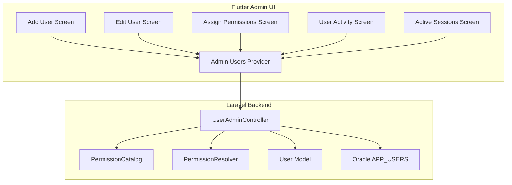
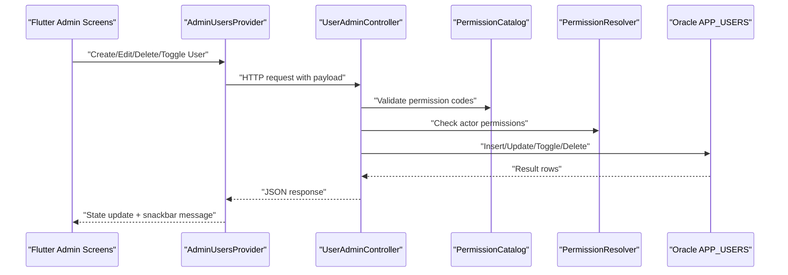
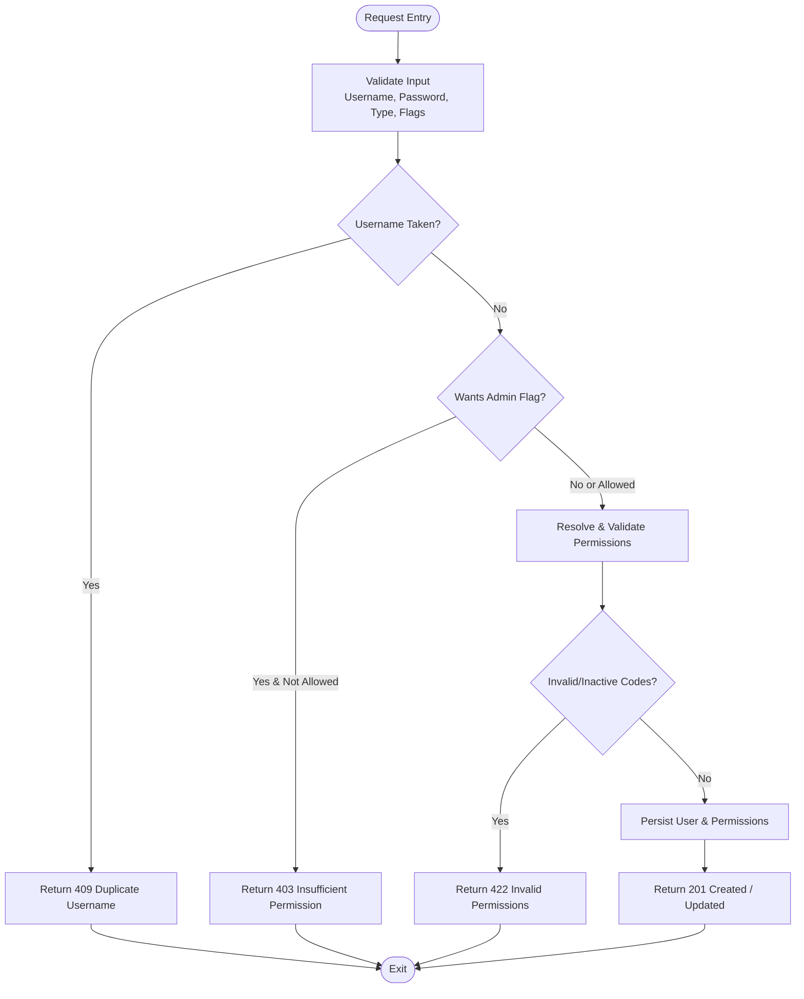
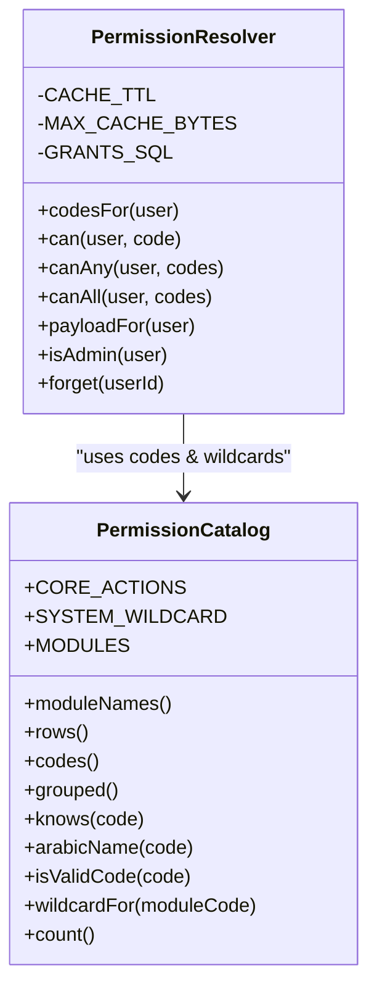
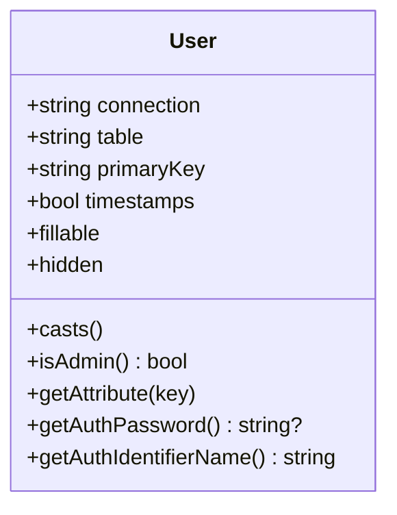
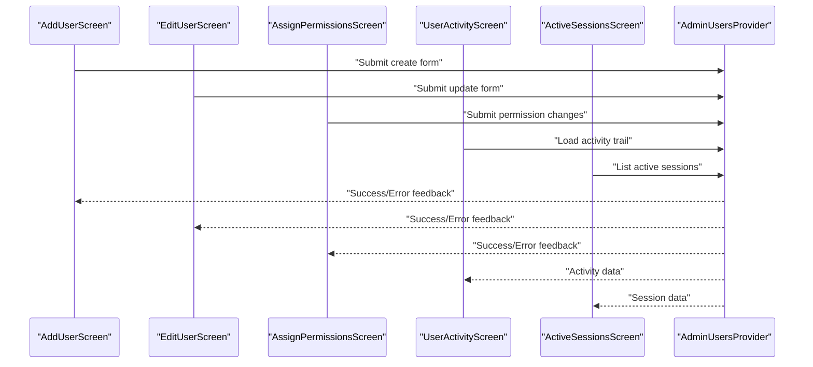
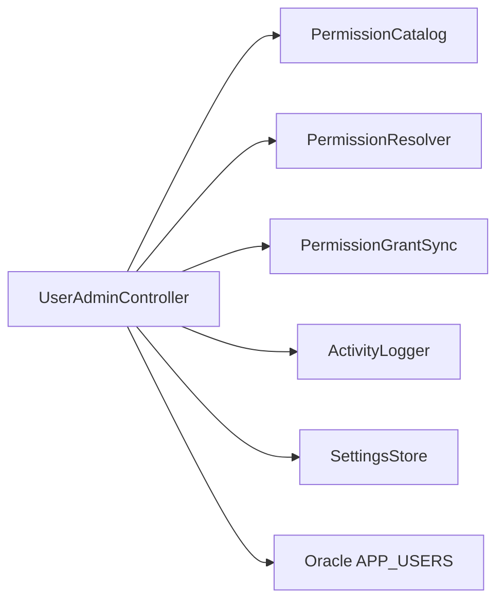

# User Management

<cite>
**Referenced Files in This Document**   
- [UserAdminController.php](file://kyApp_API/app/Http/Controllers/UserAdminController.php)
- [User.php](file://kyApp_API/app/Models/User.php)
- [PermissionCatalog.php](file://kyApp_API/app/Support/PermissionCatalog.php)
- [PermissionResolver.php](file://kyApp_API/app/Support/PermissionResolver.php)
- [admin_users_provider.dart](file://lib/features/admin/presentation/providers/admin_users_provider.dart)
- [add_user_screen.dart](file://lib/features/admin/presentation/screens/add_user_screen.dart)
- [edit_user_screen.dart](file://lib/features/admin/presentation/screens/edit_user_screen.dart)
- [assign_permissions_screen.dart](file://lib/features/admin/presentation/screens/assign_permissions_screen.dart)
- [user_activity_screen.dart](file://lib/features/admin/presentation/screens/user_activity_screen.dart)
- [active_sessions_screen.dart](file://lib/features/admin/presentation/screens/active_sessions_screen.dart)
</cite>

## Table of Contents
1. [Introduction](#introduction)
2. [Project Structure](#project-structure)
3. [Core Components](#core-components)
4. [Architecture Overview](#architecture-overview)
5. [Detailed Component Analysis](#detailed-component-analysis)
6. [Dependency Analysis](#dependency-analysis)
7. [Performance Considerations](#performance-considerations)
8. [Troubleshooting Guide](#troubleshooting-guide)
9. [Conclusion](#conclusion)
10. [Appendices](#appendices)

## Introduction
This document explains the user management functionality within the admin module. It covers the Flutter user interface for creating, editing, and deleting users with role and permission assignment, as well as the backend Laravel controller that implements CRUD operations, role-based access control, and account lifecycle management. It also documents error handling for duplicate usernames, invalid roles, and permission conflicts, and provides guidance for extending user types, validation rules, and attributes.

## Project Structure
The user management feature spans two layers:

- Backend (Laravel): `UserAdminController` exposes endpoints for listing, viewing, creating, updating, toggling activation, deleting, and auditing users. It integrates with Oracle via explicit queries, enforces anti-lockout guards, validates permissions through `PermissionCatalog` and `PermissionResolver`, and persists changes to `ACCOUNTS.APP_USERS`.
- Frontend (Flutter): Admin screens provide forms and lists for user creation, editing, permission assignment, activity review, and session management. State is managed by providers and repositories that call the backend API.

**Diagram sources**
- [UserAdminController.php:108-148](file://kyApp_API/app/Http/Controllers/UserAdminController.php#L108-L148)
- [UserAdminController.php:188-312](file://kyApp_API/app/Http/Controllers/UserAdminController.php#L188-L312)
- [UserAdminController.php:318-496](file://kyApp_API/app/Http/Controllers/UserAdminController.php#L318-L496)
- [UserAdminController.php:502-560](file://kyApp_API/app/Http/Controllers/UserAdminController.php#L502-L560)
- [UserAdminController.php:566-626](file://kyApp_API/app/Http/Controllers/UserAdminController.php#L566-L626)
- [PermissionCatalog.php:194-208](file://kyApp_API/app/Support/PermissionCatalog.php#L194-L208)
- [PermissionResolver.php:95-132](file://kyApp_API/app/Support/PermissionResolver.php#L95-L132)
- [User.php:10-117](file://kyApp_API/app/Models/User.php#L10-L117)
- [admin_users_provider.dart:1-264](file://lib/features/admin/presentation/providers/admin_users_provider.dart#L1-L264)

**Section sources**
- [UserAdminController.php:108-148](file://kyApp_API/app/Http/Controllers/UserAdminController.php#L108-L148)
- [UserAdminController.php:188-312](file://kyApp_API/app/Http/Controllers/UserAdminController.php#L188-L312)
- [UserAdminController.php:318-496](file://kyApp_API/app/Http/Controllers/UserAdminController.php#L318-L496)
- [UserAdminController.php:502-560](file://kyApp_API/app/Http/Controllers/UserAdminController.php#L502-L560)
- [UserAdminController.php:566-626](file://kyApp_API/app/Http/Controllers/UserAdminController.php#L566-L626)
- [PermissionCatalog.php:194-208](file://kyApp_API/app/Support/PermissionCatalog.php#L194-L208)
- [PermissionResolver.php:95-132](file://kyApp_API/app/Support/PermissionResolver.php#L95-L132)
- [User.php:10-117](file://kyApp_API/app/Models/User.php#L10-L117)
- [admin_users_provider.dart:1-264](file://lib/features/admin/presentation/providers/admin_users_provider.dart#L1-L264)

## Core Components
- Backend controller: `UserAdminController` handles all user administration operations, including search, filtering, sorting, pagination, creation, updates, activation toggle, deletion, and activity retrieval. It enforces strict security rules such as no self-deletion or self-deactivation, protection of the last administrator, and anti-escalation for permissions.
- Permission system: `PermissionCatalog` defines valid permission codes and labels; `PermissionResolver` evaluates whether a user has a given permission, supporting admin bypass, wildcard grants, and caching.
- Data model: `User` maps to the legacy `APP_USERS` table, hides sensitive fields, and normalizes attribute access across Oracle column casing.
- Frontend: Flutter screens and providers implement the user management UI and state synchronization with the backend.

Key responsibilities:
- Create user with optional permissions and admin flag.
- Update user profile and optionally replace permissions.
- Toggle activation and terminate sessions when deactivating.
- Delete user along with grants and tokens.
- List users with filters, search, sort, and pagination.
- View user details, granted permissions, and activity trail.

**Section sources**
- [UserAdminController.php:18-33](file://kyApp_API/app/Http/Controllers/UserAdminController.php#L18-L33)
- [UserAdminController.php:108-148](file://kyApp_API/app/Http/Controllers/UserAdminController.php#L108-L148)
- [UserAdminController.php:188-312](file://kyApp_API/app/Http/Controllers/UserAdminController.php#L188-L312)
- [UserAdminController.php:318-496](file://kyApp_API/app/Http/Controllers/UserAdminController.php#L318-L496)
- [UserAdminController.php:502-560](file://kyApp_API/app/Http/Controllers/UserAdminController.php#L502-L560)
- [UserAdminController.php:566-626](file://kyApp_API/app/Http/Controllers/UserAdminController.php#L566-L626)
- [PermissionCatalog.php:194-208](file://kyApp_API/app/Support/PermissionCatalog.php#L194-L208)
- [PermissionResolver.php:95-132](file://kyApp_API/app/Support/PermissionResolver.php#L95-L132)
- [User.php:10-117](file://kyApp_API/app/Models/User.php#L10-L117)

## Architecture Overview
The user management architecture connects Flutter admin screens to Laravel endpoints, enforcing RBAC at both presentation and server layers.

**Diagram sources**
- [UserAdminController.php:188-312](file://kyApp_API/app/Http/Controllers/UserAdminController.php#L188-L312)
- [UserAdminController.php:318-496](file://kyApp_API/app/Http/Controllers/UserAdminController.php#L318-L496)
- [UserAdminController.php:502-560](file://kyApp_API/app/Http/Controllers/UserAdminController.php#L502-L560)
- [UserAdminController.php:566-626](file://kyApp_API/app/Http/Controllers/UserAdminController.php#L566-L626)
- [PermissionCatalog.php:194-208](file://kyApp_API/app/Support/PermissionCatalog.php#L194-L208)
- [PermissionResolver.php:95-132](file://kyApp_API/app/Support/PermissionResolver.php#L95-L132)
- [admin_users_provider.dart:1-264](file://lib/features/admin/presentation/providers/admin_users_provider.dart#L1-L264)

## Detailed Component Analysis

### Backend: UserAdminController
Responsibilities:
- Listing users with search, status filter, type filter, admin-only filter, sorting, and pagination.
- Showing a single user with granted permissions and latest activity.
- Creating users with validation, username uniqueness checks, optional admin flag, and initial permissions.
- Updating users with selective field writes, password updates, and optional permission replacement.
- Toggling activation while preventing self-deactivation and protecting the last administrator.
- Deleting users with cascading cleanup of grants and tokens.
- Retrieving user activity trails.

Security and validation highlights:
- Anti-lockout guards prevent self-delete/self-deactivate and demoting/deleting the last admin.
- Anti-escalation prevents non-admins from granting permissions they do not hold.
- Admin flag changes require `users.admin_flag_manage`.
- Arabic text encoding is handled consistently for storage and retrieval.
- Sensitive columns are never exposed in responses.

**Diagram sources**
- [UserAdminController.php:188-312](file://kyApp_API/app/Http/Controllers/UserAdminController.php#L188-L312)
- [UserAdminController.php:318-496](file://kyApp_API/app/Http/Controllers/UserAdminController.php#L318-L496)
- [UserAdminController.php:821-864](file://kyApp_API/app/Http/Controllers/UserAdminController.php#L821-L864)

**Section sources**
- [UserAdminController.php:108-148](file://kyApp_API/app/Http/Controllers/UserAdminController.php#L108-L148)
- [UserAdminController.php:188-312](file://kyApp_API/app/Http/Controllers/UserAdminController.php#L188-L312)
- [UserAdminController.php:318-496](file://kyApp_API/app/Http/Controllers/UserAdminController.php#L318-L496)
- [UserAdminController.php:502-560](file://kyApp_API/app/Http/Controllers/UserAdminController.php#L502-L560)
- [UserAdminController.php:566-626](file://kyApp_API/app/Http/Controllers/UserAdminController.php#L566-L626)
- [UserAdminController.php:821-864](file://kyApp_API/app/Http/Controllers/UserAdminController.php#L821-L864)

### Backend: Permission System
- `PermissionCatalog`: Defines modules, actions, and permission codes. The `users` module includes view, create, update, delete, toggle, manage permissions, view activity, and manage admin flag.
- `PermissionResolver`: Evaluates permissions with admin bypass, wildcard support, and caching. Provides helper methods for checking single or multiple permissions and generating payloads for clients.

**Diagram sources**
- [PermissionCatalog.php:22-480](file://kyApp_API/app/Support/PermissionCatalog.php#L22-L480)
- [PermissionResolver.php:27-275](file://kyApp_API/app/Support/PermissionResolver.php#L27-L275)

**Section sources**
- [PermissionCatalog.php:194-208](file://kyApp_API/app/Support/PermissionCatalog.php#L194-L208)
- [PermissionCatalog.php:271-316](file://kyApp_API/app/Support/PermissionCatalog.php#L271-L316)
- [PermissionCatalog.php:421-456](file://kyApp_API/app/Support/PermissionCatalog.php#L421-L456)
- [PermissionResolver.php:95-132](file://kyApp_API/app/Support/PermissionResolver.php#L95-L132)
- [PermissionResolver.php:178-200](file://kyApp_API/app/Support/PermissionResolver.php#L178-L200)

### Backend: User Model
- Maps to `APP_USERS` on Oracle connection.
- Hides sensitive fields like passwords and device tokens.
- Normalizes attribute access for Oracle column casing differences.
- Provides `isAdmin()` helper and authentication integration.

**Diagram sources**
- [User.php:10-117](file://kyApp_API/app/Models/User.php#L10-L117)

**Section sources**
- [User.php:10-117](file://kyApp_API/app/Models/User.php#L10-L117)

### Frontend: Admin UI Screens and Providers
- `AdminUsersProvider` manages list state, search/filter/sort parameters, and calls repository methods for toggle and delete operations.
- Screens:
  - `AddUserScreen`: Creates new users.
  - `EditUserScreen`: Edits existing users.
  - `AssignPermissionsScreen`: Assigns or removes permissions.
  - `UserActivityScreen`: Reviews user activity trail.
  - `ActiveSessionsScreen`: Manages active sessions.

**Diagram sources**
- [admin_users_provider.dart:1-264](file://lib/features/admin/presentation/providers/admin_users_provider.dart#L1-L264)
- [add_user_screen.dart](file://lib/features/admin/presentation/screens/add_user_screen.dart)
- [edit_user_screen.dart](file://lib/features/admin/presentation/screens/edit_user_screen.dart)
- [assign_permissions_screen.dart](file://lib/features/admin/presentation/screens/assign_permissions_screen.dart)
- [user_activity_screen.dart](file://lib/features/admin/presentation/screens/user_activity_screen.dart)
- [active_sessions_screen.dart](file://lib/features/admin/presentation/screens/active_sessions_screen.dart)

**Section sources**
- [admin_users_provider.dart:1-264](file://lib/features/admin/presentation/providers/admin_users_provider.dart#L1-L264)
- [add_user_screen.dart](file://lib/features/admin/presentation/screens/add_user_screen.dart)
- [edit_user_screen.dart](file://lib/features/admin/presentation/screens/edit_user_screen.dart)
- [assign_permissions_screen.dart](file://lib/features/admin/presentation/screens/assign_permissions_screen.dart)
- [user_activity_screen.dart](file://lib/features/admin/presentation/screens/user_activity_screen.dart)
- [active_sessions_screen.dart](file://lib/features/admin/presentation/screens/active_sessions_screen.dart)

## Dependency Analysis
The controller depends on several support classes and services:

**Diagram sources**
- [UserAdminController.php:97-102](file://kyApp_API/app/Http/Controllers/UserAdminController.php#L97-L102)
- [UserAdminController.php:188-312](file://kyApp_API/app/Http/Controllers/UserAdminController.php#L188-L312)
- [UserAdminController.php:318-496](file://kyApp_API/app/Http/Controllers/UserAdminController.php#L318-L496)

**Section sources**
- [UserAdminController.php:97-102](file://kyApp_API/app/Http/Controllers/UserAdminController.php#L97-L102)

## Performance Considerations
- Pagination uses bounded limits (`DEFAULT_LIMIT`, `MAX_LIMIT`) and deterministic ordering to ensure stable results.
- Listing query uses window functions for slicing rows efficiently on older Oracle versions.
- Permission resolution caches effective codes per user with a safe byte-size limit to avoid cache store errors.
- Updates selectively write only changed fields to avoid accidental blanking of stored values.
- Deactivation immediately terminates sessions to invalidate active tokens.

[No sources needed since this section provides general guidance]

## Troubleshooting Guide
Common issues and resolutions:

- Duplicate username:
  - Symptom: 409 conflict with message indicating username already exists.
  - Cause: Case-insensitive uniqueness check fails during create or update.
  - Resolution: Choose a different username or normalize input before submission.

- Invalid or inactive permissions:
  - Symptom: 422 validation error listing unknown or inactive codes.
  - Cause: Submitted permission codes are not defined in the catalog or are disabled.
  - Resolution: Use only codes from `PermissionCatalog`; ensure permissions are active.

- Permission conflicts or escalation attempts:
  - Symptom: 403 denial with message referencing required permission (e.g., `users.permissions_manage`).
  - Cause: Non-admin attempting to grant permissions they do not hold, or missing required permission.
  - Resolution: Ensure actor holds necessary permissions; restrict admin flag changes to authorized actors.

- Last administrator protection:
  - Symptom: 403 denial when trying to deactivate, demote, or delete the last admin.
  - Cause: System lockout prevention.
  - Resolution: Promote another user to admin first, then perform the operation.

- Self-protection:
  - Symptom: 422 denial when attempting to deactivate or delete own account.
  - Cause: Anti-self-harm guard.
  - Resolution: Use another administrative account to perform the action.

- Database errors:
  - Symptom: 500 internal server error with optional debug message.
  - Cause: Underlying database or transaction failure.
  - Resolution: Check application logs and database connectivity; verify bindings and schema compatibility.

**Section sources**
- [UserAdminController.php:227-233](file://kyApp_API/app/Http/Controllers/UserAdminController.php#L227-L233)
- [UserAdminController.php:381-391](file://kyApp_API/app/Http/Controllers/UserAdminController.php#L381-L391)
- [UserAdminController.php:831-864](file://kyApp_API/app/Http/Controllers/UserAdminController.php#L831-L864)
- [UserAdminController.php:518-525](file://kyApp_API/app/Http/Controllers/UserAdminController.php#L518-L525)
- [UserAdminController.php:575-584](file://kyApp_API/app/Http/Controllers/UserAdminController.php#L575-L584)
- [UserAdminController.php:1160-1167](file://kyApp_API/app/Http/Controllers/UserAdminController.php#L1160-L1167)

## Conclusion
The user management subsystem combines a robust Flutter admin UI with a secure Laravel backend. It enforces strong RBAC, protects against lockout scenarios, and provides comprehensive lifecycle management for users. Extensibility points include adding new user types, custom validation rules, and additional user attributes, while maintaining consistency with the permission catalog and resolver.

[No sources needed since this section summarizes without analyzing specific files]

## Appendices

### Adding New User Types
- Extend backend validation to accept new type values in `store` and `update`.
- Update `shape` to map new type values to display labels.
- Adjust frontend forms to present and validate the new type options.

**Section sources**
- [UserAdminController.php:193-212](file://kyApp_API/app/Http/Controllers/UserAdminController.php#L193-L212)
- [UserAdminController.php:351-367](file://kyApp_API/app/Http/Controllers/UserAdminController.php#L351-L367)
- [UserAdminController.php:926-952](file://kyApp_API/app/Http/Controllers/UserAdminController.php#L926-L952)

### Implementing Custom User Validation Rules
- Add custom validators in `store` and `update` for domain-specific constraints.
- Return structured validation errors to the Flutter UI.

**Section sources**
- [UserAdminController.php:193-212](file://kyApp_API/app/Http/Controllers/UserAdminController.php#L193-L212)
- [UserAdminController.php:351-367](file://kyApp_API/app/Http/Controllers/UserAdminController.php#L351-L367)

### Extending User Attributes
- Add new fields to the model’s `fillable` list if using Eloquent mass assignment.
- Include new fields in controller validation and persistence logic.
- Update response shaping to expose new attributes safely.

**Section sources**
- [User.php:53-75](file://kyApp_API/app/Models/User.php#L53-L75)
- [UserAdminController.php:252-281](file://kyApp_API/app/Http/Controllers/UserAdminController.php#L252-L281)
- [UserAdminController.php:411-440](file://kyApp_API/app/Http/Controllers/UserAdminController.php#L411-L440)
- [UserAdminController.php:926-952](file://kyApp_API/app/Http/Controllers/UserAdminController.php#L926-L952)