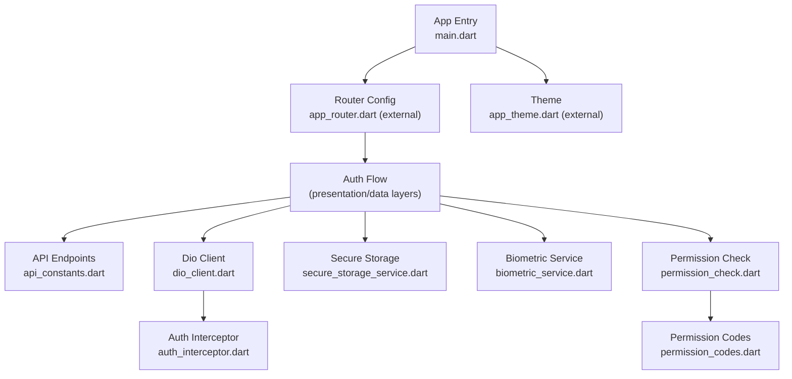
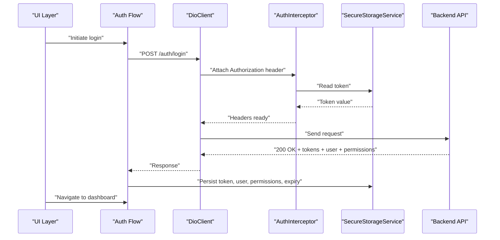
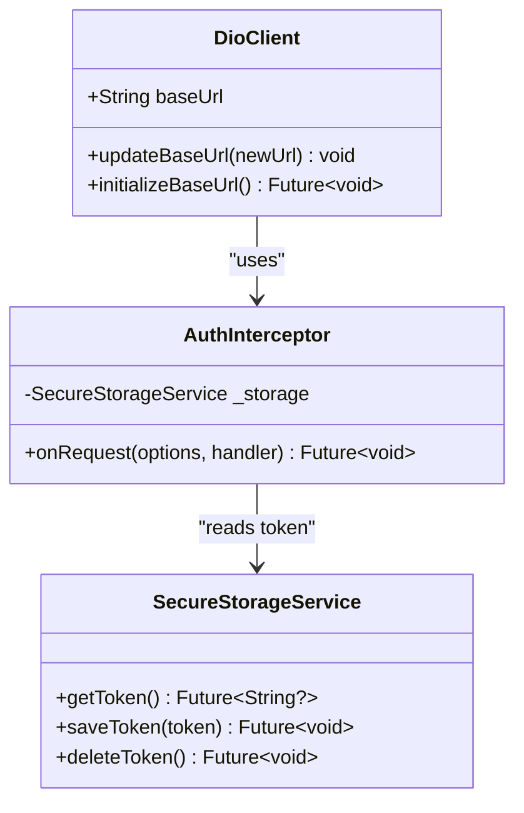
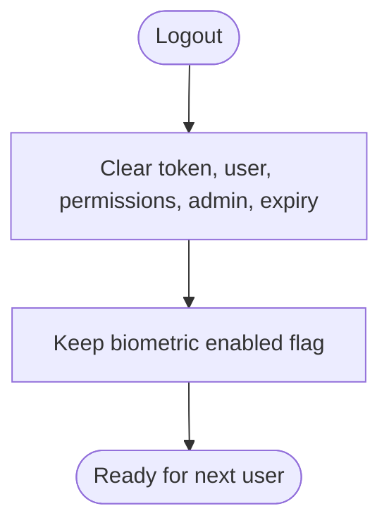
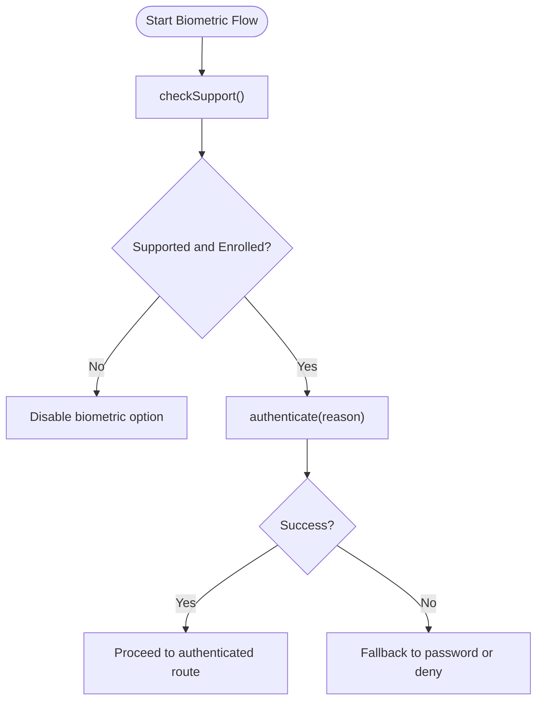
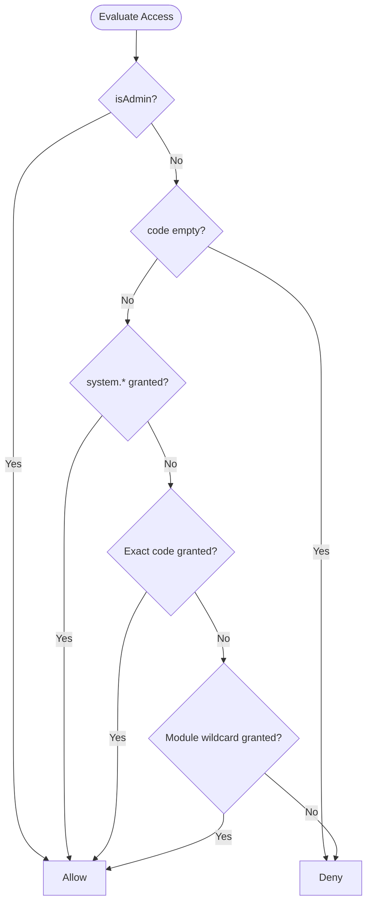
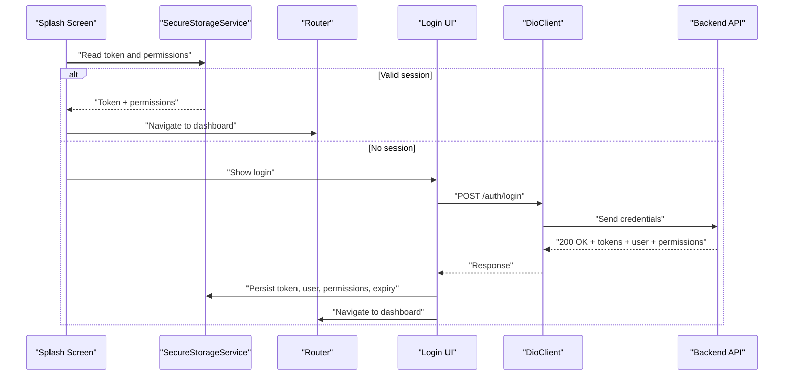
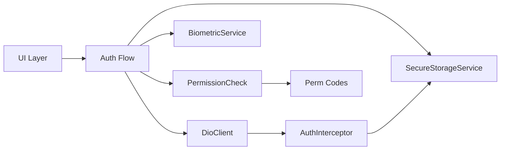

# Authentication Module

<cite>
**Referenced Files in This Document**
- [pubspec.yaml](file://pubspec.yaml)
- [main.dart](file://lib/main.dart)
- [api_constants.dart](file://lib/core/constants/api_constants.dart)
- [permission_codes.dart](file://lib/core/constants/permission_codes.dart)
- [dio_client.dart](file://lib/core/network/dio_client.dart)
- [auth_interceptor.dart](file://lib/core/network/auth_interceptor.dart)
- [secure_storage_service.dart](file://lib/core/storage/secure_storage_service.dart)
- [biometric_service.dart](file://lib/core/utils/biometric_service.dart)
- [permission_check.dart](file://lib/core/utils/permission_check.dart)
</cite>

## Table of Contents
1. [Introduction](#introduction)
2. [Project Structure](#project-structure)
3. [Core Components](#core-components)
4. [Architecture Overview](#architecture-overview)
5. [Detailed Component Analysis](#detailed-component-analysis)
6. [Dependency Analysis](#dependency-analysis)
7. [Performance Considerations](#performance-considerations)
8. [Troubleshooting Guide](#troubleshooting-guide)
9. [Conclusion](#conclusion)

## Introduction
This document explains the authentication module that implements multi-factor authentication with biometric support. It covers credential verification, biometric registration and authentication, session management, token handling, secure storage, permission caching, and how authentication state controls feature access. It also provides practical guidance for implementing custom authentication flows, handling errors, integrating with the backend API, and wiring up the permission system.

The Flutter application uses a centralized HTTP client with interceptors to attach tokens, a secure storage service for sensitive data, a biometric wrapper around the platform authenticator, and a pure permission-checking library that mirrors server-side authorization rules.

## Project Structure
The authentication-related code is organized under core modules:
- Constants define API endpoints and permission codes.
- Network layer configures Dio with auth and error interceptors.
- Storage encapsulates encrypted persistence for tokens, user data, permissions, and biometric state.
- Utilities provide biometric capability checks and permission evaluation logic.
- The app entry point initializes providers and routes.

**Diagram sources**
- [main.dart:7-46](file://lib/main.dart#L7-L46)
- [api_constants.dart:3-28](file://lib/core/constants/api_constants.dart#L3-L28)
- [dio_client.dart:9-59](file://lib/core/network/dio_client.dart#L9-L59)
- [auth_interceptor.dart:6-23](file://lib/core/network/auth_interceptor.dart#L6-L23)
- [secure_storage_service.dart:7-204](file://lib/core/storage/secure_storage_service.dart#L7-L204)
- [biometric_service.dart:14-84](file://lib/core/utils/biometric_service.dart#L14-L84)
- [permission_check.dart:24-68](file://lib/core/utils/permission_check.dart#L24-L68)
- [permission_codes.dart:12-143](file://lib/core/constants/permission_codes.dart#L12-L143)

**Section sources**
- [main.dart:7-46](file://lib/main.dart#L7-L46)
- [pubspec.yaml:30-44](file://pubspec.yaml#L30-L44)

## Core Components
- API constants: Centralize base URL, timeouts, and endpoints for login, logout, profile, permissions, and biometric operations.
- Dio client: Configure base options, interceptors, and dynamic base URL initialization from secure storage.
- Auth interceptor: Attach Bearer token and Accept headers on every request using stored token.
- Secure storage service: Persist tokens, user type, user data, API base URL, IBAC permissions, admin flag, session expiry, and biometric state.
- Biometric service: Detect device capabilities, check enrollment, and perform biometric authentication.
- Permission checker: Pure functions mirroring server-side authorization rules for fast, offline gating decisions.

Key responsibilities:
- Token lifecycle: save, read, delete; auto-injection into requests.
- Session state: persist and clear permissions, admin flag, and expiry.
- Biometric flow: register, authenticate, and manage enabled state and associated user ID.
- Permission gating: evaluate grants against codes with wildcard and admin bypass.

**Section sources**
- [api_constants.dart:3-28](file://lib/core/constants/api_constants.dart#L3-L28)
- [dio_client.dart:9-59](file://lib/core/network/dio_client.dart#L9-L59)
- [auth_interceptor.dart:6-23](file://lib/core/network/auth_interceptor.dart#L6-L23)
- [secure_storage_service.dart:7-204](file://lib/core/storage/secure_storage_service.dart#L7-L204)
- [biometric_service.dart:14-84](file://lib/core/utils/biometric_service.dart#L14-L84)
- [permission_check.dart:24-68](file://lib/core/utils/permission_check.dart#L24-L68)

## Architecture Overview
The authentication architecture integrates UI flows with network and storage layers:
- UI triggers login or biometric authentication.
- Credentials are sent to the backend via Dio.
- On success, tokens and user metadata are persisted securely.
- Permissions and session expiry are cached locally.
- Subsequent requests automatically include the token.
- Feature access is gated by local permission checks.

**Diagram sources**
- [dio_client.dart:14-42](file://lib/core/network/dio_client.dart#L14-L42)
- [auth_interceptor.dart:11-22](file://lib/core/network/auth_interceptor.dart#L11-L22)
- [secure_storage_service.dart:32-45](file://lib/core/storage/secure_storage_service.dart#L32-L45)
- [secure_storage_service.dart:97-162](file://lib/core/storage/secure_storage_service.dart#L97-L162)
- [api_constants.dart:12-18](file://lib/core/constants/api_constants.dart#L12-L18)

## Detailed Component Analysis

### API Constants
- Base URL and timeouts are defined centrally.
- Endpoints cover login, logout, profile, permissions, and biometric operations.
- Timeouts ensure predictable behavior under poor connectivity.

Usage patterns:
- Use these constants when constructing API calls to avoid hard-coded strings.
- Update base URL at runtime via Dio client if needed.

**Section sources**
- [api_constants.dart:3-28](file://lib/core/constants/api_constants.dart#L3-L28)

### Dio Client and Auth Interceptor
- DioClient sets base URL, timeouts, default headers, and registers interceptors.
- AuthInterceptor reads the token from SecureStorageService and attaches it as a Bearer token.
- ErrorInterceptor (not shown here) handles unauthorized responses and can trigger re-authentication or cleanup.

**Diagram sources**
- [dio_client.dart:9-59](file://lib/core/network/dio_client.dart#L9-L59)
- [auth_interceptor.dart:6-23](file://lib/core/network/auth_interceptor.dart#L6-L23)
- [secure_storage_service.dart:32-45](file://lib/core/storage/secure_storage_service.dart#L32-L45)

**Section sources**
- [dio_client.dart:9-59](file://lib/core/network/dio_client.dart#L9-L59)
- [auth_interceptor.dart:6-23](file://lib/core/network/auth_interceptor.dart#L6-L23)

### Secure Storage Service
Responsibilities:
- Token lifecycle: save, read, delete.
- User metadata: type and JSON payload.
- API base URL: save, read, delete, and reset to default.
- IBAC state: permissions list, admin flag, session expiry.
- Biometric state: enabled flag and associated user ID.
- Clearing: safe logout clears session but preserves biometric enablement for future use; purgeEverything wipes all keys.

Security considerations:
- Uses platform keychain/keystore-backed storage.
- Permission parsing tolerates corrupt blobs by denying access rather than crashing.
- Admin flag and permissions are separate keys to allow minimal reads during gating.

**Diagram sources**
- [secure_storage_service.dart:82-95](file://lib/core/storage/secure_storage_service.dart#L82-L95)

**Section sources**
- [secure_storage_service.dart:7-204](file://lib/core/storage/secure_storage_service.dart#L7-L204)

### Biometric Service
Capabilities:
- Detects whether biometrics are supported and enrolled.
- Distinguishes face recognition and fingerprint types.
- Performs biometric-only authentication with sticky sessions.

Integration points:
- UI should call checkSupport/isAvailable to decide whether to show biometric options.
- authenticate returns true on success; handle PlatformException and general exceptions gracefully.

**Diagram sources**
- [biometric_service.dart:14-84](file://lib/core/utils/biometric_service.dart#L14-L84)

**Section sources**
- [biometric_service.dart:14-84](file://lib/core/utils/biometric_service.dart#L14-L84)

### Permission System Integration
- Permission codes mirror the server catalog to ensure consistent gating without extra network calls.
- Permission checking functions implement the same rules as the server resolver:
  - Admin bypass grants everything.
  - system.* wildcard grants everything.
  - Exact code match.
  - Module wildcard grant (module.*).
  - Otherwise denied.

**Diagram sources**
- [permission_check.dart:24-68](file://lib/core/utils/permission_check.dart#L24-L68)
- [permission_codes.dart:313-338](file://lib/core/constants/permission_codes.dart#L313-L338)

**Section sources**
- [permission_check.dart:1-69](file://lib/core/utils/permission_check.dart#L1-L69)
- [permission_codes.dart:12-143](file://lib/core/constants/permission_codes.dart#L12-L143)

### Login Flow and Route Navigation
Conceptual flow:
- Splash screen checks for existing token and permissions.
- If valid, navigate to protected routes; otherwise, show login.
- Login sends credentials to /auth/login.
- On success, store token, user data, permissions, admin flag, and session expiry.
- Navigate to dashboard or requested route.

Note: The splash and router files are not included in the referenced set; this diagram illustrates the expected integration with the components documented above.

[No sources needed since this diagram shows conceptual workflow, not actual code structure]

### Token Handling and Session Management
- Tokens are attached automatically to requests via AuthInterceptor.
- Session expiry is stored as a string and can be used to proactively refresh or log out.
- Logout clears session data while preserving biometric enablement so users can re-enter with biometrics later.

**Section sources**
- [auth_interceptor.dart:11-22](file://lib/core/network/auth_interceptor.dart#L11-L22)
- [secure_storage_service.dart:82-95](file://lib/core/storage/secure_storage_service.dart#L82-L95)
- [secure_storage_service.dart:139-162](file://lib/core/storage/secure_storage_service.dart#L139-L162)

### Biometric Registration and Authentication
- Registration: After successful login, optionally register biometric linkage by storing enabled flag and user ID.
- Authentication: Use BiometricService.authenticate to prompt the user; on success, proceed to authenticated routes.
- Backend endpoints: /auth/biometric/register, /auth/biometric/login, /auth/biometric/revoke are available for server-side coordination.

**Section sources**
- [api_constants.dart:20-23](file://lib/core/constants/api_constants.dart#L20-L23)
- [secure_storage_service.dart:164-198](file://lib/core/storage/secure_storage_service.dart#L164-L198)
- [biometric_service.dart:14-84](file://lib/core/utils/biometric_service.dart#L14-L84)

### Practical Examples

#### Implementing Custom Authentication Flows
- Credential-based login:
  - Call POST /auth/login via DioClient.
  - On success, persist token, user data, permissions, admin flag, and session expiry.
  - Navigate to protected routes.
- Biometric-first login:
  - Check BiometricService.isAvailable.
  - If available, attempt BiometricService.authenticate.
  - On success, verify session via /auth/me or proceed based on cached permissions.
- Custom provider integration:
  - Inject DioClient with onUnauthorized callback to handle 401 responses (e.g., clear session and redirect to login).

[No sources needed since this section provides general guidance]

#### Handling Authentication Errors
- Unauthorized (401):
  - Clear IBAC state and token.
  - Redirect to login.
- Network errors:
  - Retry with backoff if appropriate.
  - Show user-friendly messages.
- Biometric failures:
  - Fall back to password or deny access depending on policy.

[No sources needed since this section provides general guidance]

#### Integrating with the Backend API
- Use ApiConstants for endpoint paths and timeouts.
- Ensure DioClient.baseOptions include required headers.
- Handle response payloads consistently across features.

**Section sources**
- [api_constants.dart:3-28](file://lib/core/constants/api_constants.dart#L3-L28)
- [dio_client.dart:14-42](file://lib/core/network/dio_client.dart#L14-L42)

### Permission System Integration and Feature Access
- Gate UI elements using canCode, canAnyCode, canAllCode with current permissions and isAdmin flag.
- Load permissions from SecureStorageService after login; refresh from /auth/permissions when needed.
- Respect deny-by-default: missing codes mean no access.

**Section sources**
- [permission_check.dart:24-68](file://lib/core/utils/permission_check.dart#L24-L68)
- [secure_storage_service.dart:97-162](file://lib/core/storage/secure_storage_service.dart#L97-L162)
- [api_constants.dart:16-18](file://lib/core/constants/api_constants.dart#L16-L18)

## Dependency Analysis
The authentication module has clear separation of concerns:
- UI depends on services and utilities.
- Services depend on secure storage and Dio client.
- Dio client depends on interceptors and constants.
- Permission checking is independent and testable.

**Diagram sources**
- [dio_client.dart:9-59](file://lib/core/network/dio_client.dart#L9-L59)
- [auth_interceptor.dart:6-23](file://lib/core/network/auth_interceptor.dart#L6-L23)
- [secure_storage_service.dart:7-204](file://lib/core/storage/secure_storage_service.dart#L7-L204)
- [biometric_service.dart:14-84](file://lib/core/utils/biometric_service.dart#L14-L84)
- [permission_check.dart:24-68](file://lib/core/utils/permission_check.dart#L24-L68)
- [permission_codes.dart:12-143](file://lib/core/constants/permission_codes.dart#L12-L143)

**Section sources**
- [dio_client.dart:9-59](file://lib/core/network/dio_client.dart#L9-L59)
- [auth_interceptor.dart:6-23](file://lib/core/network/auth_interceptor.dart#L6-L23)
- [secure_storage_service.dart:7-204](file://lib/core/storage/secure_storage_service.dart#L7-L204)
- [biometric_service.dart:14-84](file://lib/core/utils/biometric_service.dart#L14-L84)
- [permission_check.dart:24-68](file://lib/core/utils/permission_check.dart#L24-L68)
- [permission_codes.dart:12-143](file://lib/core/constants/permission_codes.dart#L12-L143)

## Performance Considerations
- Minimize network calls by caching permissions and admin flag locally.
- Use BiometricService.isAvailable to avoid unnecessary prompts.
- Avoid reading full user blob for permission checks; rely on dedicated permission keys.
- Set reasonable timeouts to prevent long hangs under poor connectivity.

[No sources needed since this section provides general guidance]

## Troubleshooting Guide
Common issues and resolutions:
- Token not attached:
  - Verify SecureStorageService.getToken returns a non-empty value.
  - Ensure AuthInterceptor is registered in DioClient.
- 401 Unauthorized loop:
  - Clear IBAC state and token on 401.
  - Re-authenticate and reload permissions.
- Biometric not showing:
  - Check BiometricService.checkSupport and BiometricService.isAvailable.
  - Confirm device supports and has enrolled biometrics.
- Permission mismatch:
  - Ensure permission codes are mirrored from server catalog.
  - Validate canCode/canAnyCode/canAllCode usage matches server rules.

**Section sources**
- [auth_interceptor.dart:11-22](file://lib/core/network/auth_interceptor.dart#L11-L22)
- [secure_storage_service.dart:156-162](file://lib/core/storage/secure_storage_service.dart#L156-L162)
- [biometric_service.dart:18-54](file://lib/core/utils/biometric_service.dart#L18-L54)
- [permission_check.dart:24-68](file://lib/core/utils/permission_check.dart#L24-L68)

## Conclusion
The authentication module provides a robust foundation for secure, multi-factor login with biometric support. It centralizes API configuration, secures sensitive data, caches permissions for fast gating, and aligns client-side authorization with server-side rules. By following the patterns outlined here, you can implement custom authentication flows, handle errors gracefully, integrate with the backend API, and control feature access consistently.

[No sources needed since this section summarizes without analyzing specific files]