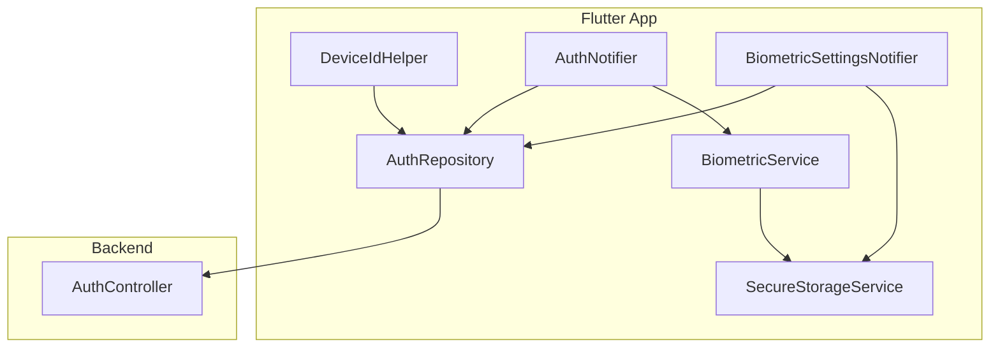
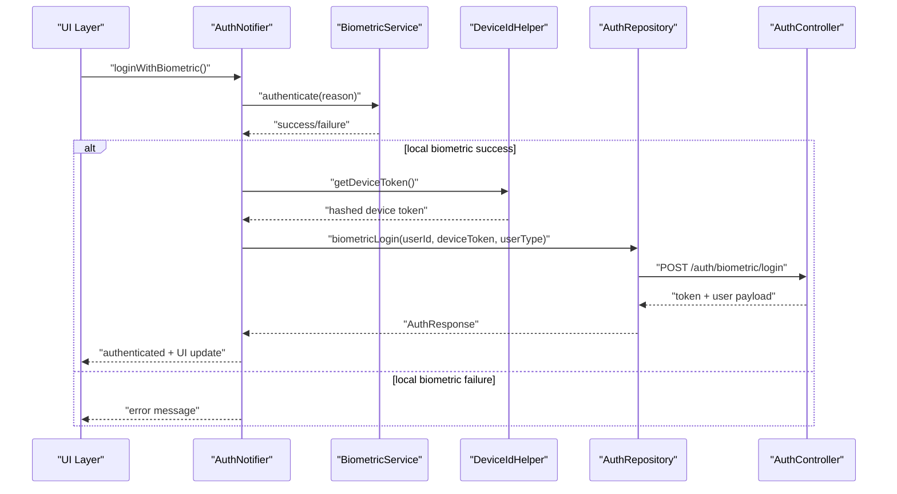
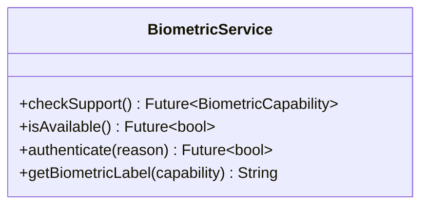
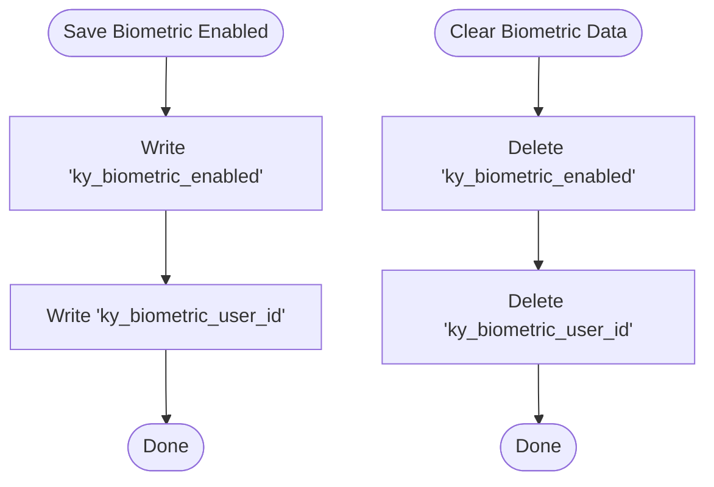
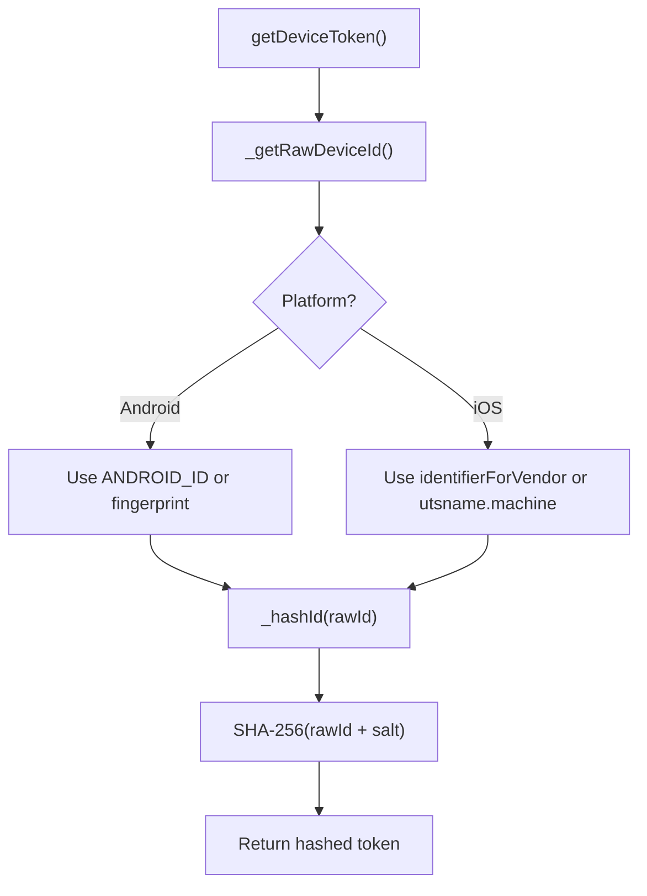
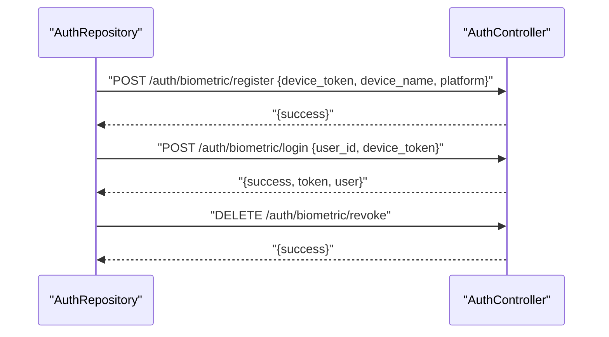
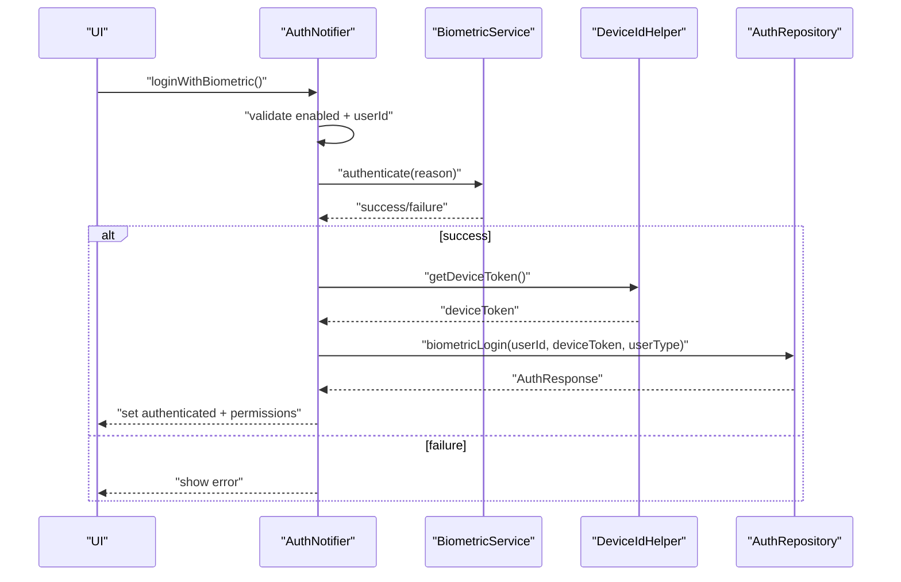
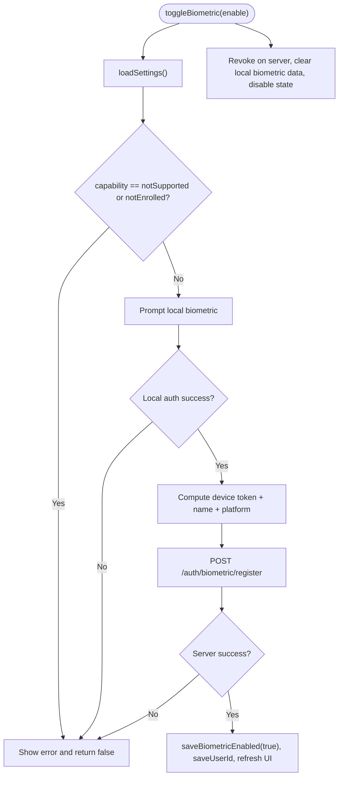
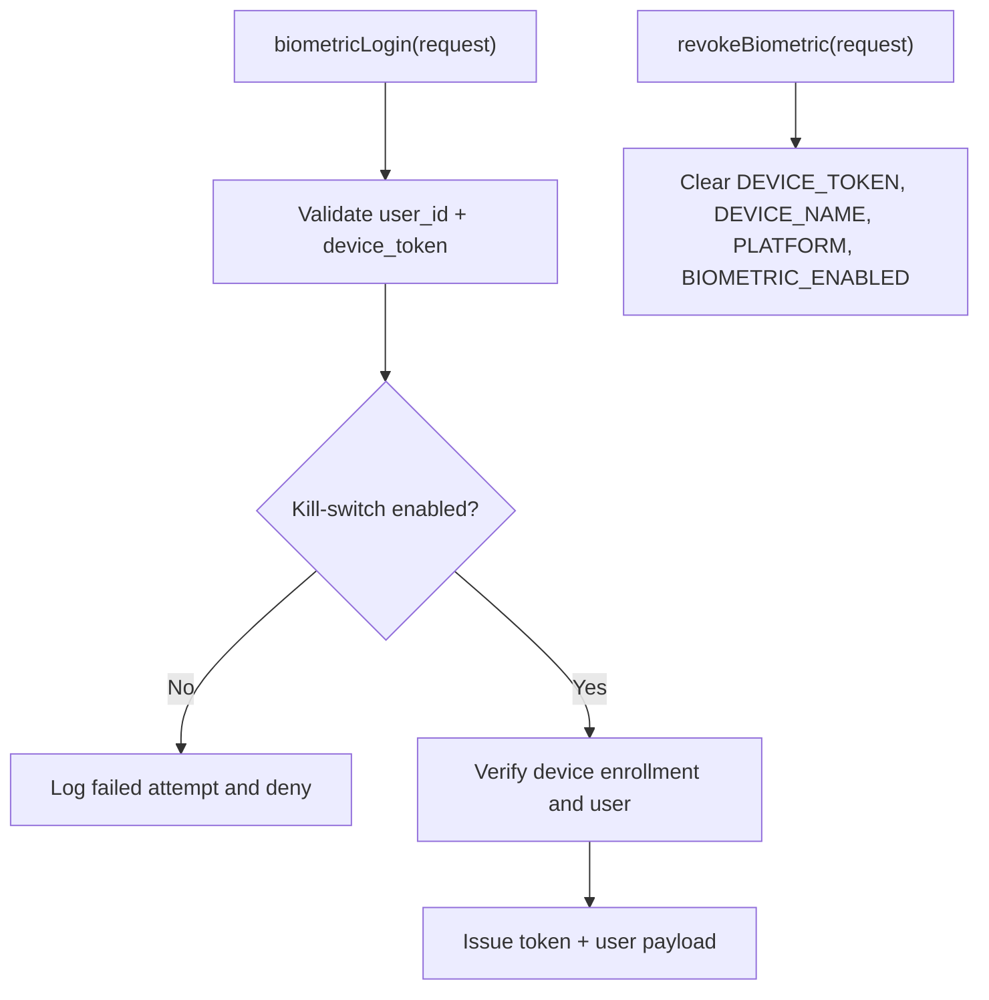
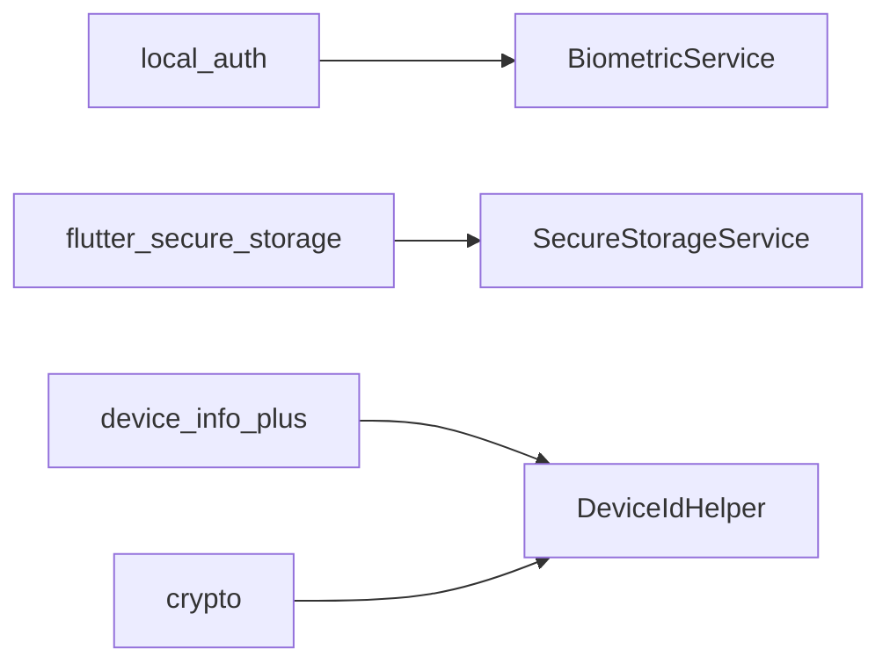

# Biometric Authentication

<cite>
**Referenced Files in This Document**
- [pubspec.yaml](file://pubspec.yaml)
- [biometric_service.dart](file://lib/core/utils/biometric_service.dart)
- [secure_storage_service.dart](file://lib/core/storage/secure_storage_service.dart)
- [api_constants.dart](file://lib/core/constants/api_constants.dart)
- [device_id_helper.dart](file://lib/core/utils/device_id_helper.dart)
- [auth_repository.dart](file://lib/features/auth/data/repositories/auth_repository.dart)
- [auth_notifier.dart](file://lib/features/auth/presentation/providers/auth_notifier.dart)
- [biometric_settings_notifier.dart](file://lib/features/settings/presentation/providers/biometric_settings_notifier.dart)
- [AuthController.php](file://kyApp_API/app/Http/Controllers/AuthController.php)
</cite>

## Table of Contents
1. [Introduction](#introduction)
2. [Project Structure](#project-structure)
3. [Core Components](#core-components)
4. [Architecture Overview](#architecture-overview)
5. [Detailed Component Analysis](#detailed-component-analysis)
6. [Dependency Analysis](#dependency-analysis)
7. [Performance Considerations](#performance-considerations)
8. [Troubleshooting Guide](#troubleshooting-guide)
9. [Conclusion](#conclusion)

## Introduction
This document explains the biometric authentication implementation for fingerprint, face ID, and device pattern support within the application. It covers:
- Device capability detection and user prompts via a unified biometric service
- Secure storage integration for tokens and sensitive data
- Registration flow during initial setup and subsequent authentication flows
- Practical examples for custom prompts, enrollment failure handling, and fallback methods
- Platform-specific considerations for Android and iOS

The system uses local device biometrics to unlock access and then exchanges a hashed device token with the backend to issue or validate an authenticated session.

## Project Structure
Biometric functionality spans core utilities, secure storage, repository/networking, presentation state, and server endpoints:
- Core utilities: BiometricService and DeviceIdHelper
- Secure storage: SecureStorageService
- API constants: ApiConstants
- Auth layer: AuthRepository and AuthNotifier
- Settings UI state: BiometricSettingsNotifier
- Backend: AuthController (Laravel)

**Diagram sources**
- [biometric_service.dart:14-84](file://lib/core/utils/biometric_service.dart#L14-L84)
- [device_id_helper.dart:8-60](file://lib/core/utils/device_id_helper.dart#L8-L60)
- [secure_storage_service.dart:7-204](file://lib/core/storage/secure_storage_service.dart#L7-L204)
- [auth_repository.dart:12-178](file://lib/features/auth/data/repositories/auth_repository.dart#L12-L178)
- [auth_notifier.dart:154-373](file://lib/features/auth/presentation/providers/auth_notifier.dart#L154-L373)
- [biometric_settings_notifier.dart:56-184](file://lib/features/settings/presentation/providers/biometric_settings_notifier.dart#L56-L184)
- [AuthController.php:312-435](file://kyApp_API/app/Http/Controllers/AuthController.php#L312-L435)

**Section sources**
- [pubspec.yaml:30-44](file://pubspec.yaml#L30-L44)

## Core Components
- BiometricService: Wraps local_auth to check capabilities, prompt the user, and return success/failure. Supports fingerprint and face ID detection.
- SecureStorageService: Stores tokens, user data, and biometric flags securely using platform keychains/keystore.
- DeviceIdHelper: Generates a stable, hashed device token from device identifiers plus a project salt.
- AuthRepository: Handles network calls for biometric register/login/revoke and persists auth state.
- AuthNotifier: Orchestrates login flows, including biometric login, and updates UI state.
- BiometricSettingsNotifier: Manages enabling/disabling biometric login, device info, and error/success messages.
- AuthController (backend): Validates requests, enforces kill-switch settings, issues tokens, and manages device enrollment.

**Section sources**
- [biometric_service.dart:4-84](file://lib/core/utils/biometric_service.dart#L4-L84)
- [secure_storage_service.dart:7-204](file://lib/core/storage/secure_storage_service.dart#L7-L204)
- [device_id_helper.dart:8-60](file://lib/core/utils/device_id_helper.dart#L8-L60)
- [auth_repository.dart:97-178](file://lib/features/auth/data/repositories/auth_repository.dart#L97-L178)
- [auth_notifier.dart:271-332](file://lib/features/auth/presentation/providers/auth_notifier.dart#L271-L332)
- [biometric_settings_notifier.dart:84-174](file://lib/features/settings/presentation/providers/biometric_settings_notifier.dart#L84-L174)
- [AuthController.php:312-435](file://kyApp_API/app/Http/Controllers/AuthController.php#L312-L435)

## Architecture Overview
End-to-end biometric login sequence:
1. User triggers biometric login.
2. Local biometric prompt is shown; if successful, app computes a hashed device token.
3. App sends user_id and device_token to the backend.
4. Backend validates inputs, checks kill-switch, verifies device enrollment, and returns a token plus user payload.
5. App stores token and user data securely and updates UI state.

**Diagram sources**
- [auth_notifier.dart:271-332](file://lib/features/auth/presentation/providers/auth_notifier.dart#L271-L332)
- [biometric_service.dart:56-71](file://lib/core/utils/biometric_service.dart#L56-L71)
- [device_id_helper.dart:12-16](file://lib/core/utils/device_id_helper.dart#L12-L16)
- [auth_repository.dart:119-163](file://lib/features/auth/data/repositories/auth_repository.dart#L119-L163)
- [AuthController.php:312-410](file://kyApp_API/app/Http/Controllers/AuthController.php#L312-L410)

## Detailed Component Analysis

### Biometric Service
Responsibilities:
- Detect device capability (not supported, not enrolled, fingerprint, face ID, generic supported).
- Prompt user with localized reason and strict options (biometric-only, sticky auth).
- Provide label mapping for UI display.

Key behaviors:
- Capability detection uses canCheckBiometrics, isDeviceSupported, and getAvailableBiometrics.
- Authentication returns false on platform exceptions or general errors.

**Diagram sources**
- [biometric_service.dart:14-84](file://lib/core/utils/biometric_service.dart#L14-L84)

**Section sources**
- [biometric_service.dart:4-84](file://lib/core/utils/biometric_service.dart#L4-L84)

### Secure Storage Integration
Responsibilities:
- Store and retrieve tokens, user data, API base URL, permissions, admin flag, session expiry.
- Persist biometric enablement flag and associated user ID.
- Clear biometric data on revocation and purge everything when needed.

Security notes:
- Uses platform-native secure storage with Android reset-on-error and iOS first-unlock accessibility.
- Biometric keys are separate from session data so logout does not remove biometric enablement.

**Diagram sources**
- [secure_storage_service.dart:166-198](file://lib/core/storage/secure_storage_service.dart#L166-L198)

**Section sources**
- [secure_storage_service.dart:7-204](file://lib/core/storage/secure_storage_service.dart#L7-L204)

### Device Token Generation
Responsibilities:
- Generate a stable, hashed device token from device identifiers plus a project salt.
- Provide device name and platform string for registration.

Platform specifics:
- Android: prefers ANDROID_ID; falls back to hardware fingerprint.
- iOS: uses identifierForVendor; falls back to machine identifier.

**Diagram sources**
- [device_id_helper.dart:12-16](file://lib/core/utils/device_id_helper.dart#L12-L16)
- [device_id_helper.dart:41-59](file://lib/core/utils/device_id_helper.dart#L41-L59)

**Section sources**
- [device_id_helper.dart:8-60](file://lib/core/utils/device_id_helper.dart#L8-L60)

### Auth Repository (Biometric Endpoints)
Responsibilities:
- Register device for biometric login.
- Perform biometric login with user_id and device_token.
- Revoke biometric enrollment and clean local state.

API endpoints used:
- POST /auth/biometric/register
- POST /auth/biometric/login
- DELETE /auth/biometric/revoke

**Diagram sources**
- [auth_repository.dart:97-178](file://lib/features/auth/data/repositories/auth_repository.dart#L97-L178)
- [api_constants.dart:20-23](file://lib/core/constants/api_constants.dart#L20-L23)
- [AuthController.php:312-435](file://kyApp_API/app/Http/Controllers/AuthController.php#L312-L435)

**Section sources**
- [auth_repository.dart:97-178](file://lib/features/auth/data/repositories/auth_repository.dart#L97-L178)
- [api_constants.dart:20-23](file://lib/core/constants/api_constants.dart#L20-L23)

### Auth Notifier (Biometric Login Flow)
Responsibilities:
- Check if biometric login is enabled and user ID exists.
- Prompt local biometric authentication.
- Compute device token and call repository to authenticate.
- Update UI state and permissions snapshot on success.

**Diagram sources**
- [auth_notifier.dart:271-332](file://lib/features/auth/presentation/providers/auth_notifier.dart#L271-L332)
- [biometric_service.dart:56-71](file://lib/core/utils/biometric_service.dart#L56-L71)
- [device_id_helper.dart:12-16](file://lib/core/utils/device_id_helper.dart#L12-L16)
- [auth_repository.dart:119-163](file://lib/features/auth/data/repositories/auth_repository.dart#L119-L163)

**Section sources**
- [auth_notifier.dart:271-332](file://lib/features/auth/presentation/providers/auth_notifier.dart#L271-L332)

### Biometric Settings Notifier (Registration and Toggle)
Responsibilities:
- Load device capability, current enablement, device name, and platform.
- Enable biometric login: verify capability, prompt local biometric, compute device token, register on server, persist enablement and user ID.
- Disable biometric login: revoke on server, clear local biometric data, update state.

**Diagram sources**
- [biometric_settings_notifier.dart:67-174](file://lib/features/settings/presentation/providers/biometric_settings_notifier.dart#L67-L174)
- [auth_repository.dart:97-117](file://lib/features/auth/data/repositories/auth_repository.dart#L97-L117)

**Section sources**
- [biometric_settings_notifier.dart:67-174](file://lib/features/settings/presentation/providers/biometric_settings_notifier.dart#L67-L174)

### Backend Controller (AuthController)
Responsibilities:
- Validate biometric login request fields.
- Enforce system kill-switch for biometric login.
- Verify device enrollment and return token plus user payload.
- Revoke device enrollment and clear related fields.

**Diagram sources**
- [AuthController.php:312-435](file://kyApp_API/app/Http/Controllers/AuthController.php#L312-L435)

**Section sources**
- [AuthController.php:312-435](file://kyApp_API/app/Http/Controllers/AuthController.php#L312-L435)

## Dependency Analysis
External dependencies relevant to biometric authentication:
- local_auth: Biometric prompts and capability checks.
- flutter_secure_storage: Encrypted storage for tokens and sensitive data.
- device_info_plus: Device identifiers and metadata.
- crypto: SHA-256 hashing for device token generation.

**Diagram sources**
- [pubspec.yaml:30-44](file://pubspec.yaml#L30-L44)
- [biometric_service.dart:1-2](file://lib/core/utils/biometric_service.dart#L1-L2)
- [secure_storage_service.dart:1-3](file://lib/core/storage/secure_storage_service.dart#L1-L3)
- [device_id_helper.dart:1-4](file://lib/core/utils/device_id_helper.dart#L1-L4)

**Section sources**
- [pubspec.yaml:30-44](file://pubspec.yaml#L30-L44)

## Performance Considerations
- Minimize repeated capability checks by caching results in UI state where appropriate.
- Avoid unnecessary network calls; rely on local secure storage for quick checks of enablement and user ID.
- Use short timeouts for biometric prompts; handle platform exceptions gracefully to prevent blocking the UI thread.
- Hash device identifiers once per session and reuse the token across biometric login attempts.

[No sources needed since this section provides general guidance]

## Troubleshooting Guide
Common issues and resolutions:
- Device not supported or no biometrics enrolled:
  - The capability check returns notSupported or notEnrolled. Prompt users to enroll biometrics in device settings.
- Local biometric prompt fails:
  - The service catches platform exceptions and returns false. Ensure the device has biometrics set up and the app has required permissions.
- Server kill-switch disabled:
  - Backend rejects biometric login if the system setting disables it. Coordinate with administrators to enable biometric login.
- Revocation inconsistencies:
  - Even if revocation request fails, local biometric data is cleared. Ensure UI reflects disabled state after revocation.

**Section sources**
- [biometric_service.dart:18-47](file://lib/core/utils/biometric_service.dart#L18-L47)
- [biometric_service.dart:56-71](file://lib/core/utils/biometric_service.dart#L56-L71)
- [AuthController.php:312-341](file://kyApp_API/app/Http/Controllers/AuthController.php#L312-L341)
- [auth_repository.dart:165-178](file://lib/features/auth/data/repositories/auth_repository.dart#L165-L178)

## Conclusion
The biometric authentication system integrates local device biometrics with secure storage and backend validation. It supports fingerprint and face ID, generates a hashed device token, and provides robust flows for registration, login, and revocation. Proper handling of platform differences, error conditions, and kill-switch policies ensures a secure and user-friendly experience.

[No sources needed since this section summarizes without analyzing specific files]