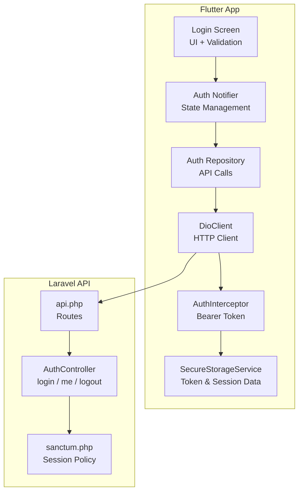
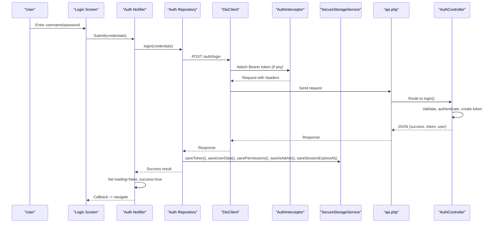
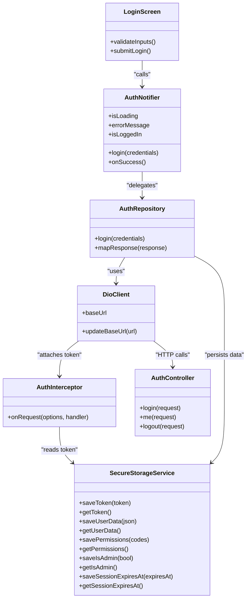

# Login Flow Implementation

<cite>
**Referenced Files in This Document**
- [lib/features/auth/presentation/screens/login_screen.dart](file://lib/features/auth/presentation/screens/login_screen.dart)
- [lib/features/auth/presentation/providers/auth_notifier.dart](file://lib/features/auth/presentation/providers/auth_notifier.dart)
- [lib/features/auth/data/repositories/auth_repository.dart](file://lib/features/auth/data/repositories/auth_repository.dart)
- [lib/core/network/dio_client.dart](file://lib/core/network/dio_client.dart)
- [lib/core/network/auth_interceptor.dart](file://lib/core/network/auth_interceptor.dart)
- [lib/core/storage/secure_storage_service.dart](file://lib/core/storage/secure_storage_service.dart)
- [kyApp_API/routes/api.php](file://kyApp_API/routes/api.php)
- [kyApp_API/app/Http/Controllers/AuthController.php](file://kyApp_API/app/Http/Controllers/AuthController.php)
- [kyApp_API/config/sanctum.php](file://kyApp_API/config/sanctum.php)
</cite>

## Table of Contents
1. [Introduction](#introduction)
2. [Project Structure](#project-structure)
3. [Core Components](#core-components)
4. [Architecture Overview](#architecture-overview)
5. [Detailed Component Analysis](#detailed-component-analysis)
6. [Dependency Analysis](#dependency-analysis)
7. [Performance Considerations](#performance-considerations)
8. [Troubleshooting Guide](#troubleshooting-guide)
9. [Conclusion](#conclusion)

## Introduction
This document explains the complete login flow from user input to successful authentication, covering the Flutter login screen, form validation, credential submission, response handling, auth notifier state management, and backend Sanctum integration. It also provides practical customization examples and troubleshooting guidance for common issues such as network errors, invalid credentials, and server timeouts.

## Project Structure
The login feature is organized into presentation, data, and core networking layers:

**Diagram sources**
- [lib/features/auth/presentation/screens/login_screen.dart](file://lib/features/auth/presentation/screens/login_screen.dart)
- [lib/features/auth/presentation/providers/auth_notifier.dart](file://lib/features/auth/presentation/providers/auth_notifier.dart)
- [lib/features/auth/data/repositories/auth_repository.dart](file://lib/features/auth/data/repositories/auth_repository.dart)
- [lib/core/network/dio_client.dart](file://lib/core/network/dio_client.dart)
- [lib/core/network/auth_interceptor.dart](file://lib/core/network/auth_interceptor.dart)
- [lib/core/storage/secure_storage_service.dart](file://lib/core/storage/secure_storage_service.dart)
- [kyApp_API/routes/api.php](file://kyApp_API/routes/api.php)
- [kyApp_API/app/Http/Controllers/AuthController.php](file://kyApp_API/app/Http/Controllers/AuthController.php)
- [kyApp_API/config/sanctum.php](file://kyApp_API/config/sanctum.php)

**Section sources**
- [lib/features/auth/presentation/screens/login_screen.dart](file://lib/features/auth/presentation/screens/login_screen.dart)
- [lib/features/auth/presentation/providers/auth_notifier.dart](file://lib/features/auth/presentation/providers/auth_notifier.dart)
- [lib/features/auth/data/repositories/auth_repository.dart](file://lib/features/auth/data/repositories/auth_repository.dart)
- [lib/core/network/dio_client.dart](file://lib/core/network/dio_client.dart)
- [kyApp_API/routes/api.php](file://kyApp_API/routes/api.php)

## Core Components
- Login Screen UI: Renders username/password inputs, optional biometric login button, user type selector, and error messages. It triggers validation and delegates submission to the Auth Notifier.
- Auth Notifier: Holds loading, error, and success states; orchestrates repository calls; persists tokens and user/session data on success; exposes callbacks for navigation or UI updates.
- Auth Repository: Encapsulates HTTP requests to the backend using DioClient; maps responses to domain models; handles token persistence via SecureStorageService.
- DioClient: Central HTTP client with base URL, timeouts, and interceptors for authorization and error handling.
- AuthInterceptor: Automatically attaches Bearer tokens from SecureStorageService to outgoing requests.
- SecureStorageService: Securely stores tokens, user data, permissions, admin flag, session expiry, and biometric-related flags.
- Backend Routes and Controller: Expose `/auth/login`, `/auth/me`, `/auth/logout`, and Sanctum-protected routes; validate inputs, authenticate users, issue tokens, and return user payload with permissions.

**Section sources**
- [lib/features/auth/presentation/screens/login_screen.dart](file://lib/features/auth/presentation/screens/login_screen.dart)
- [lib/features/auth/presentation/providers/auth_notifier.dart](file://lib/features/auth/presentation/providers/auth_notifier.dart)
- [lib/features/auth/data/repositories/auth_repository.dart](file://lib/features/auth/data/repositories/auth_repository.dart)
- [lib/core/network/dio_client.dart](file://lib/core/network/dio_client.dart)
- [lib/core/network/auth_interceptor.dart](file://lib/core/network/auth_interceptor.dart)
- [lib/core/storage/secure_storage_service.dart](file://lib/core/storage/secure_storage_service.dart)
- [kyApp_API/routes/api.php](file://kyApp_API/routes/api.php)
- [kyApp_API/app/Http/Controllers/AuthController.php](file://kyApp_API/app/Http/Controllers/AuthController.php)

## Architecture Overview
End-to-end login sequence:

**Diagram sources**
- [lib/features/auth/presentation/screens/login_screen.dart](file://lib/features/auth/presentation/screens/login_screen.dart)
- [lib/features/auth/presentation/providers/auth_notifier.dart](file://lib/features/auth/presentation/providers/auth_notifier.dart)
- [lib/features/auth/data/repositories/auth_repository.dart](file://lib/features/auth/data/repositories/auth_repository.dart)
- [lib/core/network/dio_client.dart](file://lib/core/network/dio_client.dart)
- [lib/core/network/auth_interceptor.dart](file://lib/core/network/auth_interceptor.dart)
- [lib/core/storage/secure_storage_service.dart](file://lib/core/storage/secure_storage_service.dart)
- [kyApp_API/routes/api.php](file://kyApp_API/routes/api.php)
- [kyApp_API/app/Http/Controllers/AuthController.php](file://kyApp_API/app/Http/Controllers/AuthController.php)

## Detailed Component Analysis

### Login Screen UI and Form Validation
Responsibilities:
- Render input fields for username and password.
- Provide a user type selector when applicable.
- Show validation errors inline and at the top level.
- Trigger login submission through the Auth Notifier.
- Optionally render a biometric login button if enabled by configuration.

Validation approach:
- Ensure required fields are present before calling the repository.
- Display localized or translated messages based on backend validation errors.

Customization tips:
- Add additional fields (e.g., organization code) by extending the form model and passing them to the repository call.
- Integrate custom validators (e.g., email format) before invoking the login flow.

**Section sources**
- [lib/features/auth/presentation/screens/login_screen.dart](file://lib/features/auth/presentation/screens/login_screen.dart)

### Auth Notifier State Management
Responsibilities:
- Manage `isLoading`, `errorMessage`, and `isLoggedIn` states.
- Call the repository’s login method with validated credentials.
- On success: persist token, user data, permissions, admin flag, and session expiry; clear previous errors; trigger success callback.
- On failure: set loading to false and propagate error message.

Key behaviors:
- Loading state prevents duplicate submissions.
- Error handling surfaces user-friendly messages.
- Success callback enables navigation to the app’s main screen or dashboard.

Practical example:
- After successful login, navigate to the home screen and optionally refresh permissions.

**Section sources**
- [lib/features/auth/presentation/providers/auth_notifier.dart](file://lib/features/auth/presentation/providers/auth_notifier.dart)

### Auth Repository and API Integration
Responsibilities:
- Perform HTTP POST to `/auth/login`.
- Map backend response to local models.
- Persist authentication artifacts securely.

Integration points:
- Uses DioClient for network operations.
- Uses SecureStorageService to store token, user data, permissions, admin flag, and session expiry.

Response handling:
- On success: save token, user data, permissions, admin flag, and session expiry; return success result.
- On failure: surface error message and status for UI display.

**Section sources**
- [lib/features/auth/data/repositories/auth_repository.dart](file://lib/features/auth/data/repositories/auth_repository.dart)
- [lib/core/network/dio_client.dart](file://lib/core/network/dio_client.dart)
- [lib/core/storage/secure_storage_service.dart](file://lib/core/storage/secure_storage_service.dart)

### DioClient, AuthInterceptor, and SecureStorageService
DioClient:
- Configures base URL, connect/receive timeouts, and default headers.
- Attaches global interceptors for authorization and error logging.

AuthInterceptor:
- Reads token from SecureStorageService and adds Authorization header.

SecureStorageService:
- Stores and retrieves token, user data, permissions, admin flag, session expiry, and biometric-related flags.
- Provides safe parsing for permissions and clears IBAC state on logout.

**Section sources**
- [lib/core/network/dio_client.dart](file://lib/core/network/dio_client.dart)
- [lib/core/network/auth_interceptor.dart](file://lib/core/network/auth_interceptor.dart)
- [lib/core/storage/secure_storage_service.dart](file://lib/core/storage/secure_storage_service.dart)

### Backend Authentication with Sanctum
Routes:
- Public: `POST /auth/login`, `POST /auth/biometric/login`.
- Protected: `GET /auth/me`, `POST /auth/logout`, and others under `auth:sanctum`.

AuthController.login:
- Validates username, password, and optional user_type.
- Looks up user by English or Arabic username or numeric USER_ID.
- Checks account activation status.
- Compares password (supports legacy plain text and hashed values).
- Creates a Sanctum personal access token and primes session policy.
- Logs activity and returns token plus user payload including permissions and admin flag.

Sanctum configuration:
- Stateful domains allow SPA cookie-based sessions.
- Guard set to web guard.
- Expiration left null to rely on custom session policy.
- Last-used-at tracking enabled for active sessions.

**Section sources**
- [kyApp_API/routes/api.php](file://kyApp_API/routes/api.php)
- [kyApp_API/app/Http/Controllers/AuthController.php](file://kyApp_API/app/Http/Controllers/AuthController.php)
- [kyApp_API/config/sanctum.php](file://kyApp_API/config/sanctum.php)

## Dependency Analysis
Component relationships:

**Diagram sources**
- [lib/features/auth/presentation/screens/login_screen.dart](file://lib/features/auth/presentation/screens/login_screen.dart)
- [lib/features/auth/presentation/providers/auth_notifier.dart](file://lib/features/auth/presentation/providers/auth_notifier.dart)
- [lib/features/auth/data/repositories/auth_repository.dart](file://lib/features/auth/data/repositories/auth_repository.dart)
- [lib/core/network/dio_client.dart](file://lib/core/network/dio_client.dart)
- [lib/core/network/auth_interceptor.dart](file://lib/core/network/auth_interceptor.dart)
- [lib/core/storage/secure_storage_service.dart](file://lib/core/storage/secure_storage_service.dart)
- [kyApp_API/app/Http/Controllers/AuthController.php](file://kyApp_API/app/Http/Controllers/AuthController.php)

**Section sources**
- [lib/features/auth/presentation/screens/login_screen.dart](file://lib/features/auth/presentation/screens/login_screen.dart)
- [lib/features/auth/presentation/providers/auth_notifier.dart](file://lib/features/auth/presentation/providers/auth_notifier.dart)
- [lib/features/auth/data/repositories/auth_repository.dart](file://lib/features/auth/data/repositories/auth_repository.dart)
- [lib/core/network/dio_client.dart](file://lib/core/network/dio_client.dart)
- [lib/core/network/auth_interceptor.dart](file://lib/core/network/auth_interceptor.dart)
- [lib/core/storage/secure_storage_service.dart](file://lib/core/storage/secure_storage_service.dart)
- [kyApp_API/app/Http/Controllers/AuthController.php](file://kyApp_API/app/Http/Controllers/AuthController.php)

## Performance Considerations
- Use DioClient timeouts to avoid long hangs during network issues.
- Avoid redundant network calls by caching user data and permissions locally after successful login.
- Debounce repeated login attempts while loading is true.
- Minimize payload size by sending only necessary fields (username, password, optional user_type).
- Leverage Sanctum’s last_used_at tracking to monitor active sessions without extra queries.

[No sources needed since this section provides general guidance]

## Troubleshooting Guide

Common issues and solutions:

- Network errors or timeouts:
  - Check DioClient timeout settings and ensure the base URL is correct.
  - Verify connectivity and DNS resolution.
  - Inspect logs from LogInterceptor for request/response details.

- Invalid credentials:
  - Backend returns 401 with a generic message to prevent username enumeration.
  - Ensure username matches English/Arabic fields or numeric USER_ID.
  - Confirm password supports both hashed and legacy plain-text formats.

- Account deactivated:
  - Backend returns 403 for deactivated accounts.
  - Contact system administration to activate the account.

- Sanctum session misconfiguration:
  - Ensure stateful domains include your frontend host.
  - Verify that cookies are allowed and CORS is configured correctly.

- Token not attached:
  - Confirm SecureStorageService has a valid token.
  - Ensure AuthInterceptor reads the token and sets Authorization header.

- Permissions not updating:
  - After login, fetch permissions via protected endpoints and update SecureStorageService.
  - Clear stale IBAC state if permission refresh fails.

**Section sources**
- [kyApp_API/app/Http/Controllers/AuthController.php](file://kyApp_API/app/Http/Controllers/AuthController.php)
- [kyApp_API/config/sanctum.php](file://kyApp_API/config/sanctum.php)
- [lib/core/network/dio_client.dart](file://lib/core/network/dio_client.dart)
- [lib/core/network/auth_interceptor.dart](file://lib/core/network/auth_interceptor.dart)
- [lib/core/storage/secure_storage_service.dart](file://lib/core/storage/secure_storage_service.dart)

## Conclusion
The login flow integrates a clean Flutter UI with robust state management, secure storage, and a Laravel Sanctum-backed API. The design separates concerns across presentation, data, and networking layers, enabling easy customization and maintenance. By following the guidelines here, you can extend validation rules, customize the login form, handle edge cases gracefully, and maintain secure, performant authentication.

[No sources needed since this section summarizes without analyzing specific files]