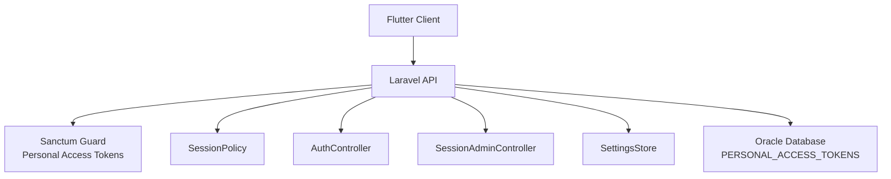
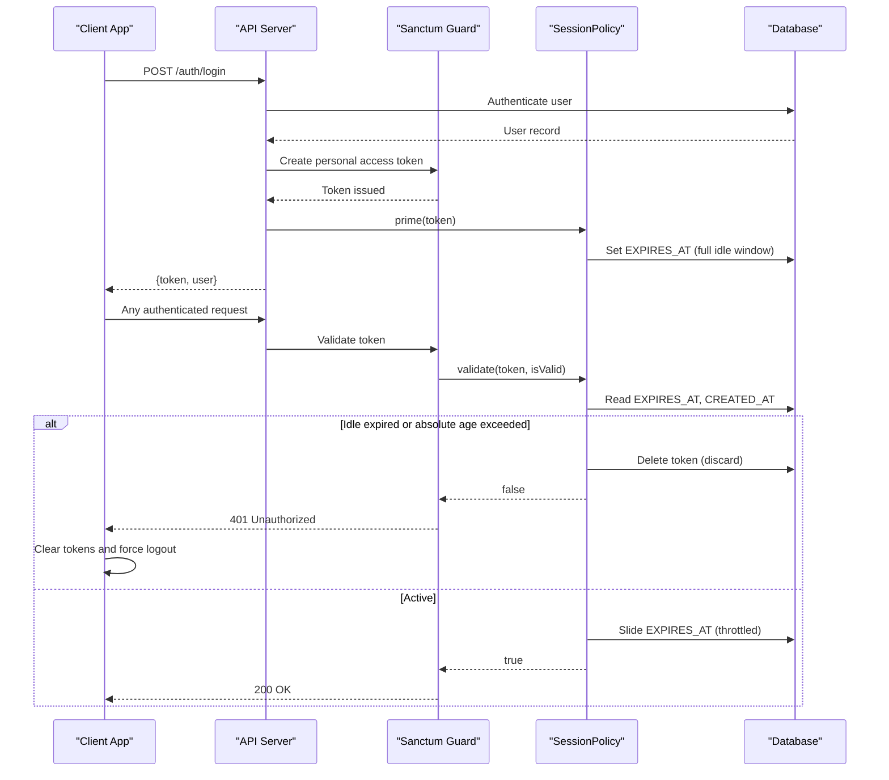
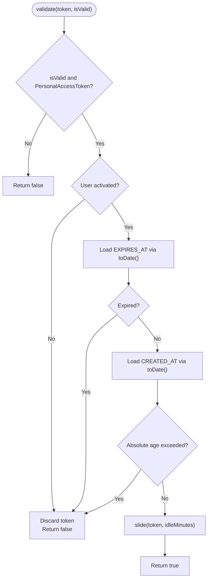
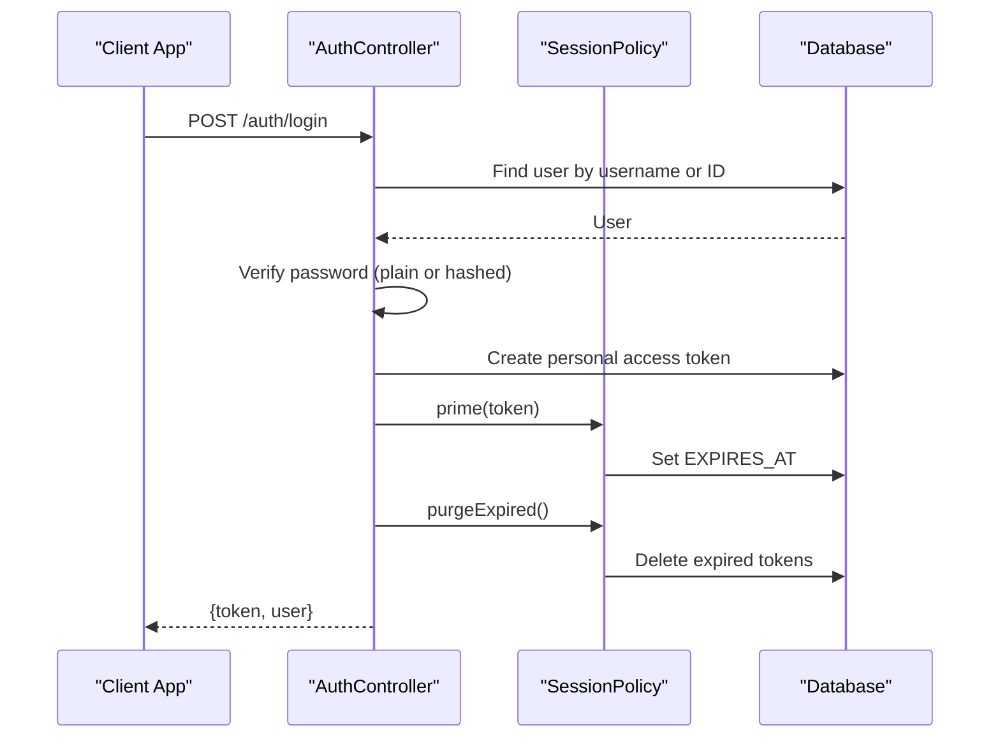
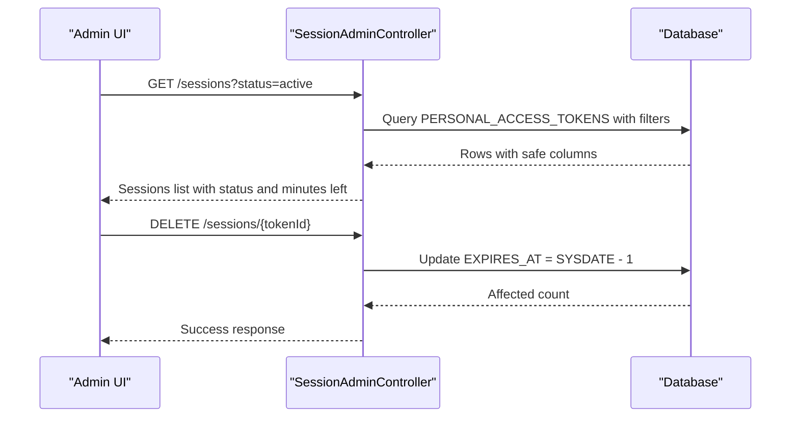
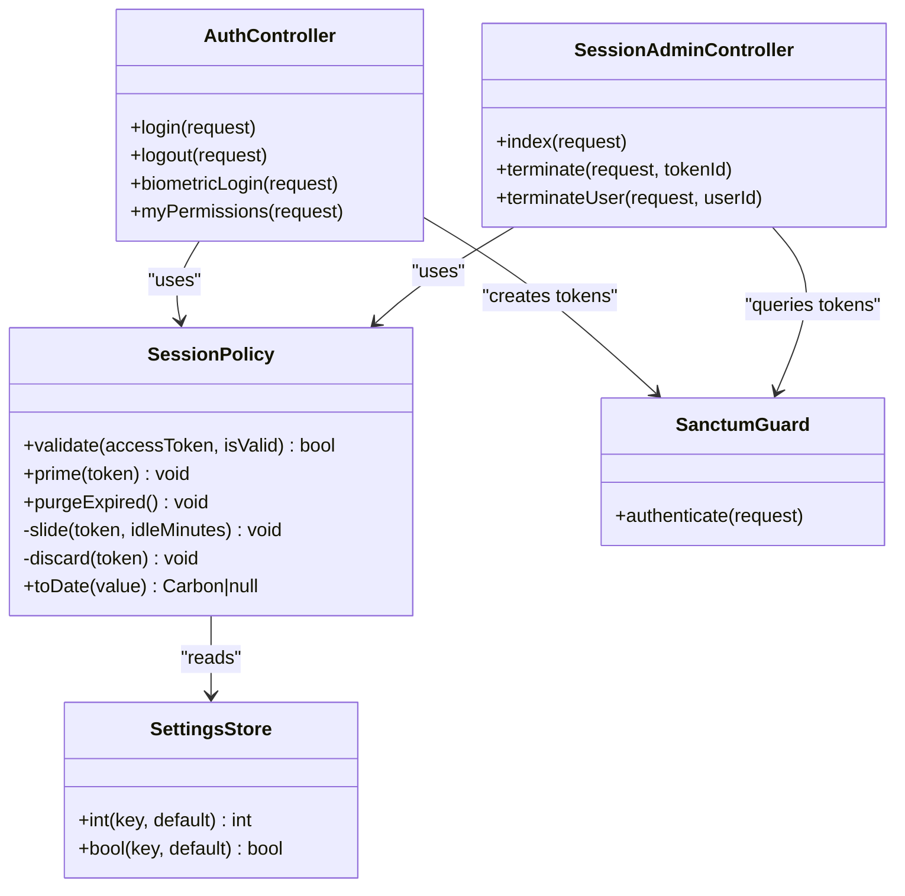

# Session Management

<cite>
**Referenced Files in This Document**
- [sanctum.php](file://kyApp_API/config/sanctum.php)
- [api.php](file://kyApp_API/routes/api.php)
- [SessionPolicy.php](file://kyApp_API/app/Support/SessionPolicy.php)
- [AuthController.php](file://kyApp_API/app/Http/Controllers/AuthController.php)
- [SessionAdminController.php](file://kyApp_API/app/Http/Controllers/SessionAdminController.php)
</cite>

## Table of Contents
1. [Introduction](#introduction)
2. [Project Structure](#project-structure)
3. [Core Components](#core-components)
4. [Architecture Overview](#architecture-overview)
5. [Detailed Component Analysis](#detailed-component-analysis)
6. [Dependency Analysis](#dependency-analysis)
7. [Performance Considerations](#performance-considerations)
8. [Troubleshooting Guide](#troubleshooting-guide)
9. [Conclusion](#conclusion)
10. [Appendices](#appendices)

## Introduction
This document explains the session management design for the application, focusing on:
- User session lifecycle from login to expiration and logout
- Token refresh behavior through sliding renewal and idle expiry
- Persistence across app restarts via Sanctum personal access tokens
- The auth notifier role in handling authentication state, session expiration, and automatic logout
- Secure storage and timeout logic on both client and server sides
- Backend active session tracking, remote termination, and concurrent session behavior
- Practical examples for custom session policies, conflict handling, and admin session control integration

The backend uses Laravel Sanctum with a custom `SessionPolicy` that drives real `EXPIRES_AT` values instead of relying on Sanctum’s absolute expiration setting.

## Project Structure
The session system spans configuration, routing, controllers, and support classes:
- Configuration defines Sanctum behavior and middleware
- Routes expose authentication and session administration endpoints
- Controllers handle login, logout, biometric flows, and session listing/termination
- Support classes implement session policy, settings, and activity logging

**Diagram sources**
- [sanctum.php:1-112](file://kyApp_API/config/sanctum.php#L1-L112)
- [api.php:18-130](file://kyApp_API/routes/api.php#L18-L130)
- [SessionPolicy.php:1-185](file://kyApp_API/app/Support/SessionPolicy.php#L1-L185)
- [AuthController.php:1-494](file://kyApp_API/app/Http/Controllers/AuthController.php#L1-L494)
- [SessionAdminController.php:1-474](file://kyApp_API/app/Http/Controllers/SessionAdminController.php#L1-L474)

**Section sources**
- [sanctum.php:1-112](file://kyApp_API/config/sanctum.php#L1-L112)
- [api.php:18-130](file://kyApp_API/routes/api.php#L18-L130)

## Core Components
- Sanctum configuration: keeps absolute expiration disabled so sliding renewal is fully controlled by `SessionPolicy`. It enables last-used-at tracking and configures middleware for session authentication, cookie encryption, and CSRF validation.
- SessionPolicy: validates each token request, enforces idle expiry and absolute age, performs write-throttled sliding renewal, and purges expired tokens.
- AuthController: handles login, logout, biometric login, and returns current user payload including effective permissions and session expiration hint.
- SessionAdminController: lists active sessions, filters them, and terminates individual or all sessions for a user by pushing their expiry into the past.

Key responsibilities:
- Lifecycle: create token → prime with full idle window → slide on activity → expire when idle or absolute age reached → logout or terminate removes access.
- Persistence: tokens are stored in `PERSONAL_ACCESS_TOKENS`; clients persist tokens securely to survive app restarts.
- Expiration: driven by `EXPIRES_AT`, not Sanctum’s absolute expiration.

**Section sources**
- [sanctum.php:10-77](file://kyApp_API/config/sanctum.php#L10-L77)
- [SessionPolicy.php:9-41](file://kyApp_API/app/Support/SessionPolicy.php#L9-L41)
- [AuthController.php:17-33](file://kyApp_API/app/Http/Controllers/AuthController.php#L17-L33)
- [SessionAdminController.php:15-31](file://kyApp_API/app/Http/Controllers/SessionAdminController.php#L15-L31)

## Architecture Overview
The session architecture combines Sanctum-based token authentication with a custom policy layer:

**Diagram sources**
- [api.php:18-48](file://kyApp_API/routes/api.php#L18-L48)
- [AuthController.php:47-164](file://kyApp_API/app/Http/Controllers/AuthController.php#L47-L164)
- [SessionPolicy.php:70-108](file://kyApp_API/app/Support/SessionPolicy.php#L70-L108)
- [SessionPolicy.php:114-117](file://kyApp_API/app/Support/SessionPolicy.php#L114-L117)
- [SessionPolicy.php:166-183](file://kyApp_API/app/Support/SessionPolicy.php#L166-L183)

## Detailed Component Analysis

### SessionPolicy
SessionPolicy implements the core session rules:
- Validates account activation status
- Enforces idle expiry using `session_idle_minutes`
- Enforces absolute age using `session_absolute_days`
- Performs sliding renewal with write throttling based on `session_touch_threshold_minutes`
- Purges expired tokens best-effort without blocking requests

**Diagram sources**
- [SessionPolicy.php:70-108](file://kyApp_API/app/Support/SessionPolicy.php#L70-L108)
- [SessionPolicy.php:166-183](file://kyApp_API/app/Support/SessionPolicy.php#L166-L183)

Implementation highlights:
- Date normalization protects against Oracle returning empty dates as booleans
- Sliding renewal updates `expires_at` and `updated_at` only when necessary
- Discarding tokens on rejection prevents stale rows accumulation
- Purge method runs on login and sessions screen to clean leftovers

**Section sources**
- [SessionPolicy.php:9-41](file://kyApp_API/app/Support/SessionPolicy.php#L9-L41)
- [SessionPolicy.php:50-61](file://kyApp_API/app/Support/SessionPolicy.php#L50-L61)
- [SessionPolicy.php:114-141](file://kyApp_API/app/Support/SessionPolicy.php#L114-L141)
- [SessionPolicy.php:147-155](file://kyApp_API/app/Support/SessionPolicy.php#L147-L155)
- [SessionPolicy.php:166-183](file://kyApp_API/app/Support/SessionPolicy.php#L166-L183)

### AuthController
AuthController manages authentication flows and integrates session policy:
- Login validates credentials, creates a Sanctum token, primes it with a full idle window, purges expired tokens, logs activity, and returns token plus user payload
- Logout deletes the current token and logs activity
- Biometric login enforces platform kill-switch, verifies device binding, issues a token under the same policy, and logs activity
- MyPermissions endpoint returns effective permissions and current session expiration hint using `SessionPolicy::toDate()`

**Diagram sources**
- [AuthController.php:47-164](file://kyApp_API/app/Http/Controllers/AuthController.php#L47-L164)
- [AuthController.php:217-239](file://kyApp_API/app/Http/Controllers/AuthController.php#L217-L239)
- [AuthController.php:316-410](file://kyApp_API/app/Http/Controllers/AuthController.php#L316-L410)
- [AuthController.php:190-215](file://kyApp_API/app/Http/Controllers/AuthController.php#L190-L215)

**Section sources**
- [AuthController.php:47-164](file://kyApp_API/app/Http/Controllers/AuthController.php#L47-L164)
- [AuthController.php:217-239](file://kyApp_API/app/Http/Controllers/AuthController.php#L217-L239)
- [AuthController.php:316-410](file://kyApp_API/app/Http/Controllers/AuthController.php#L316-L410)
- [AuthController.php:190-215](file://kyApp_API/app/Http/Controllers/AuthController.php#L190-L215)

### SessionAdminController
SessionAdminController provides administrative controls over active sessions:
- Lists sessions with pagination, search, and filtering by status (active, expired, disabled)
- Terminates a single session by token ID
- Terminates all sessions for a user
- Uses safe column selection and avoids reading sensitive fields like TOKEN or ABILITIES
- Marks the current session for the requesting device

Termination works by updating `EXPIRES_AT` to the past rather than deleting rows, preserving audit trails while forcing the next request to fail with 401.

**Diagram sources**
- [SessionAdminController.php:93-141](file://kyApp_API/app/Http/Controllers/SessionAdminController.php#L93-L141)
- [SessionAdminController.php:147-182](file://kyApp_API/app/Http/Controllers/SessionAdminController.php#L147-L182)
- [SessionAdminController.php:193-233](file://kyApp_API/app/Http/Controllers/SessionAdminController.php#L193-L233)
- [SessionAdminController.php:343-355](file://kyApp_API/app/Http/Controllers/SessionAdminController.php#L343-L355)

**Section sources**
- [SessionAdminController.php:15-31](file://kyApp_API/app/Http/Controllers/SessionAdminController.php#L15-L31)
- [SessionAdminController.php:93-141](file://kyApp_API/app/Http/Controllers/SessionAdminController.php#L93-L141)
- [SessionAdminController.php:147-233](file://kyApp_API/app/Http/Controllers/SessionAdminController.php#L147-L233)
- [SessionAdminController.php:245-283](file://kyApp_API/app/Http/Controllers/SessionAdminController.php#L245-L283)
- [SessionAdminController.php:343-355](file://kyApp_API/app/Http/Controllers/SessionAdminController.php#L343-L355)
- [SessionAdminController.php:384-417](file://kyApp_API/app/Http/Controllers/SessionAdminController.php#L384-L417)

### Sanctum Configuration
Sanctum configuration ensures session behavior aligns with policy-driven expiration:
- Absolute expiration is null to avoid hard cutoffs that would disconnect active users
- Last-used-at tracking is enabled for accurate activity reporting
- Middleware includes session authentication, cookie encryption, and CSRF validation

**Section sources**
- [sanctum.php:10-77](file://kyApp_API/config/sanctum.php#L10-L77)
- [sanctum.php:94-109](file://kyApp_API/config/sanctum.php#L94-L109)

### Routing
Routes define protected endpoints for authentication and session administration:
- Authentication routes: login, logout, me, biometric register/revoke
- Session administration routes: list sessions, terminate session, terminate user sessions
- All session routes require `auth:sanctum` and additional permission checks

**Section sources**
- [api.php:18-48](file://kyApp_API/routes/api.php#L18-L48)
- [api.php:104-130](file://kyApp_API/routes/api.php#L104-L130)

## Dependency Analysis
The session system has clear dependencies:
- AuthController depends on SessionPolicy for priming and purging tokens
- SessionPolicy depends on SettingsStore for session timeouts
- SessionAdminController depends on ActivityLogger for audit trails and on SessionPolicy for date normalization
- Sanctum configuration affects how tokens are validated and tracked

**Diagram sources**
- [AuthController.php:36-41](file://kyApp_API/app/Http/Controllers/AuthController.php#L36-L41)
- [SessionPolicy.php:44-44](file://kyApp_API/app/Support/SessionPolicy.php#L44-L44)
- [SessionPolicy.php:70-108](file://kyApp_API/app/Support/SessionPolicy.php#L70-L108)
- [SessionAdminController.php:82-82](file://kyApp_API/app/Http/Controllers/SessionAdminController.php#L82-L82)

**Section sources**
- [AuthController.php:36-41](file://kyApp_API/app/Http/Controllers/AuthController.php#L36-L41)
- [SessionPolicy.php:44-44](file://kyApp_API/app/Support/SessionPolicy.php#L44-L44)
- [SessionAdminController.php:82-82](file://kyApp_API/app/Http/Controllers/SessionAdminController.php#L82-L82)

## Performance Considerations
- Sliding renewal is write-throttled to reduce database writes; updates occur only when the current expiry is close to the new horizon
- Purge operations are best-effort and wrapped in try-catch to avoid blocking login or listing sessions
- Session listing uses fixed ordering and safe column selection to prevent SQL injection and performance issues
- Avoid reading sensitive columns like TOKEN or ABILITIES to minimize overhead and exposure

[No sources needed since this section provides general guidance]

## Troubleshooting Guide
Common issues and resolutions:
- 401 Unauthorized after activity: Indicates idle expiry or absolute age exceeded; check `EXPIRES_AT` and `CREATED_AT` in `PERSONAL_ACCESS_TOKENS`
- Stale token rows accumulating: Ensure purgeExpired is called on login and sessions screen; verify SessionPolicy discard logic
- Arabic text corruption in session list: Use ArabicEncoding utilities consistently; avoid double-fixing names
- Session termination not taking effect: Confirm EXPIRES_AT was updated to past; verify next request triggers 401 and client clears tokens

**Section sources**
- [SessionPolicy.php:130-141](file://kyApp_API/app/Support/SessionPolicy.php#L130-L141)
- [SessionPolicy.php:147-155](file://kyApp_API/app/Support/SessionPolicy.php#L147-L155)
- [SessionAdminController.php:423-430](file://kyApp_API/app/Http/Controllers/SessionAdminController.php#L423-L430)

## Conclusion
The session management system combines Sanctum’s token infrastructure with a robust custom policy layer. It ensures secure, persistent sessions with sliding renewal, idle expiry, and absolute age limits. Administrators can monitor and terminate sessions effectively, while clients handle expiration gracefully through automatic logout flows.

[No sources needed since this section summarizes without analyzing specific files]

## Appendices

### Practical Examples

#### Implementing Custom Session Policies
- Adjust idle minutes and absolute days via settings store keys
- Modify touch threshold to balance security and write frequency
- Extend SessionPolicy validation to include additional business rules

**Section sources**
- [SessionPolicy.php:84-86](file://kyApp_API/app/Support/SessionPolicy.php#L84-L86)
- [SessionPolicy.php:168-169](file://kyApp_API/app/Support/SessionPolicy.php#L168-L169)

#### Handling Session Conflicts
- When multiple devices are active, each maintains its own token and expiry
- Terminate specific sessions via admin interface to resolve conflicts
- Use session list to identify conflicting devices and take action

**Section sources**
- [SessionAdminController.php:93-141](file://kyApp_API/app/Http/Controllers/SessionAdminController.php#L93-L141)
- [SessionAdminController.php:193-233](file://kyApp_API/app/Http/Controllers/SessionAdminController.php#L193-L233)

#### Integrating with Admin Session Control Features
- Grant appropriate permissions for viewing and terminating sessions
- Use session list to monitor active sessions and their status
- Implement audit logging for session termination actions

**Section sources**
- [api.php:113-130](file://kyApp_API/routes/api.php#L113-L130)
- [SessionAdminController.php:165-172](file://kyApp_API/app/Http/Controllers/SessionAdminController.php#L165-L172)
- [SessionAdminController.php:216-223](file://kyApp_API/app/Http/Controllers/SessionAdminController.php#L216-L223)