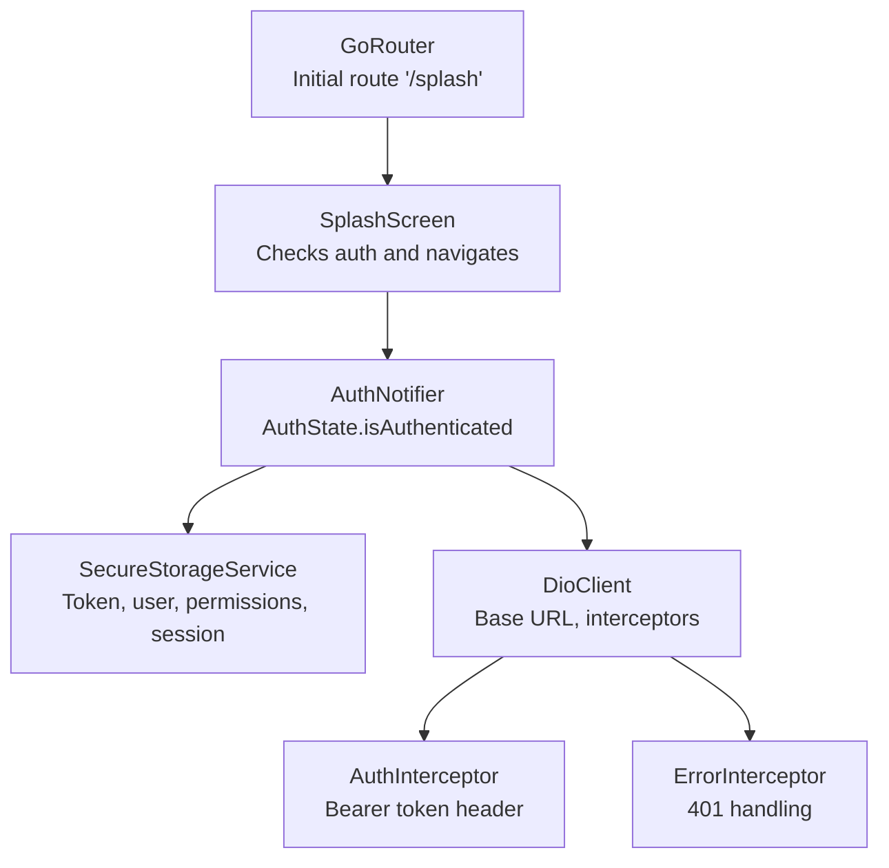
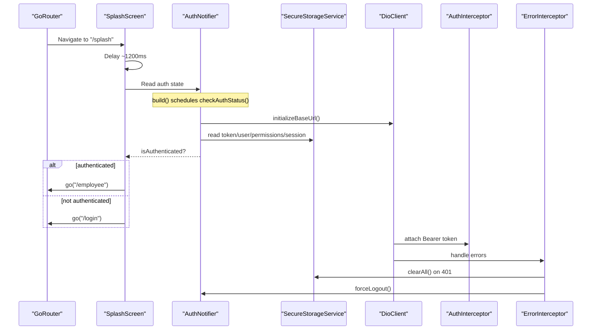
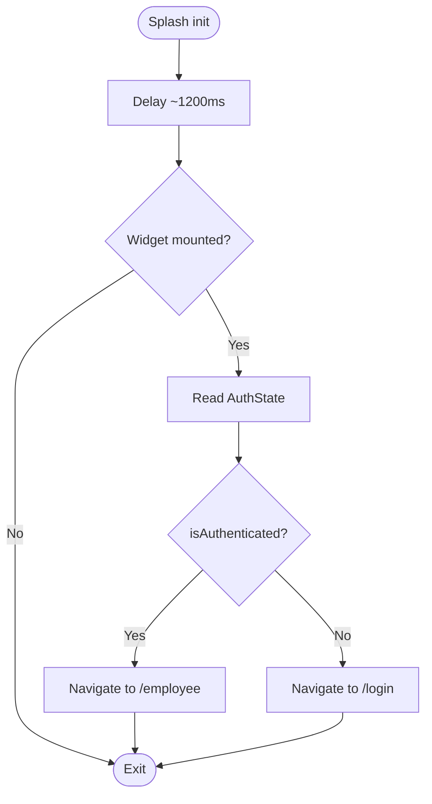
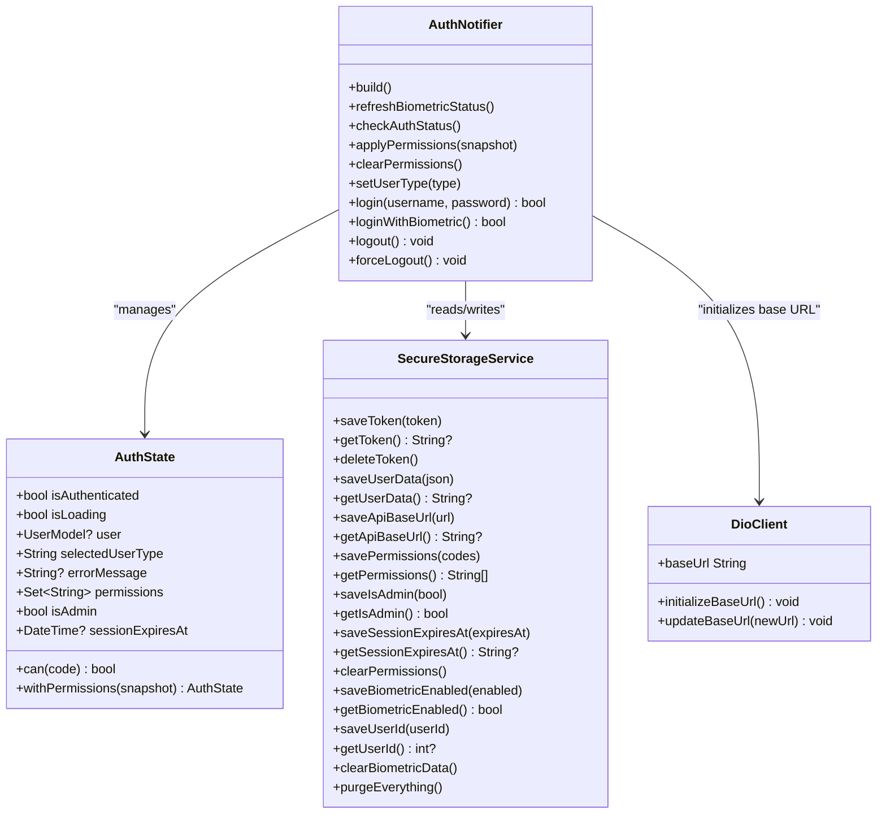
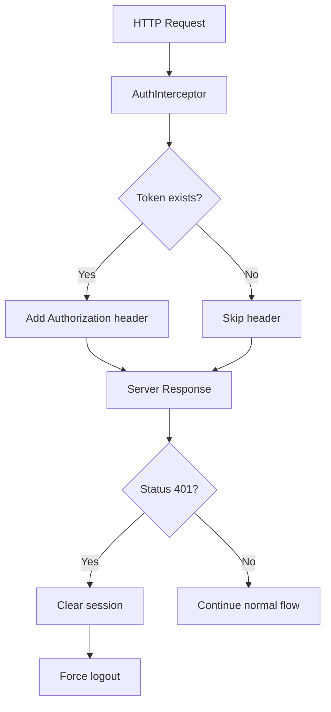
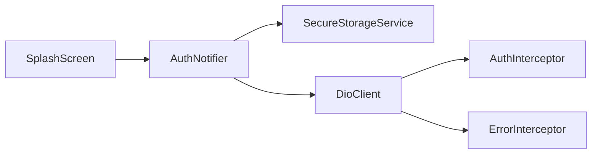

# Splash Screen Authentication

<cite>
**Referenced Files in This Document**
- [splash_screen.dart](file://lib/features/auth/presentation/screens/splash_screen.dart)
- [app_router.dart](file://lib/routing/app_router.dart)
- [auth_notifier.dart](file://lib/features/auth/presentation/providers/auth_notifier.dart)
- [secure_storage_service.dart](file://lib/core/storage/secure_storage_service.dart)
- [dio_client.dart](file://lib/core/network/dio_client.dart)
- [auth_interceptor.dart](file://lib/core/network/auth_interceptor.dart)
- [error_interceptor.dart](file://lib/core/network/error_interceptor.dart)
</cite>

## Table of Contents
1. [Introduction](#introduction)
2. [Project Structure](#project-structure)
3. [Core Components](#core-components)
4. [Architecture Overview](#architecture-overview)
5. [Detailed Component Analysis](#detailed-component-analysis)
6. [Dependency Analysis](#dependency-analysis)
7. [Performance Considerations](#performance-considerations)
8. [Troubleshooting Guide](#troubleshooting-guide)
9. [Conclusion](#conclusion)
10. [Appendices](#appendices)

## Introduction
This document explains the splash screen authentication flow that automatically checks whether a user is already authenticated and routes them to either the employee portal or the login screen. It covers:
- How the splash screen initializes and delays before navigation.
- How it reads the current authentication state from the auth notifier.
- How conditional routing works based on login status.
- How the auth notifier integrates with secure storage for fast credential validation.
- How network interceptors handle unauthorized responses and trigger forced logout.
- Error handling around failed authentication checks and guidance for retry behavior.
- Practical examples for customizing splash behavior, adding loading indicators, and implementing pre-checks.

## Project Structure
The splash authentication logic spans presentation, state management, routing, secure storage, and networking layers:
- Presentation: `SplashScreen` widget performs the initial check and navigation.
- State: `AuthNotifier` manages authentication state, cached credentials, permissions, and biometric settings.
- Routing: `GoRouter` defines `/splash`, `/login`, and `/employee`.
- Storage: `SecureStorageService` persists tokens, user data, API base URL, IBAC grants, and biometric flags.
- Networking: `DioClient` configures timeouts, headers, and interceptors; `AuthInterceptor` injects tokens; `ErrorInterceptor` handles 401 and cancellation.

**Diagram sources**
- [app_router.dart:10-16](file://lib/routing/app_router.dart#L10-L16)
- [splash_screen.dart:16-33](file://lib/features/auth/presentation/screens/splash_screen.dart#L16-L33)
- [auth_notifier.dart:153-216](file://lib/features/auth/presentation/providers/auth_notifier.dart#L153-L216)
- [secure_storage_service.dart:32-75](file://lib/core/storage/secure_storage_service.dart#L32-L75)
- [dio_client.dart:9-42](file://lib/core/network/dio_client.dart#L9-L42)
- [auth_interceptor.dart:6-22](file://lib/core/network/auth_interceptor.dart#L6-L22)
- [error_interceptor.dart:6-36](file://lib/core/network/error_interceptor.dart#L6-L36)

**Section sources**
- [app_router.dart:10-36](file://lib/routing/app_router.dart#L10-L36)
- [splash_screen.dart:16-33](file://lib/features/auth/presentation/screens/splash_screen.dart#L16-L33)

## Core Components
- SplashScreen: A consumer widget that waits briefly, reads the current auth state, and navigates to `/employee` if authenticated or `/login` otherwise. It also renders a logo, app name, and a small circular progress indicator while checking.
- AuthNotifier: The central state manager for authentication. On first build, it asynchronously checks login status, restores cached user and permissions, refreshes biometric capability, and sets `isAuthenticated`.
- SecureStorageService: Encrypted persistence for tokens, user data, API base URL, IBAC grants, admin flag, session expiry, and biometric configuration.
- DioClient: Central HTTP client configured with timeouts, JSON headers, and interceptors. It can initialize its base URL from secure storage.
- AuthInterceptor: Automatically attaches the stored bearer token to outgoing requests.
- ErrorInterceptor: Handles request cancellations gracefully and clears session on 401, then triggers forced logout via the provided callback.

**Section sources**
- [splash_screen.dart:16-84](file://lib/features/auth/presentation/screens/splash_screen.dart#L16-L84)
- [auth_notifier.dart:153-216](file://lib/features/auth/presentation/providers/auth_notifier.dart#L153-L216)
- [secure_storage_service.dart:32-75](file://lib/core/storage/secure_storage_service.dart#L32-L75)
- [dio_client.dart:9-58](file://lib/core/network/dio_client.dart#L9-L58)
- [auth_interceptor.dart:6-22](file://lib/core/network/auth_interceptor.dart#L6-L22)
- [error_interceptor.dart:6-36](file://lib/core/network/error_interceptor.dart#L6-L36)

## Architecture Overview
The runtime flow begins at the router, which starts at `/splash`. The splash screen delays briefly, then reads the auth state. If authenticated, it goes to `/employee`; otherwise, it goes to `/login`. The auth notifier initializes the Dio client base URL, refreshes biometric support, and validates the session using the repository backed by secure storage. Network errors like 401 are handled centrally by the error interceptor, which clears the session and forces logout.

**Diagram sources**
- [app_router.dart:10-16](file://lib/routing/app_router.dart#L10-L16)
- [splash_screen.dart:23-33](file://lib/features/auth/presentation/screens/splash_screen.dart#L23-L33)
- [auth_notifier.dart:153-216](file://lib/features/auth/presentation/providers/auth_notifier.dart#L153-L216)
- [dio_client.dart:52-58](file://lib/core/network/dio_client.dart#L52-L58)
- [auth_interceptor.dart:12-22](file://lib/core/network/auth_interceptor.dart#L12-L22)
- [error_interceptor.dart:13-36](file://lib/core/network/error_interceptor.dart#L13-L36)

## Detailed Component Analysis

### SplashScreen Initialization and Navigation
- Initialization: In `initState`, the splash calls `_checkNavigation`.
- Delay: It waits approximately 1200 milliseconds to allow UI to settle and avoid flashing.
- Mounted check: Before navigating, it ensures the widget is still mounted.
- Auth check: It reads `authNotifierProvider` and inspects `isAuthenticated`.
- Routing:
  - If authenticated: navigates to `/employee`.
  - Otherwise: navigates to `/login`.
- Visual feedback: Displays logo, app title, subtitle, and a small circular progress indicator.

**Diagram sources**
- [splash_screen.dart:16-33](file://lib/features/auth/presentation/screens/splash_screen.dart#L16-L33)

**Section sources**
- [splash_screen.dart:16-33](file://lib/features/auth/presentation/screens/splash_screen.dart#L16-L33)

### AuthNotifier and Authentication State Checking
- Provider wiring:
  - `secureStorageProvider` creates `SecureStorageService`.
  - `dioClientProvider` creates `DioClient` with storage and an `onUnauthorized` callback that calls `forceLogout`.
  - `authRepositoryProvider` composes `AuthRepository` with Dio client and storage.
- Initial build:
  - Schedules `checkAuthStatus()` via microtask.
  - Returns a loading state initially.
- `checkAuthStatus`:
  - Initializes Dio base URL from secure storage.
  - Refreshes biometric capability and enabled state.
  - Calls repository to determine if logged in.
  - If logged in: loads cached user and permissions snapshot, sets `isAuthenticated = true`, preserves selected user type, and applies permissions.
  - If not logged in: sets `isAuthenticated = false`, clears permissions/admin/session fields.
- Biometric login and regular login update state and apply permission snapshots.
- Logout and forced logout:
  - `logout` clears session via repository and resets state.
  - `forceLogout` clears grants and shows an error message indicating session expiration.

**Diagram sources**
- [auth_notifier.dart:11-32](file://lib/features/auth/presentation/providers/auth_notifier.dart#L11-L32)
- [auth_notifier.dart:40-137](file://lib/features/auth/presentation/providers/auth_notifier.dart#L40-L137)
- [auth_notifier.dart:153-216](file://lib/features/auth/presentation/providers/auth_notifier.dart#L153-L216)
- [secure_storage_service.dart:32-75](file://lib/core/storage/secure_storage_service.dart#L32-L75)
- [secure_storage_service.dart:97-162](file://lib/core/storage/secure_storage_service.dart#L97-L162)
- [dio_client.dart:9-58](file://lib/core/network/dio_client.dart#L9-L58)

**Section sources**
- [auth_notifier.dart:11-32](file://lib/features/auth/presentation/providers/auth_notifier.dart#L11-L32)
- [auth_notifier.dart:153-216](file://lib/features/auth/presentation/providers/auth_notifier.dart#L153-L216)
- [secure_storage_service.dart:32-75](file://lib/core/storage/secure_storage_service.dart#L32-L75)
- [secure_storage_service.dart:97-162](file://lib/core/storage/secure_storage_service.dart#L97-L162)
- [dio_client.dart:9-58](file://lib/core/network/dio_client.dart#L9-L58)

### Integration with Secure Storage for Quick Credential Validation
- Token persistence: `saveToken`, `getToken`, `deleteToken`.
- User data: `saveUserData`, `getUserData`.
- API base URL: `saveApiBaseUrl`, `getApiBaseUrl`, `deleteApiBaseUrl`.
- IBAC state:
  - `savePermissions`, `getPermissions` (returns empty list on corrupt data).
  - `saveIsAdmin`, `getIsAdmin`.
  - `saveSessionExpiresAt`, `getSessionExpiresAt`.
  - `clearPermissions` drops IBAC state after failures.
- Biometric configuration:
  - `saveBiometricEnabled`, `getBiometricEnabled`.
  - `saveUserId`, `getUserId`.
  - `clearBiometricData`.
- Session clearing: `clearAll` removes token, user type, user data, and IBAC state but keeps biometric data so users can re-login with biometrics.

**Section sources**
- [secure_storage_service.dart:32-75](file://lib/core/storage/secure_storage_service.dart#L32-L75)
- [secure_storage_service.dart:82-95](file://lib/core/storage/secure_storage_service.dart#L82-L95)
- [secure_storage_service.dart:97-162](file://lib/core/storage/secure_storage_service.dart#L97-L162)
- [secure_storage_service.dart:164-203](file://lib/core/storage/secure_storage_service.dart#L164-L203)

### Network Interceptors and Error Handling
- DioClient:
  - Configures connect/receive timeouts and JSON headers.
  - Adds `AuthInterceptor`, `ErrorInterceptor`, and logging.
  - Can initialize base URL from secure storage.
- AuthInterceptor:
  - Reads token from secure storage and attaches `Authorization: Bearer <token>` to requests.
- ErrorInterceptor:
  - Gracefully resolves cancelled requests without throwing.
  - On 401: clears all session data and invokes `onUnauthorized`, which triggers `forceLogout` in the auth notifier.

**Diagram sources**
- [dio_client.dart:9-42](file://lib/core/network/dio_client.dart#L9-L42)
- [auth_interceptor.dart:12-22](file://lib/core/network/auth_interceptor.dart#L12-L22)
- [error_interceptor.dart:13-36](file://lib/core/network/error_interceptor.dart#L13-L36)
- [auth_notifier.dart:17-25](file://lib/features/auth/presentation/providers/auth_notifier.dart#L17-L25)

**Section sources**
- [dio_client.dart:9-58](file://lib/core/network/dio_client.dart#L9-L58)
- [auth_interceptor.dart:6-22](file://lib/core/network/auth_interceptor.dart#L6-L22)
- [error_interceptor.dart:6-36](file://lib/core/network/error_interceptor.dart#L6-L36)

### Conditional Navigation Based on Login Status
- The splash screen reads `AuthState.isAuthenticated`.
- If true: navigates to `/employee`.
- If false: navigates to `/login`.
- The router maps these paths to their respective screens/layouts.

**Section sources**
- [splash_screen.dart:23-33](file://lib/features/auth/presentation/screens/splash_screen.dart#L23-L33)
- [app_router.dart:10-36](file://lib/routing/app_router.dart#L10-L36)

## Dependency Analysis
The following diagram shows how components depend on each other during splash authentication:

**Diagram sources**
- [splash_screen.dart:16-33](file://lib/features/auth/presentation/screens/splash_screen.dart#L16-L33)
- [auth_notifier.dart:153-216](file://lib/features/auth/presentation/providers/auth_notifier.dart#L153-L216)
- [secure_storage_service.dart:32-75](file://lib/core/storage/secure_storage_service.dart#L32-L75)
- [dio_client.dart:9-42](file://lib/core/network/dio_client.dart#L9-L42)
- [auth_interceptor.dart:6-22](file://lib/core/network/auth_interceptor.dart#L6-L22)
- [error_interceptor.dart:6-36](file://lib/core/network/error_interceptor.dart#L6-L36)

**Section sources**
- [splash_screen.dart:16-33](file://lib/features/auth/presentation/screens/splash_screen.dart#L16-L33)
- [auth_notifier.dart:153-216](file://lib/features/auth/presentation/providers/auth_notifier.dart#L153-L216)
- [dio_client.dart:9-42](file://lib/core/network/dio_client.dart#L9-L42)

## Performance Considerations
- Minimal delay: The splash screen uses a short delay (~1200ms) to ensure UI readiness without long waits.
- Cached state: Auth state restoration uses secure storage for immediate availability of tokens and permissions, reducing network dependency during startup.
- Permission caching: IBAC grants are persisted and applied quickly, allowing sections to render without waiting for the server on every launch.
- Dio timeouts: Connect and receive timeouts prevent indefinite hangs during initialization.
- Avoiding unnecessary rebuilds: The splash reads auth state once and navigates immediately after the delay.

[No sources needed since this section provides general guidance]

## Troubleshooting Guide
Common issues and resolutions:
- App always routes to login even when credentials exist:
  - Verify `SecureStorageService.getToken` returns a non-empty token.
  - Ensure `AuthNotifier.checkAuthStatus` successfully reads cached user and permissions.
- Unexpected forced logout:
  - Check for 401 responses handled by `ErrorInterceptor`.
  - Confirm `onUnauthorized` triggers `forceLogout` in `AuthNotifier`.
- Corrupted permissions causing deny-by-default:
  - `SecureStorageService.getPermissions` returns an empty list on malformed data; review stored JSON and consider clearing corrupted entries.
- Base URL not applied:
  - Confirm `DioClient.initializeBaseUrl` reads saved API URL from secure storage.
- Biometric login disabled:
  - Check `SecureStorageService.getBiometricEnabled` and `getUserId`; ensure they are set after successful login.

**Section sources**
- [secure_storage_service.dart:105-123](file://lib/core/storage/secure_storage_service.dart#L105-L123)
- [error_interceptor.dart:13-36](file://lib/core/network/error_interceptor.dart#L13-L36)
- [dio_client.dart:52-58](file://lib/core/network/dio_client.dart#L52-L58)
- [auth_notifier.dart:347-356](file://lib/features/auth/presentation/providers/auth_notifier.dart#L347-L356)

## Conclusion
The splash screen authentication flow is straightforward and robust:
- It delays briefly, reads auth state, and routes accordingly.
- Auth state is backed by secure storage for fast validation and consistent permissions.
- Network errors are centralized through interceptors, ensuring safe handling of cancellations and 401 sessions.
- The architecture supports customization for loading indicators, pre-checks, and extended behaviors without altering core routing logic.

[No sources needed since this section summarizes without analyzing specific files]

## Appendices

### Customization Examples

- Customize splash behavior:
  - Change the delay duration in the splash navigation function.
  - Add additional pre-checks before routing (e.g., validate API connectivity or required settings).
  - Use Riverpod to watch additional state (e.g., pending onboarding steps) and navigate conditionally.

- Add loading indicators:
  - Replace or augment the existing circular progress indicator with a more prominent loader.
  - Show a spinner tied to `AuthNotifier.isLoading` to reflect ongoing initialization.

- Implement custom authentication pre-checks:
  - Before reading auth state, perform device checks (biometric capability, permissions).
  - Validate API base URL and connectivity; if invalid, show a settings screen instead of login.
  - Integrate with external services (e.g., analytics) to log splash events.

[No sources needed since this section provides conceptual guidance]