# Customer CRUD Operations

<cite>
**Referenced Files in This Document**
- [customer_model.dart](file://lib/features/customers/data/models/customer_model.dart)
- [customer_repository.dart](file://lib/features/customers/data/repositories/customer_repository.dart)
- [customers_provider.dart](file://lib/features/customers/presentation/providers/customers_provider.dart)
- [customer_form_widget.dart](file://lib/features/customers/presentation/widgets/customer_form_widget.dart)
- [customers_dashboard_screen.dart](file://lib/features/customers/presentation/screens/customers_dashboard_screen.dart)
- [add_customer_screen.dart](file://lib/features/customers/presentation/screens/add_customer_screen.dart)
- [edit_customer_screen.dart](file://lib/features/customers/presentation/screens/edit_customer_screen.dart)
- [delete_customer_screen.dart](file://lib/features/customers/presentation/screens/delete_customer_screen.dart)
- [all_customers_screen.dart](file://lib/features/customers/presentation/screens/all_customers_screen.dart)
</cite>

## Table of Contents
1. [Introduction](#introduction)
2. [Project Structure](#project-structure)
3. [Core Components](#core-components)
4. [Architecture Overview](#architecture-overview)
5. [Detailed Component Analysis](#detailed-component-analysis)
6. [Dependency Analysis](#dependency-analysis)
7. [Performance Considerations](#performance-considerations)
8. [Troubleshooting Guide](#troubleshooting-guide)
9. [Conclusion](#conclusion)

## Introduction
This document explains the end-to-end customer CRUD (Create, Read, Update, Delete) implementation in the Ky Apps system. It covers:
- Data model and validation rules for customers
- Repository layer for API calls and error handling
- State management using Riverpod providers
- UI components for listing, creating, editing, and deleting customers
- Practical workflows for form submission, validation errors, and state updates
- Error handling strategies and guidance for offline persistence

## Project Structure
The customer feature is organized under lib/features/customers with clear separation between data, presentation, and shared widgets:
- Data models define the customer entity and mapping utilities
- Repository encapsulates network operations via Dio
- Providers manage application state for lists and statements
- Screens implement user flows (dashboard, add, edit, delete, list)
- Widgets provide reusable forms and pickers

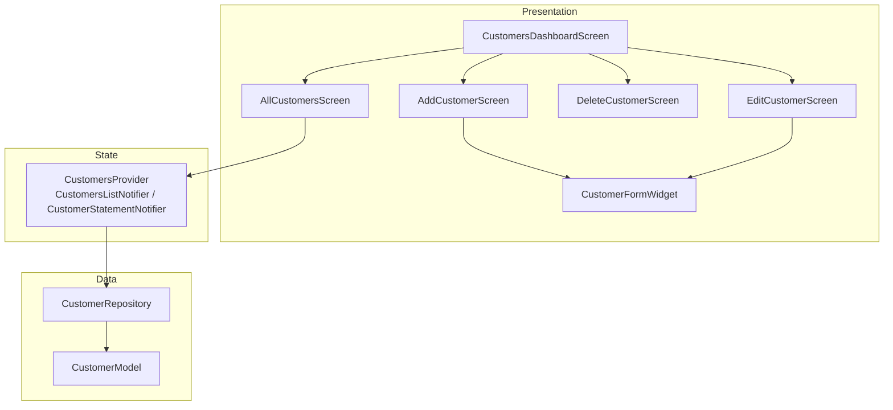

**Diagram sources**
- [customers_dashboard_screen.dart:1-386](file://lib/features/customers/presentation/screens/customers_dashboard_screen.dart#L1-L386)
- [add_customer_screen.dart:1-121](file://lib/features/customers/presentation/screens/add_customer_screen.dart#L1-L121)
- [edit_customer_screen.dart:1-267](file://lib/features/customers/presentation/screens/edit_customer_screen.dart#L1-L267)
- [delete_customer_screen.dart:1-464](file://lib/features/customers/presentation/screens/delete_customer_screen.dart#L1-L464)
- [all_customers_screen.dart:1-417](file://lib/features/customers/presentation/screens/all_customers_screen.dart#L1-L417)
- [customer_form_widget.dart:1-404](file://lib/features/customers/presentation/widgets/customer_form_widget.dart#L1-L404)
- [customers_provider.dart:1-216](file://lib/features/customers/presentation/providers/customers_provider.dart#L1-L216)
- [customer_repository.dart:1-155](file://lib/features/customers/data/repositories/customer_repository.dart#L1-L155)
- [customer_model.dart:1-125](file://lib/features/customers/data/models/customer_model.dart#L1-L125)

**Section sources**
- [customers_dashboard_screen.dart:1-386](file://lib/features/customers/presentation/screens/customers_dashboard_screen.dart#L1-L386)
- [all_customers_screen.dart:1-417](file://lib/features/customers/presentation/screens/all_customers_screen.dart#L1-L417)

## Core Components
- CustomerModel: Immutable data structure representing a customer with JSON serialization, parsing helpers, and derived properties such as stop status.
- CustomerRepository: Encapsulates HTTP requests to the backend for listing, fetching, creating, updating, deleting customers, and retrieving statements.
- CustomersProvider: Riverpod Notifier managing the customer list state (loading, search, pagination hints) and statement loading state.
- CustomerFormWidget: Reusable form for adding or editing customers with built-in validation and field mapping.
- Screens: Dashboard entry point; Add, Edit, Delete screens orchestrate user flows; AllCustomersScreen displays the list with search and actions.

Key responsibilities:
- Model: Data contract and encoding/decoding
- Repository: Network I/O and error normalization
- Provider: Application state and side effects
- UI: User interactions, validation, and feedback

**Section sources**
- [customer_model.dart:1-125](file://lib/features/customers/data/models/customer_model.dart#L1-L125)
- [customer_repository.dart:1-155](file://lib/features/customers/data/repositories/customer_repository.dart#L1-L155)
- [customers_provider.dart:1-216](file://lib/features/customers/presentation/providers/customers_provider.dart#L1-L216)
- [customer_form_widget.dart:1-404](file://lib/features/customers/presentation/widgets/customer_form_widget.dart#L1-L404)

## Architecture Overview
The flow from UI to data and back uses a layered approach:
- UI triggers actions (create/update/delete/search)
- Provider coordinates repository calls and updates state
- Repository performs HTTP requests and maps responses to models
- UI reacts to state changes to render results and show feedback

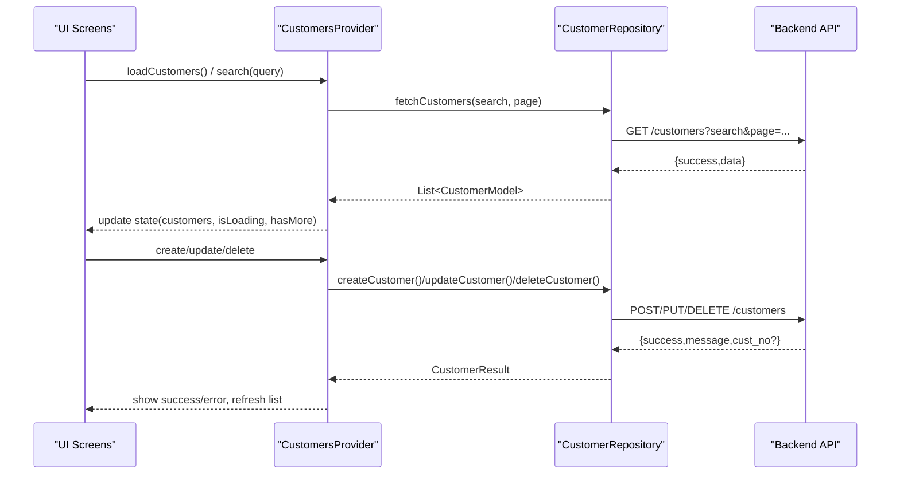

**Diagram sources**
- [customers_provider.dart:57-128](file://lib/features/customers/presentation/providers/customers_provider.dart#L57-L128)
- [customer_repository.dart:31-119](file://lib/features/customers/data/repositories/customer_repository.dart#L31-L119)
- [add_customer_screen.dart:18-37](file://lib/features/customers/presentation/screens/add_customer_screen.dart#L18-L37)
- [edit_customer_screen.dart:44-63](file://lib/features/customers/presentation/screens/edit_customer_screen.dart#L44-L63)
- [delete_customer_screen.dart:43-192](file://lib/features/customers/presentation/screens/delete_customer_screen.dart#L43-L192)

## Detailed Component Analysis

### CustomerModel
- Purpose: Represents a customer record mapped to the Oracle CUST table.
- Fields:
  - custNo (required): unique identifier
  - custName (required): customer name
  - addr, tel1, tel2, postbox, email, fax: optional contact/address fields
  - accNo, accno: account identifiers
  - limitedBalance: credit limit
  - preCustName: previous name
  - stoppingCust: flag indicating if the customer is stopped
- Validation and constraints:
  - Required fields enforced at construction time
  - Derived property isStopped indicates whether the customer is blocked
  - JSON parsing handles both uppercase and lowercase keys and applies Arabic text normalization where appropriate
- Serialization:
  - toJson produces payload keys expected by the backend
  - copyWith supports immutable updates

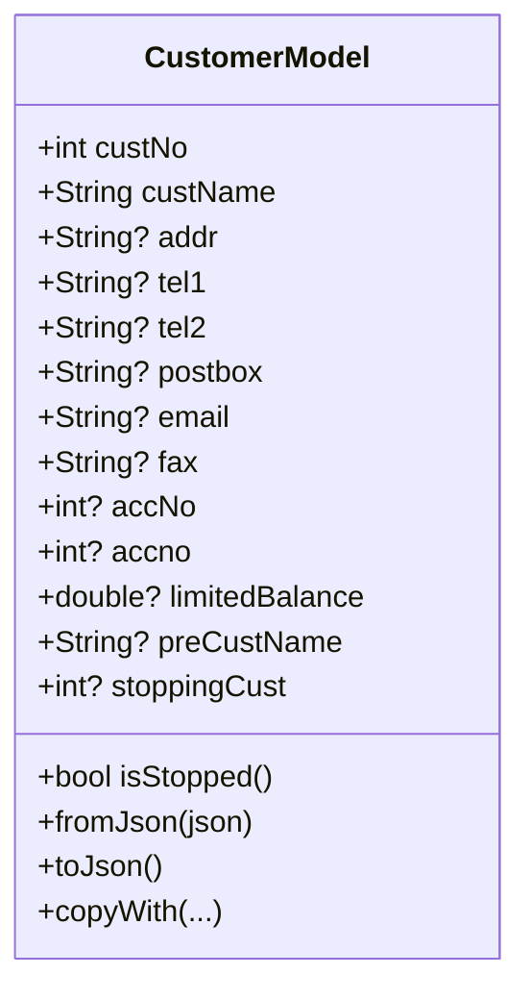

**Diagram sources**
- [customer_model.dart:5-124](file://lib/features/customers/data/models/customer_model.dart#L5-L124)

**Section sources**
- [customer_model.dart:1-125](file://lib/features/customers/data/models/customer_model.dart#L1-L125)

### CustomerRepository
- Responsibilities:
  - Fetch customer list with search and pagination parameters
  - Fetch a single customer by ID
  - Create, update, and delete customers
  - Fetch customer statement with optional date range
- Error handling:
  - Normalizes DioException into CustomerResult with success=false and message
  - Handles cancellation gracefully for read operations
- Response mapping:
  - Parses backend payloads and converts to CustomerModel and related models

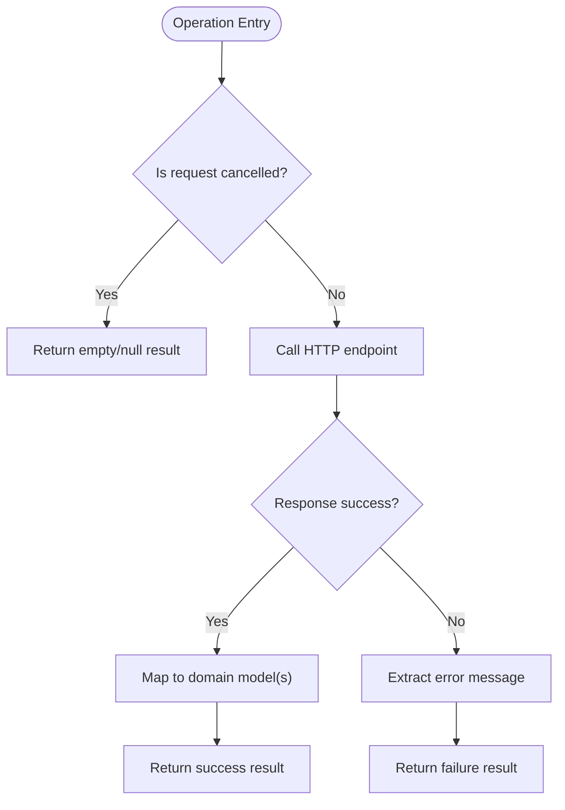

**Diagram sources**
- [customer_repository.dart:31-119](file://lib/features/customers/data/repositories/customer_repository.dart#L31-L119)

**Section sources**
- [customer_repository.dart:1-155](file://lib/features/customers/data/repositories/customer_repository.dart#L1-L155)

### CustomersProvider (Riverpod)
- Responsibilities:
  - Manage list state: customers, isLoading, error, searchQuery, page, hasMore
  - Load initial list on build
  - Debounced search integration through repository
  - Statement loading state and data binding
- State updates:
  - Clears previous errors when starting new operations
  - Updates hasMore based on returned list length
  - Provides methods for loadCustomers and search

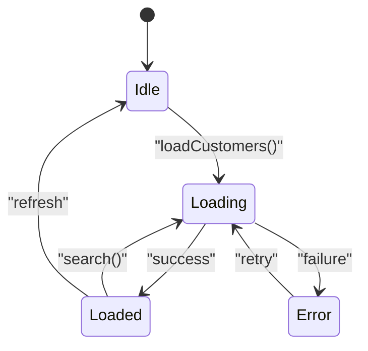

**Diagram sources**
- [customers_provider.dart:18-54](file://lib/features/customers/presentation/providers/customers_provider.dart#L18-L54)
- [customers_provider.dart:57-128](file://lib/features/customers/presentation/providers/customers_provider.dart#L57-L128)

**Section sources**
- [customers_provider.dart:1-216](file://lib/features/customers/presentation/providers/customers_provider.dart#L1-L216)

### CustomerFormWidget
- Purpose: Reusable form for adding and editing customers.
- Features:
  - Binds to CustomerModel fields via TextEditingControllers
  - Validates required fields (e.g., customer name), optional email format, numeric fields
  - Maps UI inputs to backend payload keys
  - Displays a switch for stopping/activating a customer
  - Disables submit while loading and shows progress indicator
- Interaction patterns:
  - onSubmit returns a Map<String, dynamic> to be sent to repository
  - Supports initialData for edit mode

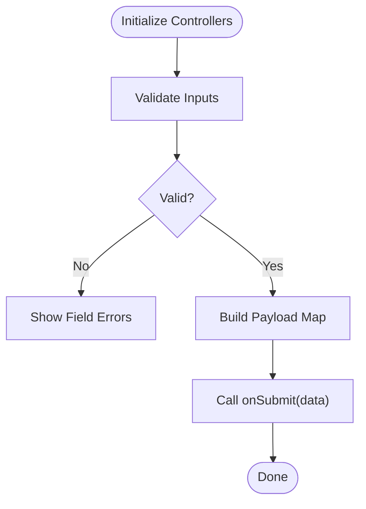

**Diagram sources**
- [customer_form_widget.dart:26-100](file://lib/features/customers/presentation/widgets/customer_form_widget.dart#L26-L100)
- [customer_form_widget.dart:102-334](file://lib/features/customers/presentation/widgets/customer_form_widget.dart#L102-L334)

**Section sources**
- [customer_form_widget.dart:1-404](file://lib/features/customers/presentation/widgets/customer_form_widget.dart#L1-L404)

### AddCustomerScreen
- Workflow:
  - Presents CustomerFormWidget with “Add” action
  - On submit, calls repository.createCustomer
  - On success, refreshes the customer list and navigates back
  - Shows success/error SnackBar messages

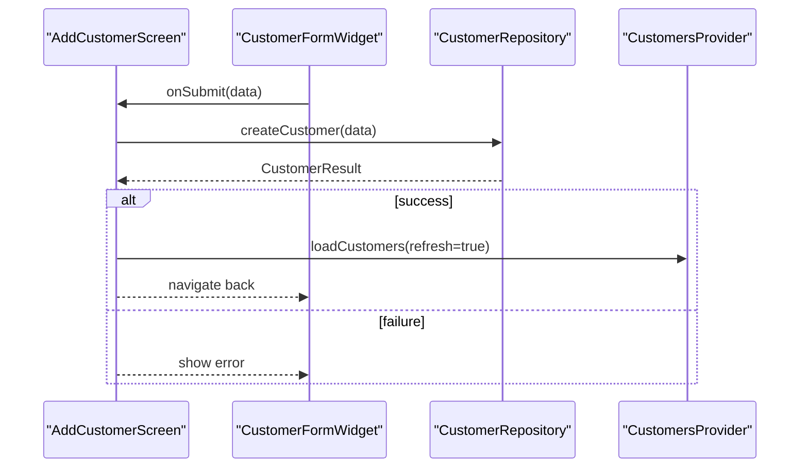

**Diagram sources**
- [add_customer_screen.dart:18-37](file://lib/features/customers/presentation/screens/add_customer_screen.dart#L18-L37)
- [customer_repository.dart:75-89](file://lib/features/customers/data/repositories/customer_repository.dart#L75-L89)
- [customers_provider.dart:67-90](file://lib/features/customers/presentation/providers/customers_provider.dart#L67-L90)

**Section sources**
- [add_customer_screen.dart:1-121](file://lib/features/customers/presentation/screens/add_customer_screen.dart#L1-L121)

### EditCustomerScreen
- Workflow:
  - Allows picking an existing customer via picker
  - Pre-fills CustomerFormWidget with selected customer data
  - On save, calls repository.updateCustomer
  - Refreshes list and navigates back on success

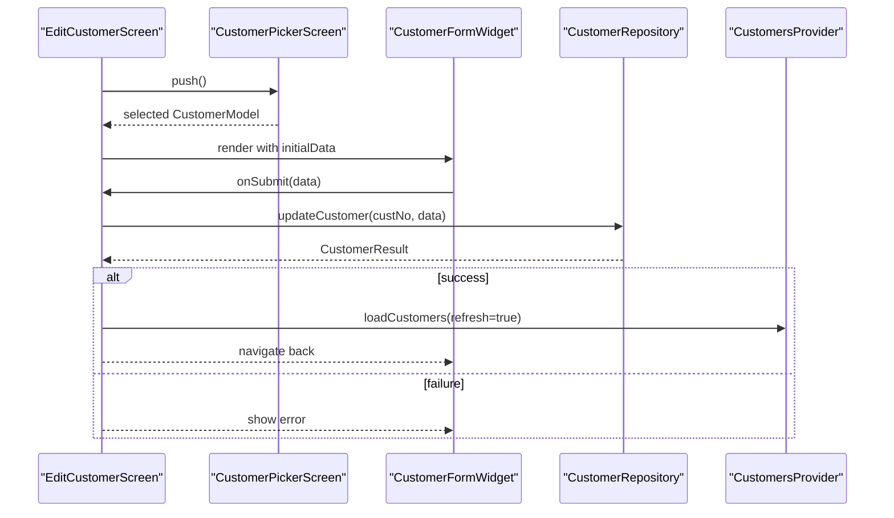

**Diagram sources**
- [edit_customer_screen.dart:29-63](file://lib/features/customers/presentation/screens/edit_customer_screen.dart#L29-L63)
- [customer_repository.dart:91-104](file://lib/features/customers/data/repositories/customer_repository.dart#L91-L104)

**Section sources**
- [edit_customer_screen.dart:1-267](file://lib/features/customers/presentation/screens/edit_customer_screen.dart#L1-L267)

### DeleteCustomerScreen
- Workflow:
  - Picks a customer to delete
  - Shows confirmation dialog with details
  - Calls repository.deleteCustomer
  - On success, refreshes list and navigates back

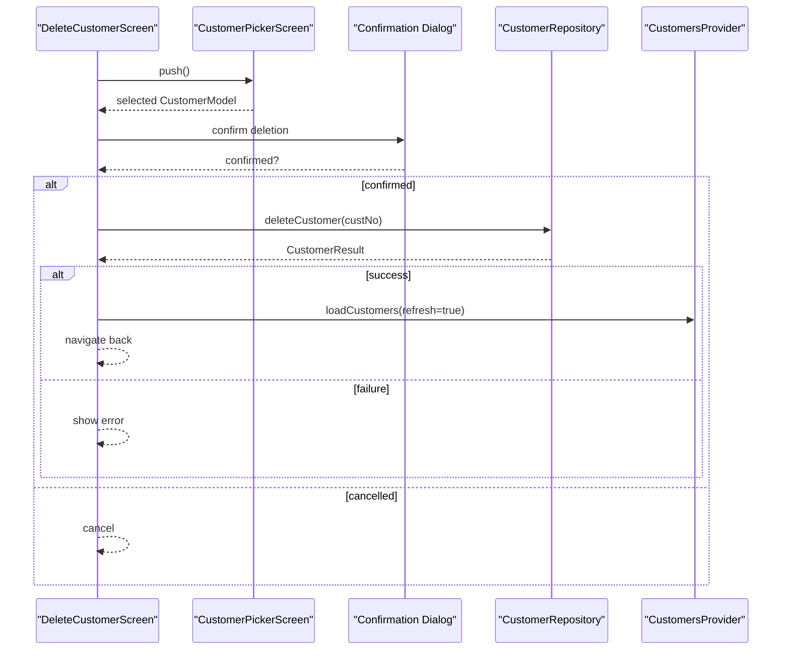

**Diagram sources**
- [delete_customer_screen.dart:28-192](file://lib/features/customers/presentation/screens/delete_customer_screen.dart#L28-L192)
- [customer_repository.dart:106-119](file://lib/features/customers/data/repositories/customer_repository.dart#L106-L119)

**Section sources**
- [delete_customer_screen.dart:1-464](file://lib/features/customers/presentation/screens/delete_customer_screen.dart#L1-L464)

### AllCustomersScreen
- Features:
  - Displays all customers with responsive grid/list layout
  - Debounced search input bound to provider.search
  - Actions per card: view statement, open edit screen
  - Error and empty states with retry option

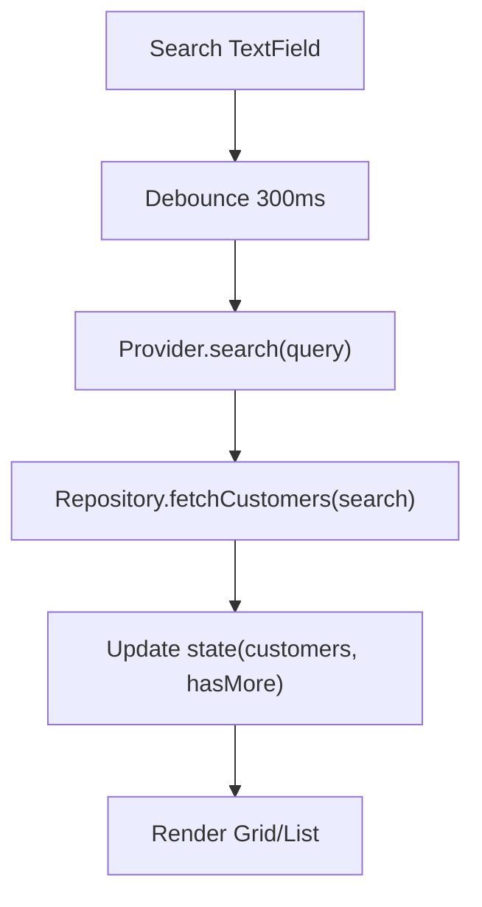

**Diagram sources**
- [all_customers_screen.dart:18-154](file://lib/features/customers/presentation/screens/all_customers_screen.dart#L18-L154)
- [customers_provider.dart:92-122](file://lib/features/customers/presentation/providers/customers_provider.dart#L92-L122)
- [customer_repository.dart:31-58](file://lib/features/customers/data/repositories/customer_repository.dart#L31-L58)

**Section sources**
- [all_customers_screen.dart:1-417](file://lib/features/customers/presentation/screens/all_customers_screen.dart#L1-L417)

### Conceptual Overview
The following conceptual diagram illustrates how the UI, state, repository, and backend interact during typical CRUD operations without referencing specific files.

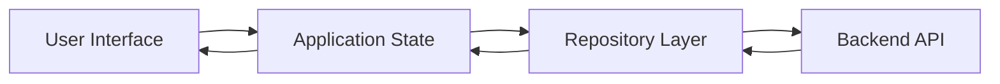

[No sources needed since this diagram shows conceptual workflow, not actual code structure]

## Dependency Analysis
High-level dependencies among components:

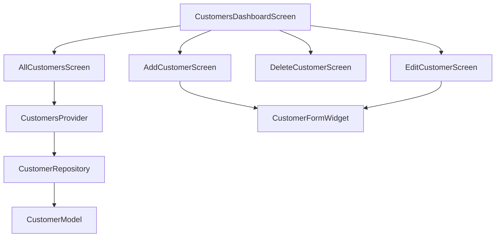

**Diagram sources**
- [customers_dashboard_screen.dart:1-386](file://lib/features/customers/presentation/screens/customers_dashboard_screen.dart#L1-L386)
- [add_customer_screen.dart:1-121](file://lib/features/customers/presentation/screens/add_customer_screen.dart#L1-L121)
- [edit_customer_screen.dart:1-267](file://lib/features/customers/presentation/screens/edit_customer_screen.dart#L1-L267)
- [delete_customer_screen.dart:1-464](file://lib/features/customers/presentation/screens/delete_customer_screen.dart#L1-L464)
- [all_customers_screen.dart:1-417](file://lib/features/customers/presentation/screens/all_customers_screen.dart#L1-L417)
- [customer_form_widget.dart:1-404](file://lib/features/customers/presentation/widgets/customer_form_widget.dart#L1-L404)
- [customers_provider.dart:1-216](file://lib/features/customers/presentation/providers/customers_provider.dart#L1-L216)
- [customer_repository.dart:1-155](file://lib/features/customers/data/repositories/customer_repository.dart#L1-L155)
- [customer_model.dart:1-125](file://lib/features/customers/data/models/customer_model.dart#L1-L125)

**Section sources**
- [customer_repository.dart:1-155](file://lib/features/customers/data/repositories/customer_repository.dart#L1-L155)
- [customers_provider.dart:1-216](file://lib/features/customers/presentation/providers/customers_provider.dart#L1-L216)

## Performance Considerations
- Debounced search reduces unnecessary network calls during typing.
- Pagination hinting via hasMore allows future infinite scroll enhancements.
- Avoid rebuilding large lists by leveraging immutable state updates in providers.
- Use CancelToken for read operations to prevent stale updates when navigating away quickly.

[No sources needed since this section provides general guidance]

## Troubleshooting Guide
Common issues and resolutions:
- Network failures:
  - Repository catches DioException and returns CustomerResult with a user-friendly message.
  - UI surfaces errors via SnackBar or error state in providers.
- Cancellation:
  - Read operations handle cancellation gracefully and return empty/null results.
- Validation errors:
  - Form validators enforce required fields and correct formats; ensure users see inline errors before submission.
- State inconsistencies:
  - Always call loadCustomers(refresh: true) after mutations to keep the list consistent.

Operational tips:
- For offline scenarios, consider caching successful responses locally and syncing when connectivity is restored.
- Implement optimistic UI updates with rollback on failure for better UX.

**Section sources**
- [customer_repository.dart:75-119](file://lib/features/customers/data/repositories/customer_repository.dart#L75-L119)
- [customers_provider.dart:84-122](file://lib/features/customers/presentation/providers/customers_provider.dart#L84-L122)
- [customer_form_widget.dart:79-100](file://lib/features/customers/presentation/widgets/customer_form_widget.dart#L79-L100)

## Conclusion
The Ky Apps customer module implements a clean separation of concerns across model, repository, provider, and UI layers. The CustomerModel defines the data contract, CustomerRepository abstracts network operations with robust error handling, CustomersProvider manages state and side effects, and the UI screens deliver intuitive workflows for creating, reading, updating, and deleting customers. With debounced search, clear validation, and consistent error feedback, the system provides a solid foundation for further enhancements such as offline persistence and advanced pagination.