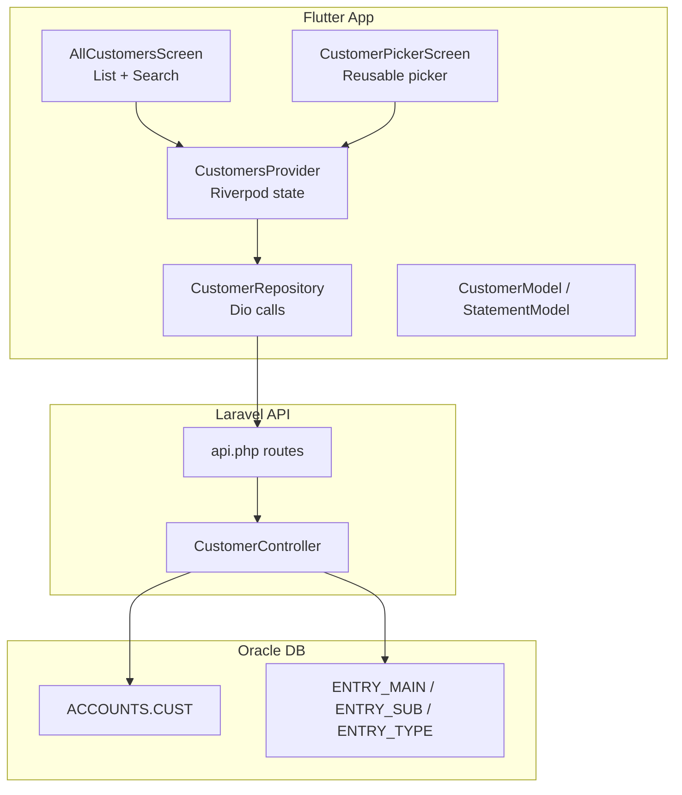
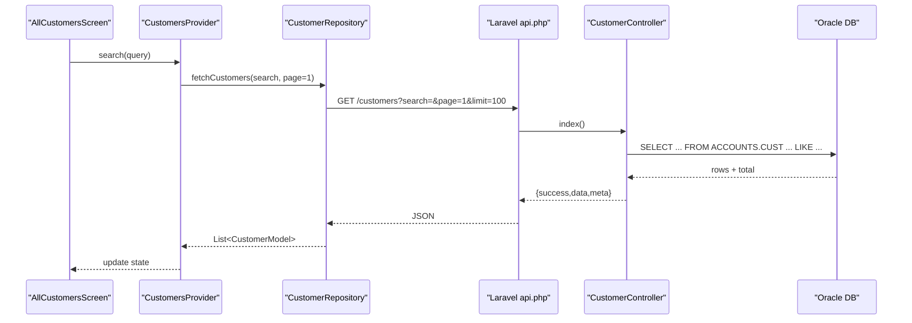
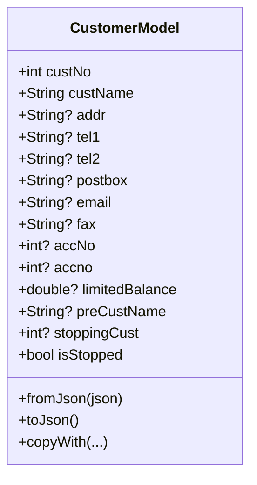
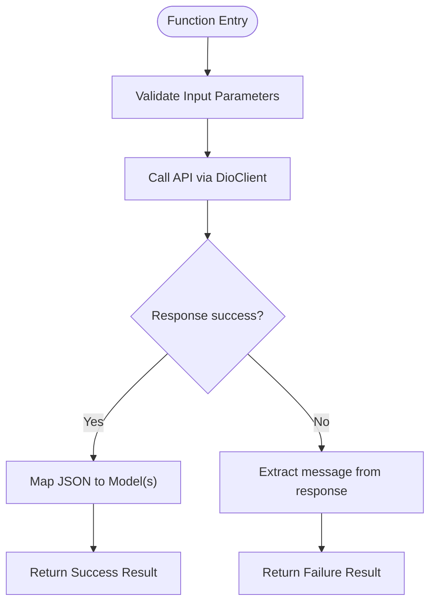
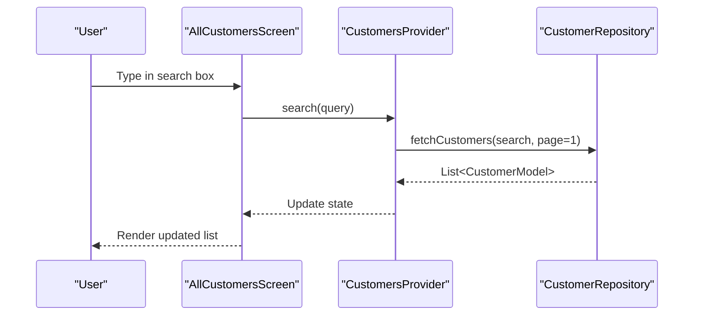
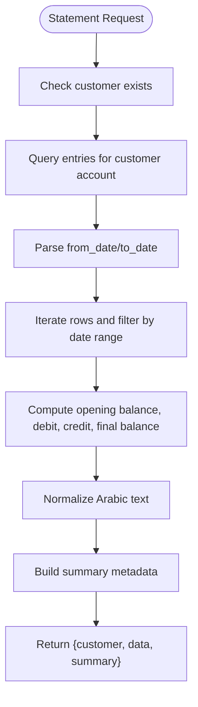
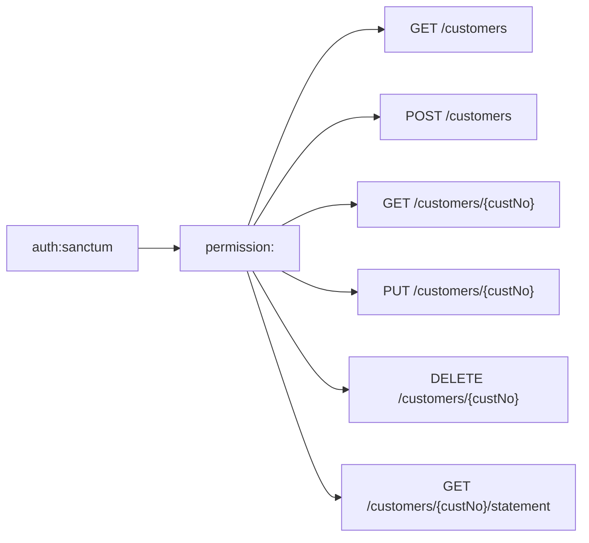
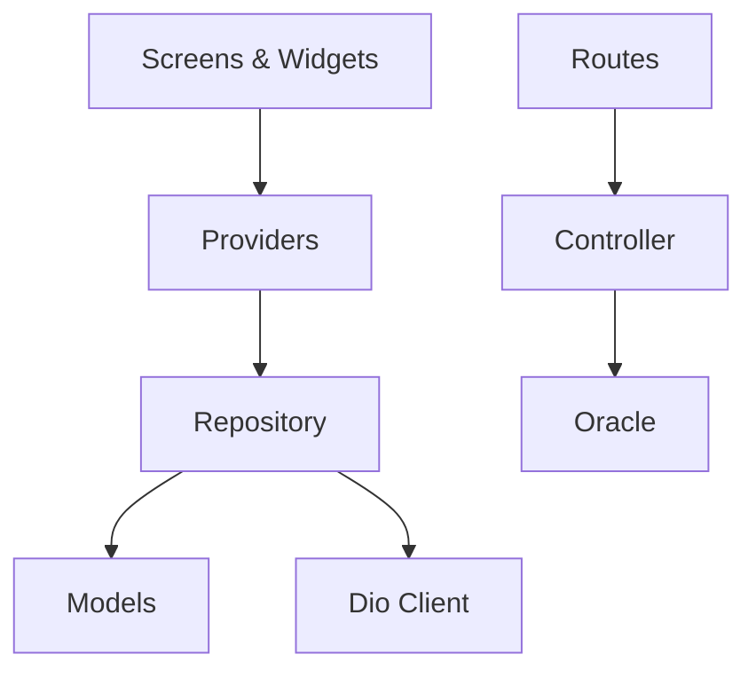

# Customer Management Module

<cite>
**Referenced Files in This Document**
- [customer_repository.dart](file://lib/features/customers/data/repositories/customer_repository.dart)
- [customer_model.dart](file://lib/features/customers/data/models/customer_model.dart)
- [customer_statement_model.dart](file://lib/features/customers/data/models/customer_statement_model.dart)
- [customers_provider.dart](file://lib/features/customers/presentation/providers/customers_provider.dart)
- [all_customers_screen.dart](file://lib/features/customers/presentation/screens/all_customers_screen.dart)
- [customer_picker_screen.dart](file://lib/features/customers/presentation/widgets/customer_picker_screen.dart)
- [CustomerController.php](file://kyApp_API/app/Http/Controllers/CustomerController.php)
- [api.php](file://kyApp_API/routes/api.php)
</cite>

## Table of Contents
1. [Introduction](#introduction)
2. [Project Structure](#project-structure)
3. [Core Components](#core-components)
4. [Architecture Overview](#architecture-overview)
5. [Detailed Component Analysis](#detailed-component-analysis)
6. [Dependency Analysis](#dependency-analysis)
7. [Performance Considerations](#performance-considerations)
8. [Troubleshooting Guide](#troubleshooting-guide)
9. [Conclusion](#conclusion)
10. [Appendices](#appendices)

## Introduction
This document explains the customer management module end-to-end: data models, repository pattern, UI components, statement generation, search and filtering, API synchronization, error handling, and offline considerations. It targets both developers extending the feature and users who need to understand how customers are created, updated, searched, and reported.

## Project Structure
The customer module is organized by Flutter feature boundaries with a clear separation between data (models and repositories) and presentation (providers, screens, widgets). The backend exposes REST endpoints for CRUD and statements, backed by an Oracle database.

**Diagram sources**
- [all_customers_screen.dart:1-417](file://lib/features/customers/presentation/screens/all_customers_screen.dart#L1-L417)
- [customer_picker_screen.dart:122-254](file://lib/features/customers/presentation/widgets/customer_picker_screen.dart#L122-L254)
- [customers_provider.dart:1-216](file://lib/features/customers/presentation/providers/customers_provider.dart#L1-L216)
- [customer_repository.dart:1-119](file://lib/features/customers/data/repositories/customer_repository.dart#L1-L119)
- [customer_model.dart:1-125](file://lib/features/customers/data/models/customer_model.dart#L1-L125)
- [customer_statement_model.dart:1-81](file://lib/features/customers/data/models/customer_statement_model.dart#L1-L81)
- [api.php:188-209](file://kyApp_API/routes/api.php#L188-L209)
- [CustomerController.php:28-463](file://kyApp_API/app/Http/Controllers/CustomerController.php#L28-L463)

**Section sources**
- [all_customers_screen.dart:1-417](file://lib/features/customers/presentation/screens/all_customers_screen.dart#L1-L417)
- [customer_picker_screen.dart:122-254](file://lib/features/customers/presentation/widgets/customer_picker_screen.dart#L122-L254)
- [customers_provider.dart:1-216](file://lib/features/customers/presentation/providers/customers_provider.dart#L1-L216)
- [customer_repository.dart:1-119](file://lib/features/customers/data/repositories/customer_repository.dart#L1-L119)
- [customer_model.dart:1-125](file://lib/features/customers/data/models/customer_model.dart#L1-L125)
- [customer_statement_model.dart:1-81](file://lib/features/customers/data/models/customer_statement_model.dart#L1-L81)
- [api.php:188-209](file://kyApp_API/routes/api.php#L188-L209)
- [CustomerController.php:28-463](file://kyApp_API/app/Http/Controllers/CustomerController.php#L28-L463)

## Core Components
- Customer model: Strongly typed representation of the Oracle CUST table fields, with safe parsing and Arabic text normalization.
- Repository: Encapsulates HTTP calls for listing, fetching, creating, updating, deleting, and generating statements.
- Providers: Riverpod-based state for list and statement features, including search debouncing and pagination hints.
- UI: List screen with search, cards, quick actions (statement, edit), and a reusable picker widget.
- Backend: Laravel controller with validation, encoding helpers, pagination, and statement computation.

Key responsibilities:
- Data layer: Models and repository.
- State layer: Providers manage loading, errors, search queries, and results.
- Presentation layer: Screens and widgets render state and trigger actions.
- API layer: Routes and controller enforce permissions, validate input, and compute statements.

**Section sources**
- [customer_model.dart:1-125](file://lib/features/customers/data/models/customer_model.dart#L1-L125)
- [customer_repository.dart:1-119](file://lib/features/customers/data/repositories/customer_repository.dart#L1-L119)
- [customers_provider.dart:1-216](file://lib/features/customers/presentation/providers/customers_provider.dart#L1-L216)
- [all_customers_screen.dart:1-417](file://lib/features/customers/presentation/screens/all_customers_screen.dart#L1-L417)
- [customer_picker_screen.dart:122-254](file://lib/features/customers/presentation/widgets/customer_picker_screen.dart#L122-L254)
- [CustomerController.php:28-463](file://kyApp_API/app/Http/Controllers/CustomerController.php#L28-L463)

## Architecture Overview
The module follows a layered architecture:
- Presentation uses Riverpod providers to reactively display data and trigger operations.
- Repository abstracts network calls using Dio and maps responses to domain models.
- Controller validates requests, interacts with Oracle via Laravel query builder or raw SQL, and returns normalized JSON.

**Diagram sources**
- [all_customers_screen.dart:78-147](file://lib/features/customers/presentation/screens/all_customers_screen.dart#L78-L147)
- [customers_provider.dart:67-122](file://lib/features/customers/presentation/providers/customers_provider.dart#L67-L122)
- [customer_repository.dart:31-57](file://lib/features/customers/data/repositories/customer_repository.dart#L31-L57)
- [api.php:190-192](file://kyApp_API/routes/api.php#L190-L192)
- [CustomerController.php:28-84](file://kyApp_API/app/Http/Controllers/CustomerController.php#L28-L84)

## Detailed Component Analysis

### Customer Model and Validation Rules
- Fields map directly to Oracle columns such as customer number, name, address, phone numbers, postbox, email, fax, account number(s), limited balance, previous customer name, and stop flag.
- Parsing utilities safely convert types and normalize Arabic strings.
- Computed property indicates whether a customer is stopped.

**Diagram sources**
- [customer_model.dart:1-125](file://lib/features/customers/data/models/customer_model.dart#L1-L125)

Backend validation rules for create/update:
- Required fields include customer name; optional fields include address, phones, postbox, email, fax, account number, limited balance, previous customer name, and stop flag.
- Email must be valid when provided; string lengths are enforced.

**Section sources**
- [customer_model.dart:1-125](file://lib/features/customers/data/models/customer_model.dart#L1-L125)
- [CustomerController.php:118-182](file://kyApp_API/app/Http/Controllers/CustomerController.php#L118-L182)
- [CustomerController.php:188-256](file://kyApp_API/app/Http/Controllers/CustomerController.php#L188-L256)

### Customer Repository Pattern
Responsibilities:
- Fetch paginated customer lists with search.
- Fetch a single customer by ID.
- Create, update, delete customers.
- Return typed results with success flags and messages.

Error handling:
- Network errors are caught and converted into user-friendly result objects.
- Cancelled requests are handled gracefully.

**Diagram sources**
- [customer_repository.dart:31-119](file://lib/features/customers/data/repositories/customer_repository.dart#L31-L119)

**Section sources**
- [customer_repository.dart:1-119](file://lib/features/customers/data/repositories/customer_repository.dart#L1-L119)

### UI Components: List and Detail Views
- AllCustomersScreen:
  - Debounced search input triggers provider search.
  - Displays loading, error, empty states, and responsive grid/list.
  - Quick actions open statement view and edit flow.
- CustomerPickerScreen:
  - Reusable component that shows search results and returns selected customer.

**Diagram sources**
- [all_customers_screen.dart:78-147](file://lib/features/customers/presentation/screens/all_customers_screen.dart#L78-L147)
- [customers_provider.dart:92-122](file://lib/features/customers/presentation/providers/customers_provider.dart#L92-L122)
- [customer_repository.dart:31-57](file://lib/features/customers/data/repositories/customer_repository.dart#L31-L57)

**Section sources**
- [all_customers_screen.dart:1-417](file://lib/features/customers/presentation/screens/all_customers_screen.dart#L1-L417)
- [customer_picker_screen.dart:122-254](file://lib/features/customers/presentation/widgets/customer_picker_screen.dart#L122-L254)

### Statement Generation Feature
The statement endpoint computes opening balance, debit/credit totals, running balances, and date-filtered rows. It joins entry tables with customer and type tables, then normalizes text and formats dates.

**Diagram sources**
- [CustomerController.php:294-421](file://kyApp_API/app/Http/Controllers/CustomerController.php#L294-L421)

Provider and model support:
- CustomerStatementState holds rows, summary, and customer payload.
- CustomerStatementModel parses statement lines, deriving debit/credit from amount when needed.

**Section sources**
- [customers_provider.dart:134-216](file://lib/features/customers/presentation/providers/customers_provider.dart#L134-L216)
- [customer_statement_model.dart:1-81](file://lib/features/customers/data/models/customer_statement_model.dart#L1-L81)
- [CustomerController.php:294-421](file://kyApp_API/app/Http/Controllers/CustomerController.php#L294-L421)

### API Endpoints and Permissions
Customer routes are protected by Sanctum authentication and fine-grained permissions:
- List, show, create, update, delete require respective permissions.
- Statement requires a separate permission to limit access to financial details.

**Diagram sources**
- [api.php:188-209](file://kyApp_API/routes/api.php#L188-L209)

**Section sources**
- [api.php:188-209](file://kyApp_API/routes/api.php#L188-L209)

## Dependency Analysis
Coupling and cohesion:
- Presentation depends on providers for state and side effects.
- Providers depend on repository for data access.
- Repository depends on Dio client and models.
- Backend controller depends on Laravel routing, validators, and Oracle connection.

External dependencies:
- Dio for HTTP networking.
- Riverpod for reactive state.
- Laravel Sanctum for session auth.
- Oracle database for persistent storage.

Potential circular dependencies:
- None observed within the module; layers are strictly separated.

**Diagram sources**
- [all_customers_screen.dart:1-417](file://lib/features/customers/presentation/screens/all_customers_screen.dart#L1-L417)
- [customers_provider.dart:1-216](file://lib/features/customers/presentation/providers/customers_provider.dart#L1-L216)
- [customer_repository.dart:1-119](file://lib/features/customers/data/repositories/customer_repository.dart#L1-L119)
- [customer_model.dart:1-125](file://lib/features/customers/data/models/customer_model.dart#L1-L125)
- [api.php:188-209](file://kyApp_API/routes/api.php#L188-L209)
- [CustomerController.php:28-463](file://kyApp_API/app/Http/Controllers/CustomerController.php#L28-L463)

**Section sources**
- [all_customers_screen.dart:1-417](file://lib/features/customers/presentation/screens/all_customers_screen.dart#L1-L417)
- [customers_provider.dart:1-216](file://lib/features/customers/presentation/providers/customers_provider.dart#L1-L216)
- [customer_repository.dart:1-119](file://lib/features/customers/data/repositories/customer_repository.dart#L1-L119)
- [customer_model.dart:1-125](file://lib/features/customers/data/models/customer_model.dart#L1-L125)
- [api.php:188-209](file://kyApp_API/routes/api.php#L188-L209)
- [CustomerController.php:28-463](file://kyApp_API/app/Http/Controllers/CustomerController.php#L28-L463)

## Performance Considerations
- Debounced search reduces unnecessary network calls while typing.
- Pagination parameters allow controlled data loads; consider implementing infinite scroll if needed.
- Server-side search and pagination minimize payload size.
- Statement computation runs on the server; keep date filters narrow to reduce processing time.

[No sources needed since this section provides general guidance]

## Troubleshooting Guide
Common issues and resolutions:
- Network errors:
  - Repository catches Dio exceptions and returns failure results; UI displays error with retry action.
- Cancelled requests:
  - Search debouncing cancels prior requests; cancelled exceptions are ignored.
- Validation failures:
  - Backend returns structured validation errors; ensure form fields match expected types and constraints.
- Permission denied:
  - Missing permissions return 403; verify user has required permission codes.
- Arabic text issues:
  - Backend normalizes text; ensure encoding utilities are used consistently.

Operational tips:
- Use refresh button to reload data after errors.
- Clear search to reset filters.
- For statements, provide precise date ranges to improve performance.

**Section sources**
- [customer_repository.dart:75-119](file://lib/features/customers/data/repositories/customer_repository.dart#L75-L119)
- [customers_provider.dart:84-122](file://lib/features/customers/presentation/providers/customers_provider.dart#L84-L122)
- [all_customers_screen.dart:170-195](file://lib/features/customers/presentation/screens/all_customers_screen.dart#L170-L195)
- [CustomerController.php:138-144](file://kyApp_API/app/Http/Controllers/CustomerController.php#L138-L144)
- [api.php:188-209](file://kyApp_API/routes/api.php#L188-L209)

## Conclusion
The customer management module provides a robust, permissioned, and searchable customer registry with full CRUD operations and financial statement generation. Its layered design separates concerns cleanly, enabling maintainability and extensibility. Developers can extend models, add custom filters, and integrate additional reporting features while preserving consistent error handling and data normalization.

[No sources needed since this section summarizes without analyzing specific files]

## Appendices

### Practical Examples

- Adding a new customer field:
  - Extend CustomerModel with the new field and update toJson/fromJson mappings.
  - Add corresponding validation rules in the backend controller for create/update.
  - Ensure the Oracle schema includes the column and the controller reads/writes it.

- Implementing custom search filters:
  - Extend repository fetchCustomers with additional query parameters.
  - Update provider search method to pass new filters.
  - Update controller index to accept and apply filters in the query.

- Generating customer statements:
  - Use provider loadStatement with optional fromDate/toDate.
  - Display rows and summary in a dedicated screen or dialog.
  - Respect permissions; only users with statement permission can access.

[No sources needed since this section provides general guidance]