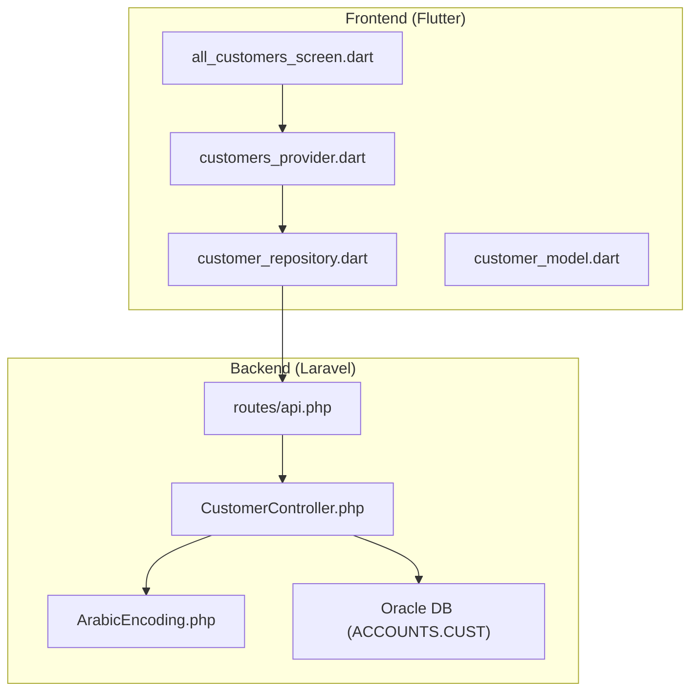
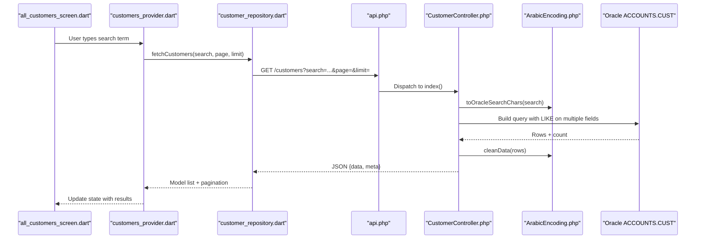
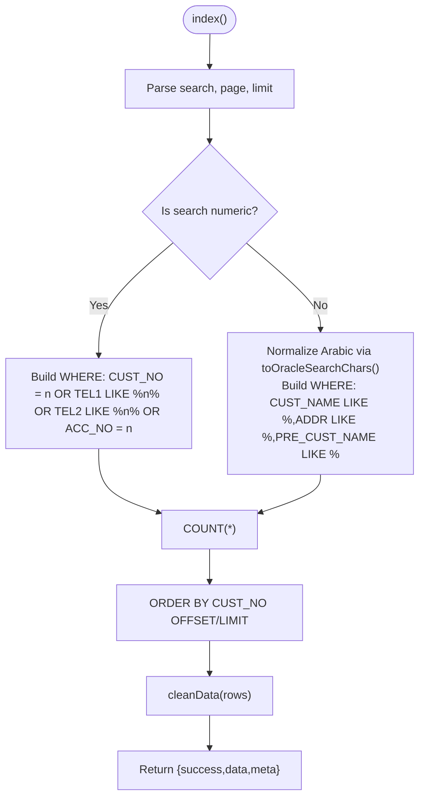
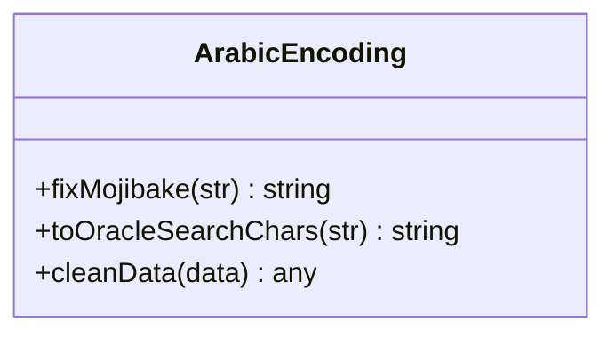
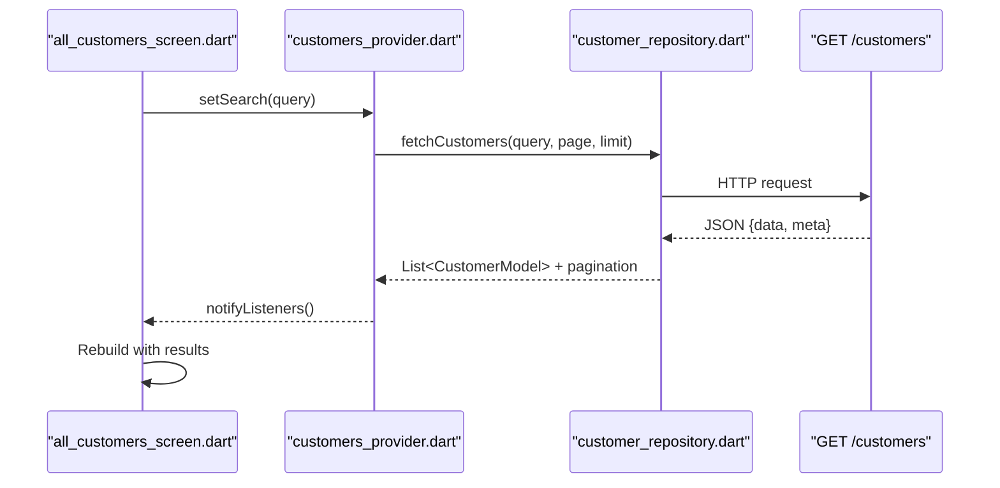
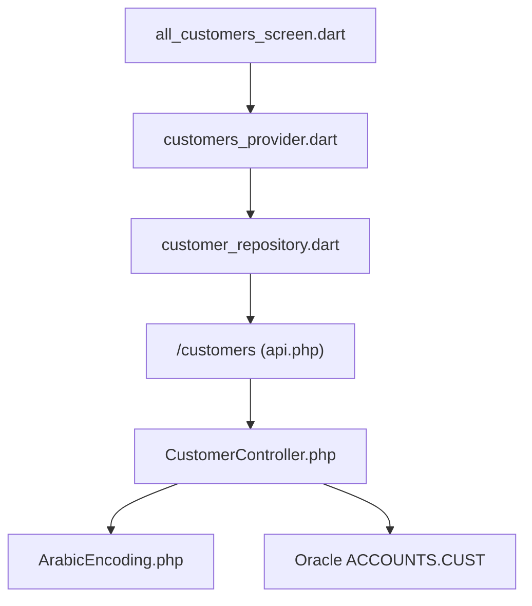

# Search and Filtering

<cite>
**Referenced Files in This Document**
- [CustomerController.php](file://kyApp_API/app/Http/Controllers/CustomerController.php)
- [api.php](file://kyApp_API/routes/api.php)
- [ArabicEncoding.php](file://kyApp_API/app/Support/ArabicEncoding.php)
- [customer_repository.dart](file://lib/features/customers/data/repositories/customer_repository.dart)
- [customers_provider.dart](file://lib/features/customers/presentation/providers/customers_provider.dart)
- [all_customers_screen.dart](file://lib/features/customers/presentation/screens/all_customers_screen.dart)
- [customer_model.dart](file://lib/features/customers/data/models/customer_model.dart)
</cite>

## Table of Contents
1. [Introduction](#introduction)
2. [Project Structure](#project-structure)
3. [Core Components](#core-components)
4. [Architecture Overview](#architecture-overview)
5. [Detailed Component Analysis](#detailed-component-analysis)
6. [Dependency Analysis](#dependency-analysis)
7. [Performance Considerations](#performance-considerations)
8. [Troubleshooting Guide](#troubleshooting-guide)
9. [Conclusion](#conclusion)

## Introduction
This document explains the customer search and filtering capabilities across the backend API and Flutter frontend. It covers:
- Backend search algorithms for name, phone number, address, account number, and numeric identifiers
- Server-side pagination and result shaping
- Frontend UI components for search input, filters, and results display
- Integration with the backend API and local caching strategies
- Optimization techniques for large datasets and partial text matching

## Project Structure
The customer search feature spans both server and client layers:
- Backend (Laravel): CustomerController exposes a paginated list endpoint with search and Arabic encoding support
- Routes: api.php registers protected endpoints under auth:sanctum and permission gates
- Frontend (Flutter): customers feature includes repository, provider, models, screens, and widgets

**Diagram sources**
- [api.php:188-209](file://kyApp_API/routes/api.php#L188-L209)
- [CustomerController.php:28-84](file://kyApp_API/app/Http/Controllers/CustomerController.php#L28-L84)
- [ArabicEncoding.php:122-162](file://kyApp_API/app/Support/ArabicEncoding.php#L122-L162)
- [all_customers_screen.dart](file://lib/features/customers/presentation/screens/all_customers_screen.dart)
- [customers_provider.dart](file://lib/features/customers/presentation/providers/customers_provider.dart)
- [customer_repository.dart](file://lib/features/customers/data/repositories/customer_repository.dart)
- [customer_model.dart](file://lib/features/customers/data/models/customer_model.dart)

**Section sources**
- [api.php:188-209](file://kyApp_API/routes/api.php#L188-L209)
- [CustomerController.php:28-84](file://kyApp_API/app/Http/Controllers/CustomerController.php#L28-L84)

## Core Components
- Backend search endpoint: GET /customers with query parameters for search, page, and limit
- Search algorithm: multi-field LIKE matching with numeric optimization and Arabic character normalization
- Pagination: server-side offset/limit with total count and page metadata
- Encoding helper: safe conversion between UTF-8 and Oracle CP1256 to preserve Arabic text integrity
- Frontend integration: repository calls API; provider manages state; screen renders search inputs and results

Key responsibilities:
- CustomerController.index: parses request, builds dynamic WHERE clauses, applies pagination, cleans Arabic data
- ArabicEncoding.toOracleSearchChars: maps UTF-8 Arabic to Oracle-compatible characters for correct LIKE searches
- ArabicEncoding.cleanData: repairs mojibake on response payloads
- Flutter repository/provider/screen: orchestrate search requests, manage loading/error states, render lists

**Section sources**
- [CustomerController.php:28-84](file://kyApp_API/app/Http/Controllers/CustomerController.php#L28-L84)
- [ArabicEncoding.php:122-192](file://kyApp_API/app/Support/ArabicEncoding.php#L122-L192)

## Architecture Overview
End-to-end flow for searching customers:

**Diagram sources**
- [api.php:188-209](file://kyApp_API/routes/api.php#L188-L209)
- [CustomerController.php:28-84](file://kyApp_API/app/Http/Controllers/CustomerController.php#L28-L84)
- [ArabicEncoding.php:122-192](file://kyApp_API/app/Support/ArabicEncoding.php#L122-L192)

## Detailed Component Analysis

### Backend Search Algorithm (CustomerController.index)
- Input parameters:
  - search: free-text or numeric identifier
  - page: current page (default 1)
  - limit: items per page (default 100, max 500)
- Search logic:
  - If search is numeric: match CUST_NO, TEL1, TEL2, ACC_NO
  - Else: match CUST_NAME, ADDR, PRE_CUST_NAME using normalized Arabic characters plus raw search
- Pagination:
  - Computes offset from page and limit
  - Returns total count and pages in meta
- Data cleaning:
  - Applies ArabicEncoding.cleanData to ensure proper Arabic rendering

**Diagram sources**
- [CustomerController.php:28-84](file://kyApp_API/app/Http/Controllers/CustomerController.php#L28-L84)
- [ArabicEncoding.php:122-162](file://kyApp_API/app/Support/ArabicEncoding.php#L122-L162)

**Section sources**
- [CustomerController.php:28-84](file://kyApp_API/app/Http/Controllers/CustomerController.php#L28-L84)

### Arabic Encoding Helper (ArabicEncoding)
- toOracleSearchChars: Converts UTF-8 Arabic to Oracle CP1256-compatible characters so LIKE queries work correctly over AL32UTF8 client and WE8MSWIN1252 database
- fixMojibake/cleanData: Repairs corrupted Arabic text in responses by detecting and converting mojibake patterns

**Diagram sources**
- [ArabicEncoding.php:36-120](file://kyApp_API/app/Support/ArabicEncoding.php#L36-L120)
- [ArabicEncoding.php:122-192](file://kyApp_API/app/Support/ArabicEncoding.php#L122-L192)

**Section sources**
- [ArabicEncoding.php:36-120](file://kyApp_API/app/Support/ArabicEncoding.php#L36-L120)
- [ArabicEncoding.php:122-192](file://kyApp_API/app/Support/ArabicEncoding.php#L122-L192)

### API Routing and Permissions
- Endpoint: GET /customers
- Protected by:
  - auth:sanctum session
  - permission:customers.view
- Additional related routes:
  - GET /customers/{custNo}/statement (permission:customers.statement)
  - CRUD routes for customers with respective permissions

**Diagram sources**
- [api.php:188-209](file://kyApp_API/routes/api.php#L188-L209)

**Section sources**
- [api.php:188-209](file://kyApp_API/routes/api.php#L188-L209)

### Frontend Integration (Flutter)
- Repository:
  - customer_repository.dart encapsulates HTTP calls to GET /customers with search, page, limit
  - Maps JSON response to customer_model.dart entities
- Provider:
  - customers_provider.dart manages search state (query, page, limit, loading, error)
  - Triggers repository calls and updates UI state
- Screen:
  - all_customers_screen.dart provides search input, filter controls, and result list
  - Uses provider to reactively update when search changes

**Diagram sources**
- [customer_repository.dart](file://lib/features/customers/data/repositories/customer_repository.dart)
- [customers_provider.dart](file://lib/features/customers/presentation/providers/customers_provider.dart)
- [all_customers_screen.dart](file://lib/features/customers/presentation/screens/all_customers_screen.dart)
- [customer_model.dart](file://lib/features/customers/data/models/customer_model.dart)

**Section sources**
- [customer_repository.dart](file://lib/features/customers/data/repositories/customer_repository.dart)
- [customers_provider.dart](file://lib/features/customers/presentation/providers/customers_provider.dart)
- [all_customers_screen.dart](file://lib/features/customers/presentation/screens/all_customers_screen.dart)
- [customer_model.dart](file://lib/features/customers/data/models/customer_model.dart)

## Dependency Analysis
- Backend dependencies:
  - Laravel routing and middleware (auth:sanctum, permission gates)
  - Oracle DB connection for ACCOUNTS.CUST
  - ArabicEncoding utility for text normalization and repair
- Frontend dependencies:
  - Dio/HTTP client via repository
  - State management via provider
  - Models mapping JSON to Dart objects

**Diagram sources**
- [api.php:188-209](file://kyApp_API/routes/api.php#L188-L209)
- [CustomerController.php:28-84](file://kyApp_API/app/Http/Controllers/CustomerController.php#L28-L84)
- [ArabicEncoding.php:122-192](file://kyApp_API/app/Support/ArabicEncoding.php#L122-L192)

**Section sources**
- [api.php:188-209](file://kyApp_API/routes/api.php#L188-L209)
- [CustomerController.php:28-84](file://kyApp_API/app/Http/Controllers/CustomerController.php#L28-L84)

## Performance Considerations
- Server-side pagination:
  - Use reasonable default limit (e.g., 100) and enforce maximum (500)
  - Avoid fetching entire dataset; rely on page/offset/limit
- Indexing recommendations:
  - Ensure indexes on frequently searched columns: CUST_NO, TEL1, TEL2, ACC_NO, CUST_NAME, ADDR
- Partial matching:
  - LIKE '%term%' is flexible but can be slow; consider full-text indexes if supported by Oracle configuration
- Arabic text handling:
  - Always normalize search terms via toOracleSearchChars before LIKE to avoid mismatches due to encoding issues
- Frontend responsiveness:
  - Debounce search input to reduce network calls
  - Cache recent results locally (in-memory or persistent store) to improve perceived performance
  - Implement optimistic UI updates where appropriate

[No sources needed since this section provides general guidance]

## Troubleshooting Guide
- Arabic text not matching:
  - Verify that search terms are normalized using toOracleSearchChars
  - Check that responses are cleaned via cleanData to avoid mojibake
- Empty results despite valid input:
  - Confirm permission:customers.view is granted to the authenticated user
  - Validate query parameters (search, page, limit) are within expected ranges
- Slow search performance:
  - Review database indexes on CUST_NO, TEL1, TEL2, ACC_NO, CUST_NAME, ADDR
  - Reduce limit or refine search criteria
- Network errors:
  - Inspect authentication token validity and session status
  - Check API route registration and middleware configuration

**Section sources**
- [CustomerController.php:28-84](file://kyApp_API/app/Http/Controllers/CustomerController.php#L28-L84)
- [api.php:188-209](file://kyApp_API/routes/api.php#L188-L209)
- [ArabicEncoding.php:122-192](file://kyApp_API/app/Support/ArabicEncoding.php#L122-L192)

## Conclusion
The customer search and filtering system combines robust backend logic with a responsive Flutter interface. The backend performs efficient multi-field searches with proper Arabic encoding normalization and server-side pagination. The frontend integrates cleanly through repository/provider patterns, enabling smooth user interactions. For optimal performance and reliability, apply indexing, debouncing, and caching strategies while ensuring correct permissions and encoding handling.

[No sources needed since this section summarizes without analyzing specific files]