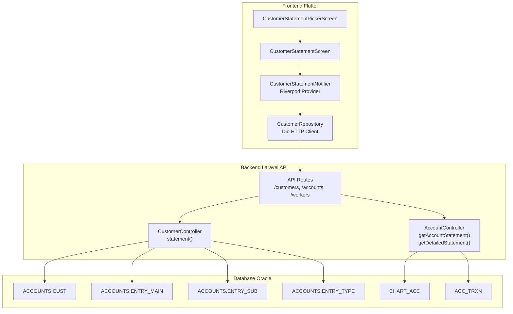
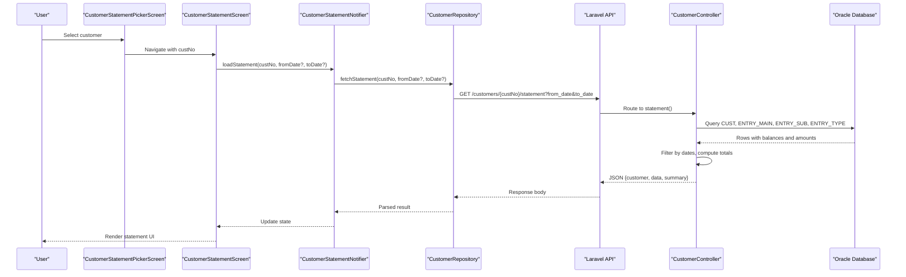
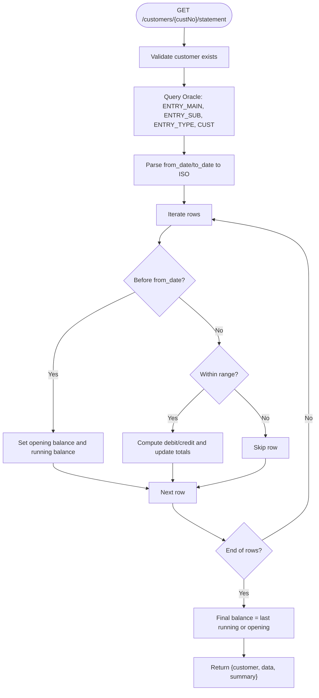
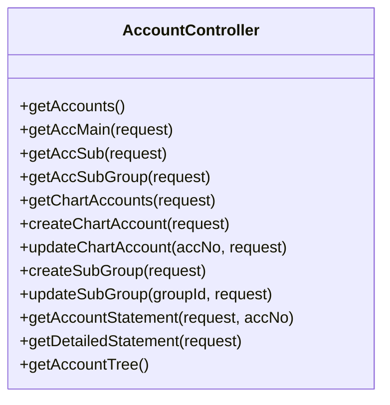
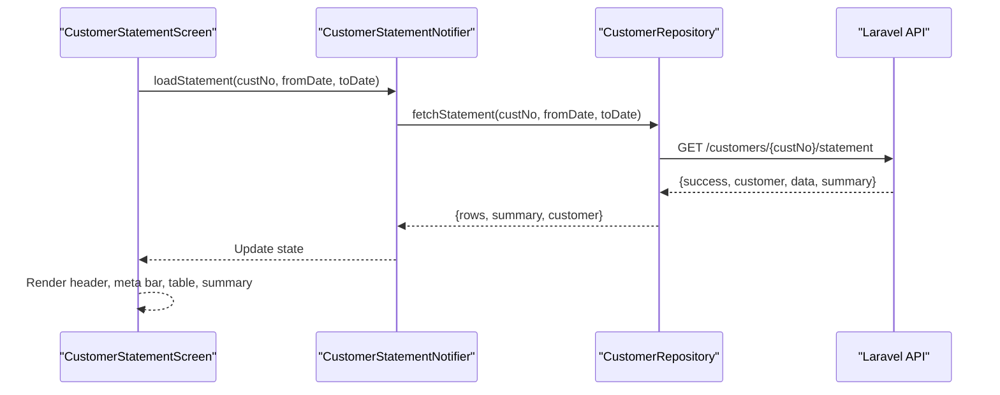
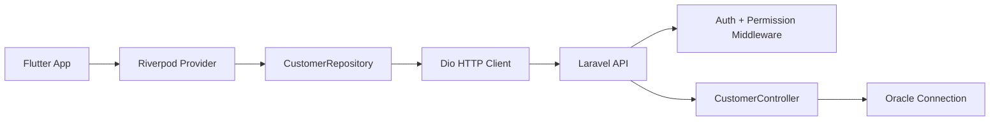

# Statement Generation

<cite>
**Referenced Files in This Document**
- [CustomerController.php](file://kyApp_API/app/Http/Controllers/CustomerController.php)
- [AccountController.php](file://kyApp_API/app/Http/Controllers/AccountController.php)
- [api.php](file://kyApp_API/routes/api.php)
- [customer_statement_screen.dart](file://lib/features/customers/presentation/screens/customer_statement_screen.dart)
- [customers_provider.dart](file://lib/features/customers/presentation/providers/customers_provider.dart)
- [customer_repository.dart](file://lib/features/customers/data/repositories/customer_repository.dart)
- [customer_statement_model.dart](file://lib/features/customers/data/models/customer_statement_model.dart)
</cite>

## Table of Contents
1. [Introduction](#introduction)
2. [Project Structure](#project-structure)
3. [Core Components](#core-components)
4. [Architecture Overview](#architecture-overview)
5. [Detailed Component Analysis](#detailed-component-analysis)
6. [Dependency Analysis](#dependency-analysis)
7. [Performance Considerations](#performance-considerations)
8. [Troubleshooting Guide](#troubleshooting-guide)
9. [Conclusion](#conclusion)
10. [Appendices](#appendices)

## Introduction
This document explains the customer statement generation feature end-to-end. It covers how individual customer financial statements are calculated, how transaction history and balances are retrieved from the Oracle database, and how the Flutter frontend displays formatted statements with date-range filtering. It also documents related account-level statement endpoints, permission gating, data aggregation logic, currency handling, and guidance for extending the feature to support additional metrics, custom formats, PDF export, and reporting integrations.

## Project Structure
The statement feature spans both backend and frontend layers:

- Backend (Laravel API):
  - Customer statement endpoint under `/customers/{custNo}/statement`.
  - Account-level statement endpoints under `/accounts/chart/{accNo}/statement` and `/accounts/statement-detail`.
  - All routes are protected by authentication and specific permissions.
  - Data is read directly from an Oracle connection using Laravel’s query builder and raw SQL where needed.

- Frontend (Flutter):
  - A picker screen selects a customer.
  - The statement screen shows a responsive, official-looking statement layout.
  - Date filters are applied before calling the repository.
  - State is managed through Riverpod providers.
  - Repository calls the API via Dio.

**Diagram sources**
- [api.php:188-209](file://kyApp_API/routes/api.php#L188-L209)
- [api.php:315-320](file://kyApp_API/routes/api.php#L315-L320)
- [CustomerController.php:294-420](file://kyApp_API/app/Http/Controllers/CustomerController.php#L294-L420)
- [AccountController.php:439-539](file://kyApp_API/app/Http/Controllers/AccountController.php#L439-L539)
- [AccountController.php:547-639](file://kyApp_API/app/Http/Controllers/AccountController.php#L547-L639)
- [customer_statement_screen.dart:13-45](file://lib/features/customers/presentation/screens/customer_statement_screen.dart#L13-L45)
- [customer_statement_screen.dart:164-208](file://lib/features/customers/presentation/screens/customer_statement_screen.dart#L164-L208)
- [customers_provider.dart:167-215](file://lib/features/customers/presentation/providers/customers_provider.dart#L167-L215)
- [customer_repository.dart:121-153](file://lib/features/customers/data/repositories/customer_repository.dart#L121-L153)

**Section sources**
- [api.php:188-209](file://kyApp_API/routes/api.php#L188-L209)
- [api.php:315-320](file://kyApp_API/routes/api.php#L315-L320)
- [customer_statement_screen.dart:13-45](file://lib/features/customers/presentation/screens/customer_statement_screen.dart#L13-L45)
- [customer_statement_screen.dart:164-208](file://lib/features/customers/presentation/screens/customer_statement_screen.dart#L164-L208)
- [customers_provider.dart:167-215](file://lib/features/customers/presentation/providers/customers_provider.dart#L167-L215)
- [customer_repository.dart:121-153](file://lib/features/customers/data/repositories/customer_repository.dart#L121-L153)

## Core Components
- Customer statement backend controller: calculates rows, opening balance, totals, and final balance; returns customer metadata, transaction rows, and summary.
- Account statement controllers: provide single-account ledger statements and detailed multi-account summaries.
- API routes: expose protected endpoints for customer and account statements.
- Frontend screens: picker and statement display with date filters and responsive layout.
- Providers and repositories: manage state and HTTP calls to the API.
- Data model: maps backend JSON into typed Dart objects for UI consumption.

Key responsibilities:
- Backend:
  - Validate customer existence.
  - Query Oracle tables for entries and types.
  - Apply date range filtering in PHP after fetching rows.
  - Compute debit, credit, opening balance, and final balance.
  - Return structured JSON including `customer`, `data`, and `summary`.

- Frontend:
  - Let users select a customer.
  - Allow date range selection or quick ranges.
  - Call repository method to fetch statement data.
  - Render header, meta bar, table, and bottom balance summary.

**Section sources**
- [CustomerController.php:294-420](file://kyApp_API/app/Http/Controllers/CustomerController.php#L294-L420)
- [AccountController.php:439-539](file://kyApp_API/app/Http/Controllers/AccountController.php#L439-L539)
- [AccountController.php:547-639](file://kyApp_API/app/Http/Controllers/AccountController.php#L547-L639)
- [api.php:188-209](file://kyApp_API/routes/api.php#L188-L209)
- [api.php:315-320](file://kyApp_API/routes/api.php#L315-L320)
- [customer_statement_screen.dart:164-208](file://lib/features/customers/presentation/screens/customer_statement_screen.dart#L164-L208)
- [customers_provider.dart:167-215](file://lib/features/customers/presentation/providers/customers_provider.dart#L167-L215)
- [customer_repository.dart:121-153](file://lib/features/customers/data/repositories/customer_repository.dart#L121-L153)
- [customer_statement_model.dart:5-80](file://lib/features/customers/data/models/customer_statement_model.dart#L5-L80)

## Architecture Overview
The customer statement flow connects Flutter UI to Laravel API and Oracle database.

**Diagram sources**
- [customer_statement_screen.dart:164-208](file://lib/features/customers/presentation/screens/customer_statement_screen.dart#L164-L208)
- [customers_provider.dart:167-215](file://lib/features/customers/presentation/providers/customers_provider.dart#L167-L215)
- [customer_repository.dart:121-153](file://lib/features/customers/data/repositories/customer_repository.dart#L121-L153)
- [api.php:197-199](file://kyApp_API/routes/api.php#L197-L199)
- [CustomerController.php:294-420](file://kyApp_API/app/Http/Controllers/CustomerController.php#L294-L420)

## Detailed Component Analysis

### Backend: Customer Statement Endpoint
The customer statement endpoint retrieves all entries linked to the selected customer’s account and computes financial aggregates.

Key behaviors:
- Validates that the customer exists.
- Queries Oracle tables:
  - `ACCOUNTS.CUST`
  - `ACCOUNTS.ENTRY_MAIN`
  - `ACCOUNTS.ENTRY_SUB`
  - `ACCOUNTS.ENTRY_TYPE`
- Builds a row set containing entry identifiers, formatted date, type name, details, balance, amount, and customer/account identifiers.
- Applies date filtering in PHP:
  - Transactions before `from_date` contribute to opening balance.
  - Transactions after `to_date` are excluded.
- Computes:
  - Opening balance from pre-range transactions.
  - Total debit and total credit within the range.
  - Final balance based on last running balance or opening balance if no filtered rows exist.
- Returns:
  - `customer`: cleaned customer record.
  - `data`: list of statement rows.
  - `summary`: totals, opening/final balance, date range, currency, and account title.

**Diagram sources**
- [CustomerController.php:294-420](file://kyApp_API/app/Http/Controllers/CustomerController.php#L294-L420)

**Section sources**
- [CustomerController.php:294-420](file://kyApp_API/app/Http/Controllers/CustomerController.php#L294-L420)

### Backend: Account Statement Endpoints
Two account-related endpoints complement the customer statement:

- Single account statement:
  - Endpoint: `GET /accounts/chart/{accNo}/statement`
  - Parameters: `from_date`, `to_date`, pagination (`page`, `limit`)
  - Reads from `CHART_ACC` and optionally `ACC_TRXN`
  - Returns account info, paginated transactions, and summary

- Detailed statement:
  - Endpoint: `GET /accounts/statement-detail`
  - Parameters: `type` (account/main/sub/group), `id`, `from_date`, `to_date`, `cur_no`, pagination
  - Aggregates accounts by hierarchy level and returns account list and summary

**Diagram sources**
- [AccountController.php:31-50](file://kyApp_API/app/Http/Controllers/AccountController.php#L31-L50)
- [AccountController.php:56-84](file://kyApp_API/app/Http/Controllers/AccountController.php#L56-L84)
- [AccountController.php:90-118](file://kyApp_API/app/Http/Controllers/AccountController.php#L90-L118)
- [AccountController.php:124-150](file://kyApp_API/app/Http/Controllers/AccountController.php#L124-L150)
- [AccountController.php:161-243](file://kyApp_API/app/Http/Controllers/AccountController.php#L161-L243)
- [AccountController.php:249-304](file://kyApp_API/app/Http/Controllers/AccountController.php#L249-L304)
- [AccountController.php:310-352](file://kyApp_API/app/Http/Controllers/AccountController.php#L310-L352)
- [AccountController.php:358-392](file://kyApp_API/app/Http/Controllers/AccountController.php#L358-L392)
- [AccountController.php:398-428](file://kyApp_API/app/Http/Controllers/AccountController.php#L398-L428)
- [AccountController.php:439-539](file://kyApp_API/app/Http/Controllers/AccountController.php#L439-L539)
- [AccountController.php:547-639](file://kyApp_API/app/Http/Controllers/AccountController.php#L547-L639)
- [AccountController.php:650-800](file://kyApp_API/app/Http/Controllers/AccountController.php#L650-L800)

**Section sources**
- [AccountController.php:439-539](file://kyApp_API/app/Http/Controllers/AccountController.php#L439-L539)
- [AccountController.php:547-639](file://kyApp_API/app/Http/Controllers/AccountController.php#L547-L639)

### Frontend: Statement Screens and State Management
- Picker screen navigates to the statement screen with selected customer data.
- Statement screen:
  - Displays official header and company branding.
  - Shows customer metadata bar with code, currency, account title, and date range.
  - Renders a horizontally scrollable statement table.
  - Shows bottom balance summary with opening and final balances.
  - Supports filter panel toggle, refresh, and quick date ranges.

State management:
- Riverpod provider holds loading state, error message, rows, summary, and customer data.
- Notifier triggers API call via repository and updates state accordingly.

Repository:
- Calls `GET /customers/{custNo}/statement` with optional `from_date` and `to_date`.
- Parses response into `CustomerStatementModel` list and returns structured object.

**Diagram sources**
- [customer_statement_screen.dart:164-208](file://lib/features/customers/presentation/screens/customer_statement_screen.dart#L164-L208)
- [customer_statement_screen.dart:254-330](file://lib/features/customers/presentation/screens/customer_statement_screen.dart#L254-L330)
- [customer_statement_screen.dart:502-650](file://lib/features/customers/presentation/screens/customer_statement_screen.dart#L502-L650)
- [customers_provider.dart:167-215](file://lib/features/customers/presentation/providers/customers_provider.dart#L167-L215)
- [customer_repository.dart:121-153](file://lib/features/customers/data/repositories/customer_repository.dart#L121-L153)

**Section sources**
- [customer_statement_screen.dart:13-45](file://lib/features/customers/presentation/screens/customer_statement_screen.dart#L13-L45)
- [customer_statement_screen.dart:164-208](file://lib/features/customers/presentation/screens/customer_statement_screen.dart#L164-L208)
- [customer_statement_screen.dart:254-330](file://lib/features/customers/presentation/screens/customer_statement_screen.dart#L254-L330)
- [customer_statement_screen.dart:502-650](file://lib/features/customers/presentation/screens/customer_statement_screen.dart#L502-L650)
- [customers_provider.dart:167-215](file://lib/features/customers/presentation/providers/customers_provider.dart#L167-L215)
- [customer_repository.dart:121-153](file://lib/features/customers/data/repositories/customer_repository.dart#L121-L153)

### Data Model: Customer Statement Row
The model maps backend JSON fields to strongly typed Dart properties. It normalizes numeric values and applies Arabic text encoding fixes where appropriate.

Key fields:
- Entry identifiers and formatted date.
- Entry type name and details.
- Balance and amount.
- Derived debit and credit values.
- Customer and account identifiers.

**Section sources**
- [customer_statement_model.dart:5-80](file://lib/features/customers/data/models/customer_statement_model.dart#L5-L80)

## Dependency Analysis
The feature depends on:
- Authentication and permission middleware for secure access.
- Oracle database connectivity configured in Laravel.
- Flutter networking stack (Dio) and Riverpod state management.

**Diagram sources**
- [api.php:38-48](file://kyApp_API/routes/api.php#L38-L48)
- [api.php:188-209](file://kyApp_API/routes/api.php#L188-L209)
- [customer_repository.dart:1-5](file://lib/features/customers/data/repositories/customer_repository.dart#L1-L5)
- [customers_provider.dart:1-6](file://lib/features/customers/presentation/providers/customers_provider.dart#L1-L6)

**Section sources**
- [api.php:38-48](file://kyApp_API/routes/api.php#L38-L48)
- [api.php:188-209](file://kyApp_API/routes/api.php#L188-L209)
- [customer_repository.dart:1-5](file://lib/features/customers/data/repositories/customer_repository.dart#L1-L5)
- [customers_provider.dart:1-6](file://lib/features/customers/presentation/providers/customers_provider.dart#L1-L6)

## Performance Considerations
- Backend date filtering occurs in PHP after fetching rows; consider moving date filters into Oracle queries for large datasets.
- Pagination is implemented for account statements but not yet for customer statements; adding pagination can improve performance.
- Avoid unnecessary string conversions and repeated computations in loops.
- Use indexed columns for frequently filtered fields like `ENTRY_DATE` and `ACC_NO`.
- Cache static reference data such as entry types and currency information when feasible.

[No sources needed since this section provides general guidance]

## Troubleshooting Guide
Common issues and resolutions:
- Customer not found:
  - Ensure the customer ID exists in `ACCOUNTS.CUST`.
  - Check route parameter validation and permission grants.

- Empty statement data:
  - Verify date range parameters are correctly formatted.
  - Confirm entries exist for the selected customer and account.

- Encoding problems:
  - Backend cleans Arabic text using helper utilities; ensure client-side encoding matches.

- Network errors:
  - Handle Dio exceptions and cancel tokens appropriately in the repository.
  - Provide retry mechanisms and user-friendly error messages in the UI.

**Section sources**
- [CustomerController.php:300-311](file://kyApp_API/app/Http/Controllers/CustomerController.php#L300-L311)
- [CustomerController.php:418-420](file://kyApp_API/app/Http/Controllers/CustomerController.php#L418-L420)
- [customer_repository.dart:128-152](file://lib/features/customers/data/repositories/customer_repository.dart#L128-L152)
- [customer_statement_screen.dart:519-554](file://lib/features/customers/presentation/screens/customer_statement_screen.dart#L519-L554)

## Conclusion
The customer statement generation feature integrates Flutter UI, Laravel API, and Oracle database to deliver accurate financial statements for individual customers. It supports date-range filtering, computes key financial metrics, and presents results in a responsive, branded layout. Related account statement endpoints provide broader accounting views. Future enhancements can include server-side date filtering, pagination for customer statements, multi-currency conversion, PDF export, and integration with external reporting systems.

[No sources needed since this section summarizes without analyzing specific files]

## Appendices

### API Endpoints Summary
- Customer statement:
  - Method: GET
  - Path: `/customers/{custNo}/statement`
  - Query parameters: `from_date`, `to_date`
  - Permissions: `auth:sanctum`, `customers.statement`
  - Response: `{ success, customer, data, summary }`

- Account statement:
  - Method: GET
  - Path: `/accounts/chart/{accNo}/statement`
  - Query parameters: `from_date`, `to_date`, `page`, `limit`
  - Permissions: `auth:sanctum`, `accounts.statement`
  - Response: `{ success, data: { account, transactions }, summary, meta }`

- Detailed statement:
  - Method: GET
  - Path: `/accounts/statement-detail`
  - Query parameters: `type`, `id`, `from_date`, `to_date`, `cur_no`, `page`, `limit`
  - Permissions: `auth:sanctum`, `accounts.statement`
  - Response: `{ success, data: { accounts, total_count, summary } }`

**Section sources**
- [api.php:197-199](file://kyApp_API/routes/api.php#L197-L199)
- [api.php:315-320](file://kyApp_API/routes/api.php#L315-L320)

### Customization Guidance
- Adding additional financial metrics:
  - Extend backend aggregation logic to compute new fields (e.g., aging buckets, interest accrual).
  - Include new fields in the summary and row payloads.
  - Update frontend model and UI to display new metrics.

- Customizing statement formats:
  - Modify frontend layout components to adjust headers, footers, and table structure.
  - Introduce template variables for dynamic content such as report IDs and generated timestamps.

- Multi-currency support:
  - Add currency conversion logic in backend using daily FX rates.
  - Normalize amounts to a base currency for summary calculations.
  - Display original and converted currencies in the UI.

- Integrating with reporting systems:
  - Expose a batch endpoint to generate consolidated reports across multiple customers or accounts.
  - Support scheduled jobs to produce periodic statements and push them to external systems.

[No sources needed since this section provides general guidance]