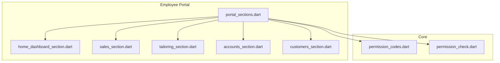
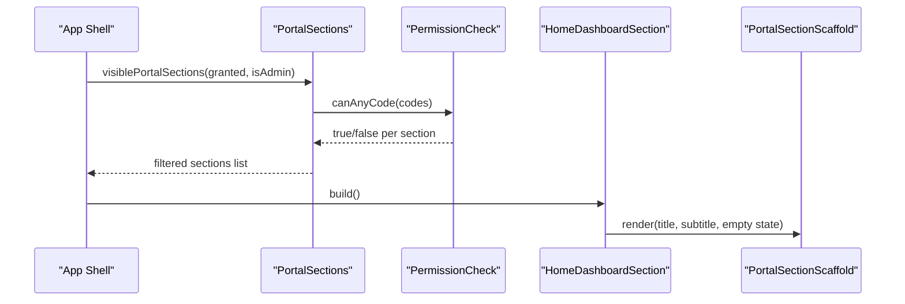
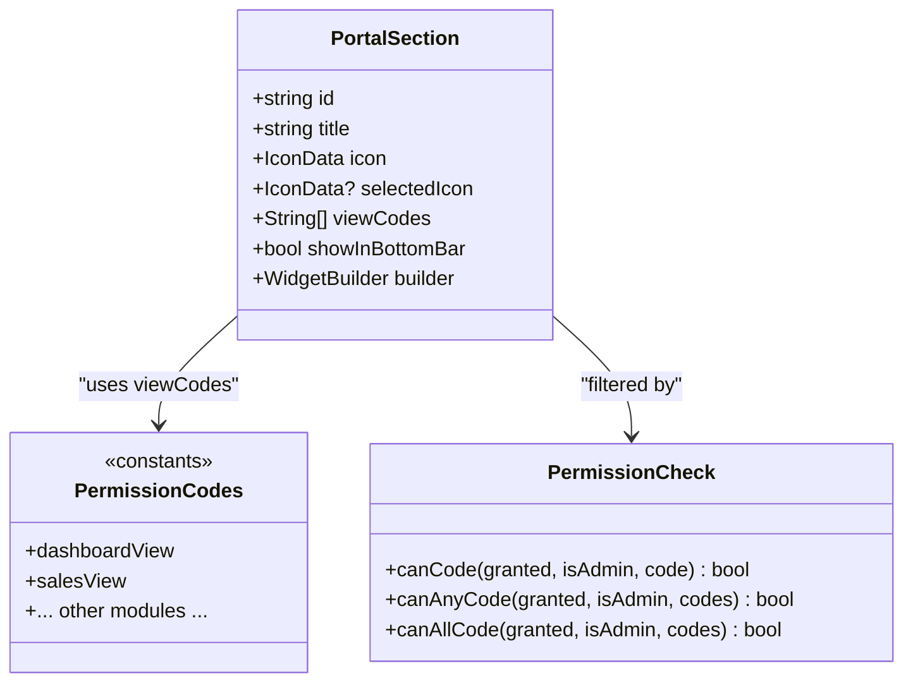
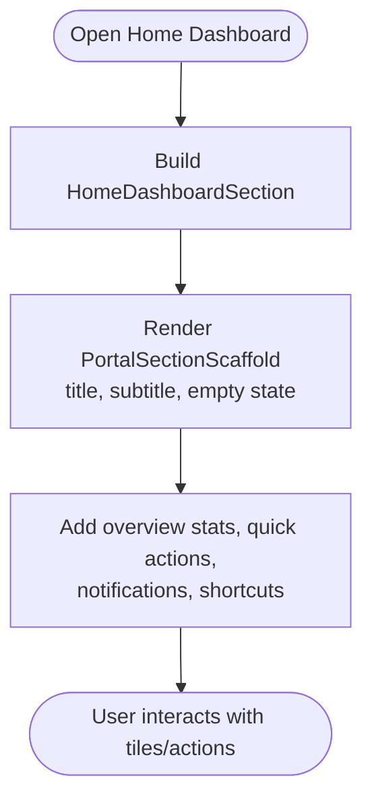
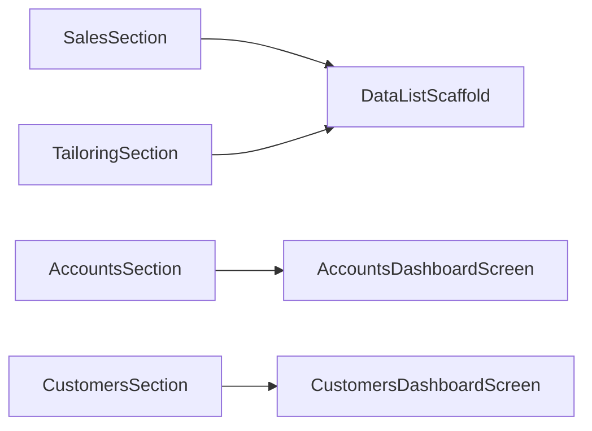
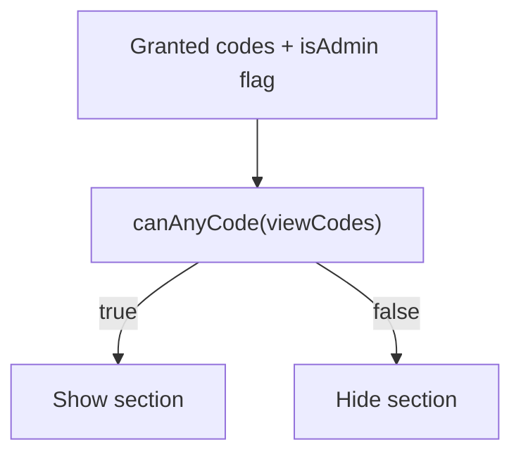
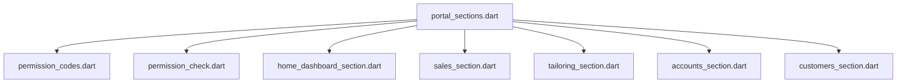

# Employee Portal Module

<cite>
**Referenced Files in This Document**
- [pubspec.yaml](file://pubspec.yaml)
- [portal_sections.dart](file://lib/features/employee_portal/domain/portal_sections.dart)
- [home_dashboard_section.dart](file://lib/features/employee_portal/presentation/screens/sections/home_dashboard_section.dart)
- [sales_section.dart](file://lib/features/employee_portal/presentation/screens/sections/sales_section.dart)
- [tailoring_section.dart](file://lib/features/employee_portal/presentation/screens/sections/tailoring_section.dart)
- [accounts_section.dart](file://lib/features/employee_portal/presentation/screens/sections/accounts_section.dart)
- [customers_section.dart](file://lib/features/employee_portal/presentation/screens/sections/customers_section.dart)
- [permission_codes.dart](file://lib/core/constants/permission_codes.dart)
- [permission_check.dart](file://lib/core/utils/permission_check.dart)
</cite>

## Table of Contents
1. [Introduction](#introduction)
2. [Project Structure](#project-structure)
3. [Core Components](#core-components)
4. [Architecture Overview](#architecture-overview)
5. [Detailed Component Analysis](#detailed-component-analysis)
6. [Dependency Analysis](#dependency-analysis)
7. [Performance Considerations](#performance-considerations)
8. [Troubleshooting Guide](#troubleshooting-guide)
9. [Conclusion](#conclusion)
10. [Appendices](#appendices)

## Introduction
This document explains the Employee Portal module that provides a dashboard and quick access features for daily operations. It covers:
- Dashboard screen with overview statistics, quick actions, and real-time notifications
- Task management system integration points
- Performance metrics display and shortcut navigation
- Responsive mobile-first design
- Real-time data updates and personalized content by user roles
- Practical examples for extending the portal with new widgets, custom quick actions, and additional employee-facing features

The module is built on Flutter and uses a permission-driven registry to render sections based on server-provided grants.

## Project Structure
The Employee Portal is organized under `lib/features/employee_portal` with:
- Domain layer defining portal sections and visibility rules
- Presentation layer containing section screens and scaffolds
- Shared core utilities for permissions and theming

**Diagram sources**
- [portal_sections.dart:66-145](file://lib/features/employee_portal/domain/portal_sections.dart#L66-L145)
- [home_dashboard_section.dart:1-20](file://lib/features/employee_portal/presentation/screens/sections/home_dashboard_section.dart#L1-L20)
- [sales_section.dart:1-21](file://lib/features/employee_portal/presentation/screens/sections/sales_section.dart#L1-L21)
- [tailoring_section.dart:1-21](file://lib/features/employee_portal/presentation/screens/sections/tailoring_section.dart#L1-L21)
- [accounts_section.dart:1-13](file://lib/features/employee_portal/presentation/screens/sections/accounts_section.dart#L1-L13)
- [customers_section.dart:1-13](file://lib/features/employee_portal/presentation/screens/sections/customers_section.dart#L1-L13)
- [permission_codes.dart:12-143](file://lib/core/constants/permission_codes.dart#L12-L143)
- [permission_check.dart:24-68](file://lib/core/utils/permission_check.dart#L24-L68)

**Section sources**
- [portal_sections.dart:15-62](file://lib/features/employee_portal/domain/portal_sections.dart#L15-L62)
- [portal_sections.dart:66-145](file://lib/features/employee_portal/domain/portal_sections.dart#L66-L145)

## Core Components
- PortalSection registry: A single source of truth for all portal sections, including id, title, icon, builder, view codes, and bottom-bar membership.
- Visibility filtering: Sections are filtered using server-derived grants via permission checks.
- Section screens: Lightweight wrappers that delegate to feature-specific dashboards or scaffolds (e.g., HomeDashboardSection, SalesSection).

Key responsibilities:
- Centralized navigation model for drawer and bottom bar
- Consistent gating logic aligned with server permissions
- Lazy construction of denied sections to avoid unnecessary network calls

**Section sources**
- [portal_sections.dart:15-62](file://lib/features/employee_portal/domain/portal_sections.dart#L15-L62)
- [portal_sections.dart:147-179](file://lib/features/employee_portal/domain/portal_sections.dart#L147-L179)

## Architecture Overview
The portal renders sections based on a registry and permission evaluation. The home dashboard acts as the primary entry point for daily operations.

**Diagram sources**
- [portal_sections.dart:164-179](file://lib/features/employee_portal/domain/portal_sections.dart#L164-L179)
- [permission_check.dart:42-54](file://lib/core/utils/permission_check.dart#L42-L54)
- [home_dashboard_section.dart:9-18](file://lib/features/employee_portal/presentation/screens/sections/home_dashboard_section.dart#L9-L18)

## Detailed Component Analysis

### Employee Portal Registry and Navigation
The registry defines each section with stable identifiers and builders. It ensures consistent behavior across desktop drawers and mobile bottom bars.

**Diagram sources**
- [portal_sections.dart:31-62](file://lib/features/employee_portal/domain/portal_sections.dart#L31-L62)
- [permission_codes.dart:12-143](file://lib/core/constants/permission_codes.dart#L12-L143)
- [permission_check.dart:24-68](file://lib/core/utils/permission_check.dart#L24-L68)

**Section sources**
- [portal_sections.dart:31-62](file://lib/features/employee_portal/domain/portal_sections.dart#L31-L62)
- [portal_sections.dart:66-145](file://lib/features/employee_portal/domain/portal_sections.dart#L66-L145)
- [permission_codes.dart:12-143](file://lib/core/constants/permission_codes.dart#L12-L143)
- [permission_check.dart:24-68](file://lib/core/utils/permission_check.dart#L24-L68)

### Home Dashboard Section
The home dashboard provides an overview scaffold suitable for summary widgets, quick actions, and notifications.

Practical guidance:
- Add overview statistics cards at the top
- Place quick action buttons below stats
- Show real-time notifications in a scrollable list
- Provide shortcut navigation to frequently used sections

**Diagram sources**
- [home_dashboard_section.dart:9-18](file://lib/features/employee_portal/presentation/screens/sections/home_dashboard_section.dart#L9-L18)

**Section sources**
- [home_dashboard_section.dart:1-20](file://lib/features/employee_portal/presentation/screens/sections/home_dashboard_section.dart#L1-L20)

### Sales, Tailoring, Accounts, and Customers Sections
These sections wrap existing dashboards or scaffolds to provide consistent UI patterns.

- SalesSection: Uses a data list scaffold for invoices and payments.
- TailoringSection: Uses a data list scaffold for tailoring cards and measurements.
- AccountsSection: Delegates to the accounts dashboard screen.
- CustomersSection: Delegates to the customers dashboard screen.

**Diagram sources**
- [sales_section.dart:9-18](file://lib/features/employee_portal/presentation/screens/sections/sales_section.dart#L9-L18)
- [tailoring_section.dart:9-18](file://lib/features/employee_portal/presentation/screens/sections/tailoring_section.dart#L9-L18)
- [accounts_section.dart:9-11](file://lib/features/employee_portal/presentation/screens/sections/accounts_section.dart#L9-L11)
- [customers_section.dart:9-11](file://lib/features/employee_portal/presentation/screens/sections/customers_section.dart#L9-L11)

**Section sources**
- [sales_section.dart:1-21](file://lib/features/employee_portal/presentation/screens/sections/sales_section.dart#L1-L21)
- [tailoring_section.dart:1-21](file://lib/features/employee_portal/presentation/screens/sections/tailoring_section.dart#L1-L21)
- [accounts_section.dart:1-13](file://lib/features/employee_portal/presentation/screens/sections/accounts_section.dart#L1-L13)
- [customers_section.dart:1-13](file://lib/features/employee_portal/presentation/screens/sections/customers_section.dart#L1-L13)

### Permissions and Personalization
Personalization is driven by server-provided grants. The client mirrors permission codes and applies identical logic to hide or show UI elements.

**Diagram sources**
- [permission_check.dart:42-54](file://lib/core/utils/permission_check.dart#L42-L54)
- [permission_codes.dart:12-143](file://lib/core/constants/permission_codes.dart#L12-L143)

**Section sources**
- [permission_codes.dart:12-143](file://lib/core/constants/permission_codes.dart#L12-L143)
- [permission_check.dart:24-68](file://lib/core/utils/permission_check.dart#L24-L68)

## Dependency Analysis
The portal depends on:
- Permission constants and checking utilities for visibility control
- Feature dashboards for domain-specific screens
- Scaffolds for consistent layout and empty states

**Diagram sources**
- [portal_sections.dart:1-13](file://lib/features/employee_portal/domain/portal_sections.dart#L1-L13)
- [portal_sections.dart:66-145](file://lib/features/employee_portal/domain/portal_sections.dart#L66-L145)
- [permission_codes.dart:12-143](file://lib/core/constants/permission_codes.dart#L12-L143)
- [permission_check.dart:24-68](file://lib/core/utils/permission_check.dart#L24-L68)

**Section sources**
- [portal_sections.dart:1-13](file://lib/features/employee_portal/domain/portal_sections.dart#L1-L13)
- [portal_sections.dart:66-145](file://lib/features/employee_portal/domain/portal_sections.dart#L66-L145)

## Performance Considerations
- Avoid building hidden sections: Denied sections are excluded from the list to prevent unnecessary network calls and widget builds.
- Use const constructors where possible: Section builders return const widgets to minimize rebuilds.
- Keep permission checks local: Mirroring server permission codes avoids repeated network round-trips for gating decisions.

[No sources needed since this section provides general guidance]

## Troubleshooting Guide
Common issues and resolutions:
- Section not visible: Verify the user’s granted codes include at least one required view code for the section.
- Button shown but API rejects: Ensure permission codes mirror the server catalog exactly; any divergence may expose UI the backend denies.
- Bottom bar misalignment: Confirm the section’s `showInBottomBar` flag is set intentionally; only five items fit the mobile bottom bar.

**Section sources**
- [portal_sections.dart:164-179](file://lib/features/employee_portal/domain/portal_sections.dart#L164-L179)
- [permission_codes.dart:1-11](file://lib/core/constants/permission_codes.dart#L1-L11)
- [permission_check.dart:1-17](file://lib/core/utils/permission_check.dart#L1-L17)

## Conclusion
The Employee Portal module centralizes navigation and personalization through a permission-driven registry. The home dashboard serves as the operational hub, while section screens integrate with existing dashboards. By mirroring server permissions and using consistent scaffolds, the portal delivers a responsive, role-aware experience suitable for mobile-first workflows.

[No sources needed since this section summarizes without analyzing specific files]

## Appendices

### How to Add a New Dashboard Widget
Steps:
- Open the home dashboard section file.
- Insert a new card or tile widget within the scaffold’s content area.
- Bind the widget to your data provider or service.
- Test responsiveness across breakpoints.

[No sources needed since this section provides general guidance]

### How to Implement a Custom Quick Action
Steps:
- In the home dashboard section, add a quick action button.
- Define the action handler to navigate or trigger a workflow.
- Optionally gate the action using permission checks if it requires specific rights.

[No sources needed since this section provides general guidance]

### How to Extend the Portal with Additional Features
Steps:
- Create a new section screen under `presentation/screens/sections`.
- Register the section in the portal registry with a stable id, title, icon, builder, and view codes.
- Set `showInBottomBar` if appropriate.
- Ensure the section’s view codes match server permissions.

**Section sources**
- [portal_sections.dart:66-145](file://lib/features/employee_portal/domain/portal_sections.dart#L66-L145)

### Real-Time Data Updates
Recommendations:
- Use streams or providers to push updates into dashboard widgets.
- Debounce heavy computations and batch updates to maintain smooth scrolling.
- Handle offline states gracefully with cached data and retry logic.

[No sources needed since this section provides general guidance]

### Responsive Design Notes
- Prefer flexible layouts and adaptive components.
- Use the app theme and color constants for consistency.
- Validate layouts on small screens first, then scale up.

**Section sources**
- [pubspec.yaml:30-46](file://pubspec.yaml#L30-L46)