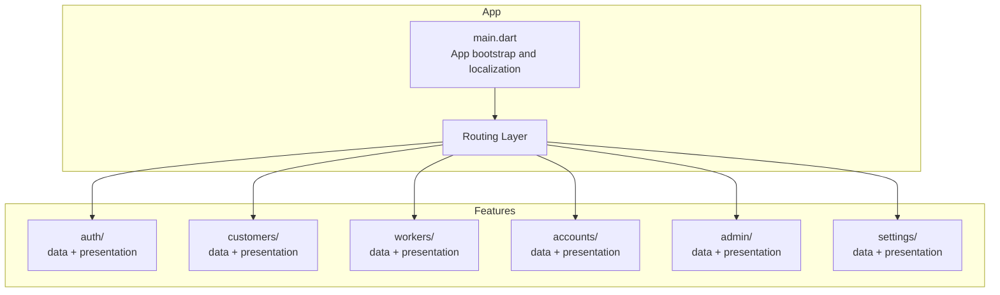
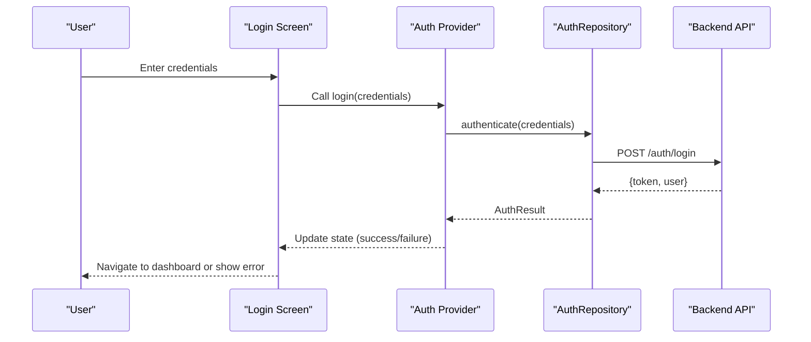
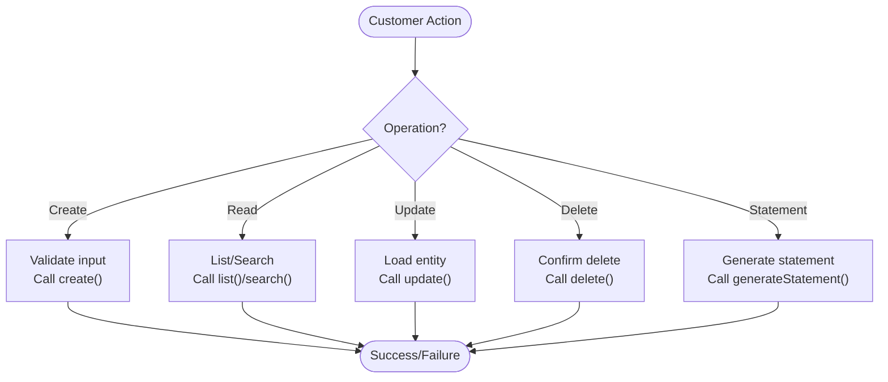
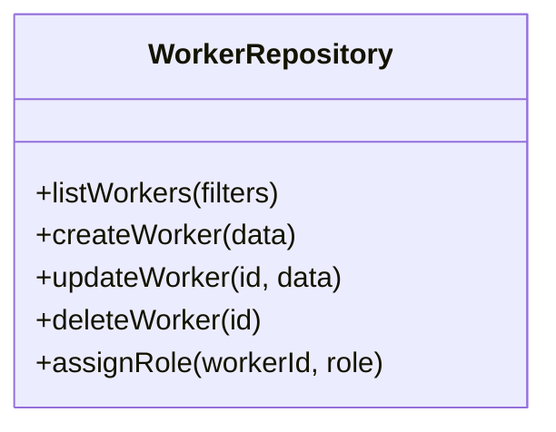
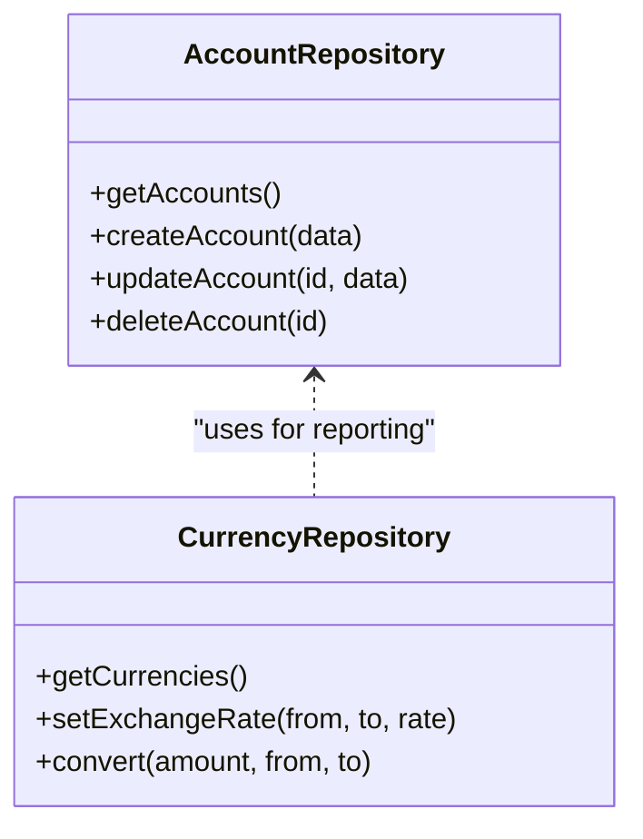
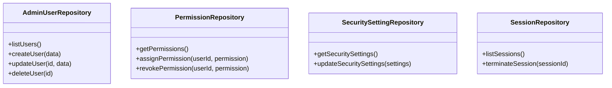
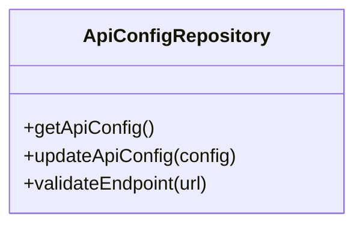
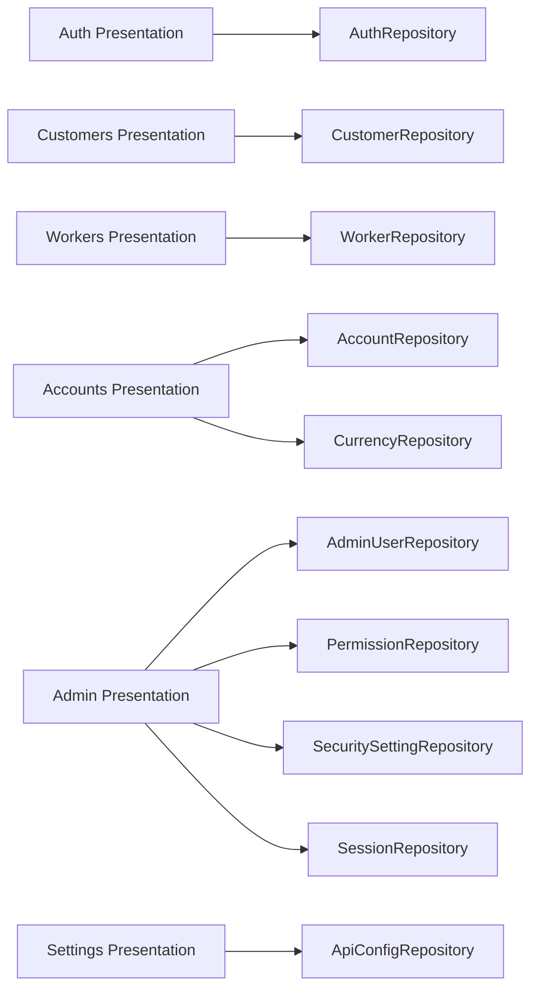

# Feature Modules

<cite>
**Referenced Files in This Document**
- [main.dart](file://lib/main.dart)
- [auth_repository.dart](file://lib/features/auth/data/repositories/auth_repository.dart)
- [account_repository.dart](file://lib/features/accounts/data/repositories/account_repository.dart)
- [currency_repository.dart](file://lib/features/accounts/data/repositories/currency_repository.dart)
- [admin_user_repository.dart](file://lib/features/admin/data/repositories/admin_user_repository.dart)
- [permission_repository.dart](file://lib/features/admin/data/repositories/permission_repository.dart)
- [security_setting_repository.dart](file://lib/features/admin/data/repositories/security_setting_repository.dart)
- [session_repository.dart](file://lib/features/admin/data/repositories/session_repository.dart)
- [customer_repository.dart](file://lib/features/customers/data/repositories/customer_repository.dart)
- [api_config_repository.dart](file://lib/features/settings/data/repositories/api_config_repository.dart)
- [worker_repository.dart](file://lib/features/workers/data/repositories/worker_repository.dart)
</cite>

## Table of Contents
1. [Introduction](#introduction)
2. [Project Structure](#project-structure)
3. [Core Components](#core-components)
4. [Architecture Overview](#architecture-overview)
5. [Detailed Component Analysis](#detailed-component-analysis)
6. [Dependency Analysis](#dependency-analysis)
7. [Performance Considerations](#performance-considerations)
8. [Troubleshooting Guide](#troubleshooting-guide)
9. [Conclusion](#conclusion)
10. [Appendices](#appendices)

## Introduction
This document explains the feature-based architecture used across the application, where code is organized by business domains rather than technical layers. Each feature module encapsulates its own presentation, domain, and data layers, promoting clear boundaries, testability, and maintainability. The documentation covers:
- Authentication module (login flow, biometric registration, session management screens and services)
- Customer management module (CRUD operations, statement generation, search)
- Worker management module (employees, tailors, cutters workflows)
- Accounting module (chart of accounts, financial statements, multi-currency support)
- Settings module (API configuration, security settings, system administration)

It also provides practical guidance for creating new feature modules, implementing repository patterns, and following consistent architectural patterns.

## Project Structure
The application follows a feature-based organization under lib/features. Each feature folder contains:
- data: models and repositories
- presentation: providers, screens, widgets
- domain: business logic and use cases (when present)

At the top level, the app entry point initializes global state and routing, then delegates navigation to the router.

**Diagram sources**
- [main.dart:7-46](file://lib/main.dart#L7-L46)

**Section sources**
- [main.dart:7-46](file://lib/main.dart#L7-L46)

## Core Components
This section outlines the core components that implement the repository pattern within each feature module. Repositories abstract data access and expose typed methods to the presentation layer.

- Authentication
  - AuthRepository: handles authentication operations such as login, logout, and token/session management.

- Customers
  - CustomerRepository: exposes CRUD operations, search, and statement generation endpoints.

- Workers
  - WorkerRepository: manages employees, tailors, and cutters with their respective workflows.

- Accounts
  - AccountRepository: manages chart of accounts and related accounting entities.
  - CurrencyRepository: supports multi-currency configuration and conversions.

- Admin
  - AdminUserRepository: admin user management.
  - PermissionRepository: permission catalog and assignment.
  - SecuritySettingRepository: security-related settings.
  - SessionRepository: active sessions management.

- Settings
  - ApiConfigRepository: API configuration storage and retrieval.

These repositories provide a consistent interface for data access across features, enabling clean separation between UI and data concerns.

**Section sources**
- [auth_repository.dart:12-12](file://lib/features/auth/data/repositories/auth_repository.dart#L12-L12)
- [customer_repository.dart:21-21](file://lib/features/customers/data/repositories/customer_repository.dart#L21-L21)
- [worker_repository.dart:20-20](file://lib/features/workers/data/repositories/worker_repository.dart#L20-L20)
- [account_repository.dart:24-24](file://lib/features/accounts/data/repositories/account_repository.dart#L24-L24)
- [currency_repository.dart:19-19](file://lib/features/accounts/data/repositories/currency_repository.dart#L19-L19)
- [admin_user_repository.dart:31-31](file://lib/features/admin/data/repositories/admin_user_repository.dart#L31-L31)
- [permission_repository.dart:72-72](file://lib/features/admin/data/repositories/permission_repository.dart#L72-L72)
- [security_setting_repository.dart:15-15](file://lib/features/admin/data/repositories/security_setting_repository.dart#L15-L15)
- [session_repository.dart:20-20](file://lib/features/admin/data/repositories/session_repository.dart#L20-L20)
- [api_config_repository.dart:21-21](file://lib/features/settings/data/repositories/api_config_repository.dart#L21-L21)

## Architecture Overview
The application uses a layered approach within each feature:
- Presentation: UI screens, widgets, and Riverpod providers
- Domain: business rules and use cases (where implemented)
- Data: repositories and models

```mermaid
graph TB
subgraph "Feature: auth"
A_Present["presentation/providers + screens"]
A_Domain["domain/use cases"]
A_Data["data/models + repositories/AuthRepository"]
end
subgraph "Feature: customers"
C_Present["presentation/providers + screens"]
C_Domain["domain/use cases"]
C_Data["data/models + repositories/CustomerRepository"]
end
subgraph "Feature: workers"
W_Present["presentation/providers + screens"]
W_Domain["domain/use cases"]
W_Data["data/models + repositories/WorkerRepository"]
end
subgraph "Feature: accounts"
Ac_Present["presentation/providers + screens"]
Ac_Domain["domain/use cases"]
Ac_Data["data/models + repositories/AccountRepository + CurrencyRepository"]
end
subgraph "Feature: admin"
Ad_Present["presentation/providers + screens"]
Ad_Domain["domain/use cases"]
Ad_Data["data/models + repositories/AdminUserRepository + PermissionRepository + SecuritySettingRepository + SessionRepository"]
end
subgraph "Feature: settings"
S_Present["presentation/providers + screens"]
S_Domain["domain/use cases"]
S_Data["data/models + repositories/ApiConfigRepository"]
end
A_Present --> A_Domain --> A_Data
C_Present --> C_Domain --> C_Data
W_Present --> W_Domain --> W_Data
Ac_Present --> Ac_Domain --> Ac_Data
Ad_Present --> Ad_Domain --> Ad_Data
S_Present --> S_Domain --> S_Data
```

[No sources needed since this diagram shows conceptual workflow, not actual code structure]

## Detailed Component Analysis

### Authentication Module
Responsibilities:
- Login flow with credentials and optional biometric enrollment
- Biometric registration and verification
- Session management screens and services

Key components:
- AuthRepository: centralizes authentication operations and session handling.

**Diagram sources**
- [auth_repository.dart:12-12](file://lib/features/auth/data/repositories/auth_repository.dart#L12-L12)

Practical notes:
- Use providers to manage login state and errors.
- Persist tokens securely and refresh as needed.
- Integrate biometric prompts before or after credential login depending on policy.

**Section sources**
- [auth_repository.dart:12-12](file://lib/features/auth/data/repositories/auth_repository.dart#L12-L12)

### Customer Management Module
Responsibilities:
- CRUD operations for customers
- Statement generation per customer
- Search functionality with filters

Key components:
- CustomerRepository: exposes methods for listing, creating, updating, deleting, searching, and generating statements.

**Diagram sources**
- [customer_repository.dart:21-21](file://lib/features/customers/data/repositories/customer_repository.dart#L21-L21)

**Section sources**
- [customer_repository.dart:21-21](file://lib/features/customers/data/repositories/customer_repository.dart#L21-L21)

### Worker Management Module
Responsibilities:
- Manage employees, tailors, and cutters
- Role-specific workflows and assignments

Key components:
- WorkerRepository: handles worker entities and role-based operations.

**Diagram sources**
- [worker_repository.dart:20-20](file://lib/features/workers/data/repositories/worker_repository.dart#L20-L20)

**Section sources**
- [worker_repository.dart:20-20](file://lib/features/workers/data/repositories/worker_repository.dart#L20-L20)

### Accounting Module
Responsibilities:
- Chart of accounts management
- Financial statements generation
- Multi-currency support

Key components:
- AccountRepository: manages account entities and relationships.
- CurrencyRepository: manages currency definitions and conversion rates.

**Diagram sources**
- [account_repository.dart:24-24](file://lib/features/accounts/data/repositories/account_repository.dart#L24-L24)
- [currency_repository.dart:19-19](file://lib/features/accounts/data/repositories/currency_repository.dart#L19-L19)

**Section sources**
- [account_repository.dart:24-24](file://lib/features/accounts/data/repositories/account_repository.dart#L24-L24)
- [currency_repository.dart:19-19](file://lib/features/accounts/data/repositories/currency_repository.dart#L19-L19)

### Admin Module
Responsibilities:
- Admin user management
- Permission catalog and assignment
- Security settings configuration
- Active sessions management

Key components:
- AdminUserRepository
- PermissionRepository
- SecuritySettingRepository
- SessionRepository

**Diagram sources**
- [admin_user_repository.dart:31-31](file://lib/features/admin/data/repositories/admin_user_repository.dart#L31-L31)
- [permission_repository.dart:72-72](file://lib/features/admin/data/repositories/permission_repository.dart#L72-L72)
- [security_setting_repository.dart:15-15](file://lib/features/admin/data/repositories/security_setting_repository.dart#L15-L15)
- [session_repository.dart:20-20](file://lib/features/admin/data/repositories/session_repository.dart#L20-L20)

**Section sources**
- [admin_user_repository.dart:31-31](file://lib/features/admin/data/repositories/admin_user_repository.dart#L31-L31)
- [permission_repository.dart:72-72](file://lib/features/admin/data/repositories/permission_repository.dart#L72-L72)
- [security_setting_repository.dart:15-15](file://lib/features/admin/data/repositories/security_setting_repository.dart#L15-L15)
- [session_repository.dart:20-20](file://lib/features/admin/data/repositories/session_repository.dart#L20-L20)

### Settings Module
Responsibilities:
- API configuration management
- System administration settings

Key components:
- ApiConfigRepository: stores and retrieves API endpoints, keys, and environment configurations.

**Diagram sources**
- [api_config_repository.dart:21-21](file://lib/features/settings/data/repositories/api_config_repository.dart#L21-L21)

**Section sources**
- [api_config_repository.dart:21-21](file://lib/features/settings/data/repositories/api_config_repository.dart#L21-L21)

## Dependency Analysis
Repositories are the primary dependency points between presentation/domain and data layers. Features depend on their own repositories; cross-feature dependencies should be minimized.

**Diagram sources**
- [auth_repository.dart:12-12](file://lib/features/auth/data/repositories/auth_repository.dart#L12-L12)
- [customer_repository.dart:21-21](file://lib/features/customers/data/repositories/customer_repository.dart#L21-L21)
- [worker_repository.dart:20-20](file://lib/features/workers/data/repositories/worker_repository.dart#L20-L20)
- [account_repository.dart:24-24](file://lib/features/accounts/data/repositories/account_repository.dart#L24-L24)
- [currency_repository.dart:19-19](file://lib/features/accounts/data/repositories/currency_repository.dart#L19-L19)
- [admin_user_repository.dart:31-31](file://lib/features/admin/data/repositories/admin_user_repository.dart#L31-L31)
- [permission_repository.dart:72-72](file://lib/features/admin/data/repositories/permission_repository.dart#L72-L72)
- [security_setting_repository.dart:15-15](file://lib/features/admin/data/repositories/security_setting_repository.dart#L15-L15)
- [session_repository.dart:20-20](file://lib/features/admin/data/repositories/session_repository.dart#L20-L20)
- [api_config_repository.dart:21-21](file://lib/features/settings/data/repositories/api_config_repository.dart#L21-L21)

**Section sources**
- [auth_repository.dart:12-12](file://lib/features/auth/data/repositories/auth_repository.dart#L12-L12)
- [customer_repository.dart:21-21](file://lib/features/customers/data/repositories/customer_repository.dart#L21-L21)
- [worker_repository.dart:20-20](file://lib/features/workers/data/repositories/worker_repository.dart#L20-L20)
- [account_repository.dart:24-24](file://lib/features/accounts/data/repositories/account_repository.dart#L24-L24)
- [currency_repository.dart:19-19](file://lib/features/accounts/data/repositories/currency_repository.dart#L19-L19)
- [admin_user_repository.dart:31-31](file://lib/features/admin/data/repositories/admin_user_repository.dart#L31-L31)
- [permission_repository.dart:72-72](file://lib/features/admin/data/repositories/permission_repository.dart#L72-L72)
- [security_setting_repository.dart:15-15](file://lib/features/admin/data/repositories/security_setting_repository.dart#L15-L15)
- [session_repository.dart:20-20](file://lib/features/admin/data/repositories/session_repository.dart#L20-L20)
- [api_config_repository.dart:21-21](file://lib/features/settings/data/repositories/api_config_repository.dart#L21-L21)

## Performance Considerations
- Prefer lazy loading and pagination for large lists (customers, workers).
- Cache frequently accessed data (e.g., currencies, permissions) using local storage or in-memory caches.
- Debounce search inputs to reduce network calls.
- Batch updates where possible to minimize round trips.
- Avoid heavy computations on the UI thread; offload to background tasks.

[No sources needed since this section provides general guidance]

## Troubleshooting Guide
Common issues and resolutions:
- Authentication failures: verify credentials, check token persistence, and ensure backend connectivity.
- Session expiration: handle token refresh flows and prompt re-login when necessary.
- Permission denied: confirm user roles and assigned permissions via admin module.
- API configuration errors: validate endpoints and keys through settings module.
- Data inconsistencies: reconcile with server state and retry failed operations.

**Section sources**
- [auth_repository.dart:12-12](file://lib/features/auth/data/repositories/auth_repository.dart#L12-L12)
- [session_repository.dart:20-20](file://lib/features/admin/data/repositories/session_repository.dart#L20-L20)
- [permission_repository.dart:72-72](file://lib/features/admin/data/repositories/permission_repository.dart#L72-L72)
- [api_config_repository.dart:21-21](file://lib/features/settings/data/repositories/api_config_repository.dart#L21-L21)

## Conclusion
The feature-based architecture organizes code by business domains, ensuring clear separation of concerns and scalable growth. Each feature encapsulates presentation, domain, and data layers, with repositories providing consistent data access. Following these patterns simplifies adding new features, maintaining existing ones, and improving performance and reliability.

[No sources needed since this section summarizes without analyzing specific files]

## Appendices

### Creating a New Feature Module
Steps:
1. Create a new folder under lib/features named after the business domain.
2. Inside the feature folder, add:
   - data/models: define data classes
   - data/repositories: implement repository interfaces
   - presentation/providers: manage state with Riverpod
   - presentation/screens: build UI screens
   - presentation/widgets: reusable UI components
   - domain (optional): use cases and business rules
3. Implement repository methods for all required operations.
4. Wire up providers to call repositories and expose state to screens.
5. Register routes in the app router to navigate to the new screens.

Consistent patterns:
- Repository methods return typed results and handle errors consistently.
- Providers subscribe to repository changes and update UI state.
- Screens remain thin, delegating logic to providers and repositories.

[No sources needed since this section provides general guidance]