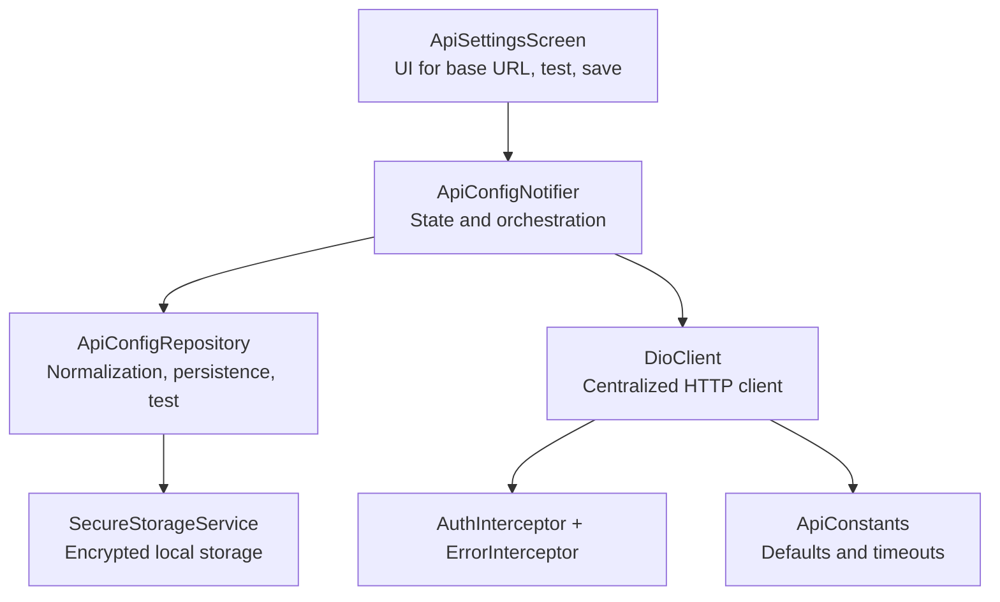
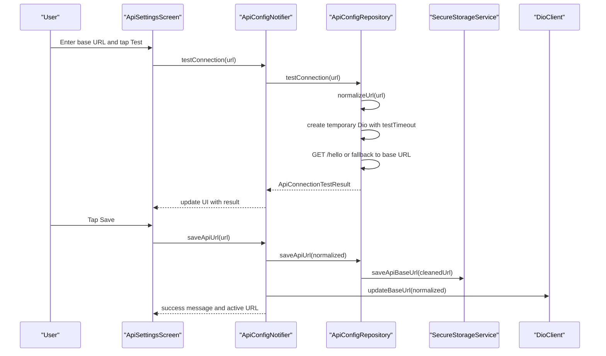
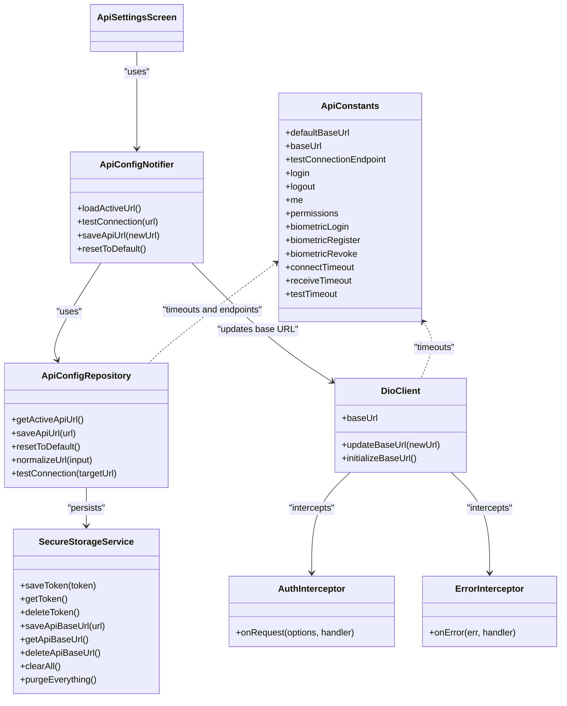

# API Configuration

<cite>
**Referenced Files in This Document**
- [api_constants.dart](file://lib/core/constants/api_constants.dart)
- [dio_client.dart](file://lib/core/network/dio_client.dart)
- [auth_interceptor.dart](file://lib/core/network/auth_interceptor.dart)
- [error_interceptor.dart](file://lib/core/network/error_interceptor.dart)
- [secure_storage_service.dart](file://lib/core/storage/secure_storage_service.dart)
- [api_settings_screen.dart](file://lib/features/settings/presentation/screens/api_settings_screen.dart)
- [api_config_notifier.dart](file://lib/features/settings/presentation/providers/api_config_notifier.dart)
- [api_config_state.dart](file://lib/features/settings/presentation/providers/api_config_state.dart)
- [api_config_repository.dart](file://lib/features/settings/data/repositories/api_config_repository.dart)
- [api_config_test.dart](file://test/api_config_test.dart)
</cite>

## Table of Contents
1. [Introduction](#introduction)
2. [Project Structure](#project-structure)
3. [Core Components](#core-components)
4. [Architecture Overview](#architecture-overview)
5. [Detailed Component Analysis](#detailed-component-analysis)
6. [Dependency Analysis](#dependency-analysis)
7. [Performance Considerations](#performance-considerations)
8. [Troubleshooting Guide](#troubleshooting-guide)
9. [Conclusion](#conclusion)

## Introduction
This document explains the API configuration system used by the application. It covers endpoint management, connection testing, and network settings. It also documents the API settings screen implementation for base URL configuration, timeout behavior, environment switching, Dio client integration with dynamic configuration updates, authentication token management, connection validation, and configuration persistence using secure storage.

The system is designed so that users can switch between environments (for example, development, staging, production) by changing the base URL, test connectivity before saving, and rely on a centralized HTTP client that automatically attaches authentication tokens and handles common errors.

## Project Structure
The API configuration spans presentation, state, repository, networking, constants, and storage layers:

- Constants define default endpoints, timeouts, and paths.
- The UI provides an API settings screen to enter and validate base URLs.
- A Riverpod notifier manages state and orchestrates repository calls and client updates.
- The repository performs normalization, persistence, and connection tests.
- The Dio client centralizes HTTP configuration, interceptors, and runtime base URL updates.
- Secure storage persists sensitive data such as tokens and the active API base URL.

**Diagram sources**
- [api_settings_screen.dart:1-712](file://lib/features/settings/presentation/screens/api_settings_screen.dart#L1-L712)
- [api_config_notifier.dart:1-129](file://lib/features/settings/presentation/providers/api_config_notifier.dart#L1-L129)
- [api_config_repository.dart:1-168](file://lib/features/settings/data/repositories/api_config_repository.dart#L1-L168)
- [secure_storage_service.dart:1-206](file://lib/core/storage/secure_storage_service.dart#L1-L206)
- [dio_client.dart:1-60](file://lib/core/network/dio_client.dart#L1-L60)
- [auth_interceptor.dart:1-24](file://lib/core/network/auth_interceptor.dart#L1-L24)
- [error_interceptor.dart:1-39](file://lib/core/network/error_interceptor.dart#L1-L39)
- [api_constants.dart:1-29](file://lib/core/constants/api_constants.dart#L1-L29)

**Section sources**
- [api_settings_screen.dart:1-712](file://lib/features/settings/presentation/screens/api_settings_screen.dart#L1-L712)
- [api_config_notifier.dart:1-129](file://lib/features/settings/presentation/providers/api_config_notifier.dart#L1-L129)
- [api_config_repository.dart:1-168](file://lib/features/settings/data/repositories/api_config_repository.dart#L1-L168)
- [secure_storage_service.dart:1-206](file://lib/core/storage/secure_storage_service.dart#L1-L206)
- [dio_client.dart:1-60](file://lib/core/network/dio_client.dart#L1-L60)
- [auth_interceptor.dart:1-24](file://lib/core/network/auth_interceptor.dart#L1-L24)
- [error_interceptor.dart:1-39](file://lib/core/network/error_interceptor.dart#L1-L39)
- [api_constants.dart:1-29](file://lib/core/constants/api_constants.dart#L1-L29)

## Core Components
- ApiConstants: Centralizes default base URL, endpoints, and timeouts.
- DioClient: Creates and configures the Dio instance, applies interceptors, exposes base URL getter, and supports runtime base URL updates.
- AuthInterceptor: Injects Bearer tokens from secure storage into outgoing requests.
- ErrorInterceptor: Handles cancellation and 401 Unauthorized responses; clears session and triggers an unauthorized callback.
- SecureStorageService: Encrypted storage for tokens, user data, permissions, and the active API base URL.
- ApiSettingsScreen: User interface for entering and validating base URLs, testing connectivity, and saving changes.
- ApiConfigNotifier: Manages UI state, loads active URL, tests connections, saves URLs, and resets to defaults.
- ApiConfigRepository: Normalizes URLs, persists them, and performs connection tests against the target server.
- ApiConfigState: Immutable state model for the API configuration screen.

Key responsibilities:
- Endpoint management: ApiConstants defines endpoints like login, logout, me, permissions, and biometric endpoints.
- Connection testing: ApiConfigRepository.testConnection validates reachability and latency.
- Network settings: ApiConstants defines connect and receive timeouts; DioClient applies them globally.
- Environment switching: Users change the base URL via the UI; the active URL is persisted and applied immediately to DioClient.

**Section sources**
- [api_constants.dart:1-29](file://lib/core/constants/api_constants.dart#L1-L29)
- [dio_client.dart:1-60](file://lib/core/network/dio_client.dart#L1-L60)
- [auth_interceptor.dart:1-24](file://lib/core/network/auth_interceptor.dart#L1-L24)
- [error_interceptor.dart:1-39](file://lib/core/network/error_interceptor.dart#L1-L39)
- [secure_storage_service.dart:1-206](file://lib/core/storage/secure_storage_service.dart#L1-L206)
- [api_settings_screen.dart:1-712](file://lib/features/settings/presentation/screens/api_settings_screen.dart#L1-L712)
- [api_config_notifier.dart:1-129](file://lib/features/settings/presentation/providers/api_config_notifier.dart#L1-L129)
- [api_config_repository.dart:1-168](file://lib/features/settings/data/repositories/api_config_repository.dart#L1-L168)
- [api_config_state.dart:1-42](file://lib/features/settings/presentation/providers/api_config_state.dart#L1-L42)

## Architecture Overview
The API configuration architecture follows a layered approach:

- Presentation layer: ApiSettingsScreen renders inputs, buttons, and feedback.
- State layer: ApiConfigNotifier coordinates actions and updates UI state.
- Data layer: ApiConfigRepository handles normalization, persistence, and connectivity checks.
- Networking layer: DioClient encapsulates HTTP configuration and interceptors.
- Security layer: SecureStorageService stores sensitive values securely.
- Configuration layer: ApiConstants provides shared defaults and timeouts.

**Diagram sources**
- [api_settings_screen.dart:47-79](file://lib/features/settings/presentation/screens/api_settings_screen.dart#L47-L79)
- [api_config_notifier.dart:40-94](file://lib/features/settings/presentation/providers/api_config_notifier.dart#L40-L94)
- [api_config_repository.dart:47-166](file://lib/features/settings/data/repositories/api_config_repository.dart#L47-L166)
- [secure_storage_service.dart:67-80](file://lib/core/storage/secure_storage_service.dart#L67-L80)
- [dio_client.dart:47-50](file://lib/core/network/dio_client.dart#L47-L50)

## Detailed Component Analysis

### ApiConstants
Purpose:
- Define default base URL and API endpoints.
- Provide consistent timeouts for normal operations and connection tests.

Highlights:
- Default base URL and baseUrl alias.
- Endpoints for authentication, permissions, and biometric flows.
- Connect and receive timeouts for general requests; separate test timeout for connectivity checks.

Usage examples:
- Development: Use a local IP address or localhost path as base URL while keeping these endpoints unchanged.
- Staging: Point baseUrl to staging domain/IP.
- Production: Point baseUrl to production domain/IP.

**Section sources**
- [api_constants.dart:1-29](file://lib/core/constants/api_constants.dart#L1-L29)

### DioClient
Purpose:
- Create a single Dio instance with global headers and timeouts.
- Attach authentication and error interceptors.
- Expose current base URL and allow runtime updates.
- Initialize base URL from secure storage at startup.

Key behaviors:
- BaseOptions set with content-type and accept headers.
- Interceptors added: AuthInterceptor, ErrorInterceptor, LogInterceptor.
- updateBaseUrl modifies the active base URL immediately.
- initializeBaseUrl reads saved base URL and applies it if present.

Integration points:
- Used by ApiConfigNotifier to apply new base URLs instantly.
- Consumed by feature repositories through dependency injection.

**Section sources**
- [dio_client.dart:1-60](file://lib/core/network/dio_client.dart#L1-L60)

### AuthInterceptor
Purpose:
- Automatically attach Authorization header with Bearer token when available.
- Ensure Accept header is set for JSON responses.

Token flow:
- Reads token from SecureStorageService.
- If token exists and is not empty, sets Authorization header.
- Proceeds with request after modification.

Security note:
- Tokens are stored securely; this interceptor only reads them at request time.

**Section sources**
- [auth_interceptor.dart:1-24](file://lib/core/network/auth_interceptor.dart#L1-L24)
- [secure_storage_service.dart:32-45](file://lib/core/storage/secure_storage_service.dart#L32-L45)

### ErrorInterceptor
Purpose:
- Handle Dio exceptions centrally.
- Gracefully resolve canceled requests without throwing unexpected exceptions.
- Clear session and trigger unauthorized callback on 401 responses.

Behavior:
- Canceled requests return a structured response indicating cancellation.
- On 401, clears all session data and invokes onUnauthorized callback.
- Otherwise, forwards the error to the next handler.

**Section sources**
- [error_interceptor.dart:1-39](file://lib/core/network/error_interceptor.dart#L1-L39)
- [secure_storage_service.dart:82-95](file://lib/core/storage/secure_storage_service.dart#L82-L95)

### SecureStorageService
Purpose:
- Provide encrypted storage for tokens, user data, permissions, and API base URL.
- Offer methods to read, write, delete, and clear specific keys.

Relevant capabilities:
- Token lifecycle: save, read, delete.
- API base URL lifecycle: save, read, delete.
- Session and permission management: save/clear permissions, admin flag, session expiry.
- Biometric-related flags and IDs.
- Purge everything when needed.

Persistence strategy:
- Uses FlutterSecureStorage with platform-specific options for Android and iOS.
- Keys are named consistently for maintainability.

**Section sources**
- [secure_storage_service.dart:1-206](file://lib/core/storage/secure_storage_service.dart#L1-L206)

### ApiSettingsScreen
Purpose:
- Provide a focused UI for configuring the API base URL.
- Allow users to test connectivity before saving.
- Show quick chips for common development addresses.
- Display the currently active base URL.

User interactions:
- Input validation ensures non-empty and http/https scheme.
- Test button triggers connection check and shows result card.
- Save button confirms changes and updates both storage and DioClient.
- Reset button restores default base URL.

State handling:
- Watches ApiConfigNotifier to reflect loading, testing, saving states.
- Displays success/error messages via snackbars.

Environment switching:
- Quick chips help select common IPs for local development.
- Users can type any valid base URL for staging or production.

**Section sources**
- [api_settings_screen.dart:1-712](file://lib/features/settings/presentation/screens/api_settings_screen.dart#L1-L712)

### ApiConfigNotifier
Purpose:
- Manage UI state for API configuration.
- Load active URL from repository and sync with DioClient.
- Perform connection tests and persist new URLs.
- Reset to default base URL.

Workflow:
- build initializes loading state and schedules loadActiveUrl.
- testConnection delegates to repository and updates state with result.
- saveApiUrl normalizes URL, validates scheme, persists via repository, updates DioClient, and sets success message.
- resetToDefault clears stored URL and reverts to default.

Provider wiring:
- apiConfigRepositoryProvider creates repository with secure storage.
- dioClientProvider supplies the centralized Dio client.

**Section sources**
- [api_config_notifier.dart:1-129](file://lib/features/settings/presentation/providers/api_config_notifier.dart#L1-L129)
- [api_config_state.dart:1-42](file://lib/features/settings/presentation/providers/api_config_state.dart#L1-L42)

### ApiConfigRepository
Purpose:
- Normalize and validate base URLs.
- Persist active API base URL to secure storage.
- Test connectivity to the configured server.

Normalization:
- Trims whitespace and removes trailing slashes.

Connection test logic:
- Validates input URL format.
- Creates a temporary Dio instance with testTimeout.
- Attempts GET /hello if base URL ends with /api; otherwise GET base URL.
- Measures latency and returns structured result.
- Handles 404 by falling back to base URL.
- Maps DioException types to user-friendly messages.

**Section sources**
- [api_config_repository.dart:1-168](file://lib/features/settings/data/repositories/api_config_repository.dart#L1-L168)

### ApiConfigState
Purpose:
- Represent immutable state for the API configuration screen.
- Include fields for active URL, loading/testing/saving flags, test result, and messages.

Immutability:
- copyWith helper allows partial updates without mutating existing state.

**Section sources**
- [api_config_state.dart:1-42](file://lib/features/settings/presentation/providers/api_config_state.dart#L1-L42)

## Dependency Analysis
The following diagram illustrates how components depend on each other:

**Diagram sources**
- [api_constants.dart:1-29](file://lib/core/constants/api_constants.dart#L1-L29)
- [secure_storage_service.dart:1-206](file://lib/core/storage/secure_storage_service.dart#L1-L206)
- [dio_client.dart:1-60](file://lib/core/network/dio_client.dart#L1-L60)
- [auth_interceptor.dart:1-24](file://lib/core/network/auth_interceptor.dart#L1-L24)
- [error_interceptor.dart:1-39](file://lib/core/network/error_interceptor.dart#L1-L39)
- [api_config_repository.dart:1-168](file://lib/features/settings/data/repositories/api_config_repository.dart#L1-L168)
- [api_config_notifier.dart:1-129](file://lib/features/settings/presentation/providers/api_config_notifier.dart#L1-L129)
- [api_settings_screen.dart:1-712](file://lib/features/settings/presentation/screens/api_settings_screen.dart#L1-L712)

**Section sources**
- [api_constants.dart:1-29](file://lib/core/constants/api_constants.dart#L1-L29)
- [secure_storage_service.dart:1-206](file://lib/core/storage/secure_storage_service.dart#L1-L206)
- [dio_client.dart:1-60](file://lib/core/network/dio_client.dart#L1-L60)
- [auth_interceptor.dart:1-24](file://lib/core/network/auth_interceptor.dart#L1-L24)
- [error_interceptor.dart:1-39](file://lib/core/network/error_interceptor.dart#L1-L39)
- [api_config_repository.dart:1-168](file://lib/features/settings/data/repositories/api_config_repository.dart#L1-L168)
- [api_config_notifier.dart:1-129](file://lib/features/settings/presentation/providers/api_config_notifier.dart#L1-L129)
- [api_settings_screen.dart:1-712](file://lib/features/settings/presentation/screens/api_settings_screen.dart#L1-L712)

## Performance Considerations
- Timeouts:
  - General requests use connectTimeout and receiveTimeout defined in ApiConstants.
  - Connection tests use a shorter testTimeout to avoid long UI stalls.
- Temporary Dio instance:
  - Connection tests create a dedicated Dio instance and close it afterward to avoid interfering with the main client.
- Logging:
  - LogInterceptor logs request/response bodies and errors; consider disabling in production builds to reduce overhead.
- Storage access:
  - SecureStorageService uses platform-backed encryption; minimize redundant reads by caching active URL in memory where appropriate.

[No sources needed since this section provides general guidance]

## Troubleshooting Guide
Common issues and resolutions:

- Invalid base URL:
  - Ensure the URL starts with http:// or https://.
  - Remove trailing slashes; normalization will handle most cases.
- Connection failures:
  - Verify server is running and reachable from the device.
  - Check IP/port configuration for local development.
  - Review DioExceptionType mapping for timeout vs connection errors.
- 401 Unauthorized:
  - The error interceptor clears session data and triggers unauthorized handling.
  - Re-authenticate and ensure token persistence works correctly.
- Persistence problems:
  - Confirm SecureStorageService keys are intact and not corrupted.
  - Use purgeEverything only during full resets.

Operational tips:
- Use the Test Connectivity button to validate the URL before saving.
- Use quick chips for common development addresses.
- After saving, verify the Active URL card reflects the new base URL.

**Section sources**
- [api_config_repository.dart:57-166](file://lib/features/settings/data/repositories/api_config_repository.dart#L57-L166)
- [error_interceptor.dart:13-36](file://lib/core/network/error_interceptor.dart#L13-L36)
- [secure_storage_service.dart:82-95](file://lib/core/storage/secure_storage_service.dart#L82-L95)

## Conclusion
The API configuration system provides a robust, user-friendly way to manage endpoints and network settings. It combines a clear UI for environment switching, reliable connection testing, centralized HTTP configuration, automatic authentication, and secure persistence. By following the documented patterns, you can extend the system with custom interceptors, additional environment profiles, and enhanced error handling while maintaining consistency across the application.

[No sources needed since this section summarizes without analyzing specific files]