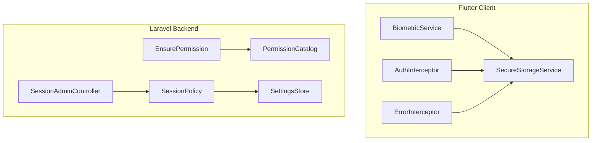
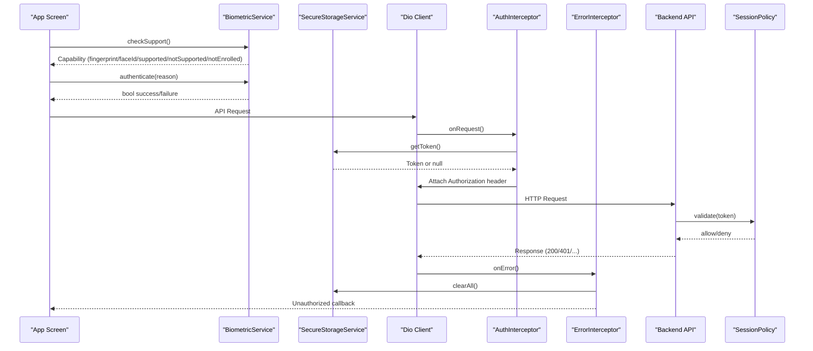
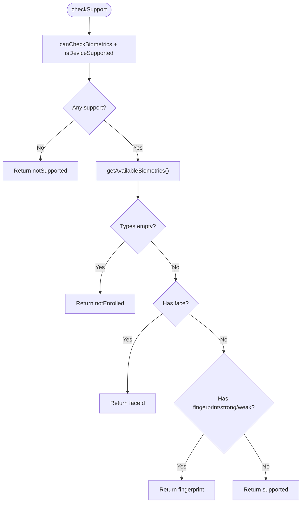
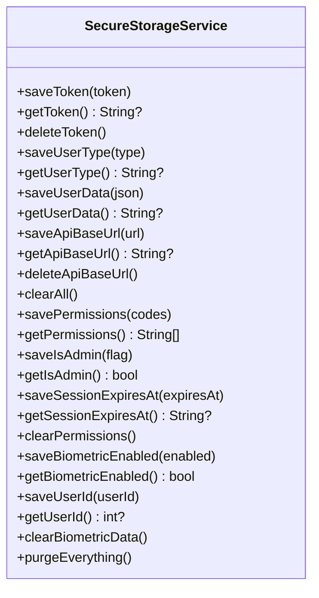
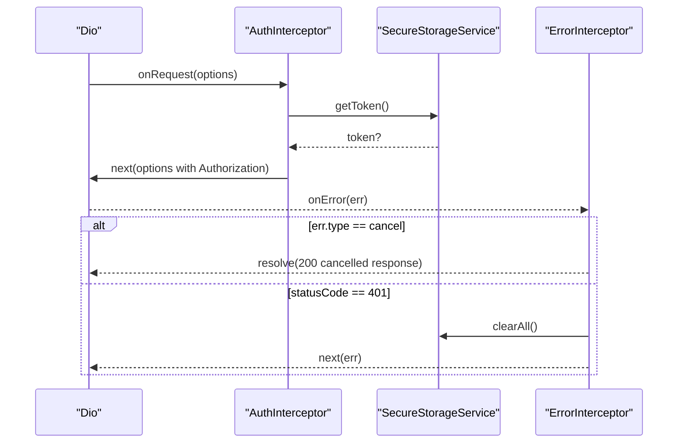
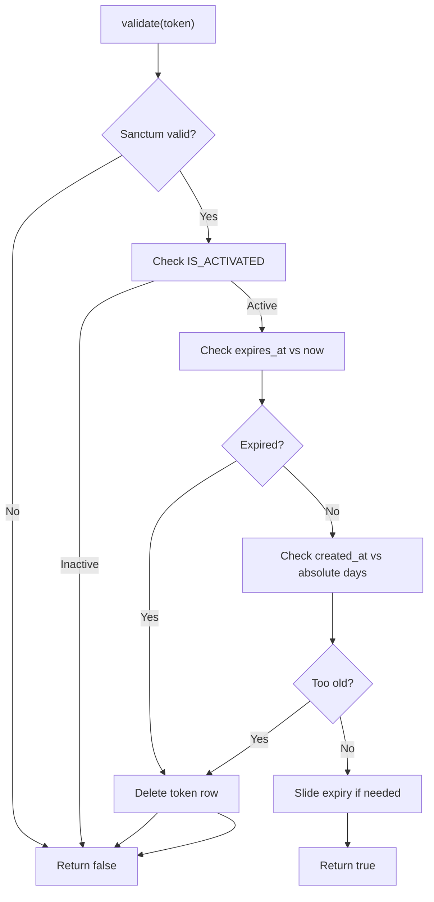
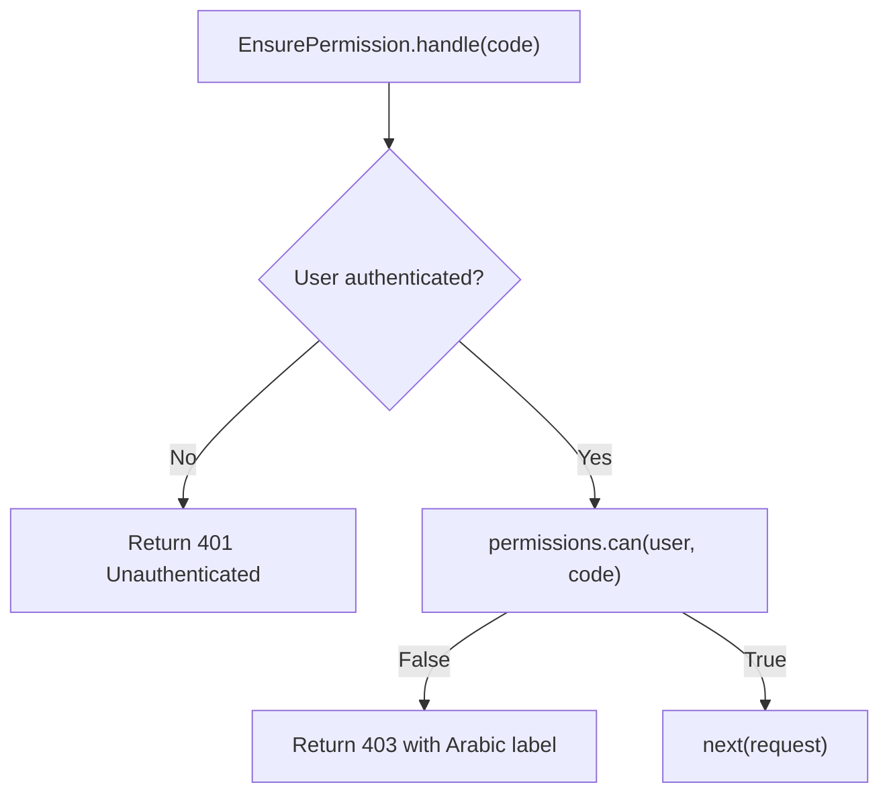
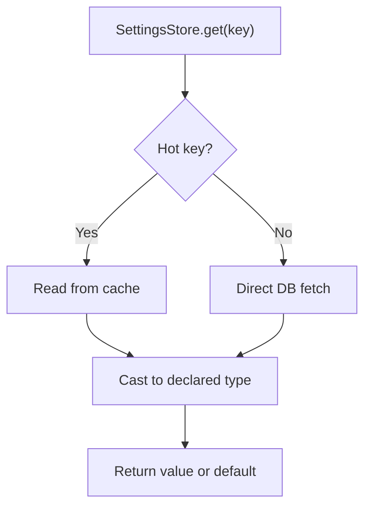
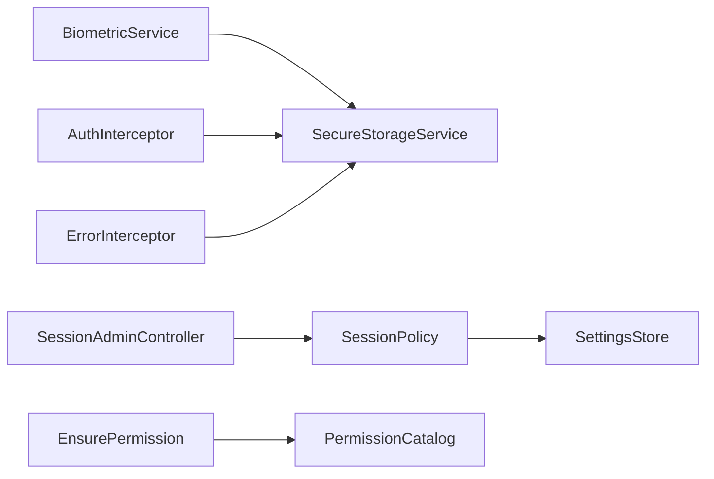

# Security Settings

<cite>
**Referenced Files in This Document**
- [biometric_service.dart](file://lib/core/utils/biometric_service.dart)
- [secure_storage_service.dart](file://lib/core/storage/secure_storage_service.dart)
- [auth_interceptor.dart](file://lib/core/network/auth_interceptor.dart)
- [error_interceptor.dart](file://lib/core/network/error_interceptor.dart)
- [SessionAdminController.php](file://kyApp_API/app/Http/Controllers/SessionAdminController.php)
- [SessionPolicy.php](file://kyApp_API/app/Support/SessionPolicy.php)
- [PermissionCatalog.php](file://kyApp_API/app/Support/PermissionCatalog.php)
- [EnsurePermission.php](file://kyApp_API/app/Http/Middleware/EnsurePermission.php)
- [SettingsStore.php](file://kyApp_API/app/Support/SettingsStore.php)
</cite>

## Table of Contents
1. [Introduction](#introduction)
2. [Project Structure](#project-structure)
3. [Core Components](#core-components)
4. [Architecture Overview](#architecture-overview)
5. [Detailed Component Analysis](#detailed-component-analysis)
6. [Dependency Analysis](#dependency-analysis)
7. [Performance Considerations](#performance-considerations)
8. [Troubleshooting Guide](#troubleshooting-guide)
9. [Conclusion](#conclusion)

## Introduction
This document explains the security settings implementation across the mobile client and backend. It covers:
- Biometric authentication configuration, registration flow, fingerprint and face ID setup, and policy controls.
- Secure storage for tokens, user data, permissions, session expiry, and biometric flags.
- Session management with sliding expiration, absolute lifetime, and active session termination.
- Permission controls using a canonical permission catalog and middleware enforcement.
- Practical examples for custom policies, session lifecycle handling, and biometric failure strategies.

## Project Structure
The security system spans Flutter client code and Laravel backend services:
- Client-side:
  - Biometric service wrapping device hardware capabilities.
  - Secure storage service managing encrypted tokens, credentials, permissions, and session metadata.
  - Network interceptors attaching authorization headers and handling unauthorized responses.
- Server-side:
  - Session controller listing and terminating active sessions.
  - Session policy enforcing idle sliding renewal and absolute expiration.
  - Permission catalog defining modules, actions, wildcards, and labels.
  - Permission middleware enforcing access control.
  - Settings store providing secure/session configuration with caching.

**Diagram sources**
- [biometric_service.dart:14-84](file://lib/core/utils/biometric_service.dart#L14-L84)
- [secure_storage_service.dart:7-204](file://lib/core/storage/secure_storage_service.dart#L7-L204)
- [auth_interceptor.dart:6-23](file://lib/core/network/auth_interceptor.dart#L6-L23)
- [error_interceptor.dart:6-38](file://lib/core/network/error_interceptor.dart#L6-L38)
- [SessionAdminController.php:32-474](file://kyApp_API/app/Http/Controllers/SessionAdminController.php#L32-L474)
- [SessionPolicy.php:42-185](file://kyApp_API/app/Support/SessionPolicy.php#L42-L185)
- [PermissionCatalog.php:22-480](file://kyApp_API/app/Support/PermissionCatalog.php#L22-L480)
- [EnsurePermission.php:25-54](file://kyApp_API/app/Http/Middleware/EnsurePermission.php#L25-L54)
- [SettingsStore.php:28-501](file://kyApp_API/app/Support/SettingsStore.php#L28-L501)

**Section sources**
- [biometric_service.dart:14-84](file://lib/core/utils/biometric_service.dart#L14-L84)
- [secure_storage_service.dart:7-204](file://lib/core/storage/secure_storage_service.dart#L7-L204)
- [auth_interceptor.dart:6-23](file://lib/core/network/auth_interceptor.dart#L6-L23)
- [error_interceptor.dart:6-38](file://lib/core/network/error_interceptor.dart#L6-L38)
- [SessionAdminController.php:32-474](file://kyApp_API/app/Http/Controllers/SessionAdminController.php#L32-L474)
- [SessionPolicy.php:42-185](file://kyApp_API/app/Support/SessionPolicy.php#L42-L185)
- [PermissionCatalog.php:22-480](file://kyApp_API/app/Support/PermissionCatalog.php#L22-L480)
- [EnsurePermission.php:25-54](file://kyApp_API/app/Http/Middleware/EnsurePermission.php#L25-L54)
- [SettingsStore.php:28-501](file://kyApp_API/app/Support/SettingsStore.php#L28-L501)

## Core Components
- BiometricService: Detects device capability, checks enrollment, prompts for biometric authentication, and maps capabilities to UI labels.
- SecureStorageService: Encrypts and stores tokens, user data, API base URL, permissions, admin flag, session expiry, and biometric state. Provides logout-safe clearing and full purge.
- AuthInterceptor: Automatically attaches Bearer token and JSON accept header to outgoing requests.
- ErrorInterceptor: Centralized error handling; clears session on 401 and triggers an unauthorized callback.
- SessionAdminController: Lists active sessions with search/filter/pagination and terminates single or all sessions by pushing expiry into the past.
- SessionPolicy: Validates tokens per request, enforces idle sliding renewal, absolute lifetime, and purges expired rows.
- PermissionCatalog: Canonical source of permission codes, module definitions, wildcard support, and human-readable labels.
- EnsurePermission: Middleware that denies access without required permission, returning localized messages.
- SettingsStore: Reads/writes security and session settings with type casting, bounds checking, locking, and short-lived cache.

**Section sources**
- [biometric_service.dart:14-84](file://lib/core/utils/biometric_service.dart#L14-L84)
- [secure_storage_service.dart:7-204](file://lib/core/storage/secure_storage_service.dart#L7-L204)
- [auth_interceptor.dart:6-23](file://lib/core/network/auth_interceptor.dart#L6-L23)
- [error_interceptor.dart:6-38](file://lib/core/network/error_interceptor.dart#L6-L38)
- [SessionAdminController.php:32-474](file://kyApp_API/app/Http/Controllers/SessionAdminController.php#L32-L474)
- [SessionPolicy.php:42-185](file://kyApp_API/app/Support/SessionPolicy.php#L42-L185)
- [PermissionCatalog.php:22-480](file://kyApp_API/app/Support/PermissionCatalog.php#L22-L480)
- [EnsurePermission.php:25-54](file://kyApp_API/app/Http/Middleware/EnsurePermission.php#L25-L54)
- [SettingsStore.php:28-501](file://kyApp_API/app/Support/SettingsStore.php#L28-L501)

## Architecture Overview
The security architecture integrates device biometrics, secure local storage, network interception, server-side session policy, and permission enforcement.

**Diagram sources**
- [biometric_service.dart:18-71](file://lib/core/utils/biometric_service.dart#L18-L71)
- [secure_storage_service.dart:32-95](file://lib/core/storage/secure_storage_service.dart#L32-L95)
- [auth_interceptor.dart:11-22](file://lib/core/network/auth_interceptor.dart#L11-L22)
- [error_interceptor.dart:12-36](file://lib/core/network/error_interceptor.dart#L12-L36)
- [SessionPolicy.php:70-108](file://kyApp_API/app/Support/SessionPolicy.php#L70-L108)

## Detailed Component Analysis

### Biometric Authentication Service
Responsibilities:
- Enumerates supported biometric types and enrollment status.
- Prompts for biometric authentication with platform-specific options.
- Maps capabilities to user-facing labels.

Key behaviors:
- Capability detection returns notSupported, notEnrolled, fingerprint, faceId, or supported.
- isAvailable filters out unsupported or unenrolled states.
- authenticate uses biometricOnly and stickyAuth to enforce strict biometric-only flows.

**Diagram sources**
- [biometric_service.dart:18-47](file://lib/core/utils/biometric_service.dart#L18-L47)

Practical guidance:
- Use checkSupport to gate UI elements for biometric login.
- Use isAvailable before prompting to avoid unnecessary prompts.
- Handle PlatformException and generic exceptions gracefully; treat failures as denied.

**Section sources**
- [biometric_service.dart:14-84](file://lib/core/utils/biometric_service.dart#L14-L84)

### Secure Storage Service
Responsibilities:
- Encrypted persistence for auth tokens, user data, API base URL, permissions, admin flag, session expiry, and biometric state.
- Logout-safe clearing that preserves API base URL but removes session-scoped data.
- Safe permission parsing that defaults to no permissions on corruption.

Key behaviors:
- clearAll removes token, user type, user data, permissions, admin flag, and session expiry.
- getPermissions tolerates malformed stored JSON and returns an empty list.
- saveSessionExpiresAt persists server-provided deadline text; getSessionExpiresAt reads it.
- Biometric keys persist across logout so users can re-authenticate via biometrics.

**Diagram sources**
- [secure_storage_service.dart:7-204](file://lib/core/storage/secure_storage_service.dart#L7-L204)

Security notes:
- Tokens and credentials are stored via flutter_secure_storage with platform keychain/keystore protection.
- Permissions are read defensively; corrupt blobs result in deny-by-default behavior.
- Biometric enablement and associated user ID survive logout to support biometric login.

**Section sources**
- [secure_storage_service.dart:7-204](file://lib/core/storage/secure_storage_service.dart#L7-L204)

### Network Interceptors
AuthInterceptor:
- Injects Authorization header when a token exists.
- Sets Accept header to application/json.

ErrorInterceptor:
- Handles cancellation errors gracefully.
- On 401, clears all session data and invokes an unauthorized callback.

**Diagram sources**
- [auth_interceptor.dart:11-22](file://lib/core/network/auth_interceptor.dart#L11-L22)
- [error_interceptor.dart:12-36](file://lib/core/network/error_interceptor.dart#L12-L36)

**Section sources**
- [auth_interceptor.dart:6-23](file://lib/core/network/auth_interceptor.dart#L6-L23)
- [error_interceptor.dart:6-38](file://lib/core/network/error_interceptor.dart#L6-L38)

### Active Sessions Management
SessionAdminController:
- Lists sessions with pagination, filtering by status and user, and search across names/devices.
- Terminates a single session or all sessions for a user by setting EXPIRES_AT to the past.
- Avoids reading sensitive TOKEN or ABILITIES columns.

SessionPolicy:
- Validates tokens after Sanctum lookup.
- Rejects if account deactivated, idle expired, or absolute age exceeded.
- Slides expiry within a threshold window to reduce writes.
- Purges expired tokens on login and session screen open.

**Diagram sources**
- [SessionPolicy.php:70-108](file://kyApp_API/app/Support/SessionPolicy.php#L70-L108)
- [SessionPolicy.php:147-183](file://kyApp_API/app/Support/SessionPolicy.php#L147-L183)

Operational notes:
- Termination does not delete token rows to preserve audit trail; it sets EXPIRES_AT to the past.
- The client’s ErrorInterceptor will log out devices automatically upon receiving 401 from subsequent requests.

**Section sources**
- [SessionAdminController.php:93-141](file://kyApp_API/app/Http/Controllers/SessionAdminController.php#L93-L141)
- [SessionAdminController.php:147-182](file://kyApp_API/app/Http/Controllers/SessionAdminController.php#L147-L182)
- [SessionAdminController.php:193-233](file://kyApp_API/app/Http/Controllers/SessionAdminController.php#L193-L233)
- [SessionPolicy.php:70-108](file://kyApp_API/app/Support/SessionPolicy.php#L70-L108)
- [SessionPolicy.php:130-141](file://kyApp_API/app/Support/SessionPolicy.php#L130-L141)

### Permission Controls
PermissionCatalog:
- Defines modules, core actions, extra actions, wildcards, and labels.
- Provides grouped structures for UI and validation helpers.

EnsurePermission:
- Enforces require-permission middleware.
- Returns 401 if unauthenticated, 403 with Arabic label if permission missing.

**Diagram sources**
- [EnsurePermission.php:32-52](file://kyApp_API/app/Http/Middleware/EnsurePermission.php#L32-L52)
- [PermissionCatalog.php:432-441](file://kyApp_API/app/Support/PermissionCatalog.php#L432-L441)

Implementation tips:
- Register routes under auth:sanctum and apply ->middleware('permission:module.action').
- System administrators bypass grant checks via PermissionResolver.

**Section sources**
- [PermissionCatalog.php:22-480](file://kyApp_API/app/Support/PermissionCatalog.php#L22-L480)
- [EnsurePermission.php:25-54](file://kyApp_API/app/Http/Middleware/EnsurePermission.php#L25-L54)

### Security Settings Store
SettingsStore:
- Caches hot security/session keys with TTL to reduce database load.
- Validates and normalizes values by declared type (bool/int/json/string).
- Supports locked settings and provides raw access for sensitive hashes.

Hot keys include session idle minutes, absolute days, touch threshold, single active session per device, password min length, max failed logins, lockout minutes, biometric login enabled, activity log retention, and maintenance message.

**Diagram sources**
- [SettingsStore.php:130-153](file://kyApp_API/app/Support/SettingsStore.php#L130-L153)
- [SettingsStore.php:205-216](file://kyApp_API/app/Support/SettingsStore.php#L205-L216)

Configuration guidance:
- Use SettingsStore.int(), .bool(), .raw() for typed reads.
- Use set() with updatedBy to persist changes; locked settings throw exceptions.

**Section sources**
- [SettingsStore.php:28-501](file://kyApp_API/app/Support/SettingsStore.php#L28-L501)

## Dependency Analysis

**Diagram sources**
- [biometric_service.dart:14-84](file://lib/core/utils/biometric_service.dart#L14-L84)
- [secure_storage_service.dart:7-204](file://lib/core/storage/secure_storage_service.dart#L7-L204)
- [auth_interceptor.dart:6-23](file://lib/core/network/auth_interceptor.dart#L6-L23)
- [error_interceptor.dart:6-38](file://lib/core/network/error_interceptor.dart#L6-L38)
- [SessionAdminController.php:32-474](file://kyApp_API/app/Http/Controllers/SessionAdminController.php#L32-L474)
- [SessionPolicy.php:42-185](file://kyApp_API/app/Support/SessionPolicy.php#L42-L185)
- [PermissionCatalog.php:22-480](file://kyApp_API/app/Support/PermissionCatalog.php#L22-L480)
- [EnsurePermission.php:25-54](file://kyApp_API/app/Http/Middleware/EnsurePermission.php#L25-L54)
- [SettingsStore.php:28-501](file://kyApp_API/app/Support/SettingsStore.php#L28-L501)

Coupling and cohesion:
- BiometricService depends only on LocalAuthentication; SecureStorageService encapsulates all persistent security state.
- SessionPolicy centralizes token lifecycle logic; controllers delegate to it rather than duplicating rules.
- PermissionCatalog is the single source of truth for permission semantics, reducing drift between server and UI.

Potential circular dependencies:
- None observed among analyzed components; dependencies are directional and well-scoped.

External integrations:
- Device biometric APIs via local_auth.
- Encrypted storage via flutter_secure_storage.
- HTTP client Dio with interceptors.
- Oracle-backed Laravel application with Sanctum tokens.

**Section sources**
- [biometric_service.dart:14-84](file://lib/core/utils/biometric_service.dart#L14-L84)
- [secure_storage_service.dart:7-204](file://lib/core/storage/secure_storage_service.dart#L7-L204)
- [auth_interceptor.dart:6-23](file://lib/core/network/auth_interceptor.dart#L6-L23)
- [error_interceptor.dart:6-38](file://lib/core/network/error_interceptor.dart#L6-L38)
- [SessionPolicy.php:42-185](file://kyApp_API/app/Support/SessionPolicy.php#L42-L185)
- [PermissionCatalog.php:22-480](file://kyApp_API/app/Support/PermissionCatalog.php#L22-L480)
- [EnsurePermission.php:25-54](file://kyApp_API/app/Http/Middleware/EnsurePermission.php#L25-L54)
- [SettingsStore.php:28-501](file://kyApp_API/app/Support/SettingsStore.php#L28-L501)

## Performance Considerations
- SessionPolicy slide writes are throttled by a configurable threshold to minimize database updates while keeping sessions alive.
- SettingsStore caches hot keys with a short TTL to reduce repeated queries on the request path.
- SecureStorageService reads permissions defensively to avoid expensive exception paths; corrupted data yields deny-by-default.
- SessionController avoids reading large CLOB fields and formats dates explicitly for Oracle compatibility.

[No sources needed since this section provides general guidance]

## Troubleshooting Guide
Common issues and resolutions:
- Biometric not available:
  - Check device support and enrollment via BiometricService.checkSupport().
  - If not enrolled, guide the user to register fingerprint or face ID in device settings.
- Biometric prompt fails:
  - Catch PlatformException and generic exceptions; fall back to password or account selection.
  - Ensure reason string is provided to localize the prompt.
- Unexpected 401 responses:
  - ErrorInterceptor clears all session data; ensure your app handles the unauthorized callback to navigate to login.
  - Verify SessionPolicy settings (idle minutes, absolute days) and that tokens are being primed on login.
- Permission denied:
  - Confirm the route uses ->middleware('permission:...') and the user has the required grant.
  - Use PermissionCatalog.arabicName to display friendly messages.
- Settings not applying immediately:
  - SettingsStore caches hot keys; changes may take up to the TTL unless flushed.
  - After transaction rollback, call SettingsStore.flush() to prevent stale cache.

**Section sources**
- [biometric_service.dart:57-71](file://lib/core/utils/biometric_service.dart#L57-L71)
- [error_interceptor.dart:12-36](file://lib/core/network/error_interceptor.dart#L12-L36)
- [SessionPolicy.php:70-108](file://kyApp_API/app/Support/SessionPolicy.php#L70-L108)
- [EnsurePermission.php:32-52](file://kyApp_API/app/Http/Middleware/EnsurePermission.php#L32-L52)
- [SettingsStore.php:130-153](file://kyApp_API/app/Support/SettingsStore.php#L130-L153)

## Conclusion
The security settings system combines robust client-side biometric integration, encrypted local storage, and server-side session and permission controls. BiometricService abstracts device capabilities, SecureStorageService protects sensitive data, and interceptors streamline authentication and error handling. On the server, SessionPolicy enforces safe session lifetimes, SessionAdminController provides administrative control over active sessions, PermissionCatalog defines a consistent permission model, and EnsurePermission enforces access control. SettingsStore centralizes configuration with caching and validation. Together, these components deliver a secure, maintainable, and user-friendly authentication and authorization experience.

[No sources needed since this section summarizes without analyzing specific files]