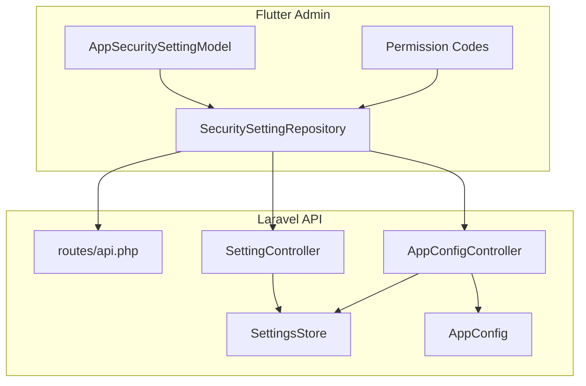
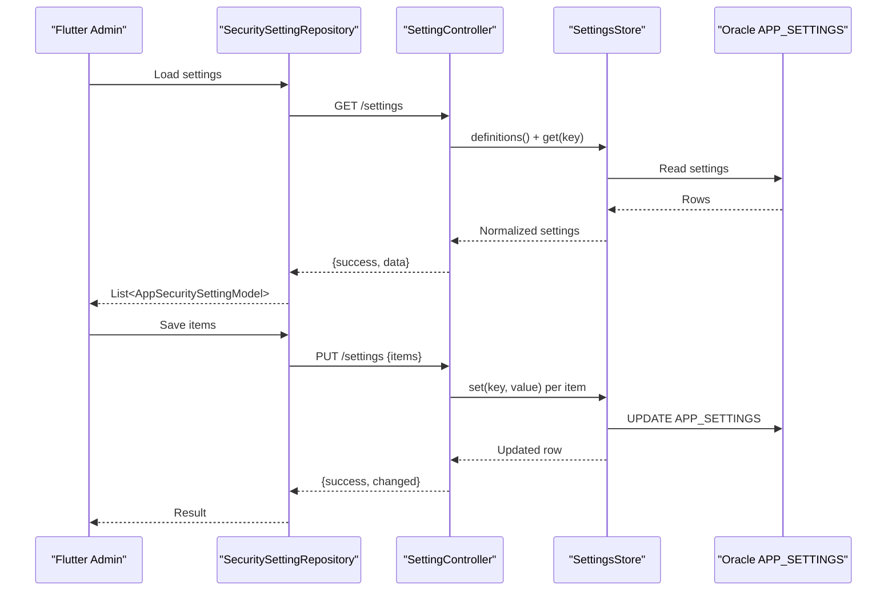
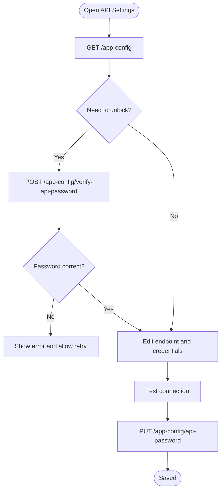
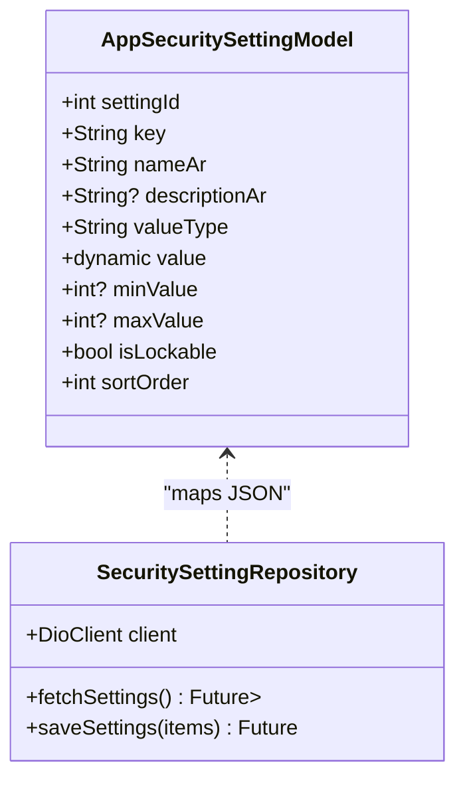
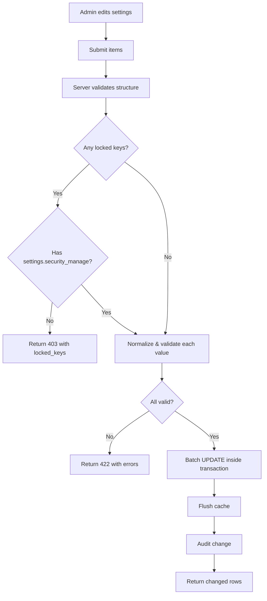
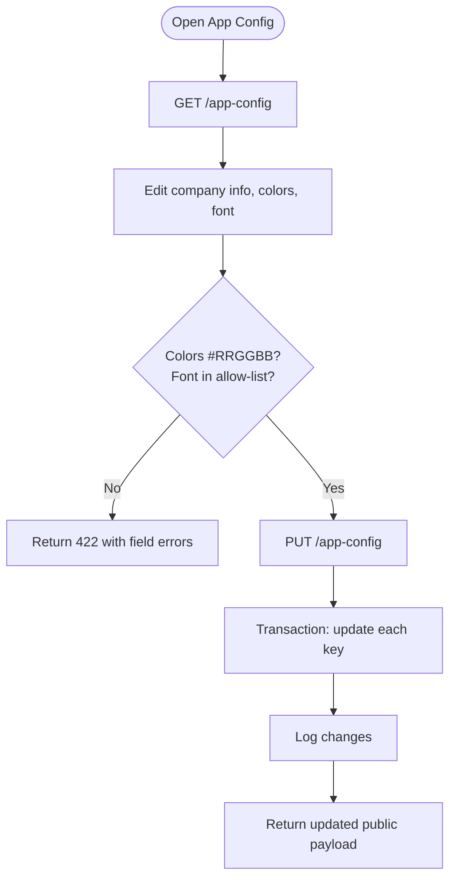
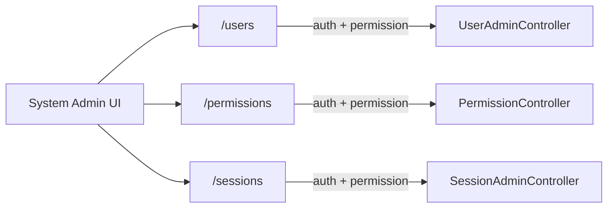
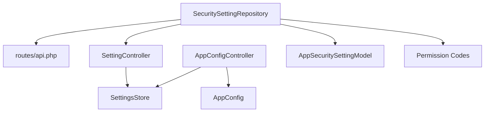

# Settings Module

<cite>
**Referenced Files in This Document**
- [SettingsStore.php](file://kyApp_API/app/Support/SettingsStore.php)
- [SettingController.php](file://kyApp_API/app/Http/Controllers/SettingController.php)
- [AppConfigController.php](file://kyApp_API/app/Http/Controllers/AppConfigController.php)
- [AppConfig.php](file://kyApp_API/app/Support/AppConfig.php)
- [api.php](file://kyApp_API/routes/api.php)
- [app_security_setting_model.dart](file://lib/features/admin/data/models/app_security_setting_model.dart)
- [security_setting_repository.dart](file://lib/features/admin/data/repositories/security_setting_repository.dart)
- [permission_codes.dart](file://lib/core/constants/permission_codes.dart)
</cite>

## Table of Contents
1. [Introduction](#introduction)
2. [Project Structure](#project-structure)
3. [Core Components](#core-components)
4. [Architecture Overview](#architecture-overview)
5. [Detailed Component Analysis](#detailed-component-analysis)
6. [Dependency Analysis](#dependency-analysis)
7. [Performance Considerations](#performance-considerations)
8. [Troubleshooting Guide](#troubleshooting-guide)
9. [Conclusion](#conclusion)
10. [Appendices](#appendices)

## Introduction
This document explains the settings module that powers API configuration, security settings, user preferences, and system administration. It covers:
- The API settings screen for endpoint configuration and connection testing.
- Security settings for authentication, session behavior, password policy, biometric controls, and maintenance messaging.
- User preference customization through application configuration such as company identity, theming, and font selection.
- System administration features including user management, permission assignment, active session control, and audit logging.
- Configuration persistence, validation, caching, and dynamic updates across the server and client.

The backend is a Laravel API backed by an Oracle database table `ACCOUNTS.APP_SETTINGS`. The Flutter frontend consumes REST endpoints to render settings screens, validate inputs, and apply changes atomically.

## Project Structure
The settings capability spans both backend and frontend layers:

- Backend
  - `kyApp_API/app/Support/SettingsStore.php`: Central persistence, validation, casting, and caching for all settings.
  - `kyApp_API/app/Http/Controllers/SettingController.php`: Reads and writes security-related settings via `/settings`.
  - `kyApp_API/app/Http/Controllers/AppConfigController.php`: Manages application configuration (company info, theming, API connection password).
  - `kyApp_API/app/Support/AppConfig.php`: Defines writable keys, defaults, allowed fonts, and public payload shape.
  - `kyApp_API/routes/api.php`: Declares routes for app config, settings, sessions, users, permissions, and business modules.

- Frontend
  - `lib/features/admin/data/models/app_security_setting_model.dart`: Data model for a single security setting returned by `/settings`.
  - `lib/features/admin/data/repositories/security_setting_repository.dart`: Repository that fetches and saves settings via `/settings`.
  - `lib/core/constants/permission_codes.dart`: Permission codes used by the UI to gate access to settings screens and actions.

**Diagram sources**
- [api.php:34-36](file://kyApp_API/routes/api.php#L34-L36)
- [api.php:125-129](file://kyApp_API/routes/api.php#L125-L129)
- [api.php:141-145](file://kyApp_API/routes/api.php#L141-L145)
- [SettingController.php:48-91](file://kyApp_API/app/Http/Controllers/SettingController.php#L48-L91)
- [AppConfigController.php:55-67](file://kyApp_API/app/Http/Controllers/AppConfigController.php#L55-L67)
- [AppConfig.php:131-143](file://kyApp_API/app/Support/AppConfig.php#L131-L143)
- [security_setting_repository.dart:22-35](file://lib/features/admin/data/repositories/security_setting_repository.dart#L22-L35)
- [app_security_setting_model.dart:1-24](file://lib/features/admin/data/models/app_security_setting_model.dart#L1-L24)
- [permission_codes.dart:133-139](file://lib/core/constants/permission_codes.dart#L133-L139)

**Section sources**
- [SettingsStore.php:1-501](file://kyApp_API/app/Support/SettingsStore.php#L1-L501)
- [SettingController.php:1-399](file://kyApp_API/app/Http/Controllers/SettingController.php#L1-L399)
- [AppConfigController.php:1-423](file://kyApp_API/app/Http/Controllers/AppConfigController.php#L1-L423)
- [AppConfig.php:1-174](file://kyApp_API/app/Support/AppConfig.php#L1-L174)
- [api.php:18-146](file://kyApp_API/routes/api.php#L18-L146)
- [app_security_setting_model.dart:1-24](file://lib/features/admin/data/models/app_security_setting_model.dart#L1-L24)
- [security_setting_repository.dart:1-40](file://lib/features/admin/data/repositories/security_setting_repository.dart#L1-L40)
- [permission_codes.dart:133-139](file://lib/core/constants/permission_codes.dart#L133-L139)

## Core Components
- SettingsStore
  - Single source of truth for reading, writing, validating, and caching settings from `ACCOUNTS.APP_SETTINGS`.
  - Provides typed getters (`get`, `int`, `bool`), raw access for sensitive values, definitions with Arabic labels, and batch-safe persistence.
  - Caches only “hot” keys on the request path; drops cache on write or explicitly via flush.

- SettingController
  - Exposes `GET /settings` and `PUT /settings` behind permissions.
  - Validates input, enforces locked-key policy, batches writes in one transaction, and logs changes.

- AppConfigController
  - Exposes public app configuration without secrets, verifies the API-settings password, and updates branding/theming safely.
  - Protects the API-settings password with a dedicated route and higher privilege.

- AppConfig
  - Defines all application configuration keys, defaults, allowed fonts, color formats, and the public payload shape.

- Flutter Admin Layer
  - `AppSecuritySettingModel` represents a single security setting returned by the server.
  - `SecuritySettingRepository` calls `/settings` to load and save settings in a single batch request.
  - Permission codes gate UI access to settings screens and actions.

**Section sources**
- [SettingsStore.php:108-153](file://kyApp_API/app/Support/SettingsStore.php#L108-L153)
- [SettingsStore.php:205-266](file://kyApp_API/app/Support/SettingsStore.php#L205-L266)
- [SettingsStore.php:279-321](file://kyApp_API/app/Support/SettingsStore.php#L279-L321)
- [SettingController.php:48-91](file://kyApp_API/app/Http/Controllers/SettingController.php#L48-L91)
- [SettingController.php:107-230](file://kyApp_API/app/Http/Controllers/SettingController.php#L107-L230)
- [AppConfigController.php:55-67](file://kyApp_API/app/Http/Controllers/AppConfigController.php#L55-L67)
- [AppConfigController.php:80-175](file://kyApp_API/app/Http/Controllers/AppConfigController.php#L80-L175)
- [AppConfigController.php:188-292](file://kyApp_API/app/Http/Controllers/AppConfigController.php#L188-L292)
- [AppConfig.php:131-143](file://kyApp_API/app/Support/AppConfig.php#L131-L143)
- [app_security_setting_model.dart:1-24](file://lib/features/admin/data/models/app_security_setting_model.dart#L1-L24)
- [security_setting_repository.dart:22-35](file://lib/features/admin/data/repositories/security_setting_repository.dart#L22-L35)
- [permission_codes.dart:133-139](file://lib/core/constants/permission_codes.dart#L133-L139)

## Architecture Overview
The settings architecture separates concerns between runtime-critical security/session settings and application configuration:

- Runtime security/session settings are read frequently (session policy, biometric checks) and cached briefly. They include idle timeout, absolute session lifetime, touch threshold, single-session-per-device rules, password policy, lockout policy, biometric enablement, activity log retention, and maintenance message.
- Application configuration includes company identity, theming colors, font family, and the API connection password. Public payload excludes secrets and falls back to defaults so the login screen can render correctly before any admin save.

**Diagram sources**
- [security_setting_repository.dart:22-35](file://lib/features/admin/data/repositories/security_setting_repository.dart#L22-L35)
- [security_setting_repository.dart:69-85](file://lib/features/admin/data/repositories/security_setting_repository.dart#L69-L85)
- [SettingController.php:48-91](file://kyApp_API/app/Http/Controllers/SettingController.php#L48-L91)
- [SettingController.php:107-230](file://kyApp_API/app/Http/Controllers/SettingController.php#L107-L230)
- [SettingsStore.php:279-321](file://kyApp_API/app/Support/SettingsStore.php#L279-L321)

## Detailed Component Analysis

### API Configuration Screen
Purpose:
- Configure endpoint base URL and connection credentials securely.
- Test connectivity before saving.

Key behaviors:
- Public configuration endpoint returns branding and theming without secrets.
- Connection password verification is public and rate-limited to distinguish wrong passwords from server unavailability.
- Updating the API connection password requires a dedicated endpoint and elevated permission.

Relevant endpoints:
- `GET /app-config` — public payload without secrets.
- `POST /app-config/verify-api-password` — verify static password for unlocking API settings.
- `PUT /app-config/api-password` — update the hashed API connection password.

**Diagram sources**
- [AppConfigController.php:55-67](file://kyApp_API/app/Http/Controllers/AppConfigController.php#L55-L67)
- [AppConfigController.php:188-226](file://kyApp_API/app/Http/Controllers/AppConfigController.php#L188-L226)
- [AppConfigController.php:240-292](file://kyApp_API/app/Http/Controllers/AppConfigController.php#L240-L292)
- [api.php:34-36](file://kyApp_API/routes/api.php#L34-L36)
- [api.php:141-145](file://kyApp_API/routes/api.php#L141-L145)

**Section sources**
- [AppConfigController.php:55-67](file://kyApp_API/app/Http/Controllers/AppConfigController.php#L55-L67)
- [AppConfigController.php:188-226](file://kyApp_API/app/Http/Controllers/AppConfigController.php#L188-L226)
- [AppConfigController.php:240-292](file://kyApp_API/app/Http/Controllers/AppConfigController.php#L240-L292)
- [api.php:34-36](file://kyApp_API/routes/api.php#L34-L36)
- [api.php:141-145](file://kyApp_API/routes/api.php#L141-L145)

### Security Settings Screen
Purpose:
- Manage authentication and session policies, password requirements, lockout behavior, biometric login toggle, activity log retention, and maintenance mode messages.

Data model:
- Each setting includes key, display name, description, value type, bounds, lockable flag, sort order, and audit metadata.

Persistence:
- Batched save ensures atomicity: either all changes apply or none do.
- Locked keys require explicit permission to modify.

**Diagram sources**
- [app_security_setting_model.dart:1-24](file://lib/features/admin/data/models/app_security_setting_model.dart#L1-L24)
- [security_setting_repository.dart:22-35](file://lib/features/admin/data/repositories/security_setting_repository.dart#L22-L35)
- [security_setting_repository.dart:69-85](file://lib/features/admin/data/repositories/security_setting_repository.dart#L69-L85)

Validation and persistence flow:

**Diagram sources**
- [SettingController.php:107-230](file://kyApp_API/app/Http/Controllers/SettingController.php#L107-L230)
- [SettingsStore.php:291-321](file://kyApp_API/app/Support/SettingsStore.php#L291-L321)
- [permission_codes.dart:133-139](file://lib/core/constants/permission_codes.dart#L133-L139)

**Section sources**
- [app_security_setting_model.dart:1-24](file://lib/features/admin/data/models/app_security_setting_model.dart#L1-L24)
- [security_setting_repository.dart:22-35](file://lib/features/admin/data/repositories/security_setting_repository.dart#L22-L35)
- [security_setting_repository.dart:69-85](file://lib/features/admin/data/repositories/security_setting_repository.dart#L69-L85)
- [SettingController.php:107-230](file://kyApp_API/app/Http/Controllers/SettingController.php#L107-L230)
- [permission_codes.dart:133-139](file://lib/core/constants/permission_codes.dart#L133-L139)

### User Preferences and Theming
Purpose:
- Customize company identity and application theme.
- Enforce safe formats for colors and fonts.

Key behaviors:
- Public payload provides defaults when values are blank.
- Colors must match `#RRGGBB`; fonts must be from an allow-list.
- All writes are transactional and audited.

**Diagram sources**
- [AppConfigController.php:80-175](file://kyApp_API/app/Http/Controllers/AppConfigController.php#L80-L175)
- [AppConfig.php:131-143](file://kyApp_API/app/Support/AppConfig.php#L131-L143)
- [AppConfig.php:160-172](file://kyApp_API/app/Support/AppConfig.php#L160-L172)
- [api.php:141-145](file://kyApp_API/routes/api.php#L141-L145)

**Section sources**
- [AppConfigController.php:80-175](file://kyApp_API/app/Http/Controllers/AppConfigController.php#L80-L175)
- [AppConfig.php:131-143](file://kyApp_API/app/Support/AppConfig.php#L131-L143)
- [AppConfig.php:160-172](file://kyApp_API/app/Support/AppConfig.php#L160-L172)
- [api.php:141-145](file://kyApp_API/routes/api.php#L141-L145)

### System Administration Features
User management:
- CRUD endpoints under `/users` with fine-grained permissions (`users.view`, `users.create`, `users.update`, `users.toggle`, `users.delete`, `users.activity_view`).

Permission management:
- Catalog and per-user grants under `/permissions` and `/users/{userId}/permissions`.

Active sessions:
- View and terminate sessions under `/sessions` with elevated permissions (`sessions.view`, `sessions.terminate`).

These routes are protected by `auth:sanctum` plus per-route `permission:<code>` middleware.

**Diagram sources**
- [api.php:59-102](file://kyApp_API/routes/api.php#L59-L102)
- [api.php:113-130](file://kyApp_API/routes/api.php#L113-L130)

**Section sources**
- [api.php:59-102](file://kyApp_API/routes/api.php#L59-L102)
- [api.php:113-130](file://kyApp_API/routes/api.php#L113-L130)

## Dependency Analysis
- Controllers depend on `SettingsStore` for consistent validation, casting, and persistence.
- `AppConfigController` additionally depends on `AppConfig` for key definitions, defaults, and public payload construction.
- Flutter repository depends on Dio client and maps responses to `AppSecuritySettingModel`.
- Permission codes in Flutter mirror server-side route protections.

**Diagram sources**
- [security_setting_repository.dart:22-35](file://lib/features/admin/data/repositories/security_setting_repository.dart#L22-L35)
- [SettingController.php:48-91](file://kyApp_API/app/Http/Controllers/SettingController.php#L48-L91)
- [AppConfigController.php:55-67](file://kyApp_API/app/Http/Controllers/AppConfigController.php#L55-L67)
- [AppConfig.php:131-143](file://kyApp_API/app/Support/AppConfig.php#L131-L143)
- [permission_codes.dart:133-139](file://lib/core/constants/permission_codes.dart#L133-L139)

**Section sources**
- [security_setting_repository.dart:22-35](file://lib/features/admin/data/repositories/security_setting_repository.dart#L22-L35)
- [SettingController.php:48-91](file://kyApp_API/app/Http/Controllers/SettingController.php#L48-L91)
- [AppConfigController.php:55-67](file://kyApp_API/app/Http/Controllers/AppConfigController.php#L55-L67)
- [AppConfig.php:131-143](file://kyApp_API/app/Support/AppConfig.php#L131-L143)
- [permission_codes.dart:133-139](file://lib/core/constants/permission_codes.dart#L133-L139)

## Performance Considerations
- Hot keys caching: Only session and biometric-related keys are cached for fast request-path reads. Non-hot keys are read directly from Oracle on rare paths (startup/admin).
- Cache TTL: Short-lived cache reduces staleness while avoiding frequent invalidation.
- Payload size limits: Numeric-only fields are cached to avoid Oracle bind-size constraints; definitions with Arabic text bypass cache due to size.
- Batch writes: Security settings are saved in a single transaction to prevent partial application of security posture changes.
- Public payload defaults: Blank values fall back to defaults so the client renders a correct identity even before first save.

[No sources needed since this section provides general guidance]

## Troubleshooting Guide
Common issues and resolutions:
- Invalid boolean or integer values: The server rejects values outside allowed tokens or numeric ranges. Check the setting’s declared type and bounds.
- Locked settings cannot be edited: Editing locked keys requires `settings.security_manage`. Ensure the actor has the required permission.
- API connection password rejected: Use the public verify endpoint to confirm the static password; failed attempts are audited without leaking details.
- Branding/theming validation failures: Colors must be `#RRGGBB`; fonts must be from the allow-list. Correct the format and retry.
- Stale settings after rollback: The controller flushes the cache after successful writes and on exceptions to prevent stale reads by session policy.

**Section sources**
- [SettingController.php:107-230](file://kyApp_API/app/Http/Controllers/SettingController.php#L107-L230)
- [AppConfigController.php:188-226](file://kyApp_API/app/Http/Controllers/AppConfigController.php#L188-L226)
- [AppConfigController.php:80-175](file://kyApp_API/app/Http/Controllers/AppConfigController.php#L80-L175)
- [SettingsStore.php:291-321](file://kyApp_API/app/Support/SettingsStore.php#L291-L321)

## Conclusion
The settings module provides a robust, secure, and extensible foundation for managing runtime security policies, application configuration, and system administration. Its design emphasizes:
- Strong validation and type safety via `SettingsStore`.
- Atomic batch operations to maintain consistent security posture.
- Clear separation between public configuration and secrets.
- Fine-grained permissions aligned with risk levels.
- Efficient caching for hot keys while preserving correctness for non-hot keys.

Extending the module involves adding new keys to `APP_SETTINGS`, defining their types and bounds, exposing them through appropriate controllers, and gating access with permissions.

[No sources needed since this section summarizes without analyzing specific files]

## Appendices

### Extending Settings Categories
Steps to add a new settings category:
- Define the new key(s) in the relevant definition class (`AppConfig` for branding/theming or `SettingsStore` hot keys if they are runtime-critical).
- Add default values and validation rules where applicable.
- Expose endpoints in `routes/api.php` with appropriate permissions.
- Implement controller methods that use `SettingsStore::set()` with proper validation and auditing.
- Update Flutter models and repositories to consume the new endpoints.

**Section sources**
- [AppConfig.php:20-104](file://kyApp_API/app/Support/AppConfig.php#L20-L104)
- [AppConfig.php:131-143](file://kyApp_API/app/Support/AppConfig.php#L131-L143)
- [api.php:141-145](file://kyApp_API/routes/api.php#L141-L145)
- [SettingController.php:107-230](file://kyApp_API/app/Http/Controllers/SettingController.php#L107-L230)

### Implementing Custom Configuration Options
Guidelines:
- Choose the correct storage path: runtime-critical options should be added to hot keys; otherwise, rely on direct reads.
- Specify `value_type` and bounds (`min_value`/`max_value`) to leverage built-in normalization and validation.
- Mark sensitive keys as lockable and protect them with dedicated endpoints and elevated permissions.
- Provide Arabic labels and descriptions in the seed data for admin screens.

**Section sources**
- [SettingsStore.php:52-89](file://kyApp_API/app/Support/SettingsStore.php#L52-L89)
- [SettingsStore.php:344-407](file://kyApp_API/app/Support/SettingsStore.php#L344-L407)
- [SettingController.php:48-91](file://kyApp_API/app/Http/Controllers/SettingController.php#L48-L91)

### Integrating with System Administration APIs
Integration checklist:
- Authenticate using Sanctum and attach the token to requests.
- Request permissions matching the operation (`users.*`, `permissions.*`, `sessions.*`, `settings.*`, `app_config.*`).
- Handle standardized responses with `success`, `message`, `data`, and optional `errors`.
- Respect rate limits on public endpoints like password verification.

**Section sources**
- [api.php:59-102](file://kyApp_API/routes/api.php#L59-L102)
- [api.php:113-130](file://kyApp_API/routes/api.php#L113-L130)
- [api.php:141-145](file://kyApp_API/routes/api.php#L141-L145)
- [permission_codes.dart:133-139](file://lib/core/constants/permission_codes.dart#L133-L139)