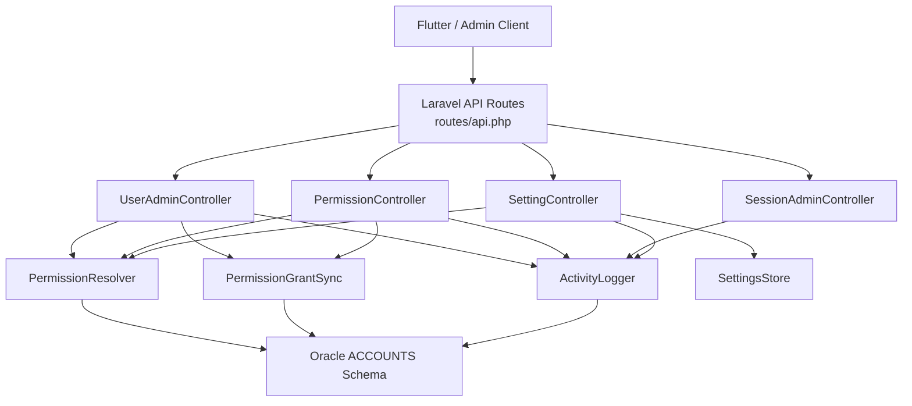
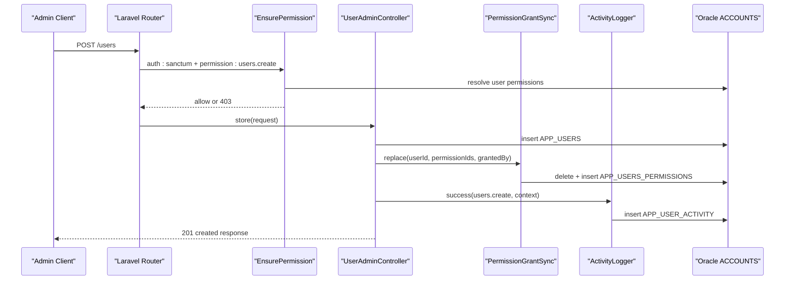
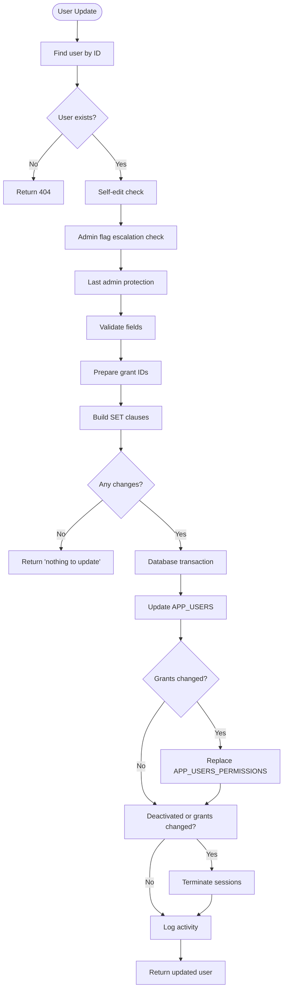
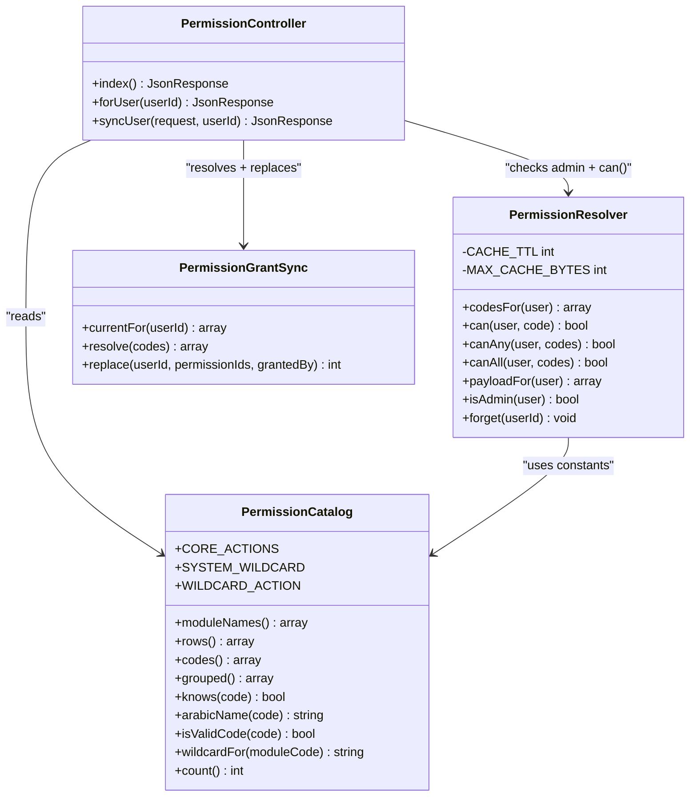
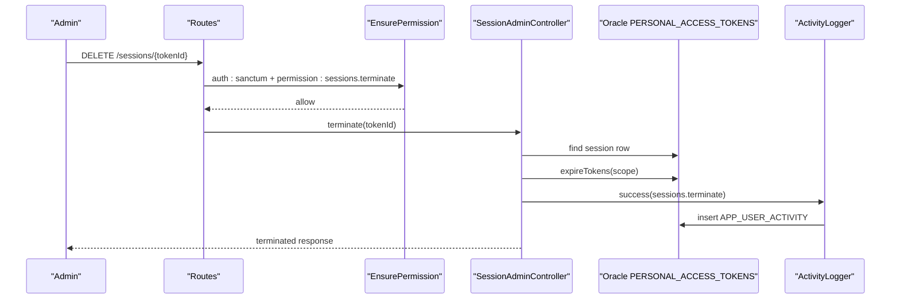
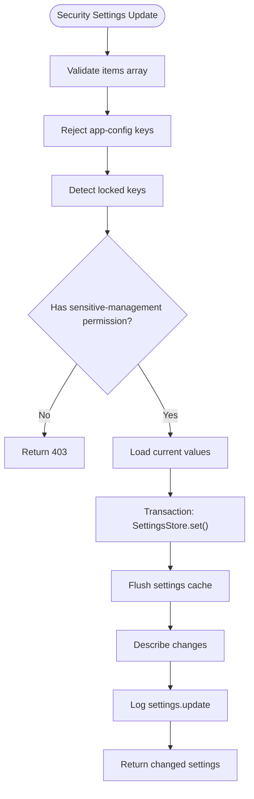
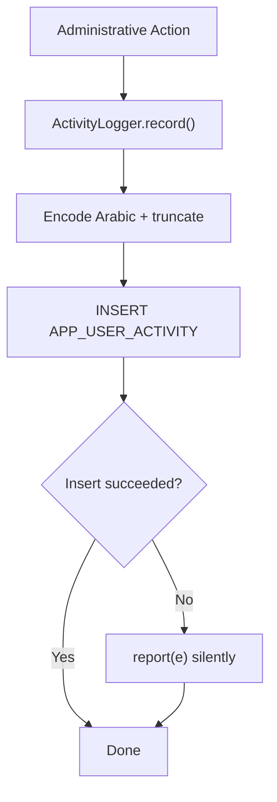
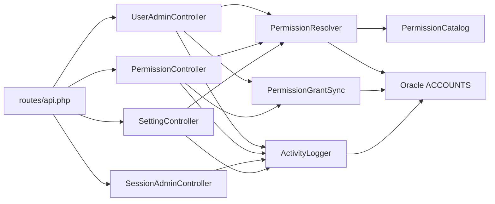

# System Administration

<cite>
**Referenced Files in This Document**   
- [UserAdminController.php](file://kyApp_API/app/Http/Controllers/UserAdminController.php)
- [PermissionController.php](file://kyApp_API/app/Http/Controllers/PermissionController.php)
- [SessionAdminController.php](file://kyApp_API/app/Http/Controllers/SessionAdminController.php)
- [SettingController.php](file://kyApp_API/app/Http/Controllers/SettingController.php)
- [EnsurePermission.php](file://kyApp_API/app/Http/Middleware/EnsurePermission.php)
- [PermissionResolver.php](file://kyApp_API/app/Support/PermissionResolver.php)
- [PermissionCatalog.php](file://kyApp_API/app/Support/PermissionCatalog.php)
- [PermissionGrantSync.php](file://kyApp_API/app/Support/PermissionGrantSync.php)
- [ActivityLogger.php](file://kyApp_API/app/Support/ActivityLogger.php)
- [User.php](file://kyApp_API/app/Models/User.php)
- [api.php](file://kyApp_API/routes/api.php)
- [01_ibac_schema.sql](file://kyApp_API/database/oracle/01_ibac_schema.sql)
- [02_ibac_seed.php](file://kyApp_API/database/oracle/02_ibac_seed.php)
</cite>

## Table of Contents
1. [Introduction](#introduction)
2. [Project Structure](#project-structure)
3. [Core Components](#core-components)
4. [Architecture Overview](#architecture-overview)
5. [Detailed Component Analysis](#detailed-component-analysis)
6. [Dependency Analysis](#dependency-analysis)
7. [Performance Considerations](#performance-considerations)
8. [Troubleshooting Guide](#troubleshooting-guide)
9. [Conclusion](#conclusion)
10. [Appendices](#appendices)

## Introduction
This document explains the system administration features implemented in the Laravel backend: user management, permission assignment, session monitoring, and security settings. It focuses on the admin dashboard integration through REST endpoints, the IBAC (Individual-Based Access Control) model, the permission catalog, grant synchronization, and audit logging. The goal is to help administrators and developers understand how to create administrative workflows, assign permissions, monitor activity, and extend the system safely.

The implementation uses:
- A legacy Oracle schema under `ACCOUNTS` for users, permissions, grants, settings, and activity.
- Laravel Sanctum sessions for authentication.
- A route-level permission middleware that enforces deny-by-default access control.
- A centralized permission resolver with caching and wildcard support.
- An explicit permission catalog that drives both database seeding and runtime validation.
- An audit trail that records administrative actions without breaking successful requests.

## Project Structure
The administration surface is exposed through protected API routes and implemented by dedicated controllers. Supporting logic lives in `app/Support`, while the data model and database schema live in `app/Models` and `database/oracle`.

**Diagram sources**
- [api.php:59-146](file://kyApp_API/routes/api.php#L59-L146)
- [UserAdminController.php:34-102](file://kyApp_API/app/Http/Controllers/UserAdminController.php#L34-L102)
- [PermissionController.php:30-42](file://kyApp_API/app/Http/Controllers/PermissionController.php#L30-L42)
- [SessionAdminController.php:32-82](file://kyApp_API/app/Http/Controllers/SessionAdminController.php#L32-L82)
- [SettingController.php:31-37](file://kyApp_API/app/Http/Controllers/SettingController.php#L31-L37)
- [PermissionResolver.php:27-33](file://kyApp_API/app/Support/PermissionResolver.php#L27-L33)
- [PermissionGrantSync.php:20-32](file://kyApp_API/app/Support/PermissionGrantSync.php#L20-L32)
- [ActivityLogger.php:18-19](file://kyApp_API/app/Support/ActivityLogger.php#L18-L19)

**Section sources**
- [api.php:18-146](file://kyApp_API/routes/api.php#L18-L146)
- [01_ibac_schema.sql:21-190](file://kyApp_API/database/oracle/01_ibac_schema.sql#L21-L190)

## Core Components
The administration system is built around five core components:

| Component | Responsibility | Key Behaviors |
|---|---|---|
| `UserAdminController` | User CRUD, activation toggle, deletion, per-user activity listing | Validates input, prevents self-harm and last-admin lockout, writes to legacy `APP_USERS`, logs activity |
| `PermissionController` | Permission catalog listing, per-user grant inspection, atomic grant replacement | Reads catalog grouped by module, resolves codes to IDs, terminates sessions when grants change |
| `SessionAdminController` | Active session listing and termination | Lists tokens joined with users, expires tokens by pushing expiry into the past, logs terminations |
| `SettingController` | Security settings read/update | Enforces type/bounds via `SettingsStore`, blocks app-config keys from this screen, requires sensitive-management permission for locked keys |
| `EnsurePermission` | Route-level authorization | Returns 401 if unauthenticated, 403 with Arabic permission label if denied, delegates decision to `PermissionResolver` |

**Section sources**
- [UserAdminController.php:18-34](file://kyApp_API/app/Http/Controllers/UserAdminController.php#L18-L34)
- [PermissionController.php:17-29](file://kyApp_API/app/Http/Controllers/PermissionController.php#L17-L29)
- [SessionAdminController.php:15-31](file://kyApp_API/app/Http/Controllers/SessionAdminController.php#L15-L31)
- [SettingController.php:17-30](file://kyApp_API/app/Http/Controllers/SettingController.php#L17-L30)
- [EnsurePermission.php:11-24](file://kyApp_API/app/Http/Middleware/EnsurePermission.php#L11-L24)

## Architecture Overview
The administration architecture follows a layered approach:

1. **Routing layer**: Sanctum-authenticated routes declare required permission codes.
2. **Middleware layer**: `EnsurePermission` checks whether the current user has the required permission.
3. **Controller layer**: Controllers validate inputs, enforce business rules, and perform database operations.
4. **Support layer**: `PermissionResolver`, `PermissionGrantSync`, `ActivityLogger`, and `SettingsStore` encapsulate cross-cutting concerns.
5. **Data layer**: Oracle tables under `ACCOUNTS` store users, permissions, grants, settings, and activity.

**Diagram sources**
- [api.php:84-85](file://kyApp_API/routes/api.php#L84-L85)
- [EnsurePermission.php:32-52](file://kyApp_API/app/Http/Middleware/EnsurePermission.php#L32-L52)
- [UserAdminController.php:188-311](file://kyApp_API/app/Http/Controllers/UserAdminController.php#L188-L311)
- [PermissionGrantSync.php:134-162](file://kyApp_API/app/Support/PermissionGrantSync.php#L134-L162)
- [ActivityLogger.php:37-73](file://kyApp_API/app/Support/ActivityLogger.php#L37-L73)

## Detailed Component Analysis

### User Management
`UserAdminController` implements the full user lifecycle:

- **List users**: paginated, filtered by status, user type, admin-only, and search; includes active grant count.
- **Show user**: returns user data, effective permission codes and IDs, and latest activity timestamp.
- **Create user**: validates input, normalizes username, enforces admin-flag permission, prepares grants, inserts user and grants atomically, logs activity.
- **Update user**: selective column updates, admin-flag escalation guard, last-admin protection, optional grant replacement, session termination on deactivation or grant changes.
- **Toggle activation**: prevents self-deactivation and last-admin deactivation; terminates sessions on deactivation.
- **Delete user**: prevents self-deletion and last-admin deletion; deletes grants, personal access tokens, and user row; clears permission cache.
- **Activity listing**: paginated list of activities where the user is actor or target.

**Diagram sources**
- [UserAdminController.php:318-495](file://kyApp_API/app/Http/Controllers/UserAdminController.php#L318-L495)

**Section sources**
- [UserAdminController.php:108-148](file://kyApp_API/app/Http/Controllers/UserAdminController.php#L108-L148)
- [UserAdminController.php:154-182](file://kyApp_API/app/Http/Controllers/UserAdminController.php#L154-L182)
- [UserAdminController.php:188-311](file://kyApp_API/app/Http/Controllers/UserAdminController.php#L188-L311)
- [UserAdminController.php:318-495](file://kyApp_API/app/Http/Controllers/UserAdminController.php#L318-L495)
- [UserAdminController.php:502-560](file://kyApp_API/app/Http/Controllers/UserAdminController.php#L502-L560)
- [UserAdminController.php:566-626](file://kyApp_API/app/Http/Controllers/UserAdminController.php#L566-L626)
- [UserAdminController.php:632-679](file://kyApp_API/app/Http/Controllers/UserAdminController.php#L632-L679)

### Permission Catalog and Grant Management
The permission system is IBAC-based: permissions are granted directly to users, not through roles. The catalog defines valid permission codes, modules, actions, labels, and ordering.

Key behaviors:
- `PermissionCatalog` defines modules, core actions, wildcards, and generates rows for seeding and UI.
- `PermissionResolver` evaluates permissions with a strict order: system admin bypass, system wildcard, explicit code, module wildcard, then deny.
- `PermissionGrantSync` is the only writer for `APP_USERS_PERMISSIONS`; it resolves codes to IDs, replaces grants atomically, and invalidates cached permissions.
- `PermissionController` exposes the catalog, per-user grant state, and an atomic sync endpoint.

**Diagram sources**
- [PermissionCatalog.php:22-479](file://kyApp_API/app/Support/PermissionCatalog.php#L22-L479)
- [PermissionResolver.php:27-274](file://kyApp_API/app/Support/PermissionResolver.php#L27-L274)
- [PermissionGrantSync.php:20-190](file://kyApp_API/app/Support/PermissionGrantSync.php#L20-L190)
- [PermissionController.php:30-243](file://kyApp_API/app/Http/Controllers/PermissionController.php#L30-L243)

**Section sources**
- [PermissionCatalog.php:5-21](file://kyApp_API/app/Support/PermissionCatalog.php#L5-L21)
- [PermissionCatalog.php:52-237](file://kyApp_API/app/Support/PermissionCatalog.php#L52-L237)
- [PermissionCatalog.php:271-316](file://kyApp_API/app/Support/PermissionCatalog.php#L271-L316)
- [PermissionResolver.php:9-26](file://kyApp_API/app/Support/PermissionResolver.php#L9-L26)
- [PermissionResolver.php:95-132](file://kyApp_API/app/Support/PermissionResolver.php#L95-L132)
- [PermissionGrantSync.php:65-120](file://kyApp_API/app/Support/PermissionGrantSync.php#L65-L120)
- [PermissionGrantSync.php:134-162](file://kyApp_API/app/Support/PermissionGrantSync.php#L134-L162)
- [PermissionController.php:51-93](file://kyApp_API/app/Http/Controllers/PermissionController.php#L51-L93)
- [PermissionController.php:137-243](file://kyApp_API/app/Http/Controllers/PermissionController.php#L137-L243)

### Session Monitoring
`SessionAdminController` manages active sessions represented by `PERSONAL_ACCESS_TOKENS`:

- Lists sessions with safe columns, filters by user, status, and search, and paginates using Oracle-compatible windowing.
- Terminates a single session or all sessions for a user by updating `EXPIRES_AT` to the past.
- Logs session termination events.
- Never reads token secrets or large CLOB abilities.

**Diagram sources**
- [api.php:117-123](file://kyApp_API/routes/api.php#L117-L123)
- [SessionAdminController.php:147-182](file://kyApp_API/app/Http/Controllers/SessionAdminController.php#L147-L182)
- [SessionAdminController.php:343-354](file://kyApp_API/app/Http/Controllers/SessionAdminController.php#L343-L354)
- [ActivityLogger.php:37-73](file://kyApp_API/app/Support/ActivityLogger.php#L37-L73)

**Section sources**
- [SessionAdminController.php:93-141](file://kyApp_API/app/Http/Controllers/SessionAdminController.php#L93-L141)
- [SessionAdminController.php:193-233](file://kyApp_API/app/Http/Controllers/SessionAdminController.php#L193-L233)
- [SessionAdminController.php:245-283](file://kyApp_API/app/Http/Controllers/SessionAdminController.php#L245-L283)
- [SessionAdminController.php:343-354](file://kyApp_API/app/Http/Controllers/SessionAdminController.php#L343-L354)

### Security Settings and System Configuration
`SettingController` backs the security settings screen:

- Returns definitions with Arabic labels, value types, bounds, lockable flags, and current values.
- Rejects app-config keys from this endpoint.
- Requires `settings.security_manage` to modify locked settings.
- Saves settings in a transaction, flushes caches, and logs changes with before/after descriptions.

**Diagram sources**
- [SettingController.php:107-230](file://kyApp_API/app/Http/Controllers/SettingController.php#L107-L230)
- [SettingController.php:243-289](file://kyApp_API/app/Http/Controllers/SettingController.php#L243-L289)
- [SettingController.php:320-334](file://kyApp_API/app/Http/Controllers/SettingController.php#L320-L334)

**Section sources**
- [SettingController.php:48-91](file://kyApp_API/app/Http/Controllers/SettingController.php#L48-L91)
- [SettingController.php:107-230](file://kyApp_API/app/Http/Controllers/SettingController.php#L107-L230)
- [SettingController.php:243-289](file://kyApp_API/app/Http/Controllers/SettingController.php#L243-L289)

### Audit Trail and Activity Monitoring
`ActivityLogger` writes administrative actions to `APP_USER_ACTIVITY`:

- Records action code, module, entity type, entity ID, Arabic description, status, IP, user agent, platform, and timestamp.
- Uses bound statements and truncation to protect against overflow.
- Wrrites silently: failures are reported but never break the calling request.
- Controllers log creation, updates, toggles, deletions, permission syncs, session terminations, and settings changes.

**Diagram sources**
- [ActivityLogger.php:37-73](file://kyApp_API/app/Support/ActivityLogger.php#L37-L73)
- [ActivityLogger.php:101-155](file://kyApp_API/app/Support/ActivityLogger.php#L101-L155)

**Section sources**
- [ActivityLogger.php:9-17](file://kyApp_API/app/Support/ActivityLogger.php#L9-L17)
- [ActivityLogger.php:37-73](file://kyApp_API/app/Support/ActivityLogger.php#L37-L73)
- [UserAdminController.php:293-300](file://kyApp_API/app/Http/Controllers/UserAdminController.php#L293-L300)
- [UserAdminController.php:477-484](file://kyApp_API/app/Http/Controllers/UserAdminController.php#L477-L484)
- [UserAdminController.php:543-550](file://kyApp_API/app/Http/Controllers/UserAdminController.php#L543-L550)
- [UserAdminController.php:609-616](file://kyApp_API/app/Http/Controllers/UserAdminController.php#L609-L616)
- [PermissionController.php:219-226](file://kyApp_API/app/Http/Controllers/PermissionController.php#L219-L226)
- [SessionAdminController.php:165-172](file://kyApp_API/app/Http/Controllers/SessionAdminController.php#L165-L172)
- [SessionAdminController.php:216-223](file://kyApp_API/app/Http/Controllers/SessionAdminController.php#L216-L223)
- [SettingController.php:199-205](file://kyApp_API/app/Http/Controllers/SettingController.php#L199-L205)

## Dependency Analysis
The administration subsystem has clear dependencies:

- Controllers depend on support classes rather than direct database logic for cross-cutting concerns.
- `PermissionResolver` depends on `PermissionCatalog` for constants and on the Oracle connection for grant queries.
- `PermissionGrantSync` depends on `PermissionResolver` only for cache invalidation after writes.
- `ActivityLogger` depends on Oracle and encoding helpers but must never fail the caller.
- Routes bind controllers to permission codes, enforcing policy at the HTTP boundary.

**Diagram sources**
- [api.php:59-146](file://kyApp_API/routes/api.php#L59-L146)
- [UserAdminController.php:97-102](file://kyApp_API/app/Http/Controllers/UserAdminController.php#L97-L102)
- [PermissionController.php:38-42](file://kyApp_API/app/Http/Controllers/PermissionController.php#L38-L42)
- [SessionAdminController.php:82-82](file://kyApp_API/app/Http/Controllers/SessionAdminController.php#L82-L82)
- [SettingController.php:33-37](file://kyApp_API/app/Http/Controllers/SettingController.php#L33-L37)
- [PermissionResolver.php:27-33](file://kyApp_API/app/Support/PermissionResolver.php#L27-L33)
- [PermissionGrantSync.php:32-32](file://kyApp_API/app/Support/PermissionGrantSync.php#L32-L32)
- [ActivityLogger.php:18-19](file://kyApp_API/app/Support/ActivityLogger.php#L18-L19)

**Section sources**
- [api.php:59-146](file://kyApp_API/routes/api.php#L59-L146)
- [PermissionResolver.php:9-26](file://kyApp_API/app/Support/PermissionResolver.php#L9-L26)
- [PermissionGrantSync.php:7-19](file://kyApp_API/app/Support/PermissionGrantSync.php#L7-L19)
- [ActivityLogger.php:9-17](file://kyApp_API/app/Support/ActivityLogger.php#L9-L17)

## Performance Considerations
- **Permission caching**: `PermissionResolver` caches a user’s permission codes for a limited time and skips cache insertion when the serialized payload approaches Oracle’s 4000-byte limit.
- **Oracle 11g pagination**: Listing endpoints use `ROW_NUMBER()` instead of `OFFSET/FETCH`, which are unavailable in Oracle 11g.
- **Safe column selection**: Session listing avoids reading token secrets and CLOB abilities.
- **Bound statements**: All SQL uses parameter binding to prevent injection and improve execution plans.
- **Selective updates**: User updates build only the changed columns, avoiding accidental blanking.
- **Audit isolation**: Activity logging failures are swallowed so they do not degrade user-facing performance.

[No sources needed since this section provides general guidance]

## Troubleshooting Guide
Common issues and their likely causes:

| Symptom | Likely Cause | Resolution |
|---|---|---|
| 401 Unauthenticated | Missing or expired Sanctum token | Reauthenticate and refresh the token |
| 403 Permission denied | User lacks the required permission code | Assign the correct permission via `/users/{userId}/permissions` |
| Cannot set admin flag | Actor does not hold `users.admin_flag_manage` | Use an existing administrator or grant the flag through a privileged operation |
| Cannot delete or deactivate last admin | Anti-lockout guard prevents system lockout | Ensure at least one administrator remains |
| Unknown permission codes | Submitted code not present in `APP_PERMISSIONS` | Use codes from the permission catalog endpoint |
| Inactive permissions cannot be granted | Permission row has `IS_ACTIVE = 0` | Activate the permission in the catalog or seed process |
| Arabic text appears corrupted | CP1256 bytes handled incorrectly | Ensure Arabic goes through `ArabicEncoding::toOracleSearchChars()` on write and `fixMojibake()` on read |
| Settings update fails with invalid value | Type or bounds violation enforced by `SettingsStore` | Adjust the value to match the declared type and min/max range |
| Session termination does not work immediately | Token expiry was not pushed into the past | Verify the terminate endpoint updates `EXPIRES_AT` to a past timestamp |

**Section sources**
- [EnsurePermission.php:32-52](file://kyApp_API/app/Http/Middleware/EnsurePermission.php#L32-L52)
- [UserAdminController.php:235-241](file://kyApp_API/app/Http/Controllers/UserAdminController.php#L235-L241)
- [UserAdminController.php:336-347](file://kyApp_API/app/Http/Controllers/UserAdminController.php#L336-L347)
- [UserAdminController.php:518-525](file://kyApp_API/app/Http/Controllers/UserAdminController.php#L518-L525)
- [UserAdminController.php:582-584](file://kyApp_API/app/Http/Controllers/UserAdminController.php#L582-L584)
- [PermissionController.php:176-192](file://kyApp_API/app/Http/Controllers/PermissionController.php#L176-L192)
- [SettingController.php:215-229](file://kyApp_API/app/Http/Controllers/SettingController.php#L215-L229)
- [SessionAdminController.php:343-354](file://kyApp_API/app/Http/Controllers/SessionAdminController.php#L343-L354)

## Conclusion
The system administration layer provides a secure, auditable, and extensible foundation for managing users, permissions, sessions, and configuration. Its design emphasizes:

- Deny-by-default authorization enforced at the route level.
- Explicit escalation guards preventing privilege abuse and system lockout.
- A single source of truth for permissions through `PermissionCatalog`.
- Atomic grant replacement with immediate effect via session termination.
- Comprehensive audit logging that records administrative actions without compromising availability.
- Oracle-aware implementations for pagination, encoding, and legacy schema compatibility.

Administrators should use the provided endpoints to manage users and permissions, monitor sessions, and adjust security settings. Developers extending the system should add new permission codes to `PermissionCatalog`, protect routes with `permission:` middleware, and log administrative actions through `ActivityLogger`.

[No sources needed since this section summarizes without analyzing specific files]

## Appendices

### Practical Examples

#### Creating a New Administrative Role Equivalent
The system uses IBAC rather than roles. To create an “administrative role” equivalent:

1. Define new permission codes in `PermissionCatalog` under a suitable module.
2. Seed `APP_PERMISSIONS` using the same catalog-driven seed script.
3. Assign those permission codes to a user through `/users/{userId}/permissions`.
4. Restrict related routes with `permission:<code>` middleware.

**Section sources**
- [PermissionCatalog.php:52-237](file://kyApp_API/app/Support/PermissionCatalog.php#L52-L237)
- [02_ibac_seed.php:434-436](file://kyApp_API/database/oracle/02_ibac_seed.php#L434-L436)
- [api.php:64-101](file://kyApp_API/routes/api.php#L64-L101)

#### Assigning Permissions to a User
Use the permission sync endpoint to replace a user’s grants:

- Endpoint: `PUT /users/{userId}/permissions`
- Required permission: `users.permissions_manage`
- Request body includes a list of permission codes and an optional `logout_others` flag.
- Unknown or inactive codes are rejected explicitly.
- Non-administrators may only grant permissions they already hold.

**Section sources**
- [api.php:72-74](file://kyApp_API/routes/api.php#L72-L74)
- [PermissionController.php:137-243](file://kyApp_API/app/Http/Controllers/PermissionController.php#L137-L243)

#### Monitoring System Activities
To review what happened to or by a user:

- Endpoint: `GET /users/{userId}/activity`
- Required permission: `users.activity_view`
- Response includes paginated activity rows with action codes, modules, entities, descriptions, and timestamps.

**Section sources**
- [api.php:99-101](file://kyApp_API/routes/api.php#L99-L101)
- [UserAdminController.php:632-679](file://kyApp_API/app/Http/Controllers/UserAdminController.php#L632-L679)

#### Implementing Custom Administrative Functions
To add a new administrative function:

1. Add a new permission code to `PermissionCatalog`.
2. Protect the new route with `auth:sanctum` and `permission:<code>`.
3. Implement controller logic with input validation, escalation guards, and database transactions.
4. Log the action through `ActivityLogger.success()` or `ActivityLogger.failed()`.
5. If the function modifies grants, use `PermissionGrantSync.replace()` and ensure session termination when appropriate.

**Section sources**
- [PermissionCatalog.php:271-316](file://kyApp_API/app/Support/PermissionCatalog.php#L271-L316)
- [api.php:59-146](file://kyApp_API/routes/api.php#L59-L146)
- [ActivityLogger.php:37-73](file://kyApp_API/app/Support/ActivityLogger.php#L37-L73)
- [PermissionGrantSync.php:134-162](file://kyApp_API/app/Support/PermissionGrantSync.php#L134-L162)