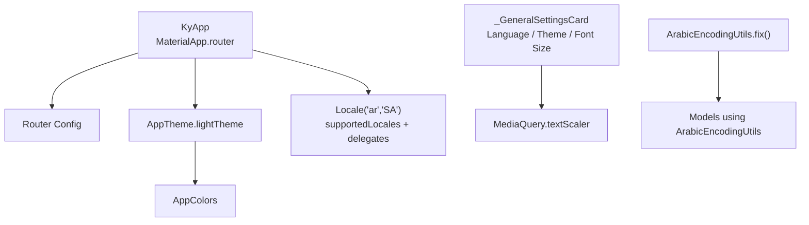
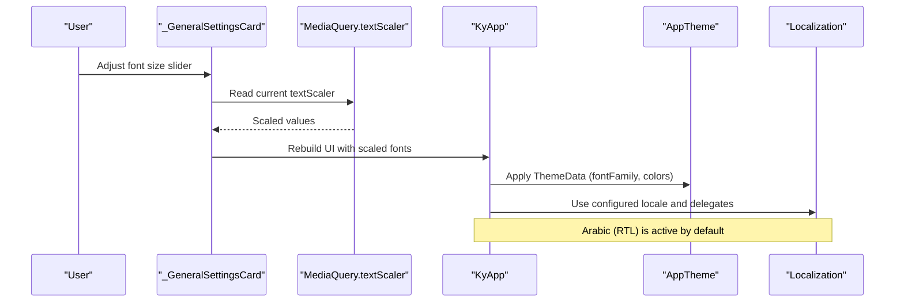
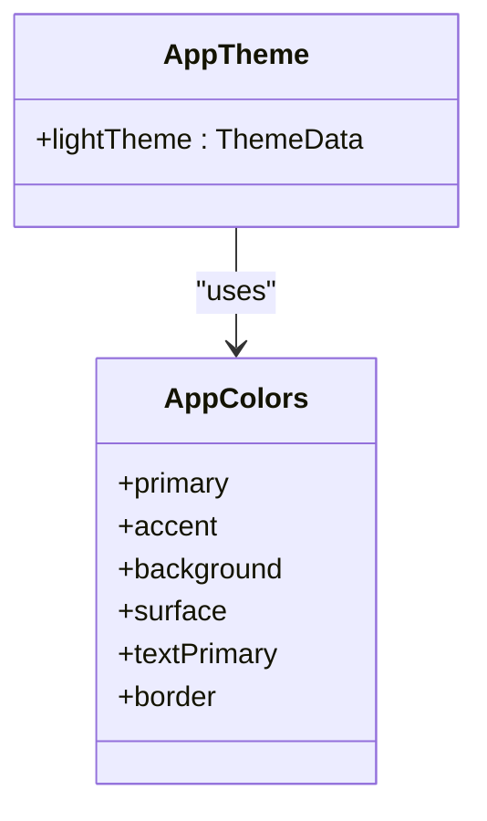
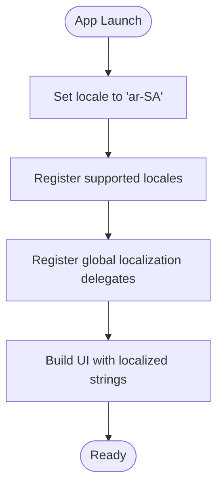
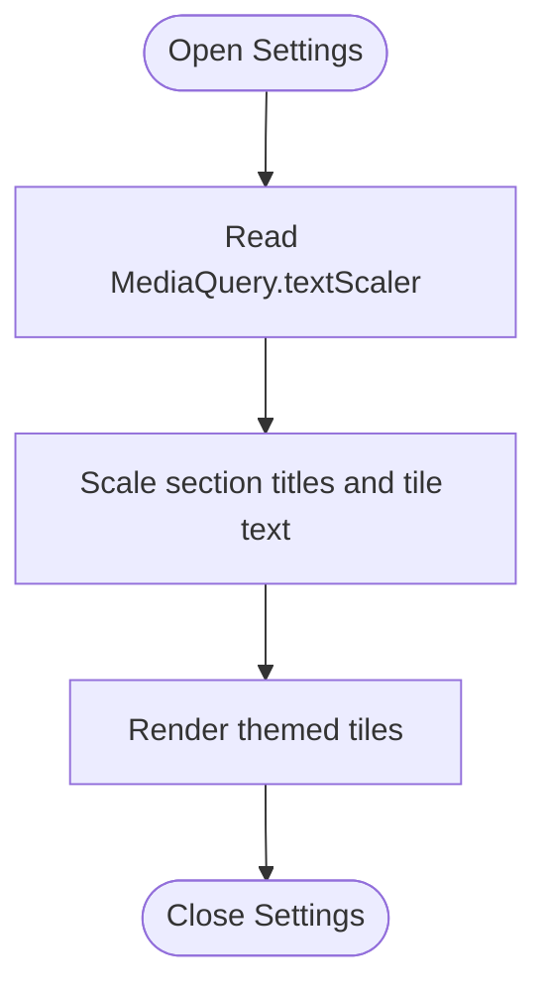
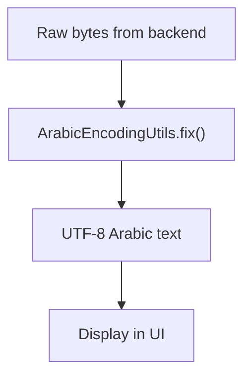
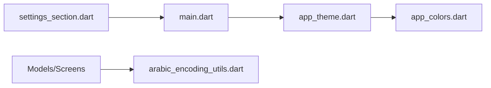

# User Preferences

<cite>
**Referenced Files in This Document**
- [main.dart](file://lib/main.dart)
- [app_theme.dart](file://lib/core/theme/app_theme.dart)
- [app_colors.dart](file://lib/core/theme/app_colors.dart)
- [settings_section.dart](file://lib/features/employee_portal/presentation/screens/sections/settings_section.dart)
- [arabic_encoding_utils.dart](file://lib/core/utils/arabic_encoding_utils.dart)
</cite>

## Table of Contents
1. [Introduction](#introduction)
2. [Project Structure](#project-structure)
3. [Core Components](#core-components)
4. [Architecture Overview](#architecture-overview)
5. [Detailed Component Analysis](#detailed-component-analysis)
6. [Dependency Analysis](#dependency-analysis)
7. [Performance Considerations](#performance-considerations)
8. [Troubleshooting Guide](#troubleshooting-guide)
9. [Conclusion](#conclusion)
10. [Appendices](#appendices)

## Introduction
This document explains the user preferences system for theme customization, language settings, and personalization options. It covers:
- Theme selection (light/dark/custom), font size adjustments, and layout preferences
- Localization setup for multi-language support and text direction handling for Arabic content
- Preference persistence mechanisms, default value management, and migration strategies
- Practical examples for adding new preference categories, implementing custom themes, and synchronizing preferences across devices

The implementation is centered around a Flutter application with Material 3 theming, Google Fonts for Arabic typography, and a dedicated settings screen that exposes user-facing controls.

## Project Structure
The relevant parts of the codebase are organized as follows:
- Application entry point configures localization, RTL, and base theme
- Centralized theme and color definitions provide consistent styling
- A settings section UI exposes language, theme, and font size controls
- Arabic encoding utilities ensure correct display of Arabic text from backend sources

**Diagram sources**
- [main.dart:17-44](file://lib/main.dart#L17-L44)
- [app_theme.dart:7-86](file://lib/core/theme/app_theme.dart#L7-L86)
- [app_colors.dart:5-37](file://lib/core/theme/app_colors.dart#L5-L37)
- [settings_section.dart:237-328](file://lib/features/employee_portal/presentation/screens/sections/settings_section.dart#L237-L328)
- [arabic_encoding_utils.dart:1-15](file://lib/core/utils/arabic_encoding_utils.dart#L1-L15)

**Section sources**
- [main.dart:1-47](file://lib/main.dart#L1-L47)
- [app_theme.dart:1-88](file://lib/core/theme/app_theme.dart#L1-L88)
- [app_colors.dart:1-38](file://lib/core/theme/app_colors.dart#L1-L38)
- [settings_section.dart:234-328](file://lib/features/employee_portal/presentation/screens/sections/settings_section.dart#L234-L328)
- [arabic_encoding_utils.dart:1-15](file://lib/core/utils/arabic_encoding_utils.dart#L1-L15)

## Core Components
- KyApp (MaterialApp): Initializes providers, sets the app title, applies the light theme, configures localization and supported locales, and clamps text scaling to avoid overflow on small screens.
- AppTheme: Provides a centralized ThemeData with Material 3, Cairo font family, color scheme derived from AppColors, and consistent input/button/card styling.
- AppColors: Defines a unified palette for primary, accent, surface, background, text, borders, and status colors.
- General Settings Screen (_GeneralSettingsCard): Exposes user-facing controls for language and direction, dark mode toggle, and font size adjustment.
- ArabicEncodingUtils: Fixes mojibake from legacy encodings (e.g., Windows-1256) to proper UTF-8 Arabic characters.

Key responsibilities:
- Theming and typography: AppTheme and AppColors
- Localization and text scaling: KyApp builder and MaterialApp configuration
- User controls: _GeneralSettingsCard and related tiles
- Arabic text correctness: ArabicEncodingUtils

**Section sources**
- [main.dart:17-44](file://lib/main.dart#L17-L44)
- [app_theme.dart:7-86](file://lib/core/theme/app_theme.dart#L7-L86)
- [app_colors.dart:5-37](file://lib/core/theme/app_colors.dart#L5-L37)
- [settings_section.dart:237-328](file://lib/features/employee_portal/presentation/screens/sections/settings_section.dart#L237-L328)
- [arabic_encoding_utils.dart:1-15](file://lib/core/utils/arabic_encoding_utils.dart#L1-L15)

## Architecture Overview
The user preferences architecture spans UI, theming, and localization layers:
- UI layer: The settings screen composes tiles for language, theme, and font size.
- Theming layer: AppTheme and AppColors define visual defaults; the app uses a light theme by default.
- Localization layer: MaterialApp sets Arabic as the initial locale, supports English, and includes global localizations delegates.
- Data layer: ArabicEncodingUtils ensures Arabic text integrity when reading from backend data.

**Diagram sources**
- [settings_section.dart:237-328](file://lib/features/employee_portal/presentation/screens/sections/settings_section.dart#L237-L328)
- [main.dart:17-44](file://lib/main.dart#L17-L44)
- [app_theme.dart:7-86](file://lib/core/theme/app_theme.dart#L7-L86)

## Detailed Component Analysis

### Theme Customization
- Default theme: Light theme via AppTheme.lightTheme applied at the app level.
- Typography: Cairo font family for Arabic readability; text styles are applied consistently across inputs, buttons, and cards.
- Color system: AppColors provides a cohesive palette used throughout the app’s theme.
- Extensibility: To add dark or custom themes, extend AppTheme with additional ThemeData getters and switch between them based on user preference.

**Diagram sources**
- [app_theme.dart:7-86](file://lib/core/theme/app_theme.dart#L7-L86)
- [app_colors.dart:5-37](file://lib/core/theme/app_colors.dart#L5-L37)

**Section sources**
- [app_theme.dart:7-86](file://lib/core/theme/app_theme.dart#L7-L86)
- [app_colors.dart:5-37](file://lib/core/theme/app_colors.dart#L5-L37)

### Language Settings and Localization
- Initial locale: Arabic (Saudi Arabia).
- Supported locales: Arabic and English.
- Localizations delegates: GlobalMaterial, GlobalWidgets, and GlobalCupertino.
- Direction: Arabic implies RTL; the app is set up for full RTL support.

**Diagram sources**
- [main.dart:17-44](file://lib/main.dart#L17-L44)

**Section sources**
- [main.dart:17-44](file://lib/main.dart#L17-L44)

### Personalization Options (Font Size, Layout)
- Font size: Controlled through MediaQuery.textScaler; the settings UI scales section text and tiles accordingly.
- Layout: The settings card adapts to narrow screens and uses consistent spacing and borders.

**Diagram sources**
- [settings_section.dart:237-328](file://lib/features/employee_portal/presentation/screens/sections/settings_section.dart#L237-L328)
- [main.dart:32-43](file://lib/main.dart#L32-L43)

**Section sources**
- [settings_section.dart:237-328](file://lib/features/employee_portal/presentation/screens/sections/settings_section.dart#L237-L328)
- [main.dart:32-43](file://lib/main.dart#L32-L43)

### Arabic Text Handling
- Problem: Backend data may contain mojibake due to legacy encodings (e.g., Windows-1256).
- Solution: ArabicEncodingUtils.fix converts corrupted sequences back to proper UTF-8 Arabic characters.
- Usage: Applied in models and presentation logic to ensure correct display.

**Diagram sources**
- [arabic_encoding_utils.dart:1-15](file://lib/core/utils/arabic_encoding_utils.dart#L1-L15)

**Section sources**
- [arabic_encoding_utils.dart:1-15](file://lib/core/utils/arabic_encoding_utils.dart#L1-L15)

## Dependency Analysis
- main.dart depends on AppTheme for theming and registers localization delegates.
- AppTheme depends on AppColors for color definitions.
- Settings screen depends on MediaQuery for text scaling and uses AppColors for styling.
- Models and screens use ArabicEncodingUtils to sanitize Arabic text.

**Diagram sources**
- [main.dart:1-47](file://lib/main.dart#L1-L47)
- [app_theme.dart:1-88](file://lib/core/theme/app_theme.dart#L1-L88)
- [app_colors.dart:1-38](file://lib/core/theme/app_colors.dart#L1-L38)
- [settings_section.dart:234-328](file://lib/features/employee_portal/presentation/screens/sections/settings_section.dart#L234-L328)
- [arabic_encoding_utils.dart:1-15](file://lib/core/utils/arabic_encoding_utils.dart#L1-L15)

**Section sources**
- [main.dart:1-47](file://lib/main.dart#L1-L47)
- [app_theme.dart:1-88](file://lib/core/theme/app_theme.dart#L1-L88)
- [app_colors.dart:1-38](file://lib/core/theme/app_colors.dart#L1-L38)
- [settings_section.dart:234-328](file://lib/features/employee_portal/presentation/screens/sections/settings_section.dart#L234-L328)
- [arabic_encoding_utils.dart:1-15](file://lib/core/utils/arabic_encoding_utils.dart#L1-L15)

## Performance Considerations
- Text scaling: Clamping text scale factors prevents overflow and reduces layout recalculations on small screens.
- Theme application: Centralized ThemeData avoids repeated style computations.
- Arabic text correction: Applying ArabicEncodingUtils.fix only where needed minimizes overhead.

[No sources needed since this section provides general guidance]

## Troubleshooting Guide
- Arabic text appears garbled: Ensure ArabicEncodingUtils.fix is applied to fields sourced from the backend.
- UI overflow on small screens: Verify textScaler clamping is active and that widgets respect constrained sizes.
- Theme not updating: Confirm the app rebuilds after changing theme state and that ThemeData is reapplied at the root.
- Localization not switching: Check supportedLocales and localizationsDelegates registration and ensure the active locale is updated in the app context.

**Section sources**
- [main.dart:32-43](file://lib/main.dart#L32-L43)
- [arabic_encoding_utils.dart:1-15](file://lib/core/utils/arabic_encoding_utils.dart#L1-L15)

## Conclusion
The user preferences system integrates theming, localization, and personalization into a cohesive experience. The app defaults to a light theme with Arabic RTL support and provides a settings interface for language, theme, and font size. ArabicEncodingUtils ensures reliable Arabic text rendering. Future enhancements can include dark mode toggling, persistent storage of preferences, and cross-device synchronization.

[No sources needed since this section summarizes without analyzing specific files]

## Appendices

### Adding a New Preference Category
- Create a new settings tile within the general settings card.
- Bind the control to a state provider or service that persists the preference.
- Update the UI to react to preference changes (e.g., theme, layout density).

**Section sources**
- [settings_section.dart:237-328](file://lib/features/employee_portal/presentation/screens/sections/settings_section.dart#L237-L328)

### Implementing Custom Themes
- Extend AppTheme with additional ThemeData getters (e.g., darkTheme, customTheme).
- Switch themes based on user preference stored in a central state.
- Ensure all components consume theme values from the theme context.

**Section sources**
- [app_theme.dart:7-86](file://lib/core/theme/app_theme.dart#L7-L86)

### Handling Preference Persistence and Migration
- Persist preferences using a secure storage solution (e.g., encrypted key-value store).
- Define default values for each preference category.
- Implement versioned migrations to handle schema changes and upgrade old preferences safely.

[No sources needed since this section provides general guidance]

### Synchronizing Preferences Across Devices
- Sync preferences via a backend API endpoint.
- On login, fetch remote preferences and apply them locally.
- On change, push updates to the server and handle conflicts deterministically.

[No sources needed since this section provides general guidance]