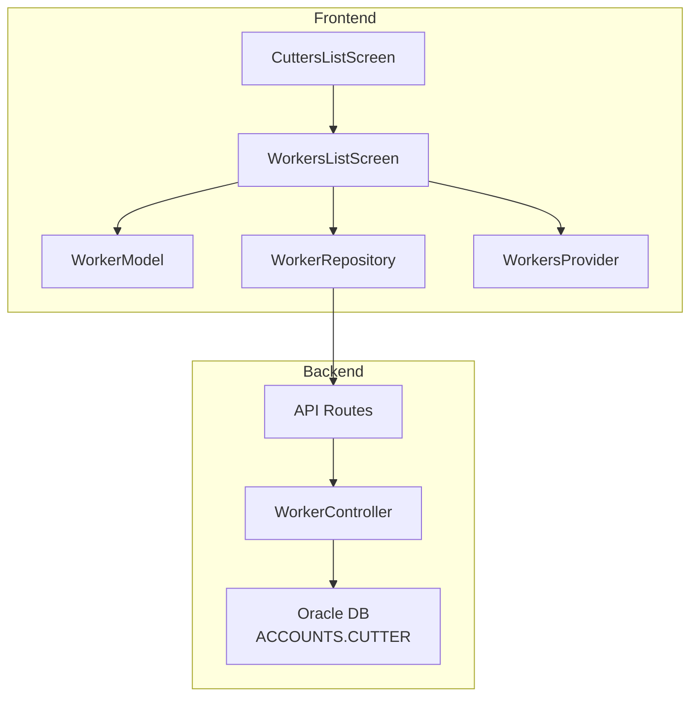
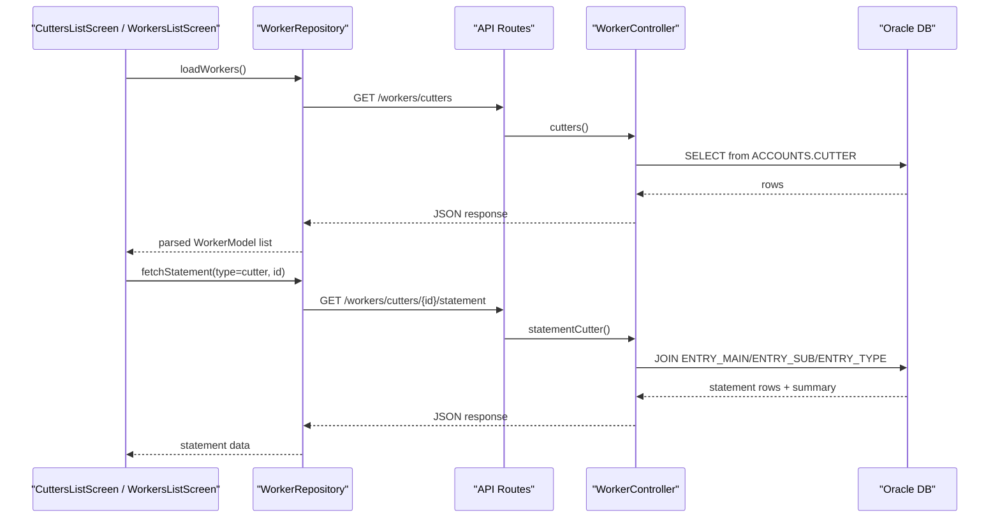
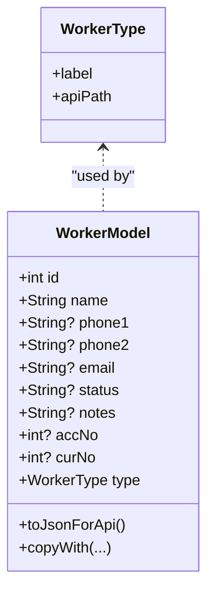
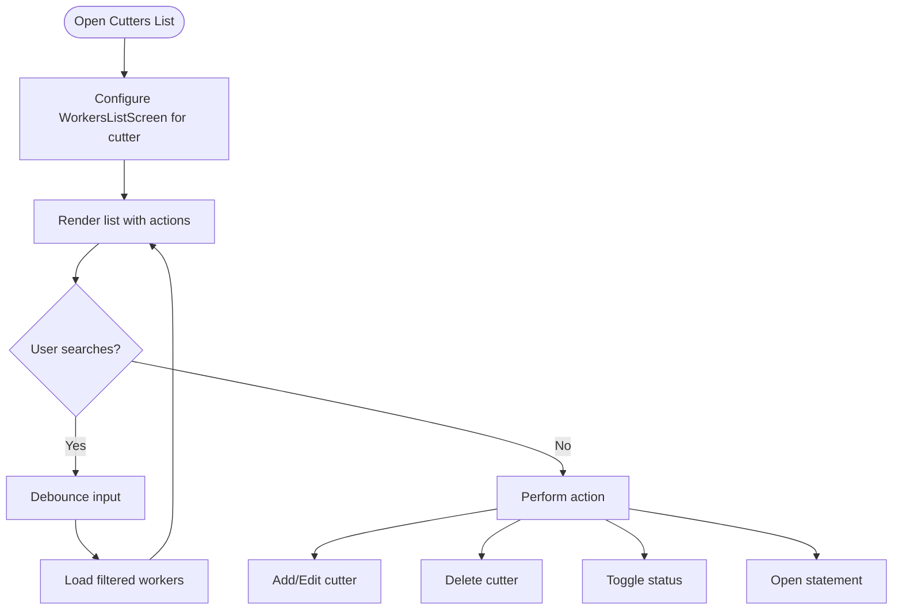
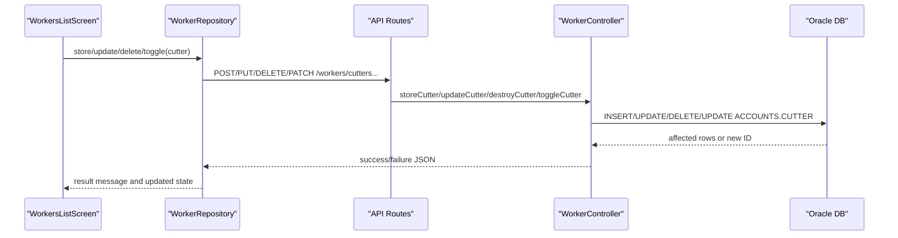
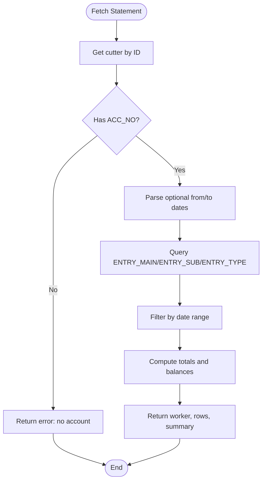
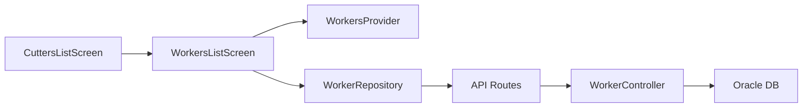

# Cutter Management

<cite>
**Referenced Files in This Document**   
- [cutters_list_screen.dart](file://lib/features/workers/presentation/screens/cutters_list_screen.dart)
- [workers_list_screen.dart](file://lib/features/workers/presentation/screens/workers_list_screen.dart)
- [worker_model.dart](file://lib/features/workers/data/models/worker_model.dart)
- [worker_repository.dart](file://lib/features/workers/data/repositories/worker_repository.dart)
- [workers_provider.dart](file://lib/features/workers/presentation/providers/workers_provider.dart)
- [api.php](file://kyApp_API/routes/api.php)
- [WorkerController.php](file://kyApp_API/app/Http/Controllers/WorkerController.php)
</cite>

## Table of Contents
1. [Introduction](#introduction)
2. [Project Structure](#project-structure)
3. [Core Components](#core-components)
4. [Architecture Overview](#architecture-overview)
5. [Detailed Component Analysis](#detailed-component-analysis)
6. [Dependency Analysis](#dependency-analysis)
7. [Performance Considerations](#performance-considerations)
8. [Troubleshooting Guide](#troubleshooting-guide)
9. [Conclusion](#conclusion)

## Introduction
This document explains the cutter management functionality implemented in the application. It covers how cutters are modeled, listed, created, updated, toggled active/inactive, and how their financial statements are retrieved. It also clarifies where cutting task assignment, measurement tracking, material allocation, and quality control would fit into the current system, based on what is present in the codebase.

The implementation uses a Flutter frontend with Riverpod state management and a Laravel backend that exposes REST endpoints for worker types including cutters. Cutters share a common list interface with employees and tailors, while having dedicated API routes and database mappings.

## Project Structure
Cutter management spans both frontend and backend:

- Frontend (Flutter):
  - A dedicated screen entry point for cutters delegates to a shared workers list UI.
  - A shared list screen handles search, add/edit, delete, toggle status, and statement navigation.
  - Data models parse cutter JSON fields and map them to a unified WorkerModel.
  - Repository calls the backend API for CRUD and statement operations.
  - Providers manage list and statement states.

- Backend (Laravel):
  - Routes expose endpoints for listing, creating, updating, deleting, toggling, and fetching statements for cutters.
  - Controller methods delegate to shared logic using a configuration table mapping for cutters.
  - Database queries target the Oracle ACCOUNTS.CUTTER table and related accounting tables for statements.

**Diagram sources**
- [cutters_list_screen.dart:1-21](file://lib/features/workers/presentation/screens/cutters_list_screen.dart#L1-L21)
- [workers_list_screen.dart:1-100](file://lib/features/workers/presentation/screens/workers_list_screen.dart#L1-L100)
- [worker_model.dart:1-40](file://lib/features/workers/data/models/worker_model.dart#L1-L40)
- [worker_repository.dart:136-181](file://lib/features/workers/data/repositories/worker_repository.dart#L136-L181)
- [workers_provider.dart:202-246](file://lib/features/workers/presentation/providers/workers_provider.dart#L202-L246)
- [api.php:238-254](file://kyApp_API/routes/api.php#L238-L254)
- [WorkerController.php:22-59](file://kyApp_API/app/Http/Controllers/WorkerController.php#L22-L59)

**Section sources**
- [cutters_list_screen.dart:1-21](file://lib/features/workers/presentation/screens/cutters_list_screen.dart#L1-L21)
- [workers_list_screen.dart:1-100](file://lib/features/workers/presentation/screens/workers_list_screen.dart#L1-L100)
- [worker_model.dart:1-40](file://lib/features/workers/data/models/worker_model.dart#L1-L40)
- [worker_repository.dart:136-181](file://lib/features/workers/data/repositories/worker_repository.dart#L136-L181)
- [workers_provider.dart:202-246](file://lib/features/workers/presentation/providers/workers_provider.dart#L202-L246)
- [api.php:238-254](file://kyApp_API/routes/api.php#L238-L254)
- [WorkerController.php:22-59](file://kyApp_API/app/Http/Controllers/WorkerController.php#L22-L59)

## Core Components
- Cutter model parsing and serialization:
  - The WorkerModel supports cutter-specific JSON fields and maps them to a unified structure.
  - It includes helper methods to convert to API payloads for cutters.

- Cutter list UI:
  - CuttersListScreen configures WorkersListScreen for cutter type with specific labels and colors.
  - WorkersListScreen provides search, add/edit, delete, toggle status, and statement navigation.

- Repository and provider:
  - WorkerRepository exposes fetchStatement and other worker operations.
  - WorkersProvider manages list and statement state, including loading and error handling.

- Backend routes and controller:
  - API routes define endpoints for cutters with permission middleware.
  - WorkerController maps cutters to the ACCOUNTS.CUTTER table and implements CRUD, toggle, and statement logic.

**Section sources**
- [worker_model.dart:95-165](file://lib/features/workers/data/models/worker_model.dart#L95-L165)
- [cutters_list_screen.dart:1-21](file://lib/features/workers/presentation/screens/cutters_list_screen.dart#L1-L21)
- [workers_list_screen.dart:11-100](file://lib/features/workers/presentation/screens/workers_list_screen.dart#L11-L100)
- [worker_repository.dart:136-181](file://lib/features/workers/data/repositories/worker_repository.dart#L136-L181)
- [workers_provider.dart:202-246](file://lib/features/workers/presentation/providers/workers_provider.dart#L202-L246)
- [api.php:238-254](file://kyApp_API/routes/api.php#L238-L254)
- [WorkerController.php:22-59](file://kyApp_API/app/Http/Controllers/WorkerController.php#L22-L59)

## Architecture Overview
The cutter management flow integrates UI interactions with backend services and database operations.

**Diagram sources**
- [workers_list_screen.dart:48-90](file://lib/features/workers/presentation/screens/workers_list_screen.dart#L48-L90)
- [worker_repository.dart:136-181](file://lib/features/workers/data/repositories/worker_repository.dart#L136-L181)
- [api.php:238-254](file://kyApp_API/routes/api.php#L238-L254)
- [WorkerController.php:188-239](file://kyApp_API/app/Http/Controllers/WorkerController.php#L188-L239)
- [WorkerController.php:398-558](file://kyApp_API/app/Http/Controllers/WorkerController.php#L398-L558)

## Detailed Component Analysis

### Cutter Model and Data Mapping
- WorkerType enum defines cutter as a distinct worker type with its own API path.
- WorkerModel.fromCutterJson parses cutter-specific fields like CUTTER_NO, CUTTER_NAME, phone/email/status/notes, ACC_NO, CUR_NO.
- WorkerModel.toJsonForApi serializes cutter data with appropriate field names for the backend.

Complexity considerations:
- Parsing helpers handle nulls, numeric conversions, and Arabic encoding normalization.
- CopyWith supports immutable updates for UI state changes.

**Diagram sources**
- [worker_model.dart:1-40](file://lib/features/workers/data/models/worker_model.dart#L1-L40)
- [worker_model.dart:95-165](file://lib/features/workers/data/models/worker_model.dart#L95-L165)

**Section sources**
- [worker_model.dart:1-40](file://lib/features/workers/data/models/worker_model.dart#L1-L40)
- [worker_model.dart:95-165](file://lib/features/workers/data/models/worker_model.dart#L95-L165)

### Cutter List Interface
- CuttersListScreen configures WorkersListScreen for cutter type with title, add label, accent color, icon, and work report label.
- WorkersListScreen provides:
  - Search with debounce.
  - Add/Edit/Delete confirmation flows.
  - Toggle active/inactive status.
  - Navigation to worker statement screen.
  - Filtering disabled workers.

**Diagram sources**
- [cutters_list_screen.dart:1-21](file://lib/features/workers/presentation/screens/cutters_list_screen.dart#L1-L21)
- [workers_list_screen.dart:48-152](file://lib/features/workers/presentation/screens/workers_list_screen.dart#L48-L152)

**Section sources**
- [cutters_list_screen.dart:1-21](file://lib/features/workers/presentation/screens/cutters_list_screen.dart#L1-L21)
- [workers_list_screen.dart:48-152](file://lib/features/workers/presentation/screens/workers_list_screen.dart#L48-L152)

### Cutter CRUD and Status Toggle
- Backend routes protect endpoints with permissions: view, create, update, delete, toggle.
- WorkerController methods delegate to shared private functions:
  - listWorkers: paginated search across name/phone/id.
  - storeWorker: insert new cutter with auto-incremented ID and default status.
  - updateWorker: update fields with Arabic encoding normalization.
  - destroyWorker: delete by primary key.
  - toggleWorker: flip status between active and disabled.

**Diagram sources**
- [api.php:238-254](file://kyApp_API/routes/api.php#L238-L254)
- [WorkerController.php:90-183](file://kyApp_API/app/Http/Controllers/WorkerController.php#L90-L183)
- [WorkerController.php:244-381](file://kyApp_API/app/Http/Controllers/WorkerController.php#L244-L381)

**Section sources**
- [api.php:238-254](file://kyApp_API/routes/api.php#L238-L254)
- [WorkerController.php:90-183](file://kyApp_API/app/Http/Controllers/WorkerController.php#L90-L183)
- [WorkerController.php:244-381](file://kyApp_API/app/Http/Controllers/WorkerController.php#L244-L381)

### Cutter Financial Statement
- The statement endpoint retrieves entries linked to the cutter’s account number (ACC_NO).
- It joins accounting tables to compute debits, credits, opening balance, running balance, and date filtering.
- If no dates are provided, it defaults to the last 30 days based on the latest entry.

**Diagram sources**
- [WorkerController.php:398-558](file://kyApp_API/app/Http/Controllers/WorkerController.php#L398-L558)

**Section sources**
- [WorkerController.php:398-558](file://kyApp_API/app/Http/Controllers/WorkerController.php#L398-L558)

### Cutter Work Report Placeholder
- The UI includes a “work report” action placeholder for cutters, currently showing an informational snackbar indicating development in progress.
- This indicates a planned extension point for productivity metrics and performance tracking.

**Section sources**
- [workers_list_screen.dart:380-387](file://lib/features/workers/presentation/screens/workers_list_screen.dart#L380-L387)

## Dependency Analysis
- Frontend dependencies:
  - CuttersListScreen depends on WorkersListScreen and WorkerModel.
  - WorkersListScreen depends on WorkersProvider and WorkerRepository.
  - WorkerRepository depends on Dio client and API routes.

- Backend dependencies:
  - API routes depend on WorkerController methods.
  - WorkerController depends on Oracle connection and ArabicEncoding utilities.

Potential coupling:
- Shared worker logic reduces duplication but increases coupling between employee/cutter/tailor features.
- Permission middleware enforces role-based access at route level.

**Diagram sources**
- [cutters_list_screen.dart:1-21](file://lib/features/workers/presentation/screens/cutters_list_screen.dart#L1-L21)
- [workers_list_screen.dart:1-100](file://lib/features/workers/presentation/screens/workers_list_screen.dart#L1-L100)
- [worker_repository.dart:136-181](file://lib/features/workers/data/repositories/worker_repository.dart#L136-L181)
- [api.php:238-254](file://kyApp_API/routes/api.php#L238-L254)
- [WorkerController.php:188-239](file://kyApp_API/app/Http/Controllers/WorkerController.php#L188-L239)

**Section sources**
- [cutters_list_screen.dart:1-21](file://lib/features/workers/presentation/screens/cutters_list_screen.dart#L1-L21)
- [workers_list_screen.dart:1-100](file://lib/features/workers/presentation/screens/workers_list_screen.dart#L1-L100)
- [worker_repository.dart:136-181](file://lib/features/workers/data/repositories/worker_repository.dart#L136-L181)
- [api.php:238-254](file://kyApp_API/routes/api.php#L238-L254)
- [WorkerController.php:188-239](file://kyApp_API/app/Http/Controllers/WorkerController.php#L188-L239)

## Performance Considerations
- Pagination and limits:
  - Backend lists use configurable limit and page parameters with a maximum cap to prevent large responses.
- Search optimization:
  - Backend search supports numeric IDs and text matching against name and phone fields.
- Date filtering:
  - Statement queries support optional date ranges; defaulting to last 30 days improves usability without heavy computation.
- Encoding normalization:
  - Arabic text is normalized before storage and retrieval to avoid mojibake and ensure consistent search behavior.

[No sources needed since this section provides general guidance]

## Troubleshooting Guide
Common issues and resolutions:
- No data displayed:
  - Verify network connectivity and permissions for cutters.view.
  - Check if the worker list provider reports errors and retry loading.
- Statement not loading:
  - Ensure the cutter has an associated ACC_NO; otherwise, the backend returns a validation error.
  - Confirm date formats if custom filters are used.
- Status toggle not reflecting:
  - Confirm the toggle endpoint is called and the backend updates the status column correctly.
- Arabic text display issues:
  - Ensure ArabicEncoding utilities are applied consistently in both frontend and backend.

**Section sources**
- [WorkerController.php:236-239](file://kyApp_API/app/Http/Controllers/WorkerController.php#L236-L239)
- [WorkerController.php:312-319](file://kyApp_API/app/Http/Controllers/WorkerController.php#L312-L319)
- [WorkerController.php:335-342](file://kyApp_API/app/Http/Controllers/WorkerController.php#L335-L342)
- [WorkerController.php:358-380](file://kyApp_API/app/Http/Controllers/WorkerController.php#L358-L380)
- [WorkerController.php:419-424](file://kyApp_API/app/Http/Controllers/WorkerController.php#L419-L424)

## Conclusion
The cutter management feature provides a robust foundation for managing cutter records, performing CRUD operations, toggling status, and retrieving financial statements tied to the cutter’s account. The UI offers a consistent experience across worker types, with a dedicated entry point for cutters. While cutting task assignments, measurement tracking, material allocation, and quality control are not yet implemented, the existing architecture supports extending these capabilities through additional screens, repositories, providers, and backend endpoints. The placeholder for work reports suggests a clear path for introducing productivity metrics and performance tracking tailored to cutters.

[No sources needed since this section summarizes without analyzing specific files]