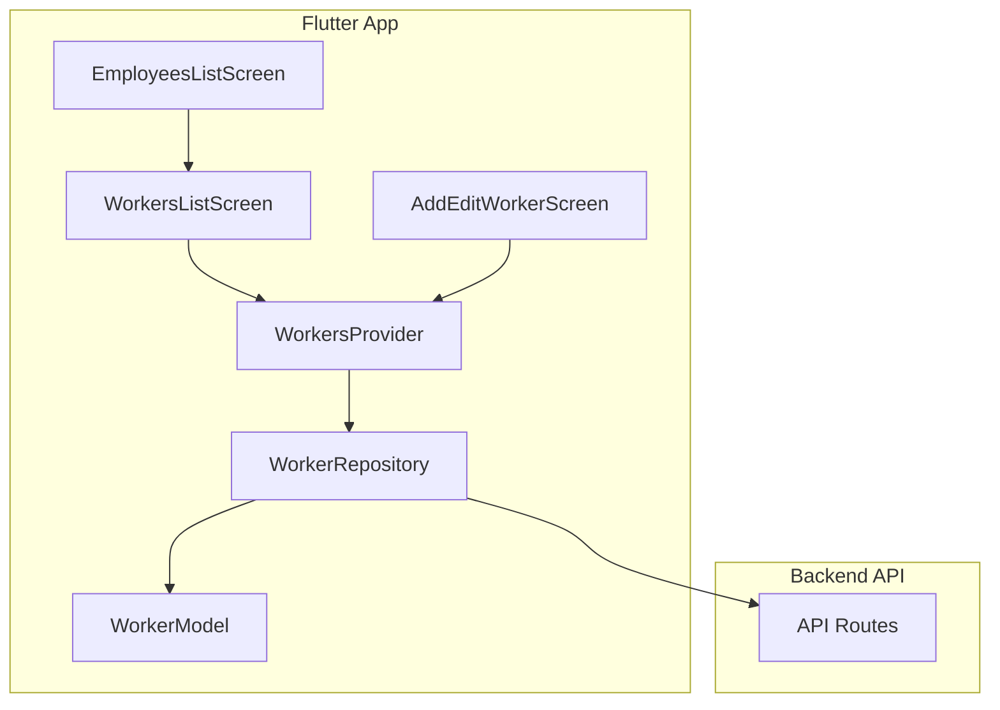
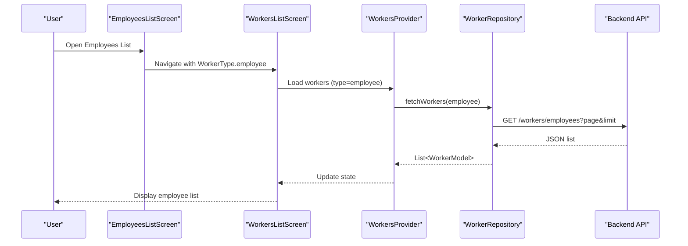
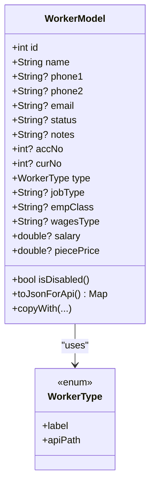
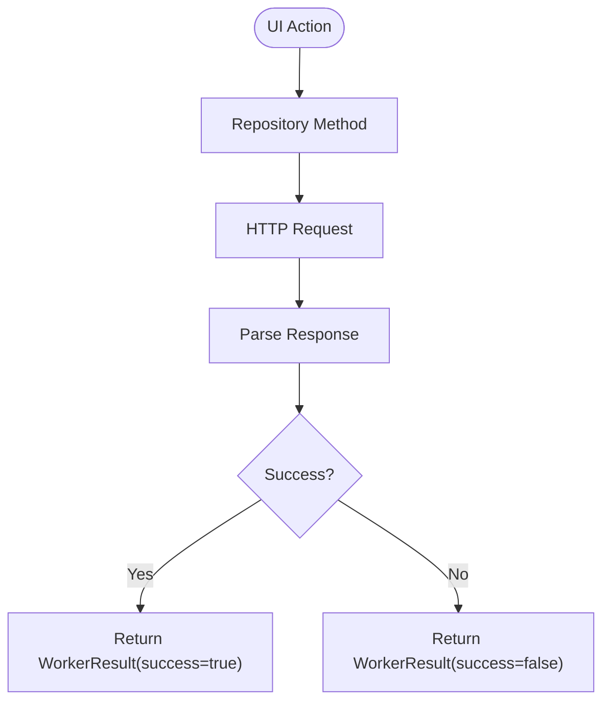
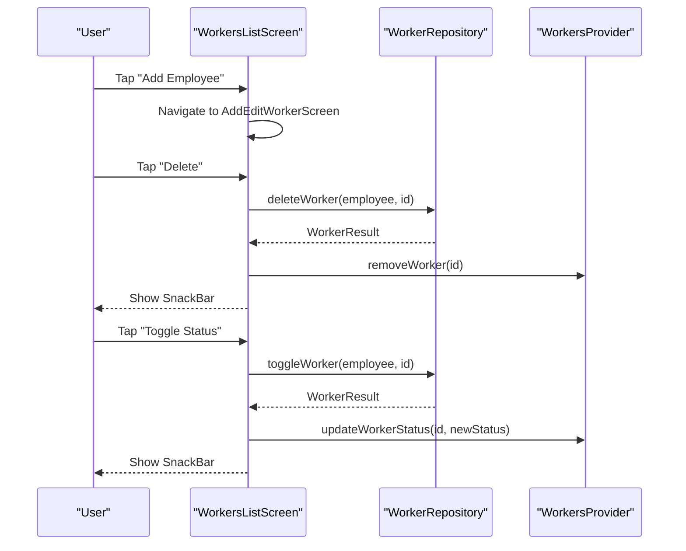
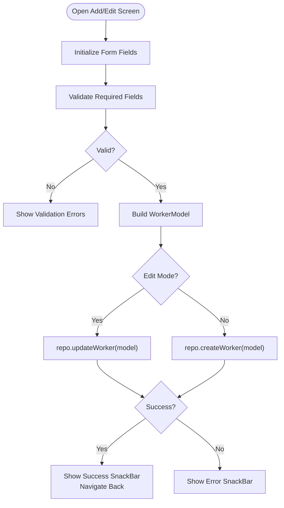
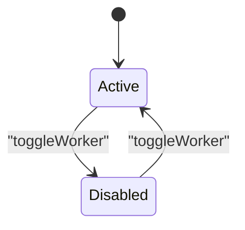
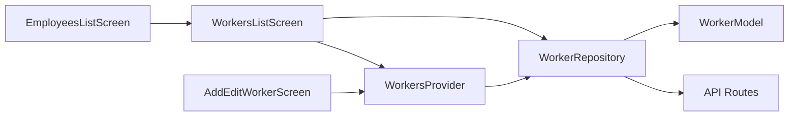

# Employee Management

<cite>
**Referenced Files in This Document**
- [worker_model.dart](file://lib/features/workers/data/models/worker_model.dart)
- [worker_repository.dart](file://lib/features/workers/data/repositories/worker_repository.dart)
- [workers_provider.dart](file://lib/features/workers/presentation/providers/workers_provider.dart)
- [employees_list_screen.dart](file://lib/features/workers/presentation/screens/employees_list_screen.dart)
- [workers_list_screen.dart](file://lib/features/workers/presentation/screens/workers_list_screen.dart)
- [add_edit_worker_screen.dart](file://lib/features/workers/presentation/screens/add_edit_worker_screen.dart)
- [api.php](file://kyApp_API/routes/api.php)
</cite>

## Table of Contents
1. [Introduction](#introduction)
2. [Project Structure](#project-structure)
3. [Core Components](#core-components)
4. [Architecture Overview](#architecture-overview)
5. [Detailed Component Analysis](#detailed-component-analysis)
6. [Dependency Analysis](#dependency-analysis)
7. [Performance Considerations](#performance-considerations)
8. [Troubleshooting Guide](#troubleshooting-guide)
9. [Conclusion](#conclusion)

## Introduction
This document explains the employee management functionality within the worker management module. It covers how employees are created, updated, listed, toggled, and deleted through the UI, the underlying data model structure, validation rules, and integration with the repository for persistence. It also documents employee status handling and basic employee information fields such as name, phone, email, account number, job type, class, wages type, salary, and piece price.

## Project Structure
The employee feature is part of the workers feature layer:
- Data models define the shared worker entity and its JSON serialization.
- The repository encapsulates HTTP calls to the backend API.
- Providers manage state using Riverpod.
- Screens provide the user interface for listing, adding, editing, and managing employees.

**Diagram sources**
- [employees_list_screen.dart:6-19](file://lib/features/workers/presentation/screens/employees_list_screen.dart#L6-L19)
- [workers_list_screen.dart:12-30](file://lib/features/workers/presentation/screens/workers_list_screen.dart#L12-L30)
- [add_edit_worker_screen.dart:8-16](file://lib/features/workers/presentation/screens/add_edit_worker_screen.dart#L8-L16)
- [workers_provider.dart:12-15](file://lib/features/workers/presentation/providers/workers_provider.dart#L12-L15)
- [worker_repository.dart:20-23](file://lib/features/workers/data/repositories/worker_repository.dart#L20-L23)
- [worker_model.dart:31-66](file://lib/features/workers/data/models/worker_model.dart#L31-L66)
- [api.php:223-234](file://kyApp_API/routes/api.php#L223-L234)

**Section sources**
- [employees_list_screen.dart:6-19](file://lib/features/workers/presentation/screens/employees_list_screen.dart#L6-L19)
- [workers_list_screen.dart:12-30](file://lib/features/workers/presentation/screens/workers_list_screen.dart#L12-L30)
- [add_edit_worker_screen.dart:8-16](file://lib/features/workers/presentation/screens/add_edit_worker_screen.dart#L8-L16)
- [worker_repository.dart:20-23](file://lib/features/workers/data/repositories/worker_repository.dart#L20-L23)
- [worker_model.dart:31-66](file://lib/features/workers/data/models/worker_model.dart#L31-L66)
- [api.php:223-234](file://kyApp_API/routes/api.php#L223-L234)

## Core Components
- WorkerModel: Shared data model for all worker types (employee, cutter, tailor). For employees, it includes additional fields like jobType, empClass, wagesType, salary, and piecePrice. It provides JSON parsing and serialization tailored to each worker type.
- WorkerRepository: Encapsulates network operations for fetching, creating, updating, deleting, and toggling workers. It maps WorkerType to API paths and parses responses into WorkerModel instances.
- WorkersProvider: Manages list state and statement loading via Riverpod Notifiers. It exposes methods to load workers, search, update status locally, and remove workers from the UI state.
- EmployeesListScreen: A thin screen that configures the generic WorkersListScreen for the employee type.
- WorkersListScreen: Generic list UI supporting search, add/edit navigation, delete confirmation, toggle status, and statement access.
- AddEditWorkerScreen: Form-based UI for creating or editing a worker, including employee-specific fields.

**Section sources**
- [worker_model.dart:31-165](file://lib/features/workers/data/models/worker_model.dart#L31-L165)
- [worker_repository.dart:20-181](file://lib/features/workers/data/repositories/worker_repository.dart#L20-L181)
- [workers_provider.dart:21-157](file://lib/features/workers/presentation/providers/workers_provider.dart#L21-L157)
- [employees_list_screen.dart:6-19](file://lib/features/workers/presentation/screens/employees_list_screen.dart#L6-L19)
- [workers_list_screen.dart:12-30](file://lib/features/workers/presentation/screens/workers_list_screen.dart#L12-L30)
- [add_edit_worker_screen.dart:8-16](file://lib/features/workers/presentation/screens/add_edit_worker_screen.dart#L8-L16)

## Architecture Overview
The employee management flow follows a layered architecture:
- UI screens interact with providers for state and actions.
- Providers call the repository for data operations.
- Repository performs HTTP requests to the backend API routes.
- Backend routes delegate to controllers which handle business logic and persistence.

**Diagram sources**
- [employees_list_screen.dart:6-19](file://lib/features/workers/presentation/screens/employees_list_screen.dart#L6-L19)
- [workers_list_screen.dart:79-91](file://lib/features/workers/presentation/screens/workers_list_screen.dart#L79-L91)
- [workers_provider.dart:79-103](file://lib/features/workers/presentation/providers/workers_provider.dart#L79-L103)
- [worker_repository.dart:31-58](file://lib/features/workers/data/repositories/worker_repository.dart#L31-L58)
- [api.php:223-234](file://kyApp_API/routes/api.php#L223-L234)

## Detailed Component Analysis

### Employee Data Model Structure
WorkerModel defines a unified structure for all worker types. For employees:
- Common fields: id, name, phone1, phone2, email, status, notes, accNo, curNo, type.
- Employee-only fields: jobType, empClass, wagesType, salary, piecePrice.
- Parsing: fromEmployeeJson maps backend JSON keys to model fields, normalizing Arabic text where needed.
- Serialization: toJsonForApi builds request payloads with appropriate field names per worker type.
- Status helper: isDisabled determines if an employee is disabled based on status string content.

**Diagram sources**
- [worker_model.dart:31-66](file://lib/features/workers/data/models/worker_model.dart#L31-L66)
- [worker_model.dart:68-72](file://lib/features/workers/data/models/worker_model.dart#L68-L72)
- [worker_model.dart:74-93](file://lib/features/workers/data/models/worker_model.dart#L74-L93)
- [worker_model.dart:127-165](file://lib/features/workers/data/models/worker_model.dart#L127-L165)

**Section sources**
- [worker_model.dart:31-165](file://lib/features/workers/data/models/worker_model.dart#L31-L165)

### Employee Repository Integration
WorkerRepository provides CRUD and status operations:
- fetchWorkers(type, search, page, limit): Retrieves a paginated list of workers for a given type.
- createWorker(worker): POSTs serialized payload to /workers/{type.apiPath}.
- updateWorker(worker): PUTs serialized payload to /workers/{type.apiPath}/{id}.
- deleteWorker(type, id): DELETEs worker by id.
- toggleWorker(type, id): PATCHes /workers/{type.apiPath}/{id}/toggle to flip status.
- Response mapping: WorkerResult wraps success flag, message, and optional data.

**Diagram sources**
- [worker_repository.dart:61-79](file://lib/features/workers/data/repositories/worker_repository.dart#L61-L79)
- [worker_repository.dart:82-99](file://lib/features/workers/data/repositories/worker_repository.dart#L82-L99)
- [worker_repository.dart:102-116](file://lib/features/workers/data/repositories/worker_repository.dart#L102-L116)
- [worker_repository.dart:119-134](file://lib/features/workers/data/repositories/worker_repository.dart#L119-L134)

**Section sources**
- [worker_repository.dart:31-181](file://lib/features/workers/data/repositories/worker_repository.dart#L31-L181)

### Employee List Screen Implementation
EmployeesListScreen configures the generic WorkersListScreen for employees:
- Sets WorkerType.employee, title, add label, accent colors, icon, and work report label.
- Delegates all list behavior to WorkersListScreen.

WorkersListScreen provides:
- Search with debounce.
- Add/Edit navigation to AddEditWorkerScreen.
- Delete confirmation dialog and deletion via repository.
- Toggle status via repository and local state update.
- Statement navigation for detailed accounting.

**Diagram sources**
- [employees_list_screen.dart:6-19](file://lib/features/workers/presentation/screens/employees_list_screen.dart#L6-L19)
- [workers_list_screen.dart:70-91](file://lib/features/workers/presentation/screens/workers_list_screen.dart#L70-L91)
- [workers_list_screen.dart:93-152](file://lib/features/workers/presentation/screens/workers_list_screen.dart#L93-L152)
- [workers_provider.dart:138-151](file://lib/features/workers/presentation/providers/workers_provider.dart#L138-L151)

**Section sources**
- [employees_list_screen.dart:6-19](file://lib/features/workers/presentation/screens/employees_list_screen.dart#L6-L19)
- [workers_list_screen.dart:36-152](file://lib/features/workers/presentation/screens/workers_list_screen.dart#L36-L152)

### Employee Registration and Edit Workflow
AddEditWorkerScreen handles both creation and editing:
- Initializes form fields from existing worker data when editing.
- Validates required fields (e.g., name).
- Builds a WorkerModel instance with trimmed values and parsed numbers.
- Calls repository.createWorker or repository.updateWorker depending on edit mode.
- Displays success/error messages via SnackBar and navigates back on success.

**Diagram sources**
- [add_edit_worker_screen.dart:88-128](file://lib/features/workers/presentation/screens/add_edit_worker_screen.dart#L88-L128)
- [add_edit_worker_screen.dart:131-321](file://lib/features/workers/presentation/screens/add_edit_worker_screen.dart#L131-L321)
- [worker_repository.dart:61-99](file://lib/features/workers/data/repositories/worker_repository.dart#L61-L99)

**Section sources**
- [add_edit_worker_screen.dart:22-128](file://lib/features/workers/presentation/screens/add_edit_worker_screen.dart#L22-L128)

### Employee Status Management
- Model-level: WorkerModel.isDisabled checks whether the status contains specific strings indicating disabled state.
- UI-level: WorkersListScreen displays active/disabled badges and allows toggling via repository.toggleWorker.
- Provider-level: WorkersProvider.updateWorkerStatus updates the local list state after a successful toggle.

**Diagram sources**
- [worker_model.dart:68-72](file://lib/features/workers/data/models/worker_model.dart#L68-L72)
- [workers_list_screen.dart:135-152](file://lib/features/workers/presentation/screens/workers_list_screen.dart#L135-L152)
- [workers_provider.dart:138-151](file://lib/features/workers/presentation/providers/workers_provider.dart#L138-L151)

**Section sources**
- [worker_model.dart:68-72](file://lib/features/workers/data/models/worker_model.dart#L68-L72)
- [workers_list_screen.dart:135-152](file://lib/features/workers/presentation/screens/workers_list_screen.dart#L135-L152)
- [workers_provider.dart:138-151](file://lib/features/workers/presentation/providers/workers_provider.dart#L138-L151)

### Basic Employee Information Handling
- Name: Required field in the form; displayed prominently in list tiles.
- Phone numbers: Optional; validated as numeric input.
- Email: Optional; validated as email format.
- Account number (ACC_NO): Optional integer.
- Job type, employee class, wages type: Optional text fields shown only for employees.
- Salary and piece price: Optional numeric fields shown only for employees.
- Notes: Optional multi-line text.
- Status: Selected via chips (active/disabled); persisted via model and toggled via repository.

**Section sources**
- [add_edit_worker_screen.dart:177-314](file://lib/features/workers/presentation/screens/add_edit_worker_screen.dart#L177-L314)
- [worker_model.dart:127-165](file://lib/features/workers/data/models/worker_model.dart#L127-L165)

## Dependency Analysis
The following diagram shows key dependencies between components involved in employee management:

**Diagram sources**
- [employees_list_screen.dart:6-19](file://lib/features/workers/presentation/screens/employees_list_screen.dart#L6-L19)
- [workers_list_screen.dart:12-30](file://lib/features/workers/presentation/screens/workers_list_screen.dart#L12-L30)
- [add_edit_worker_screen.dart:8-16](file://lib/features/workers/presentation/screens/add_edit_worker_screen.dart#L8-L16)
- [workers_provider.dart:12-15](file://lib/features/workers/presentation/providers/workers_provider.dart#L12-L15)
- [worker_repository.dart:20-23](file://lib/features/workers/data/repositories/worker_repository.dart#L20-L23)
- [worker_model.dart:31-66](file://lib/features/workers/data/models/worker_model.dart#L31-L66)
- [api.php:223-234](file://kyApp_API/routes/api.php#L223-L234)

**Section sources**
- [employees_list_screen.dart:6-19](file://lib/features/workers/presentation/screens/employees_list_screen.dart#L6-L19)
- [workers_list_screen.dart:12-30](file://lib/features/workers/presentation/screens/workers_list_screen.dart#L12-L30)
- [add_edit_worker_screen.dart:8-16](file://lib/features/workers/presentation/screens/add_edit_worker_screen.dart#L8-L16)
- [workers_provider.dart:12-15](file://lib/features/workers/presentation/providers/workers_provider.dart#L12-L15)
- [worker_repository.dart:20-23](file://lib/features/workers/data/repositories/worker_repository.dart#L20-L23)
- [worker_model.dart:31-66](file://lib/features/workers/data/models/worker_model.dart#L31-L66)
- [api.php:223-234](file://kyApp_API/routes/api.php#L223-L234)

## Performance Considerations
- Debounced search reduces unnecessary API calls while typing.
- Pagination parameters (page, limit) are passed to the repository to control data volume.
- Local state updates (removeWorker, updateWorkerStatus) avoid full re-fetches after mutations.
- Refresh indicator allows manual reloads without navigating away.

[No sources needed since this section provides general guidance]

## Troubleshooting Guide
Common issues and resolutions:
- Network errors during create/update/delete/toggle:
  - Repository catches DioException and returns WorkerResult with error messages.
  - UI displays SnackBar with the returned message.
- Empty lists:
  - Check search query and filters; ensure the correct worker type is selected.
  - Use refresh button to reload data.
- Status not reflecting changes:
  - Ensure toggleWorker succeeds; provider updates local state accordingly.
- Validation failures:
  - Ensure required fields like name are filled; check numeric formats for phone, account, salary, and piece price.

**Section sources**
- [worker_repository.dart:61-134](file://lib/features/workers/data/repositories/worker_repository.dart#L61-L134)
- [workers_list_screen.dart:93-152](file://lib/features/workers/presentation/screens/workers_list_screen.dart#L93-L152)
- [add_edit_worker_screen.dart:88-128](file://lib/features/workers/presentation/screens/add_edit_worker_screen.dart#L88-L128)

## Conclusion
The employee management functionality is implemented through a cohesive set of components: a shared data model, a repository for API integration, providers for state management, and screens for user interaction. Employees can be created and edited via a dedicated form, listed with search and filtering, and managed through status toggling and deletion. The design leverages a generic workers framework to support multiple worker types while providing employee-specific fields and behaviors.

[No sources needed since this section summarizes without analyzing specific files]