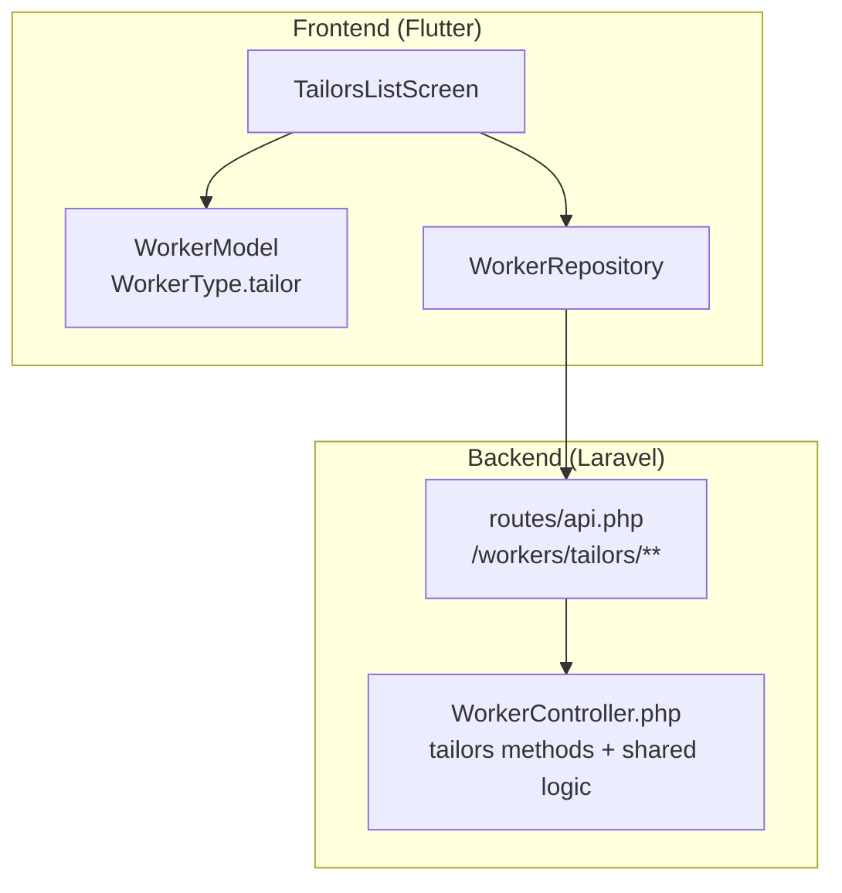
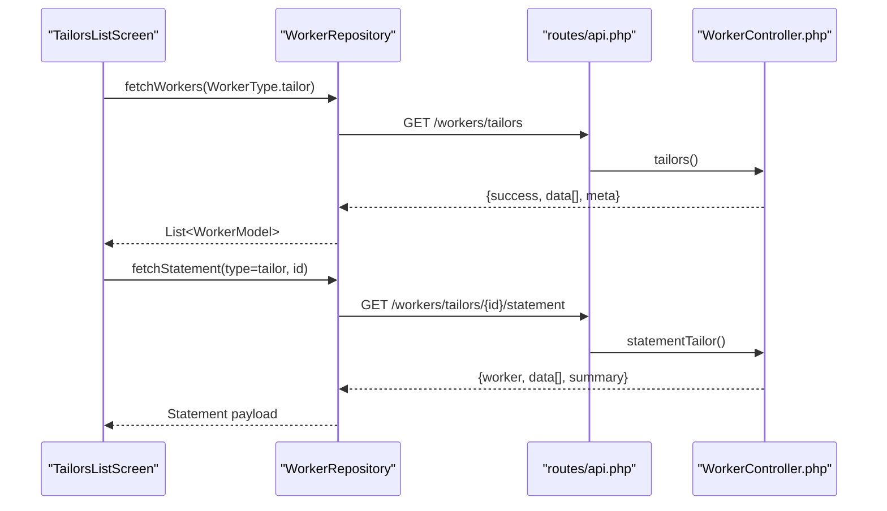
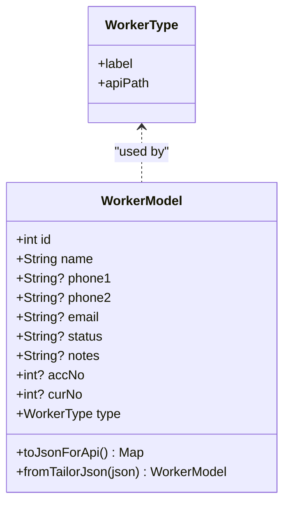
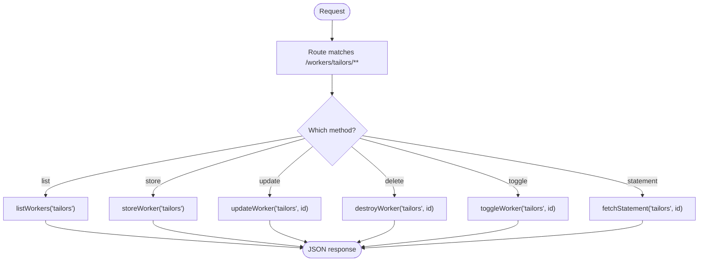
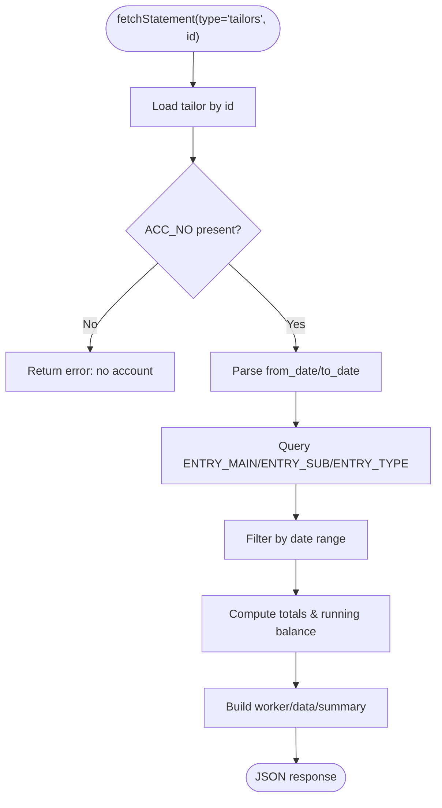
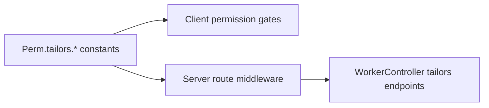
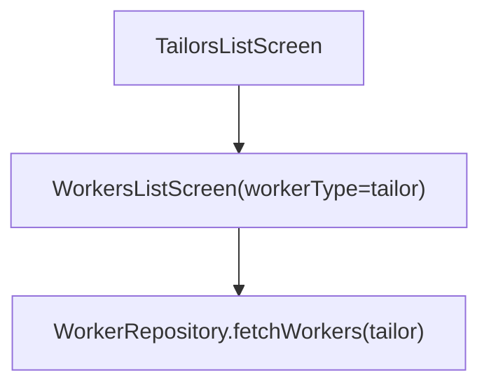
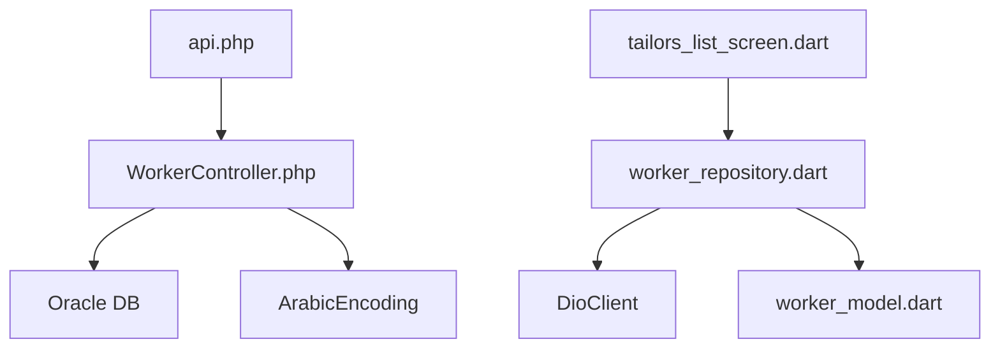

# Tailor Management

<cite>
**Referenced Files in This Document**
- [WorkerController.php](file://kyApp_API/app/Http/Controllers/WorkerController.php)
- [api.php](file://kyApp_API/routes/api.php)
- [permission_codes.dart](file://lib/core/constants/permission_codes.dart)
- [worker_model.dart](file://lib/features/workers/data/models/worker_model.dart)
- [worker_repository.dart](file://lib/features/workers/data/repositories/worker_repository.dart)
- [tailors_list_screen.dart](file://lib/features/workers/presentation/screens/tailors_list_screen.dart)
</cite>

## Table of Contents
1. [Introduction](#introduction)
2. [Project Structure](#project-structure)
3. [Core Components](#core-components)
4. [Architecture Overview](#architecture-overview)
5. [Detailed Component Analysis](#detailed-component-analysis)
6. [Dependency Analysis](#dependency-analysis)
7. [Performance Considerations](#performance-considerations)
8. [Troubleshooting Guide](#troubleshooting-guide)
9. [Conclusion](#conclusion)

## Introduction
This document explains tailor-specific management features in the system, including how tailors are modeled and managed alongside employees and cutters, how permissions control access, and how tailor statements (financial activity) are retrieved. It also clarifies where tailor assignment workflows and performance metrics can be integrated into the existing worker hierarchy and UI.

Tailors are treated as a distinct worker registry with their own database table, API routes, permission module, and Flutter model. The shared worker infrastructure supports listing, creating, updating, deleting, toggling status, and fetching statements for all three worker types: employees, cutters, and tailors.

## Project Structure
The tailor management feature spans both backend (Laravel) and frontend (Flutter):

- Backend
  - Worker controller exposes endpoints for tailors and shares logic with employees/cutters.
  - Routes enforce authentication and fine-grained permissions per worker type.
- Frontend
  - A unified worker model represents employees, cutters, and tailors.
  - A repository abstracts network calls to the worker endpoints.
  - A dedicated tailor list screen configures the generic workers list UI for tailors.

**Diagram sources**
- [tailors_list_screen.dart:1-21](file://lib/features/workers/presentation/screens/tailors_list_screen.dart#L1-L21)
- [worker_model.dart:1-28](file://lib/features/workers/data/models/worker_model.dart#L1-L28)
- [worker_repository.dart:30-58](file://lib/features/workers/data/repositories/worker_repository.dart#L30-L58)
- [api.php:256-273](file://kyApp_API/routes/api.php#L256-L273)
- [WorkerController.php:80-103](file://kyApp_API/app/Http/Controllers/WorkerController.php#L80-L103)

**Section sources**
- [WorkerController.php:18-59](file://kyApp_API/app/Http/Controllers/WorkerController.php#L18-L59)
- [api.php:211-273](file://kyApp_API/routes/api.php#L211-L273)
- [permission_codes.dart:66-73](file://lib/core/constants/permission_codes.dart#L66-L73)
- [worker_model.dart:1-28](file://lib/features/workers/data/models/worker_model.dart#L1-L28)
- [worker_repository.dart:19-58](file://lib/features/workers/data/repositories/worker_repository.dart#L19-L58)
- [tailors_list_screen.dart:1-21](file://lib/features/workers/presentation/screens/tailors_list_screen.dart#L1-L21)

## Core Components
- Tailor data model and type
  - WorkerType includes tailor; WorkerModel supports tailor fields and JSON mapping.
- Tailor API endpoints
  - CRUD and toggle/status operations under /workers/tailors.
  - Statement endpoint returns financial entries linked via ACC_NO.
- Permissions
  - Dedicated tailors.* permission codes mirror server-side catalog.
- Repository and UI
  - WorkerRepository provides typed methods for tailors.
  - TailorsListScreen wires the generic workers UI for tailors.

Key responsibilities:
- WorkerController: centralizes tailor CRUD, toggle, and statement retrieval.
- api.php: binds HTTP routes to controller methods with permission middleware.
- permission_codes.dart: defines tailors.* permission constants used by the client.
- worker_model.dart: models tailor records and serializes them for API requests.
- worker_repository.dart: encapsulates network calls for tailors.
- tailors_list_screen.dart: presents tailor lists with tailor-specific labels.

**Section sources**
- [worker_model.dart:30-48](file://lib/features/workers/data/models/worker_model.dart#L30-L48)
- [worker_model.dart:111-125](file://lib/features/workers/data/models/worker_model.dart#L111-L125)
- [worker_model.dart:127-165](file://lib/features/workers/data/models/worker_model.dart#L127-L165)
- [WorkerController.php:47-58](file://kyApp_API/app/Http/Controllers/WorkerController.php#L47-L58)
- [WorkerController.php:80-103](file://kyApp_API/app/Http/Controllers/WorkerController.php#L80-L103)
- [WorkerController.php:119-140](file://kyApp_API/app/Http/Controllers/WorkerController.php#L119-L140)
- [WorkerController.php:157-179](file://kyApp_API/app/Http/Controllers/WorkerController.php#L157-L179)
- [api.php:256-273](file://kyApp_API/routes/api.php#L256-L273)
- [permission_codes.dart:66-73](file://lib/core/constants/permission_codes.dart#L66-L73)
- [worker_repository.dart:136-169](file://lib/features/workers/data/repositories/worker_repository.dart#L136-L169)
- [tailors_list_screen.dart:1-21](file://lib/features/workers/presentation/screens/tailors_list_screen.dart#L1-L21)

## Architecture Overview
Tailors are part of a unified worker subsystem. Each worker type has its own table and permission module but shares common operations through a single controller and repository pattern on the client.

**Diagram sources**
- [worker_repository.dart:30-58](file://lib/features/workers/data/repositories/worker_repository.dart#L30-L58)
- [worker_repository.dart:136-169](file://lib/features/workers/data/repositories/worker_repository.dart#L136-L169)
- [api.php:256-273](file://kyApp_API/routes/api.php#L256-L273)
- [WorkerController.php:80-84](file://kyApp_API/app/Http/Controllers/WorkerController.php#L80-L84)
- [WorkerController.php:176-179](file://kyApp_API/app/Http/Controllers/WorkerController.php#L176-L179)

## Detailed Component Analysis

### Tailor Data Model and Type
- WorkerType enumerates tailor alongside employee and cutter.
- WorkerModel contains tailor-specific JSON constructors and serialization.
- Tailor records include name, phones, email, status, notes, account number, currency, and type.

**Diagram sources**
- [worker_model.dart:1-28](file://lib/features/workers/data/models/worker_model.dart#L1-L28)
- [worker_model.dart:111-125](file://lib/features/workers/data/models/worker_model.dart#L111-L125)
- [worker_model.dart:127-165](file://lib/features/workers/data/models/worker_model.dart#L127-L165)

**Section sources**
- [worker_model.dart:1-28](file://lib/features/workers/data/models/worker_model.dart#L1-L28)
- [worker_model.dart:111-125](file://lib/features/workers/data/models/worker_model.dart#L111-L125)
- [worker_model.dart:127-165](file://lib/features/workers/data/models/worker_model.dart#L127-L165)

### Tailor API Endpoints and Controller Logic
- Endpoints
  - GET /workers/tailors
  - POST /workers/tailors
  - PUT /workers/tailors/{id}
  - DELETE /workers/tailors/{id}
  - PATCH /workers/tailors/{id}/toggle
  - GET /workers/tailors/{id}/statement
- Controller behavior
  - Tailor-specific methods delegate to shared private helpers for list/store/update/destroy/toggle/statement.
  - Tailor table configuration maps to ACCOUNTS.TAILOR with specific column names.

**Diagram sources**
- [api.php:256-273](file://kyApp_API/routes/api.php#L256-L273)
- [WorkerController.php:80-103](file://kyApp_API/app/Http/Controllers/WorkerController.php#L80-L103)
- [WorkerController.php:119-140](file://kyApp_API/app/Http/Controllers/WorkerController.php#L119-L140)
- [WorkerController.php:157-179](file://kyApp_API/app/Http/Controllers/WorkerController.php#L157-L179)

**Section sources**
- [WorkerController.php:47-58](file://kyApp_API/app/Http/Controllers/WorkerController.php#L47-L58)
- [WorkerController.php:80-103](file://kyApp_API/app/Http/Controllers/WorkerController.php#L80-L103)
- [WorkerController.php:119-140](file://kyApp_API/app/Http/Controllers/WorkerController.php#L119-L140)
- [WorkerController.php:157-179](file://kyApp_API/app/Http/Controllers/WorkerController.php#L157-L179)
- [api.php:256-273](file://kyApp_API/routes/api.php#L256-L273)

### Tailor Statement (Financial Activity)
- Purpose: Retrieve accounting entries associated with a tailor’s account (ACC_NO).
- Behavior:
  - Fetches tailor record to obtain ACC_NO.
  - Queries entry tables and computes totals, opening balance, and filtered rows based on optional date range.
  - Returns worker info, row list, and summary including debit/credit totals and balances.

**Diagram sources**
- [WorkerController.php:398-558](file://kyApp_API/app/Http/Controllers/WorkerController.php#L398-L558)

**Section sources**
- [WorkerController.php:398-558](file://kyApp_API/app/Http/Controllers/WorkerController.php#L398-L558)

### Tailor Permission Model
- Client-side constants define tailors.* permissions mirroring the server catalog.
- These codes gate UI actions and align with route-level middleware checks.

**Diagram sources**
- [permission_codes.dart:66-73](file://lib/core/constants/permission_codes.dart#L66-L73)
- [api.php:256-273](file://kyApp_API/routes/api.php#L256-L273)

**Section sources**
- [permission_codes.dart:66-73](file://lib/core/constants/permission_codes.dart#L66-L73)
- [api.php:256-273](file://kyApp_API/routes/api.php#L256-L273)

### Tailor UI Integration
- TailorsListScreen configures the generic WorkersListScreen for tailors with tailor-specific labels and colors.
- Uses WorkerType.tailor to target the correct API path.

**Diagram sources**
- [tailors_list_screen.dart:1-21](file://lib/features/workers/presentation/screens/tailors_list_screen.dart#L1-L21)
- [worker_repository.dart:30-58](file://lib/features/workers/data/repositories/worker_repository.dart#L30-L58)

**Section sources**
- [tailors_list_screen.dart:1-21](file://lib/features/workers/presentation/screens/tailors_list_screen.dart#L1-L21)
- [worker_repository.dart:30-58](file://lib/features/workers/data/repositories/worker_repository.dart#L30-L58)

## Dependency Analysis
- WorkerController depends on Oracle DB connection and ArabicEncoding utilities.
- Tailor endpoints depend on route definitions that enforce permissions.
- Flutter side depends on DioClient and WorkerModel for serialization.

**Diagram sources**
- [WorkerController.php:1-10](file://kyApp_API/app/Http/Controllers/WorkerController.php#L1-L10)
- [WorkerController.php:203-224](file://kyApp_API/app/Http/Controllers/WorkerController.php#L203-L224)
- [api.php:256-273](file://kyApp_API/routes/api.php#L256-L273)
- [worker_repository.dart:1-4](file://lib/features/workers/data/repositories/worker_repository.dart#L1-L4)
- [worker_repository.dart:30-58](file://lib/features/workers/data/repositories/worker_repository.dart#L30-L58)
- [worker_model.dart:1-28](file://lib/features/workers/data/models/worker_model.dart#L1-L28)
- [tailors_list_screen.dart:1-21](file://lib/features/workers/presentation/screens/tailors_list_screen.dart#L1-L21)

**Section sources**
- [WorkerController.php:1-10](file://kyApp_API/app/Http/Controllers/WorkerController.php#L1-L10)
- [WorkerController.php:203-224](file://kyApp_API/app/Http/Controllers/WorkerController.php#L203-L224)
- [api.php:256-273](file://kyApp_API/routes/api.php#L256-L273)
- [worker_repository.dart:1-4](file://lib/features/workers/data/repositories/worker_repository.dart#L1-L4)
- [worker_repository.dart:30-58](file://lib/features/workers/data/repositories/worker_repository.dart#L30-L58)
- [worker_model.dart:1-28](file://lib/features/workers/data/models/worker_model.dart#L1-L28)
- [tailors_list_screen.dart:1-21](file://lib/features/workers/presentation/screens/tailors_list_screen.dart#L1-L21)

## Performance Considerations
- Pagination and limits
  - listWorkers enforces default and maximum limits and uses offset/limit for pagination.
- Search optimization
  - Numeric search targets primary key; text search uses LIKE across name and phone columns.
- Statement query efficiency
  - Statement query joins entry tables and filters by date after parsing; defaults to last 30 days if no dates provided.
- Encoding handling
  - Arabic encoding conversion is applied to names and notes to avoid mojibake issues.

Recommendations:
- Ensure indexes exist on frequently searched columns (e.g., name, phone, ACC_NO).
- Consider caching frequent tailor statements for short windows if read-heavy.
- Validate and normalize date inputs on the client to reduce server-side retries.

**Section sources**
- [WorkerController.php:188-239](file://kyApp_API/app/Http/Controllers/WorkerController.php#L188-L239)
- [WorkerController.php:398-558](file://kyApp_API/app/Http/Controllers/WorkerController.php#L398-L558)

## Troubleshooting Guide
Common issues and resolutions:
- No tailor found
  - Occurs when ID does not exist in the TAILOR table; ensure valid tailor IDs are passed.
- No account linked
  - Statement requires ACC_NO; link an account to the tailor before requesting statements.
- Permission denied
  - Verify user has tailors.view/create/update/delete/toggle/statement permissions.
- Date parsing failures
  - Use supported date formats or ISO strings; invalid dates are ignored or defaulted.

Operational tips:
- Use toggle to activate/deactivate tailors; status values are normalized to active/disabled states.
- When adding/updating tailors, ensure ACC_NO is set if financial reporting is required.

**Section sources**
- [WorkerController.php:325-343](file://kyApp_API/app/Http/Controllers/WorkerController.php#L325-L343)
- [WorkerController.php:348-381](file://kyApp_API/app/Http/Controllers/WorkerController.php#L348-L381)
- [WorkerController.php:407-424](file://kyApp_API/app/Http/Controllers/WorkerController.php#L407-L424)
- [permission_codes.dart:66-73](file://lib/core/constants/permission_codes.dart#L66-L73)

## Conclusion
Tailors are fully integrated into the worker subsystem with dedicated data modeling, API endpoints, permissions, and UI wiring. The shared controller and repository patterns keep tailor operations consistent with employees and cutters while preserving tailor-specific attributes and behaviors. Financial reporting for tailors is enabled through the statement endpoint, which leverages the tailor’s account linkage. Future enhancements such as task assignment and performance metrics can build upon this foundation by extending the tailor model and introducing new endpoints and UI components aligned with the existing permission and routing architecture.