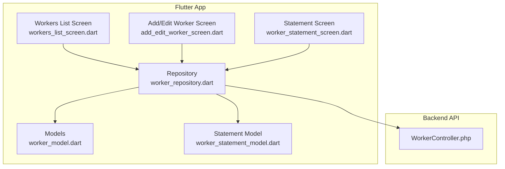
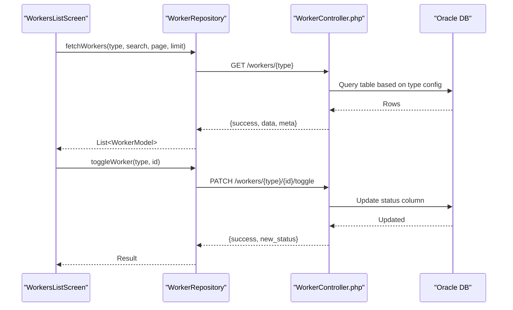
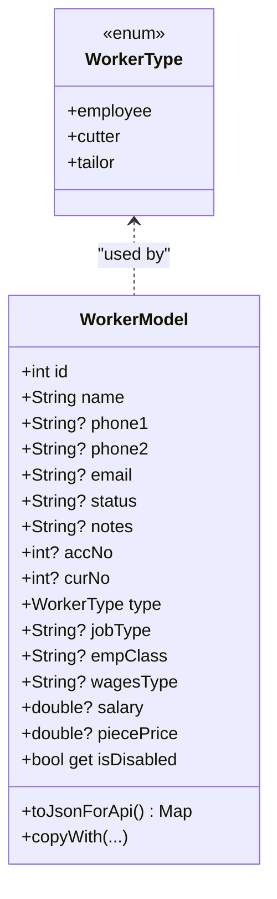
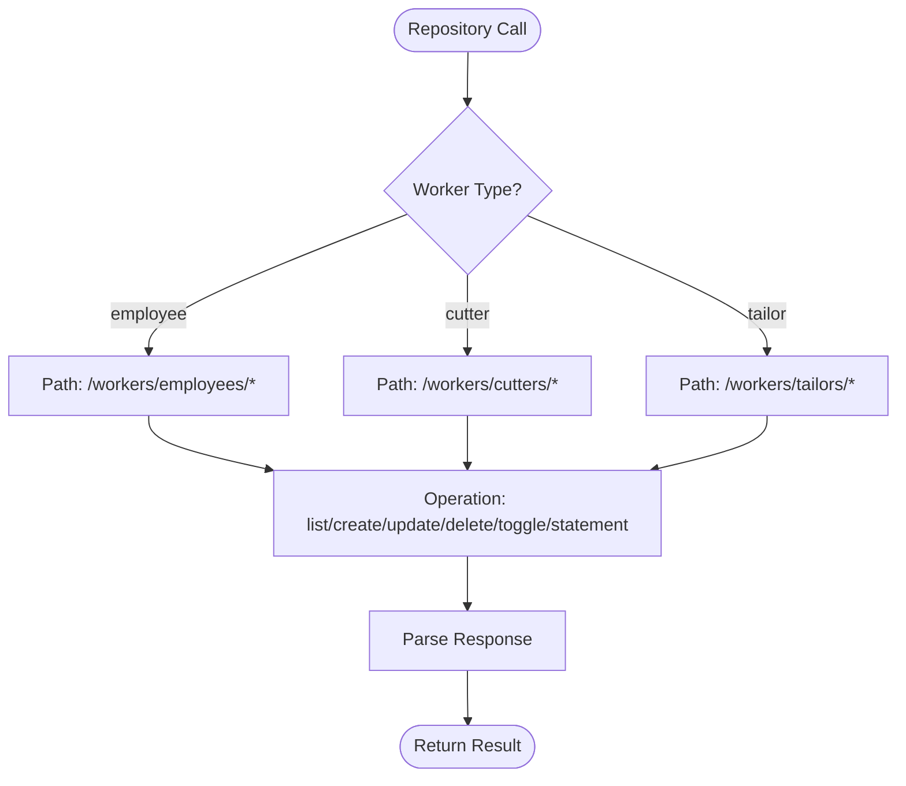
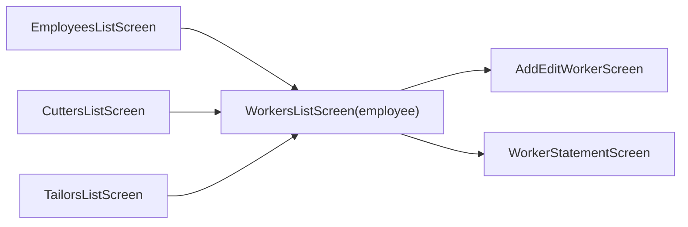
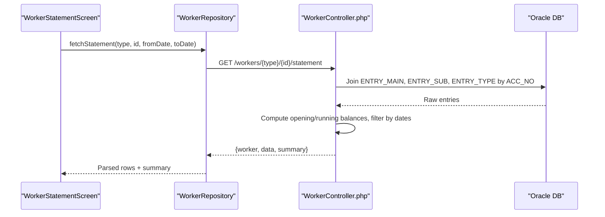
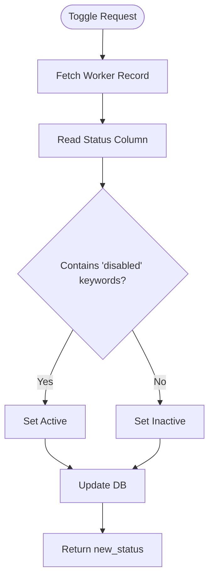
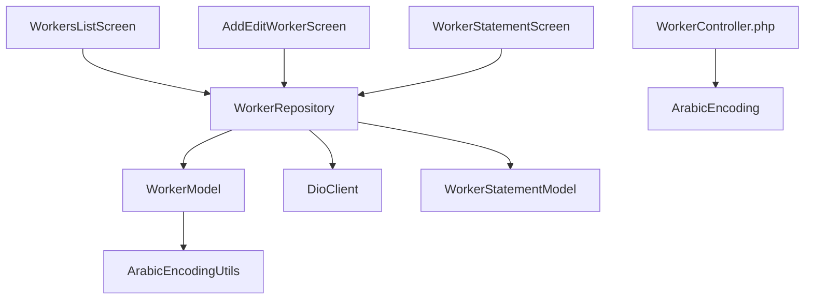

# Worker Management Module

<cite>
**Referenced Files in This Document**
- [worker_model.dart](file://lib/features/workers/data/models/worker_model.dart)
- [worker_repository.dart](file://lib/features/workers/data/repositories/worker_repository.dart)
- [workers_list_screen.dart](file://lib/features/workers/presentation/screens/workers_list_screen.dart)
- [employees_list_screen.dart](file://lib/features/workers/presentation/screens/employees_list_screen.dart)
- [cutters_list_screen.dart](file://lib/features/workers/presentation/screens/cutters_list_screen.dart)
- [tailors_list_screen.dart](file://lib/features/workers/presentation/screens/tailors_list_screen.dart)
- [add_edit_worker_screen.dart](file://lib/features/workers/presentation/screens/add_edit_worker_screen.dart)
- [worker_statement_screen.dart](file://lib/features/workers/presentation/screens/worker_statement_screen.dart)
- [worker_statement_model.dart](file://lib/features/workers/data/models/worker_statement_model.dart)
- [WorkerController.php](file://kyApp_API/app/Http/Controllers/WorkerController.php)
</cite>

## Table of Contents
1. Introduction
2. Project Structure
3. Core Components
4. Architecture Overview
5. Detailed Component Analysis
6. Dependency Analysis
7. Performance Considerations
8. Troubleshooting Guide
9. Conclusion
10. Appendices

## Introduction
This document explains the worker management module that handles three worker types: employees, cutters, and tailors. It covers the data model hierarchy, repository pattern for data operations, UI components for managing workers, performance tracking via statement generation, status management (active/inactive), and practical examples for extending the system with new worker types and custom attributes.

## Project Structure
The module is organized into three layers:
- Data models define a unified WorkerModel supporting multiple worker types and a separate model for statement rows.
- Repository abstracts API calls and maps server responses to domain models.
- Presentation screens provide reusable UI for listing, adding/editing, toggling status, and generating statements.

**Diagram sources**
- [worker_model.dart:1-224](file://lib/features/workers/data/models/worker_model.dart#L1-L224)
- [worker_repository.dart:1-182](file://lib/features/workers/data/repositories/worker_repository.dart#L1-L182)
- [workers_list_screen.dart:1-579](file://lib/features/workers/presentation/screens/workers_list_screen.dart#L1-L579)
- [add_edit_worker_screen.dart:1-489](file://lib/features/workers/presentation/screens/add_edit_worker_screen.dart#L1-L489)
- [worker_statement_screen.dart:1-800](file://lib/features/workers/presentation/screens/worker_statement_screen.dart#L1-L800)
- [worker_statement_model.dart:1-65](file://lib/features/workers/data/models/worker_statement_model.dart#L1-L65)
- [WorkerController.php:1-598](file://kyApp_API/app/Http/Controllers/WorkerController.php#L1-L598)

**Section sources**
- [worker_model.dart:1-224](file://lib/features/workers/data/models/worker_model.dart#L1-L224)
- [worker_repository.dart:1-182](file://lib/features/workers/data/repositories/worker_repository.dart#L1-L182)
- [workers_list_screen.dart:1-579](file://lib/features/workers/presentation/screens/workers_list_screen.dart#L1-L579)
- [add_edit_worker_screen.dart:1-489](file://lib/features/workers/presentation/screens/add_edit_worker_screen.dart#L1-L489)
- [worker_statement_screen.dart:1-800](file://lib/features/workers/presentation/screens/worker_statement_screen.dart#L1-L800)
- [worker_statement_model.dart:1-65](file://lib/features/workers/data/models/worker_statement_model.dart#L1-L65)
- [WorkerController.php:1-598](file://kyApp_API/app/Http/Controllers/WorkerController.php#L1-L598)

## Core Components
- WorkerType enum and extension: defines employee, cutter, tailor types and their API paths.
- WorkerModel: unified model with shared fields and employee-specific fields; includes JSON builders and serialization.
- WorkerRepository: HTTP client wrapper for CRUD, toggle status, and statement endpoints; parses responses into models.
- WorkersListScreen: reusable list screen for all worker types with search, pagination, add/edit, delete, and toggle status.
- AddEditWorkerScreen: form for creating or editing workers with type-specific fields.
- WorkerStatementScreen: statement viewer with date filters, quick ranges, pagination, and export options.
- WorkerStatementModel: typed representation of statement rows returned by the backend.

**Section sources**
- [worker_model.dart:1-224](file://lib/features/workers/data/models/worker_model.dart#L1-L224)
- [worker_repository.dart:1-182](file://lib/features/workers/data/repositories/worker_repository.dart#L1-L182)
- [workers_list_screen.dart:1-579](file://lib/features/workers/presentation/screens/workers_list_screen.dart#L1-L579)
- [add_edit_worker_screen.dart:1-489](file://lib/features/workers/presentation/screens/add_edit_worker_screen.dart#L1-L489)
- [worker_statement_screen.dart:1-800](file://lib/features/workers/presentation/screens/worker_statement_screen.dart#L1-L800)
- [worker_statement_model.dart:1-65](file://lib/features/workers/data/models/worker_statement_model.dart#L1-L65)

## Architecture Overview
The module follows a layered architecture:
- Presentation layer uses Flutter widgets to render lists, forms, and statements.
- Data layer provides a repository that communicates with the Laravel API.
- Backend controller centralizes logic for employees, cutters, and tailors using table configuration constants.

**Diagram sources**
- [workers_list_screen.dart:48-152](file://lib/features/workers/presentation/screens/workers_list_screen.dart#L48-L152)
- [worker_repository.dart:31-134](file://lib/features/workers/data/repositories/worker_repository.dart#L31-L134)
- [WorkerController.php:188-381](file://kyApp_API/app/Http/Controllers/WorkerController.php#L188-L381)

## Detailed Component Analysis

### Worker Model Hierarchy
- WorkerType enum and extension map each worker type to labels and API paths.
- WorkerModel supports shared fields (id, name, phones, email, status, notes, accNo, curNo) and employee-only fields (jobType, empClass, wagesType, salary, piecePrice).
- Factory methods parse JSON from the backend for each worker type and serialize to API payloads.

**Diagram sources**
- [worker_model.dart:1-224](file://lib/features/workers/data/models/worker_model.dart#L1-L224)

**Section sources**
- [worker_model.dart:1-224](file://lib/features/workers/data/models/worker_model.dart#L1-L224)

### Repository Pattern for Data Operations
- WorkerRepository encapsulates network calls for listing, creating, updating, deleting, toggling status, and fetching statements.
- It maps server responses to WorkerModel and WorkerStatementModel instances.
- Error handling wraps Dio exceptions and returns user-friendly messages.

**Diagram sources**
- [worker_repository.dart:31-182](file://lib/features/workers/data/repositories/worker_repository.dart#L31-L182)
- [worker_model.dart:18-27](file://lib/features/workers/data/models/worker_model.dart#L18-L27)

**Section sources**
- [worker_repository.dart:1-182](file://lib/features/workers/data/repositories/worker_repository.dart#L1-L182)

### UI Components for Managing Worker Categories
- EmployeesListScreen, CuttersListScreen, TailorsListScreen are thin wrappers around WorkersListScreen configured per worker type.
- WorkersListScreen provides:
  - Search with debounce
  - Toggle visibility of disabled workers
  - Add/Edit/Delete/Toggle Status actions
  - Navigation to Statement screen
- AddEditWorkerScreen renders common fields plus employee-specific fields when applicable.

**Diagram sources**
- [employees_list_screen.dart:1-22](file://lib/features/workers/presentation/screens/employees_list_screen.dart#L1-L22)
- [cutters_list_screen.dart:1-21](file://lib/features/workers/presentation/screens/cutters_list_screen.dart#L1-L21)
- [tailors_list_screen.dart:1-22](file://lib/features/workers/presentation/screens/tailors_list_screen.dart#L1-L22)
- [workers_list_screen.dart:1-579](file://lib/features/workers/presentation/screens/workers_list_screen.dart#L1-L579)
- [add_edit_worker_screen.dart:1-489](file://lib/features/workers/presentation/screens/add_edit_worker_screen.dart#L1-L489)
- [worker_statement_screen.dart:1-800](file://lib/features/workers/presentation/screens/worker_statement_screen.dart#L1-L800)

**Section sources**
- [employees_list_screen.dart:1-22](file://lib/features/workers/presentation/screens/employees_list_screen.dart#L1-L22)
- [cutters_list_screen.dart:1-21](file://lib/features/workers/presentation/screens/cutters_list_screen.dart#L1-L21)
- [tailors_list_screen.dart:1-22](file://lib/features/workers/presentation/screens/tailors_list_screen.dart#L1-L22)
- [workers_list_screen.dart:1-579](file://lib/features/workers/presentation/screens/workers_list_screen.dart#L1-L579)
- [add_edit_worker_screen.dart:1-489](file://lib/features/workers/presentation/screens/add_edit_worker_screen.dart#L1-L489)

### Performance Tracking System and Statement Generation
- WorkerStatementScreen requests statements via repository and displays rows with summary totals.
- Backend computes opening balance, running balance, debits, credits, and filters by date range. If no dates provided, defaults to last 30 days based on latest entry.
- Statement rows include entry details, amounts, and computed debit/credit values.

**Diagram sources**
- [worker_statement_screen.dart:46-66](file://lib/features/workers/presentation/screens/worker_statement_screen.dart#L46-L66)
- [worker_repository.dart:137-169](file://lib/features/workers/data/repositories/worker_repository.dart#L137-L169)
- [WorkerController.php:398-558](file://kyApp_API/app/Http/Controllers/WorkerController.php#L398-L558)

**Section sources**
- [worker_statement_screen.dart:1-800](file://lib/features/workers/presentation/screens/worker_statement_screen.dart#L1-L800)
- [worker_statement_model.dart:1-65](file://lib/features/workers/data/models/worker_statement_model.dart#L1-L65)
- [WorkerController.php:398-558](file://kyApp_API/app/Http/Controllers/WorkerController.php#L398-L558)

### Worker Status Management (Active/Inactive)
- The backend toggles status between active and inactive by checking for specific Arabic keywords and flipping accordingly.
- The UI reflects status via badges and allows toggling directly from the list.

**Diagram sources**
- [WorkerController.php:348-381](file://kyApp_API/app/Http/Controllers/WorkerController.php#L348-L381)
- [workers_list_screen.dart:135-152](file://lib/features/workers/presentation/screens/workers_list_screen.dart#L135-L152)

**Section sources**
- [WorkerController.php:348-381](file://kyApp_API/app/Http/Controllers/WorkerController.php#L348-L381)
- [workers_list_screen.dart:135-152](file://lib/features/workers/presentation/screens/workers_list_screen.dart#L135-L152)

### Employee Management Interface
- EmployeesListScreen configures WorkersListScreen for employee type with appropriate title, label, colors, and icon.
- AddEditWorkerScreen shows additional fields for job type, employee class, wage type, salary, and piece price when worker type is employee.

**Section sources**
- [employees_list_screen.dart:1-22](file://lib/features/workers/presentation/screens/employees_list_screen.dart#L1-L22)
- [add_edit_worker_screen.dart:244-293](file://lib/features/workers/presentation/screens/add_edit_worker_screen.dart#L244-L293)

### Tailor Assignment Workflows
- TailorsListScreen configures WorkersListScreen for tailor type.
- While assignment workflows are not implemented yet, the UI exposes a placeholder action for work reports.

**Section sources**
- [tailors_list_screen.dart:1-22](file://lib/features/workers/presentation/screens/tailors_list_screen.dart#L1-L22)
- [workers_list_screen.dart:380-387](file://lib/features/workers/presentation/screens/workers_list_screen.dart#L380-L387)

### Cutter Task Management
- CuttersListScreen configures WorkersListScreen for cutter type.
- Similar to tailors, task management placeholders exist for work reports.

**Section sources**
- [cutters_list_screen.dart:1-21](file://lib/features/workers/presentation/screens/cutters_list_screen.dart#L1-L21)
- [workers_list_screen.dart:380-387](file://lib/features/workers/presentation/screens/workers_list_screen.dart#L380-L387)

## Dependency Analysis
- WorkerModel depends on Arabic encoding utilities for safe text handling.
- WorkerRepository depends on DioClient and both WorkerModel and WorkerStatementModel.
- Presentation screens depend on providers and repositories for state and data.
- Backend WorkerController depends on Oracle connection and Arabic encoding helpers.

**Diagram sources**
- [worker_model.dart:1-224](file://lib/features/workers/data/models/worker_model.dart#L1-L224)
- [worker_repository.dart:1-182](file://lib/features/workers/data/repositories/worker_repository.dart#L1-L182)
- [worker_statement_model.dart:1-65](file://lib/features/workers/data/models/worker_statement_model.dart#L1-L65)
- [workers_list_screen.dart:1-579](file://lib/features/workers/presentation/screens/workers_list_screen.dart#L1-L579)
- [add_edit_worker_screen.dart:1-489](file://lib/features/workers/presentation/screens/add_edit_worker_screen.dart#L1-L489)
- [worker_statement_screen.dart:1-800](file://lib/features/workers/presentation/screens/worker_statement_screen.dart#L1-L800)
- [WorkerController.php:1-598](file://kyApp_API/app/Http/Controllers/WorkerController.php#L1-L598)

**Section sources**
- [worker_model.dart:1-224](file://lib/features/workers/data/models/worker_model.dart#L1-L224)
- [worker_repository.dart:1-182](file://lib/features/workers/data/repositories/worker_repository.dart#L1-L182)
- [worker_statement_model.dart:1-65](file://lib/features/workers/data/models/worker_statement_model.dart#L1-L65)
- [workers_list_screen.dart:1-579](file://lib/features/workers/presentation/screens/workers_list_screen.dart#L1-L579)
- [add_edit_worker_screen.dart:1-489](file://lib/features/workers/presentation/screens/add_edit_worker_screen.dart#L1-L489)
- [worker_statement_screen.dart:1-800](file://lib/features/workers/presentation/screens/worker_statement_screen.dart#L1-L800)
- [WorkerController.php:1-598](file://kyApp_API/app/Http/Controllers/WorkerController.php#L1-L598)

## Performance Considerations
- Server-side pagination and search reduce payload size; default limit is capped at a maximum.
- Statement computation occurs on the server; client-side pagination limits displayed rows per page.
- Debounced search reduces unnecessary network calls.
- Avoid rendering large lists without virtualization; current implementation uses ListView.separated which is efficient for moderate sizes.

[No sources needed since this section provides general guidance]

## Troubleshooting Guide
- Network errors: Repository catches DioException and surfaces user-friendly messages.
- Not found records: Backend returns success=false with message when record does not exist.
- Missing account number: Statement endpoint returns a validation error if ACC_NO is missing.
- Date parsing: Backend normalizes various date formats; ensure correct format when filtering.

**Section sources**
- [worker_repository.dart:61-134](file://lib/features/workers/data/repositories/worker_repository.dart#L61-L134)
- [WorkerController.php:289-343](file://kyApp_API/app/Http/Controllers/WorkerController.php#L289-L343)
- [WorkerController.php:398-424](file://kyApp_API/app/Http/Controllers/WorkerController.php#L398-L424)
- [WorkerController.php:563-584](file://kyApp_API/app/Http/Controllers/WorkerController.php#L563-L584)

## Conclusion
The worker management module provides a cohesive, extensible system for managing employees, cutters, and tailors. It leverages a unified model and repository pattern, offers robust UI for CRUD and status management, and includes a comprehensive statement generation feature for performance tracking. Extending the system with new worker types involves updating the enum, model factories, repository mapping, and backend table configuration.

[No sources needed since this section summarizes without analyzing specific files]

## Appendices

### Practical Examples

#### Adding a New Worker Type
Steps:
- Add a new value to WorkerType enum and extend apiPath/label mappings.
- Extend WorkerModel factory methods and toJsonForApi to handle the new type.
- Update WorkerRepository._parseWorker to map the new type.
- Add backend table configuration in WorkerController.TABLES and expose endpoints.
- Create a dedicated list screen similar to existing ones.

**Section sources**
- [worker_model.dart:3-27](file://lib/features/workers/data/models/worker_model.dart#L3-L27)
- [worker_model.dart:74-165](file://lib/features/workers/data/models/worker_model.dart#L74-L165)
- [worker_repository.dart:171-180](file://lib/features/workers/data/repositories/worker_repository.dart#L171-L180)
- [WorkerController.php:22-59](file://kyApp_API/app/Http/Controllers/WorkerController.php#L22-L59)

#### Implementing Custom Worker Attributes
- Add new fields to WorkerModel and update factory methods and toJsonForApi.
- Extend AddEditWorkerScreen to include input fields for the new attributes.
- Update backend store/update logic to accept and persist the new columns.

**Section sources**
- [worker_model.dart:30-66](file://lib/features/workers/data/models/worker_model.dart#L30-L66)
- [worker_model.dart:127-165](file://lib/features/workers/data/models/worker_model.dart#L127-L165)
- [add_edit_worker_screen.dart:244-293](file://lib/features/workers/presentation/screens/add_edit_worker_screen.dart#L244-L293)
- [WorkerController.php:244-320](file://kyApp_API/app/Http/Controllers/WorkerController.php#L244-L320)

#### Generating Worker Performance Reports
- Use WorkerStatementScreen to select date ranges or quick ranges.
- Repository calls statement endpoint; backend computes summaries and returns rows.
- Client displays paginated results with summary boxes and export options.

**Section sources**
- [worker_statement_screen.dart:46-111](file://lib/features/workers/presentation/screens/worker_statement_screen.dart#L46-L111)
- [worker_repository.dart:137-169](file://lib/features/workers/data/repositories/worker_repository.dart#L137-L169)
- [WorkerController.php:398-558](file://kyApp_API/app/Http/Controllers/WorkerController.php#L398-L558)