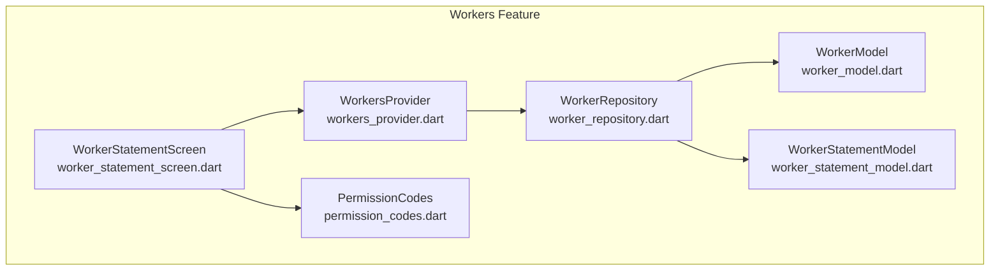
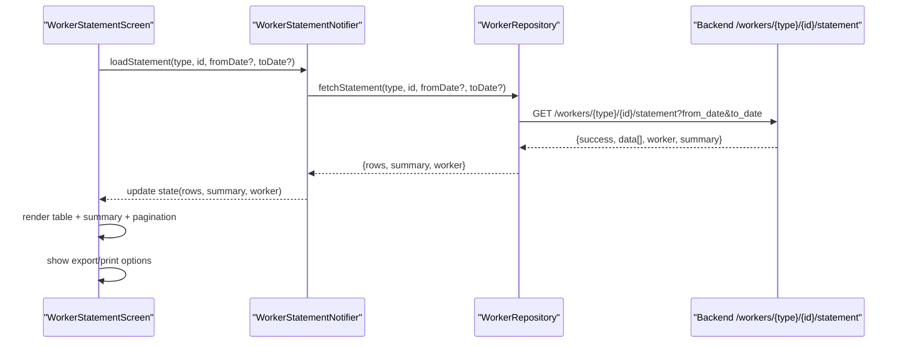
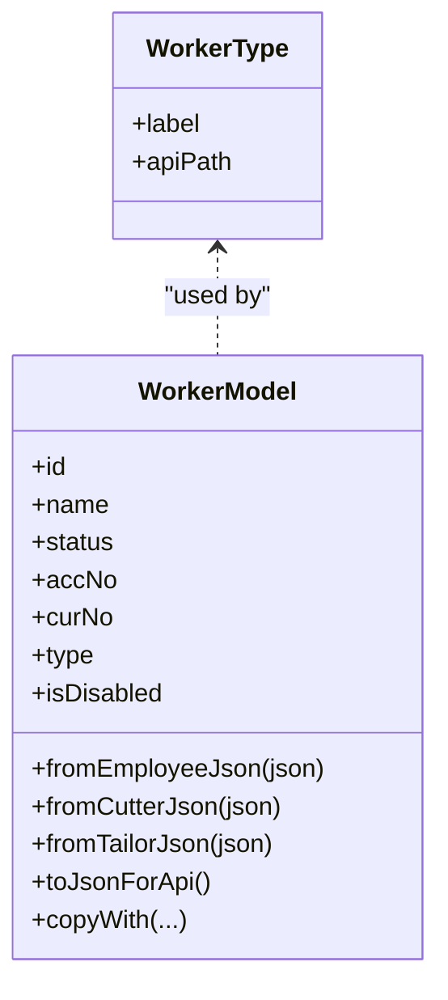
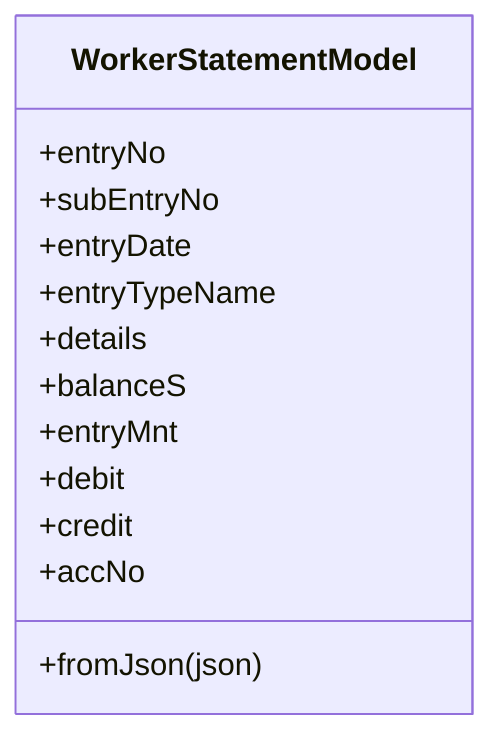
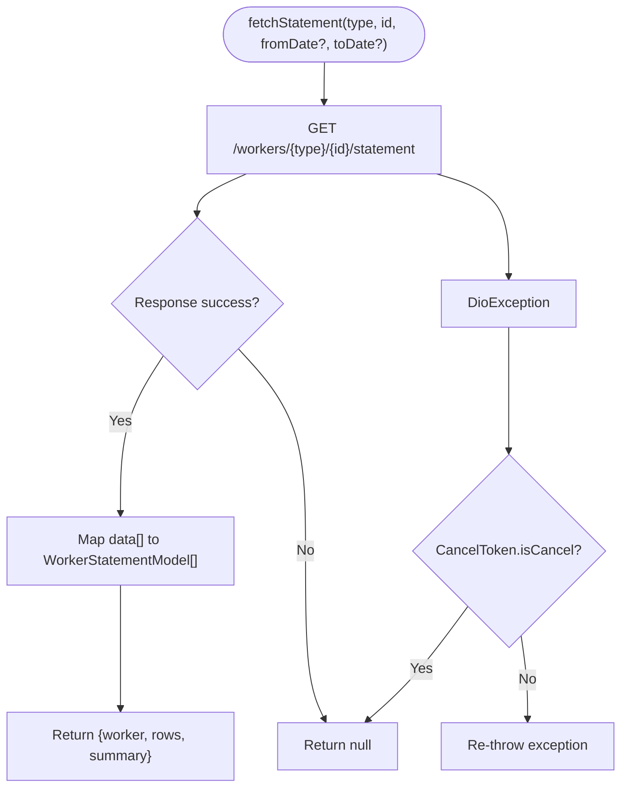
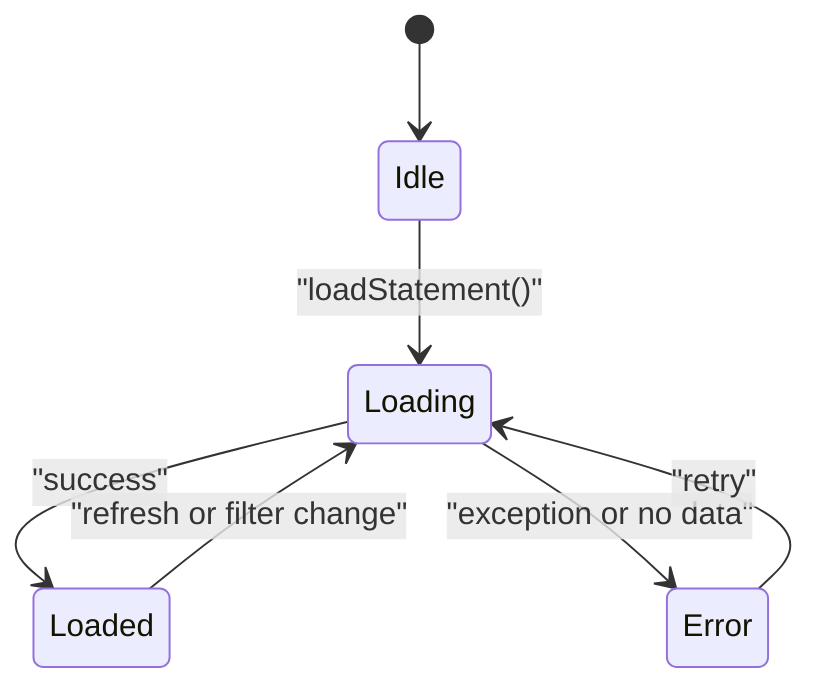
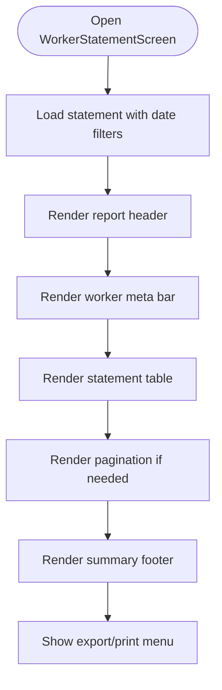
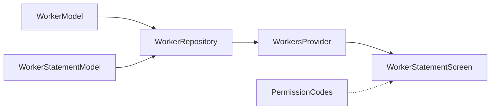

# Worker Performance Tracking

<cite>
**Referenced Files in This Document**
- [worker_model.dart](file://lib/features/workers/data/models/worker_model.dart)
- [worker_statement_model.dart](file://lib/features/workers/data/models/worker_statement_model.dart)
- [worker_repository.dart](file://lib/features/workers/data/repositories/worker_repository.dart)
- [workers_provider.dart](file://lib/features/workers/presentation/providers/workers_provider.dart)
- [worker_statement_screen.dart](file://lib/features/workers/presentation/screens/worker_statement_screen.dart)
- [permission_codes.dart](file://lib/core/constants/permission_codes.dart)
</cite>

## Table of Contents
1. [Introduction](#introduction)
2. [Project Structure](#project-structure)
3. [Core Components](#core-components)
4. [Architecture Overview](#architecture-overview)
5. [Detailed Component Analysis](#detailed-component-analysis)
6. [Dependency Analysis](#dependency-analysis)
7. [Performance Considerations](#performance-considerations)
8. [Troubleshooting Guide](#troubleshooting-guide)
9. [Conclusion](#conclusion)

## Introduction
This document explains the worker performance tracking system that applies across all worker types (employee, cutter, tailor). It focuses on how performance-related data is collected from the server, modeled locally, presented through a responsive statement screen, and exported for reporting. The system centers on:

- A unified worker model supporting multiple worker types.
- A statement endpoint that returns transaction rows and summary totals.
- A Riverpod-based provider layer that manages loading state and errors.
- A presentation screen that renders a paginated, responsive statement table with export options.
- Permission codes that gate access to worker statements and exports.

The documentation covers metrics collection, productivity calculations as reflected by statement summaries, trend analysis via date filters, and export capabilities for PDF, Excel/CSV, and print.

## Project Structure
The worker performance tracking feature spans data models, repository, providers, and UI screens under the workers feature. The key files are:

- Data models: worker type and statement row definitions.
- Repository: HTTP calls to fetch workers and their statements.
- Providers: Riverpod notifiers for list and statement state.
- Screen: Statement UI with filtering, pagination, and export actions.
- Permissions: Catalog of permission codes including worker statement and export actions.

**Diagram sources**
- [worker_model.dart:1-224](file://lib/features/workers/data/models/worker_model.dart#L1-L224)
- [worker_statement_model.dart:1-65](file://lib/features/workers/data/models/worker_statement_model.dart#L1-L65)
- [worker_repository.dart:1-182](file://lib/features/workers/data/repositories/worker_repository.dart#L1-L182)
- [workers_provider.dart:1-247](file://lib/features/workers/presentation/providers/workers_provider.dart#L1-L247)
- [worker_statement_screen.dart:1-1474](file://lib/features/workers/presentation/screens/worker_statement_screen.dart#L1-L1474)
- [permission_codes.dart:1-339](file://lib/core/constants/permission_codes.dart#L1-L339)

**Section sources**
- [worker_model.dart:1-224](file://lib/features/workers/data/models/worker_model.dart#L1-L224)
- [worker_statement_model.dart:1-65](file://lib/features/workers/data/models/worker_statement_model.dart#L1-L65)
- [worker_repository.dart:1-182](file://lib/features/workers/data/repositories/worker_repository.dart#L1-L182)
- [workers_provider.dart:1-247](file://lib/features/workers/presentation/providers/workers_provider.dart#L1-L247)
- [worker_statement_screen.dart:1-1474](file://lib/features/workers/presentation/screens/worker_statement_screen.dart#L1-L1474)
- [permission_codes.dart:1-339](file://lib/core/constants/permission_codes.dart#L1-L339)

## Core Components
- WorkerModel: Unified representation for employees, cutters, and tailors, including fields like id, name, status, account number, currency, and type-specific attributes. It provides JSON parsing and API serialization helpers.
- WorkerStatementModel: Represents a single statement row with entry identifiers, date, type, details, debit, credit, balance, and account number.
- WorkerRepository: Encapsulates network operations for fetching workers and worker statements, mapping responses into typed models and returning structured results.
- WorkersProvider: Manages UI state for worker lists and statement views using Riverpod Notifier classes. It loads statement data with optional date filters and updates rows, summary, and worker info.
- WorkerStatementScreen: Renders the statement report with header, metadata bar, responsive table, pagination, summary footer, and export/print options. It supports quick date ranges and page navigation.
- PermissionCodes: Defines permission constants for worker modules, including view, toggle, and statement actions, plus export permissions for other modules.

Key responsibilities:
- Data modeling and normalization.
- Network abstraction and error handling.
- State management for loading, error, and data.
- Presentation of performance metrics (totals, balances) and export flows.

**Section sources**
- [worker_model.dart:1-224](file://lib/features/workers/data/models/worker_model.dart#L1-L224)
- [worker_statement_model.dart:1-65](file://lib/features/workers/data/models/worker_statement_model.dart#L1-L65)
- [worker_repository.dart:1-182](file://lib/features/workers/data/repositories/worker_repository.dart#L1-L182)
- [workers_provider.dart:1-247](file://lib/features/workers/presentation/providers/workers_provider.dart#L1-L247)
- [worker_statement_screen.dart:1-1474](file://lib/features/workers/presentation/screens/worker_statement_screen.dart#L1-L1474)
- [permission_codes.dart:1-339](file://lib/core/constants/permission_codes.dart#L1-L339)

## Architecture Overview
The worker performance tracking flow starts at the UI screen, which triggers the provider to load statement data. The provider calls the repository, which makes an HTTP request to the backend endpoint for the selected worker type and ID. The response includes rows and a summary object containing totals and balances. The provider updates state, and the screen renders the statement table with pagination and summary footers. Export options are available via a bottom sheet.

**Diagram sources**
- [worker_statement_screen.dart:46-66](file://lib/features/workers/presentation/screens/worker_statement_screen.dart#L46-L66)
- [workers_provider.dart:204-240](file://lib/features/workers/presentation/providers/workers_provider.dart#L204-L240)
- [worker_repository.dart:136-169](file://lib/features/workers/data/repositories/worker_repository.dart#L136-L169)

## Detailed Component Analysis

### Worker Model and Types
WorkerModel centralizes worker data across employee, cutter, and tailor types. It exposes:
- Type enumeration and API path mapping.
- Parsing factories per type.
- Serialization helper for API payloads.
- Utility methods such as disabled status detection.

Complexity considerations:
- Parsing helpers are O(1) per field; overall construction is linear in the number of fields.
- CopyWith enables immutable updates for UI state transitions.

**Diagram sources**
- [worker_model.dart:1-224](file://lib/features/workers/data/models/worker_model.dart#L1-L224)

**Section sources**
- [worker_model.dart:1-224](file://lib/features/workers/data/models/worker_model.dart#L1-L224)

### Statement Model and Metrics
WorkerStatementModel represents each transaction row and includes:
- Entry identifiers and date.
- Entry type name and details.
- Debit, credit, and running balance.
- Account number.

Metrics aggregation:
- The backend returns a summary object with total_debit, total_credit, opening_balance, final_balance, and date range hints.
- The UI computes display values and formats amounts consistently.

**Diagram sources**
- [worker_statement_model.dart:1-65](file://lib/features/workers/data/models/worker_statement_model.dart#L1-L65)

**Section sources**
- [worker_statement_model.dart:1-65](file://lib/features/workers/data/models/worker_statement_model.dart#L1-L65)

### Repository Layer
WorkerRepository encapsulates:
- Fetching workers with search and pagination parameters.
- CRUD operations for workers (create, update, delete, toggle).
- Fetching worker statements with optional date filters.

Error handling:
- DioException is caught and transformed into user-friendly messages or null results where appropriate.
- CancelToken.isCancel is handled to avoid unnecessary error states.

**Diagram sources**
- [worker_repository.dart:136-169](file://lib/features/workers/data/repositories/worker_repository.dart#L136-L169)

**Section sources**
- [worker_repository.dart:1-182](file://lib/features/workers/data/repositories/worker_repository.dart#L1-L182)

### Provider State Management
WorkersProvider defines:
- WorkersListState and WorkersListNotifier for managing worker lists.
- WorkerStatementState and WorkerStatementNotifier for statement data.

Key behaviors:
- loadStatement sets isLoading, clears previous errors, and updates rows, summary, and worker info.
- Error paths set descriptive messages without crashing the UI.

**Diagram sources**
- [workers_provider.dart:163-240](file://lib/features/workers/presentation/providers/workers_provider.dart#L163-L240)

**Section sources**
- [workers_provider.dart:1-247](file://lib/features/workers/presentation/providers/workers_provider.dart#L1-L247)

### Presentation Screen and Reporting
WorkerStatementScreen implements:
- Date filter panel with quick ranges (last 30 days, current month/year, all).
- Responsive statement table with headers, opening balance row, transaction rows, totals row, and summary footer.
- Pagination controls for 15 rows per page.
- Export/print options via a bottom sheet (PDF, Excel/CSV, print).

Performance metrics visualization:
- Summary footer shows opening and final balances.
- Totals row displays total debits, credits, and net difference.
- Currency and account number are displayed in the metadata bar.

Export capabilities:
- Bottom sheet offers PDF export, Excel/CSV export, and direct print.
- These actions are UI-driven; actual implementation may integrate platform-specific libraries.

**Diagram sources**
- [worker_statement_screen.dart:46-66](file://lib/features/workers/presentation/screens/worker_statement_screen.dart#L46-L66)
- [worker_statement_screen.dart:113-239](file://lib/features/workers/presentation/screens/worker_statement_screen.dart#L113-L239)
- [worker_statement_screen.dart:621-683](file://lib/features/workers/presentation/screens/worker_statement_screen.dart#L621-L683)
- [worker_statement_screen.dart:934-1224](file://lib/features/workers/presentation/screens/worker_statement_screen.dart#L934-L1224)
- [worker_statement_screen.dart:1229-1323](file://lib/features/workers/presentation/screens/worker_statement_screen.dart#L1229-L1323)
- [worker_statement_screen.dart:1328-1397](file://lib/features/workers/presentation/screens/worker_statement_screen.dart#L1328-L1397)

**Section sources**
- [worker_statement_screen.dart:1-1474](file://lib/features/workers/presentation/screens/worker_statement_screen.dart#L1-L1474)

### Permissions and Access Control
Permission codes define module-scoped actions for workers:
- employees.*, cutters.*, tailors.* include view, create, update, delete, toggle, and statement actions.
- Other modules include export permissions (e.g., accounts.export, invoices.export, reports.export).

These codes ensure consistent gating between client and server catalogs.

**Section sources**
- [permission_codes.dart:1-339](file://lib/core/constants/permission_codes.dart#L1-L339)

## Dependency Analysis
The components exhibit clear separation of concerns:
- Models depend only on encoding utilities.
- Repository depends on DioClient and models.
- Providers depend on repository and models.
- Screen depends on providers, models, and theme utilities.
- Permission codes are independent constants used for gating.

**Diagram sources**
- [worker_model.dart:1-224](file://lib/features/workers/data/models/worker_model.dart#L1-L224)
- [worker_statement_model.dart:1-65](file://lib/features/workers/data/models/worker_statement_model.dart#L1-L65)
- [worker_repository.dart:1-182](file://lib/features/workers/data/repositories/worker_repository.dart#L1-L182)
- [workers_provider.dart:1-247](file://lib/features/workers/presentation/providers/workers_provider.dart#L1-L247)
- [worker_statement_screen.dart:1-1474](file://lib/features/workers/presentation/screens/worker_statement_screen.dart#L1-L1474)
- [permission_codes.dart:1-339](file://lib/core/constants/permission_codes.dart#L1-L339)

**Section sources**
- [worker_repository.dart:1-182](file://lib/features/workers/data/repositories/worker_repository.dart#L1-L182)
- [workers_provider.dart:1-247](file://lib/features/workers/presentation/providers/workers_provider.dart#L1-L247)
- [worker_statement_screen.dart:1-1474](file://lib/features/workers/presentation/screens/worker_statement_screen.dart#L1-L1474)
- [permission_codes.dart:1-339](file://lib/core/constants/permission_codes.dart#L1-L339)

## Performance Considerations
- Pagination: The statement screen uses a fixed page size of 15 rows to reduce rendering overhead and improve responsiveness on large datasets.
- Date filtering: Quick ranges minimize repeated manual input and encourage focused analysis windows.
- Network efficiency: The repository passes optional date filters to the backend, allowing server-side aggregation and reducing payload size.
- State immutability: Provider state updates use copyWith to prevent unintended mutations and enable efficient diffing in the UI.
- Error resilience: DioException handling ensures graceful degradation when requests fail or are canceled.

[No sources needed since this section provides general guidance]

## Troubleshooting Guide
Common issues and resolutions:
- No data for worker: The provider sets an error message when the repository returns null; users can retry via the screen’s retry button.
- Network errors: DioException messages are surfaced to the UI; check connectivity and credentials.
- Canceled requests: If a request is canceled (e.g., navigating away), the repository returns null without error state.
- Permission denied: Ensure the user has the relevant worker statement permission code (employees.statement, cutters.statement, tailors.statement).

**Section sources**
- [workers_provider.dart:204-240](file://lib/features/workers/presentation/providers/workers_provider.dart#L204-L240)
- [worker_repository.dart:136-169](file://lib/features/workers/data/repositories/worker_repository.dart#L136-L169)
- [permission_codes.dart:48-73](file://lib/core/constants/permission_codes.dart#L48-L73)

## Conclusion
The worker performance tracking system provides a robust, type-agnostic foundation for collecting, modeling, and presenting worker statement data. It leverages a clean architecture with models, repository, providers, and a responsive UI. Performance metrics are delivered via backend summaries and rendered with clarity through tables and footers. Export and print options support reporting needs, while permission codes enforce secure access. Future enhancements could include richer analytics, trend charts, and deeper integration with export libraries.

[No sources needed since this section summarizes without analyzing specific files]