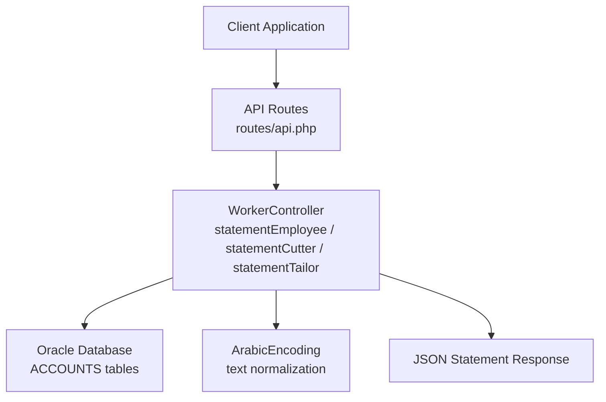
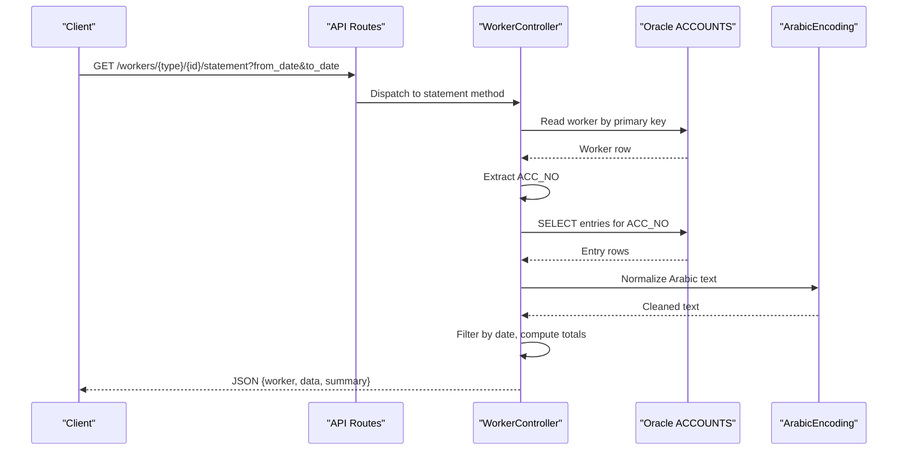
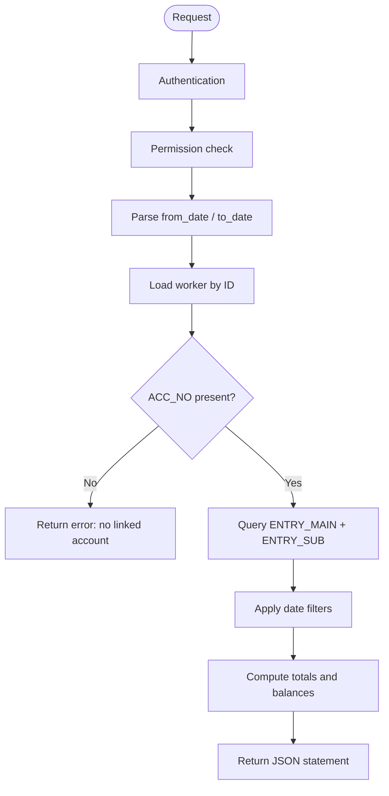
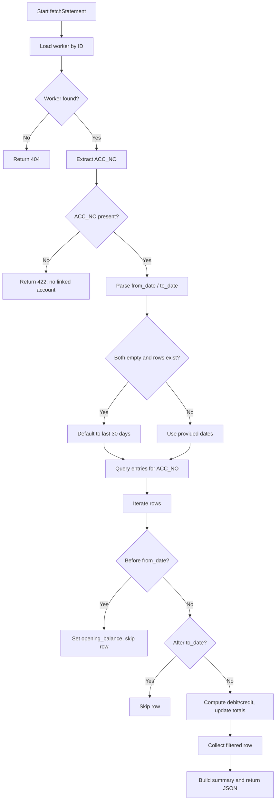
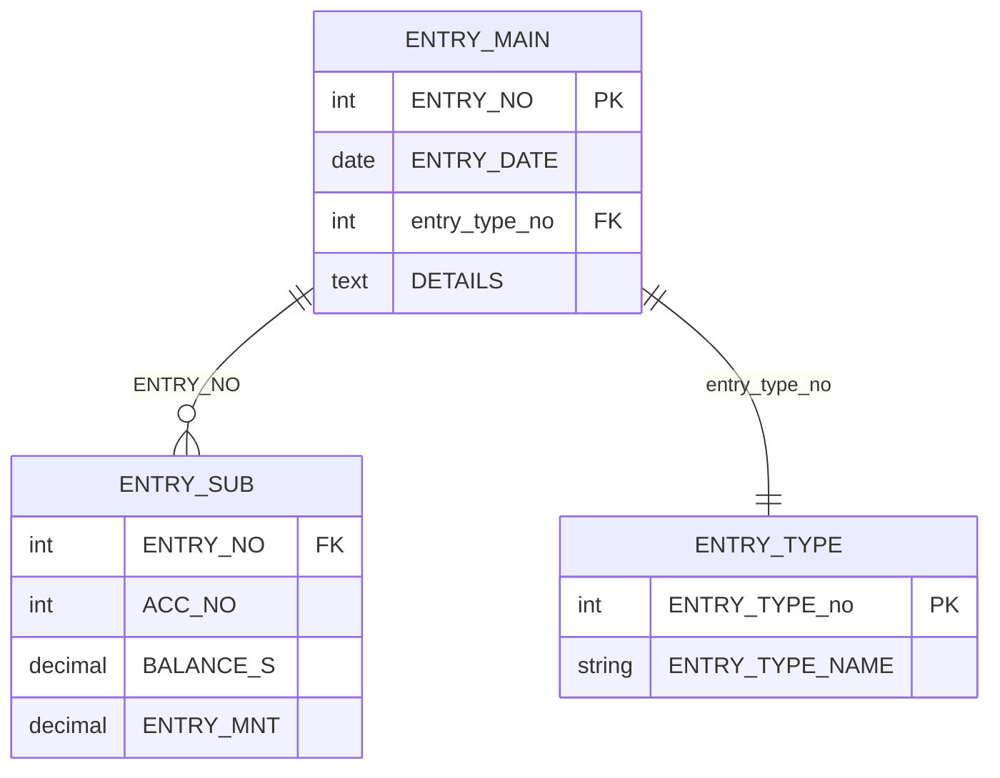

# Worker Statements and Reports

<cite>
**Referenced Files in This Document**
- [WorkerController.php](file://kyApp_API/app/Http/Controllers/WorkerController.php)
- [api.php](file://kyApp_API/routes/api.php)
- [ArabicEncoding.php](file://kyApp_API/app/Support/ArabicEncoding.php)
- [AccountController.php](file://kyApp_API/app/Http/Controllers/AccountController.php)
</cite>

## Table of Contents
1. [Introduction](#introduction)
2. [Project Structure](#project-structure)
3. [Core Components](#core-components)
4. [Architecture Overview](#architecture-overview)
5. [Detailed Component Analysis](#detailed-component-analysis)
6. [Dependency Analysis](#dependency-analysis)
7. [Performance Considerations](#performance-considerations)
8. [Troubleshooting Guide](#troubleshooting-guide)
9. [Conclusion](#conclusion)
10. [Appendices](#appendices)

## Introduction
This document explains the worker statement generation and reporting capabilities in the application. It covers:
- The three worker statement types: employees, cutters, and tailors.
- How statements are calculated from accounting entries.
- Date filtering, default behavior, and summary aggregation.
- API endpoints, permissions, and request parameters.
- Data presentation and encoding handling for Arabic text.
- Guidance for extending reports, scheduling automated delivery, and integrating with accounting systems.

The implementation is backend-focused: a Laravel controller reads Oracle accounting tables, computes debit, credit, opening balance, running balance, and returns structured JSON suitable for UI rendering or downstream integration.

## Project Structure
Worker statements are exposed through REST routes and implemented by a dedicated controller that shares logic across employee, cutter, and tailor statements.



**Diagram sources**
- [api.php:219-273](file://kyApp_API/routes/api.php#L219-L273)
- [WorkerController.php:166-179](file://kyApp_API/app/Http/Controllers/WorkerController.php#L166-L179)
- [WorkerController.php:398-558](file://kyApp_API/app/Http/Controllers/WorkerController.php#L398-L558)
- [ArabicEncoding.php:36-120](file://kyApp_API/app/Support/ArabicEncoding.php#L36-L120)

**Section sources**
- [api.php:219-273](file://kyApp_API/routes/api.php#L219-L273)
- [WorkerController.php:166-179](file://kyApp_API/app/Http/Controllers/WorkerController.php#L166-L179)

## Core Components
- WorkerStatementEndpoints: Public REST endpoints for each worker type.
- WorkerController.fetchStatement: Shared calculation engine for all worker statements.
- ArabicEncoding: Text normalization helper for Oracle Windows-1256 and UTF-8 compatibility.
- AccountStatementEndpoints: Related account-level statement endpoints for context and comparison.

Key responsibilities:
- Validate and normalize date inputs.
- Resolve the worker’s linked accounting account number.
- Query entry headers and lines from Oracle.
- Compute totals, opening balance, and final balance.
- Return a consistent JSON structure with worker metadata, line items, and summary.

**Section sources**
- [WorkerController.php:398-558](file://kyApp_API/app/Http/Controllers/WorkerController.php#L398-L558)
- [ArabicEncoding.php:36-120](file://kyApp_API/app/Support/ArabicEncoding.php#L36-L120)

## Architecture Overview
The worker statement flow is a single-request pipeline:
1. Client calls a worker statement endpoint with optional date range.
2. Route middleware enforces authentication and permission.
3. Controller resolves worker record and linked account number.
4. Controller queries Oracle for all entries related to the account.
5. Controller filters rows by requested dates (or defaults to last 30 days).
6. Controller aggregates debits, credits, opening balance, and final balance.
7. Controller returns a JSON payload with worker info, transaction rows, and summary.



**Diagram sources**
- [api.php:225-263](file://kyApp_API/routes/api.php#L225-L263)
- [WorkerController.php:398-558](file://kyApp_API/app/Http/Controllers/WorkerController.php#L398-L558)
- [ArabicEncoding.php:36-120](file://kyApp_API/app/Support/ArabicEncoding.php#L36-L120)

## Detailed Component Analysis

### Worker Statement Endpoints
There are three worker statement endpoints, one per worker registry:
- Employees: GET /workers/employees/{id}/statement
- Cutters: GET /workers/cutters/{id}/statement
- Tailors: GET /workers/tailors/{id}/statement

Each endpoint:
- Requires authentication via Sanctum.
- Requires a module-specific permission code:
  - employees.statement
  - cutters.statement
  - tailors.statement
- Accepts query parameters:
  - from_date: Optional date filter.
  - to_date: Optional date filter.
- Returns a JSON response containing worker metadata, transaction rows, and a summary.



**Diagram sources**
- [api.php:225-263](file://kyApp_API/routes/api.php#L225-L263)
- [WorkerController.php:398-558](file://kyApp_API/app/Http/Controllers/WorkerController.php#L398-L558)

**Section sources**
- [api.php:225-263](file://kyApp_API/routes/api.php#L225-L263)

### Statement Calculation Logic
The shared calculation logic is implemented in WorkerController.fetchStatement:

- Worker resolution:
  - Reads the worker row using the configured primary key column.
  - Extracts the linked accounting account number from the configured account column.
  - If no account number exists, returns a validation error.

- Date handling:
  - Parses from_date and to_date into ISO format.
  - If neither date is provided and there are existing entries, defaults to the last 30 days based on the most recent entry date.

- Data aggregation:
  - Iterates over entry rows.
  - Rows before from_date contribute to opening balance but are excluded from displayed rows.
  - Rows after to_date are excluded.
  - For each included row:
    - Debit = positive amount.
    - Credit = absolute value of negative amount.
    - Running balance is taken directly from the source balance field.
  - Totals computed:
    - total_debit
    - total_credit
    - opening_balance
    - final_balance (last running balance if any rows; otherwise opening balance)

- Presentation:
  - Each row includes entry identifiers, formatted date, type name, details, balance, amounts, and the linked account number.
  - Summary includes counts, totals, date range, currency label, and an account title combining account number and worker name.



**Diagram sources**
- [WorkerController.php:398-558](file://kyApp_API/app/Http/Controllers/WorkerController.php#L398-L558)

**Section sources**
- [WorkerController.php:398-558](file://kyApp_API/app/Http/Controllers/WorkerController.php#L398-L558)

### Data Aggregation Methods
- Opening balance:
  - Accumulated from the balance field of rows preceding the requested start date.
- Final balance:
  - Equals the last running balance among included rows; if none, equals opening balance.
- Debit and credit totals:
  - Summed separately across included rows.
- Currency:
  - Hardcoded label in the summary indicates Yemeni Riyal.
- Account title:
  - Concatenation of account number and worker name for display purposes.

These aggregations are performed in-memory after retrieving all matching entries for the account.

**Section sources**
- [WorkerController.php:477-554](file://kyApp_API/app/Http/Controllers/WorkerController.php#L477-L554)

### Presentation Formats
- JSON structure:
  - success: boolean flag.
  - worker: object with id, name, acc_no, type.
  - data: array of transaction rows.
  - summary: object with total_rows, total_debit, total_credit, opening_balance, final_balance, from_date, to_date, currency, account_title.
- Date formatting:
  - Display date uses DD/MM/YYYY.
  - Internal raw date uses YYYY-MM-DD for filtering.
- Arabic text:
  - Names, type names, and details are normalized using ArabicEncoding.fixMojibake to ensure correct display.

**Section sources**
- [WorkerController.php:517-554](file://kyApp_API/app/Http/Controllers/WorkerController.php#L517-L554)
- [ArabicEncoding.php:36-120](file://kyApp_API/app/Support/ArabicEncoding.php#L36-L120)

### Statement Customization Options
Current customization options available via query parameters:
- from_date: Restricts rows to include entries on or after this date.
- to_date: Restricts rows to include entries on or before this date.
- Default behavior:
  - If both are omitted and entries exist, the system defaults to the last 30 days based on the latest entry date.

Future extension points could include:
- Grouping by entry type.
- Export formats such as CSV or PDF.
- Additional filters like entry type or detail keywords.
- Multi-currency support beyond the current hardcoded currency label.

**Section sources**
- [WorkerController.php:402-441](file://kyApp_API/app/Http/Controllers/WorkerController.php#L402-L441)
- [WorkerController.php:464-475](file://kyApp_API/app/Http/Controllers/WorkerController.php#L464-L475)

### Integration with Accounting Systems
Worker statements rely on Oracle accounting tables:
- ENTRY_MAIN: Entry header information including date and type linkage.
- ENTRY_SUB: Entry line information including amounts and running balance.
- ENTRY_TYPE: Lookup table for entry type names.

The controller joins these tables to produce a unified view of transactions for a given account number.



**Diagram sources**
- [WorkerController.php:444-462](file://kyApp_API/app/Http/Controllers/WorkerController.php#L444-L462)

**Section sources**
- [WorkerController.php:444-462](file://kyApp_API/app/Http/Controllers/WorkerController.php#L444-L462)

### Related Account-Level Statements
For broader accounting context, the application also exposes account-level statements:
- Single account statement: GET /accounts/chart/{accNo}/statement
- Detailed multi-account statement: GET /accounts/statement-detail

These endpoints demonstrate similar patterns:
- Date filtering.
- Pagination.
- Balance aggregation.
- Arabic text normalization.

They can be used as reference when designing custom reports or integrations.

**Section sources**
- [AccountController.php:439-539](file://kyApp_API/app/Http/Controllers/AccountController.php#L439-L539)
- [AccountController.php:547-629](file://kyApp_API/app/Http/Controllers/AccountController.php#L547-L629)

## Dependency Analysis
- WorkerController depends on:
  - Laravel Request for parameter parsing.
  - Laravel DB facade for Oracle connections.
  - Carbon for date parsing.
  - ArabicEncoding for text normalization.
- Routes enforce:
  - Authentication via Sanctum.
  - Module-scoped permissions for viewing statements.

```mermaid
classDiagram
class WorkerController {
+statementEmployee(request, id)
+statementCutter(request, id)
+statementTailor(request, id)
-fetchStatement(type, request, id)
-parseDateToIso(dateStr)
-errorResponse(msg, exception)
}
class ArabicEncoding {
+fixMojibake(str)
+toOracleSearchChars(str)
+cleanData(data)
}
class ApiRoutes {
+GET workers/employees/{id}/statement
+GET workers/cutters/{id}/statement
+GET workers/tailors/{id}/statement
}
WorkerController --> ArabicEncoding : "uses"
ApiRoutes --> WorkerController : "dispatches"
```

**Diagram sources**
- [WorkerController.php:166-179](file://kyApp_API/app/Http/Controllers/WorkerController.php#L166-L179)
- [WorkerController.php:398-558](file://kyApp_API/app/Http/Controllers/WorkerController.php#L398-L558)
- [api.php:225-263](file://kyApp_API/routes/api.php#L225-L263)
- [ArabicEncoding.php:36-120](file://kyApp_API/app/Support/ArabicEncoding.php#L36-L120)

**Section sources**
- [WorkerController.php:166-179](file://kyApp_API/app/Http/Controllers/WorkerController.php#L166-L179)
- [api.php:225-263](file://kyApp_API/routes/api.php#L225-L263)

## Performance Considerations
- Full-table scan risk:
  - The current implementation retrieves all entries for the account without server-side date filtering in SQL. Large accounts may incur significant memory usage during aggregation.
- Recommendations:
  - Add SQL WHERE clauses for ENTRY_DATE between from_date and to_date when provided.
  - Use pagination at the database level for very large datasets.
  - Cache frequently accessed worker-to-account mappings if needed.
  - Monitor Oracle query performance and consider indexes on ENTRY_DATE and ACC_NO.

[No sources needed since this section provides general guidance]

## Troubleshooting Guide
Common issues and resolutions:
- Missing worker record:
  - Endpoint returns 404 when the worker ID does not exist.
- Missing linked account:
  - Endpoint returns 422 when the worker has no ACC_NO.
- Invalid date format:
  - parseDateToIso returns null for unparseable strings; ensure DD/MM/YYYY or ISO format.
- Arabic text display problems:
  - Ensure ArabicEncoding.fixMojibake is applied to text fields.
- Permission denied:
  - Verify user has the appropriate module.statement permission.

Operational checks:
- Confirm Oracle connection configuration.
- Validate that ENTRY_MAIN, ENTRY_SUB, and ENTRY_TYPE tables are accessible.
- Inspect application logs for database errors.

**Section sources**
- [WorkerController.php:412-424](file://kyApp_API/app/Http/Controllers/WorkerController.php#L412-L424)
- [WorkerController.php:563-584](file://kyApp_API/app/Http/Controllers/WorkerController.php#L563-L584)
- [api.php:225-263](file://kyApp_API/routes/api.php#L225-L263)

## Conclusion
Worker statements provide a consistent, permission-gated interface for retrieving accounting activity tied to employees, cutters, and tailors. The shared calculation engine normalizes input, filters by date, aggregates financial metrics, and returns a structured JSON payload. While the current implementation performs aggregation in application memory, future enhancements can improve scalability with server-side filtering, pagination, export formats, and richer customization options.

[No sources needed since this section summarizes without analyzing specific files]

## Appendices

### API Reference: Worker Statements
- Employees statement:
  - Method: GET
  - Path: /workers/employees/{id}/statement
  - Permissions: employees.statement
  - Parameters:
    - from_date: Optional
    - to_date: Optional
- Cutters statement:
  - Method: GET
  - Path: /workers/cutters/{id}/statement
  - Permissions: cutters.statement
  - Parameters:
    - from_date: Optional
    - to_date: Optional
- Tailors statement:
  - Method: GET
  - Path: /workers/tailors/{id}/statement
  - Permissions: tailors.statement
  - Parameters:
    - from_date: Optional
    - to_date: Optional

Response shape:
- success: boolean
- worker: object
- data: array of rows
- summary: object

**Section sources**
- [api.php:225-263](file://kyApp_API/routes/api.php#L225-L263)
- [WorkerController.php:534-554](file://kyApp_API/app/Http/Controllers/WorkerController.php#L534-L554)

### Example: Generating a Custom Report
Steps to build a custom report using the worker statement data:
1. Call the appropriate worker statement endpoint with desired date range.
2. Extract data rows and summary from the JSON response.
3. Transform rows into your preferred format (CSV, Excel, PDF).
4. Apply additional business rules (e.g., grouping by entry type).
5. Store or send the generated report via email or storage service.

Note: Export formats are not currently built-in; implement transformation logic in your client or a dedicated reporting service.

[No sources needed since this section provides general guidance]

### Example: Scheduling Automated Statement Delivery
Approach:
- Create a scheduled job or cron task that:
  - Iterates active workers.
  - Calls the worker statement endpoint for each.
  - Generates a report file.
  - Sends it via email or uploads to a secure location.
- Use environment variables to configure recipients and schedules.
- Log successes and failures for auditability.

[No sources needed since this section provides general guidance]

### Example: Integrating with Accounting Systems
Integration pattern:
- Use the worker statement JSON as input to your accounting system’s import process.
- Map fields:
  - entry_date → posting date
  - entry_type_name → journal type
  - details → memo
  - debit/credit → journal lines
  - acc_no → target account
- Handle currency conversion if required.
- Implement idempotency to avoid duplicate postings.

[No sources needed since this section provides general guidance]