# Frontend Development Guide

<cite>
**Referenced Files in This Document**
- [main.dart](file://lib/main.dart)
- [app_router.dart](file://lib/routing/app_router.dart)
- [dio_client.dart](file://lib/core/network/dio_client.dart)
- [auth_interceptor.dart](file://lib/core/network/auth_interceptor.dart)
- [error_interceptor.dart](file://lib/core/network/error_interceptor.dart)
- [secure_storage_service.dart](file://lib/core/storage/secure_storage_service.dart)
- [app_theme.dart](file://lib/core/theme/app_theme.dart)
- [pubspec.yaml](file://pubspec.yaml)
</cite>

## Table of Contents
1. Introduction
2. Project Structure
3. Core Components
4. Architecture Overview
5. Detailed Component Analysis
6. Dependency Analysis
7. Performance Considerations
8. Troubleshooting Guide
9. Conclusion

## Introduction
This guide documents the Flutter frontend for a multi-platform application targeting Android, iOS, Windows, and Web. It covers:
- Application bootstrap and localization setup
- State management with Riverpod
- Navigation with GoRouter
- Theme system and responsive typography
- Network layer using Dio with authentication and error interceptors
- Secure storage for sensitive data and biometric integration
- Feature-based architecture by business domains (authentication, customers, workers, accounting)
- Practical examples for adding screens, services, and state patterns
- UI component structure, responsive design, and platform-specific considerations

## Project Structure
The app follows a feature-based layout under lib:
- core: shared infrastructure (network, storage, theme, utils, widgets, constants)
- features: domain-driven modules (auth, customers, workers, accounts, admin, settings, employee_portal)
- routing: centralized navigation configuration
- main.dart: application entry point

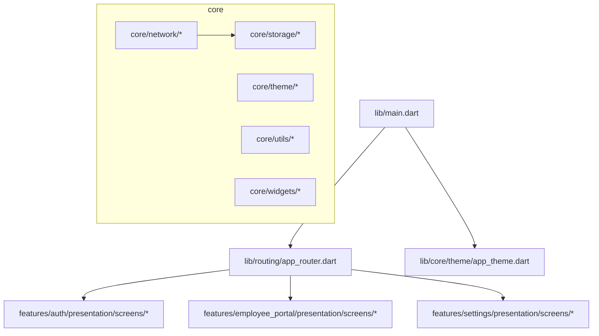

**Diagram sources**
- [main.dart:1-47](file://lib/main.dart#L1-L47)
- [app_router.dart:1-37](file://lib/routing/app_router.dart#L1-L37)
- [app_theme.dart:1-88](file://lib/core/theme/app_theme.dart#L1-L88)

**Section sources**
- [main.dart:1-47](file://lib/main.dart#L1-L47)
- [app_router.dart:1-37](file://lib/routing/app_router.dart#L1-L37)

## Core Components
- Bootstrap and Localization: The app initializes Flutter bindings, wraps the app with Riverpod’s ProviderScope, configures MaterialApp.router with GoRouter, sets Arabic as default locale with English support, and clamps text scaling for accessibility.
- Navigation: Centralized GoRouter defines routes for splash, login, employee portal, API settings, and security settings.
- Theme: Centralized light theme uses Google Fonts Cairo, Material 3 color scheme, consistent input decoration, elevated button styling, and card theming.
- Network: Dio client is configured with base URL, timeouts, headers, and interceptors for auth injection and error handling.
- Storage: Secure storage service manages tokens, user data, permissions, session expiry, API base URL, and biometric flags.

**Section sources**
- [main.dart:7-46](file://lib/main.dart#L7-L46)
- [app_router.dart:8-36](file://lib/routing/app_router.dart#L8-L36)
- [app_theme.dart:7-86](file://lib/core/theme/app_theme.dart#L7-L86)
- [dio_client.dart:7-59](file://lib/core/network/dio_client.dart#L7-L59)
- [secure_storage_service.dart:7-203](file://lib/core/storage/secure_storage_service.dart#L7-L203)

## Architecture Overview
High-level flow from app startup to network requests and secure storage:

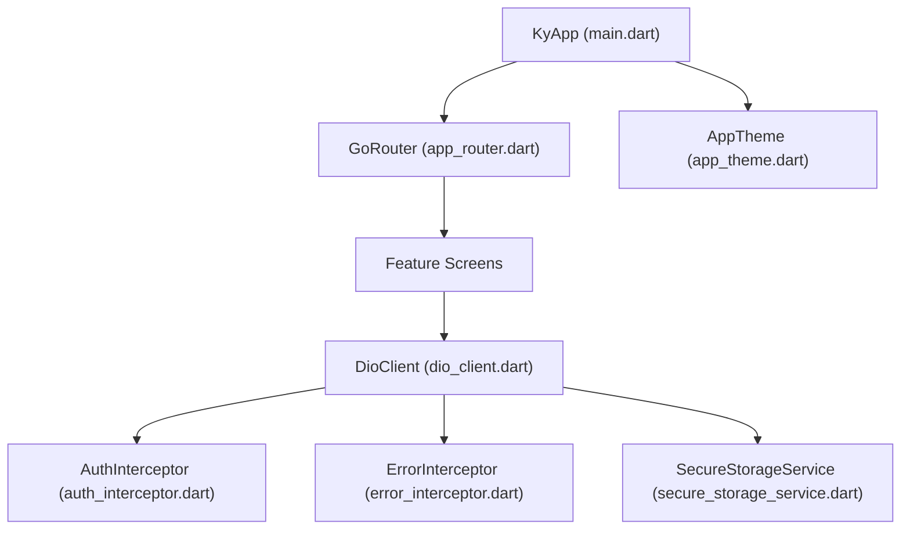

**Diagram sources**
- [main.dart:7-46](file://lib/main.dart#L7-L46)
- [app_router.dart:8-36](file://lib/routing/app_router.dart#L8-L36)
- [dio_client.dart:7-59](file://lib/core/network/dio_client.dart#L7-L59)
- [auth_interceptor.dart:4-23](file://lib/core/network/auth_interceptor.dart#L4-L23)
- [error_interceptor.dart:4-38](file://lib/core/network/error_interceptor.dart#L4-L38)
- [secure_storage_service.dart:7-203](file://lib/core/storage/secure_storage_service.dart#L7-L203)

## Detailed Component Analysis

### Application Bootstrap and Localization
- Initializes Flutter binding and provides Riverpod scope.
- Configures MaterialApp.router with:
  - Central router instance
  - Light theme
  - Default Arabic locale with English fallback
  - Global localizations delegates
  - Builder that clamps text scale factor for safe zoom levels

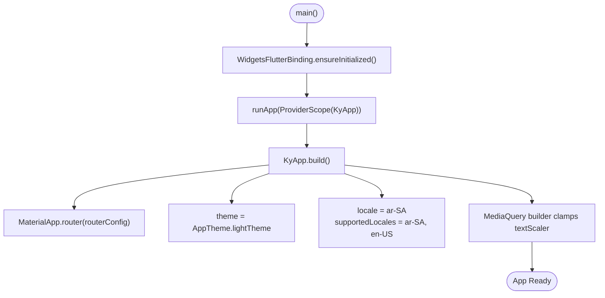

**Diagram sources**
- [main.dart:7-46](file://lib/main.dart#L7-L46)

**Section sources**
- [main.dart:7-46](file://lib/main.dart#L7-L46)

### Navigation with GoRouter
- Central router defines initial route and named routes for splash, login, employee portal, API settings, and security settings.
- Each route maps to a screen widget within feature modules.

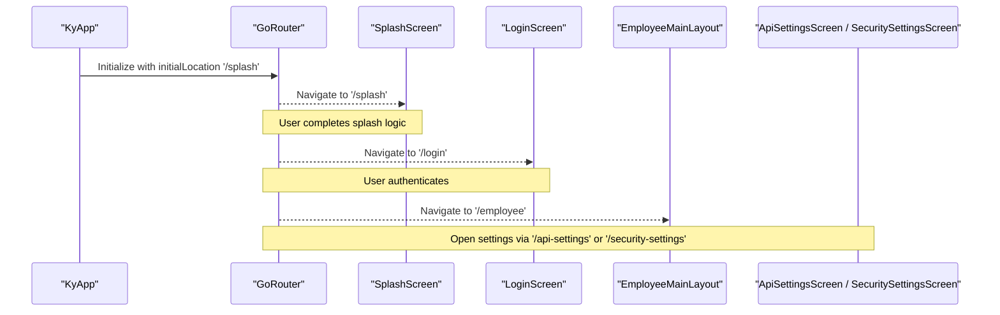

**Diagram sources**
- [app_router.dart:8-36](file://lib/routing/app_router.dart#L8-L36)

**Section sources**
- [app_router.dart:8-36](file://lib/routing/app_router.dart#L8-L36)

### Theme System
- Centralized light theme applies:
  - Google Fonts Cairo across text styles
  - Material 3 color scheme seeded from primary color
  - Consistent input decoration, elevated buttons, and cards
- Colors are defined in a dedicated file referenced by the theme.

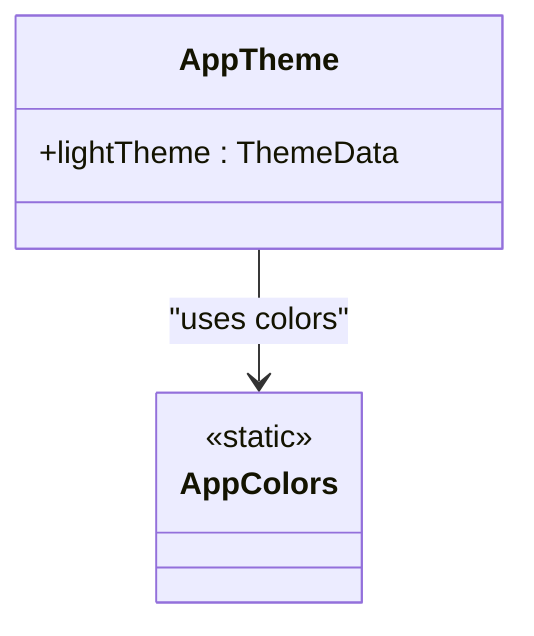

**Diagram sources**
- [app_theme.dart:7-86](file://lib/core/theme/app_theme.dart#L7-L86)

**Section sources**
- [app_theme.dart:7-86](file://lib/core/theme/app_theme.dart#L7-L86)

### Network Layer with Dio and Interceptors
- DioClient:
  - Sets base URL from constants or saved value
  - Configures timeouts and JSON headers
  - Registers interceptors: AuthInterceptor, ErrorInterceptor, LogInterceptor
  - Provides methods to update base URL and initialize it from secure storage
- AuthInterceptor:
  - Reads token from secure storage and attaches Authorization header
- ErrorInterceptor:
  - Handles cancellation gracefully
  - Clears session on 401 and triggers onUnauthorized callback

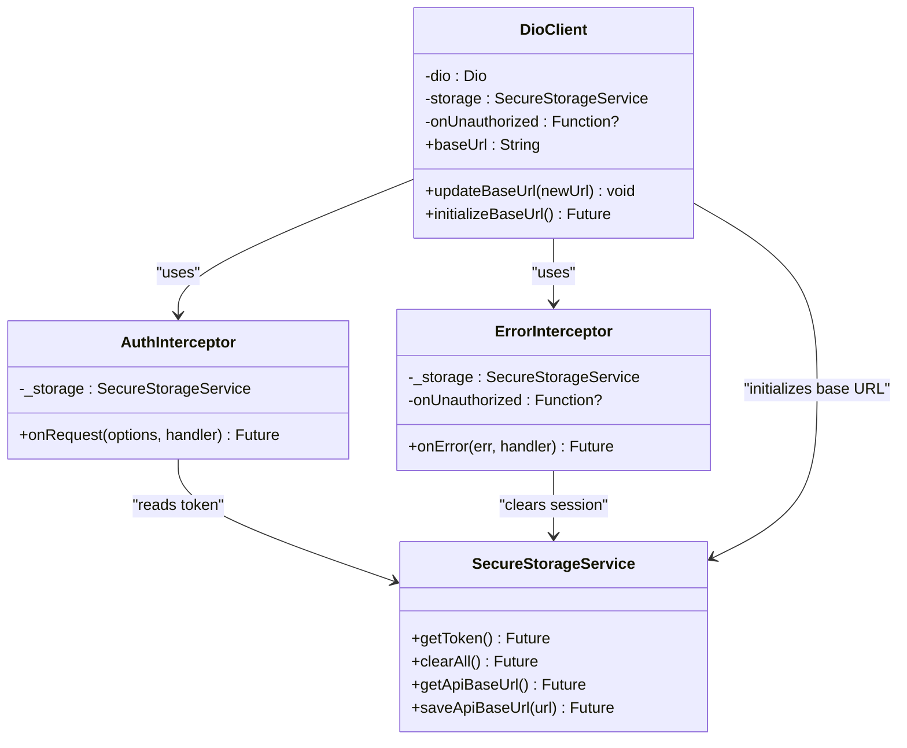

**Diagram sources**
- [dio_client.dart:7-59](file://lib/core/network/dio_client.dart#L7-L59)
- [auth_interceptor.dart:4-23](file://lib/core/network/auth_interceptor.dart#L4-L23)
- [error_interceptor.dart:4-38](file://lib/core/network/error_interceptor.dart#L4-L38)
- [secure_storage_service.dart:7-203](file://lib/core/storage/secure_storage_service.dart#L7-L203)

#### Request Flow Sequence
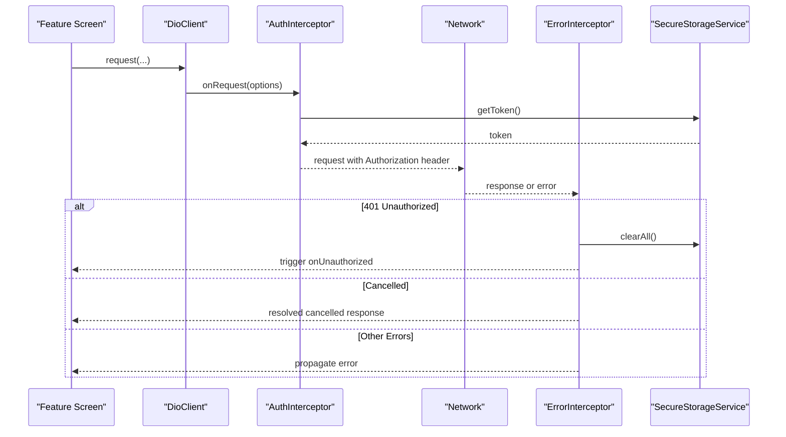

**Diagram sources**
- [dio_client.dart:7-59](file://lib/core/network/dio_client.dart#L7-L59)
- [auth_interceptor.dart:4-23](file://lib/core/network/auth_interceptor.dart#L4-L23)
- [error_interceptor.dart:4-38](file://lib/core/network/error_interceptor.dart#L4-L38)
- [secure_storage_service.dart:7-203](file://lib/core/storage/secure_storage_service.dart#L7-L203)

**Section sources**
- [dio_client.dart:7-59](file://lib/core/network/dio_client.dart#L7-L59)
- [auth_interceptor.dart:4-23](file://lib/core/network/auth_interceptor.dart#L4-L23)
- [error_interceptor.dart:4-38](file://lib/core/network/error_interceptor.dart#L4-L38)

### Secure Storage Service and Biometric Authentication
- SecureStorageService:
  - Stores tokens, user type, user data, API base URL
  - Persists IBAC-related state: permissions, admin flag, session expiry
  - Manages biometric preferences and associated user ID
  - Provides clearAll for logout and purgeEverything for full reset
- Biometric Integration:
  - Flags indicate whether biometric login is enabled
  - Stores userId for biometric sign-in context
  - ClearBiometricData removes biometric-related keys

```mermaid
flowchart TD
Start(["SecureStorageService"]) --> SaveToken["saveToken(token)"]
Start --> GetToken["getToken()"]
Start --> SaveUserType["saveUserType(type)"]
Start --> GetUserType["getUserType()"]
Start --> SaveUserData["saveUserData(json)"]
Start --> GetUserData["getUserData()"]
Start --> SaveBaseUrl["saveApiBaseUrl(url)"]
Start --> GetBaseUrl["getApiBaseUrl()"]
Start --> ClearAll["clearAll()"]
Start --> SavePermissions["savePermissions(list)"]
Start --> GetPermissions["getPermissions()"]
Start --> SaveIsAdmin["saveIsAdmin(bool)"]
Start --> GetIsAdmin["getIsAdmin()"]
Start --> SaveSessionExpiry["saveSessionExpiresAt(string?)"]
Start --> GetSessionExpiry["getSessionExpiresAt()"]
Start --> SaveBiometricEnabled["saveBiometricEnabled(bool)"]
Start --> GetBiometricEnabled["getBiometricEnabled()"]
Start --> SaveUserId["saveUserId(int)"]
Start --> GetUserId["getUserId()"]
Start --> ClearBiometric["clearBiometricData()"]
Start --> Purge["purgeEverything()"]
```

**Diagram sources**
- [secure_storage_service.dart:7-203](file://lib/core/storage/secure_storage_service.dart#L7-L203)

**Section sources**
- [secure_storage_service.dart:7-203](file://lib/core/storage/secure_storage_service.dart#L7-L203)

### Feature-Based Architecture
Organize code by business domains:
- authentication: screens and flows for login, splash, and session management
- customers: customer listing, details, and related operations
- workers: worker management and assignments
- accounts: accounting features and reports
- settings: API endpoint configuration and security settings
- employee_portal: main layout and employee-facing features

Guidelines:
- Place feature screens under features/<domain>/presentation/screens
- Keep feature state under features/<domain>/data/providers or similar
- Use core services (network, storage) through dependency injection via Riverpod providers

[No sources needed since this section provides general guidance]

### Practical Examples

#### Implementing a New Screen
Steps:
- Create a new screen widget under the appropriate feature module
- Add a route in app_router.dart mapping a path to the screen
- Navigate programmatically using GoRouter when needed

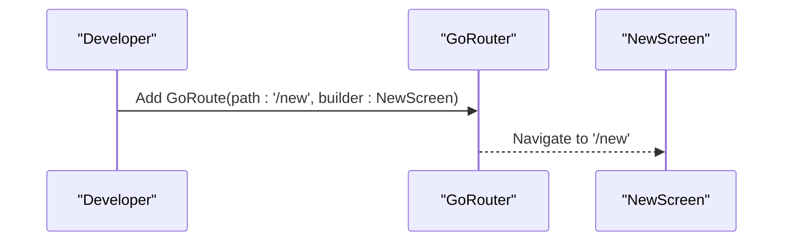

**Diagram sources**
- [app_router.dart:8-36](file://lib/routing/app_router.dart#L8-L36)

**Section sources**
- [app_router.dart:8-36](file://lib/routing/app_router.dart#L8-L36)

#### Implementing a New Service
Steps:
- Define a service class that depends on DioClient
- Inject DioClient via Riverpod provider
- Use DioClient methods to perform API calls; handle errors centrally via interceptors

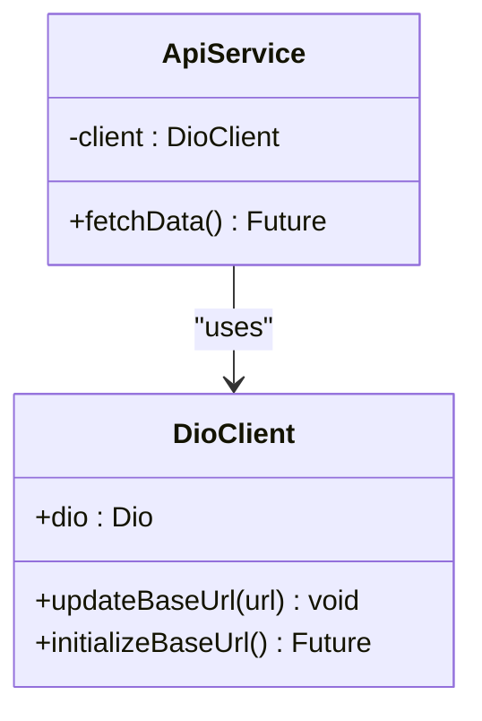

**Diagram sources**
- [dio_client.dart:7-59](file://lib/core/network/dio_client.dart#L7-L59)

**Section sources**
- [dio_client.dart:7-59](file://lib/core/network/dio_client.dart#L7-L59)

#### State Management Patterns with Riverpod
- Wrap the app with ProviderScope at bootstrap
- Define providers for:
  - Network client configuration
  - Secure storage access
  - Feature state (e.g., authentication status, user profile)
- Consume providers in screens using ConsumerWidget or ref.read/ref.watch

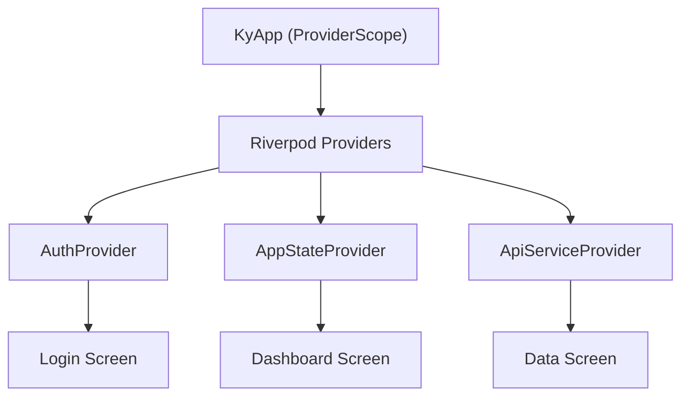

[No sources needed since this diagram shows conceptual workflow, not actual code structure]

### UI Component Structure and Responsive Design
- Typography: Unified Arabic font via Google Fonts Cairo applied globally
- Color Scheme: Seed-based Material 3 colors with consistent surface, error, and accent usage
- Input Decoration: Rounded borders, consistent padding, focus and error states
- Elevated Buttons: Consistent shape, padding, and text style
- Card Theme: Flat elevation with rounded corners and border
- Text Scaling: Clamped between min and max factors to prevent overflow on small screens

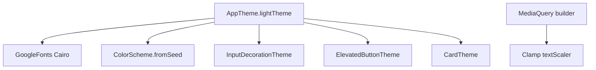

**Diagram sources**
- [app_theme.dart:7-86](file://lib/core/theme/app_theme.dart#L7-L86)
- [main.dart:32-43](file://lib/main.dart#L32-L43)

**Section sources**
- [app_theme.dart:7-86](file://lib/core/theme/app_theme.dart#L7-L86)
- [main.dart:32-43](file://lib/main.dart#L32-L43)

### Platform-Specific Adaptations
- Android:
  - Secure storage configured with AndroidOptions (resetOnError)
  - Launch assets and styles under android/app/src/main/res
- iOS:
  - Secure storage configured with IOSOptions (KeychainAccessibility.first_unlock)
  - Native assets and launch storyboards under ios/Runner
- Windows:
  - Generated plugin registrant and window handling under windows/runner
- Web:
  - Entry point and manifest under web/index.html and web/manifest.json

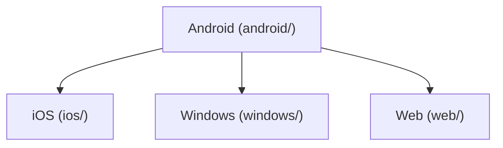

**Diagram sources**
- [secure_storage_service.dart:10-17](file://lib/core/storage/secure_storage_service.dart#L10-L17)

**Section sources**
- [secure_storage_service.dart:10-17](file://lib/core/storage/secure_storage_service.dart#L10-L17)

## Dependency Analysis
External dependencies relevant to frontend development:
- flutter_riverpod: state management
- dio: HTTP client with interceptors
- flutter_secure_storage: encrypted persistent storage
- go_router: declarative navigation
- google_fonts: unified typography
- local_auth: biometric authentication
- device_info_plus: device information utilities
- crypto: cryptographic utilities
- flutter_localizations: internationalization support

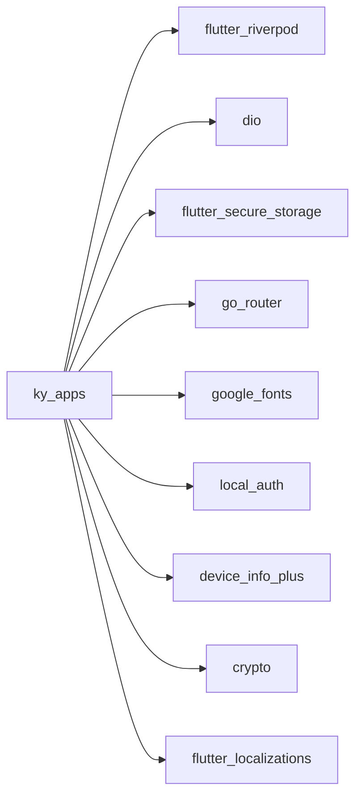

**Diagram sources**
- [pubspec.yaml:30-47](file://pubspec.yaml#L30-L47)

**Section sources**
- [pubspec.yaml:30-47](file://pubspec.yaml#L30-L47)

## Performance Considerations
- Network:
  - Use Dio’s timeout configuration to avoid long hangs
  - Leverage interceptors for centralized error handling and logging
  - Avoid unnecessary re-initialization of DioClient; reuse instances
- Storage:
  - Minimize writes to secure storage; batch updates where possible
  - Clear only necessary keys on logout to reduce overhead
- UI:
  - Clamp text scaling to prevent layout thrash on zoomed devices
  - Prefer const widgets and stable provider values to reduce rebuilds
- Routing:
  - Keep route definitions minimal and lazy-load heavy screens if needed

[No sources needed since this section provides general guidance]

## Troubleshooting Guide
Common issues and resolutions:
- 401 Unauthorized:
  - ErrorInterceptor clears stored session and invokes onUnauthorized callback
  - Ensure onUnauthorized navigates to login and resets app state
- Cancellation Errors:
  - ErrorInterceptor resolves cancellations with a normalized response to avoid unhandled exceptions
- Base URL Issues:
  - Verify DioClient.initializeBaseUrl reads saved API base URL correctly
  - Update baseUrl via DioClient.updateBaseUrl after changing settings
- Biometric Login Failures:
  - Check biometric-enabled flag and userId persistence
  - Clear biometric data if credentials change or device changes

**Section sources**
- [error_interceptor.dart:12-38](file://lib/core/network/error_interceptor.dart#L12-L38)
- [dio_client.dart:44-58](file://lib/core/network/dio_client.dart#L44-L58)
- [secure_storage_service.dart:164-198](file://lib/core/storage/secure_storage_service.dart#L164-L198)

## Conclusion
This guide outlined the Flutter frontend architecture, covering bootstrap, Riverpod state management, GoRouter navigation, theme system, Dio network layer with interceptors, secure storage, and biometric integration. The feature-based organization supports scalable growth across domains like authentication, customers, workers, and accounting. By following the provided patterns and diagrams, developers can confidently add screens, services, and state while maintaining consistency and performance across platforms.