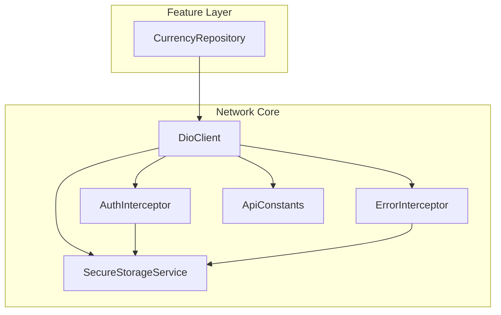
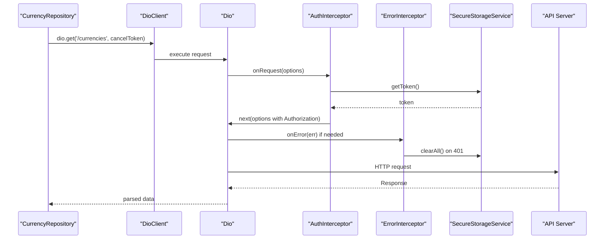
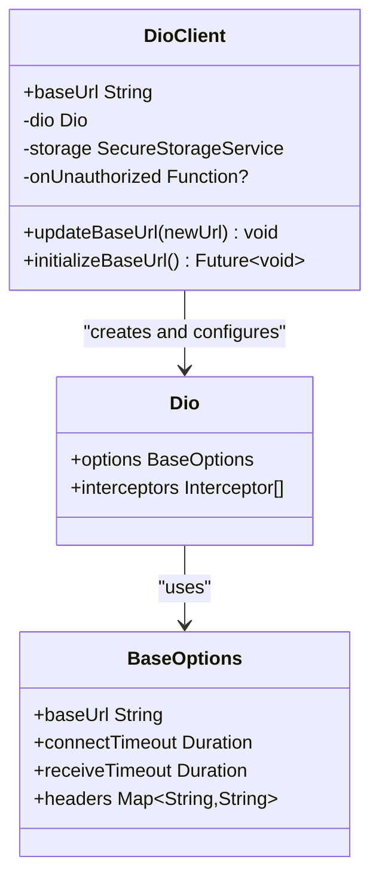
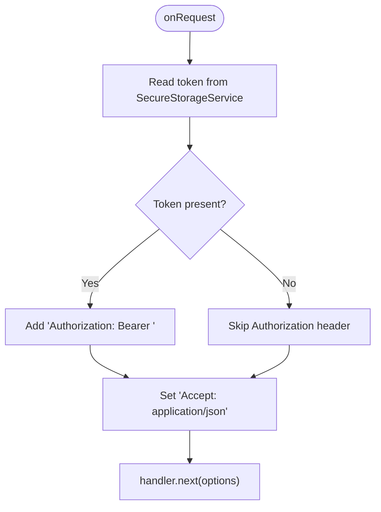
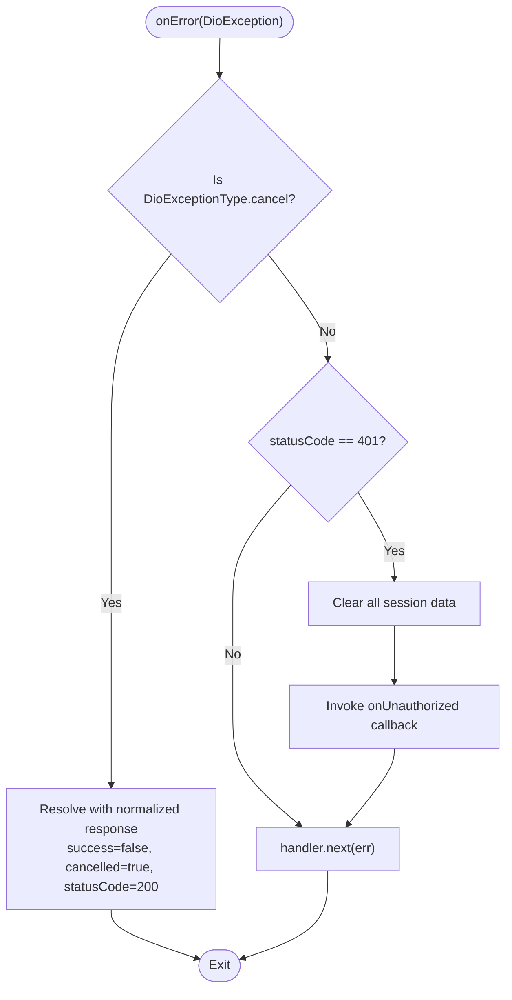
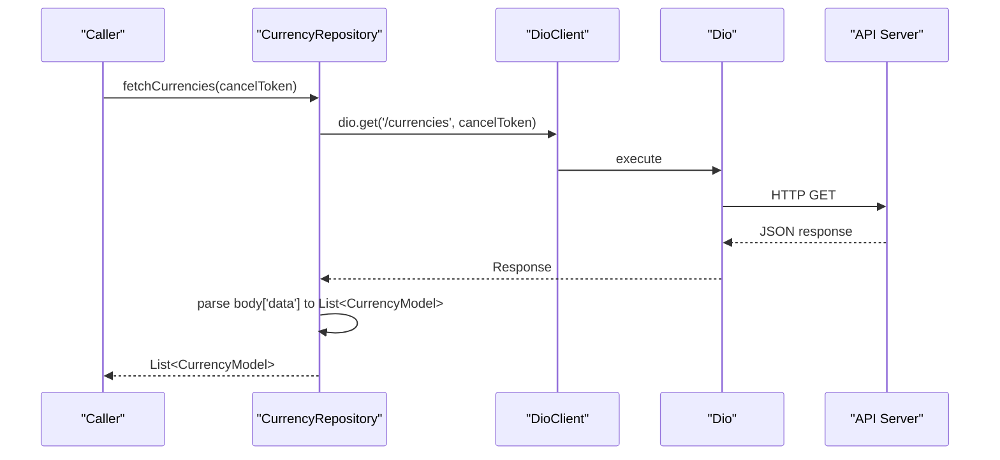
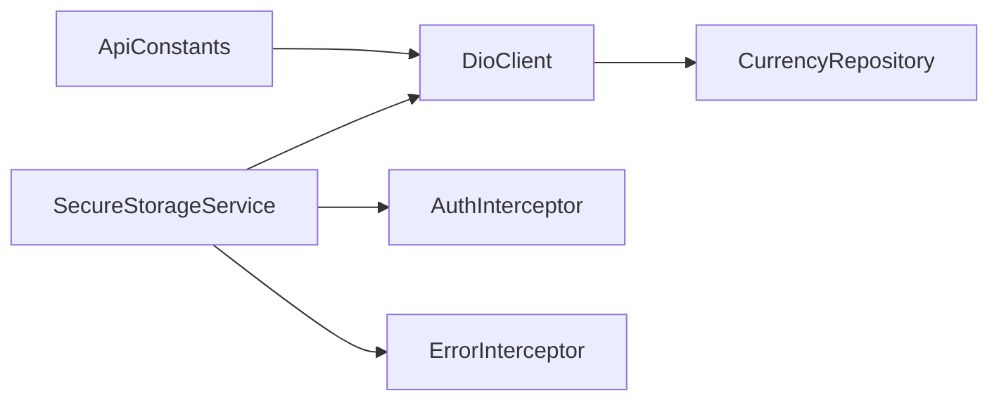

# Network Layer

<cite>
**Referenced Files in This Document**
- [dio_client.dart](file://lib/core/network/dio_client.dart)
- [auth_interceptor.dart](file://lib/core/network/auth_interceptor.dart)
- [error_interceptor.dart](file://lib/core/network/error_interceptor.dart)
- [api_constants.dart](file://lib/core/constants/api_constants.dart)
- [secure_storage_service.dart](file://lib/core/storage/secure_storage_service.dart)
- [currency_repository.dart](file://lib/features/accounts/data/repositories/currency_repository.dart)
</cite>

## Table of Contents
1. [Introduction](#introduction)
2. [Project Structure](#project-structure)
3. [Core Components](#core-components)
4. [Architecture Overview](#architecture-overview)
5. [Detailed Component Analysis](#detailed-component-analysis)
6. [Dependency Analysis](#dependency-analysis)
7. [Performance Considerations](#performance-considerations)
8. [Troubleshooting Guide](#troubleshooting-guide)
9. [Conclusion](#conclusion)

## Introduction
This document explains the network layer implementation built on Dio. It covers centralized client configuration, base URL management, default headers, interceptors for authentication and error handling, API communication patterns (GET, POST, PUT, DELETE), request cancellation, timeouts, and security considerations. Practical examples are provided through repository usage to show how to make API calls and handle different response types.

## Project Structure
The network layer is organized under `lib/core/network` with supporting constants and secure storage:
- Centralized HTTP client: `DioClient`
- Interceptors: `AuthInterceptor`, `ErrorInterceptor`
- Configuration constants: `ApiConstants`
- Secure storage for tokens and settings: `SecureStorageService`
- Example repository using the client: `CurrencyRepository`

**Diagram sources**
- [dio_client.dart:1-60](file://lib/core/network/dio_client.dart#L1-L60)
- [auth_interceptor.dart:1-24](file://lib/core/network/auth_interceptor.dart#L1-L24)
- [error_interceptor.dart:1-39](file://lib/core/network/error_interceptor.dart#L1-L39)
- [api_constants.dart:1-29](file://lib/core/constants/api_constants.dart#L1-L29)
- [secure_storage_service.dart:1-206](file://lib/core/storage/secure_storage_service.dart#L1-L206)
- [currency_repository.dart:1-162](file://lib/features/accounts/data/repositories/currency_repository.dart#L1-L162)

**Section sources**
- [dio_client.dart:1-60](file://lib/core/network/dio_client.dart#L1-L60)
- [api_constants.dart:1-29](file://lib/core/constants/api_constants.dart#L1-L29)
- [secure_storage_service.dart:1-206](file://lib/core/storage/secure_storage_service.dart#L1-L206)
- [currency_repository.dart:1-162](file://lib/features/accounts/data/repositories/currency_repository.dart#L1-L162)

## Core Components
- DioClient: Centralizes Dio instance creation, base URL, default headers, timeouts, and interceptor registration. Provides methods to update or initialize the base URL from secure storage.
- AuthInterceptor: Adds an Authorization header with a Bearer token retrieved from secure storage and ensures Accept header is set.
- ErrorInterceptor: Handles cancellation gracefully, clears session data on 401 Unauthorized, and invokes an optional callback to trigger app-level logout flow.
- ApiConstants: Holds default base URL, endpoints, and timeout durations.
- SecureStorageService: Encapsulates encrypted storage for tokens, user data, permissions, and API base URL.
- CurrencyRepository: Demonstrates GET, POST, PUT, DELETE operations, query parameters, response parsing, and cancellation handling.

**Section sources**
- [dio_client.dart:1-60](file://lib/core/network/dio_client.dart#L1-L60)
- [auth_interceptor.dart:1-24](file://lib/core/network/auth_interceptor.dart#L1-L24)
- [error_interceptor.dart:1-39](file://lib/core/network/error_interceptor.dart#L1-L39)
- [api_constants.dart:1-29](file://lib/core/constants/api_constants.dart#L1-L29)
- [secure_storage_service.dart:1-206](file://lib/core/storage/secure_storage_service.dart#L1-L206)
- [currency_repository.dart:1-162](file://lib/features/accounts/data/repositories/currency_repository.dart#L1-L162)

## Architecture Overview
The network architecture follows a layered approach:
- Feature repositories call into DioClient for HTTP requests.
- DioClient configures Dio with BaseOptions and registers interceptors.
- AuthInterceptor injects authentication headers before each request.
- ErrorInterceptor centralizes error handling, including cancellation and unauthorized responses.
- SecureStorageService provides persistent, encrypted access to tokens and settings.

**Diagram sources**
- [dio_client.dart:19-41](file://lib/core/network/dio_client.dart#L19-L41)
- [auth_interceptor.dart:11-22](file://lib/core/network/auth_interceptor.dart#L11-L22)
- [error_interceptor.dart:12-36](file://lib/core/network/error_interceptor.dart#L12-L36)
- [secure_storage_service.dart:32-40](file://lib/core/storage/secure_storage_service.dart#L32-L40)
- [currency_repository.dart:28-41](file://lib/features/accounts/data/repositories/currency_repository.dart#L28-L41)

## Detailed Component Analysis

### DioClient: Centralized HTTP Client
Responsibilities:
- Creates a single Dio instance with BaseOptions including baseUrl, connectTimeout, receiveTimeout, and default headers.
- Registers interceptors: AuthInterceptor, ErrorInterceptor, LogInterceptor.
- Exposes baseUrl getter and methods to update or initialize baseUrl from secure storage.

Key behaviors:
- Base URL resolution: uses provided baseUrl or ApiConstants.defaultBaseUrl.
- Default headers: Content-Type and Accept set to application/json.
- Timeouts: connectTimeout and receiveTimeout sourced from ApiConstants.
- Interceptor chain order: auth injection first, then error handling, then logging.

**Diagram sources**
- [dio_client.dart:9-58](file://lib/core/network/dio_client.dart#L9-L58)
- [api_constants.dart:25-27](file://lib/core/constants/api_constants.dart#L25-L27)

**Section sources**
- [dio_client.dart:1-60](file://lib/core/network/dio_client.dart#L1-L60)
- [api_constants.dart:1-29](file://lib/core/constants/api_constants.dart#L1-L29)

### AuthInterceptor: Authentication Token Management
Responsibilities:
- Reads the stored token from SecureStorageService.
- Injects Authorization header with Bearer token when present.
- Ensures Accept header is set to application/json.

Behavior:
- If no token exists, the request proceeds without Authorization.
- The Accept header is always set to ensure JSON responses.

**Diagram sources**
- [auth_interceptor.dart:11-22](file://lib/core/network/auth_interceptor.dart#L11-L22)
- [secure_storage_service.dart:32-40](file://lib/core/storage/secure_storage_service.dart#L32-L40)

**Section sources**
- [auth_interceptor.dart:1-24](file://lib/core/network/auth_interceptor.dart#L1-L24)
- [secure_storage_service.dart:32-40](file://lib/core/storage/secure_storage_service.dart#L32-L40)

### ErrorInterceptor: Centralized Error Handling
Responsibilities:
- Gracefully handles request cancellation by resolving with a normalized success-like response indicating cancellation.
- Clears all session data on 401 Unauthorized and triggers an optional onUnauthorized callback.
- Propagates other errors via handler.next.

Cancellation handling:
- Returns a standardized response object with success=false and cancelled=true, status code 200, allowing callers to treat cancellation as non-fatal.

Unauthorized handling:
- Removes tokens and related session data from SecureStorageService.
- Invokes onUnauthorized callback to initiate app-wide logout flows.

**Diagram sources**
- [error_interceptor.dart:12-36](file://lib/core/network/error_interceptor.dart#L12-L36)
- [secure_storage_service.dart:82-95](file://lib/core/storage/secure_storage_service.dart#L82-L95)

**Section sources**
- [error_interceptor.dart:1-39](file://lib/core/network/error_interceptor.dart#L1-L39)
- [secure_storage_service.dart:82-95](file://lib/core/storage/secure_storage_service.dart#L82-L95)

### ApiConstants: Configuration and Endpoints
Responsibilities:
- Defines default base URL and common endpoints such as login, logout, me, permissions, and biometric routes.
- Provides timeout durations for connection and response handling.

Usage:
- DioClient consumes these constants to configure BaseOptions.

**Section sources**
- [api_constants.dart:1-29](file://lib/core/constants/api_constants.dart#L1-L29)

### SecureStorageService: Sensitive Data Protection
Responsibilities:
- Stores and retrieves tokens, user data, permissions, admin flags, session expiration, and API base URL securely.
- Provides methods to clear session data and purge everything.

Security notes:
- Uses FlutterSecureStorage with platform-specific options for Android and iOS.
- Safe parsing for permissions and admin flags; defaults to deny-by-default on corruption.

**Section sources**
- [secure_storage_service.dart:1-206](file://lib/core/storage/secure_storage_service.dart#L1-L206)

### CurrencyRepository: API Communication Patterns
Responsibilities:
- Demonstrates GET, POST, PUT, DELETE operations against currency-related endpoints.
- Parses JSON responses into domain models.
- Handles CancelToken for request cancellation.
- Wraps results in a consistent CurrencyResult type for mutations.

Examples:
- GET list of currencies with optional cancellation.
- POST create currency.
- PUT update currency.
- DELETE currency.
- GET paginated prices with query parameters.
- POST/PUT/DELETE price entries.

Cancellation handling:
- Catches DioException.isCancel and returns safe empty results instead of throwing.

Response parsing:
- Assumes server responses include success flag and data fields; maps them to model objects.

**Diagram sources**
- [currency_repository.dart:28-41](file://lib/features/accounts/data/repositories/currency_repository.dart#L28-L41)
- [dio_client.dart:19-41](file://lib/core/network/dio_client.dart#L19-L41)

**Section sources**
- [currency_repository.dart:1-162](file://lib/features/accounts/data/repositories/currency_repository.dart#L1-L162)

## Dependency Analysis
The network layer has clear dependencies:
- DioClient depends on ApiConstants and SecureStorageService.
- AuthInterceptor depends on SecureStorageService.
- ErrorInterceptor depends on SecureStorageService and an optional callback.
- Repositories depend on DioClient for HTTP operations.

**Diagram sources**
- [dio_client.dart:1-60](file://lib/core/network/dio_client.dart#L1-L60)
- [auth_interceptor.dart:1-24](file://lib/core/network/auth_interceptor.dart#L1-L24)
- [error_interceptor.dart:1-39](file://lib/core/network/error_interceptor.dart#L1-L39)
- [api_constants.dart:1-29](file://lib/core/constants/api_constants.dart#L1-L29)
- [secure_storage_service.dart:1-206](file://lib/core/storage/secure_storage_service.dart#L1-L206)
- [currency_repository.dart:1-162](file://lib/features/accounts/data/repositories/currency_repository.dart#L1-L162)

**Section sources**
- [dio_client.dart:1-60](file://lib/core/network/dio_client.dart#L1-L60)
- [currency_repository.dart:1-162](file://lib/features/accounts/data/repositories/currency_repository.dart#L1-L162)

## Performance Considerations
- Timeouts: Connect and receive timeouts are configured centrally via ApiConstants to prevent hanging requests.
- Logging: LogInterceptor is enabled for request/response bodies and errors, which can impact performance in production; consider disabling or limiting logs in release builds.
- Cancellation: Use CancelToken to avoid unnecessary work when navigating away or refreshing lists.
- Parsing: Repository-level parsing keeps Dio payloads minimal; ensure models are efficient and avoid heavy transformations in hot paths.

[No sources needed since this section provides general guidance]

## Troubleshooting Guide
Common issues and strategies:
- Request cancellation:
  - The error interceptor resolves cancellations with a normalized response; callers should check for cancelled=true and handle gracefully.
  - Repositories catch DioException.isCancel and return safe empty results.
- Unauthorized responses:
  - On 401, the error interceptor clears session data and triggers onUnauthorized; implement app-level navigation to login.
- CORS preflight warnings:
  - When using application/json content type, browsers may send OPTIONS preflight; ensure the server allows it.
- Base URL misconfiguration:
  - Verify ApiConstants.defaultBaseUrl or dynamically updated baseUrl via DioClient.updateBaseUrl or initializeBaseUrl.

**Section sources**
- [error_interceptor.dart:12-36](file://lib/core/network/error_interceptor.dart#L12-L36)
- [currency_repository.dart:38-41](file://lib/features/accounts/data/repositories/currency_repository.dart#L38-L41)
- [dio_client.dart:47-58](file://lib/core/network/dio_client.dart#L47-L58)

## Conclusion
The network layer centers around a single DioClient that standardizes configuration, headers, timeouts, and interceptors. Authentication is handled transparently via AuthInterceptor, while ErrorInterceptor centralizes cancellation and unauthorized handling. Repositories demonstrate robust API communication patterns with proper error handling and cancellation support. For enhanced security, enforce HTTPS at the server level, consider certificate pinning where applicable, and rely on SecureStorageService for sensitive data protection.

[No sources needed since this section summarizes without analyzing specific files]