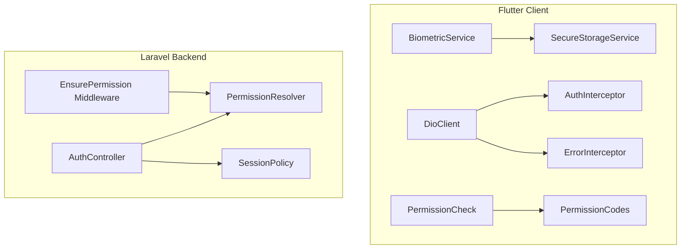
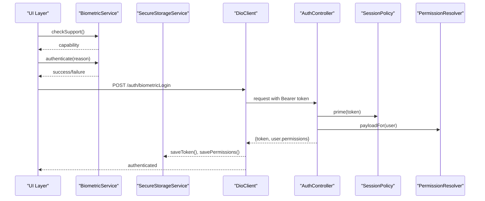
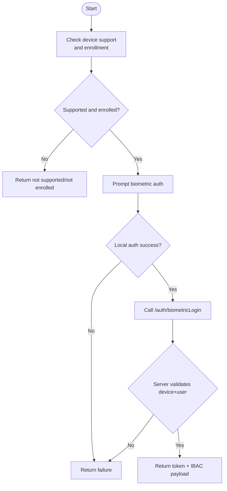
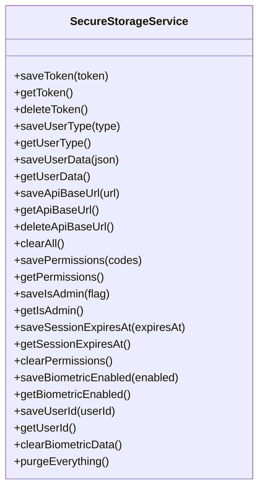
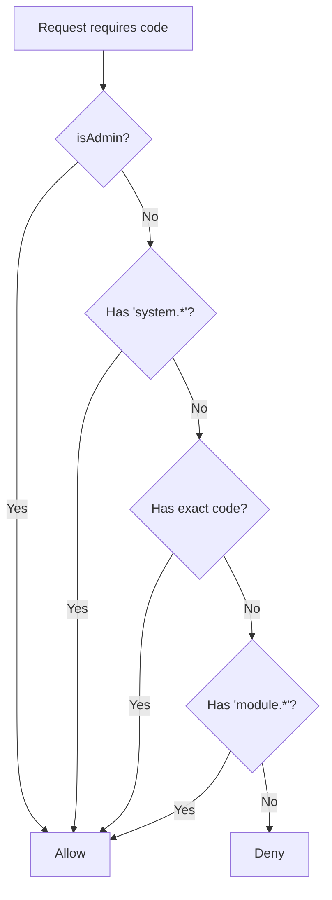
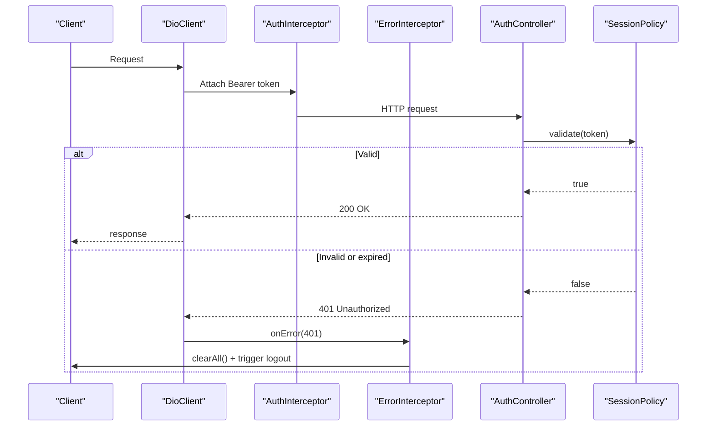
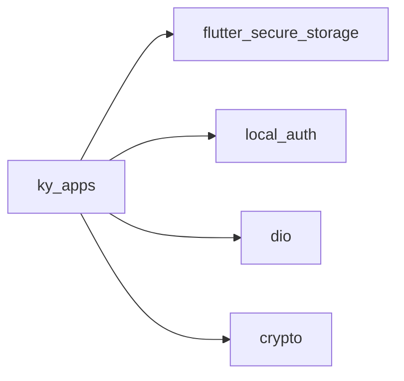

# Security Implementation

<cite>
**Referenced Files in This Document**
- [pubspec.yaml](file://pubspec.yaml)
- [biometric_service.dart](file://lib/core/utils/biometric_service.dart)
- [secure_storage_service.dart](file://lib/core/storage/secure_storage_service.dart)
- [permission_check.dart](file://lib/core/utils/permission_check.dart)
- [permission_codes.dart](file://lib/core/constants/permission_codes.dart)
- [auth_interceptor.dart](file://lib/core/network/auth_interceptor.dart)
- [error_interceptor.dart](file://lib/core/network/error_interceptor.dart)
- [dio_client.dart](file://lib/core/network/dio_client.dart)
- [PermissionResolver.php](file://kyApp_API/app/Support/PermissionResolver.php)
- [EnsurePermission.php](file://kyApp_API/app/Http/Middleware/EnsurePermission.php)
- [SessionPolicy.php](file://kyApp_API/app/Support/SessionPolicy.php)
- [AuthController.php](file://kyApp_API/app/Http/Controllers/AuthController.php)
- [session_repository.dart](file://lib/features/admin/data/repositories/session_repository.dart)
- [active_sessions_provider.dart](file://lib/features/admin/presentation/providers/active_sessions_provider.dart)
</cite>

## Table of Contents
1. [Introduction](#introduction)
2. [Project Structure](#project-structure)
3. [Core Components](#core-components)
4. [Architecture Overview](#architecture-overview)
5. [Detailed Component Analysis](#detailed-component-analysis)
6. [Dependency Analysis](#dependency-analysis)
7. [Performance Considerations](#performance-considerations)
8. [Troubleshooting Guide](#troubleshooting-guide)
9. [Conclusion](#conclusion)

## Introduction
This document explains the security implementation across biometric authentication, secure local storage, and Identity-Based Access Control (IBAC). It covers how the Flutter client integrates with device hardware for fingerprint and Face ID, how sensitive data is persisted securely, how permission codes are mirrored and validated on both sides, and how sessions, token refresh, and logout work end-to-end. It also includes practical usage guidance, best practices, and common vulnerability mitigations.

## Project Structure
The security implementation spans:
- Flutter client utilities for biometrics, secure storage, network interceptors, and permission logic.
- Laravel backend services for permissions, session policy, authentication, and active session management.

**Diagram sources**
- [biometric_service.dart:14-84](file://lib/core/utils/biometric_service.dart#L14-L84)
- [secure_storage_service.dart:7-203](file://lib/core/storage/secure_storage_service.dart#L7-L203)
- [dio_client.dart:9-59](file://lib/core/network/dio_client.dart#L9-L59)
- [auth_interceptor.dart:6-23](file://lib/core/network/auth_interceptor.dart#L6-L23)
- [error_interceptor.dart:6-38](file://lib/core/network/error_interceptor.dart#L6-L38)
- [permission_check.dart:24-68](file://lib/core/utils/permission_check.dart#L24-L68)
- [permission_codes.dart:12-143](file://lib/core/constants/permission_codes.dart#L12-L143)
- [AuthController.php:34-41](file://kyApp_API/app/Http/Controllers/AuthController.php#L34-L41)
- [PermissionResolver.php:27-132](file://kyApp_API/app/Support/PermissionResolver.php#L27-L132)
- [EnsurePermission.php:25-52](file://kyApp_API/app/Http/Middleware/EnsurePermission.php#L25-L52)
- [SessionPolicy.php:42-108](file://kyApp_API/app/Support/SessionPolicy.php#L42-L108)

**Section sources**
- [pubspec.yaml:30-44](file://pubspec.yaml#L30-L44)

## Core Components
- Biometric service: wraps device biometric capabilities and prompts for fingerprint or Face ID.
- Secure storage service: encrypts tokens, user data, API base URL, IBAC state, and biometric flags.
- Permission system: mirrors server permission codes and applies deny-by-default rules locally.
- Network layer: attaches Bearer tokens and handles 401 by clearing session and triggering logout.
- Backend auth controller: issues Sanctum tokens, primes session expiry, returns IBAC payload, and supports biometric login.
- Session policy: enforces idle sliding renewal, absolute lifetime, and cleanup of expired tokens.
- Active sessions admin: lists and terminates sessions by pushing expiry into the past.

**Section sources**
- [biometric_service.dart:14-84](file://lib/core/utils/biometric_service.dart#L14-L84)
- [secure_storage_service.dart:7-203](file://lib/core/storage/secure_storage_service.dart#L7-L203)
- [permission_check.dart:24-68](file://lib/core/utils/permission_check.dart#L24-L68)
- [permission_codes.dart:12-143](file://lib/core/constants/permission_codes.dart#L12-L143)
- [auth_interceptor.dart:6-23](file://lib/core/network/auth_interceptor.dart#L6-L23)
- [error_interceptor.dart:6-38](file://lib/core/network/error_interceptor.dart#L6-L38)
- [dio_client.dart:9-59](file://lib/core/network/dio_client.dart#L9-L59)
- [AuthController.php:47-163](file://kyApp_API/app/Http/Controllers/AuthController.php#L47-L163)
- [SessionPolicy.php:70-108](file://kyApp_API/app/Support/SessionPolicy.php#L70-L108)
- [session_repository.dart:20-103](file://lib/features/admin/data/repositories/session_repository.dart#L20-L103)

## Architecture Overview
The security flow combines local device checks, encrypted persistence, and strict backend validation.

**Diagram sources**
- [biometric_service.dart:18-70](file://lib/core/utils/biometric_service.dart#L18-L70)
- [secure_storage_service.dart:33-103](file://lib/core/storage/secure_storage_service.dart#L33-L103)
- [dio_client.dart:31-41](file://lib/core/network/dio_client.dart#L31-L41)
- [auth_interceptor.dart:12-22](file://lib/core/network/auth_interceptor.dart#L12-L22)
- [AuthController.php:316-410](file://kyApp_API/app/Http/Controllers/AuthController.php#L316-L410)
- [SessionPolicy.php:114-117](file://kyApp_API/app/Support/SessionPolicy.php#L114-L117)
- [PermissionResolver.php:178-200](file://kyApp_API/app/Support/PermissionResolver.php#L178-L200)

## Detailed Component Analysis

### Biometric Authentication
- Capability detection: determines whether the device supports biometrics, whether any are enrolled, and which type is available.
- Local prompt: requests biometric confirmation with a localized reason and platform options.
- Device binding: the backend binds biometric login to a specific device token and user; it also provides a kill switch via settings.

**Diagram sources**
- [biometric_service.dart:18-70](file://lib/core/utils/biometric_service.dart#L18-L70)
- [AuthController.php:316-410](file://kyApp_API/app/Http/Controllers/AuthController.php#L316-L410)

Practical example references:
- Implementing biometric login: call capability check, then prompt, then send device token and user id to the backend.
- Enabling biometric login: verify device support, prompt for enrollment confirmation, register device token, and persist enabled flag.

**Section sources**
- [biometric_service.dart:14-84](file://lib/core/utils/biometric_service.dart#L14-L84)
- [AuthController.php:245-310](file://kyApp_API/app/Http/Controllers/AuthController.php#L245-L310)
- [AuthController.php:316-410](file://kyApp_API/app/Http/Controllers/AuthController.php#L316-L410)

### Secure Storage Service
Responsibilities:
- Encrypted persistence for access tokens, user data, API base URL, IBAC state (permissions, admin flag, session deadline), and biometric preferences.
- Safe parsing of stored permissions to avoid crashes from corrupted blobs.
- Logout behavior that clears session and IBAC state while preserving API base URL.

Key behaviors:
- Token CRUD operations.
- JSON-encoded permission list with defensive decoding.
- Admin flag and session expiration deadline stored as strings.
- Biometric enablement and associated user id stored separately.
- Purge methods for full reset or targeted IBAC state clearing.

**Diagram sources**
- [secure_storage_service.dart:7-203](file://lib/core/storage/secure_storage_service.dart#L7-L203)

Best practices:
- Never store raw secrets beyond what is necessary; prefer tokens managed by the OS keychain/keystore.
- Treat corrupt stored data as “no permissions” rather than crashing.
- Clear all session-related keys on logout to prevent cross-user leakage.

**Section sources**
- [secure_storage_service.dart:7-203](file://lib/core/storage/secure_storage_service.dart#L7-L203)

### Permission System and IBAC Integration
Client-side:
- A mirror of server permission codes ensures consistent gating without extra network calls.
- Pure functions implement the same decision order as the server: admin bypass, system wildcard, exact code, module wildcard, then deny.

Server-side:
- Permission resolver queries effective grants, caches them safely, and applies the same rules.
- Middleware protects routes and returns clear 401/403 responses.

**Diagram sources**
- [permission_check.dart:24-38](file://lib/core/utils/permission_check.dart#L24-L38)
- [PermissionResolver.php:95-132](file://kyApp_API/app/Support/PermissionResolver.php#L95-L132)

Cache management:
- The server caches permission codes per user with a size limit to avoid Oracle bind-size errors.
- The client stores the current permission list and admin flag locally for fast decisions.

Real-time validation:
- After grant changes, the client can force-refresh permissions from the server and update its cache.

**Section sources**
- [permission_codes.dart:12-143](file://lib/core/constants/permission_codes.dart#L12-L143)
- [permission_check.dart:24-68](file://lib/core/utils/permission_check.dart#L24-L68)
- [PermissionResolver.php:66-89](file://kyApp_API/app/Support/PermissionResolver.php#L66-L89)
- [PermissionResolver.php:95-132](file://kyApp_API/app/Support/PermissionResolver.php#L95-L132)
- [PermissionResolver.php:178-200](file://kyApp_API/app/Support/PermissionResolver.php#L178-L200)
- [EnsurePermission.php:32-52](file://kyApp_API/app/Http/Middleware/EnsurePermission.php#L32-L52)

### Session Management, Token Refresh, and Logout
- Token issuance: the backend creates a Sanctum personal access token and primes it with an idle window.
- Sliding renewal: active requests extend the session within thresholds; inactive sessions expire after idle time or absolute age.
- Expired token cleanup: rejected sessions are deleted on the server; the client clears local state on 401.
- Logout: revokes the current token and logs activity.

**Diagram sources**
- [dio_client.dart:31-41](file://lib/core/network/dio_client.dart#L31-L41)
- [auth_interceptor.dart:12-22](file://lib/core/network/auth_interceptor.dart#L12-L22)
- [error_interceptor.dart:13-36](file://lib/core/network/error_interceptor.dart#L13-L36)
- [SessionPolicy.php:70-108](file://kyApp_API/app/Support/SessionPolicy.php#L70-L108)
- [AuthController.php:142-149](file://kyApp_API/app/Http/Controllers/AuthController.php#L142-L149)

Active sessions administration:
- Listing and terminating sessions is exposed through admin endpoints.
- Termination pushes EXPIRES_AT into the past so the next request fails with 401 and triggers normal logout flow.

**Section sources**
- [SessionPolicy.php:70-108](file://kyApp_API/app/Support/SessionPolicy.php#L70-L108)
- [SessionPolicy.php:114-117](file://kyApp_API/app/Support/SessionPolicy.php#L114-L117)
- [SessionPolicy.php:130-141](file://kyApp_API/app/Support/SessionPolicy.php#L130-L141)
- [AuthController.php:221-239](file://kyApp_API/app/Http/Controllers/AuthController.php#L221-L239)
- [session_repository.dart:66-103](file://lib/features/admin/data/repositories/session_repository.dart#L66-L103)
- [active_sessions_provider.dart:168-184](file://lib/features/admin/presentation/providers/active_sessions_provider.dart#L168-L184)

### Practical Examples

- Biometric login flow:
  - Check device capability and enrollment.
  - Prompt for local biometric authentication.
  - Send device token and user id to the backend.
  - On success, store token and IBAC payload.

  References:
  - [biometric_service.dart:18-70](file://lib/core/utils/biometric_service.dart#L18-L70)
  - [AuthController.php:316-410](file://kyApp_API/app/Http/Controllers/AuthController.php#L316-L410)

- Storing secure data:
  - Save token, user data, API base URL, permissions, admin flag, and session deadline.
  - Use safe getters that treat missing/corrupt data as defaults.

  References:
  - [secure_storage_service.dart:33-103](file://lib/core/storage/secure_storage_service.dart#L33-L103)
  - [secure_storage_service.dart:107-124](file://lib/core/storage/secure_storage_service.dart#L107-L124)

- Checking permissions before accessing features:
  - Use pure functions to evaluate required codes against cached grants and admin status.

  References:
  - [permission_check.dart:24-68](file://lib/core/utils/permission_check.dart#L24-L68)
  - [permission_codes.dart:12-143](file://lib/core/constants/permission_codes.dart#L12-L143)

## Dependency Analysis
External dependencies relevant to security:
- flutter_secure_storage for encrypted local storage.
- local_auth for device biometric integration.
- dio for HTTP client and interceptors.
- crypto for cryptographic utilities.

**Diagram sources**
- [pubspec.yaml:30-44](file://pubspec.yaml#L30-L44)

Coupling and cohesion:
- SecureStorageService is used by network interceptors and feature providers.
- Permission logic is decoupled into pure functions and constants for testability.
- Backend components are cohesive around Sanctum tokens, IBAC resolution, and session policy.

Potential circular dependencies:
- None observed between core security modules; they follow a layered design.

**Section sources**
- [pubspec.yaml:30-44](file://pubspec.yaml#L30-L44)
- [secure_storage_service.dart:7-203](file://lib/core/storage/secure_storage_service.dart#L7-L203)
- [permission_check.dart:24-68](file://lib/core/utils/permission_check.dart#L24-L68)

## Performance Considerations
- Permission caching on the server avoids repeated database reads while respecting Oracle bind-size limits.
- Sliding session renewal writes are throttled to reduce database churn.
- Client-side permission checks are O(n) over granted codes but operate on small in-memory sets.

Recommendations:
- Keep permission payloads minimal and synchronized after grant changes.
- Avoid unnecessary re-authentication by leveraging sliding sessions.
- Monitor cache sizes and adjust TTL if needed.

[No sources needed since this section provides general guidance]

## Troubleshooting Guide
Common issues and resolutions:
- Biometric not available:
  - Verify device support and enrollment before prompting.
  - Handle fallback to password login gracefully.

- Corrupted permissions blob:
  - Treat decode failures as empty permissions to avoid crashes.

- Unexpected 401:
  - Ensure ErrorInterceptor clears all session data and triggers logout.
  - Confirm SessionPolicy is priming tokens and sliding renewals are working.

- Biometric login disabled:
  - Check backend kill switch setting and log attempts for audit.

References:
- [secure_storage_service.dart:107-124](file://lib/core/storage/secure_storage_service.dart#L107-L124)
- [error_interceptor.dart:13-36](file://lib/core/network/error_interceptor.dart#L13-L36)
- [SessionPolicy.php:70-108](file://kyApp_API/app/Support/SessionPolicy.php#L70-L108)
- [AuthController.php:334-347](file://kyApp_API/app/Http/Controllers/AuthController.php#L334-L347)

**Section sources**
- [secure_storage_service.dart:107-124](file://lib/core/storage/secure_storage_service.dart#L107-L124)
- [error_interceptor.dart:13-36](file://lib/core/network/error_interceptor.dart#L13-L36)
- [SessionPolicy.php:70-108](file://kyApp_API/app/Support/SessionPolicy.php#L70-L108)
- [AuthController.php:334-347](file://kyApp_API/app/Http/Controllers/AuthController.php#L334-L347)

## Conclusion
The security implementation provides a robust, layered approach:
- Biometric authentication integrates with device hardware and binds login to a registered device.
- Secure storage persists sensitive data using platform-backed encryption with defensive error handling.
- IBAC permission checks are mirrored on the client and enforced on the server with consistent rules and caching.
- Sessions use sliding renewal with explicit idle and absolute lifetimes, and 401 responses trigger clean logout flows.
- Active sessions can be listed and terminated administratively.

Adhering to these patterns ensures strong security posture, predictable user experiences, and maintainable code across platforms.

[No sources needed since this section summarizes without analyzing specific files]