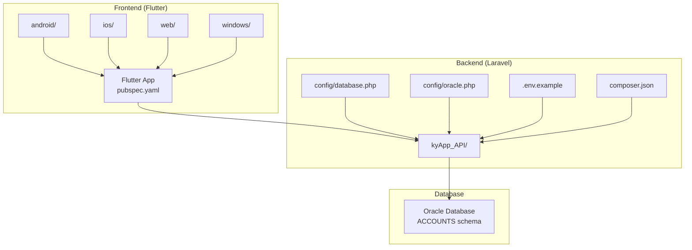
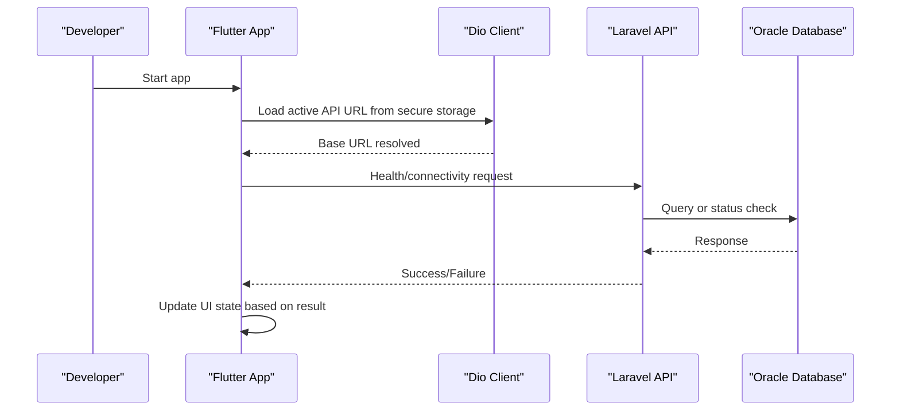
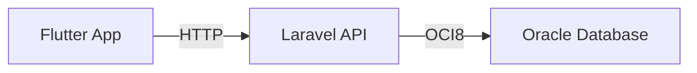

# Getting Started

<cite>
**Referenced Files in This Document**
- [README.md](file://README.md)
- [pubspec.yaml](file://pubspec.yaml)
- [composer.json](file://kyApp_API/composer.json)
- [.env.example](file://kyApp_API/.env.example)
- [database.php](file://kyApp_API/config/database.php)
- [oracle.php](file://kyApp_API/config/oracle.php)
- [01_ibac_schema.sql](file://kyApp_API/database/oracle/01_ibac_schema.sql)
- [02_ibac_seed.php](file://kyApp_API/database/oracle/02_ibac_seed.php)
- [03_ibac_bootstrap.php](file://kyApp_API/database/oracle/03_ibac_bootstrap.php)
- [api_config_notifier.dart](file://lib/features/settings/presentation/providers/api_config_notifier.dart)
- [api_config_repository.dart](file://lib/features/settings/data/repositories/api_config_repository.dart)
</cite>

## Table of Contents
1. [Introduction](#introduction)
2. [Project Structure](#project-structure)
3. [Core Components](#core-components)
4. [Architecture Overview](#architecture-overview)
5. [Detailed Component Analysis](#detailed-component-analysis)
6. [Dependency Analysis](#dependency-analysis)
7. [Performance Considerations](#performance-considerations)
8. [Troubleshooting Guide](#troubleshooting-guide)
9. [Conclusion](#conclusion)

## Introduction
This guide helps you set up the Ky Apps development environment for both the Flutter frontend and the Laravel backend, including Oracle database connectivity. It covers prerequisites, installation steps, environment configuration, database setup, and common troubleshooting scenarios. The goal is to get you from a clean machine to a running local development environment quickly and reliably.

## Project Structure
Ky Apps consists of:
- A Flutter application at the repository root (Android, iOS, Web, Windows targets).
- A Laravel API under kyApp_API with an Oracle database integration.
- Oracle schema and seeding scripts under kyApp_API/database/oracle.

**Diagram sources**
- [pubspec.yaml:1-100](file://pubspec.yaml#L1-L100)
- [composer.json:1-96](file://kyApp_API/composer.json#L1-L96)
- [database.php:1-197](file://kyApp_API/config/database.php#L1-L197)
- [oracle.php:1-30](file://kyApp_API/config/oracle.php#L1-L30)
- [.env.example:1-66](file://kyApp_API/.env.example#L1-L66)

**Section sources**
- [README.md:1-18](file://README.md#L1-L18)
- [pubspec.yaml:1-100](file://pubspec.yaml#L1-L100)
- [composer.json:1-96](file://kyApp_API/composer.json#L1-L96)

## Core Components
- Frontend (Flutter):
  - SDK constraint and dependencies are defined in pubspec.yaml.
  - Runtime API URL management is handled by providers and repositories that persist settings securely and test connectivity.
- Backend (Laravel):
  - PHP and framework versions are declared in composer.json.
  - Database connections include SQLite, MySQL/MariaDB, PostgreSQL, SQL Server, and Oracle.
  - Oracle-specific connection options are provided in oracle.php.
  - Environment variables are templated in .env.example.
- Oracle Database:
  - Schema, triggers, sequences, and seed/bootstrap scripts are provided under database/oracle.

**Section sources**
- [pubspec.yaml:21-47](file://pubspec.yaml#L21-L47)
- [api_config_notifier.dart:1-79](file://lib/features/settings/presentation/providers/api_config_notifier.dart#L1-L79)
- [api_config_repository.dart:1-45](file://lib/features/settings/data/repositories/api_config_repository.dart#L1-L45)
- [composer.json:11-18](file://kyApp_API/composer.json#L11-L18)
- [database.php:20-127](file://kyApp_API/config/database.php#L20-L127)
- [oracle.php:1-30](file://kyApp_API/config/oracle.php#L1-L30)
- [.env.example:23-38](file://kyApp_API/.env.example#L23-L38)

## Architecture Overview
The Flutter app communicates with the Laravel API over HTTP. The API connects to an Oracle database using the oracle driver. The Flutter app manages its active API base URL via secure storage and can test connectivity before saving it.

**Diagram sources**
- [api_config_notifier.dart:14-57](file://lib/features/settings/presentation/providers/api_config_notifier.dart#L14-L57)
- [api_config_repository.dart:27-45](file://lib/features/settings/data/repositories/api_config_repository.dart#L27-L45)
- [database.php:116-127](file://kyApp_API/config/database.php#L116-L127)

## Detailed Component Analysis

### Prerequisites
Install the following tools before proceeding:
- Flutter SDK and Dart (bundled with Flutter).
- Android Studio or command-line tools for Android builds.
- Xcode and Command Line Tools for iOS builds (macOS only).
- Visual Studio with C++ workload for Windows desktop builds.
- PHP 8.2+ and Composer for the Laravel backend.
- Oracle Database client libraries compatible with the yajra/laravel-oci8 package.
- Node.js and npm for Laravel asset building.

Notes:
- Ensure flutter, dart, php, composer, and node commands are available in your PATH.
- For Oracle connectivity, install the Oracle Instant Client or full client matching your OS architecture and ensure the OCI library path is configured so PHP can load the OCI8 extension.

[No sources needed since this section provides general guidance]

### Clone the Repository
1. Clone the repository to your local machine.
2. Open a terminal and navigate to the repository root.

[No sources needed since this section provides general guidance]

### Set Up the Backend (Laravel)
1. Navigate to the backend directory:
   - cd kyApp_API
2. Install dependencies:
   - composer install
3. Create the environment file:
   - Copy .env.example to .env if it does not exist.
4. Generate the application key:
   - php artisan key:generate
5. Configure the database connection:
   - In .env, set DB_CONNECTION=oracle.
   - Provide DB_HOST, DB_PORT, DB_DATABASE, DB_SERVICE_NAME, DB_USERNAME, DB_PASSWORD, and optionally DB_CHARSET.
   - If required, configure DB_TNS in .env for TNS-based connections.
6. Verify Oracle connectivity:
   - Run a simple artisan command or migration to confirm the oracle connection works.
7. Run migrations and seeders:
   - php artisan migrate --force
   - Note: Business schema changes are managed outside Laravel migrations; see Oracle setup below.
8. Build assets:
   - npm install && npm run build
9. Start the development server:
   - php artisan serve
   - Optionally start queue worker and logs concurrently using the provided scripts.

Configuration references:
- PHP and framework requirements: [composer.json:11-18](file://kyApp_API/composer.json#L11-L18)
- Default DB connection and Oracle connection block: [database.php:20-127](file://kyApp_API/config/database.php#L20-L127)
- Oracle-specific options: [oracle.php:1-30](file://kyApp_API/config/oracle.php#L1-L30)
- Environment template: [.env.example:23-38](file://kyApp_API/.env.example#L23-L38)

**Section sources**
- [composer.json:42-54](file://kyApp_API/composer.json#L42-L54)
- [database.php:20-127](file://kyApp_API/config/database.php#L20-L127)
- [oracle.php:1-30](file://kyApp_API/config/oracle.php#L1-L30)
- [.env.example:23-38](file://kyApp_API/.env.example#L23-L38)

### Connect to the Oracle Database
The project uses an Oracle database with the ACCOUNTS schema. The business schema is not managed by Laravel migrations; instead, use the provided Oracle scripts.

Steps:
1. Prepare the Oracle database:
   - Ensure the ACCOUNTS schema exists and is accessible by the configured user.
2. Apply the IBAC schema:
   - Execute database/oracle/01_ibac_schema.sql using SQL*Plus or your Oracle client.
3. Seed permissions and settings:
   - From the kyApp_API directory, run:
     - php artisan tinker database/oracle/02_ibac_seed.php
4. Bootstrap finalization:
   - From the kyApp_API directory, run:
     - php artisan tinker database/oracle/03_ibac_bootstrap.php
5. Verify objects:
   - Confirm tables, triggers, sequences, and comments were created as expected.

Important notes:
- Arabic text handling requires specific encoding when writing to Oracle; the provided scripts handle this correctly.
- The bootstrap script safely promotes the first administrator and grants system-wide permissions without duplication.

References:
- Schema definition and verification queries: [01_ibac_schema.sql:1-207](file://kyApp_API/database/oracle/01_ibac_schema.sql#L1-L207)
- Permission and settings seeding: [02_ibac_seed.php:1-310](file://kyApp_API/database/oracle/02_ibac_seed.php#L1-L310)
- Final bootstrap and admin promotion: [03_ibac_bootstrap.php:1-227](file://kyApp_API/database/oracle/03_ibac_bootstrap.php#L1-L227)

**Section sources**
- [01_ibac_schema.sql:1-207](file://kyApp_API/database/oracle/01_ibac_schema.sql#L1-L207)
- [02_ibac_seed.php:1-310](file://kyApp_API/database/oracle/02_ibac_seed.php#L1-L310)
- [03_ibac_bootstrap.php:1-227](file://kyApp_API/database/oracle/03_ibac_bootstrap.php#L1-L227)

### Set Up the Frontend (Flutter)
1. Install Flutter dependencies:
   - flutter pub get
2. Verify connected devices/emulators:
   - flutter devices
3. Run the app:
   - flutter run
4. Configure the API base URL:
   - On first launch, the app loads the active API URL from secure storage.
   - Use the in-app settings to test and save the API endpoint.
   - The app validates URLs and updates the Dio client immediately upon saving.

References:
- Flutter SDK constraint and dependencies: [pubspec.yaml:21-47](file://pubspec.yaml#L21-L47)
- API URL provider logic: [api_config_notifier.dart:14-79](file://lib/features/settings/presentation/providers/api_config_notifier.dart#L14-L79)
- API URL repository and normalization: [api_config_repository.dart:27-45](file://lib/features/settings/data/repositories/api_config_repository.dart#L27-L45)

**Section sources**
- [pubspec.yaml:21-47](file://pubspec.yaml#L21-L47)
- [api_config_notifier.dart:14-79](file://lib/features/settings/presentation/providers/api_config_notifier.dart#L14-L79)
- [api_config_repository.dart:27-45](file://lib/features/settings/data/repositories/api_config_repository.dart#L27-L45)

### Platform-Specific Notes
- Android:
  - Ensure Android SDK, platform tools, and emulator/device are configured.
  - Check android/local.properties if needed.
- iOS:
  - Requires macOS, Xcode, and a valid signing configuration.
- Windows:
  - Requires Visual Studio with C++ workload and CMake.
- Web:
  - Requires Node.js and npm for asset building.

[No sources needed since this section provides general guidance]

## Dependency Analysis
Key runtime dependencies:
- Flutter SDK and Dart (from pubspec.yaml).
- Laravel framework and Sanctum (from composer.json).
- Oracle driver via yajra/laravel-oci8 (from composer.json).
- Oracle client libraries for PHP OCI8 extension.

**Diagram sources**
- [pubspec.yaml:30-47](file://pubspec.yaml#L30-L47)
- [composer.json:11-18](file://kyApp_API/composer.json#L11-L18)
- [database.php:116-127](file://kyApp_API/config/database.php#L116-L127)

**Section sources**
- [pubspec.yaml:30-47](file://pubspec.yaml#L30-L47)
- [composer.json:11-18](file://kyApp_API/composer.json#L11-L18)
- [database.php:116-127](file://kyApp_API/config/database.php#L116-L127)

## Performance Considerations
- Keep Oracle client libraries and PHP extensions updated to avoid performance regressions.
- Use appropriate DB charset and NLS session variables as configured in oracle.php.
- Avoid unnecessary network calls from the Flutter app; cache stable data locally where appropriate.
- Monitor Laravel queue workers and logs during development to identify bottlenecks early.

[No sources needed since this section provides general guidance]

## Troubleshooting Guide

Common issues and resolutions:

- Oracle connectivity errors:
  - Symptoms: Connection refused, invalid credentials, missing OCI8 extension.
  - Checks:
    - Verify DB_CONNECTION=oracle and all DB_* values in .env.
    - Confirm Oracle client libraries are installed and visible to PHP.
    - Test connectivity using artisan or a simple query.
  - References:
    - Oracle connection block: [database.php:116-127](file://kyApp_API/config/database.php#L116-L127)
    - Oracle config options: [oracle.php:1-30](file://kyApp_API/config/oracle.php#L1-L30)
    - Environment template: [.env.example:23-38](file://kyApp_API/.env.example#L23-L38)

- Flutter build errors:
  - Symptoms: Missing SDK, unsupported Dart version, platform toolchain issues.
  - Checks:
    - Ensure Flutter SDK matches the constraint in pubspec.yaml.
    - Re-run flutter pub get and flutter doctor to diagnose environment issues.
    - For Android/iOS/Windows/Web, verify platform toolchains are installed.
  - References:
    - SDK constraint and dependencies: [pubspec.yaml:21-47](file://pubspec.yaml#L21-L47)

- Permission and security configurations:
  - Symptoms: Unauthorized access, token storage issues.
  - Checks:
    - Ensure tokens are stored securely via flutter_secure_storage.
    - Validate API URL configuration and CORS/server availability.
  - References:
    - API URL provider and repository: [api_config_notifier.dart:14-79](file://lib/features/settings/presentation/providers/api_config_notifier.dart#L14-L79), [api_config_repository.dart:27-45](file://lib/features/settings/data/repositories/api_config_repository.dart#L27-L45)

- Oracle schema and seeding:
  - Symptoms: Missing tables/triggers, incorrect Arabic text.
  - Checks:
    - Run the schema script, then seed and bootstrap scripts in order.
    - Use the provided scripts to handle Arabic encoding correctly.
  - References:
    - Schema script: [01_ibac_schema.sql:1-207](file://kyApp_API/database/oracle/01_ibac_schema.sql#L1-L207)
    - Seeding script: [02_ibac_seed.php:1-310](file://kyApp_API/database/oracle/02_ibac_seed.php#L1-L310)
    - Bootstrap script: [03_ibac_bootstrap.php:1-227](file://kyApp_API/database/oracle/03_ibac_bootstrap.php#L1-L227)

**Section sources**
- [database.php:116-127](file://kyApp_API/config/database.php#L116-L127)
- [oracle.php:1-30](file://kyApp_API/config/oracle.php#L1-L30)
- [.env.example:23-38](file://kyApp_API/.env.example#L23-L38)
- [pubspec.yaml:21-47](file://pubspec.yaml#L21-L47)
- [api_config_notifier.dart:14-79](file://lib/features/settings/presentation/providers/api_config_notifier.dart#L14-L79)
- [api_config_repository.dart:27-45](file://lib/features/settings/data/repositories/api_config_repository.dart#L27-L45)
- [01_ibac_schema.sql:1-207](file://kyApp_API/database/oracle/01_ibac_schema.sql#L1-L207)
- [02_ibac_seed.php:1-310](file://kyApp_API/database/oracle/02_ibac_seed.php#L1-L310)
- [03_ibac_bootstrap.php:1-227](file://kyApp_API/database/oracle/03_ibac_bootstrap.php#L1-L227)

## Conclusion
You now have a complete guide to setting up Ky Apps locally. Install the required tools, configure the Laravel backend with Oracle, apply the Oracle schema and bootstrap scripts, and run the Flutter app while configuring the API endpoint. Use the troubleshooting section to resolve common issues quickly. Once everything is running, you can begin developing features across the frontend and backend with confidence.

[No sources needed since this section summarizes without analyzing specific files]