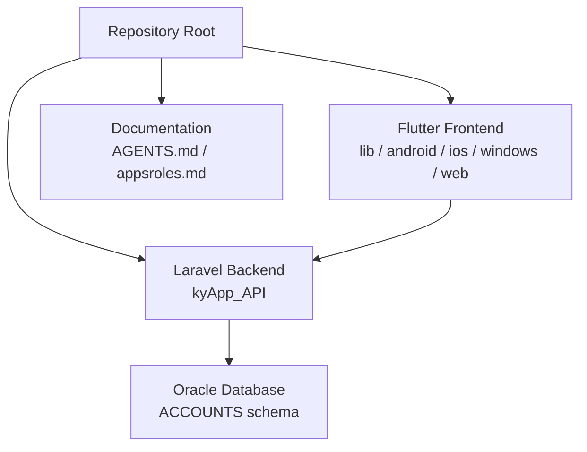
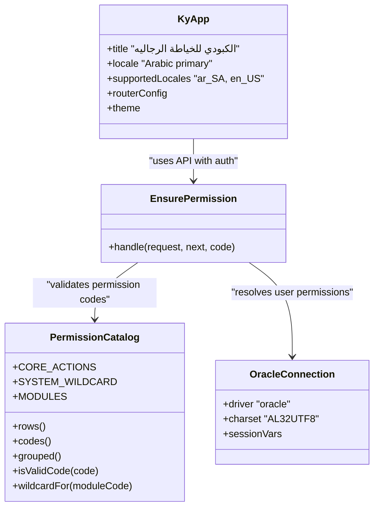
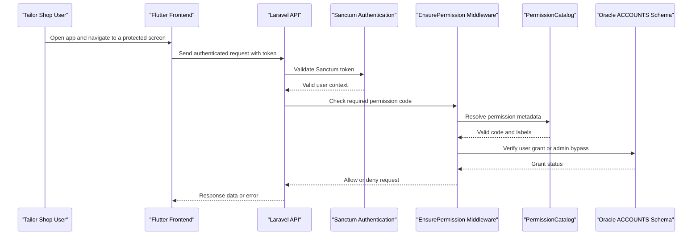
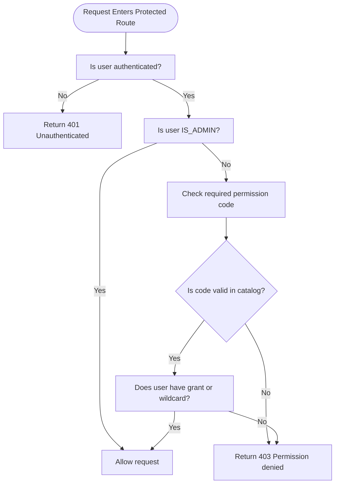
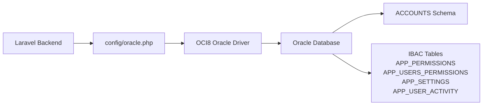
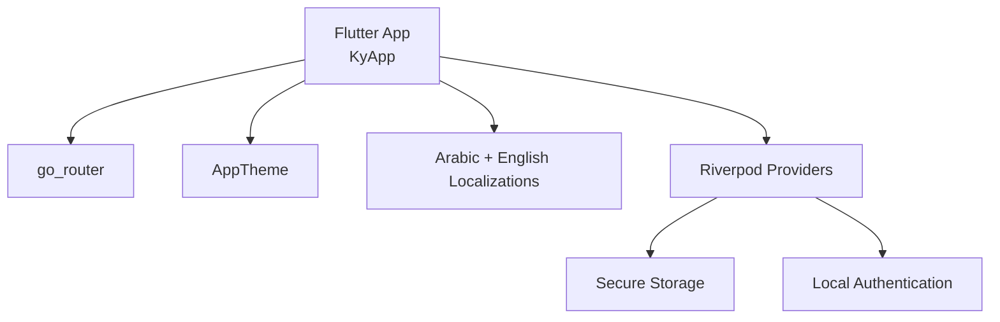
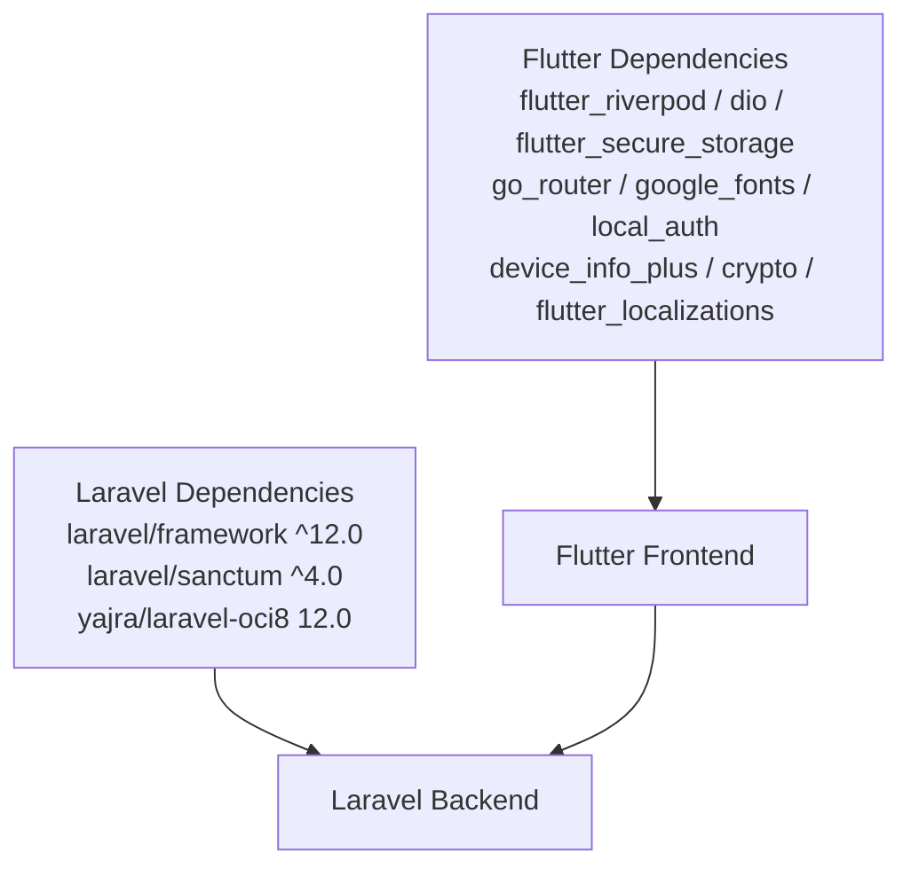

# Project Overview

<cite>
**Referenced Files in This Document**
- [README.md](file://kyApp_API/README.md)
- [pubspec.yaml](file://pubspec.yaml)
- [composer.json](file://kyApp_API/composer.json)
- [main.dart](file://lib/main.dart)
- [oracle.php](file://kyApp_API/config/oracle.php)
- [database.php](file://kyApp_API/config/database.php)
- [PermissionCatalog.php](file://kyApp_API/app/Support/PermissionCatalog.php)
- [EnsurePermission.php](file://kyApp_API/app/Http/Middleware/EnsurePermission.php)
- [01_ibac_schema.sql](file://kyApp_API/database/oracle/01_ibac_schema.sql)
- [04_ibac_rollback.sql](file://kyApp_API/database/oracle/04_ibac_rollback.sql)
- [AGENTS.md](file://AGENTS.md)
- [appsroles.md](file://appsroles.md)
</cite>

## Table of Contents
1. [Introduction](#introduction)
2. [Project Structure](#project-structure)
3. [Core Components](#core-components)
4. [Architecture Overview](#architecture-overview)
5. [Detailed Component Analysis](#detailed-component-analysis)
6. [Dependency Analysis](#dependency-analysis)
7. [Performance Considerations](#performance-considerations)
8. [Troubleshooting Guide](#troubleshooting-guide)
9. [Conclusion](#conclusion)

## Introduction
Ky Apps is a full-stack business management system built for Al-Kabadi Men’s Tailoring, known in Arabic as “الكبودي للخياطة الرجاليه.” It provides an integrated platform for tailoring operations, customer relationship management, worker and employee administration, financial accounting, invoicing, reporting, and administrative controls. The system is designed to be enterprise-grade, secure, and multi-platform, with a Flutter frontend that runs on Android, iOS, Windows, and the web, and a Laravel backend communicating over REST APIs.

At its core, Ky Apps implements Identity-Based Access Control (IBAC), where permissions are granted directly to users rather than through roles. This approach gives administrators fine-grained control over what each user can view or modify across modules such as customers, employees, tailors, cutters, sales, invoices, accounts, currencies, stores, reports, sessions, settings, and system administration.

For beginners, this means one application that helps a men’s tailoring shop manage clients, orders, workers, money, and reports from mobile or desktop devices. For experienced developers, it means a monorepo containing a Flutter client and a Laravel API backed by Oracle, with explicit security policies, session controls, activity logging, and a permission catalog that serves both server-side enforcement and UI generation.

**Section sources**
- [main.dart:12-26](file://lib/main.dart#L12-L26)
- [AGENTS.md:53-56](file://AGENTS.md#L53-L56)

## Project Structure
The repository follows a monorepo layout with separate frontend and backend components:

- Frontend: `lib` contains the Flutter application, including routing, theming, localization, and feature-based organization.
- Backend: `kyApp_API` contains the Laravel application, including controllers, middleware, support classes, configuration, database scripts, routes, tests, and deployment-related files.
- Platform-specific code: `android`, `ios`, `windows`, and `web` directories provide native and web targets for the Flutter app.
- Shared documentation and planning: root-level markdown files describe architecture, roles, development history, and IBAC design decisions.

**Diagram sources**
- [pubspec.yaml:1-22](file://pubspec.yaml#L1-L22)
- [composer.json:1-18](file://kyApp_API/composer.json#L1-L18)
- [AGENTS.md:53-90](file://AGENTS.md#L53-L90)

**Section sources**
- [pubspec.yaml:1-22](file://pubspec.yaml#L1-L22)
- [composer.json:1-18](file://kyApp_API/composer.json#L1-L18)
- [AGENTS.md:53-90](file://AGENTS.md#L53-L90)

## Core Components
Ky Apps consists of several key components:

- **Flutter Frontend**: A multi-platform UI built with Flutter, using Riverpod for state management, Dio for HTTP requests, secure storage for tokens, local authentication for biometric login, and full Arabic localization with right-to-left layout support.
- **Laravel Backend**: An API layer exposing endpoints for authentication, customers, workers, invoices, permissions, sessions, settings, and other business features. It uses Sanctum for token-based authentication and integrates with Oracle via the OCI8 driver.
- **Oracle Database Integration**: The backend connects to an Oracle database using a dedicated connection configuration, with explicit charset and session variables. Business data resides in the legacy `ACCOUNTS` schema, while IBAC tables extend access control and audit capabilities.
- **IBAC Security Layer**: Permission codes are defined centrally in `PermissionCatalog`. Middleware enforces route-level authorization, returning clear 401 and 403 responses when authentication or permission checks fail.
- **Administrative Controls**: The system includes user management, active session monitoring, security settings, and activity logging, all governed by IBAC grants and administrator bypass logic.

**Diagram sources**
- [main.dart:12-26](file://lib/main.dart#L12-L26)
- [PermissionCatalog.php:22-52](file://kyApp_API/app/Support/PermissionCatalog.php#L22-L52)
- [EnsurePermission.php:11-24](file://kyApp_API/app/Http/Middleware/EnsurePermission.php#L11-L24)
- [oracle.php:1-29](file://kyApp_API/config/oracle.php#L1-L29)

**Section sources**
- [main.dart:12-26](file://lib/main.dart#L12-L26)
- [pubspec.yaml:30-46](file://pubspec.yaml#L30-L46)
- [composer.json:11-18](file://kyApp_API/composer.json#L11-L18)
- [PermissionCatalog.php:22-52](file://kyApp_API/app/Support/PermissionCatalog.php#L22-L52)
- [EnsurePermission.php:11-24](file://kyApp_API/app/Http/Middleware/EnsurePermission.php#L11-L24)
- [oracle.php:1-29](file://kyApp_API/config/oracle.php#L1-L29)

## Architecture Overview
Ky Apps follows a layered, feature-oriented architecture:

- The Flutter frontend handles presentation, navigation, localization, and user interaction. It communicates with the Laravel backend through REST APIs secured by Sanctum tokens.
- The Laravel backend exposes domain-specific controllers for customers, workers, invoices, permissions, sessions, and settings. It enforces authentication and authorization through middleware and central permission logic.
- The Oracle database stores business data in the legacy `ACCOUNTS` schema and IBAC extension tables for permissions, grants, settings, and activity logs.
- IBAC is implemented as direct user-to-permission grants, with an administrator bypass flag (`IS_ADMIN`) and a permission catalog that defines valid module-action combinations.

**Diagram sources**
- [main.dart:12-26](file://lib/main.dart#L12-L26)
- [composer.json:11-18](file://kyApp_API/composer.json#L11-L18)
- [EnsurePermission.php:11-24](file://kyApp_API/app/Http/Middleware/EnsurePermission.php#L11-L24)
- [PermissionCatalog.php:22-52](file://kyApp_API/app/Support/PermissionCatalog.php#L22-L52)
- [01_ibac_schema.sql:1-19](file://kyApp_API/database/oracle/01_ibac_schema.sql#L1-L19)

**Section sources**
- [AGENTS.md:53-90](file://AGENTS.md#L53-L90)
- [appsroles.md:13-26](file://appsroles.md#L13-L26)
- [composer.json:11-18](file://kyApp_API/composer.json#L11-L18)
- [EnsurePermission.php:11-24](file://kyApp_API/app/Http/Middleware/EnsurePermission.php#L11-L24)
- [PermissionCatalog.php:22-52](file://kyApp_API/app/Support/PermissionCatalog.php#L22-L52)
- [01_ibac_schema.sql:1-19](file://kyApp_API/database/oracle/01_ibac_schema.sql#L1-L19)

## Detailed Component Analysis

### IBAC Permission System
The IBAC system is the security backbone of Ky Apps. Permissions are defined in a centralized catalog, validated against allowed patterns, and enforced at the API boundary. Administrators can grant specific module-action permissions to users, and the system supports wildcard grants such as `module.*` and `system.*`.

Key aspects include:
- A canonical permission catalog listing modules like dashboard, sales, tailoring, customers, employees, cutters, tailors, accounts, currencies, invoices, stores, reports, management, users, sessions, settings, and system.
- Core actions per module: view, create, update, delete.
- Additional actions per module: print, export, statement, toggle, deliver, edit_limit, structure_manage, prices_view, prices_manage, permissions_manage, activity_view, admin_flag_manage, terminate, security_manage.
- Middleware that denies access without authentication or permission, returning localized Arabic messages for denied permissions.
- Administrator bypass through `IS_ADMIN=1`, allowing full access regardless of explicit grants.

**Diagram sources**
- [EnsurePermission.php:11-24](file://kyApp_API/app/Http/Middleware/EnsurePermission.php#L11-L24)
- [PermissionCatalog.php:22-52](file://kyApp_API/app/Support/PermissionCatalog.php#L22-L52)
- [PermissionCatalog.php:436-458](file://kyApp_API/app/Support/PermissionCatalog.php#L436-L458)

**Section sources**
- [PermissionCatalog.php:22-52](file://kyApp_API/app/Support/PermissionCatalog.php#L22-L52)
- [PermissionCatalog.php:261-306](file://kyApp_API/app/Support/PermissionCatalog.php#L261-L306)
- [PermissionCatalog.php:436-458](file://kyApp_API/app/Support/PermissionCatalog.php#L436-L458)
- [EnsurePermission.php:11-24](file://kyApp_API/app/Http/Middleware/EnsurePermission.php#L11-L24)
- [EnsurePermission.php:32-52](file://kyApp_API/app/Http/Middleware/EnsurePermission.php#L32-L52)

### Oracle Database Integration
Ky Apps integrates with Oracle through a dedicated connection configuration. The backend uses the OCI8 driver, sets the client charset to `AL32UTF8`, and configures session variables for date and numeric formatting. The business schema is `ACCOUNTS`, and IBAC extension tables are created via SQL scripts rather than Laravel migrations.

Important details include:
- Oracle connection parameters: TNS, host, port, database/service name, username, password, charset, prefix, edition, load balancing, and max name length.
- Session variables for time, date, timestamp, and numeric formatting.
- DDL scripts for IBAC tables, sequences, triggers, and rollback procedures.
- Arabic text handling considerations due to client-server charset differences.

**Diagram sources**
- [oracle.php:1-29](file://kyApp_API/config/oracle.php#L1-L29)
- [database.php:116-127](file://kyApp_API/config/database.php#L116-L127)
- [01_ibac_schema.sql:1-19](file://kyApp_API/database/oracle/01_ibac_schema.sql#L1-L19)

**Section sources**
- [oracle.php:1-29](file://kyApp_API/config/oracle.php#L1-L29)
- [database.php:116-127](file://kyApp_API/config/database.php#L116-L127)
- [01_ibac_schema.sql:1-19](file://kyApp_API/database/oracle/01_ibac_schema.sql#L1-L19)
- [04_ibac_rollback.sql:1-24](file://kyApp_API/database/oracle/04_ibac_rollback.sql#L1-L24)

### Flutter Frontend and Multi-Platform Support
The Flutter frontend is configured for multi-platform deployment and Arabic-first localization. It initializes the Flutter binding, wraps the app in a provider scope, and configures Material/Cupertino localizations. The app title matches the business name, and the default locale is Arabic Saudi Arabia with English supported.

Key characteristics include:
- Multi-platform targets: Android, iOS, Windows, Web.
- State management via Riverpod.
- Secure token storage and local authentication integration.
- Responsive layout and text scaling for accessibility.
- Feature-based architecture separating data, presentation, and state layers.

**Diagram sources**
- [main.dart:7-26](file://lib/main.dart#L7-L26)
- [pubspec.yaml:30-46](file://pubspec.yaml#L30-L46)
- [appsroles.md:13-26](file://appsroles.md#L13-L26)

**Section sources**
- [main.dart:7-26](file://lib/main.dart#L7-L26)
- [pubspec.yaml:30-46](file://pubspec.yaml#L30-L46)
- [appsroles.md:13-26](file://appsroles.md#L13-L26)

## Dependency Analysis
Ky Apps has clear separation between frontend and backend dependencies:

- Flutter dependencies include framework SDK, UI icons, state management, HTTP client, secure storage, routing, fonts, local authentication, device info, cryptography, and localizations.
- Laravel dependencies include PHP runtime, Laravel framework, installer, Sanctum, Tinker, and Oracle integration via OCI8. Development tools include Pest testing, Pint, Sail, Boost, Pail, and Mockery.

**Diagram sources**
- [pubspec.yaml:30-46](file://pubspec.yaml#L30-L46)
- [composer.json:11-29](file://kyApp_API/composer.json#L11-L29)

**Section sources**
- [pubspec.yaml:30-46](file://pubspec.yaml#L30-L46)
- [composer.json:11-29](file://kyApp_API/composer.json#L11-L29)

## Performance Considerations
- Use efficient permission resolution by caching user grants where appropriate, especially for frequent route checks.
- Optimize Oracle queries for permission lookups and activity logging to avoid unnecessary joins.
- Minimize Flutter network calls by batching requests and leveraging Dio interceptors for retry and error handling.
- Keep localization assets minimal and load only necessary translations.
- Monitor session activity and clean up expired sessions to reduce database load.

[No sources needed since this section provides general guidance]

## Troubleshooting Guide
Common issues and their contexts:

- **Authentication failures**: Occur when Sanctum tokens are missing or invalid; the middleware returns 401 with a localized message.
- **Permission denials**: Occur when a user lacks the required permission code; the middleware returns 403 with the Arabic permission label.
- **Oracle charset problems**: Arabic text may appear corrupted if raw CP1256 bytes are sent over an AL32UTF8 connection; proper encoding functions must be used.
- **IBAC script errors**: Sequence naming conflicts and reserved words in PL/SQL can cause trigger failures; scripts include rollbacks and idempotent seeding.

Recommended steps:
- Verify Sanctum token presence and validity before calling protected routes.
- Confirm that required permission codes exist in `PermissionCatalog` and are granted to the user.
- Ensure Oracle connection charset and session variables match application expectations.
- Use provided rollback scripts when modifying IBAC schema objects.

**Section sources**
- [EnsurePermission.php:32-52](file://kyApp_API/app/Http/Middleware/EnsurePermission.php#L32-L52)
- [01_ibac_schema.sql:1-19](file://kyApp_API/database/oracle/01_ibac_schema.sql#L1-L19)
- [04_ibac_rollback.sql:1-24](file://kyApp_API/database/oracle/04_ibac_rollback.sql#L1-L24)

## Conclusion
Ky Apps delivers a complete, secure, and multi-platform solution for Al-Kabadi Men’s Tailoring. Its Flutter frontend provides a responsive, localized experience across devices, while its Laravel backend offers robust APIs backed by Oracle. The IBAC permission system ensures fine-grained access control, and the administrative features enable comprehensive management of users, sessions, settings, and business operations. Together, these components form an enterprise-grade system tailored to the needs of a professional tailoring business.

[No sources needed since this section summarizes without analyzing specific files]