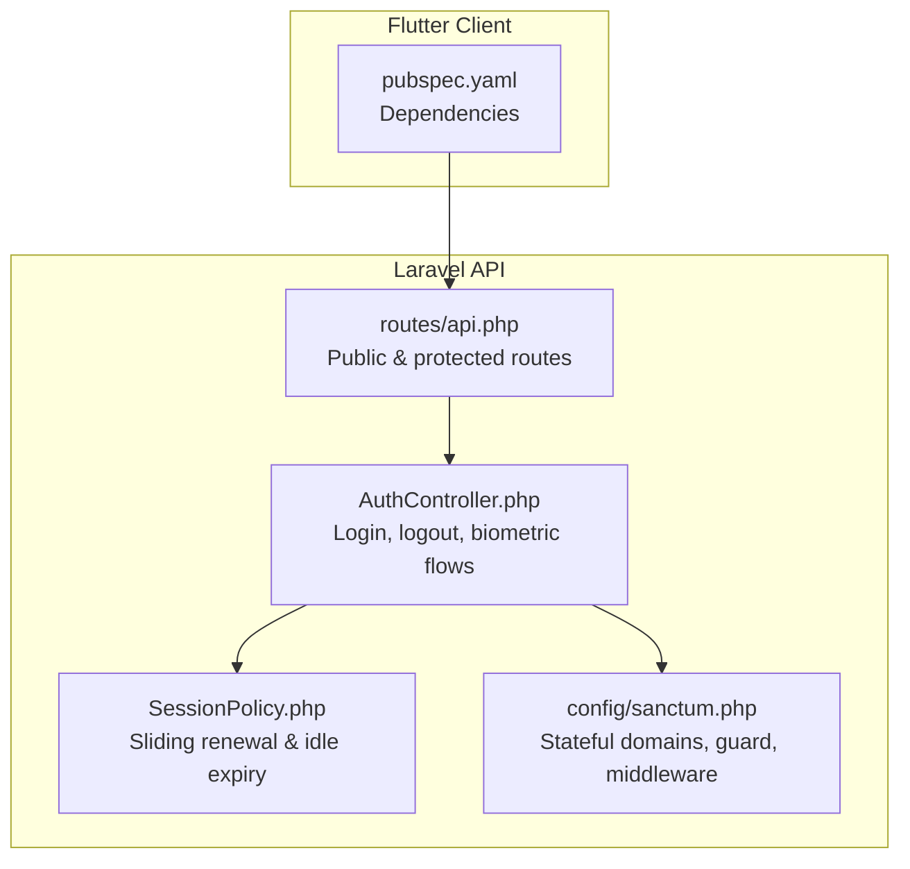
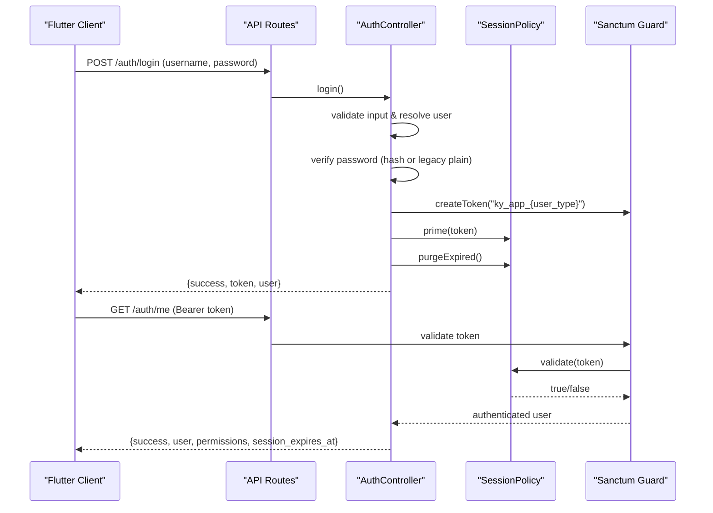
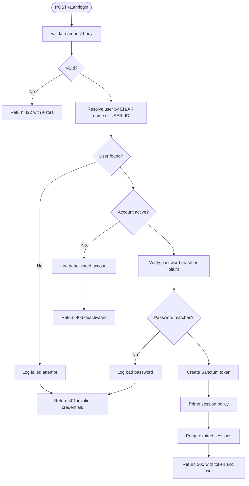
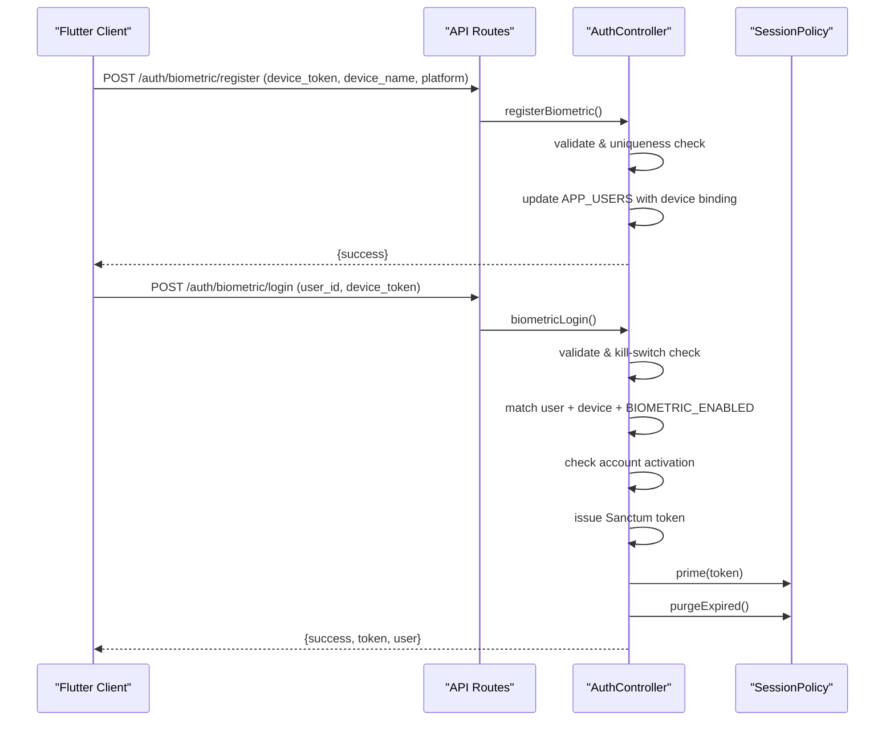
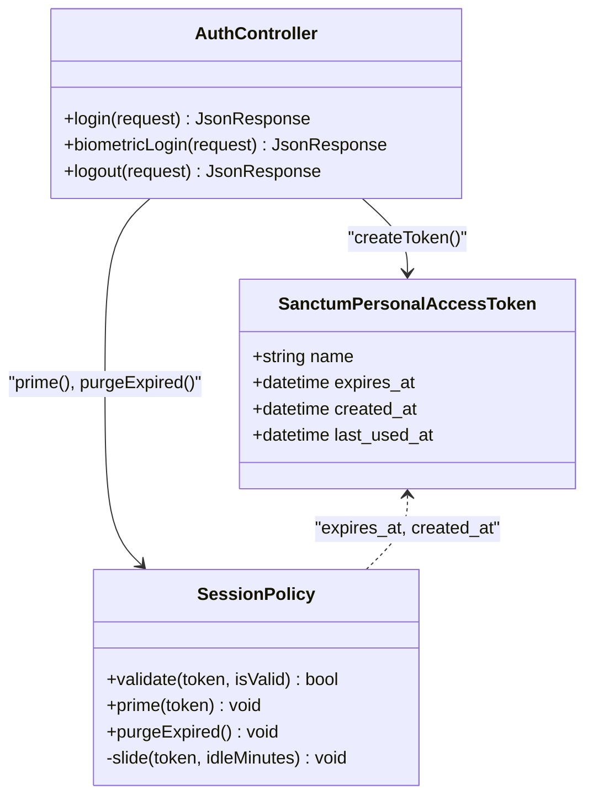
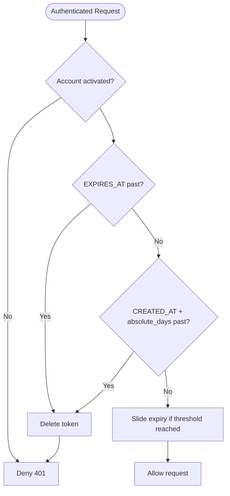
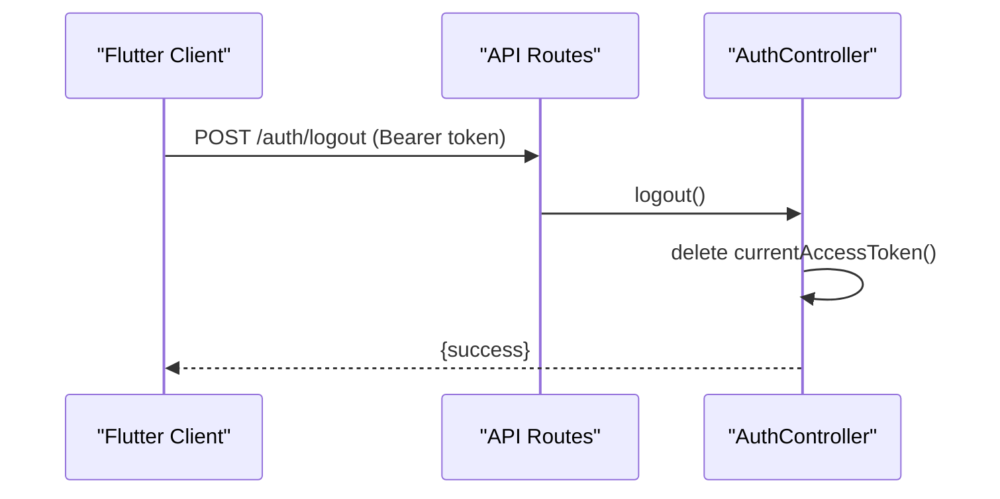
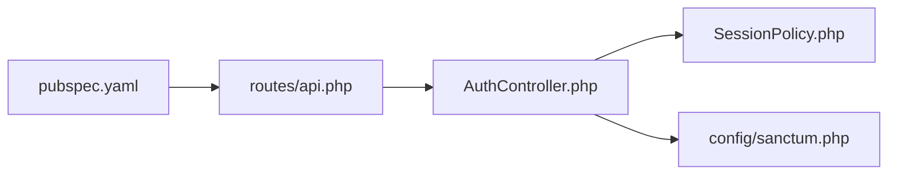

# Authentication System

<cite>
**Referenced Files in This Document**
- [AuthController.php](file://kyApp_API/app/Http/Controllers/AuthController.php)
- [SessionPolicy.php](file://kyApp_API/app/Support/SessionPolicy.php)
- [api.php](file://kyApp_API/routes/api.php)
- [sanctum.php](file://kyApp_API/config/sanctum.php)
- [pubspec.yaml](file://pubspec.yaml)
</cite>

## Table of Contents
1. [Introduction](#introduction)
2. [Project Structure](#project-structure)
3. [Core Components](#core-components)
4. [Architecture Overview](#architecture-overview)
5. [Detailed Component Analysis](#detailed-component-analysis)
6. [Dependency Analysis](#dependency-analysis)
7. [Performance Considerations](#performance-considerations)
8. [Troubleshooting Guide](#troubleshooting-guide)
9. [Conclusion](#conclusion)
10. [Appendices](#appendices)

## Introduction
This document explains the Ky Apps authentication system, which combines password-based and biometric verification for mobile clients. The backend is a Laravel API secured by Laravel Sanctum. Clients authenticate with username/password or device-bound biometrics, receive Sanctum personal access tokens, and rely on a custom session policy that implements sliding renewal and idle expiry. The Flutter client integrates the Local Auth plugin to perform biometric checks before calling the server’s biometric login endpoint.

The system also provides:
- Token generation and management via Sanctum
- Active session tracking and remote termination endpoints
- Security policies driven by application settings
- Permission-aware responses so the UI can gate features based on real grants
- Audit logging for authentication events

## Project Structure
At a high level, authentication spans:
- Flutter client dependencies for networking, secure storage, routing, and biometrics
- Laravel API routes exposing public and protected endpoints
- An authentication controller handling credential validation, token issuance, and biometric enrollment/login
- A session policy enforcing idle and absolute session lifetimes
- Sanctum configuration for stateful domains, guards, and middleware

**Diagram sources**
- [pubspec.yaml:30-44](file://pubspec.yaml#L30-L44)
- [api.php:17-34](file://kyApp_API/routes/api.php#L17-L34)
- [AuthController.php:47-163](file://kyApp_API/app/Http/Controllers/AuthController.php#L47-L163)
- [SessionPolicy.php:70-108](file://kyApp_API/app/Support/SessionPolicy.php#L70-L108)
- [sanctum.php:21-40](file://kyApp_API/config/sanctum.php#L21-L40)

**Section sources**
- [pubspec.yaml:30-44](file://pubspec.yaml#L30-L44)
- [api.php:17-34](file://kyApp_API/routes/api.php#L17-L34)
- [sanctum.php:21-40](file://kyApp_API/config/sanctum.php#L21-L40)

## Core Components
- Authentication controller
  - Password login with flexible username resolution and legacy plain-text password support
  - Biometric registration, login, and revocation
  - Logout and current user profile endpoints
  - Permission payload injection into responses
- Session policy
  - Sliding renewal with write throttling
  - Idle expiration and absolute lifetime enforcement
  - Best-effort cleanup of expired tokens
- Sanctum configuration
  - Stateful domain list for cookie-based SPA auth
  - Guard set to web
  - Last-used-at stamping enabled
- Flutter client dependencies
  - Dio for HTTP requests
  - flutter_secure_storage for token persistence
  - local_auth for biometric prompts
  - go_router for navigation after auth outcomes

**Section sources**
- [AuthController.php:47-163](file://kyApp_API/app/Http/Controllers/AuthController.php#L47-L163)
- [AuthController.php:245-441](file://kyApp_API/app/Http/Controllers/AuthController.php#L245-L441)
- [SessionPolicy.php:70-108](file://kyApp_API/app/Support/SessionPolicy.php#L70-L108)
- [sanctum.php:21-77](file://kyApp_API/config/sanctum.php#L21-L77)
- [pubspec.yaml:30-44](file://pubspec.yaml#L30-L44)

## Architecture Overview
The authentication architecture uses Sanctum personal access tokens combined with a custom session policy. Public endpoints accept credentials or biometric proof; protected endpoints require a valid token and pass through permission checks.

**Diagram sources**
- [api.php:17-34](file://kyApp_API/routes/api.php#L17-L34)
- [AuthController.php:47-163](file://kyApp_API/app/Http/Controllers/AuthController.php#L47-L163)
- [AuthController.php:170-215](file://kyApp_API/app/Http/Controllers/AuthController.php#L170-L215)
- [SessionPolicy.php:70-108](file://kyApp_API/app/Support/SessionPolicy.php#L70-L108)

## Detailed Component Analysis

### Password-Based Login Flow
- Input validation enforces required fields and allowed user types.
- Username resolution supports English, Arabic, and numeric USER_ID inputs.
- Account activation check prevents disabled accounts from signing in.
- Password verification supports hashed values and legacy plain-text entries.
- On success, a Sanctum token is created, primed with a full idle window, and expired sessions are purged.
- Authentication events are logged for auditability.

**Diagram sources**
- [AuthController.php:47-163](file://kyApp_API/app/Http/Controllers/AuthController.php#L47-L163)

**Section sources**
- [AuthController.php:47-163](file://kyApp_API/app/Http/Controllers/AuthController.php#L47-L163)

### Biometric Registration and Login
- Registration requires an authenticated user and binds a device token to the user record. Duplicate device tokens across users are rejected.
- Biometric login is a public endpoint that validates user_id and device_token, checks platform kill-switch, verifies the device binding and account activation, then issues a token under the same session policy as password login.
- Revocation clears device binding and disables biometric login for the user.

**Diagram sources**
- [api.php:21-34](file://kyApp_API/routes/api.php#L21-L34)
- [AuthController.php:245-441](file://kyApp_API/app/Http/Controllers/AuthController.php#L245-L441)

**Section sources**
- [AuthController.php:245-441](file://kyApp_API/app/Http/Controllers/AuthController.php#L245-L441)

### Token Generation and Management with Laravel Sanctum
- Tokens are created per login flow with descriptive names indicating origin.
- The session policy primes each new token with a full idle window derived from settings.
- Sanctum last-used-at stamping is enabled to reflect real activity timestamps.
- Expiration is not set globally in Sanctum config; instead, EXPIRES_AT is managed by the session policy to avoid hard absolute age behavior.

**Diagram sources**
- [AuthController.php:47-163](file://kyApp_API/app/Http/Controllers/AuthController.php#L47-L163)
- [SessionPolicy.php:70-108](file://kyApp_API/app/Support/SessionPolicy.php#L70-L108)
- [sanctum.php:47-77](file://kyApp_API/config/sanctum.php#L47-L77)

**Section sources**
- [sanctum.php:47-77](file://kyApp_API/config/sanctum.php#L47-L77)
- [AuthController.php:47-163](file://kyApp_API/app/Http/Controllers/AuthController.php#L47-L163)
- [SessionPolicy.php:70-108](file://kyApp_API/app/Support/SessionPolicy.php#L70-L108)

### Session Management: Active Tracking, Termination, and Policies
- Active sessions are tracked via Sanctum’s last-used-at stamping and the session policy’s sliding renewal.
- Remote termination endpoints allow administrators to terminate all sessions for a user or a specific token, gated by permissions.
- Session policy enforces:
  - Deactivated accounts are immediately denied even if the token is otherwise valid
  - Idle expiration based on configurable minutes
  - Absolute lifetime based on configurable days
  - Write-throttled sliding renewal to reduce database writes

**Diagram sources**
- [SessionPolicy.php:70-108](file://kyApp_API/app/Support/SessionPolicy.php#L70-L108)
- [SessionPolicy.php:130-183](file://kyApp_API/app/Support/SessionPolicy.php#L130-L183)

**Section sources**
- [api.php:99-116](file://kyApp_API/routes/api.php#L99-L116)
- [SessionPolicy.php:70-108](file://kyApp_API/app/Support/SessionPolicy.php#L70-L108)
- [SessionPolicy.php:130-183](file://kyApp_API/app/Support/SessionPolicy.php#L130-L183)

### Logout Procedures
- Logout deletes the current token and logs the event.
- After logout, the client should clear stored tokens and navigate to the login screen.

**Diagram sources**
- [api.php:24-29](file://kyApp_API/routes/api.php#L24-L29)
- [AuthController.php:221-239](file://kyApp_API/app/Http/Controllers/AuthController.php#L221-L239)

**Section sources**
- [AuthController.php:221-239](file://kyApp_API/app/Http/Controllers/AuthController.php#L221-L239)

### Practical Examples

#### Implementing Custom Authentication Flows
- Use the existing login pattern: validate input, resolve user, verify credentials, create token, prime session policy, purge expired sessions, log the event, and return a unified user payload including permissions.
- For multi-step flows, keep sensitive operations behind `auth:sanctum` and add fine-grained `permission:<code>` middleware where needed.

Reference paths:
- [AuthController.php:47-163](file://kyApp_API/app/Http/Controllers/AuthController.php#L47-L163)
- [api.php:45-88](file://kyApp_API/routes/api.php#L45-L88)

#### Handling Authentication Errors
- Validation failures return 422 with structured errors.
- Invalid credentials return 401 without revealing whether the username exists.
- Disabled accounts return 403.
- Biometric kill-switch returns 403 when disabled by admin settings.

Reference paths:
- [AuthController.php:51-66](file://kyApp_API/app/Http/Controllers/AuthController.php#L51-L66)
- [AuthController.php:86-140](file://kyApp_API/app/Http/Controllers/AuthController.php#L86-L140)
- [AuthController.php:334-347](file://kyApp_API/app/Http/Controllers/AuthController.php#L334-L347)

#### Securing API Endpoints
- Wrap business routes with `auth:sanctum` and `permission:<code>` middleware.
- Keep sensitive administrative endpoints (sessions, settings) behind stricter permissions.

Reference paths:
- [api.php:99-116](file://kyApp_API/routes/api.php#L99-L116)
- [api.php:138-155](file://kyApp_API/routes/api.php#L138-L155)

### Token Refresh Mechanisms
- There is no explicit refresh endpoint. Instead, the session policy performs silent sliding renewal on every authenticated request within a write threshold window.
- The client should treat a 401 response as “session expired” and force re-authentication.
- The `/auth/me` response includes `session_expires_at`, allowing the client to warn users before forced logout.

Reference paths:
- [SessionPolicy.php:157-183](file://kyApp_API/app/Support/SessionPolicy.php#L157-L183)
- [AuthController.php:190-215](file://kyApp_API/app/Http/Controllers/AuthController.php#L190-L215)

### Flutter Client Integration Notes
- Dependencies include Dio for HTTP, flutter_secure_storage for token persistence, local_auth for biometric prompts, and go_router for navigation.
- Typical flow: prompt biometrics locally, call `/auth/biometric/login`, store returned token securely, attach it to subsequent requests, handle 401 by clearing storage and navigating to login.

Reference paths:
- [pubspec.yaml:30-44](file://pubspec.yaml#L30-L44)

**Section sources**
- [AuthController.php:190-215](file://kyApp_API/app/Http/Controllers/AuthController.php#L190-L215)
- [SessionPolicy.php:157-183](file://kyApp_API/app/Support/SessionPolicy.php#L157-L183)
- [pubspec.yaml:30-44](file://pubspec.yaml#L30-L44)

## Dependency Analysis
The authentication subsystem has clear boundaries:
- Routes expose public and protected endpoints
- AuthController orchestrates validation, token issuance, and biometric flows
- SessionPolicy centralizes session lifecycle rules
- Sanctum configuration defines guard and middleware behavior
- Flutter client depends on networking, secure storage, and biometric packages

**Diagram sources**
- [pubspec.yaml:30-44](file://pubspec.yaml#L30-L44)
- [api.php:17-34](file://kyApp_API/routes/api.php#L17-L34)
- [AuthController.php:47-163](file://kyApp_API/app/Http/Controllers/AuthController.php#L47-L163)
- [SessionPolicy.php:70-108](file://kyApp_API/app/Support/SessionPolicy.php#L70-L108)
- [sanctum.php:21-40](file://kyApp_API/config/sanctum.php#L21-L40)

**Section sources**
- [api.php:17-34](file://kyApp_API/routes/api.php#L17-L34)
- [AuthController.php:47-163](file://kyApp_API/app/Http/Controllers/AuthController.php#L47-L163)
- [SessionPolicy.php:70-108](file://kyApp_API/app/Support/SessionPolicy.php#L70-L108)
- [sanctum.php:21-40](file://kyApp_API/config/sanctum.php#L21-L40)
- [pubspec.yaml:30-44](file://pubspec.yaml#L30-L44)

## Performance Considerations
- Sliding renewal is write-throttled to minimize database updates during frequent API calls.
- Expired token cleanup runs on login and session listing to prevent accumulation of stale rows.
- Avoid setting a global Sanctum expiration; rely on EXPIRES_AT managed by the session policy to prevent abrupt disconnections for active users.

[No sources needed since this section provides general guidance]

## Troubleshooting Guide
Common issues and resolutions:
- Validation errors on login or biometric registration: ensure required fields are present and correctly typed.
- Invalid credentials: verify username resolution path and password format (hashed vs legacy plain).
- Disabled account: confirm IS_ACTIVATED status before attempting login.
- Biometric login blocked: check platform kill-switch setting and device binding.
- 401 on protected endpoints: indicates session expired; clear local tokens and re-authenticate.
- Remote session termination: use the session administration endpoints with appropriate permissions.

Reference paths:
- [AuthController.php:51-66](file://kyApp_API/app/Http/Controllers/AuthController.php#L51-L66)
- [AuthController.php:86-140](file://kyApp_API/app/Http/Controllers/AuthController.php#L86-L140)
- [AuthController.php:334-347](file://kyApp_API/app/Http/Controllers/AuthController.php#L334-L347)
- [api.php:99-116](file://kyApp_API/routes/api.php#L99-L116)

**Section sources**
- [AuthController.php:51-66](file://kyApp_API/app/Http/Controllers/AuthController.php#L51-L66)
- [AuthController.php:86-140](file://kyApp_API/app/Http/Controllers/AuthController.php#L86-L140)
- [AuthController.php:334-347](file://kyApp_API/app/Http/Controllers/AuthController.php#L334-L347)
- [api.php:99-116](file://kyApp_API/routes/api.php#L99-L116)

## Conclusion
Ky Apps implements a robust, mobile-friendly authentication system combining password and biometric verification. Sanctum personal access tokens provide secure API access, while the custom session policy ensures safe, sliding renewals and idle expiration. The Flutter client leverages standard plugins for secure storage and biometric prompts. Administrators can manage active sessions and enforce security policies through permission-gated endpoints. Following the documented flows and best practices will help maintain a secure and responsive authentication experience.

[No sources needed since this section summarizes without analyzing specific files]

## Appendices

### API Endpoints Summary
- Public
  - POST /auth/login
  - POST /auth/biometric/login
- Protected (requires Sanctum token)
  - POST /auth/logout
  - GET /auth/me
  - GET /auth/permissions
  - POST /auth/biometric/register
  - DELETE /auth/biometric/revoke
- Administration (requires additional permissions)
  - GET /sessions
  - DELETE /sessions/user/{userId}
  - DELETE /sessions/{tokenId}
  - GET /settings
  - PUT /settings

Reference paths:
- [api.php:17-34](file://kyApp_API/routes/api.php#L17-L34)
- [api.php:99-116](file://kyApp_API/routes/api.php#L99-L116)

**Section sources**
- [api.php:17-34](file://kyApp_API/routes/api.php#L17-L34)
- [api.php:99-116](file://kyApp_API/routes/api.php#L99-L116)