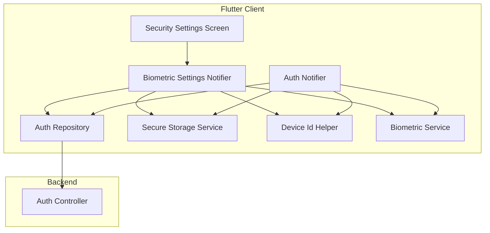
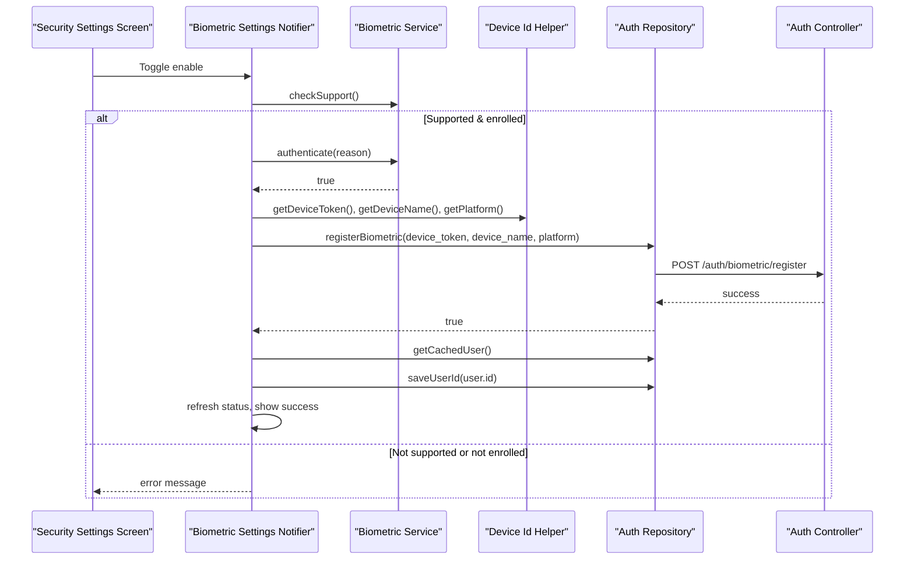
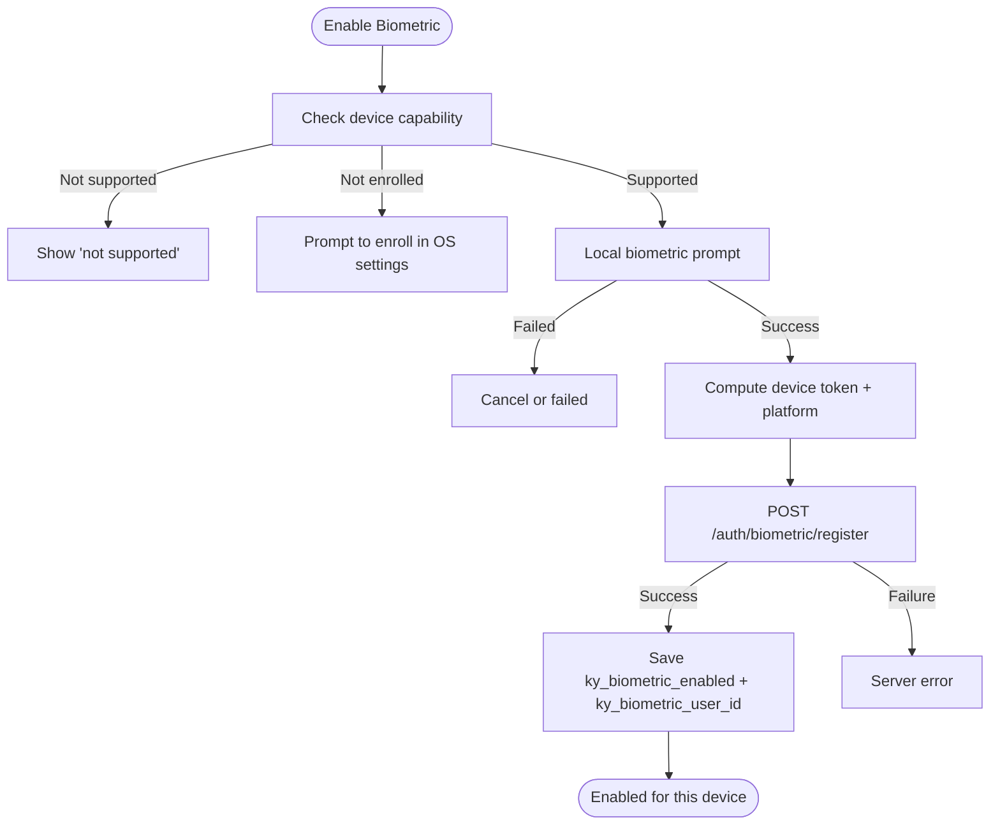
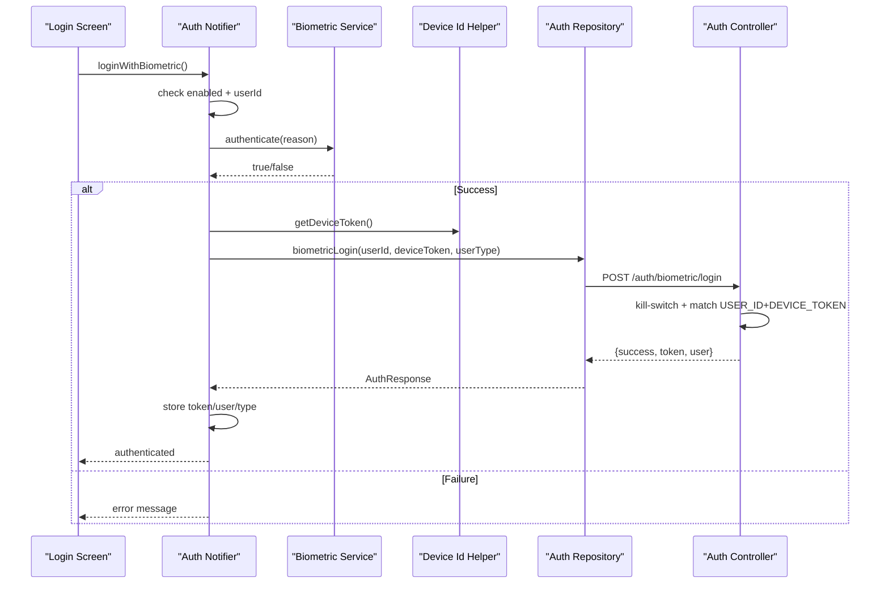
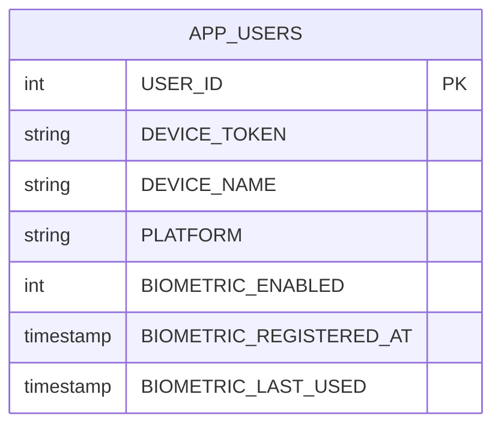
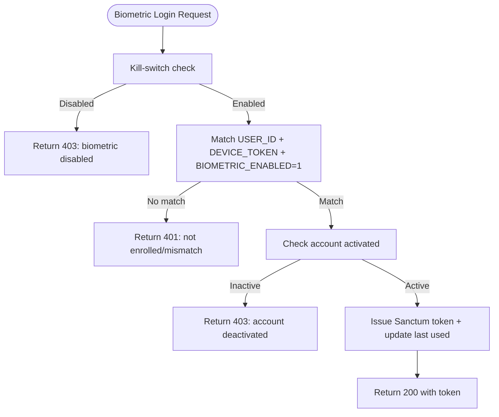
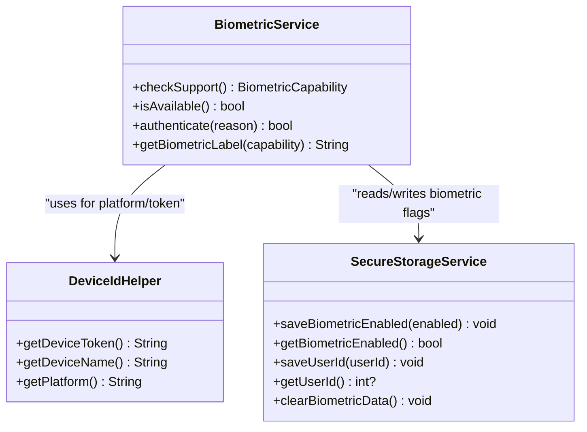
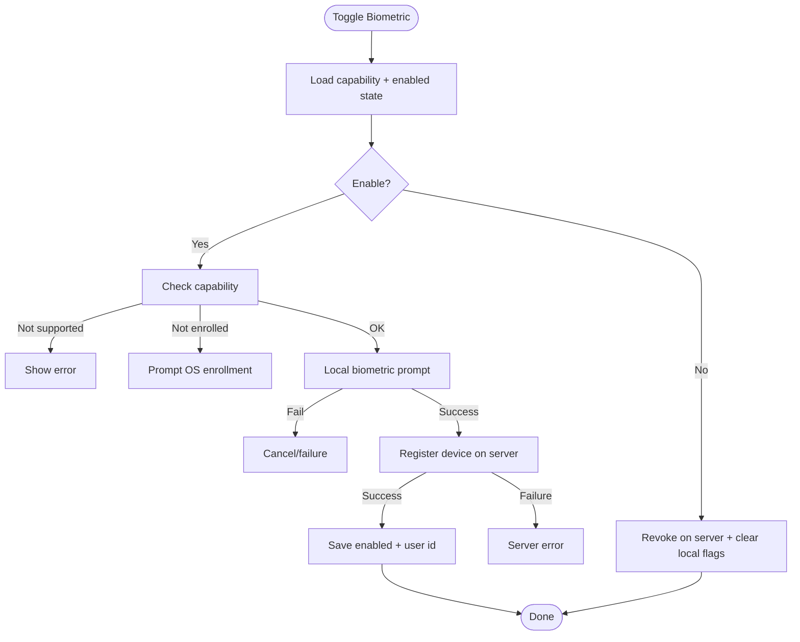
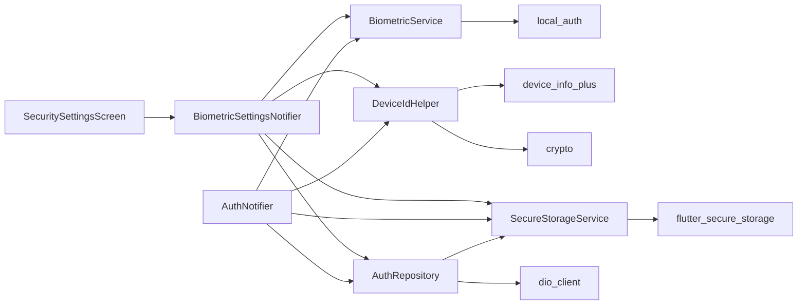

# Biometric Authentication

<cite>
**Referenced Files in This Document**
- [biometric_service.dart](file://lib/core/utils/biometric_service.dart)
- [device_id_helper.dart](file://lib/core/utils/device_id_helper.dart)
- [secure_storage_service.dart](file://lib/core/storage/secure_storage_service.dart)
- [auth_repository.dart](file://lib/features/auth/data/repositories/auth_repository.dart)
- [auth_notifier.dart](file://lib/features/auth/presentation/providers/auth_notifier.dart)
- [biometric_settings_notifier.dart](file://lib/features/settings/presentation/providers/biometric_settings_notifier.dart)
- [security_settings_screen.dart](file://lib/features/settings/presentation/screens/security_settings_screen.dart)
- [AuthController.php](file://kyApp_API/app/Http/Controllers/AuthController.php)
</cite>

## Table of Contents
1. [Introduction](#introduction)
2. [Project Structure](#project-structure)
3. [Core Components](#core-components)
4. [Architecture Overview](#architecture-overview)
5. [Detailed Component Analysis](#detailed-component-analysis)
6. [Dependency Analysis](#dependency-analysis)
7. [Performance Considerations](#performance-considerations)
8. [Troubleshooting Guide](#troubleshooting-guide)
9. [Conclusion](#conclusion)

## Introduction
This document explains the biometric authentication implementation in Ky Apps. It covers device registration with secure device token binding, platform detection for Android and iOS, enrollment storage in the APP_USERS table, the biometric login flow with device-user matching, system kill-switch controls via settings, and security validations. It also documents the Local Auth plugin integration for fingerprint and Face ID functionality, secure local storage of biometric preferences, and cross-platform compatibility considerations. Practical examples are provided through code paths and diagrams to guide implementation, failure handling, and user preference management.

## Project Structure
The biometric feature spans Flutter client modules and a Laravel backend controller:

- Flutter client
  - Core utilities: `BiometricService` (Local Auth wrapper), `DeviceIdHelper` (device token and platform detection), `SecureStorageService` (encrypted keys).
  - Feature layer: `AuthRepository` (API calls), `AuthNotifier` (login flows), `BiometricSettingsNotifier` (settings UI logic), `SecuritySettingsScreen` (UI toggle).
- Backend
  - `AuthController.php` implements biometric register, login, and revoke endpoints, enforcing validation, kill-switch, device-user matching, and APP_USERS persistence.

**Diagram sources**
- [biometric_settings_notifier.dart:1-191](file://lib/features/settings/presentation/providers/biometric_settings_notifier.dart#L1-L191)
- [auth_notifier.dart:1-379](file://lib/features/auth/presentation/providers/auth_notifier.dart#L1-L379)
- [auth_repository.dart:1-273](file://lib/features/auth/data/repositories/auth_repository.dart#L1-L273)
- [secure_storage_service.dart:1-206](file://lib/core/storage/secure_storage_service.dart#L1-L206)
- [device_id_helper.dart:1-61](file://lib/core/utils/device_id_helper.dart#L1-L61)
- [biometric_service.dart:1-85](file://lib/core/utils/biometric_service.dart#L1-L85)
- [AuthController.php:241-441](file://kyApp_API/app/Http/Controllers/AuthController.php#L241-L441)

**Section sources**
- [biometric_service.dart:1-85](file://lib/core/utils/biometric_service.dart#L1-L85)
- [device_id_helper.dart:1-61](file://lib/core/utils/device_id_helper.dart#L1-L61)
- [secure_storage_service.dart:1-206](file://lib/core/storage/secure_storage_service.dart#L1-L206)
- [auth_repository.dart:1-273](file://lib/features/auth/data/repositories/auth_repository.dart#L1-L273)
- [auth_notifier.dart:1-379](file://lib/features/auth/presentation/providers/auth_notifier.dart#L1-L379)
- [biometric_settings_notifier.dart:1-191](file://lib/features/settings/presentation/providers/biometric_settings_notifier.dart#L1-L191)
- [security_settings_screen.dart:238-269](file://lib/features/settings/presentation/screens/security_settings_screen.dart#L238-L269)
- [AuthController.php:241-441](file://kyApp_API/app/Http/Controllers/AuthController.php#L241-L441)

## Core Components
- Biometric capability detection and prompt: `BiometricService` wraps `local_auth`, detects supported types (fingerprint, face), and prompts the user with strict options.
- Secure device identity: `DeviceIdHelper` computes a SHA-256 device token from a stable device identifier plus a project salt, and resolves platform and device name.
- Encrypted local state: `SecureStorageService` persists tokens, user data, IBAC state, and biometric flags (`ky_biometric_enabled`, `ky_biometric_user_id`) using platform keychain/keystore.
- API orchestration: `AuthRepository` posts biometric register/login/revoke endpoints and stores session artifacts on success.
- User flows: `AuthNotifier` handles password and biometric login; `BiometricSettingsNotifier` manages enabling/disabling biometrics from settings.
- Backend enforcement: `AuthController.php` validates inputs, enforces kill-switch, binds device tokens per user, updates APP_USERS, and issues Sanctum tokens.

**Section sources**
- [biometric_service.dart:1-85](file://lib/core/utils/biometric_service.dart#L1-L85)
- [device_id_helper.dart:1-61](file://lib/core/utils/device_id_helper.dart#L1-L61)
- [secure_storage_service.dart:1-206](file://lib/core/storage/secure_storage_service.dart#L1-L206)
- [auth_repository.dart:95-178](file://lib/features/auth/data/repositories/auth_repository.dart#L95-L178)
- [auth_notifier.dart:271-332](file://lib/features/auth/presentation/providers/auth_notifier.dart#L271-L332)
- [biometric_settings_notifier.dart:84-175](file://lib/features/settings/presentation/providers/biometric_settings_notifier.dart#L84-L175)
- [AuthController.php:241-441](file://kyApp_API/app/Http/Controllers/AuthController.php#L241-L441)

## Architecture Overview
End-to-end flows for enrollment and login:

**Diagram sources**
- [biometric_settings_notifier.dart:92-151](file://lib/features/settings/presentation/providers/biometric_settings_notifier.dart#L92-L151)
- [biometric_service.dart:18-47](file://lib/core/utils/biometric_service.dart#L18-L47)
- [device_id_helper.dart:12-37](file://lib/core/utils/device_id_helper.dart#L12-L37)
- [auth_repository.dart:97-117](file://lib/features/auth/data/repositories/auth_repository.dart#L97-L117)
- [AuthController.php:241-309](file://kyApp_API/app/Http/Controllers/AuthController.php#L241-L309)

## Detailed Component Analysis

### Device Registration Flow
- Capability checks: The notifier verifies device support and enrollment before prompting.
- Local authentication: A successful local biometric prompt is required to proceed.
- Device identity: The helper derives a deterministic device token and platform string.
- Server enrollment: The repository posts device details; the controller ensures uniqueness and writes to APP_USERS.
- Local state: On success, the app saves enabled flag and current user id for later biometric login.

**Diagram sources**
- [biometric_settings_notifier.dart:92-151](file://lib/features/settings/presentation/providers/biometric_settings_notifier.dart#L92-L151)
- [device_id_helper.dart:12-37](file://lib/core/utils/device_id_helper.dart#L12-L37)
- [auth_repository.dart:97-117](file://lib/features/auth/data/repositories/auth_repository.dart#L97-L117)
- [AuthController.php:241-309](file://kyApp_API/app/Http/Controllers/AuthController.php#L241-L309)

**Section sources**
- [biometric_settings_notifier.dart:92-151](file://lib/features/settings/presentation/providers/biometric_settings_notifier.dart#L92-L151)
- [device_id_helper.dart:12-37](file://lib/core/utils/device_id_helper.dart#L12-L37)
- [auth_repository.dart:97-117](file://lib/features/auth/data/repositories/auth_repository.dart#L97-L117)
- [AuthController.php:241-309](file://kyApp_API/app/Http/Controllers/AuthController.php#L241-L309)

### Biometric Login Flow
- Pre-checks: Ensure biometric is enabled locally and a user id is stored.
- Local prompt: Require a successful biometric verification.
- Token derivation: Compute the same device token used during enrollment.
- Server validation: The controller enforces kill-switch, matches user id with device token, checks activation, and issues a Sanctum token.
- Session setup: The client stores token, user type, and user data.

**Diagram sources**
- [auth_notifier.dart:271-332](file://lib/features/auth/presentation/providers/auth_notifier.dart#L271-L332)
- [biometric_service.dart:56-71](file://lib/core/utils/biometric_service.dart#L56-L71)
- [device_id_helper.dart:12-16](file://lib/core/utils/device_id_helper.dart#L12-L16)
- [auth_repository.dart:119-163](file://lib/features/auth/data/repositories/auth_repository.dart#L119-L163)
- [AuthController.php:312-410](file://kyApp_API/app/Http/Controllers/AuthController.php#L312-L410)

**Section sources**
- [auth_notifier.dart:271-332](file://lib/features/auth/presentation/providers/auth_notifier.dart#L271-L332)
- [auth_repository.dart:119-163](file://lib/features/auth/data/repositories/auth_repository.dart#L119-L163)
- [AuthController.php:312-410](file://kyApp_API/app/Http/Controllers/AuthController.php#L312-L410)

### Device Registration Data Model and Storage
- Client-side encrypted keys:
  - `ky_biometric_enabled`: whether biometric login is enabled on this device.
  - `ky_biometric_user_id`: cached user id used for biometric login.
- Server-side persistence in APP_USERS:
  - `DEVICE_TOKEN`, `DEVICE_NAME`, `PLATFORM`, `BIOMETRIC_ENABLED`, `BIOMETRIC_REGISTERED_AT`.
- Uniqueness constraint:
  - The server rejects a device token already bound to another user.

**Diagram sources**
- [AuthController.php:288-297](file://kyApp_API/app/Http/Controllers/AuthController.php#L288-L297)
- [AuthController.php:388-390](file://kyApp_API/app/Http/Controllers/AuthController.php#L388-L390)
- [secure_storage_service.dart:23-30](file://lib/core/storage/secure_storage_service.dart#L23-L30)

**Section sources**
- [AuthController.php:288-297](file://kyApp_API/app/Http/Controllers/AuthController.php#L288-L297)
- [AuthController.php:388-390](file://kyApp_API/app/Http/Controllers/AuthController.php#L388-L390)
- [secure_storage_service.dart:23-30](file://lib/core/storage/secure_storage_service.dart#L23-L30)

### Kill-Switch and Security Validations
- System kill-switch: If `biometric_login_enabled` is disabled in settings, all biometric login attempts are rejected by the server.
- Device-user matching: Login requires both `USER_ID` and `DEVICE_TOKEN` to match an active, enrolled record.
- Account activation: Deactivated accounts cannot sign in even via biometrics.
- Local-only fallback: If local biometric prompt fails, the client aborts without contacting the server.

**Diagram sources**
- [AuthController.php:334-347](file://kyApp_API/app/Http/Controllers/AuthController.php#L334-L347)
- [AuthController.php:352-371](file://kyApp_API/app/Http/Controllers/AuthController.php#L352-L371)
- [AuthController.php:373-386](file://kyApp_API/app/Http/Controllers/AuthController.php#L373-L386)
- [AuthController.php:388-410](file://kyApp_API/app/Http/Controllers/AuthController.php#L388-L410)

**Section sources**
- [AuthController.php:334-347](file://kyApp_API/app/Http/Controllers/AuthController.php#L334-L347)
- [AuthController.php:352-371](file://kyApp_API/app/Http/Controllers/AuthController.php#L352-L371)
- [AuthController.php:373-386](file://kyApp_API/app/Http/Controllers/AuthController.php#L373-L386)
- [AuthController.php:388-410](file://kyApp_API/app/Http/Controllers/AuthController.php#L388-L410)

### Local Auth Plugin Integration and Cross-Platform Compatibility
- Capability detection:
  - Detects Face ID vs fingerprint vs generic support.
  - Returns clear capability states for UI and gating logic.
- Prompt behavior:
  - Uses `biometricOnly: true` to prevent passcode fallback.
  - Uses `stickyAuth: true` to keep the prompt consistent across app transitions.
- Platform detection:
  - Android uses a stable device identifier; iOS uses vendor identifier.
  - Computes a deterministic SHA-256 token with a fixed salt to avoid leaking raw identifiers.

**Diagram sources**
- [biometric_service.dart:1-85](file://lib/core/utils/biometric_service.dart#L1-L85)
- [device_id_helper.dart:1-61](file://lib/core/utils/device_id_helper.dart#L1-L61)
- [secure_storage_service.dart:164-198](file://lib/core/storage/secure_storage_service.dart#L164-L198)

**Section sources**
- [biometric_service.dart:1-85](file://lib/core/utils/biometric_service.dart#L1-L85)
- [device_id_helper.dart:1-61](file://lib/core/utils/device_id_helper.dart#L1-L61)
- [secure_storage_service.dart:164-198](file://lib/core/storage/secure_storage_service.dart#L164-L198)

### Managing Biometric Preferences in User Settings
- UI toggle: The security settings screen shows a switch labeled for fingerprint or Face ID depending on capability.
- Enable path:
  - Checks capability and enrollment.
  - Requires local biometric confirmation.
  - Registers device on server and caches user id.
- Disable path:
  - Revokes enrollment on server.
  - Clears local biometric flags.
  - Refreshes auth state.

**Diagram sources**
- [security_settings_screen.dart:238-269](file://lib/features/settings/presentation/screens/security_settings_screen.dart#L238-L269)
- [biometric_settings_notifier.dart:84-175](file://lib/features/settings/presentation/providers/biometric_settings_notifier.dart#L84-L175)

**Section sources**
- [security_settings_screen.dart:238-269](file://lib/features/settings/presentation/screens/security_settings_screen.dart#L238-L269)
- [biometric_settings_notifier.dart:84-175](file://lib/features/settings/presentation/providers/biometric_settings_notifier.dart#L84-L175)

## Dependency Analysis
Key dependencies between components:

**Diagram sources**
- [biometric_service.dart:1-85](file://lib/core/utils/biometric_service.dart#L1-L85)
- [device_id_helper.dart:1-61](file://lib/core/utils/device_id_helper.dart#L1-L61)
- [secure_storage_service.dart:1-206](file://lib/core/storage/secure_storage_service.dart#L1-L206)
- [auth_repository.dart:1-273](file://lib/features/auth/data/repositories/auth_repository.dart#L1-L273)
- [auth_notifier.dart:1-379](file://lib/features/auth/presentation/providers/auth_notifier.dart#L1-L379)
- [biometric_settings_notifier.dart:1-191](file://lib/features/settings/presentation/providers/biometric_settings_notifier.dart#L1-L191)
- [security_settings_screen.dart:238-269](file://lib/features/settings/presentation/screens/security_settings_screen.dart#L238-L269)

**Section sources**
- [biometric_service.dart:1-85](file://lib/core/utils/biometric_service.dart#L1-L85)
- [device_id_helper.dart:1-61](file://lib/core/utils/device_id_helper.dart#L1-L61)
- [secure_storage_service.dart:1-206](file://lib/core/storage/secure_storage_service.dart#L1-L206)
- [auth_repository.dart:1-273](file://lib/features/auth/data/repositories/auth_repository.dart#L1-L273)
- [auth_notifier.dart:1-379](file://lib/features/auth/presentation/providers/auth_notifier.dart#L1-L379)
- [biometric_settings_notifier.dart:1-191](file://lib/features/settings/presentation/providers/biometric_settings_notifier.dart#L1-L191)
- [security_settings_screen.dart:238-269](file://lib/features/settings/presentation/screens/security_settings_screen.dart#L238-L269)

## Performance Considerations
- Local-first design: Biometric prompts and capability checks run locally to minimize network calls.
- Deterministic device token: SHA-256 hashing avoids repeated expensive operations beyond initial computation.
- Cached credentials: Tokens and user data are persisted securely to reduce re-authentication overhead.
- Minimal server round-trips: Enrollment and login only occur after successful local biometric verification.

[No sources needed since this section provides general guidance]

## Troubleshooting Guide
Common issues and resolutions:

- Device does not support biometrics
  - Symptom: Capability returns not supported.
  - Action: Inform the user that the device lacks biometric hardware or OS support.
  - References: [biometric_service.dart:18-47](file://lib/core/utils/biometric_service.dart#L18-L47), [biometric_settings_notifier.dart:92-102](file://lib/features/settings/presentation/providers/biometric_settings_notifier.dart#L92-L102)

- No biometric enrolled on device
  - Symptom: Capability returns not enrolled.
  - Action: Direct the user to add a fingerprint or Face ID in device settings.
  - References: [biometric_service.dart:27-31](file://lib/core/utils/biometric_service.dart#L27-L31), [biometric_settings_notifier.dart:103-110](file://lib/features/settings/presentation/providers/biometric_settings_notifier.dart#L103-L110)

- Local biometric prompt canceled or failed
  - Symptom: `authenticate()` returns false.
  - Action: Retry or fall back to password login; do not call the server.
  - References: [biometric_service.dart:56-71](file://lib/core/utils/biometric_service.dart#L56-L71), [auth_notifier.dart:294-303](file://lib/features/auth/presentation/providers/auth_notifier.dart#L294-L303)

- Biometric login disabled by admin
  - Symptom: Server returns 403 indicating biometric login is disabled.
  - Action: Use password login until the setting is re-enabled.
  - References: [AuthController.php:334-347](file://kyApp_API/app/Http/Controllers/AuthController.php#L334-L347)

- Device-user mismatch or unenrolled
  - Symptom: Server returns 401 due to missing or mismatched enrollment.
  - Action: Re-enable biometrics in settings to re-register the device.
  - References: [AuthController.php:352-371](file://kyApp_API/app/Http/Controllers/AuthController.php#L352-L371)

- Account deactivated
  - Symptom: Server returns 403 because the account is inactive.
  - Action: Contact administration to reactivate the account.
  - References: [AuthController.php:373-386](file://kyApp_API/app/Http/Controllers/AuthController.php#L373-L386)

- Revoke biometrics but still enabled locally
  - Symptom: Local state inconsistent after revoke.
  - Action: Ensure local flags are cleared; the repository clears them even if the revoke request fails.
  - References: [auth_repository.dart:165-178](file://lib/features/auth/data/repositories/auth_repository.dart#L165-L178), [secure_storage_service.dart:194-198](file://lib/core/storage/secure_storage_service.dart#L194-L198)

**Section sources**
- [biometric_service.dart:18-71](file://lib/core/utils/biometric_service.dart#L18-L71)
- [biometric_settings_notifier.dart:92-110](file://lib/features/settings/presentation/providers/biometric_settings_notifier.dart#L92-L110)
- [auth_notifier.dart:294-303](file://lib/features/auth/presentation/providers/auth_notifier.dart#L294-L303)
- [AuthController.php:334-386](file://kyApp_API/app/Http/Controllers/AuthController.php#L334-L386)
- [auth_repository.dart:165-178](file://lib/features/auth/data/repositories/auth_repository.dart#L165-L178)
- [secure_storage_service.dart:194-198](file://lib/core/storage/secure_storage_service.dart#L194-L198)

## Conclusion
Ky Apps implements a robust, cross-platform biometric authentication flow. The client performs local capability checks and prompts, generates a deterministic device token, and synchronizes enrollment with the server. The backend enforces critical security policies including kill-switch controls, device-user matching, and account activation checks. Secure local storage preserves minimal biometric-related state, while the UI provides clear feedback and controls for enabling or disabling biometric login. Together, these components deliver a secure, user-friendly experience across Android and iOS.

[No sources needed since this section summarizes without analyzing specific files]