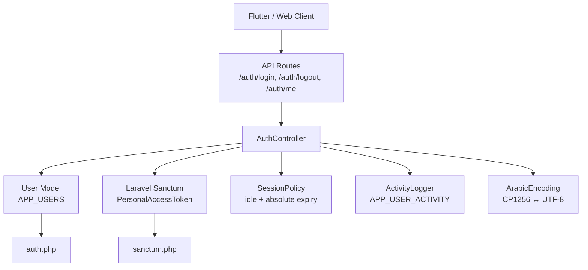
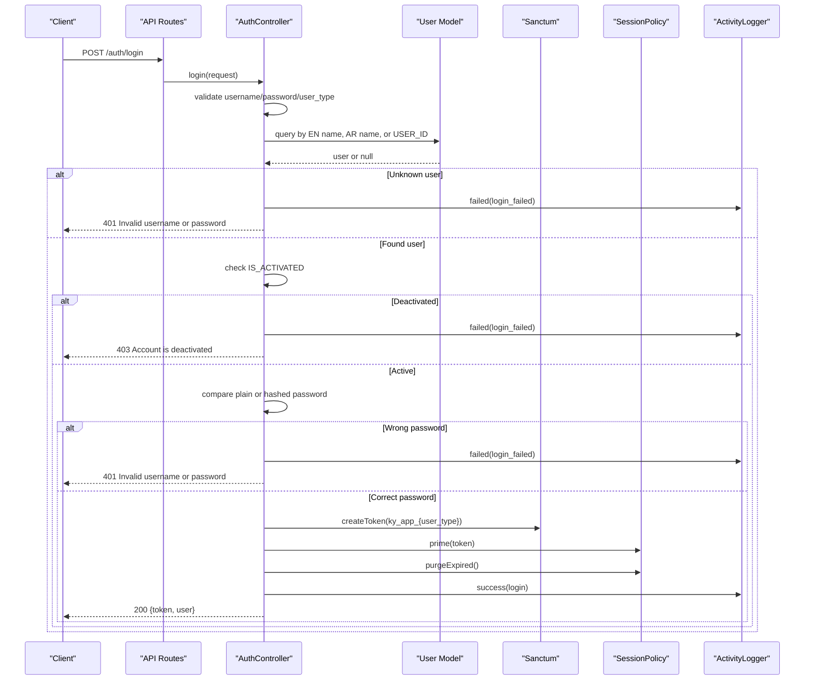
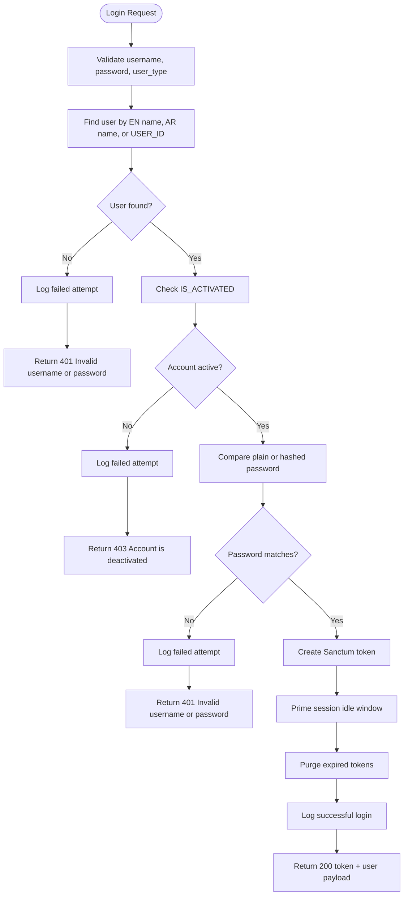
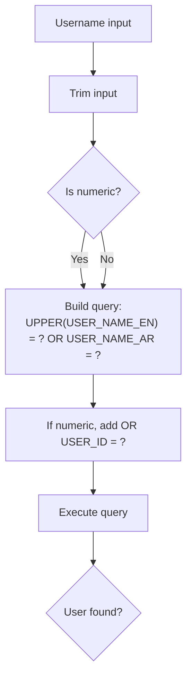
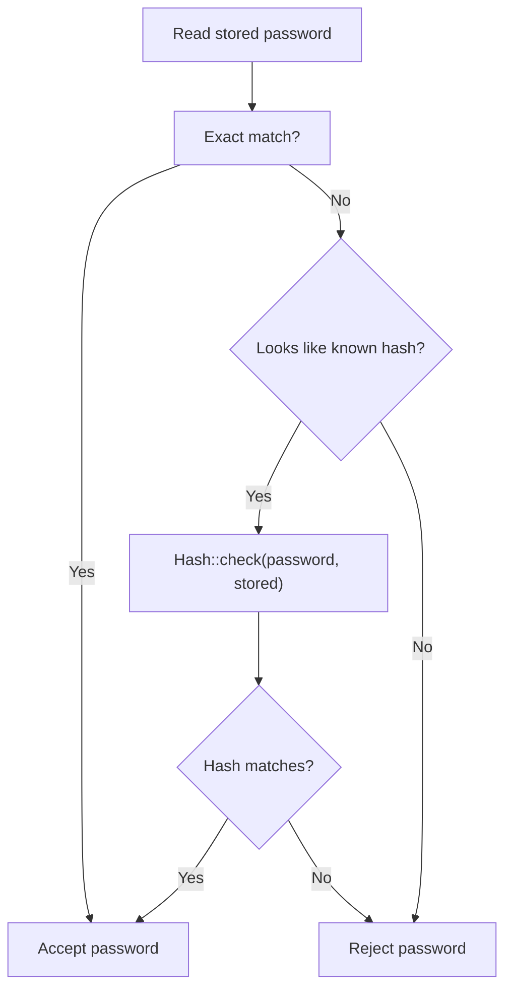
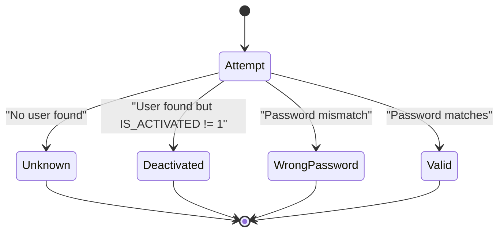
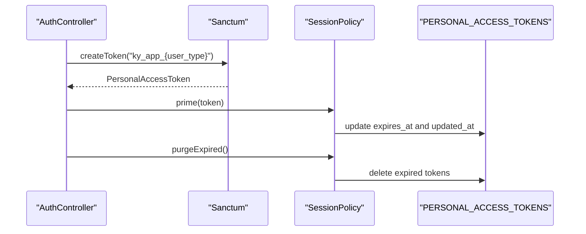
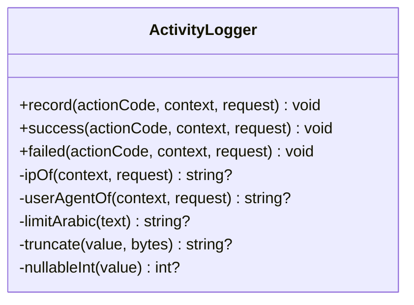
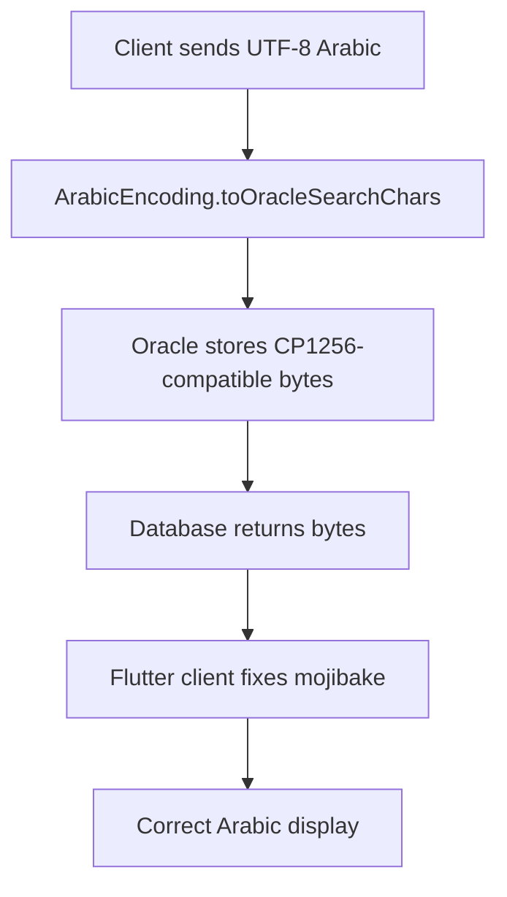
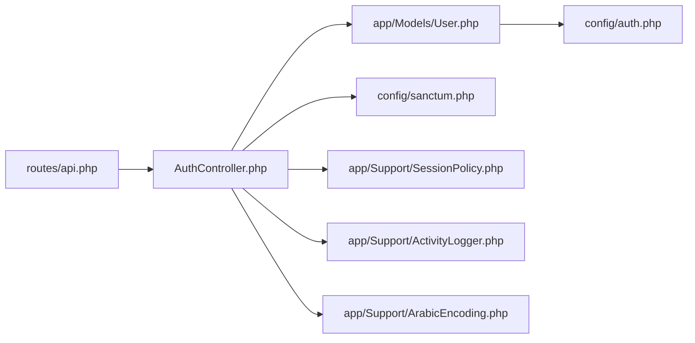

# Password Authentication

<cite>
**Referenced Files in This Document**
- [AuthController.php](file://kyApp_API/app/Http/Controllers/AuthController.php)
- [User.php](file://kyApp_API/app/Models/User.php)
- [auth.php](file://kyApp_API/config/auth.php)
- [sanctum.php](file://kyApp_API/config/sanctum.php)
- [api.php](file://kyApp_API/routes/api.php)
- [ActivityLogger.php](file://kyApp_API/app/Support/ActivityLogger.php)
- [SessionPolicy.php](file://kyApp_API/app/Support/SessionPolicy.php)
- [ArabicEncoding.php](file://kyApp_API/app/Support/ArabicEncoding.php)
</cite>

## Table of Contents
1. [Introduction](#introduction)
2. [Project Structure](#project-structure)
3. [Core Components](#core-components)
4. [Architecture Overview](#architecture-overview)
5. [Detailed Component Analysis](#detailed-component-analysis)
6. [Dependency Analysis](#dependency-analysis)
7. [Performance Considerations](#performance-considerations)
8. [Troubleshooting Guide](#troubleshooting-guide)
9. [Conclusion](#conclusion)

## Introduction
This document explains password-based authentication in Ky Apps, focusing on the server-side login flow implemented in the Laravel API. It covers:

- Username validation supporting both Arabic and English usernames.
- Numeric `USER_ID` lookup for legacy or internal references.
- Account activation checks before allowing access.
- Password verification that supports modern hashed passwords and legacy plain-text passwords.
- Token generation using Laravel Sanctum with a custom session policy.
- Security measures against username enumeration.
- Activity logging for failed and successful authentication events.
- Practical guidance for implementing custom login flows, handling authentication errors, and securing API endpoints.

The implementation is intentionally defensive: it avoids leaking whether an invalid request came from a missing user or a wrong password, and it keeps audit logs non-blocking so they cannot break normal requests.

## Project Structure
Password authentication lives primarily in the Laravel API backend under `kyApp_API`. The key pieces are:

| Area | Responsibility |
|---|---|
| Routes | Public `/auth/login`, protected logout/me/permissions, and biometric routes. |
| Controller | Login validation, user lookup, password verification, token issuance, activity logging, and unified user payload. |
| Model | Oracle-backed `APP_USERS` table mapping, attribute case handling, admin flag, and hidden sensitive fields. |
| Sanctum config | Stateless token guard, explicit null expiration, last-used tracking, and middleware hooks. |
| Session policy | Sliding idle expiry, absolute age check, token deletion on expiry, and write-throttled renewal. |
| Activity logger | Safe audit trail writes to `ACCOUNTS.APP_USER_ACTIVITY`. |
| Arabic encoding | Safe round-trip handling between UTF-8 clients and Oracle’s Windows-1256 storage. |

**Diagram sources**
- [api.php:18-48](file://kyApp_API/routes/api.php#L18-L48)
- [AuthController.php:47-163](file://kyApp_API/app/Http/Controllers/AuthController.php#L47-L163)
- [User.php:10-166](file://kyApp_API/app/Models/User.php#L10-L166)
- [sanctum.php:8-111](file://kyApp_API/config/sanctum.php#L8-L111)
- [SessionPolicy.php:42-184](file://kyApp_API/app/Support/SessionPolicy.php#L42-L184)
- [ActivityLogger.php:18-95](file://kyApp_API/app/Support/ActivityLogger.php#L18-L95)
- [ArabicEncoding.php:9-162](file://kyApp_API/app/Support/ArabicEncoding.php#L9-L162)

**Section sources**
- [api.php:18-48](file://kyApp_API/routes/api.php#L18-L48)
- [AuthController.php:47-163](file://kyApp_API/app/Http/Controllers/AuthController.php#L47-L163)
- [User.php:10-166](file://kyApp_API/app/Models/User.php#L10-L166)
- [sanctum.php:8-111](file://kyApp_API/config/sanctum.php#L8-L111)
- [SessionPolicy.php:42-184](file://kyApp_API/app/Support/SessionPolicy.php#L42-L184)
- [ActivityLogger.php:18-95](file://kyApp_API/app/Support/ActivityLogger.php#L18-L95)
- [ArabicEncoding.php:9-162](file://kyApp_API/app/Support/ArabicEncoding.php#L9-L162)

## Core Components
The password authentication system is built around five core components:

1. **Authentication controller**
   - Validates incoming login data.
   - Looks up users by English username, Arabic username, or numeric `USER_ID`.
   - Checks account activation.
   - Verifies passwords for both hashed and legacy plain-text values.
   - Issues a Sanctum token and primes its session window.
   - Logs success or failure.
   - Returns a unified user payload including permissions and admin state.

2. **User model**
   - Maps to the Oracle `APP_USERS` table.
   - Normalizes column names across case differences.
   - Hides sensitive fields like passwords and device tokens.
   - Provides helper methods such as `isAdmin()`.

3. **Sanctum configuration**
   - Uses the `web` guard for first-party SPA sessions.
   - Keeps token expiration null so the custom session policy controls sliding expiry.
   - Tracks last used time for active-session reporting.

4. **Session policy**
   - Rejects deactivated accounts immediately.
   - Rejects expired idle sessions and overly old absolute sessions.
   - Silently renews active sessions within a write threshold.
   - Deletes rejected tokens when possible.

5. **Activity logger**
   - Writes audit events to `ACCOUNTS.APP_USER_ACTIVITY`.
   - Never throws on database failures during logging.
   - Captures action code, module, description, status, IP, user agent, platform, and timestamps.

**Section sources**
- [AuthController.php:47-163](file://kyApp_API/app/Http/Controllers/AuthController.php#L47-L163)
- [User.php:10-166](file://kyApp_API/app/Models/User.php#L10-L166)
- [sanctum.php:8-111](file://kyApp_API/config/sanctum.php#L8-L111)
- [SessionPolicy.php:42-184](file://kyApp_API/app/Support/SessionPolicy.php#L42-L184)
- [ActivityLogger.php:18-95](file://kyApp_API/app/Support/ActivityLogger.php#L18-L95)

## Architecture Overview
The login architecture separates concerns between routing, controller logic, database access, token management, session lifecycle, and auditing.

**Diagram sources**
- [api.php:18-23](file://kyApp_API/routes/api.php#L18-L23)
- [AuthController.php:47-163](file://kyApp_API/app/Http/Controllers/AuthController.php#L47-L163)
- [User.php:10-166](file://kyApp_API/app/Models/User.php#L10-L166)
- [sanctum.php:40-77](file://kyApp_API/config/sanctum.php#L40-L77)
- [SessionPolicy.php:114-117](file://kyApp_API/app/Support/SessionPolicy.php#L114-L117)
- [ActivityLogger.php:81-95](file://kyApp_API/app/Support/ActivityLogger.php#L81-L95)

## Detailed Component Analysis

### Login Flow Implementation
The login endpoint is public and accepts a username, password, and optional user type. It performs these steps:

1. Validate required fields.
2. Normalize inputs.
3. Look up the user by:
   - Uppercase English username.
   - Arabic username.
   - Numeric input mapped to `USER_ID`.
4. Return a generic invalid-credentials response if no user exists.
5. Check whether the account is activated.
6. Verify the password:
   - Exact match for legacy plain-text.
   - Hashed comparison for modern hashes.
7. Issue a Sanctum personal access token.
8. Prime the token’s session window.
9. Purge expired tokens.
10. Log the event and return the token plus a unified user payload.

**Diagram sources**
- [AuthController.php:47-163](file://kyApp_API/app/Http/Controllers/AuthController.php#L47-L163)
- [ActivityLogger.php:81-95](file://kyApp_API/app/Support/ActivityLogger.php#L81-L95)
- [SessionPolicy.php:114-117](file://kyApp_API/app/Support/SessionPolicy.php#L114-L117)

**Section sources**
- [AuthController.php:47-163](file://kyApp_API/app/Http/Controllers/AuthController.php#L47-L163)

### Username Validation and Lookup
The controller supports three lookup strategies:

| Input Type | Behavior |
|---|---|
| English username | Matches uppercase `USER_NAME_EN`. |
| Arabic username | Matches `USER_NAME_AR` exactly as provided. |
| Numeric input | Matches `USER_ID`. |

This design allows:

- Case-insensitive English lookups.
- Arabic usernames without double-fixing text that the client already repairs.
- Legacy or internal systems passing numeric IDs directly.

The query uses a single Eloquent builder with conditional branches, avoiding separate queries for each strategy.

**Diagram sources**
- [AuthController.php:68-84](file://kyApp_API/app/Http/Controllers/AuthController.php#L68-L84)

**Section sources**
- [AuthController.php:68-84](file://kyApp_API/app/Http/Controllers/AuthController.php#L68-L84)

### Password Verification Strategy
Password verification supports two storage modes:

| Stored Format | Verification Method |
|---|---|
| Modern hash starting with `$2y$`, `$2a$`, or `$argon2` | Use Laravel’s `Hash::check`. |
| Plain text | Direct string comparison. |

The controller reads the password field flexibly because Oracle may return either lowercase or uppercase column names. If the stored value looks like a known hash, it attempts a hash check; otherwise it falls back to exact plain-text comparison.

Security notes:

- Plain-text support is intentional for migration compatibility.
- Hash comparison is wrapped in error handling so malformed hashes do not crash the request.
- Failed password attempts are logged but return the same generic message as unknown users.

**Diagram sources**
- [AuthController.php:115-127](file://kyApp_API/app/Http/Controllers/AuthController.php#L115-L127)
- [AuthController.php:487-492](file://kyApp_API/app/Http/Controllers/AuthController.php#L487-L492)

**Section sources**
- [AuthController.php:115-127](file://kyApp_API/app/Http/Controllers/AuthController.php#L115-L127)
- [AuthController.php:487-492](file://kyApp_API/app/Http/Controllers/AuthController.php#L487-L492)

### Account Activation and Security Against Enumeration
Two important security behaviors are combined:

1. **Enumeration protection:** Both unknown users and wrong passwords return the same generic message and HTTP status where appropriate.
2. **Activation gate:** A deactivated account receives a distinct 403 response, but only after the user is found.

This means attackers cannot distinguish “user does not exist” from “password is wrong,” while administrators can still see deactivation through structured responses and audit logs.

**Diagram sources**
- [AuthController.php:86-140](file://kyApp_API/app/Http/Controllers/AuthController.php#L86-L140)

**Section sources**
- [AuthController.php:86-140](file://kyApp_API/app/Http/Controllers/AuthController.php#L86-L140)

### Token Generation and Session Policy Integration
After successful authentication, the controller:

- Creates a Sanctum personal access token named `ky_app_{user_type}`.
- Primes the token with a full idle window via `SessionPolicy::prime`.
- Purges expired tokens.
- Logs the successful login.

Sanctum is configured to use the `web` guard and keep `expiration` null. This is deliberate: the application manages sliding expiry through `EXPIRES_AT` instead of relying on Sanctum’s absolute age comparison.

**Diagram sources**
- [AuthController.php:142-149](file://kyApp_API/app/Http/Controllers/AuthController.php#L142-L149)
- [sanctum.php:40-63](file://kyApp_API/config/sanctum.php#L40-L63)
- [SessionPolicy.php:114-117](file://kyApp_API/app/Support/SessionPolicy.php#L114-L117)
- [SessionPolicy.php:130-141](file://kyApp_API/app/Support/SessionPolicy.php#L130-L141)

**Section sources**
- [AuthController.php:142-149](file://kyApp_API/app/Http/Controllers/AuthController.php#L142-L149)
- [sanctum.php:40-63](file://kyApp_API/config/sanctum.php#L40-L63)
- [SessionPolicy.php:114-117](file://kyApp_API/app/Support/SessionPolicy.php#L114-L117)
- [SessionPolicy.php:130-141](file://kyApp_API/app/Support/SessionPolicy.php#L130-L141)

### Activity Logging for Failed Attempts
Every failed authentication path calls `ActivityLogger::failed`:

- Unknown user.
- Deactivated account.
- Wrong password.

Successful logins call `ActivityLogger::success`. The logger writes to `ACCOUNTS.APP_USER_ACTIVITY` using bound parameters and never lets logging failures break the main request.

Key logged fields include:

| Field | Purpose |
|---|---|
| `action_code` | Event type such as `login_failed` or `login`. |
| `module_code` | Usually `system` for authentication. |
| `description_ar` | Arabic human-readable description. |
| `status` | `success` or `failed`. |
| `ip` | Client IP address. |
| `user_agent` | Client user agent. |
| `platform` | Optional platform metadata. |

**Diagram sources**
- [ActivityLogger.php:18-95](file://kyApp_API/app/Support/ActivityLogger.php#L18-L95)
- [ActivityLogger.php:101-168](file://kyApp_API/app/Support/ActivityLogger.php#L101-L168)

**Section sources**
- [ActivityLogger.php:18-95](file://kyApp_API/app/Support/ActivityLogger.php#L18-L95)
- [ActivityLogger.php:101-168](file://kyApp_API/app/Support/ActivityLogger.php#L101-L168)

### Arabic Username Handling
Arabic usernames are handled carefully because the Oracle connection and database character set differ from the application’s UTF-8 environment.

Important rules:

- Arabic usernames are returned exactly as Oracle provides them.
- The Flutter client applies its own repair function.
- Double-fixing Arabic text would corrupt it.
- When writing or searching, the system maps CP1256 bytes to Latin-1 characters so Oracle stores the original byte sequence safely.

**Diagram sources**
- [ArabicEncoding.php:122-162](file://kyApp_API/app/Support/ArabicEncoding.php#L122-L162)
- [AuthController.php:29-32](file://kyApp_API/app/Http/Controllers/AuthController.php#L29-L32)

**Section sources**
- [ArabicEncoding.php:122-162](file://kyApp_API/app/Support/ArabicEncoding.php#L122-L162)
- [AuthController.php:29-32](file://kyApp_API/app/Http/Controllers/AuthController.php#L29-L32)

### Unified User Payload
Successful login, profile retrieval, and biometric login all share a unified user payload. It includes:

- Internal user ID.
- Preferred username.
- Arabic and English name fields.
- User type.
- Branch number.
- Admin flag.
- IBAC permission payload.

This ensures consistent responses across authentication-related endpoints.

**Section sources**
- [AuthController.php:443-463](file://kyApp_API/app/Http/Controllers/AuthController.php#L443-L463)

## Dependency Analysis
The authentication subsystem has clear boundaries:

- Routes depend on controllers.
- Controllers depend on models, Sanctum, session policy, activity logger, settings store, and permission resolver.
- Models depend on Laravel’s authenticatable base and Sanctum’s token trait.
- Session policy depends on settings and Sanctum’s token model.
- Activity logger depends on database connection and Arabic encoding helpers.

**Diagram sources**
- [api.php:18-48](file://kyApp_API/routes/api.php#L18-L48)
- [AuthController.php:5-15](file://kyApp_API/app/Http/Controllers/AuthController.php#L5-L15)
- [User.php:5-12](file://kyApp_API/app/Models/User.php#L5-L12)
- [sanctum.php:8-111](file://kyApp_API/config/sanctum.php#L8-L111)
- [SessionPolicy.php:42-44](file://kyApp_API/app/Support/SessionPolicy.php#L42-L44)
- [ActivityLogger.php:18-19](file://kyApp_API/app/Support/ActivityLogger.php#L18-L19)
- [ArabicEncoding.php:9-10](file://kyApp_API/app/Support/ArabicEncoding.php#L9-L10)

**Section sources**
- [api.php:18-48](file://kyApp_API/routes/api.php#L18-L48)
- [AuthController.php:5-15](file://kyApp_API/app/Http/Controllers/AuthController.php#L5-L15)
- [User.php:5-12](file://kyApp_API/app/Models/User.php#L5-L12)
- [sanctum.php:8-111](file://kyApp_API/config/sanctum.php#L8-L111)
- [SessionPolicy.php:42-44](file://kyApp_API/app/Support/SessionPolicy.php#L42-L44)
- [ActivityLogger.php:18-19](file://kyApp_API/app/Support/ActivityLogger.php#L18-L19)
- [ArabicEncoding.php:9-10](file://kyApp_API/app/Support/ArabicEncoding.php#L9-L10)

## Performance Considerations
- Single query user lookup avoids multiple database hits for different username formats.
- Session renewal is write-throttled so frequent authenticated requests do not constantly update token rows.
- Expired token cleanup runs on login and session listing rather than on every request.
- Audit logging is best-effort and isolated from request success.
- Hash checking is only attempted when the stored value looks like a known hash format.

[No sources needed since this section provides general guidance]

## Troubleshooting Guide

### Common Authentication Errors

| Symptom | Likely Cause | Response Behavior | Recommended Action |
|---|---|---|---|
| 422 validation error | Missing or invalid username, password, or user_type | Returns validation errors | Ensure required fields are present and user_type is one of the allowed values. |
| 401 Invalid username or password | Unknown user or wrong password | Generic message | Do not expose whether the username exists. Check audit logs for `login_failed`. |
| 403 Account is deactivated | User exists but `IS_ACTIVATED` is not 1 | Distinct deactivation message | Review user activation status in administration tools. |
| 401 on subsequent API calls | Session expired due to idle timeout or absolute age | Sanctum rejects token | Re-authenticate via `/auth/login`. |
| Arabic username appears corrupted | Double-fixing or incorrect client/server encoding | Display issues | Let the Flutter client handle Arabic repair; avoid applying server-side fixes twice. |

### Debugging Steps

1. Check whether the login request reaches the controller.
2. Inspect validation errors for missing fields.
3. Confirm the user lookup finds the expected record.
4. Verify `IS_ACTIVATED` is set correctly.
5. Check whether the stored password is plain text or a hash.
6. Review activity logs for `login_failed` entries.
7. For token issues, inspect `PERSONAL_ACCESS_TOKENS` and `EXPIRES_AT`.
8. For Arabic text issues, verify client-side encoding behavior.

**Section sources**
- [AuthController.php:51-66](file://kyApp_API/app/Http/Controllers/AuthController.php#L51-L66)
- [AuthController.php:86-140](file://kyApp_API/app/Http/Controllers/AuthController.php#L86-L140)
- [ActivityLogger.php:37-73](file://kyApp_API/app/Support/ActivityLogger.php#L37-L73)
- [SessionPolicy.php:70-108](file://kyApp_API/app/Support/SessionPolicy.php#L70-L108)

## Conclusion
Ky Apps implements a secure, migration-friendly password authentication flow. It supports Arabic and English usernames, numeric `USER_ID` lookup, activation checks, legacy plain-text passwords, modern hashed passwords, Sanctum token issuance, sliding session expiry, and robust audit logging. The design prioritizes security by hiding enumeration information, keeping logging non-blocking, and centralizing session policy outside Sanctum’s default expiration mechanism.

For custom login flows, follow the existing pattern:

- Validate inputs early.
- Avoid revealing whether a user exists.
- Check activation before credential verification.
- Support both plain-text and hashed passwords during migration.
- Issue tokens through Sanctum.
- Prime and manage sessions through `SessionPolicy`.
- Log all authentication outcomes.
- Return structured, consistent error responses.

[No sources needed since this section summarizes without analyzing specific files]