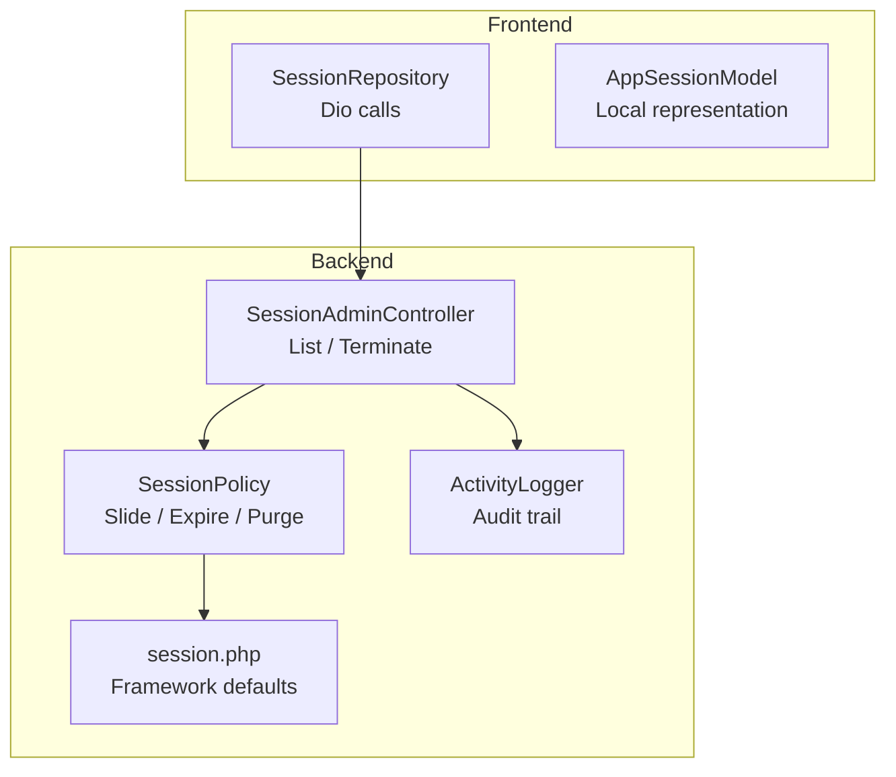
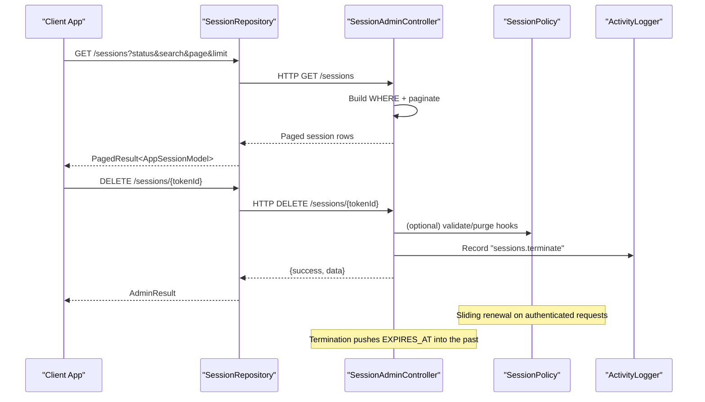
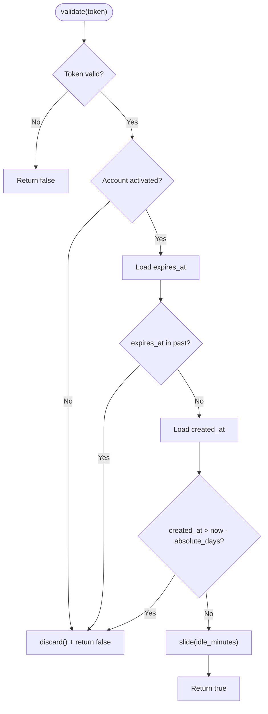
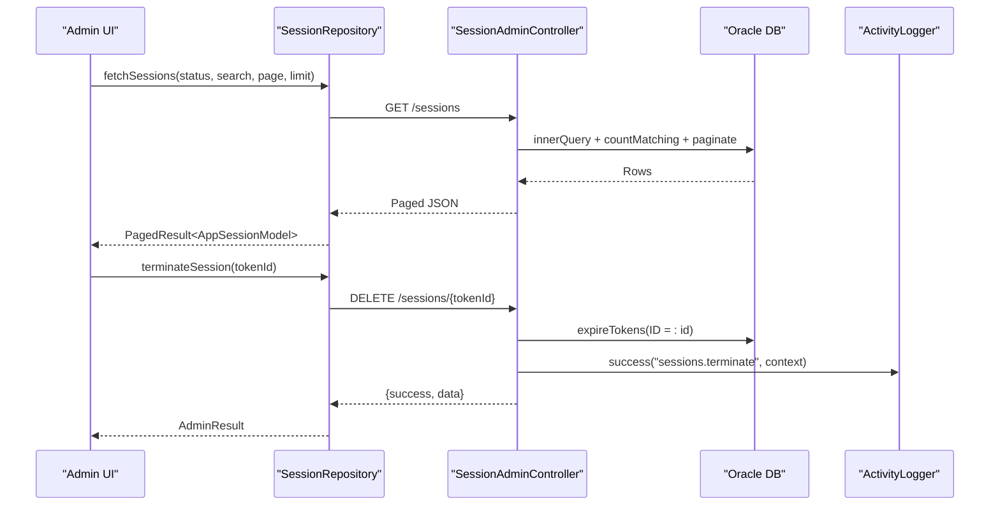
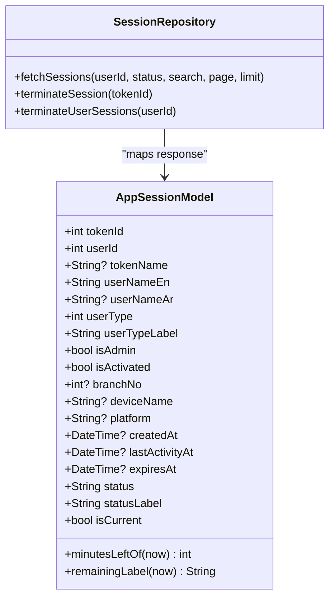
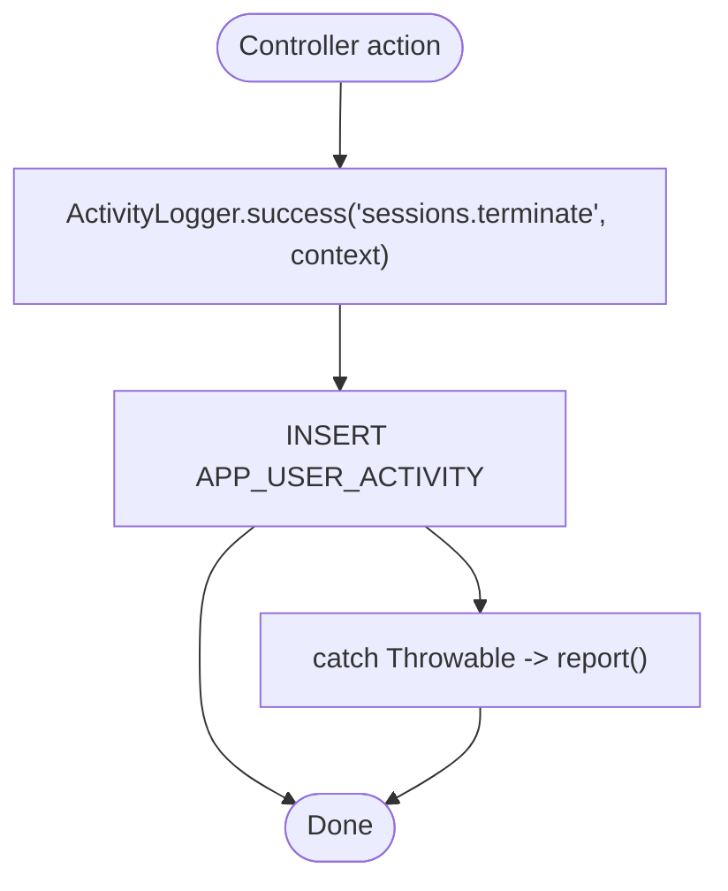
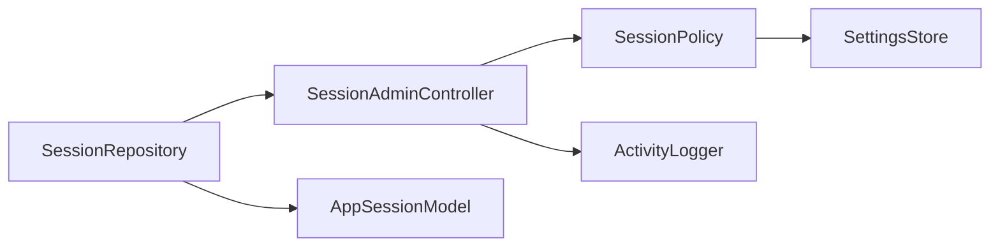

# Session Management

<cite>
**Referenced Files in This Document**
- [SessionPolicy.php](file://kyApp_API/app/Support/SessionPolicy.php)
- [ActivityLogger.php](file://kyApp_API/app/Support/ActivityLogger.php)
- [SessionAdminController.php](file://kyApp_API/app/Http/Controllers/SessionAdminController.php)
- [session_repository.dart](file://lib/features/admin/data/repositories/session_repository.dart)
- [app_session_model.dart](file://lib/features/admin/data/models/app_session_model.dart)
- [session.php](file://kyApp_API/config/session.php)
</cite>

## Table of Contents
1. [Introduction](#introduction)
2. [Project Structure](#project-structure)
3. [Core Components](#core-components)
4. [Architecture Overview](#architecture-overview)
5. [Detailed Component Analysis](#detailed-component-analysis)
6. [Dependency Analysis](#dependency-analysis)
7. [Performance Considerations](#performance-considerations)
8. [Troubleshooting Guide](#troubleshooting-guide)
9. [Conclusion](#conclusion)

## Introduction
This document explains session management in Ky Apps, focusing on the server-side sliding expiration policy, automatic cleanup of expired sessions, real-time session monitoring, active session tracking with platform information, remote session termination, and security policies. It also documents integration with the audit trail via ActivityLogger, client-server state synchronization, and practical guidance for handling concurrent sessions across multiple devices.

The system uses Sanctum personal access tokens as sessions. A session is a token row whose expiry is managed by `EXPIRES_AT`. The policy slides the expiry while the user is active, enforces idle and absolute lifetimes, and deletes rejected tokens. Administrators can list, filter, and terminate sessions remotely. The Flutter admin UI consumes these capabilities through a repository and model layer.

## Project Structure
The session feature spans both backend (Laravel) and frontend (Flutter):

- Backend:
  - Policy and lifecycle logic: `SessionPolicy`
  - Audit logging: `ActivityLogger`
  - Admin API controller: `SessionAdminController`
  - Framework session configuration: `config/session.php`
- Frontend:
  - Repository for listing and terminating sessions: `SessionRepository`
  - Session data model: `AppSessionModel`

**Diagram sources**
- [SessionAdminController.php:15-31](file://kyApp_API/app/Http/Controllers/SessionAdminController.php#L15-L31)
- [SessionPolicy.php:9-41](file://kyApp_API/app/Support/SessionPolicy.php#L9-L41)
- [ActivityLogger.php:9-17](file://kyApp_API/app/Support/ActivityLogger.php#L9-L17)
- [session_repository.dart:11-19](file://lib/features/admin/data/repositories/session_repository.dart#L11-L19)
- [app_session_model.dart:6-11](file://lib/features/admin/data/models/app_session_model.dart#L6-L11)
- [session.php:1-20](file://kyApp_API/config/session.php#L1-L20)

**Section sources**
- [SessionPolicy.php:9-41](file://kyApp_API/app/Support/SessionPolicy.php#L9-L41)
- [SessionAdminController.php:15-31](file://kyApp_API/app/Http/Controllers/SessionAdminController.php#L15-L31)
- [session_repository.dart:11-19](file://lib/features/admin/data/repositories/session_repository.dart#L11-L19)
- [app_session_model.dart:6-11](file://lib/features/admin/data/models/app_session_model.dart#L6-L11)
- [session.php:1-20](file://kyApp_API/config/session.php#L1-L20)

## Core Components
- SessionPolicy: Implements sliding session renewal, idle and absolute expiration checks, best-effort deletion of rejected tokens, and periodic purge of expired tokens.
- SessionAdminController: Exposes endpoints to list active sessions with filters and pagination, and to terminate single or all sessions for a user. It integrates with ActivityLogger for audit trails.
- SessionRepository (Flutter): Calls `/sessions`, `/sessions/{id}`, and `/sessions/user/{id}` to manage sessions from the admin UI.
- AppSessionModel (Flutter): Represents a session record, computes remaining time locally, and exposes display helpers.
- ActivityLogger: Writes secure, non-blocking audit events to the activity table.
- config/session.php: Defines framework-level session behavior such as driver, lifetime, cookie settings, and sweep lottery.

Key responsibilities:
- Sliding expiration: Active sessions extend their expiry within a write-throttled threshold.
- Idle and absolute limits: Sessions expire after idle minutes or after an absolute number of days.
- Remote termination: Pushing `EXPIRES_AT` into the past invalidates the next request.
- Real-time monitoring: Paginated listing with status, device name, platform, and “current device” flag.
- Audit trail: All termination actions are recorded with actor, target, module, entity, and description.

**Section sources**
- [SessionPolicy.php:42-185](file://kyApp_API/app/Support/SessionPolicy.php#L42-L185)
- [SessionAdminController.php:32-474](file://kyApp_API/app/Http/Controllers/SessionAdminController.php#L32-L474)
- [session_repository.dart:20-104](file://lib/features/admin/data/repositories/session_repository.dart#L20-L104)
- [app_session_model.dart:12-173](file://lib/features/admin/data/models/app_session_model.dart#L12-L173)
- [ActivityLogger.php:18-170](file://kyApp_API/app/Support/ActivityLogger.php#L18-L170)
- [session.php:21-218](file://kyApp_API/config/session.php#L21-L218)

## Architecture Overview
The session architecture coordinates authentication callbacks, admin operations, and client requests:

**Diagram sources**
- [session_repository.dart:27-64](file://lib/features/admin/data/repositories/session_repository.dart#L27-L64)
- [session_repository.dart:68-102](file://lib/features/admin/data/repositories/session_repository.dart#L68-L102)
- [SessionAdminController.php:93-141](file://kyApp_API/app/Http/Controllers/SessionAdminController.php#L93-L141)
- [SessionAdminController.php:147-182](file://kyApp_API/app/Http/Controllers/SessionAdminController.php#L147-L182)
- [SessionPolicy.php:70-108](file://kyApp_API/app/Support/SessionPolicy.php#L70-L108)
- [ActivityLogger.php:37-84](file://kyApp_API/app/Support/ActivityLogger.php#L37-L84)

## Detailed Component Analysis

### SessionPolicy: Sliding Expiration, Cleanup, and Security
SessionPolicy centralizes session lifecycle decisions:

- Validation flow:
  - Reject if account is deactivated.
  - Reject if `EXPIRES_AT` is in the past; delete the token.
  - Reject if `CREATED_AT` exceeds absolute days; delete the token.
  - Otherwise, slide the expiry based on idle minutes and a write threshold.
- Prime: Set full idle window immediately after token creation.
- PurgeExpired: Delete expired tokens that were not cleaned up earlier.
- Date normalization: Safe conversion of Oracle date values to Carbon.

**Diagram sources**
- [SessionPolicy.php:70-108](file://kyApp_API/app/Support/SessionPolicy.php#L70-L108)
- [SessionPolicy.php:114-117](file://kyApp_API/app/Support/SessionPolicy.php#L114-L117)
- [SessionPolicy.php:130-141](file://kyApp_API/app/Support/SessionPolicy.php#L130-L141)
- [SessionPolicy.php:147-155](file://kyApp_API/app/Support/SessionPolicy.php#L147-L155)
- [SessionPolicy.php:166-183](file://kyApp_API/app/Support/SessionPolicy.php#L166-L183)

Practical implications:
- Sliding renewal reduces database writes by throttling updates when the current expiry already reaches near the new horizon.
- Rejection triggers best-effort deletion so stale tokens do not accumulate.
- Settings-driven thresholds allow tuning idle minutes, absolute days, and touch threshold.

**Section sources**
- [SessionPolicy.php:9-41](file://kyApp_API/app/Support/SessionPolicy.php#L9-L41)
- [SessionPolicy.php:42-185](file://kyApp_API/app/Support/SessionPolicy.php#L42-L185)

### SessionAdminController: Listing, Filtering, and Remote Termination
The controller provides:
- List sessions with search, status filters, and pagination.
- Terminate a single session by token id.
- Terminate all sessions for a user.
- Audit every termination via ActivityLogger.

Key behaviors:
- No separate sessions table; sessions are Sanctum token rows.
- Termination sets `EXPIRES_AT` to the past rather than deleting the row, preserving audit history.
- Status labels and minutes left are computed consistently with SessionPolicy’s date handling.

**Diagram sources**
- [SessionAdminController.php:93-141](file://kyApp_API/app/Http/Controllers/SessionAdminController.php#L93-L141)
- [SessionAdminController.php:147-182](file://kyApp_API/app/Http/Controllers/SessionAdminController.php#L147-L182)
- [SessionAdminController.php:245-283](file://kyApp_API/app/Http/Controllers/SessionAdminController.php#L245-L283)
- [SessionAdminController.php:343-355](file://kyApp_API/app/Http/Controllers/SessionAdminController.php#L343-L355)
- [session_repository.dart:27-64](file://lib/features/admin/data/repositories/session_repository.dart#L27-L64)
- [session_repository.dart:68-82](file://lib/features/admin/data/repositories/session_repository.dart#L68-L82)

Security and safety:
- Sensitive columns (`TOKEN`, `ABILITIES`) are never read.
- Search terms are bound parameters; ordering is fixed to prevent injection.
- Arabic text is repaired safely; dates are formatted explicitly.

**Section sources**
- [SessionAdminController.php:15-31](file://kyApp_API/app/Http/Controllers/SessionAdminController.php#L15-L31)
- [SessionAdminController.php:93-141](file://kyApp_API/app/Http/Controllers/SessionAdminController.php#L93-L141)
- [SessionAdminController.php:147-182](file://kyApp_API/app/Http/Controllers/SessionAdminController.php#L147-L182)
- [SessionAdminController.php:245-283](file://kyApp_API/app/Http/Controllers/SessionAdminController.php#L245-L283)
- [SessionAdminController.php:343-355](file://kyApp_API/app/Http/Controllers/SessionAdminController.php#L343-L355)
- [SessionAdminController.php:384-417](file://kyApp_API/app/Http/Controllers/SessionAdminController.php#L384-L417)

### Flutter Integration: SessionRepository and AppSessionModel
The Flutter side provides:
- `SessionRepository`:
  - `fetchSessions(userId?, status, search, page, limit)` → paginated results.
  - `terminateSession(tokenId)` → single session termination.
  - `terminateUserSessions(userId)` → terminate all sessions for a user.
- `AppSessionModel`:
  - Local computation of remaining minutes from `expiresAt`.
  - Display helpers for remaining time labels.
  - Robust JSON parsing for mixed-case keys and Arabic text.

**Diagram sources**
- [session_repository.dart:20-104](file://lib/features/admin/data/repositories/session_repository.dart#L20-L104)
- [app_session_model.dart:12-173](file://lib/features/admin/data/models/app_session_model.dart#L12-L173)

Operational notes:
- Filter statuses align with server-side accepted values.
- Cancellation tokens are supported for long-running list requests.
- Minutes left are derived locally from `expiresAt`, matching the policy’s decision boundary.

**Section sources**
- [session_repository.dart:7-9](file://lib/features/admin/data/repositories/session_repository.dart#L7-L9)
- [session_repository.dart:27-64](file://lib/features/admin/data/repositories/session_repository.dart#L27-L64)
- [session_repository.dart:68-102](file://lib/features/admin/data/repositories/session_repository.dart#L68-L102)
- [app_session_model.dart:73-90](file://lib/features/admin/data/models/app_session_model.dart#L73-L90)
- [app_session_model.dart:92-114](file://lib/features/admin/data/models/app_session_model.dart#L92-L114)
- [app_session_model.dart:116-155](file://lib/features/admin/data/models/app_session_model.dart#L116-L155)

### ActivityLogger: Audit Trail Integration
ActivityLogger records session-related administrative actions:
- Action codes include `sessions.terminate`.
- Context includes actor user, target user, module code, entity type/id, Arabic description, IP, user agent, and platform.
- Writes are best-effort and never break successful requests.

**Diagram sources**
- [ActivityLogger.php:37-84](file://kyApp_API/app/Support/ActivityLogger.php#L37-L84)
- [ActivityLogger.php:101-125](file://kyApp_API/app/Support/ActivityLogger.php#L101-L125)
- [ActivityLogger.php:131-168](file://kyApp_API/app/Support/ActivityLogger.php#L131-L168)

**Section sources**
- [ActivityLogger.php:9-17](file://kyApp_API/app/Support/ActivityLogger.php#L9-L17)
- [ActivityLogger.php:37-84](file://kyApp_API/app/Support/ActivityLogger.php#L37-L84)
- [ActivityLogger.php:101-168](file://kyApp_API/app/Support/ActivityLogger.php#L101-L168)

### Configuration and Security Policies
Framework session configuration controls storage driver, lifetime, cookies, and sweep lottery. While Sanctum manages tokens directly, this configuration remains relevant for application-level session behavior and cookie security.

Important options:
- Driver and connection/store for persistence.
- Lifetime and expire-on-close behavior.
- Cookie security flags: secure, http_only, same_site, partitioned.
- Sweep lottery for background cleanup.

**Section sources**
- [session.php:21-218](file://kyApp_API/config/session.php#L21-L218)

## Dependency Analysis
High-level dependencies between components:

- Coupling:
  - Repository depends only on the API contract (HTTP endpoints).
  - Controller depends on Policy for lifecycle decisions and Logger for auditing.
  - Policy depends on SettingsStore for tunable thresholds.
- Cohesion:
  - Each component has a focused responsibility: lifecycle, administration, auditing, data mapping.

**Diagram sources**
- [session_repository.dart:20-104](file://lib/features/admin/data/repositories/session_repository.dart#L20-L104)
- [SessionAdminController.php:82-82](file://kyApp_API/app/Http/Controllers/SessionAdminController.php#L82-L82)
- [SessionPolicy.php:44-44](file://kyApp_API/app/Support/SessionPolicy.php#L44-L44)
- [app_session_model.dart:12-173](file://lib/features/admin/data/models/app_session_model.dart#L12-L173)

**Section sources**
- [session_repository.dart:20-104](file://lib/features/admin/data/repositories/session_repository.dart#L20-L104)
- [SessionAdminController.php:82-82](file://kyApp_API/app/Http/Controllers/SessionAdminController.php#L82-L82)
- [SessionPolicy.php:44-44](file://kyApp_API/app/Support/SessionPolicy.php#L44-L44)
- [app_session_model.dart:12-173](file://lib/features/admin/data/models/app_session_model.dart#L12-L173)

## Performance Considerations
- Sliding renewal throttling: Updates occur only when the current expiry is close to the new deadline, reducing write load under high concurrency.
- Pagination: Server-side pagination avoids loading all sessions at once.
- Best-effort cleanup: Deletions during rejection and scheduled purges are wrapped to avoid impacting request latency.
- Database-specific optimizations: Explicit date formatting and safe column selection reduce overhead and errors.

Recommendations:
- Tune `session_idle_minutes`, `session_absolute_days`, and `session_touch_threshold_minutes` according to workload.
- Monitor purge frequency and adjust sweep strategies if needed.
- Ensure Oracle connection performance for token queries and updates.

[No sources needed since this section provides general guidance]

## Troubleshooting Guide
Common issues and resolutions:

- Sessions show zero minutes left but remain active:
  - Cause: Timezone skew between server and client or fractional minute truncation.
  - Resolution: Use local device time to compute remaining minutes; rely on `expiresAt` comparison.
- Terminated sessions still appear:
  - Behavior: Termination pushes `EXPIRES_AT` into the past; rows remain visible with status changed.
  - Resolution: Filter by status or wait for the next client request to receive 401 and clear the session.
- Arabic text corruption:
  - Cause: Encoding differences between systems.
  - Resolution: Use provided encoding utilities; ensure consistent CP1256 handling.
- Audit logs missing:
  - Cause: Logging failures are swallowed to protect request success.
  - Resolution: Check application logs for reported exceptions.

**Section sources**
- [app_session_model.dart:73-90](file://lib/features/admin/data/models/app_session_model.dart#L73-L90)
- [SessionAdminController.php:147-182](file://kyApp_API/app/Http/Controllers/SessionAdminController.php#L147-L182)
- [ActivityLogger.php:68-72](file://kyApp_API/app/Support/ActivityLogger.php#L68-L72)

## Conclusion
Ky Apps implements robust session management through a combination of sliding expiration, strict idle and absolute limits, and best-effort cleanup. Administrators gain visibility into active sessions with platform and device details, and can terminate sessions remotely. The design preserves audit trails, ensures security by avoiding sensitive data exposure, and synchronizes state between client and server using consistent date handling and status semantics. For multi-device scenarios, each device maintains its own token with independent sliding behavior, enabling concurrent sessions while allowing precise control and monitoring.

[No sources needed since this section summarizes without analyzing specific files]