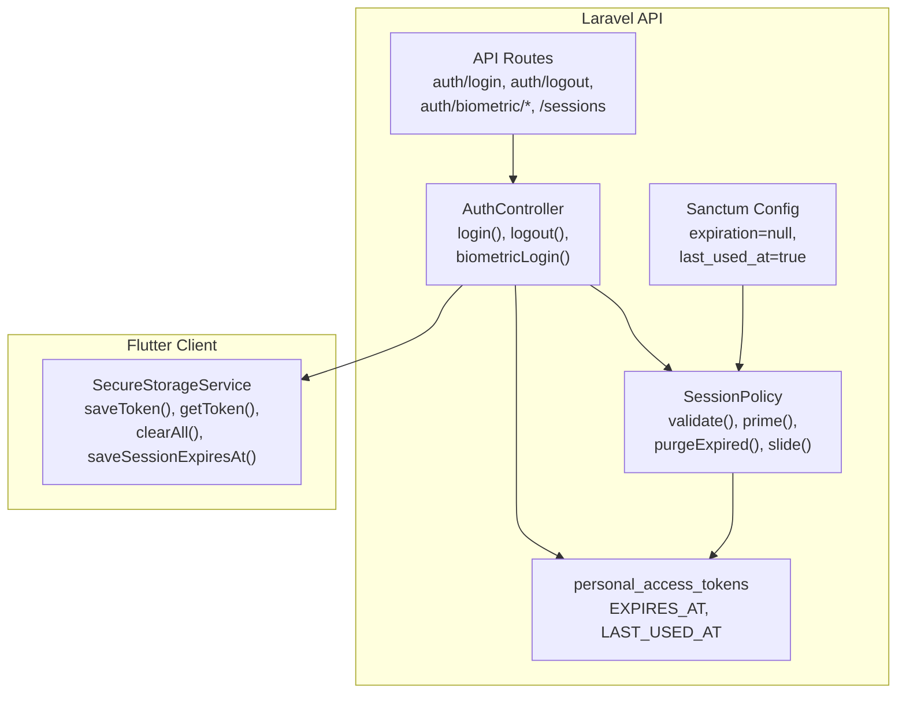
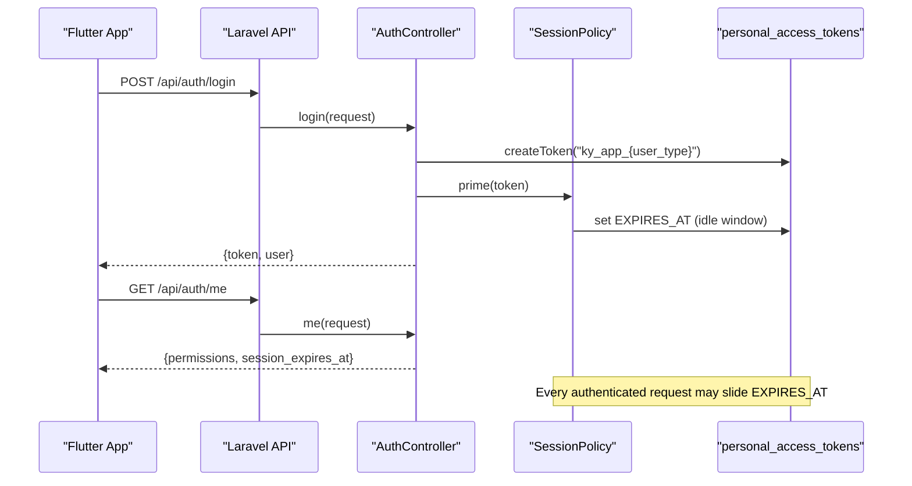
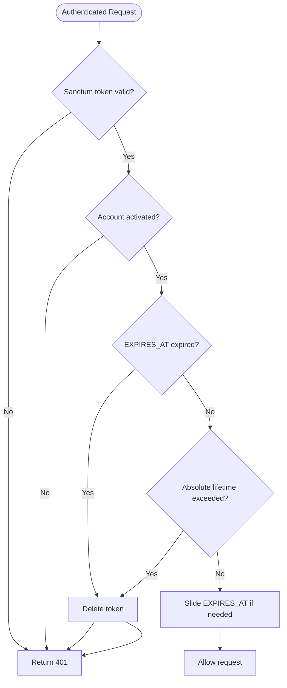
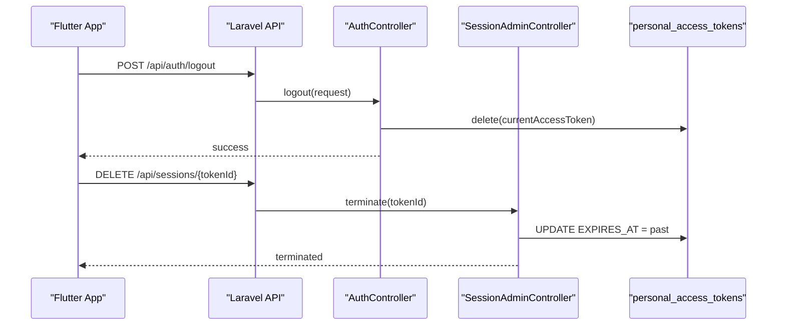
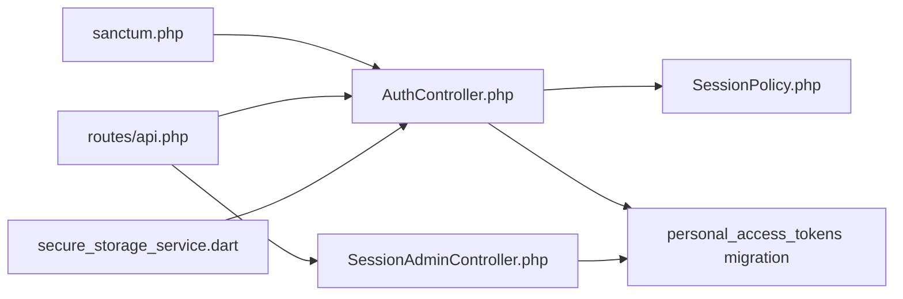

# Token Management

<cite>
**Referenced Files in This Document**
- [SessionPolicy.php](file://kyApp_API/app/Support/SessionPolicy.php)
- [sanctum.php](file://kyApp_API/config/sanctum.php)
- [api.php](file://kyApp_API/routes/api.php)
- [AuthController.php](file://kyApp_API/app/Http/Controllers/AuthController.php)
- [SessionAdminController.php](file://kyApp_API/app/Http/Controllers/SessionAdminController.php)
- [2026_09_01_212624_create_personal_access_tokens_table.php](file://kyApp_API/database/migrations/2026_09_01_212624_create_personal_access_tokens_table.php)
- [secure_storage_service.dart](file://lib/core/storage/secure_storage_service.dart)
</cite>

## Table of Contents
1. [Introduction](#introduction)
2. [Project Structure](#project-structure)
3. [Core Components](#core-components)
4. [Architecture Overview](#architecture-overview)
5. [Detailed Component Analysis](#detailed-component-analysis)
6. [Dependency Analysis](#dependency-analysis)
7. [Performance Considerations](#performance-considerations)
8. [Troubleshooting Guide](#troubleshooting-guide)
9. [Conclusion](#conclusion)

## Introduction
This document explains the token management system used by Ky Apps across its Laravel API and Flutter client. It covers:
- How Laravel Sanctum personal access tokens are created for password login and biometric login.
- Token naming conventions: `ky_app_{user_type}` versus `ky_biometric_login`.
- Session lifecycle, including sliding expiration, absolute lifetime, idle expiry, and active session tracking.
- Server-side policy enforcement through `SessionPolicy`.
- Client-side storage using `flutter_secure_storage`, token refresh behavior, and security best practices.
- Practical guidance for persistence, expiration handling, and secure multi-session usage.

## Project Structure
The token system spans server configuration, authentication controllers, a session policy, route definitions, database schema, and Flutter secure storage.

**Diagram sources**
- [api.php:18-48](file://kyApp_API/routes/api.php#L18-L48)
- [AuthController.php:47-163](file://kyApp_API/app/Http/Controllers/AuthController.php#L47-L163)
- [SessionPolicy.php:70-183](file://kyApp_API/app/Support/SessionPolicy.php#L70-L183)
- [sanctum.php:40-77](file://kyApp_API/config/sanctum.php#L40-L77)
- [2026_09_01_212624_create_personal_access_tokens_table.php:14-23](file://kyApp_API/database/migrations/2026_09_01_212624_create_personal_access_tokens_table.php#L14-L23)
- [secure_storage_service.dart:19-30](file://lib/core/storage/secure_storage_service.dart#L19-L30)

**Section sources**
- [api.php:18-48](file://kyApp_API/routes/api.php#L18-L48)
- [sanctum.php:40-77](file://kyApp_API/config/sanctum.php#L40-L77)
- [2026_09_01_212624_create_personal_access_tokens_table.php:14-23](file://kyApp_API/database/migrations/2026_09_01_212624_create_personal_access_tokens_table.php#L14-L23)
- [secure_storage_service.dart:19-30](file://lib/core/storage/secure_storage_service.dart#L19-L30)

## Core Components
- Sanctum configuration sets token prefix behavior and enables last-used-at tracking while leaving expiration null so that custom sliding logic applies.
- `AuthController` issues tokens with explicit names and primes them with a real idle window.
- `SessionPolicy` enforces account activation, idle expiry, absolute lifetime, and write-throttled sliding renewal.
- `SessionAdminController` lists sessions and terminates them by pushing their expiry into the past.
- Flutter’s `SecureStorageService` persists tokens and session metadata securely.

Key responsibilities:
- Token creation and naming: `AuthController.login()` and `AuthController.biometricLogin()`.
- Sliding session policy: `SessionPolicy.validate()` and `SessionPolicy.slide()`.
- Active session listing and termination: `SessionAdminController.index()` and `terminate()`.
- Secure client storage: `SecureStorageService.saveToken()`, `getToken()`, `clearAll()`, `saveSessionExpiresAt()`.

**Section sources**
- [sanctum.php:40-77](file://kyApp_API/config/sanctum.php#L40-L77)
- [AuthController.php:47-163](file://kyApp_API/app/Http/Controllers/AuthController.php#L47-L163)
- [AuthController.php:316-410](file://kyApp_API/app/Http/Controllers/AuthController.php#L316-L410)
- [SessionPolicy.php:70-183](file://kyApp_API/app/Support/SessionPolicy.php#L70-L183)
- [SessionAdminController.php:93-141](file://kyApp_API/app/Http/Controllers/SessionAdminController.php#L93-L141)
- [SessionAdminController.php:147-182](file://kyApp_API/app/Http/Controllers/SessionAdminController.php#L147-L182)
- [secure_storage_service.dart:32-45](file://lib/core/storage/secure_storage_service.dart#L32-L45)
- [secure_storage_service.dart:82-95](file://lib/core/storage/secure_storage_service.dart#L82-L95)
- [secure_storage_service.dart:139-154](file://lib/core/storage/secure_storage_service.dart#L139-L154)

## Architecture Overview
The system uses Sanctum personal access tokens stored in `PERSONAL_ACCESS_TOKENS`. Instead of relying on Sanctum’s static expiration, Ky Apps drives session validity via the `EXPIRES_AT` column managed by `SessionPolicy`. The Flutter app stores the token securely and receives the current session deadline from `/auth/me`.

**Diagram sources**
- [api.php:18-48](file://kyApp_API/routes/api.php#L18-L48)
- [AuthController.php:47-163](file://kyApp_API/app/Http/Controllers/AuthController.php#L47-L163)
- [AuthController.php:170-215](file://kyApp_API/app/Http/Controllers/AuthController.php#L170-L215)
- [SessionPolicy.php:114-117](file://kyApp_API/app/Support/SessionPolicy.php#L114-L117)
- [2026_09_01_212624_create_personal_access_tokens_table.php:14-23](file://kyApp_API/database/migrations/2026_09_01_212624_create_personal_access_tokens_table.php#L14-L23)

## Detailed Component Analysis

### Token Naming Conventions
- Password login creates tokens named `ky_app_{user_type}`, where `user_type` comes from the login payload and defaults to `employee`.
- Biometric login creates tokens named `ky_biometric_login`.
- These names help distinguish sessions in the active-sessions UI and audit logs.

Implementation references:
- Password login token name: `AuthController.login()` constructs `ky_app_` plus the provided or default user type.
- Biometric login token name: `AuthController.biometricLogin()` uses `ky_biometric_login`.

**Section sources**
- [AuthController.php:142-149](file://kyApp_API/app/Http/Controllers/AuthController.php#L142-L149)
- [AuthController.php:392-396](file://kyApp_API/app/Http/Controllers/AuthController.php#L392-L396)

### Token Generation and Lifecycle
- Creation:
  - Password flow: `AuthController.login()` calls Sanctum’s token creation and then primes the token with an idle window.
  - Biometric flow: `AuthController.biometricLogin()` validates device binding and settings, then creates a token and primes it.
- Priming:
  - `SessionPolicy.prime()` assigns a full idle window based on configured minutes.
- Validation and sliding:
  - `SessionPolicy.validate()` runs after each Sanctum token lookup. It checks account activation, idle expiry, absolute lifetime, and performs write-throttled sliding renewal.
- Expiration and cleanup:
  - Expired tokens are deleted when rejected. A periodic sweep removes leftovers.
- Last activity:
  - Sanctum stamps `LAST_USED_AT` on every authenticated request; this powers the active-sessions view.

**Diagram sources**
- [SessionPolicy.php:70-108](file://kyApp_API/app/Support/SessionPolicy.php#L70-L108)
- [SessionPolicy.php:147-155](file://kyApp_API/app/Support/SessionPolicy.php#L147-L155)
- [SessionPolicy.php:166-183](file://kyApp_API/app/Support/SessionPolicy.php#L166-L183)

**Section sources**
- [AuthController.php:47-163](file://kyApp_API/app/Http/Controllers/AuthController.php#L47-L163)
- [AuthController.php:316-410](file://kyApp_API/app/Http/Controllers/AuthController.php#L316-L410)
- [SessionPolicy.php:70-183](file://kyApp_API/app/Support/SessionPolicy.php#L70-L183)
- [sanctum.php:65-77](file://kyApp_API/config/sanctum.php#L65-L77)

### SessionPolicy Integration
Responsibilities:
- Normalize date values safely for Oracle.
- Enforce account activation.
- Apply idle expiry and absolute lifetime.
- Perform write-throttled sliding renewal.
- Purge expired tokens.

Key behaviors:
- `validate()` rejects inactive accounts, idle-expired tokens, and tokens beyond absolute lifetime.
- `prime()` sets a fresh idle window immediately after token issuance.
- `purgeExpired()` deletes rows where `EXPIRES_AT` is in the past.
- `slide()` updates `EXPIRES_AT` only when necessary to reduce writes.

**Section sources**
- [SessionPolicy.php:46-61](file://kyApp_API/app/Support/SessionPolicy.php#L46-L61)
- [SessionPolicy.php:70-108](file://kyApp_API/app/Support/SessionPolicy.php#L70-L108)
- [SessionPolicy.php:114-117](file://kyApp_API/app/Support/SessionPolicy.php#L114-L117)
- [SessionPolicy.php:130-141](file://kyApp_API/app/Support/SessionPolicy.php#L130-L141)
- [SessionPolicy.php:166-183](file://kyApp_API/app/Support/SessionPolicy.php#L166-L183)

### Logout and Token Revocation
- Explicit logout deletes the current token.
- Admin termination pushes `EXPIRES_AT` into the past so the next request fails and the client path clears local state.

**Diagram sources**
- [AuthController.php:217-239](file://kyApp_API/app/Http/Controllers/AuthController.php#L217-L239)
- [SessionAdminController.php:147-182](file://kyApp_API/app/Http/Controllers/SessionAdminController.php#L147-L182)
- [SessionAdminController.php:343-355](file://kyApp_API/app/Http/Controllers/SessionAdminController.php#L343-L355)

**Section sources**
- [AuthController.php:217-239](file://kyApp_API/app/Http/Controllers/AuthController.php#L217-L239)
- [SessionAdminController.php:147-182](file://kyApp_API/app/Http/Controllers/SessionAdminController.php#L147-L182)
- [SessionAdminController.php:343-355](file://kyApp_API/app/Http/Controllers/SessionAdminController.php#L343-L355)

### Active Session Tracking
- Sanctum tracks `LAST_USED_AT` per request.
- The active-sessions endpoint returns readable fields and status derived from `EXPIRES_AT` and account activation.
- Termination does not delete rows; it expires them to preserve audit trails.

**Section sources**
- [sanctum.php:65-77](file://kyApp_API/config/sanctum.php#L65-L77)
- [SessionAdminController.php:93-141](file://kyApp_API/app/Http/Controllers/SessionAdminController.php#L93-L141)
- [SessionAdminController.php:384-416](file://kyApp_API/app/Http/Controllers/SessionAdminController.php#L384-L416)

### Flutter Storage and Security Best Practices
- Tokens and sensitive data are persisted using `flutter_secure_storage`.
- Keys include token, user type, user data, permissions, admin flag, and session expiry timestamp.
- On logout, all session-related keys are cleared except biometric enrollment data, which remains available for future quick login.
- Permissions and admin flags are read independently at startup to gate UI without loading the full user blob.

Best practices reflected in the code:
- Never store tokens in shared preferences; use encrypted secure storage.
- Clear session state on logout to avoid leaking credentials or cached permissions between users.
- Store session expiry as a string and present it to the client for proactive re-authentication.

**Section sources**
- [secure_storage_service.dart:19-30](file://lib/core/storage/secure_storage_service.dart#L19-L30)
- [secure_storage_service.dart:32-45](file://lib/core/storage/secure_storage_service.dart#L32-L45)
- [secure_storage_service.dart:82-95](file://lib/core/storage/secure_storage_service.dart#L82-L95)
- [secure_storage_service.dart:99-124](file://lib/core/storage/secure_storage_service.dart#L99-L124)
- [secure_storage_service.dart:139-154](file://lib/core/storage/secure_storage_service.dart#L139-L154)

### Token Refresh Mechanisms
- The server does not issue refresh tokens. Instead, it slides the existing token’s `EXPIRES_AT` while the session is active.
- The client can proactively refresh UI and prompt re-login when approaching `session_expires_at` returned by `/auth/me`.
- If a request receives 401 due to policy rejection, the client should clear local state and redirect to login.

**Section sources**
- [AuthController.php:190-215](file://kyApp_API/app/Http/Controllers/AuthController.php#L190-L215)
- [SessionPolicy.php:166-183](file://kyApp_API/app/Support/SessionPolicy.php#L166-L183)
- [secure_storage_service.dart:139-154](file://lib/core/storage/secure_storage_service.dart#L139-L154)

## Dependency Analysis

**Diagram sources**
- [sanctum.php:40-77](file://kyApp_API/config/sanctum.php#L40-L77)
- [api.php:18-48](file://kyApp_API/routes/api.php#L18-L48)
- [AuthController.php:47-163](file://kyApp_API/app/Http/Controllers/AuthController.php#L47-L163)
- [SessionPolicy.php:70-183](file://kyApp_API/app/Support/SessionPolicy.php#L70-L183)
- [SessionAdminController.php:93-141](file://kyApp_API/app/Http/Controllers/SessionAdminController.php#L93-L141)
- [2026_09_01_212624_create_personal_access_tokens_table.php:14-23](file://kyApp_API/database/migrations/2026_09_01_212624_create_personal_access_tokens_table.php#L14-L23)
- [secure_storage_service.dart:19-30](file://lib/core/storage/secure_storage_service.dart#L19-L30)

**Section sources**
- [sanctum.php:40-77](file://kyApp_API/config/sanctum.php#L40-L77)
- [api.php:18-48](file://kyApp_API/routes/api.php#L18-L48)
- [AuthController.php:47-163](file://kyApp_API/app/Http/Controllers/AuthController.php#L47-L163)
- [SessionPolicy.php:70-183](file://kyApp_API/app/Support/SessionPolicy.php#L70-L183)
- [SessionAdminController.php:93-141](file://kyApp_API/app/Http/Controllers/SessionAdminController.php#L93-L141)
- [2026_09_01_212624_create_personal_access_tokens_table.php:14-23](file://kyApp_API/database/migrations/2026_09_01_212624_create_personal_access_tokens_table.php#L14-L23)
- [secure_storage_service.dart:19-30](file://lib/core/storage/secure_storage_service.dart#L19-L30)

## Performance Considerations
- Write-throttled sliding renewal reduces database writes by updating `EXPIRES_AT` only when the new horizon exceeds the current value minus a threshold.
- Avoid setting Sanctum’s global expiration; doing so would enforce a hard absolute age against `created_at`, breaking active sessions.
- Use `last_used_at` tracking to power accurate “last activity” reporting without extra queries.

[No sources needed since this section provides general guidance]

## Troubleshooting Guide
Common issues and resolutions:
- 401 after successful login:
  - Cause: Account deactivated, idle expiry reached, or absolute lifetime exceeded.
  - Resolution: Verify account activation, check `EXPIRES_AT`, and ensure the client clears state and redirects to login.
- Stale sessions remain visible:
  - Cause: Cleanup did not run or database constraints prevented deletion.
  - Resolution: Call purge operations on login and session screen; failures are best-effort and do not block operations.
- Arabic text corruption in session list:
  - Cause: Encoding differences between Oracle and client.
  - Resolution: Use the controller’s encoding helpers when shaping responses.

Operational references:
- Rejection and discard behavior: `SessionPolicy.validate()` and `discard()`.
- Sweep of expired tokens: `SessionPolicy.purgeExpired()`.
- Safe date normalization: `SessionPolicy.toDate()`.

**Section sources**
- [SessionPolicy.php:70-108](file://kyApp_API/app/Support/SessionPolicy.php#L70-L108)
- [SessionPolicy.php:130-141](file://kyApp_API/app/Support/SessionPolicy.php#L130-L141)
- [SessionPolicy.php:147-155](file://kyApp_API/app/Support/SessionPolicy.php#L147-L155)
- [SessionPolicy.php:46-61](file://kyApp_API/app/Support/SessionPolicy.php#L46-L61)

## Conclusion
Ky Apps implements a robust token management strategy:
- Distinct token names differentiate password-based and biometric sessions.
- Sliding session expiration is enforced server-side via `SessionPolicy`, avoiding the pitfalls of Sanctum’s static expiration.
- Active sessions are tracked and manageable through dedicated endpoints.
- Flutter securely persists tokens and session metadata, clearing state on logout and supporting proactive re-authentication.
For secure multi-session usage, rely on server-driven expiration, keep tokens in encrypted storage, and handle 401 errors by clearing local state and prompting re-login.

[No sources needed since this section summarizes without analyzing specific files]